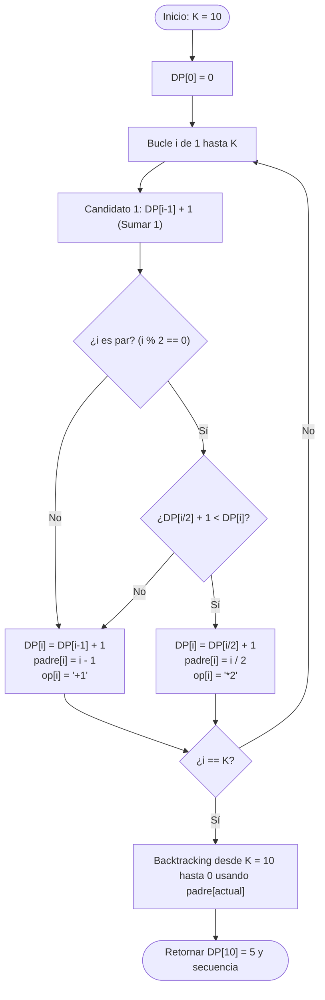
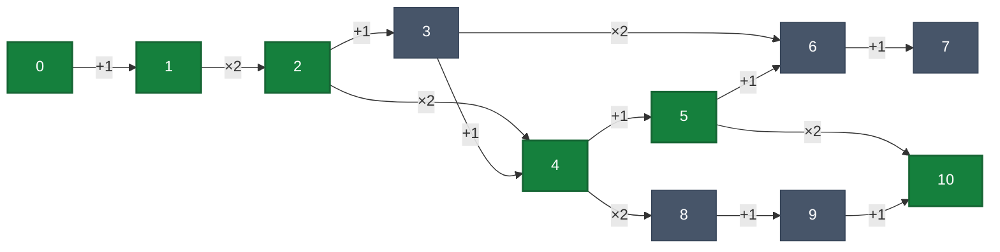

# Teoría de Algoritmos (FIUBA — TB024 / 75.29 / 95.06)
## Manual Práctico de Resolución de Parciales
### Edición Intensiva: "Salvando el Cuatrimestre"

---

## 1. Cómo usar esta guía

Este documento fue diseñado con un único objetivo en mente: **aprobar el parcial de Teoría de Algoritmos optimizando cada minuto de estudio**. No es un compendio enciclopédico de teoría ni una transcripción de diapositivas. Es un manual de ingeniería algorítmica para el examen, estructurado a partir del análisis riguroso de los parciales reales tomados por la cátedra (Curso Echevarría) en 2024 y 2025, cruzados con la guía práctica oficial.

### Planes de preparación según tu tiempo disponible

* **Plan de Emergencia (48 a 72 horas antes del examen):**
  1. Leé la **Sección 3: Guía mental para reconocer el ejercicio en 30 segundos**.
  2. Resolvé exclusivamente los ejercicios marcados como 🔴 **IMPRESCINDIBLE**.
  3. Memorizá el esquema de 4 pasos obligatorios para **Reducciones NP-Completas** (Sección 10).
  4. Revisá el **Catálogo de Errores Típicos** y la **Checklist antes de entrar al parcial**.
* **Plan Táctico (1 semana antes del examen):**
  1. Realizá el Plan de Emergencia completo.
  2. Sumá todos los ejercicios marcados como 🟡 **IMPORTANTE**.
  3. Escribí en papel (sin mirar la solución) el pseudocódigo de cada ejercicio de Programación Dinámica, Backtracking y Greedy.
  4. Resolvé los **Ejercicios Integradores Multi-Paradigma** (Sección 11, destacando **La Mochila — Ej 35** y **El Viajante TSP — Ej 36** en todos los paradigmas) y los **Ejercicios Tipo Parcial Generados** (Sección 12).
* **Plan Integral (2 o más semanas):**
  1. Recorré la guía completa incluyendo ejercicios 🟢 **COMPLEMENTARIO**.
  2. Implementá en tu computadora los algoritmos más sensibles (o revisá las implementaciones en Python de la carpeta `Practicas/`).
  3. Dominá las demostraciones formales de optimalidad por *Greedy Stays Ahead* y las recurrencias del Teorema Maestro.

### Reglas de oro para rendir el examen
1. **Cada ejercicio se entrega en hoja separada:** La cátedra exige entregar cada pregunta en una hoja individual. Planteá la solución de forma limpia, separando claramente: *Idea conceptual*, *Pseudocódigo*, *Justificación de optimalidad/reconstrucción*, y *Cálculo de complejidad temporal y espacial*.
2. **El pseudocódigo debe ser concreto:** No uses abstracciones vagas como `resolver_problema(grafo)`. Empleá estructuras de control estándar (`SI`, `PARA`, `MIENTRAS`, `RETORNAR`) y manipulá arreglos, matrices o listas explícitamente.
3. **No omitir casos borde:** Estructura vacía, un solo elemento, elementos repetidos, grafo disconexo o capacidades nulas restan puntos valiosos si no están cubiertos.
4. **La complejidad debe estar justificada:** Decir únicamente O(n²) sin explicar cuántas iteraciones hace cada bucle y qué costo tiene cada operación interna equivale a puntaje parcial.

---

## 2. Radiografía de los Parciales de TDA

Un examen típico de esta cátedra consta exactamente de **5 ejercicios prácticos** (20 puntos cada uno), distribuidos estratégicamente para evaluar si el alumno sabe elegir la herramienta adecuada para cada problema.

### Inventario de Parciales Reales Analizados

1. **Parcial 2024-2 — 1ª Oportunidad (5 de noviembre de 2024):**
   * *Ej 1 (Backtracking):* Teorema de los cuatro cuadrados de Lagrange (n = w² + x² + y² + z²).
   * *Ej 2 (Greedy):* Alan Turing y descifrado de código de submarinos por sustitución de palabras de 4 letras.
   * *Ej 3 (Programación Dinámica):* Mochila 2D de Paolo Casanova (peso y volumen) con restricción excluyente y obligatoria de guías de aves.
   * *Ej 4 (Programación Lineal):* Salidas de observación de aves con presupuesto de tiempo y máxima cobertura de especies.
   * *Ej 5 (Reducciones NP):* Demostrar que Cambio de Monedas no es más difícil que Subset Sum (≤_P).
2. **Parcial 2024-2 — 2ª Oportunidad (26 de noviembre de 2024):**
   * *Ej 1 (Backtracking / Exacto):* Vertex Cover Mínimo en grafo no dirigido con podas.
   * *Ej 2 (Programación Dinámica):* Mínima cantidad de operaciones para llegar de 0 a K sumando 1 o duplicando.
   * *Ej 3 (Greedy):* Mafioso Arnook en Ciudad República (Interval Scheduling en kilómetros de ruta costera).
   * *Ej 4 (Redes de Flujo):* Emparejamiento de médicos y pacientes con franjas horarias en hospital (Matching Bipartito).
   * *Ej 5 (Reducciones NP):* Demostrar que Dominating Set es NP-Completo reduciendo desde Vertex Cover.
3. **Parcial 2024-2 — 3ª Oportunidad / Recuperatorio (10 de diciembre de 2024):**
   * *Ej 1 (Redes de Flujo):* Análisis V/F con contraejemplo: "Si se suma 1 a la capacidad de cada arista, ¿el corte mínimo sigue siendo mínimo?".
   * *Ej 2 (Programación Dinámica):* Justificación de texto (Word Wrap / Knuth-Plass) minimizando la suma de cuadrados de sobrantes.
   * *Ej 3 (Programación Lineal):* Ubicación de antenas de celular en grilla para cubrir al menos el 70% de vecindarios con costo mínimo.
   * *Ej 4 (Greedy):* Antenas celulares con costos variables por celda mediante heurística voraz de cobertura.
   * *Ej 5 (Reducciones NP):* Dominating Set es NP-Completo (desde Vertex Cover).
4. **Parcial 2025-1 — 1ª Oportunidad (27 de mayo de 2025):**
   * *Ej 1 (Redes de Flujo):* Sistema energético argentino (9 regiones) con generación, demanda y capacidades de transporte vía Ford-Fulkerson.
   * *Ej 2 (Greedy):* Algoritmo voraz para el sistema energético y discusión de optimalidad.
   * *Ej 3 (Programación Lineal):* Modelo de Programación Lineal (Flujo de Costo Mínimo) para el sistema energético.
   * *Ej 4 (Programación Dinámica):* Problema del delivery (Mochila con peso, volumen y tope de seguro financiero).
   * *Ej 5 (Reducciones NP):* El dilema de Marco el cadete: Reducción de Ciclo Hamiltoniano a TSP de decisión.
5. **Parcial 2025-1 — 2ª Oportunidad (17 de junio de 2025):**
   * *Ej 1 (División y Conquista):* Multiplicación de matrices cuadradas n × n por bloques y Teorema Maestro.
   * *Ej 2 (Programación Dinámica):* Traslado de carga crítica INVAP (Ezeiza a Bariloche en etapas de ≤ 400 km/día con seguro).
   * *Ej 3 (Greedy):* Algoritmo voraz para el traslado INVAP y contraejemplo de por qué no es óptimo.
   * *Ej 4 (Backtracking):* Problema de las 8 Reinas con estructuras de datos para chequeo en O(1).
   * *Ej 5 (Programación Lineal):* Modelo de PL para el camino óptimo INVAP (o 8 Reinas) con recuento de variables y restricciones.

### Matriz de Frecuencia y Dificultad por Tema

| Tema / Paradigma | Frecuencia en Exámenes | Presencia Relativa | Dificultad Típica | Tipos de Pregunta Habituales |
| :--- | :---: | :---: | :---: | :--- |
| **Programación Dinámica (PD)** | 5 de 5 parciales | **100%** | Alta | Mochila multidimensional o con condiciones lógicas, secuencias/texto, mínimas operaciones, caminos en DAGs por etapas. |
| **Algoritmos Greedy (Voraces)** | 5 de 5 parciales | **100%** | Media-Alta | Interval Scheduling, heurísticas de cobertura con costos, comparación con soluciones óptimas y demostración de contraejemplos. |
| **Programación Lineal (PL / PLI)** | 4 de 5 parciales | **80%** | Media-Alta | Cobertura de conjuntos (Set Cover), Flujo de Costo Mínimo, caminos en grafos, linealización de funciones no lineales. Recuento de variables y restricciones. |
| **Reducciones Polinomiales / NP-C** | 4 de 5 parciales | **80%** | Muy Alta | Demostración formal de NP-Completitud (Dominating Set, TSP), reducciones numéricas (≤_P), verificadores polinomiales. |
| **Redes de Flujo (Flujo / Corte)** | 3 de 5 parciales | **60%** | Alta | Matching Bipartito (médicos/pacientes), transporte multipunto con super-fuente/sumidero, V/F teórico sobre cortes mínimos. |
| **Backtracking & Branch and Bound** | 3 de 5 parciales | **60%** | Media | 8 Reinas con estructuras O(1), descomposición numérica (Lagrange), Vertex Cover exacto con podas por factibilidad y cota. |
| **División y Conquista (DyC)** | 1 de 5 parciales | **20%** | Media | Multiplicación de matrices por bloques, Teorema Maestro, búsquedas binarias adaptadas sobre arreglos unimodales/pico. |

---

## 3. Guía Mental: "Cómo Reconocer el Ejercicio en 30 Segundos"

Uno de los errores más costosos en un parcial es intentar resolver con Greedy un problema que requiere Programación Dinámica, o plantear Programación Dinámica para un problema NP-Duro que pide Backtracking o Programación Lineal Entera. Utilizá este árbol de decisión rápido en el examen:

### Árbol de Decisión Rápido

```text
¿QUÉ PIDE EL ENUNCIADO?
│
├── 1. "Demostrar que el problema X es NP-Completo / no es más difícil que Y"
│     └── PARADIGMA: REDUCCIONES POLINOMIALES
│           └── Esquema de 4 pasos: Verificador en NP + Problema conocido A en NPC +
│               Transformación polinomial f(I_A) -> I_B + Demostración bidireccional (Ida y Vuelta).
│
├── 2. "Plantear un modelo matemático con variables y restricciones / Indicar cantidad de variables"
│     └── PARADIGMA: PROGRAMACIÓN LINEAL (PL / PLI)
│           └── Definir variables de decisión (binarias, enteras o continuas) +
│               Función Objetivo (Min / Max) + Restricciones lineales explícitas + Dominios.
│
├── 3. "Determinar emparejamiento máximo / asignar tareas a horarios / balancear oferta y demanda en red"
│     └── PARADIGMA: REDES DE FLUJO (FORD-FULKERSON / EDMONDS-KARP)
│           └── Modelar grafo dirigido con fuente 's' y sumidero 't'.
│               Definir capacidades en aristas. Verificar conservación y capacidad.
│
├── 4. "Optimizar (maximizar o minimizar) un valor numérico"
│     │
│     ├── ¿Las elecciones locales nunca comprometen el futuro y los subproblemas no tienen restricciones acopladas?
│     │     └── PARADIGMA: GREEDY (VORAZ)
│     │           └── Requiere: Criterio de ordenamiento voraz + Demostración (Greedy Stays Ahead / Intercambio)
│     │               O BIEN: Hallar contraejemplo si el enunciado pide analizar si es óptimo.
│     │
│     ├── ¿Hay superposición de subproblemas y una decisión actual afecta los recursos disponibles (capacidad, días)?
│     │     └── PARADIGMA: PROGRAMACIÓN DINÁMICA (PD)
│     │           └── Requiere: Definir Estado OPT(...) + Ecuación de recurrencia + Casos base +
│     │               Orden de llenado bottom-up + Algoritmo de reconstrucción.
│     │
│     └── ¿El problema es NP-Duro (ej. Vertex Cover, N-Reinas, Subset Sum exacto) y pide la solución exacta?
│           └── PARADIGMA: BACKTRACKING & BRANCH AND BOUND
│                 └── Requiere: Árbol de decisiones (inclusión/exclusión o asignación) +
│                     Poda por factibilidad en O(1) + Poda por cota superior/inferior.
│
└── 5. "Buscar un elemento en estructura ordenada/monótona o dividir en partes independientes de tamaño n/b"
      └── PARADIGMA: DIVISIÓN Y CONQUISTA (DyC)
            └── Requiere: Caso base + Partición en subproblemas disjuntos + Combinación + Teorema Maestro.
```

### Tabla de Señales y Disparadores Léxicos

| Si el enunciado menciona... | Señal clave | Paradigma sugerido | Estructura / Técnica |
| :--- | :--- | :--- | :--- |
| "Intervalos de tiempo", "pedidos no solapados", "deadlines" | Maximizar cantidad sin pesos | **Greedy** | Ordenar por tiempo de finalización más temprano (f_i). |
| "Intervalos con pesos o beneficios", "Juan el Vago" | Decisión sobre días/turnos adyacentes | **Programación Dinámica** | OPT(i) = max(OPT(i-1), OPT(p(i)) + v_i). |
| "Mochila con peso y volumen", "delivery", "límite de seguro" | Recursos múltiples acoplados | **Programación Dinámica** | Matriz 2D/3D: OPT(i, w, v, m). |
| "Ubicar antenas en celdas", "visitar lugares para ver especies" | Cobertura de conjuntos (Set Cover) | **Programación Lineal (PLI)** | Variables binarias x_i ∈ {0, 1}, restricciones x_i ≤ ∑ y_j. |
| "Médicos y turnos", "estudiantes y cupos", "red de cañerías" | Capacidad unitaria o integral de transporte | **Redes de Flujo** | Super-fuente s, super-sumidero t, Ford-Fulkerson. |
| "Tablero", "ubicar piezas sin ataques", "4 cuadrados que sumen n" | Espacio de búsqueda combinatorio | **Backtracking** | Recursión con estructuras booleanas de poda en O(1). |
| "Demostrar que X es NP-Completo", "compró software para Y" | Relación de dificultad de problemas | **Reducciones NP** | Reducción de Karp A ≤_P B con demostración en 4 pasos. |


---

## 4. Tema 1: División y Conquista (DyC)

### Conceptos Mínimos de Supervivencia

1. **Definición del Paradigma:**
   Un algoritmo de División y Conquista divide un problema de tamaño n en a subproblemas independientes de tamaño n/b, resuelve cada subproblema recursivamente (conquista), y luego combina sus soluciones con un costo f(n) (combinación).
2. **Teorema Maestro (Master Theorem):**
   Para recurrencias de la forma:
   > **T(n) = a · T(n/b) + O(nᶜ)**
   
   con a ≥ 1, b > 1, c ≥ 0:
   * **Caso 1 (Dominio de Hojas):** Si log_b a > c ⟹ T(n) = O(n^(log_b a)). El costo está concentrado en las hojas del árbol de recursión.
   * **Caso 2 (Balance Equitativo):** Si log_b a = c ⟹ T(n) = O(nᶜ log n). Cada nivel del árbol recursivo aporta la misma cantidad de trabajo.
   * **Caso 3 (Dominio de la Raíz):** Si log_b a < c ⟹ T(n) = O(nᶜ) (sujeto a la condición de regularidad a · f(n/b) ≤ k · f(n) con k < 1). El costo de combinar en la raíz domina todo el proceso.
3. **Requisitos de Factibilidad:**
   * Los subproblemas deben ser **estrictamente disjuntos** (sin superposición; si hay superposición, corresponde Programación Dinámica).
   * La reducción del tamaño debe ser multiplicativa (n/b), no sustractiva (n - 1). Si es sustractiva (T(n) = T(n - 1) + O(1)), no aplica Teorema Maestro y la complejidad es lineal o cuadrática.

---

### Patrón de Ejercicio 1.1: Álgebra Matricial y Partición en Bloques

En los parciales aparece el requerimiento de formular algoritmos multiplicativos dividiendo estructuras bidimensionales en cuadrantes y deduciendo la complejidad formal con el Teorema Maestro.

---

### Ejercicio 1 — Multiplicación de Matrices Cuadradas por Bloques

**Clasificación:** 🔴 IMPRESCINDIBLE  
**Origen:** Parcial 2025-1-2 (17 de junio de 2025), Ejercicio 1

**Enunciado**  
Realizar un algoritmo que resuelva la multiplicación de dos matrices cuadradas de orden n (A y B) mediante división y conquista. Recordemos la definición: C = A × B donde C_ij = ∑(k=1..n) A_ik · B_kj para todo i, j ∈ {1, ..., n}. Para simplificar el algoritmo se puede suponer que n es una potencia de 2. Indicar y justificar el orden de complejidad del algoritmo.

**Qué está evaluando**  
Partición de matrices en 4 bloques de orden n/2, formulación de las llamadas recursivas de multiplicación, suma de matrices en la etapa de combinación, y aplicación rigurosa del Teorema Maestro.

**Idea de resolución**  
1. Si n = 1, multiplicamos los dos escalares directamente en O(1).
2. Si n > 1, dividimos cada matriz A y B en 4 submatrices cuadradas de tamaño n/2 × n/2:
   ```text
   A = [ A11  A12 ]        B = [ B11  B12 ]
       [ A21  A22 ]            [ B21  B22 ]
   ```
3. Los bloques resultantes de C = A × B se calculan como:
   * C11 = A11 · B11 + A12 · B21
   * C12 = A11 · B12 + A12 · B22
   * C21 = A21 · B11 + A22 · B21
   * C22 = A21 · B12 + A22 · B22
4. Esto requiere 8 multiplicaciones de matrices de tamaño n/2 y 4 sumas matriciales de tamaño n/2. Sumar dos matrices de n/2 × n/2 toma O(n²) operaciones.

**Pseudocódigo**

```text
FUNCION MultiplicarMatricesDyC(A, B, n):
    // Caso base: matriz de 1x1
    SI n = 1:
        INICIALIZAR C como matriz de 1x1
        C[0][0] <- A[0][0] * B[0][0]
        RETORNAR C

    // División en submatrices de orden n/2
    m <- n / 2
    INICIALIZAR A11, A12, A21, A22 como matrices de m x m
    INICIALIZAR B11, B12, B21, B22 como matrices de m x m

    PARA i <- 0 HASTA m - 1:
        PARA j <- 0 HASTA m - 1:
            A11[i][j] <- A[i][j]
            A12[i][j] <- A[i][j + m]
            A21[i][j] <- A[i + m][j]
            A22[i][j] <- A[i + m][j + m]

            B11[i][j] <- B[i][j]
            B12[i][j] <- B[i][j + m]
            B21[i][j] <- B[i + m][j]
            B22[i][j] <- B[i + m][j + m]

    // 8 llamadas recursivas para los productos
    M1 <- MultiplicarMatricesDyC(A11, B11, m)
    M2 <- MultiplicarMatricesDyC(A12, B21, m)
    M3 <- MultiplicarMatricesDyC(A11, B12, m)
    M4 <- MultiplicarMatricesDyC(A12, B22, m)
    M5 <- MultiplicarMatricesDyC(A21, B11, m)
    M6 <- MultiplicarMatricesDyC(A22, B21, m)
    M7 <- MultiplicarMatricesDyC(A21, B12, m)
    M8 <- MultiplicarMatricesDyC(A22, B22, m)

    // Combinación mediante 4 sumas de matrices
    C11 <- SumarMatrices(M1, M2, m)
    C12 <- SumarMatrices(M3, M4, m)
    C21 <- SumarMatrices(M5, M6, m)
    C22 <- SumarMatrices(M7, M8, m)

    // Ensamblado de la matriz final C de n x n
    INICIALIZAR C como matriz de n x n
    PARA i <- 0 HASTA m - 1:
        PARA j <- 0 HASTA m - 1:
            C[i][j]         <- C11[i][j]
            C[i][j + m]     <- C12[i][j]
            C[i + m][j]     <- C21[i][j]
            C[i + m][j + m] <- C22[i][j]

    RETORNAR C

FUNCION SumarMatrices(X, Y, m):
    INICIALIZAR R como matriz de m x m
    PARA i <- 0 HASTA m - 1:
        PARA j <- 0 HASTA m - 1:
            R[i][j] <- X[i][j] + Y[i][j]
    RETORNAR R
```

**Explicación del algoritmo**  
El algoritmo parte las matrices en 4 cuadrantes. La partición y el copiado de submatrices toman O(n²). Luego se disparan 8 llamadas recursivas con submatrices de tamaño n/2. Finalmente, las sumas de bloques y el ensamblado en la matriz C toman 4 × O((n/2)²) = O(n²).

**Complejidad**  
* **Tiempo:** La ecuación de recurrencia es:
  > T(n) = 8 · T(n/2) + O(n²)
  
  Aplicando el Teorema Maestro con a = 8, b = 2, c = 2:
  log_b a = log₂ 8 = 3.
  Como log_b a = 3 > 2 = c, estamos en el **Caso 1 (domina la recursión)**:
  > T(n) = O(n^(log₂ 8)) = O(n³)
* **Espacio:** En cada nivel se crean submatrices por un total de O(n²). La profundidad del árbol es log₂ n. Con paso por copia el espacio total es O(n²). Si se usan punteros o índices sobre la matriz original sin copiar, el espacio auxiliar de la pila recursiva es O(log n).

**Puntos donde puedo equivocarme**  
* Pensar que la división y conquista ingenua mejora a O(n²). No lo hace sin el truco algebraico de Strassen (a = 7), que logra O(n^(log₂ 7)) ≈ O(n^2.81).
* Olvidar sumar las parejas de matrices resultantes de las llamadas recursivas.
* Confundir los índices de los bloques (por ejemplo, hacer A12 × B12 en lugar de A12 × B21).

**Variación típica de parcial**  
Pedir que se explique cómo el algoritmo de Strassen reduce la cantidad de multiplicaciones de 8 a 7 mediante combinaciones lineales inteligentes, derivando en T(n) = 7 · T(n/2) + O(n²) ⟹ O(n^2.807).

---

### Patrón de Ejercicio 1.2: Búsqueda Binaria sobre Propiedades Monótonas

Se busca un elemento o punto crítico en arreglos que no están completamente ordenados pero que presentan una propiedad monótona o un cambio de tendencia detectable en tiempo O(log n).

---

### Ejercicio 2 — Elemento Pico en un Arreglo Unimodal

**Clasificación:** 🟡 IMPORTANTE  
**Origen:** Guía de Ejercicios 01, Ejercicio 4

**Enunciado**  
Dado un arreglo A de n enteros distintos donde no hay dos elementos adyacentes iguales, un elemento A[i] se define como "pico" si es estrictamente mayor que sus vecinos existentes (es decir, A[i] > A[i-1] y A[i] > A[i+1], considerando los extremos con un único vecino). Diseñar un algoritmo por División y Conquista que encuentre un elemento pico en tiempo O(log n).

**Qué está evaluando**  
Descarte de mitades en tiempo logarítmico aprovechando la dirección de la pendiente local, sin necesidad de que el arreglo completo esté ordenado.

**Idea de resolución**  
1. Calculamos el índice medio m = ⌊(ini + fin) / 2⌋.
2. Comparamos A[m] con su vecino derecho A[m+1]:
   * Si A[m] < A[m+1], la secuencia está subiendo hacia la derecha. Por lo tanto, **garantizadamente existe al menos un pico en la mitad derecha** [m+1, fin].
   * Si A[m] > A[m+1], la secuencia está bajando hacia la derecha (o subiendo hacia la izquierda). Por lo tanto, **garantizadamente existe un pico en la mitad izquierda** [ini, m] (el propio m podría ser el pico).
3. Reducimos el espacio de búsqueda a la mitad en cada paso.

**Pseudocódigo**

```text
FUNCION EncontrarPico(A):
    SI longitud(A) = 0:
        RETORNAR -1
    RETORNAR EncontrarPicoRec(A, 0, longitud(A) - 1)

FUNCION EncontrarPicoRec(A, ini, fin):
    // Caso base: rango de un único elemento
    SI ini = fin:
        RETORNAR ini

    m <- (ini + fin) / 2

    // Si la pendiente sube hacia la derecha, el pico está a la derecha
    SI A[m] < A[m + 1]:
        RETORNAR EncontrarPicoRec(A, m + 1, fin)
    SINO:
        // La pendiente baja hacia la derecha, el pico está en m o a la izquierda
        RETORNAR EncontrarPicoRec(A, ini, m)
```

**Explicación del algoritmo**  
El algoritmo inspecciona dos elementos centrales contiguos (m y m+1). Como todos los elementos adyacentes son distintos, siempre hay una dirección de ascenso. Seguir la pendiente ascendente asegura chocar contra un pico local o alcanzar el extremo del arreglo, el cual actúa como pico.

**Complejidad**  
* **Tiempo:** T(n) = 1 · T(n/2) + O(1). Con a = 1, b = 2, c = 0:
  log_b a = log₂ 1 = 0 = c ⟹ T(n) = O(n⁰ log n) = O(log n).
* **Espacio adicional:** O(log n) de memoria en la pila de llamadas recursivas (u O(1) si se formula con un bucle MIENTRAS).

**Puntos donde puedo equivocarme**  
* Llamar a la recursión izquierda con `m - 1`. Si A[m] > A[m+1], A[m] podría ser el pico; si descartamos m, perdemos la solución. Por eso la llamada debe ser `[ini, m]`.
* Acceder a `A[m+1]` cuando ini = fin (desbordamiento de índice). El caso base `ini = fin` previene esto porque con ini < fin, m < fin, asegurando que m + 1 ≤ fin.

**Variación típica de parcial**  
Buscar un pico en una matriz de n × n en tiempo O(n log n) o O(n) (buscar el máximo de la columna central y verificar sus vecinos izquierdo y derecho).

---

### Ejercicio 3 — Búsqueda del Primer Cero en un Arreglo de Unos y Ceros

**Clasificación:** 🔴 IMPRESCINDIBLE  
**Origen:** Guía de Ejercicios 01, Ejercicio 2 / Práctica

**Enunciado**  
Se tiene un arreglo A de n elementos compuesto exclusivamente por números 1 seguidos por números 0 (es decir, de la forma [1, 1, ..., 1, 0, 0, ..., 0]). Puede ocurrir que todos sean 1 o todos sean 0. Implementar un algoritmo por División y Conquista que determine la posición del primer 0 en tiempo O(log n).

**Qué está evaluando**  
Búsqueda binaria modificada para encontrar el primer elemento que satisface una condición de borde sin recorrer linealmente los repetidos.

**Idea de resolución**  
1. Si en la posición media m hay un 1, el primer cero debe estar estrictamente a la derecha (m + 1 ... fin).
2. Si en la posición media m hay un 0, este podría ser el primer cero, o bien el primer cero ocurrió antes (ini ... m).
3. Condición de corte directo: Si A[m] = 0 y (m = 0 o A[m-1] = 1), encontramos exactamente el primer 0.

**Pseudocódigo**

```text
FUNCION BuscarPrimerCero(A):
    SI longitud(A) = 0:
        RETORNAR -1
    RETORNAR BuscarPrimerCeroRec(A, 0, longitud(A) - 1)

FUNCION BuscarPrimerCeroRec(A, ini, fin):
    SI ini > fin:
        RETORNAR -1 // No hay ceros en el arreglo

    m <- (ini + fin) / 2

    SI A[m] = 0:
        // Verificamos si es el primer cero absoluto
        SI m = 0 O A[m - 1] = 1:
            RETORNAR m
        SINO:
            // Hay más ceros a la izquierda
            RETORNAR BuscarPrimerCeroRec(A, ini, m - 1)
    SINO:
        // A[m] es 1, el primer cero debe estar a la derecha
        RETORNAR BuscarPrimerCeroRec(A, m + 1, fin)
```

**Explicación del algoritmo**  
En cada paso se evalúa el elemento central. Si es 1, se descarta toda la mitad izquierda junto con la posición central. Si es 0, se chequea si es el primer cero mirando el elemento anterior. Si no lo es, se explora recursivamente hacia la izquierda.

**Complejidad**  
* **Tiempo:** En cada llamada se divide el espacio de búsqueda exactamente por 2 y se realizan comparaciones O(1). T(n) = T(n/2) + O(1) ⟹ O(log n).
* **Espacio adicional:** O(log n) por la pila recursiva (O(1) si es iterativo).

**Puntos donde puedo equivocarme**  
* No chequear si m = 0 antes de acceder a A[m-1], lo que provoca un error de índice fuera de rango.
* Si no hay ceros en todo el arreglo, caer en un ciclo infinito en lugar de devolver -1.

**Variación típica de parcial**  
* Encontrar el punto fijo en un arreglo ordenado tal que A[i] = i.
* Determinar la raíz de una función monótona continua aplicando el teorema de Bolzano por bisección.

---

### Errores Frecuentes en Exámenes sobre División y Conquista

1. **Olvidar el Caso Base:** Omitir la condición de parada cuando n = 1 o ini ≥ fin, provocando recursión infinita en la traza.
2. **Calcular erróneamente los parámetros del Teorema Maestro:** Confundir a (cantidad de subproblemas) con b (factor de reducción del tamaño). Ejemplo clásico: en multiplicación de matrices, poner a = 4 en lugar de a = 8.
3. **No justificar el costo de combinación f(n):** Poner directamente O(n²) sin detallar que proviene de recorrer las submatrices sumando elemento a elemento.
4. **Dividir en subproblemas no balanceados:** Si la división reduce el tamaño a n - 1 (como Quicksort en el peor caso), no se puede aplicar el Teorema Maestro básico; se debe resolver mediante sumatoria telescópica.


---

## 5. Tema 2: Algoritmos Greedy (Voraces)

### Conceptos Mínimos de Supervivencia

1. **Naturaleza de un Algoritmo Greedy:**
   En cada paso, toma la decisión que parece mejor en ese momento específico (óptimo local) bajo una regla de selección fija, sin mirar atrás ni reconsiderar elecciones previas (elección irrevocable).
2. **Propiedad de la Elección Voraz y Subestructura Óptima:**
   Para que un algoritmo greedy sea **óptimo**, debe cumplirse que:
   * Una elección voraz inicial conduce a una solución globalmente óptima (propiedad de elección voraz).
   * La solución óptima del problema global contiene dentro de sí soluciones óptimas a los subproblemas resultantes (subestructura óptima).
3. **Las Dos Técnicas Canónicas de Demostración de Optimalidad:**
   * **Greedy Stays Ahead ("El voraz se mantiene adelante"):** Se define una métrica de progreso m(i). Se demuestra por inducción que en cada paso k, la solución voraz aventaja o iguala a cualquier solución óptima OPT (m(G_k) ≤ m(OPT_k) o m(G_k) ≥ m(OPT_k)), garantizando que al finalizar no puede ser superada.
   * **Argumento de Intercambio (Exchange Argument):** Se toma una solución óptima hipotética OPT que difiere de la solución greedy G. Se identifica la primera inversión o discrepancia y se demuestra que al intercambiar el elemento de OPT por el elemento elegido por G, la calidad de la solución no empeora. Repitiendo el proceso, OPT se transforma en G sin perder valor, probando que G también es óptima.
4. **Cómo Probar que una Idea Greedy es Incorrecta (El Contraejemplo):**
   Si en un examen te preguntan *"¿El algoritmo greedy propuesto es óptimo siempre? Indicar si es óptimo o dar un contraejemplo"*, **NUNCA** respondas con explicaciones vagas. Debes presentar un contraejemplo concreto:
   1. Definir una instancia pequeña con datos numéricos explícitos.
   2. Mostrar paso a paso qué elige el algoritmo greedy y cuál es su costo/beneficio obtenido.
   3. Mostrar una solución alternativa factible y su costo/beneficio estrictamente superior.
   4. Concluir formalmente: *Como Valor(Alternativa) > Valor(Greedy), el algoritmo no garantiza la solución óptima.*

---

### Patrón de Ejercicio 2.1: Interval Scheduling (Planificación de Intervalos No Solapados)

Aparece con diferentes metáforas narrativas: charlas en un aula, pedidos de mafias locales para controlar kilómetros de una ruta, franjas horarias de satélites o turnos de guardias. El objetivo es maximizar la cantidad de pedidos aceptados sin solapamiento.

---

### Ejercicio 4 — Concesión de Permisos a Mafias en la Ruta Costera (Arnook)

**Clasificación:** 🔴 IMPRESCINDIBLE  
**Origen:** Parcial 2024-2-2 (26 de noviembre de 2024), Ejercicio 3 / Guía 02 Ejercicio 12

**Enunciado**  
Trabajamos para el mafioso Arnook, quien organiza los pedidos de pequeñas mafias locales por el control de diferentes kilómetros de la ruta costera de Ciudad República. Cada mafia le pide control sobre un rango de kilómetros [s_i, f_i] (por ejemplo, del kilómetro 1 al 5, del 3 al 8, etc.). Si una mafia toma control de un kilómetro, ninguna otra puede ocupar ese mismo tramo (no pueden solaparse). Arnook cobra una tarifa fija por otorgar el permiso, independientemente de los kilómetros pedidos, por lo que su objetivo es maximizar la cantidad total de permisos otorgados sin conflictos de territorio.  
1. Implementar un algoritmo Greedy que determine a qué mafias otorgar el permiso.  
2. Indicar y justificar la complejidad temporal y espacial.  
3. Justificar por qué el algoritmo planteado es Greedy.  
4. ¿El algoritmo da la solución óptima siempre? Demostrarlo formalmente.

**Qué está evaluando**  
Comprensión del arquetipo de *Interval Scheduling*, diseño del criterio voraz correcto (ordenamiento por punto final más temprano), y la demostración formal de optimalidad vía *Greedy Stays Ahead*.

**Idea de resolución**  
* ¿Por qué descartar otros criterios?
  * *Ordenar por inicio más temprano (s_i):* Falla si un pedido empieza muy temprano y ocupa toda la ruta ([1, 100] vs [2, 3] y [4, 5]).
  * *Ordenar por menor longitud (f_i - s_i):* Falla si un pedido corto bloquea a dos pedidos compatibles a sus costados ([10, 20], [19, 21], [20, 30]).
* *Criterio óptimo:* Ordenar las solicitudes por su **kilómetro de finalización más temprano (f_i)**. Esto deja libre la mayor cantidad de ruta posible hacia adelante para futuras mafias.
* Seleccionamos el primer pedido que termine más temprano. Luego, iteramos seleccionando el próximo pedido cuyo inicio s_j sea mayor o igual al fin del último pedido aceptado (s_j ≥ f_ultimo).

**Pseudocódigo**

```text
FUNCION ConcederPermisosMafias(pedidos):
    SI longitud(pedidos) = 0:
        RETORNAR lista vacía

    // 1. Ordenar por fin ascendente: pedidos[i].fin
    ORDENAR pedidos POR fin ASCENDENTE

    INICIALIZAR seleccionados como lista vacía
    INSERTAR pedidos[0] EN seleccionados
    ultimo_fin <- pedidos[0].fin

    // 2. Selección voraz de intervalos compatibles
    PARA i <- 1 HASTA longitud(pedidos) - 1:
        SI pedidos[i].inicio >= ultimo_fin:
            INSERTAR pedidos[i] EN seleccionados
            ultimo_fin <- pedidos[i].fin

    RETORNAR seleccionados
```

**Explicación del algoritmo**  
El algoritmo clasifica las solicitudes de menor a mayor según el kilómetro en el que terminan. Al aceptar siempre la que termina antes y es compatible con las ya otorgadas, se minimiza el territorio retenido en cada decisión.

**Complejidad**  
* **Tiempo:** Ordenar n solicitudes requiere O(n log n) mediante Mergesort o Heapsort. El recorrido lineal posterior realiza una comparación O(1) por elemento en O(n). Por lo tanto, la complejidad temporal total es:
  > **O(n log n)**
* **Espacio:** O(n) para almacenar los pedidos seleccionados (o memoria auxiliar de ordenamiento).

**Justificación de por qué es Greedy**  
Es un algoritmo voraz porque:
1. En cada paso toma una decisión basada en una regla miope de optimización local (elegir el intervalo compatible que termine antes).
2. La decisión es **irrevocable**: una vez que un permiso es otorgado, nunca se retira ni se reconsidera a la luz de los pedidos futuros.

**Demostración de Optimalidad (Greedy Stays Ahead)**  
* Sean G = {g_1, g_2, ..., g_k} los intervalos seleccionados por el algoritmo voraz ordenados por fin, y OPT = {o_1, o_2, ..., o_m} los intervalos de una solución óptima arbitraria también ordenados por fin, con m ≥ k.
* **Proposición inductiva:** Para todo r ≤ k, el tiempo de fin del r-ésimo elemento voraz es menor o igual al del r-ésimo elemento óptimo:
  > **f(g_r) ≤ f(o_r)**
* **Caso Base (r = 1):** El algoritmo voraz elige el intervalo con el menor tiempo de fin absoluto en todo el conjunto. Por lo tanto, f(g_1) ≤ f(o_1).
* **Paso Inductivo:** Asumimos f(g_{r-1}) ≤ f(o_{r-1}). Como o_r es compatible con o_{r-1}, sabemos que s(o_r) ≥ f(o_{r-1}). Por hipótesis inductiva:
  > s(o_r) ≥ f(o_{r-1}) ≥ f(g_{r-1})
  
  Esto prueba que o_r era una opción válida y compatible para el algoritmo voraz al buscar su r-ésimo elemento. Dado que el algoritmo voraz selecciona el que tiene el menor tiempo de fin entre todos los compatibles disponibles, necesariamente:
  > f(g_r) ≤ f(o_r)
* **Conclusión:** Si la solución óptima tuviera más elementos que el voraz (m > k), existiría un elemento o_{k+1} en OPT. Por la propiedad anterior, s(o_{k+1}) ≥ f(o_k) ≥ f(g_k), lo cual significa que o_{k+1} era compatible con g_k. Pero el algoritmo voraz terminó en g_k porque ya no quedaba ningún intervalo compatible. Contradicción. Por lo tanto, k = m y la solución voraz es **óptima**.

**Puntos donde puedo equivocarme**  
* Permitir solapamiento estricto si dos intervalos comparten un borde (chequear si el enunciado dice s_j ≥ f_i o s_j > f_i).
* Ordenar por tiempo de inicio o por duración, los cuales no son óptimos.

**Variación típica de parcial**  
* *Interval Scheduling Ponderado:* Cada intervalo tiene un valor o peso v_i. En este caso, **Greedy NO funciona** y se debe resolver con Programación Dinámica (ver Ejercicio 18).
* *Interval Partitioning:* Se pide determinar la cantidad mínima de salas/recursos necesarios para programar todas las charlas sin solapamiento (se resuelve ordenando por inicio y usando una cola de prioridad).

---

### Patrón de Ejercicio 2.2: Mochila Fraccionaria vs 0-1 con Garantía de Calidad 1/2

En las evaluaciones teóricas y en los TPs de la cátedra se examina la relación entre la solución fraccionaria (óptima con greedy) y la versión entera 0-1, demostrando cómo una regla greedy corregida otorga una cota de aproximación constante.

---

### Ejercicio 5 — Mochila 0-1 con Garantía de Aproximación 1/2

**Clasificación:** 🔴 IMPRESCINDIBLE  
**Origen:** Guía de Ejercicios 02, Ejercicio 8 / Diapositivas Explicativas de Cátedra

**Enunciado**  
Se tiene una mochila de capacidad de peso W y n objetos indivisibles (0-1), donde cada objeto i tiene peso w_i y valor v_i.  
1. Explicar por qué la regla voraz estándar basada en ordenar por densidad de valor (v_i / w_i) puede fallar de forma arbitraria en la mochila 0-1.  
2. Diseñar un algoritmo greedy modificado que garantice una calidad de al menos 1/2 respecto a la solución óptima global.  
3. Demostrar formalmente que Sol / OPT > 1/2.  
4. Indicar la complejidad temporal del algoritmo.

**Qué está evaluando**  
Capacidad de analizar por qué un algoritmo voraz falla, cómo corregirlo mediante la detección del *elemento crítico*, y el cálculo de factores de aproximación comparando contra la relajación continua.

**Idea de resolución**  
1. Descartamos elementos que individualmente pesen más que W.
2. Ordenamos por ratio r_i = v_i / w_i descendente.
3. Llenamos vorazmente. El primer objeto que no entra lo denominamos **Elemento Crítico (c)** con peso w_c y valor v_c.
4. La solución voraz acumulada tiene valor P_1.
5. Comparamos P_1 contra el elemento crítico en solitario v_c. Devolvemos max(P_1, v_c).

**Pseudocódigo**

```text
FUNCION MochilaGreedyConGarantia(objetos, W):
    INICIALIZAR candidatos como lista vacía

    // 1. Filtrar objetos que no entran por sí solos
    PARA CADA obj EN objetos:
        SI obj.peso <= W:
            INSERTAR obj EN candidatos

    SI longitud(candidatos) = 0:
        RETORNAR (0, lista vacía)

    // 2. Ordenar por densidad valor/peso descendente
    ORDENAR candidatos POR (valor / peso) DESCENDENTE

    INICIALIZAR solucion_greedy como lista vacía
    peso_acumulado <- 0
    valor_acumulado <- 0
    elemento_critico <- NULO

    // 3. Llenado voraz e identificación del elemento crítico
    PARA CADA obj EN candidatos:
        SI peso_acumulado + obj.peso <= W:
            INSERTAR obj EN solucion_greedy
            peso_acumulado <- peso_acumulado + obj.peso
            valor_acumulado <- valor_acumulado + obj.valor
        SINO:
            SI elemento_critico = NULO:
                elemento_critico <- obj

    // 4. Aplicación de la cota 1/2
    SI elemento_critico != NULO Y elemento_critico.valor > valor_acumulado:
        INICIALIZAR sol_critica como lista con elemento_critico
        RETORNAR (elemento_critico.valor, sol_critica)

    RETORNAR (valor_acumulado, solucion_greedy)
```

**Explicación del algoritmo**  
La debilidad de la densidad v_i / w_i es que puede tomar objetos muy densos pero diminutos, dejando capacidad insuficiente para un objeto pesado que vale mucho más. Al comparar la solución greedy acumulada contra el valor del primer objeto rechazado (v_c), nos cubrimos de ese peor caso.

**Demostración Formal de la Cota 1/2**  
1. Sea OPT el valor de la solución óptima del problema entero 0-1.
2. Sea OPT_frac el valor de la solución óptima fraccionaria. Es inmediato que OPT ≤ OPT_frac.
3. La solución fraccionaria óptima toma exactamente los elementos de la solución greedy entera (P_1) más una fracción α ∈ [0, 1) del elemento crítico c:
   > OPT_frac = P_1 + α · v_c < P_1 + v_c
4. Por transitividad: OPT < P_1 + v_c.
5. Nuestro algoritmo devuelve Sol = max(P_1, v_c). Por propiedad del promedio aritmético:
   > max(P_1, v_c) ≥ (P_1 + v_c) / 2
6. Sustituyendo la cota de OPT:
   > Sol ≥ (P_1 + v_c) / 2 > OPT / 2  ⟹  Sol / OPT > 1/2

**Complejidad**  
* **Tiempo:** Filtrado en O(n), ordenamiento de n elementos en O(n log n), recorrido voraz en O(n). Total: O(n log n).
* **Espacio adicional:** O(n) para almacenar la lista de candidatos y la solución seleccionada.

**Puntos donde puedo equivocarme**  
* No descartar previamente los elementos con w_i > W. Si el elemento crítico pesa más que W, no puede incluirse en solitario.

**Variación típica de parcial**  
Preguntar por qué la mochila fraccionaria sí es óptima con greedy y la 0-1 requiere Programación Dinámica (subestructura óptima con superposición vs subproblemas fraccionarios independientes).

---

### Patrón de Ejercicio 2.3: Minimización de Latencia y Deadlines (EDF)

Se tienen tareas con tiempos de procesamiento y fechas límite de entrega (deadlines). El objetivo es ordenar las tareas para minimizar la latencia máxima que experimenta cualquier tarea.

---

### Ejercicio 6 — Minimización de Latencia Máxima (Earliest Deadline First)

**Clasificación:** 🟡 IMPORTANTE  
**Origen:** Guía de Ejercicios 02, Ejercicio 9 / Práctica

**Enunciado**  
Se tienen n tareas que deben procesarse secuencialmente en una única máquina. Cada tarea i tiene una duración t_i y una fecha límite de entrega d_i. Si una tarea comienza en el tiempo s_i, finaliza en f_i = s_i + t_i. La latencia de la tarea i se define como L_i = max(0, f_i - d_i). Diseñar un algoritmo greedy que programe las tareas minimizando la latencia máxima L_max = max_i L_i. Demostrar su optimalidad.

**Qué está evaluando**  
Técnica de ordenamiento por fecha de vencimiento más temprana (*Earliest Deadline First*) y demostración por argumento de intercambio de inversiones adyacentes.

**Idea de resolución**  
* ¿Por qué otros criterios fallan?
  * *Menor duración primero (t_i):* Ignora fechas límites urgentes.
  * *Menor holgura (d_i - t_i):* Falla si una tarea corta tiene menor holgura pero fecha límite lejana y bloquea una urgente.
* *Criterio óptimo (EDF):* Ordenar las tareas en orden creciente de sus fechas límites: d_1 ≤ d_2 ≤ ... ≤ d_n.
* No dejar tiempo ocioso en la máquina entre tareas consecutivas.

**Pseudocódigo**

```text
FUNCION MinimizarLatenciaMaxima(tareas):
    // Cada tarea tiene id, duracion, deadline
    ORDENAR tareas POR deadline ASCENDENTE

    tiempo_actual <- 0
    latencia_maxima <- 0
    INICIALIZAR programacion como lista vacía

    PARA CADA tarea EN tareas:
        inicio <- tiempo_actual
        fin <- tiempo_actual + tarea.duracion
        latencia <- maximo(0, fin - tarea.deadline)

        SI latencia > latencia_maxima:
            latencia_maxima <- latencia

        INSERTAR (tarea.id, inicio, fin, latencia) EN programacion
        tiempo_actual <- fin

    RETORNAR (latencia_maxima, programacion)
```

**Explicación del algoritmo**  
Al atender siempre la tarea cuyo vencimiento está más próximo, se previene que las fechas límites inminentes acumulen retrasos catastróficos causados por tareas menos urgentes.

**Demostración de Optimalidad (Argumento de Intercambio)**  
1. Decimos que una programación tiene una **inversión** si existe un par de tareas adyacentes i seguida inmediatamente por j tal que d_i > d_j (la tarea i vence más tarde que j, pero se ejecuta antes).
2. La solución greedy por definición no tiene inversiones.
3. Sea OPT una solución óptima sin tiempo ocioso con la menor cantidad de inversiones. Si OPT tiene cero inversiones, coincide con la programación greedy.
4. Si OPT tiene al menos una inversión, deben existir dos tareas contiguas invertidas i y j con d_i > d_j.
5. Al intercambiar i y j en el cronograma:
   * Las tareas distintas de i y j no modifican sus tiempos de inicio ni fin, por lo que sus latencias no cambian.
   * La tarea j se adelanta, por lo que su latencia estrictamente no aumenta.
   * La nueva latencia de i finaliza en el mismo tiempo que antes finalizaba j. Como d_i > d_j, su latencia nueva es menor que la latencia previa que tenía j.
6. Por lo tanto, la latencia máxima tras el intercambio no aumentó. Esto reduce la cantidad de inversiones sin empeorar la solución óptima. Repitiendo el proceso se llega a la solución greedy, probando que es **óptima**.

**Complejidad**  
* **Tiempo:** O(n log n) por el ordenamiento inicial y O(n) en el barrido temporal. Total: O(n log n).
* **Espacio adicional:** O(n) para almacenar el cronograma resultante.

**Puntos donde puedo equivocarme**  
* Dejar huecos ociosos entre tareas. Una programación con tiempo ocioso siempre puede comprimirse hacia la izquierda sin aumentar la latencia.

**Variación típica de parcial**  
Considerar que las tareas tienen tiempos de arribo r_i diferentes. En este caso el problema se vuelve NP-Duro y EDF simple no garantiza el óptimo.

---

### Patrón de Ejercicio 2.4: Heurísticas Voraces de Cobertura (Set Cover Greedy)

Aparece cuando el problema exacto es NP-Hard (como Set Cover o Dominating Set) y el enunciado solicita explícitamente: *"El personal no conoce programación lineal, diseñar un algoritmo greedy..."*.

---

### Ejercicio 7 — Ubicación Voraz de Antenas Celulares con Costo por Vecindario

**Clasificación:** 🔴 IMPRESCINDIBLE  
**Origen:** Parcial 2024-2-3 (10 de diciembre de 2024), Ejercicio 4

**Enunciado**  
Una empresa de telefonía celular desea colocar antenas en una grilla de celdas para brindar cobertura a un conjunto de vecindarios distribuidos en la zona. Cada antena colocada en una celda (i, j) da cobertura a esa celda y a las 8 que la rodean (un bloque de 3 × 3). El costo de instalar una antena en la celda (i, j) es de CTO_ij pesos. Se desea cubrir todos los vecindarios (o un porcentaje requerido) minimizando el costo total. Diseñar un algoritmo Greedy que determine en qué celdas colocar antenas. Justificar la regla de elección voraz y la complejidad del algoritmo.

**Qué está evaluando**  
Modelado del problema de *Weighted Set Cover* mediante una heurística voraz de costo/beneficio marginal.

**Idea de resolución**  
* En cada paso, evaluamos todas las celdas candidatas donde aún no hay antena.
* Para cada celda candidata (i, j), calculamos cuántos **nuevos vecindarios no cubiertos previamente** aportaría instalar una antena allí: NuevosCobertura(i, j).
* Definimos el ratio de costo por beneficio marginal:
  > **Ratio(i, j) = CTO_ij / NuevosCobertura(i, j)**
* Elegimos vorazmente la celda que tenga el **menor ratio de costo por vecindario nuevo cubierto**.
* Marcamos los vecindarios como cubiertos y repetimos hasta que todos los vecindarios estén cubiertos.

**Pseudocódigo**

```text
FUNCION ColocarAntenasGreedy(grilla, vecindarios, CTO):
    INICIALIZAR no_cubiertos como conjunto con todos los vecindarios
    INICIALIZAR antenas_elegidas como lista vacía

    MIENTRAS longitud(no_cubiertos) > 0:
        mejor_celda <- NULO
        mejor_ratio <- INFINITO

        // Evaluar todas las celdas posibles de la grilla
        PARA CADA celda (i, j) EN grilla:
            vecinos_nuevos <- 0
            PARA CADA v EN Cobertura(i, j):
                SI v PERTENECE A no_cubiertos:
                    vecinos_nuevos <- vecinos_nuevos + 1

            // Solo consideramos celdas que aportan cobertura nueva
            SI vecinos_nuevos > 0:
                ratio <- CTO[i][j] / vecinos_nuevos
                SI ratio < mejor_ratio:
                    mejor_ratio <- ratio
                    mejor_celda <- (i, j)

        // Si no encontramos celda que cubra los restantes, es infactible
        SI mejor_celda = NULO:
            ROMPER // No se pueden cubrir todos los vecindarios restantes

        INSERTAR mejor_celda EN antenas_elegidas
        // Actualizar vecindarios cubiertos
        PARA CADA v EN Cobertura(mejor_celda):
            ELIMINAR v DE no_cubiertos

    RETORNAR antenas_elegidas
```

**Explicación del algoritmo**  
El algoritmo aplica la regla clásica de Chvátal para Set Cover. En cada iteración maximiza la eficiencia económica por cada elemento nuevo incorporado al universo cubierto.

**Complejidad**  
* Si la grilla tiene M celdas y hay V vecindarios, en el peor caso se seleccionan hasta V antenas. En cada paso se evalúan las M celdas inspeccionando las 9 celdas cubiertas (O(1)).
* Tiempo total: O(V · M).
* Espacio adicional: O(V) para mantener el conjunto de vecindarios no cubiertos.

**Puntos donde puedo equivocarme**  
* Elegir la celda con menor costo absoluto CTO_ij (podría no cubrir ningún vecindario o muy pocos).
* Elegir la celda que cubre más vecindarios sin considerar el costo (podría ser extremadamente cara).
* El cociente debe ser siempre costo / nuevos vecindarios, no sobre el total histórico de celdas que abarca.

**Variación típica de parcial**  
Preguntar si este algoritmo garantiza la solución óptima. **Respuesta:** No, porque Set Cover es NP-Duro. Este algoritmo voraz es una aproximación con factor de garantía ln |V| + 1.

---

### Patrón de Ejercicio 2.5: Greedy en Caminos y Etapas (Demostración de No-Optimalidad)

Aparece cuando se plantea un problema de etapas secuenciales y se pide evaluar si un enfoque voraz local alcanza el óptimo global.

---

### Ejercicio 8 — Traslado Crítico INVAP: Enfoque Voraz y Contraejemplo Formal

**Clasificación:** 🔴 IMPRESCINDIBLE  
**Origen:** Parcial 2025-1-2 (17 de junio de 2025), Ejercicio 3

**Enunciado**  
Para el traslado de una carga peligrosa del INVAP de Ezeiza a Bariloche a través de etapas diarias (con alternativas de ciudades intermedias y costos de seguro asociados a cada tramo):  
1. Diseñar un algoritmo Greedy que decida el itinerario.  
2. Indicar si la solución obtenida será óptima o no. Fundamentar con un contraejemplo riguroso.

**Qué está evaluando**  
Construcción de heurísticas paso a paso y formulación de contraejemplos matemáticos claros para refutar la optimalidad de algoritmos voraces en grafos de decisión multietapa.

**Idea de resolución**  
* *Regla voraz:* Estando en la ciudad actual, elegir como siguiente parada aquella ciudad accesible en la etapa que tenga el **menor costo de seguro inmediato**.
* *Optimalidad:* **NO es óptimo**. Un tramo inicial barato puede forzar a tomar en la siguiente etapa rutas con costos astronómicos o sin salida barata.

**Pseudocódigo**

```text
FUNCION TrasladoInvapGreedy(origen, destino, grafo_etapas):
    ciudad_actual <- origen
    costo_total <- 0
    INICIALIZAR camino como lista con origen

    MIENTRAS ciudad_actual != destino:
        siguientes_opciones <- ObtenerVecinos(grafo_etapas, ciudad_actual)
        SI longitud(siguientes_opciones) = 0:
            RETORNAR ("Error: camino bloqueado", INFINITO)

        // Elección voraz: mínimo costo en el tramo inmediato
        mejor_siguiente <- NULO
        menor_costo_tramo <- INFINITO

        PARA CADA (ciudad_sig, costo_seguro) EN siguientes_opciones:
            SI costo_seguro < menor_costo_tramo:
                menor_costo_tramo <- costo_seguro
                mejor_siguiente <- ciudad_sig

        INSERTAR mejor_siguiente EN camino
        costo_total <- costo_total + menor_costo_tramo
        ciudad_actual <- mejor_siguiente

    RETORNAR (camino, costo_total)
```

**Contraejemplo Formal de No-Optimalidad**  
Consideremos el siguiente grafo de etapas desde el origen E (Ezeiza) hasta el destino B (Bariloche):
* Etapa 1 desde E:
  * Tramo E → V1 con costo de seguro de 10 pesos.
  * Tramo E → V2 con costo de seguro de 20 pesos.
* Etapa 2 hacia el destino B:
  * Desde V1 → B con costo de seguro de 100 pesos.
  * Desde V2 → B con costo de seguro de 5 pesos.

* **Ejecución del algoritmo Greedy:**
  * En E, compara las opciones inmediatas: 10 pesos (a V1) vs 20 pesos (a V2).
  * Elige vorazmente E → V1 por costar 10 pesos.
  * En V1, la única opción hacia el destino es V1 → B con costo de 100 pesos.
  * **Costo total obtenido por Greedy:** 10 + 100 = 110 pesos.
* **Solución alternativa factible:**
  * Ruta E → V2 → B.
  * Costo total: 20 + 5 = 25 pesos.
* **Conclusión:** Como 110 > 25, el algoritmo voraz no encuentra la solución óptima. Los problemas de caminos mínimos en grafos por etapas requieren **Programación Dinámica** (ver Ejercicio 32).

**Complejidad**  
* **Tiempo:** O(V + E) en el peor caso si recorre las aristas de las etapas.
* **Espacio:** O(V) para la lista de ciudades del camino.

---

### Errores Frecuentes en Exámenes sobre Greedy

1. **Afirmar que Greedy es óptimo sin demostrarlo:** Poner "es óptimo porque siempre elijo lo mejor" es causal de pérdida total de puntos. Se debe presentar *Greedy Stays Ahead* o *Argumento de Intercambio*.
2. **Dar un contraejemplo sin números:** Decir "podría pasar que después sea más caro" no es un contraejemplo. Un contraejemplo exige nodos, aristas y costos numéricos explícitos.
3. **No justificar por qué el algoritmo es voraz:** Se debe explicitar que la decisión es local, miope e irrevocable.
4. **Confundir Interval Scheduling con Interval Scheduling Ponderado:** Si las tareas tienen valores o beneficios distintos, ordenar por tiempo de fin no es óptimo.


---

## 6. Tema 3: Backtracking y Branch & Bound

### Conceptos Mínimos de Supervivencia

1. **Definición del Paradigma:**
   Backtracking es una técnica de búsqueda exhaustiva sistemática sobre un **árbol de estados combinatorios**. Avanza construyendo soluciones candidatas paso a paso; en cuanto determina que el estado actual no puede completarse para dar una solución válida u óptima, retrocede (*backtrack*) al estado anterior deshaciendo los cambios.
2. **Las Dos Clases Fundamentales de Podas:**
   * **Poda por Factibilidad (Feasibility Pruning):** Se aplica tanto en problemas de decisión como de optimización. Descarta una rama si el estado actual viola una restricción obligatoria del problema (por ejemplo, dos reinas en la misma diagonal, o la suma actual supera el valor objetivo).
   * **Poda por Cota u Optimalidad (Branch and Bound):** Se aplica en problemas de optimización. Se calcula una cota teórica (superior para maximización, inferior para minimización) del mejor valor que podría lograrse explorando el subárbol actual. Si esa cota no mejora a la mejor solución factible ya registrada (`mejor_solucion`), la rama entera se descarta.
3. **Estructuras Auxiliares para Validación en O(1):**
   En los parciales es penalizado verificar restricciones recorriendo estructuras con bucles O(n) dentro de cada paso recursivo. Se deben emplear **arreglos o tablas booleanas auxiliares** para chequear y marcar ocupación en tiempo constante O(1) (ejemplo: columnas y diagonales en N-Reinas).
4. **Complejidad en el Peor Caso:**
   Aunque las podas reducen drásticamente el tiempo empírico, la complejidad asintótica en el peor caso sigue siendo exponencial (O(2ⁿ), O(kⁿ)) o factorial (O(n!)), dado que los problemas resueltos típicamente son NP-Hard.

---

### Patrón de Ejercicio 3.1: Posicionamiento en Tableros con Estructuras O(1)

Aparece en enunciados de colocación de piezas (reinas, caballos, torres) donde se exige explicitar las estructuras de datos que garantizan validaciones en tiempo constante.

---

### Ejercicio 9 — Problema de las 8 Reinas con Control de Conflictos en O(1)

**Clasificación:** 🔴 IMPRESCINDIBLE  
**Origen:** Parcial 2025-1-2 (17 de junio de 2025), Ejercicio 4 / Guía 03 Ejercicio 3

**Enunciado**  
Realizar un algoritmo que resuelva el problema de las 8 reinas mediante backtracking. El problema consiste en ubicar 8 reinas en un tablero de ajedrez de 8 × 8 de manera que no haya dos reinas en la misma fila, columna o diagonal. Indicar detalladamente las estructuras de datos utilizadas para representar el problema y la solución, garantizando que el chequeo de amenazas se realice en O(1).

**Qué está evaluando**  
Árbol de búsqueda fila por fila, uso de vectores booleanos para registrar columnas y diagonales directas e inversas, y manejo de backtracking con restauración de estado.

**Idea de resolución**  
* Colocamos exactamente una reina por fila, avanzando fila por fila (fila = 0, 1, ..., 7). Esto elimina automáticamente los conflictos de fila.
* Para chequear columnas en O(1): vector booleano `col_ocupada[8]`.
* Para diagonales:
  * Diagonal Principal (\): la diferencia `fila - col` es constante para todas las celdas de una misma diagonal. Varía entre -7 y +7. Con un desplazamiento de +7, mapeamos al rango [0, 14] mediante la clave `fila - col + 7`.
  * Diagonal Secundaria (/): la suma `fila + col` es constante para todas las celdas de una misma diagonal. Varía entre 0 y 14 mediante la clave `fila + col`.
* Al probar una columna válida en la fila actual, marcamos las estructuras, llamamos recursivamente a la fila siguiente, y al retornar **desmarcamos** las estructuras.

**Pseudocódigo**

```text
FUNCION Resolver8Reinas():
    INICIALIZAR solucion como arreglo de tamaño 8 lleno de -1
    INICIALIZAR col_ocupada como arreglo booleano de tamaño 8 en FALSO
    INICIALIZAR diag_prin como arreglo booleano de tamaño 15 en FALSO
    INICIALIZAR diag_sec como arreglo booleano de tamaño 15 en FALSO

    exito <- ReinasBT(0, solucion, col_ocupada, diag_prin, diag_sec)

    SI exito:
        RETORNAR solucion // solucion[i] indica la columna de la reina en la fila i
    SINO:
        RETORNAR "No existe solucion"

FUNCION ReinasBT(fila, solucion, col_ocupada, diag_prin, diag_sec):
    // Caso base: las 8 reinas fueron ubicadas con éxito
    SI fila = 8:
        RETORNAR VERDADERO

    PARA col <- 0 HASTA 7:
        d_prin <- fila - col + 7
        d_sec  <- fila + col

        // Poda por Factibilidad en O(1)
        SI NO col_ocupada[col] Y NO diag_prin[d_prin] Y NO diag_sec[d_sec]:
            // 1. Marcar decisión
            solucion[fila] <- col
            col_ocupada[col] <- VERDADERO
            diag_prin[d_prin] <- VERDADERO
            diag_sec[d_sec] <- VERDADERO

            // 2. Llamada recursiva a la siguiente fila
            SI ReinasBT(fila + 1, solucion, col_ocupada, diag_prin, diag_sec):
                RETORNAR VERDADERO

            // 3. Deshacer decisión (Backtrack)
            solucion[fila] <- -1
            col_ocupada[col] <- FALSO
            diag_prin[d_prin] <- FALSO
            diag_sec[d_sec] <- FALSO

    RETORNAR FALSO
```

**Explicación del algoritmo**  
El algoritmo recorre las columnas candidatas para la fila actual. Gracias a las tres tablas booleanas, la validación de no agresión toma O(1). Si una asignación conduce a un callejón sin salida en filas posteriores, la ejecución vuelve atrás, restaura los booleanos a `FALSO` y prueba la siguiente columna.

**Complejidad**  
* **Tiempo:** En el peor caso para N reinas es O(N!), ya que la primera fila tiene N opciones, la segunda a lo sumo N - 1, etc. Para N = 8, el espacio de búsqueda es menor a 8! = 40.320 nodos y con podas diagonales evalúa apenas unos pocos cientos de estados.
* **Espacio:** O(N) para la pila de recursión y los vectores de control booleanos (8 + 15 + 15 = 38 booleanos).

**Puntos donde puedo equivocarme**  
* Olvidar desmarcar las tablas booleanas al retornar de la recursión.
* Calcular mal el desplazamiento de la diagonal principal y provocar un índice negativo (`fila - col < 0`).
* Hacer un doble bucle para verificar si hay otra reina en el tablero, degradando el chequeo a O(N) en lugar de O(1).

**Variación típica de parcial**  
Pedir todas las soluciones posibles en lugar de la primera (se acumula una copia de `solucion` en una lista global y nunca se corta con `RETORNAR VERDADERO`).

---

### Patrón de Ejercicio 3.2: Descomposición Numérica con Cotas (Lagrange)

Problemas donde se debe descomponer un número entero en sumas de componentes (cuadrados, primos, monedas) bajo un número fijo de términos.

---

### Ejercicio 10 — Suma de Cuatro Cuadrados de Lagrange con Cotas y Podas

**Clasificación:** 🔴 IMPRESCINDIBLE  
**Origen:** Parcial 2024-2-1 (5 de noviembre de 2024), Ejercicio 1

**Enunciado**  
El teorema de los cuatro cuadrados de Lagrange especifica que cualquier número entero no negativo n puede expresarse como la suma de cuatro cuadrados de enteros no negativos:
> **n = w² + x² + y² + z²**

Desarrollar un algoritmo que, dado el valor de n, indique cuáles son los cuatro enteros no negativos que lo componen. Indicar y justificar la complejidad del algoritmo implementado.

**Qué está evaluando**  
Diseño de un árbol de backtracking acotado a profundidad 4, imposición de orden no creciente para evitar ramas simétricas redundantes (w ≥ x ≥ y ≥ z), y poda por cota superior e inferior.

**Idea de resolución**  
* Buscamos una tupla (w, x, y, z) tal que w² + x² + y² + z² = n.
* Para no explorar permutaciones repetidas de la misma solución, forzamos:
  > **w ≥ x ≥ y ≥ z ≥ 0**
* Cotas y podas:
  1. En el paso k (con k ∈ {1, 2, 3, 4}), si nos queda un remanente R, el valor actual v no puede superar ⌊√R⌋.
  2. Además, v no puede ser mayor que el valor elegido en el paso anterior (v ≤ anterior).
  3. Cota inferior de poda: Los (4 - k + 1) términos restantes con valor máximo v deben ser capaces de alcanzar R. Si (4 - k + 1) · v² < R, es imposible llegar a R y se poda la rama.
  4. En el paso 4, no hace falta iterar: simplemente verificamos si el remanente R es un cuadrado perfecto (z = ⌊√R⌋ y z² = R).

**Pseudocódigo**

```text
FUNCION CuatroCuadradosLagrange(n):
    INICIALIZAR solucion como arreglo de tamaño 4 en 0
    max_posible <- PARTE_ENTERA(RAIZ(n))
    exito <- LagrangeBT(0, n, max_posible, solucion)
    SI exito:
        RETORNAR solucion
    RETORNAR "No encontrado"

FUNCION LagrangeBT(paso, remanente, max_limite, solucion):
    // Caso base: si asignamos 3 cuadrados, el 4to queda determinado
    SI paso = 3:
        z <- PARTE_ENTERA(RAIZ(remanente))
        SI z * z = remanente Y z <= max_limite:
            solucion[3] <- z
            RETORNAR VERDADERO
        RETORNAR FALSO

    // Determinamos el rango del valor actual v
    limite_sup <- MINIMO(max_limite, PARTE_ENTERA(RAIZ(remanente)))

    PARA v <- limite_sup BAJANDO HASTA 0:
        // Poda por cota: si los términos restantes no alcanzan el remanente
        terminos_restantes <- 4 - paso
        SI terminos_restantes * (v * v) < remanente:
            ROMPER // Como v baja, valores menores tampoco alcanzarán

        solucion[paso] <- v
        SI LagrangeBT(paso + 1, remanente - v * v, v, solucion):
            RETORNAR VERDADERO

    RETORNAR FALSO
```

**Explicación del algoritmo**  
El algoritmo explora a lo sumo 3 niveles de profundidad, calculando el cuarto término analíticamente en O(1). La condición v ≤ anterior elimina simetrías, y la condición `terminos_restantes * (v * v) < remanente` aborta inmediatamente ramas cuando los valores se vuelven demasiado pequeños para sumar n.

**Complejidad**  
* **Tiempo:** El primer término tiene a lo sumo √n opciones. El segundo tiene a lo sumo √n opciones. El tercero tiene a lo sumo √n opciones. El cuarto se determina en O(1). Por lo tanto, en el peor caso sin podas sería O((√n)³) = O(n^(3/2)). Con la poda de simetría w ≥ x ≥ y ≥ z y el corte temprano por cota inferior, el espacio de búsqueda se reduce a una fracción mínima de n^(3/2), resolviendo en milisegundos para números grandes.
* **Espacio:** O(1) de memoria adicional más una pila de recursión fija de profundidad 4.

**Puntos donde puedo equivocarme**  
* Iterar los 4 bucles hasta √n sin calcular el último término en O(1) (O(n²) vs O(n^(3/2))).
* No imponer el orden decreciente v ≤ anterior, multiplicando el tiempo por 4! = 24.

**Variación típica de parcial**  
Descomponer un número como suma de cubos positivos (problema de Waring) o suma de números primos con un máximo de k términos.

---

### Patrón de Ejercicio 3.3: Cobertura en Grafos con Branch and Bound (Vertex Cover)

Aparece cuando se solicita un algoritmo exacto para un problema NP-Hard sobre grafos no dirigidos.

---

### Ejercicio 11 — Vertex Cover Mínimo por Branch and Bound

**Clasificación:** 🔴 IMPRESCINDIBLE  
**Origen:** Parcial 2024-2-2 (26 de noviembre de 2024), Ejercicio 1 / Guía 03 Ejercicio 13

**Enunciado**  
Implementar un algoritmo que dado un grafo no dirigido G = (V, E) devuelva un conjunto de vértices que represente un mínimo Vertex Cover del mismo. Explicar el árbol de decisiones, las podas aplicadas y la complejidad.

**Qué está evaluando**  
Estrategia de branching sobre aristas no cubiertas (al menos uno de los extremos debe pertenecer a la cobertura), poda por cota superior (*Branch and Bound*) descartando ramas que superen el mejor tamaño ya hallado.

**Idea de resolución**  
* Un Vertex Cover requiere que para cada arista (u, v) ∈ E, al menos u ∈ C o v ∈ C.
* *Branching inteligente:* En lugar de probar vértice por vértice arbitrariamente (2^|V|), buscamos una arista (u, v) que **aún no esté cubierta** por el conjunto actual:
  * Rama 1: Incluimos u en la cobertura y recursamos.
  * Rama 2: Incluimos v en la cobertura y recursamos.
* *Poda Branch and Bound:* Mantenemos el tamaño del mejor Vertex Cover encontrado hasta el momento (`mejor_tamano`). Si en el estado actual |C| ≥ mejor_tamano, podar inmediatamente la rama, porque cualquier solución derivada tendrá tamaño mayor o igual y no puede mejorar el récord actual.
* Caso base: Si no quedan aristas sin cubrir, C es un Vertex Cover válido y actualizamos la mejor solución.

**Pseudocódigo**

```text
FUNCION MinimoVertexCover(G):
    mejor_cobertura <- V(G) // Cota superior trivial inicial: todos los vértices
    INICIALIZAR cobertura_actual como conjunto vacío

    VertexCoverBT(G, cobertura_actual, mejor_cobertura)
    RETORNAR mejor_cobertura

PROCEDIMIENTO VertexCoverBT(G, actual, MEJOR):
    // Poda por cota superior (Branch and Bound)
    SI cardinal(actual) >= cardinal(MEJOR):
        RETORNAR

    // Buscar una arista no cubierta
    arista_libre <- BuscarAristaNoCubierta(G, actual)

    // Si no hay aristas libres, 'actual' cubre todas las aristas y es mejor
    SI arista_libre = NULO:
        MEJOR <- COPIAR(actual)
        RETORNAR

    u <- arista_libre.origen
    v <- arista_libre.destino

    // Rama 1: Incluir u
    AGREGAR u A actual
    VertexCoverBT(G, actual, MEJOR)
    QUITAR u DE actual // Backtrack

    // Rama 2: Incluir v
    AGREGAR v A actual
    VertexCoverBT(G, actual, MEJOR)
    QUITAR v DE actual // Backtrack

FUNCION BuscarAristaNoCubierta(G, cobertura):
    PARA CADA arista (u, v) EN E(G):
        SI u NO PERTENECE A cobertura Y v NO PERTENECE A cobertura:
            RETORNAR (u, v)
    RETORNAR NULO
```

**Explicación del algoritmo**  
Al ramificar sobre los dos extremos de una arista no cubierta, el árbol tiene factor de ramificación 2. Si el grafo tiene un Vertex Cover de tamaño k, la profundidad máxima explorada es k. La poda por cota superior asegura que apenas se encuentra una cobertura de tamaño k, ninguna rama de tamaño ≥ k es explorada.

**Complejidad**  
* **Tiempo:** En el peor caso la recursión genera O(2ᵏ · |E|) operaciones, donde k es el tamaño del Vertex Cover mínimo. Comparado con el espacio ingenuo O(2^|V|), esto es exponencialmente más veloz cuando k < |V|.
* **Espacio:** O(|V|) para almacenar el conjunto de la cobertura actual y la pila de recursión.

**Puntos donde puedo equivocarme**  
* Ramificar incluyendo ninguno de los dos extremos (eso violaría la definición de cobertura).
* No hacer una copia profunda (`COPIAR`) de `actual` al actualizar `MEJOR`.
* No podar con `>= cardinal(MEJOR)` permitiendo explorar soluciones con igual o peor tamaño.

**Variación típica de parcial**  
* *Independent Set Máximo:* Recordar la dualidad S es Independent Set ⟺ V \ S es Vertex Cover.
* Resolver el problema de decisión: ¿Existe un Vertex Cover de tamaño ≤ k? (Se corta la búsqueda con éxito en cuanto se halle uno de tamaño ≤ k).

---

### Patrón de Ejercicio 3.4: Suma de Subconjuntos (Subset Sum) con Podas

Exploración binaria de inclusión/exclusión de elementos para alcanzar un valor objetivo exacto.

---

### Ejercicio 12 — Suma de Subconjuntos con Podas Tempranas

**Clasificación:** 🟡 IMPORTANTE  
**Origen:** Guía de Ejercicios 03, Ejercicio 11 / Práctica

**Enunciado**  
Dada una lista de enteros positivos L y un entero objetivo S, implementar un algoritmo por backtracking que determine si existe un subconjunto de L cuya suma sea exactamente S, y en caso afirmativo devuelva dicho subconjunto. Indicar las podas aplicadas.

**Qué está evaluando**  
Árbol binario de inclusión/exclusión, poda por exceso de suma y optimización mediante ordenamiento previo.

**Idea de resolución**  
1. Ordenamos L de menor a mayor.
2. En el índice i, tenemos dos ramas:
   * **Incluir L[i]:** Sumamos L[i] y avanzamos al siguiente índice.
   * **Excluir L[i]:** Mantenemos la suma y avanzamos al siguiente índice.
3. **Podas:**
   * Si la suma actual supera S, podar inmediatamente (elementos positivos).
   * Al estar ordenado, si la suma actual más L[i] supera S, ningún elemento posterior entrará; se corta el bucle de prueba.

**Pseudocódigo**

```text
FUNCION SubsetSumBT(L, S):
    ORDENAR L ASCENDENTE
    INICIALIZAR solucion como lista vacía
    exito <- SubsetSumRec(L, 0, S, solucion)
    SI exito:
        RETORNAR solucion
    RETORNAR "No existe subconjunto"

FUNCION SubsetSumRec(L, indice, remanente, solucion):
    // Caso base: alcanzamos la suma exacta
    SI remanente = 0:
        RETORNAR VERDADERO

    // Caso base: sin elementos o remanente negativo
    SI indice >= longitud(L) O remanente < 0:
        RETORNAR FALSO

    // Poda por ordenamiento: si el elemento actual supera el remanente,
    // ninguno de los siguientes podrá entrar
    SI L[indice] > remanente:
        RETORNAR FALSO

    // Rama 1: Incluir L[indice]
    INSERTAR L[indice] EN solucion
    SI SubsetSumRec(L, indice + 1, remanente - L[indice], solucion):
        RETORNAR VERDADERO
    ELIMINAR_ULTIMO(solucion) // Backtrack

    // Rama 2: Excluir L[indice]
    SI SubsetSumRec(L, indice + 1, remanente, solucion):
        RETORNAR VERDADERO

    RETORNAR FALSO
```

**Complejidad**  
* **Tiempo:** O(2ⁿ) en el peor caso, pero fuertemente reducido por las podas con L ordenado.
* **Espacio:** O(n) por la pila de recursión y la lista de la solución.

---

### Errores Frecuentes en Exámenes sobre Backtracking

1. **Olvidar desmarcar el estado en el retorno (Backtrack):** Dejar variables modificadas al salir de una llamada arruina la exploración de las ramas hermanas.
2. **Validar restricciones recorriendo estructuras completas:** Usar bucles en cada nodo en vez de booleanos de control O(1).
3. **No justificar la complejidad en el peor caso:** Afirmar que con podas el algoritmo pasa a ser polinomial. Las podas optimizan el caso promedio, pero el peor caso sigue siendo exponencial o factorial.
4. **No podar simetrías:** Permitir explorar permutaciones del mismo conjunto en problemas de combinatoria.


---

## 7. Tema 4: Programación Dinámica (PD)

### Conceptos Mínimos de Supervivencia

1. **Cuándo Usar Programación Dinámica:**
   * El problema exhibe **Subestructura Óptima**: la solución óptima global se compone de soluciones óptimas a sus subproblemas.
   * El problema tiene **Subproblemas Superpuestos**: los mismos subproblemas se resuelven una y otra vez (a diferencia de División y Conquista, donde los subproblemas son disjuntos).
2. **Los Cinco Pasos Obligatorios en el Examen de TDA:**
   Para obtener el puntaje completo en un ejercicio de Programación Dinámica, tu respuesta debe contener explícitamente:
   1. **Definición Formal del Estado:** ¿Qué significa exactamente OPT(i, w) en el contexto del enunciado? (Ej: *"Valor máximo obtenible considerando un subconjunto de los primeros i elementos con una capacidad restante de w kilos"*).
   2. **Casos Base:** Valores donde la solución es trivial o inmediata (ej: OPT(0, w) = 0, OPT(i, 0) = 0).
   3. **Ecuación de Recurrencia:** La fórmula matemática cerrada que computa OPT a partir de subproblemas más chicos, detallando las opciones consideradas y la función objetivo (min o max).
   4. **Orden de Llenado de la Tabla:** Justificación de la dirección en que se itera la matriz (ej: *"De menor a mayor índice i, y para cada i de menor a mayor capacidad w, asegurando que los valores requeridos ya hayan sido calculados"*).
   5. **Algoritmo de Reconstrucción de la Solución:** Procedimiento que recorre la tabla hacia atrás desde el resultado final para identificar qué elementos concretos componen la solución óptima.

---

### Patrón de Ejercicio 4.1: DP 1D Aritmética y Transición de Estados

Problemas de cálculo de pasos mínimos o secuencias de transformación entre dos valores numéricos dados (0 → K o N → 1).

---

### Ejercicio 13 — Mínima Cantidad de Operaciones para Llegar de 0 a K (+1, × 2)

**Clasificación:** 🔴 IMPRESCINDIBLE  
**Origen:** Parcial 2024-2-2 (26 de noviembre de 2024), Ejercicio 2 / Guía 04 Ejercicio 11

**Enunciado**  
Dado un número natural $K$, se desea obtener la mínima cantidad de operaciones para llegar desde $0$ hasta $K$, sabiendo que las operaciones permitidas son:  
(i) Aumentar el valor del operando en 1 ($x \leftarrow x + 1$).  
(ii) Duplicar el valor del operando ($x \leftarrow 2x$).  
Implementar un algoritmo que, por programación dinámica, obtenga la menor cantidad de operaciones a realizar y detalle la secuencia exacta de dichas operaciones. Desarrollar la ecuación de recurrencia. Indicar y justificar la complejidad temporal y espacial.

**Qué está evaluando**  
Modelado del estado en 1D, razonamiento hacia atrás ($K \to 0$), planteo riguroso de la recurrencia con análisis de paridad, demostración formal de optimalidad y reconstrucción exacta de la secuencia de operaciones.

**Idea de resolución y Perspectiva Inversa**  
* *Perspectiva hacia atrás ($i \to 0$):* Pensar cómo llegar a un número $i$:
  * Siempre podemos llegar desde $i - 1$ aplicando la operación $+1$.
  * Si $i$ es par, también podemos llegar desde $i / 2$ aplicando la operación $\times 2$. Si $i$ es impar, es imposible haber llegado duplicando un entero.
* *Casos trampa iniciales:* Desde $0$, la operación $\times 2$ no genera avance ($0 \times 2 = 0$). El primer paso hacia adelante siempre debe ser $+1$ (hacia 1).

#### Los Cinco Pasos Obligatorios de Programación Dinámica (Criterio FIUBA)

1. **Definición Formal del Estado:**  
   $$OPT(i) = \text{Mínima cantidad de operaciones necesarias para alcanzar el valor } i \text{ partiendo desde } 0.$$

2. **Casos Base:**  
   * $OPT(0) = 0$: Ya estamos en el origen, se requieren $0$ operaciones.  
   * $OPT(1) = 1$: Única transición válida es $0 + 1 = 1$, pues $0 \times 2 = 0$ no avanza.

3. **Ecuación de Recurrencia:**  
   Para todo $i \ge 1$:
   $$OPT(i) = \begin{cases} 
   OPT(i - 1) + 1 & \text{si } i \text{ es impar} \\
   \min\Big(OPT(i - 1) + 1, \; OPT\left(\frac{i}{2}\right) + 1\Big) & \text{si } i \text{ es par}
   \end{cases}$$

4. **Orden de Llenado de la Tabla:**  
   Iteración unidireccional creciente (Bottom-Up) desde $i = 1$ hasta $K$.  
   *Justificación:* Cada estado $i$ solo depende de $i - 1$ y $i / 2$. Como ambos predecesores son estrictamente menores que $i$, todos los subproblemas necesarios ya habrán sido resueltos y almacenados previamente en el DAG de dependencias.

5. **Algoritmo de Reconstrucción de la Secuencia:**  
   Retrocedemos desde $K$ hasta $0$ consultando el arreglo de predecesores `padre[i]`. Si $padre[i] = i / 2$, la operación fue $\times 2$; en caso contrario, fue $+1$. Se invierte la lista resultante para presentar la secuencia en orden cronológico de $0$ a $K$.

#### Demostración Rigurosa de Correctitud (Por qué la solución es la correcta)

<div class="proof-card">
  <div class="proof-card-header">🛡️ 1. Exhaustividad en el Espacio de Decisiones</div>
  <p>Dado que las únicas operaciones permitidas en el universo del problema son $+1$ y $\times 2$:</p>
  <ul>
    <li>Si el último paso fue $+1$, el estado predecesor fue necesariamente $(i - 1)$. Opción válida para todo $i \ge 1$.</li>
    <li>Si el último paso fue $\times 2$, el estado predecesor fue necesariamente $(i / 2)$. Esta opción <strong>solo existe si $i$ es par</strong>, ya que ningún número entero multiplicado por $2$ produce un entero impar.</li>
  </ul>
  <p>Por lo tanto, el conjunto de predecesores posibles es exhaustivo: $\{i - 1\}$ si $i$ es impar, o $\{i - 1, i/2\}$ si $i$ es par. No existe ningún otro camino admisible.</p>
</div>

<div class="proof-card">
  <div class="proof-card-header">🛡️ 2. Subestructura Óptima (Demostración por Reducción al Absurdo / Cut-and-Paste)</div>
  <p>Supongamos que el camino óptimo global para llegar a $i$ termina con la operación $+1$, viniendo de $i - 1$, con costo $C = \text{costo}(0 \to i-1) + 1$.</p>
  <p>Si el subcamino $(0 \to i - 1)$ no fuera óptimo, existiría un camino alternativo con menor costo $C' < \text{costo}(0 \to i - 1)$. Reemplazando dicho subcamino, obtendríamos un camino a $i$ con costo $C' + 1 < C$, lo cual contradice que $C$ era la cantidad mínima de operaciones para $i$.</p>
  <p>El mismo razonamiento aplica si el último paso fue $\times 2$ desde $i / 2$. En consecuencia, $OPT(i)$ se construye necesariamente a partir de la solución óptima de uno de sus predecesores inmediatos.</p>
</div>

<div class="proof-card">
  <div class="proof-card-header">🛡️ 3. Ausencia de Ciclos y Orden Topológico</div>
  <p>Para todo $i \ge 1$, se cumple estrictamente que $i - 1 < i$ y $i / 2 < i$. El grafo de dependencias de subproblemas es un <strong>DAG (Grafo Acíclico Dirigido)</strong>, garantizando que el llenado secuencial $1, 2, \dots, K$ respeta el orden topológico sin generar llamadas recursivas circulares.</p>
</div>

<div class="proof-card">
  <div class="proof-card-header">🛡️ 4. Inducción Fuerte sobre K</div>
  <p><strong>Base ($K=0, K=1$):</strong> $OPT(0)=0$ y $OPT(1)=1$ son óptimos triviales comprobables de forma directa.</p>
  <p><strong>Paso Inductivo:</strong> Asumiendo como hipótesis inductiva que $DP[j] = OPT(j)$ para todo $0 \le j < i$, el cálculo $DP[i] = \min_{p \in \text{Pred}(i)}(DP[p] + 1)$ evalúa exhaustivamente el óptimo sobre todos los predecesores válidos, garantizando por inducción matemática que $DP[i] = OPT(i)$ para todo $i \ge 0$.</p>
</div>

#### Diagrama de Flujo y Grafo Acíclico (DAG) de Decisiones

A continuación se representa el flujo de decisión iterativo y el grafo de transiciones óptimas para $K = 10$:





<div class="visual-trace-container">
  <span class="trace-node start-node">0</span>
  <span class="trace-arrow"><span class="arrow-op">+1</span>➜</span>
  <span class="trace-node">1</span>
  <span class="trace-arrow"><span class="arrow-op">×2</span>➜</span>
  <span class="trace-node">2</span>
  <span class="trace-arrow"><span class="arrow-op">×2</span>➜</span>
  <span class="trace-node">4</span>
  <span class="trace-arrow"><span class="arrow-op">+1</span>➜</span>
  <span class="trace-node">5</span>
  <span class="trace-arrow"><span class="arrow-op">×2</span>➜</span>
  <span class="trace-node end-node">10</span>
</div>

#### Tabla de Seguimiento Paso a Paso (Trace Table para $K = 10$)

| $i$ | Paridad | Opción $+1$ ($DP[i-1]+1$) | Opción $\times 2$ ($DP[i/2]+1$) | $DP[i]$ Óptimo | Decisión Tomada | `padre[i]` |
|:---:|:---:|:---:|:---:|:---:|:---:|:---:|
| **0** | Par | — | — | **0** | Estado Inicial | — |
| **1** | Impar | $DP[0] + 1 = 0 + 1 = \mathbf{1}$ | No aplica ($1$ es impar) | **1** | $+1$ desde $0$ | 0 |
| **2** | Par | $DP[1] + 1 = 1 + 1 = 2$ | $DP[1] + 1 = 1 + 1 = \mathbf{2}$ | **2** | $\times 2$ desde $1$ | 1 |
| **3** | Impar | $DP[2] + 1 = 2 + 1 = \mathbf{3}$ | No aplica ($3$ es impar) | **3** | $+1$ desde $2$ | 2 |
| **4** | Par | $DP[3] + 1 = 3 + 1 = 4$ | $DP[2] + 1 = 2 + 1 = \mathbf{3}$ | **3** | $\times 2$ desde $2$ | 2 |
| **5** | Impar | $DP[4] + 1 = 3 + 1 = \mathbf{4}$ | No aplica ($5$ es impar) | **4** | $+1$ desde $4$ | 4 |
| **6** | Par | $DP[5] + 1 = 4 + 1 = 5$ | $DP[3] + 1 = 3 + 1 = \mathbf{4}$ | **4** | $\times 2$ desde $3$ | 3 |
| **7** | Impar | $DP[6] + 1 = 4 + 1 = \mathbf{5}$ | No aplica ($7$ es impar) | **5** | $+1$ desde $6$ | 6 |
| **8** | Par | $DP[7] + 1 = 5 + 1 = 6$ | $DP[4] + 1 = 3 + 1 = \mathbf{4}$ | **4** | $\times 2$ desde $4$ | 4 |
| **9** | Impar | $DP[8] + 1 = 4 + 1 = \mathbf{5}$ | No aplica ($9$ es impar) | **5** | $+1$ desde $8$ | 8 |
| **10** | Par | $DP[9] + 1 = 5 + 1 = 6$ | $DP[5] + 1 = 4 + 1 = \mathbf{5}$ | **5** | $\times 2$ desde $5$ | 5 |

**Detalle de Reconstrucción (Backtracking desde $K = 10$):**
1. En $10$: `padre[10] = 5`, operación = $\times 2$.
2. En $5$: `padre[5] = 4`, operación = $+1$.
3. En $4$: `padre[4] = 2`, operación = $\times 2$.
4. En $2$: `padre[2] = 1`, operación = $\times 2$.
5. En $1$: `padre[1] = 0`, operación = $+1$.
6. En $0$: Fin del recorrido.
* **Resultado exacto:** $5$ operaciones mínimas: `[+1, ×2, ×2, +1, ×2]`.

**Pseudocódigo Formal para Examen**

```text
FUNCION MinimasOperacionesAK(K):
    SI K = 0:
        RETORNAR (0, lista vacía)

    // 1. Inicialización de la tabla DP y estructuras de reconstrucción
    INICIALIZAR DP como arreglo de tamaño (K + 1) en 0
    INICIALIZAR padre como arreglo de tamaño (K + 1) en 0
    INICIALIZAR op como arreglo de tamaño (K + 1) en cadenas vacías

    DP[0] <- 0

    // 2. Llenado Bottom-Up
    PARA i <- 1 HASTA K:
        // Opción por defecto: Sumar 1 desde (i - 1)
        DP[i] <- DP[i - 1] + 1
        padre[i] <- i - 1
        op[i] <- "SUMAR_1"

        // Opción alternativa: Duplicar desde (i / 2) si i es par
        SI (i MOD 2) = 0:
            SI DP[i / 2] + 1 < DP[i]:
                DP[i] <- DP[i / 2] + 1
                padre[i] <- i / 2
                op[i] <- "DUPLICAR"

    // 3. Reconstrucción en reversa del camino óptimo
    INICIALIZAR secuencia como lista vacía
    actual <- K
    MIENTRAS actual > 0:
        INSERTAR op[actual] AL INICIO DE secuencia
        actual <- padre[actual]

    RETORNAR (DP[K], secuencia)
```

**Implementación en Python con Tipado Estricto**

```python
from typing import List, Tuple

def minimas_operaciones_a_k(k: int) -> Tuple[int, List[str]]:
    # Calcula la mínima cantidad de operaciones para llegar de 0 a K (+1, *2)
    # utilizando Programación Dinámica en O(K).
    if k == 0:
        return 0, []
    
    dp = [0] * (k + 1)
    padre = [0] * (k + 1)
    op = [""] * (k + 1)
    
    dp[0] = 0
    
    for i in range(1, k + 1):
        # Opción 1: Sumar 1
        dp[i] = dp[i - 1] + 1
        padre[i] = i - 1
        op[i] = "+1"
        
        # Opción 2: Duplicar si es par
        if i % 2 == 0:
            candidato = dp[i // 2] + 1
            if candidato < dp[i]:
                dp[i] = candidato
                padre[i] = i // 2
                op[i] = "*2"
                
    # Reconstrucción de la secuencia óptima
    secuencia = []
    actual = k
    while actual > 0:
        secuencia.append(op[actual])
        actual = padre[actual]
        
    secuencia.reverse()
    return dp[k], secuencia
```

**Complejidad**  
* **Temporal:** $\mathcal{O}(K)$. La tabla tiene $K + 1$ posiciones y cada una se calcula en tiempo constante $\mathcal{O}(1)$ comparando a lo sumo dos candidatos aritméticos. La reconstrucción realiza a lo sumo $K$ saltos (en la práctica $\le 2 \log_2 K$ saltos), lo que toma $\mathcal{O}(\log K) \subseteq \mathcal{O}(K)$.
* **Espacial:** $\mathcal{O}(K)$. Arreglos contiguos de tamaño $K + 1$ para almacenar los costos óptimos y punteros de retroceso.

**Puntos donde puedo equivocarme (Trampas de Corrección)**  
* **Intentar duplicar desde 0:** $0 \times 2 = 0$. Duplicar solo genera avance a partir de $x \ge 1$.
* **No incluir la reconstrucción de operaciones:** Si el enunciado pide explícitamente *"y cómo son dichas operaciones"*, no devolver la secuencia descuenta la mitad del puntaje del ejercicio.
* **No justificar la paridad:** Es indispensable explicitar en la recurrencia que la opción $\times 2$ solo se evalúa cuando $(i \pmod 2) = 0$.

**Variación típica de parcial (Pregunta Clave: DP vs Greedy)**  
* *¿Se puede resolver con Greedy en tiempo $\mathcal{O}(\log K)$?*  
  **Sí:** Pensando de $K$ hacia $0$, si $K$ es par siempre conviene dividir por $2$; si es impar, restar $1$. Esto toma $\mathcal{O}(\log K)$ pasos.
* *¿Por qué entonces la cátedra exige Programación Dinámica?*  
  1. **Consigna estricta:** Si el enunciado impone DP, usar Greedy anula el ejercicio.  
  2. **Generalización ante variantes:** La formulación de DP es genérica y se adapta de inmediato si se introducen reglas más complejas donde Greedy fracasa (por ejemplo, si existieran transiciones como $+3$, $\times 3$, o costos no unitarios para cada operación). Con DP, simplemente se agrega un nuevo término a la función $\min()$:
     $$OPT(i) = \min\big(OPT(i-1) + c_{+1}, \; OPT(i/2) + c_{\times 2}, \; OPT(i-3) + c_{+3}\big)$$
     En cambio, un enfoque voraz requeriraría una demostración formal de elección voraz (*Greedy Choice Property*) que con múltiples operaciones adicionales suele ser falsa.

---

### Patrón de Ejercicio 4.2: Mochila 2D con Restricciones Lógicas

Aparece cuando la mochila tiene múltiples recursos acoplados (peso y volumen) y condiciones lógicas adicionales sobre subconjuntos específicos de elementos (exclusión mutua y obligatoriedad).

---

### Ejercicio 14 — Mochila 2D con Selección Obligatoria y Excluyente de Guías de Aves

**Clasificación:** 🔴 IMPRESCINDIBLE  
**Origen:** Parcial 2024-2-1 (5 de noviembre de 2024), Ejercicio 3

**Enunciado**  
Paolo Casanova llevará una mochila para el fin de semana con capacidad de peso C kilos y volumen L litros. Tiene una lista de n elementos posibles, donde cada elemento i tiene un peso w_i, un volumen v_i y un beneficio b_i. Los ítems 1 y 2 son dos guías de observación de aves distintas. Por utilidad, **no tiene sentido llevar ambas guías, pero Paolo debe llevar obligatoriamente una de las dos** (es decir, debe elegir exactamente la guía 1 o la guía 2, nunca ninguna ni las dos). Desarrollar un algoritmo de Programación Dinámica que encuentre la combinación óptima de elementos que maximice el beneficio total respetando las capacidades.

**Qué está evaluando**  
Mochila 2D (estado tridimensional elemento × peso × volumen) y manejo riguroso de restricciones lógicas mediante bifurcación del problema en dos subinstancias independientes de DP o fijación de estado inicial.

**Idea de resolución**  
* Una mochila con peso y volumen clásica tiene estado OPT(i, c, l): beneficio máximo con los primeros i elementos, peso máximo c y volumen máximo l.
* Restricción lógica: Debe estar exactamente el ítem 1 O el ítem 2.
* *Estrategia limpia y robusta:*
  1. **Caso A:** Asumimos que elegimos la Guía 1. Incorporamos obligatoriamente la Guía 1 (consumiendo w₁ de peso y v₁ de volumen, aportando b₁). Descartamos la Guía 2. Resolvemos la mochila 2D estándar para los ítems restantes 3, 4, ..., n con capacidades remanentes C - w₁ y L - v₁.
  2. **Caso B:** Asumimos que elegimos la Guía 2. Incorporamos obligatoriamente la Guía 2 (consumiendo w₂ y v₂, aportando b₂). Descartamos la Guía 1. Resolvemos la mochila 2D estándar para los ítems restantes 3, 4, ..., n con capacidades remanentes C - w₂ y L - v₂.
  3. Comparamos el beneficio total máximo de ambos casos y nos quedamos con el mejor.

**Pseudocódigo**

```text
FUNCION MochilaPaoloCasanova(items, C, L):
    // items[0] es Guia 1, items[1] es Guia 2, items[2..n-1] son el resto

    beneficio_mejor <- -INFINITO
    INICIALIZAR mejor_solucion como lista vacía

    // --- CASO A: Llevar Guia 1 (items[0]) ---
    SI items[0].peso <= C Y items[0].volumen <= L:
        cap_peso_rem <- C - items[0].peso
        cap_vol_rem  <- L - items[0].volumen

        // Subconjunto de items restantes: items[2..n-1]
        resto_items <- items[2 .. longitud(items) - 1]
        (ben_A, sol_A) <- Mochila2DEstandar(resto_items, cap_peso_rem, cap_vol_rem)
        total_ben_A <- items[0].beneficio + ben_A

        SI total_ben_A > beneficio_mejor:
            beneficio_mejor <- total_ben_A
            INSERTAR items[0] AL INICIO DE sol_A
            mejor_solucion <- sol_A

    // --- CASO B: Llevar Guia 2 (items[1]) ---
    SI items[1].peso <= C Y items[1].volumen <= L:
        cap_peso_rem <- C - items[1].peso
        cap_vol_rem  <- L - items[1].volumen

        resto_items <- items[2 .. longitud(items) - 1]
        (ben_B, sol_B) <- Mochila2DEstandar(resto_items, cap_peso_rem, cap_vol_rem)
        total_ben_B <- items[1].beneficio + ben_B

        SI total_ben_B > beneficio_mejor:
            beneficio_mejor <- total_ben_B
            INSERTAR items[1] AL INICIO DE sol_B
            mejor_solucion <- sol_B

    RETORNAR (beneficio_mejor, mejor_solucion)

FUNCION Mochila2DEstandar(elementos, MaxPeso, MaxVol):
    m <- longitud(elementos)
    INICIALIZAR DP como matriz 3D de (m + 1) x (MaxPeso + 1) x (MaxVol + 1) en 0

    PARA i <- 1 HASTA m:
        elem <- elementos[i - 1]
        PARA p <- 0 HASTA MaxPeso:
            PARA v <- 0 HASTA MaxVol:
                // Opcion 1: No llevar el elemento i
                DP[i][p][v] <- DP[i - 1][p][v]

                // Opcion 2: Llevar el elemento i si cabe en peso y volumen
                SI elem.peso <= p Y elem.volumen <= v:
                    val_con_elem <- DP[i - 1][p - elem.peso][v - elem.volumen] + elem.beneficio
                    SI val_con_elem > DP[i][p][v]:
                        DP[i][p][v] <- val_con_elem

    // Reconstrucción
    INICIALIZAR seleccion como lista vacía
    rem_p <- MaxPeso
    rem_v <- MaxVol
    PARA i <- m BAJANDO HASTA 1:
        SI DP[i][rem_p][rem_v] != DP[i - 1][rem_p][rem_v]:
            elem <- elementos[i - 1]
            INSERTAR elem EN seleccion
            rem_p <- rem_p - elem.peso
            rem_v <- rem_v - elem.volumen

    RETORNAR (DP[m][MaxPeso][MaxVol], seleccion)
```

**Ecuación de Recurrencia para la Mochila 2D Auxiliar**  
> **OPT(i, p, v) = 0** (si i = 0 o p = 0 o v = 0)  
> **OPT(i, p, v) = OPT(i - 1, p, v)** (si w_i > p o v_i > v)  
> **OPT(i, p, v) = max(OPT(i - 1, p, v), OPT(i - 1, p - w_i, v - v_i) + b_i)** (en otro caso)

**Complejidad**  
* **Tiempo:** Resolvemos la tabla 3D dos veces (una para cada guía obligatoria). Cada llenado tiene dimensiones n × C × L y operaciones O(1) por celda: **O(n · C · L)**.
* **Espacio:** Tabla 3D de tamaño **O(n · C · L)**.

**Puntos donde puedo equivocarme**  
* Permitir que la mochila quede vacía de guías o que se lleven ambas.
* No chequear si individualmente la Guía 1 o Guía 2 caben en la mochila antes de iniciar la recursión.

**Variación típica de parcial**  
Agregar una tercera restricción, como un límite en el costo económico de los objetos asegurados (problema del Delivery, ver Ejercicio 16).

---

### Patrón de Ejercicio 4.3: Partición de Secuencias y Formateo (Word Wrap)

Minimizar una penalidad cuadrática o no lineal sobre la partición de un arreglo de palabras en líneas de longitud fija.

---

### Ejercicio 15 — Justificación de Texto (Word Wrap / Knuth-Plass)

**Clasificación:** 🔴 IMPRESCINDIBLE  
**Origen:** Parcial 2024-2-3 (10 de diciembre de 2024), Ejercicio 2

**Enunciado**  
Se tiene un texto formado por una sucesión de n palabras W₁, W₂, ..., Wₙ. Cada palabra W_i tiene una longitud de C_i caracteres. Se quiere dividir el texto en líneas de ancho máximo L. Si se asignan las palabras W_i, ..., W_k a una misma línea, la longitud total ocupada es:
> **Longitud(i, k) = ∑_{j=i}^k C_j + (k - i)**

donde (k - i) representa el espacio en blanco simple obligatorio entre palabras contiguas. Una línea es válida si Longitud(i, k) ≤ L. Al valor sobrante de la línea se lo define como:
> **Sobrante(i, k) = L - Longitud(i, k)**

Diseñar un algoritmo por Programación Dinámica que realice una partición del texto en líneas minimizando la suma de los cuadrados de los sobrantes de todas las líneas. Desarrollar la recurrencia, complejidad y reconstrucción.

**Qué está evaluando**  
DP sobre prefijos de secuencias (1 ... i), evaluación de la última línea como punto de corte, y minimización de funciones de costo cuadrático.

**Idea de resolución**  
* *Definición del Estado:*  
  OPT(i): Mínimo costo total (suma de cuadrados de sobrantes) de formatear el prefijo de palabras W₁, ..., W_i.
* *Decisión en el paso i:*  
  ¿Dónde empieza la última línea que contiene a W_i?
  Si la última línea empieza en la palabra j (con 1 ≤ j ≤ i), esa línea agrupa a W_j, ..., W_i.
  El costo de esa última línea es Sobrante(j, i)².
  El costo de las líneas previas es el costo óptimo de formatear las palabras hasta j - 1, es decir, OPT(j - 1).
* *Caso Base:*  
  OPT(0) = 0 (cero palabras tienen costo cero).
* *Ecuación de Recurrencia:*  
  > **OPT(i) = min_{1 ≤ j ≤ i, Longitud(j, i) ≤ L} { OPT(j - 1) + (L - Longitud(j, i))² }**
* *Reconstrucción:* Guardamos en `corte[i]` el índice j óptimo que minimizó la expresión para i.

**Pseudocódigo**

```text
FUNCION JustificarTextoWordWrap(longitudes_palabras, L):
    n <- longitud(longitudes_palabras)

    // DP[i]: costo mínimo para las primeras i palabras
    INICIALIZAR DP como arreglo de tamaño (n + 1) con INFINITO
    INICIALIZAR corte como arreglo de tamaño (n + 1) con 0
    DP[0] <- 0

    // Llenado de DP para prefijos crecientes
    PARA i <- 1 HASTA n:
        longitud_acumulada <- 0

        // Probamos que la última línea comience en la palabra j
        PARA j <- i BAJANDO HASTA 1:
            // Longitud de las palabras desde j hasta i + espacios intermedios
            SI j = i:
                longitud_acumulada <- longitudes_palabras[i - 1]
            SINO:
                longitud_acumulada <- longitud_acumulada + 1 + longitudes_palabras[j - 1]

            // Si excede el ancho de línea L, no caben más palabras hacia atrás
            SI longitud_acumulada > L:
                ROMPER

            sobrante <- L - longitud_acumulada
            costo_linea <- sobrante * sobrante

            SI DP[j - 1] + costo_linea < DP[i]:
                DP[i] <- DP[j - 1] + costo_linea
                corte[i] <- j

    // Reconstrucción de la partición en líneas
    INICIALIZAR lineas como lista vacía
    idx <- n
    MIENTRAS idx > 0:
        inicio_linea <- corte[idx]
        INSERTAR (inicio_linea, idx) AL INICIO DE lineas
        idx <- inicio_linea - 1

    RETORNAR (DP[n], lineas)
```

**Explicación del algoritmo**  
Para cada palabra i, retrocedemos evaluando posibles inicios de la línea actual j. Apenas el largo acumulado supera L, cortamos el bucle interno con `ROMPER` gracias a la monotonía de la suma de palabras. Cada línea se almacena como el rango de palabras [inicio, fin].

**Complejidad**  
* **Tiempo:** Hay n estados. Para cada estado i, el bucle interno evalúa a lo sumo i palabras (y en la práctica a lo sumo L palabras, ya que cada palabra tiene longitud ≥ 1). En el peor caso la complejidad es **O(n²) o bien O(n · L)**.
* **Espacio:** Arreglos 1D de tamaño n + 1 para `DP` y `corte`: **O(n)**.

**Puntos donde puedo equivocarme**  
* Olvidar sumar 1 por cada espacio intermedio entre palabras consecutivas (k - i).
* No penalizar adecuadamente las líneas que superan L: si una combinación supera L, debe ser descartada o tratada como costo ∞, nunca permitir sobrantes negativos.

**Variación típica de parcial**  
No penalizar los sobrantes de la última línea del texto (convención tipográfica habitual). En ese caso, para la línea que llega a n, el costo de la línea se fija en 0 en lugar de Sobrante².

---

### Patrón de Ejercicio 4.4: Mochila 3D Multidimensional con Restricciones Presupuestarias

Aparece cuando el problema presenta 3 dimensiones de recursos simultáneas (peso, volumen, costo monetario o seguro) y exige definir un estado 4D.

---

### Ejercicio 16 — Problema del Delivery: Mochila 3D con Límite de Seguro Financiero

**Clasificación:** 🔴 IMPRESCINDIBLE  
**Origen:** Parcial 2025-1-1 (27 de mayo de 2025), Ejercicio 4

**Enunciado**  
Se tiene el problema del delivery. Para cada paquete i de una lista de n paquetes se conoce su peso W_i, su volumen V_i, su costo de seguro C_i y su beneficio comercial B_i. El repartidor dispone de un vehículo con capacidad máxima de peso C kilos y volumen máximo de T litros. Además, por una cláusula estricta del seguro de transporte, la suma total de los costos de los productos transportados no puede superar los M pesos. Desarrollar un algoritmo de Programación Dinámica que resuelva el problema maximizando el beneficio.

**Qué está evaluando**  
Generalización formal de la mochila 0-1 a tres dimensiones de capacidad acumuladas simultáneamente.

**Idea de resolución**  
* *Definición del Estado:*  
  OPT(i, w, v, m): Beneficio máximo considerando un subconjunto de los primeros i paquetes (1 ≤ i ≤ n), con un peso disponible de hasta w (0 ≤ w ≤ C), un volumen disponible de hasta v (0 ≤ v ≤ T), y un límite de costo de seguro disponible de hasta m (0 ≤ m ≤ M).
* *Casos Base:*  
  OPT(0, w, v, m) = 0 para todo w, v, m.
* *Ecuación de Recurrencia:*  
  Para el paquete i, evaluamos si cabe simultáneamente en los tres recursos (W_i ≤ w, V_i ≤ v, C_i ≤ m):  
  > **OPT(i, w, v, m) = OPT(i - 1, w, v, m)** (si no entra en algún recurso)  
  > **OPT(i, w, v, m) = max(OPT(i - 1, w, v, m), OPT(i - 1, w - W_i, v - V_i, m - C_i) + B_i)** (si entra en los tres)

**Pseudocódigo**

```text
FUNCION ResolverDeliveryMochila3D(paquetes, C, T, M):
    n <- longitud(paquetes)

    // Tabla 4D de dimensiones: (n + 1) x (C + 1) x (T + 1) x (M + 1)
    INICIALIZAR DP como arreglo 4D inicializado en 0

    // Llenado bottom-up
    PARA i <- 1 HASTA n:
        p <- paquetes[i - 1]
        PARA w <- 0 HASTA C:
            PARA v <- 0 HASTA T:
                PARA m <- 0 HASTA M:
                    // Opcion 1: Excluir paquete i
                    DP[i][w][v][m] <- DP[i - 1][w][v][m]

                    // Opcion 2: Incluir paquete i si no satura ningun recurso
                    SI p.peso <= w Y p.volumen <= v Y p.costo <= m:
                        val_con_p <- DP[i - 1][w - p.peso][v - p.volumen][m - p.costo] + p.beneficio
                        SI val_con_p > DP[i][w][v][m]:
                            DP[i][w][v][m] <- val_con_p

    // Reconstrucción de los paquetes seleccionados
    INICIALIZAR seleccionados como lista vacía
    curr_w <- C
    curr_v <- T
    curr_m <- M

    PARA i <- n BAJANDO HASTA 1:
        SI DP[i][curr_w][curr_v][curr_m] != DP[i - 1][curr_w][curr_v][curr_m]:
            p <- paquetes[i - 1]
            INSERTAR p EN seleccionados
            curr_w <- curr_w - p.peso
            curr_v <- curr_v - p.volumen
            curr_m <- curr_m - p.costo

    RETORNAR (DP[n][C][T][M], seleccionados)
```

**Complejidad**  
* **Tiempo:** Se llenan (n + 1) · (C + 1) · (T + 1) · (M + 1) celdas con O(1) operaciones por celda: **O(n · C · T · M)** (Complejidad pseudo-polinomial).
* **Espacio:** **O(n · C · T · M)** para la matriz completa (u O(C · T · M) si solo se pide el valor máximo iterando en reversa sobre una única tabla tridimensional).

**Puntos donde puedo equivocarme**  
* Olvidar una de las tres dimensiones en la condición de inclusión (`SI p.peso <= w Y p.volumen <= v Y p.costo <= m`).
* No aclarar que es un algoritmo pseudo-polinomial dependiente del valor numérico de las capacidades.

---

### Patrón de Ejercicio 4.5: Exclusión Adyacente (House Robber / Juan el Vago)

Decisión sobre elementos consecutivos donde elegir un elemento prohíbe elegir a su vecino inmediato.

---

### Ejercicio 17 — Juan el Vago (Exclusión de Días Consecutivos)

**Clasificación:** 🟡 IMPORTANTE  
**Origen:** Guía de Ejercicios 04, Ejercicio 4 / Práctica

**Enunciado**  
Juan dispone de ofertas de trabajo para los próximos n días. Cada día i le ofrece una ganancia G[i]. Sin embargo, Juan es vago y no está dispuesto a trabajar dos días seguidos. Diseñar un algoritmo por Programación Dinámica que determine la ganancia máxima que Juan puede obtener y qué días debe trabajar.

**Idea de resolución**  
* *Definición del Estado:*  
  OPT(i): Ganancia máxima considerando los primeros i días (1 ≤ i ≤ n).
* *Recurrencia:*  
  En el día i:
  * No trabaja el día i: Ganancia = OPT(i - 1).
  * Trabaja el día i: Gana G[i], pero no pudo haber trabajado el día i - 1, por lo que suma OPT(i - 2).  
  > **OPT(i) = max(OPT(i - 1), OPT(i - 2) + G[i])**
* *Casos Base:*  
  OPT(0) = 0, OPT(1) = G[1].

**Pseudocódigo**

```text
FUNCION JuanElVago(G):
    n <- longitud(G)
    SI n = 0:
        RETORNAR (0, lista vacía)
    SI n = 1:
        RETORNAR (G[0], [0])

    INICIALIZAR DP como arreglo de tamaño (n + 1) en 0
    DP[0] <- 0
    DP[1] <- G[0]

    PARA i <- 2 HASTA n:
        DP[i] <- maximo(DP[i - 1], DP[i - 2] + G[i - 1])

    // Reconstrucción
    INICIALIZAR dias como lista vacía
    idx <- n
    MIENTRAS idx > 0:
        SI idx = 1:
            INSERTAR 0 EN dias
            ROMPER
        SI DP[idx] = DP[idx - 2] + G[idx - 1]:
            INSERTAR (idx - 1) AL INICIO DE dias
            idx <- idx - 2
        SINO:
            idx <- idx - 1

    RETORNAR (DP[n], dias)
```

**Complejidad**  
* **Tiempo:** O(n) pues llena una tabla lineal de n posiciones con operaciones O(1).
* **Espacio:** O(n) (u O(1) con variables temporales si no se requiere reconstrucción).

---

### Patrón de Ejercicio 4.6: Interval Scheduling Ponderado (DP con Búsqueda Binaria)

Selección de intervalos con pesos o beneficios arbitrarios donde Greedy falla y se requiere DP con búsqueda logarítmica del predecesor compatible.

---

### Ejercicio 18 — Interval Scheduling Ponderado (DP + Búsqueda Binaria)

**Clasificación:** 🔴 IMPRESCINDIBLE  
**Origen:** Guía de Ejercicios 04, Ejercicio 2 / Práctica

**Enunciado**  
Se tiene un conjunto de n intervalos [s_i, f_i], cada uno con un beneficio v_i. No se pueden seleccionar intervalos que se solapen. Diseñar un algoritmo que maximice la suma de los beneficios de los intervalos elegidos en tiempo O(n log n).

**Idea de resolución**  
1. Ordenar los intervalos por tiempo de fin creciente: f₁ ≤ f₂ ≤ ... ≤ fₙ.
2. Para cada intervalo i, precalcular mediante **búsqueda binaria** el índice p(i) del último intervalo compatible anterior (f_{p(i)} ≤ s_i).
3. *Recurrencia:*  
   > **OPT(i) = max(OPT(i - 1), OPT(p(i)) + v_i)**
4. Caso base: OPT(0) = 0.

**Pseudocódigo**

```text
FUNCION IntervalSchedulingPonderado(intervalos):
    n <- longitud(intervalos)
    ORDENAR intervalos POR fin ASCENDENTE

    // Precalcular p(i) para cada i mediante búsqueda binaria
    INICIALIZAR P como arreglo de tamaño (n + 1) en 0
    PARA i <- 1 HASTA n:
        P[i] <- BuscarUltimoCompatible(intervalos, i)

    INICIALIZAR DP como arreglo de tamaño (n + 1) en 0
    DP[0] <- 0

    PARA i <- 1 HASTA n:
        val_excluir <- DP[i - 1]
        val_incluir <- DP[P[i]] + intervalos[i - 1].valor
        DP[i] <- maximo(val_excluir, val_incluir)

    // Reconstrucción
    INICIALIZAR seleccion como lista vacía
    idx <- n
    MIENTRAS idx > 0:
        SI DP[P[idx]] + intervalos[idx - 1].valor >= DP[idx - 1]:
            INSERTAR intervalos[idx - 1] AL INICIO DE seleccion
            idx <- P[idx]
        SINO:
            idx <- idx - 1

    RETORNAR (DP[n], seleccion)

FUNCION BuscarUltimoCompatible(intervalos, i):
    ini <- 0
    fin <- i - 2
    res <- 0
    s_i <- intervalos[i - 1].inicio

    MIENTRAS ini <= fin:
        med <- (ini + fin) / 2
        SI intervalos[med].fin <= s_i:
            res <- med + 1 // Convertido a índice 1-based
            ini <- med + 1
        SINO:
            fin <- med - 1

    RETORNAR res
```

**Complejidad**  
* **Tiempo:** Ordenamiento en O(n log n). Búsqueda binaria de p(i) para los n intervalos en O(n log n). Llenado de DP en O(n). Total: **O(n log n)**.
* **Espacio:** O(n) para los arreglos `DP`, `P` y la reconstrucción.

---

### Errores Frecuentes en Exámenes sobre Programación Dinámica

1. **No definir formalmente qué significa OPT(...):** Escribir directamente una matriz sin explicar qué representan las filas y columnas anula la justificación.
2. **Olvidar los casos base:** No definir OPT(0, w) o inicializar en 0 cuando un valor inaccesible debería ser -∞.
3. **No justificar el orden de llenado:** Asumir que se llena mágicamente sin decir que las filas se procesan de 0 a n y las capacidades de 0 a W.
4. **Omitir la reconstrucción:** Quedarse con el número final DP[n][W] cuando el problema pide "cuáles son los elementos".


---

## 8. Tema 5: Programación Lineal y Entera (PL / PLI)

### Conceptos Mínimos de Supervivencia

1. **Estructura Formal de un Modelo de Programación Lineal:**
   Un modelo debe presentarse obligatoriamente con estos cuatro componentes:
   * **Variables de Decisión:** Definir claramente qué representa cada variable física o lógicamente en el problema, indicando sus índices y conjuntos.
   * **Dominios de las Variables:** Restricciones de signo e integralidad (x_i ∈ {0, 1}, y_j ≥ 0, z_k ∈ ℤ⁺).
   * **Función Objetivo:** Maximizar o minimizar una combinación lineal exacta de las variables (nunca multiplicar variables entre sí ni usar operadores max, min o |·| directamente).
   * **Restricciones Lineales:** Sistema de igualdades o desigualdades lineales (≤, ≥, =) que definen la región factible.
   * **Conteo Explícito de Variables y Restricciones:** En la cátedra Echevarría es un requerimiento frecuente indicar el número exacto de variables y restricciones en función de los parámetros del problema.
2. **Técnicas de Linealización Clásicas:**
   * **Minimizar un Máximo (min max(f₁, f₂, ...)):**  
     Se introduce una variable auxiliar continua Z.  
     Objetivo: min Z  
     Sujeto a: Z ≥ f₁, Z ≥ f₂, ...
   * **Relación Lógica "Al menos uno":**  
     Para asegurar que al menos un elemento del conjunto S sea seleccionado: ∑_{j ∈ S} y_j ≥ 1.
   * **Relación Lógica "Activación / Cobertura":**  
     Si la entidad i solo puede considerarse cubierta (x_i = 1) cuando al menos un proveedor j que la abastece está activo (y_j = 1):
     > **x_i ≤ ∑_{j ∈ Proveedores(i)} y_j**
     (Si ningún y_j = 1, la sumatoria es 0, forzando x_i = 0. Si al menos uno es 1, x_i puede ser 1).

---

### Patrón de Ejercicio 5.1: Máxima Cobertura con Presupuesto de Recursos

Problemas donde se busca maximizar la cantidad de elementos cubiertos o beneficiados sujeto a un límite estricto de tiempo, dinero o capacidad disponible.

---

### Ejercicio 19 — Observación de Aves de Paolo Casanova (Máxima Cobertura con Presupuesto de Tiempo)

**Clasificación:** 🔴 IMPRESCINDIBLE  
**Origen:** Parcial 2024-2-1 (5 de noviembre de 2024), Ejercicio 4

**Enunciado**  
Paolo Casanova dispone de 2 días para realizar salidas a diferentes lugares cercanos y observar la mayor cantidad posible de especies de aves. Hay 10 especies en particular que desea encontrar (E = {1, ..., 10}) y 6 lugares posibles a visitar (L = {1, ..., 6}). Algunos lugares insumen medio día (0.5 días) y otros un día completo (1.0 días). Para cada lugar se conoce exactamente qué especies habitan allí según una matriz binaria de presencia A_ij (A_ij = 1 si la especie i habita en el lugar j, 0 si no). Plantear un modelo de Programación Lineal Entera que determine qué lugares visitar para maximizar la cantidad de especies distintas encontradas en el tiempo disponible. Indicar la cantidad de variables y restricciones del modelo.

**Qué está evaluando**  
Modelado de *Maximum Coverage Problem* en PLI, variables de cobertura vs variables de selección de recursos, y formulación de restricciones de enlace (*linking constraints*).

**Idea de resolución**  
* Definir variables binarias para cada lugar: y_j = 1 si Paolo visita el lugar j, 0 si no.
* Definir variables binarias para cada especie: x_i = 1 si Paolo logra ver la especie i, 0 si no.
* Función objetivo: Maximizar el total de especies distintas vistas: ∑_{i=1}^{10} x_i.
* Restricción de presupuesto de tiempo: La suma de las duraciones de los lugares visitados no puede superar 2 días: ∑_{j=1}^6 d_j · y_j ≤ 2.
* Restricción de enlace: La especie i solo puede considerarse vista (x_i = 1) si visita al menos un lugar j donde esa especie habita.

**Modelo Matemático Formal**

```text
CONJUNTOS Y PARÁMETROS:
  E = {1, ..., 10}        // Conjunto de especies
  L = {1, ..., 6}         // Conjunto de lugares
  d_j                     // Duración en días del lugar j (d_j ∈ {0.5, 1.0})
  A_ij ∈ {0, 1}           // 1 si la especie i habita en el lugar j, 0 en otro caso

VARIABLES DE DECISIÓN:
  y_j ∈ {0, 1}   ∀ j ∈ L  // 1 si se visita el lugar j, 0 si no
  x_i ∈ {0, 1}   ∀ i ∈ E  // 1 si se observa la especie i, 0 si no

FUNCIÓN OBJETIVO:
  MAXIMIZAR Z = ∑_{i ∈ E} x_i

RESTRICCIONES:
  // 1. Presupuesto máximo de tiempo (2 días)
  ∑_{j ∈ L} (d_j * y_j) <= 2

  // 2. Cobertura de cada especie (enlace lógico entre x_i e y_j)
  x_i <= ∑_{j ∈ L} (A_ij * y_j)    ∀ i ∈ E
```

**Explicación del modelo**  
Si Paolo no visita ningún lugar donde habita la especie i, todos los y_j con A_ij = 1 valen 0, por lo que la sumatoria es 0 y la restricción x_i ≤ 0 fuerza a que x_i = 0. Como el objetivo es maximizar la suma de x_i, en cuanto visite al menos un lugar con esa especie (y_j = 1), el solucionador pondrá automáticamente x_i = 1. Visitar dos lugares con la misma especie no duplica el valor porque x_i está acotada en 1.

**Conteo de Variables y Restricciones**  
* **Variables:**  
  * 6 variables binarias y_j (lugares).  
  * 10 variables binarias x_i (especies).  
  * **Total de variables:** 6 + 10 = 16 variables binarias.
* **Restricciones:**  
  * 1 restricción de tiempo.  
  * 10 restricciones de cobertura de especies (una por cada i ∈ E).  
  * **Total de restricciones:** 1 + 10 = 11 restricciones lineales (más las cotas de dominio).

**Puntos donde puedo equivocarme**  
* Poner x_i = ∑ A_ij · y_j con igualdad: si visita 2 lugares que tienen la misma especie, x_i tomaría el valor 2, sumando dos veces la misma especie en el objetivo.
* Declarar y_j o x_i como continuas: daría valores fraccionarios absurdos (como visitar 0.3 de un lugar).

---

### Patrón de Ejercicio 5.2: Cobertura de Celdas con Umbral Porcentual

Problemas de infraestructura (antenas, sensores, cámaras) sobre grillas donde se exige cubrir una fracción mínima del total de objetivos con costo mínimo.

---

### Ejercicio 20 — Cobertura de Antenas Celulares con Umbral del 70% de Vecindarios

**Clasificación:** 🔴 IMPRESCINDIBLE  
**Origen:** Parcial 2024-2-3 (10 de diciembre de 2024), Ejercicio 3

**Enunciado**  
Una empresa de telefonía celular colocará antenas en una grilla de celdas para prestar servicio a vecindarios distribuidos en un mapa. Si se coloca una antena en la celda (i, j), brindará servicio a 9 celdas (la celda (i, j) y sus 8 vecinas). Instalar una antena tiene un costo fijo CTE en cualquier celda. Se dispone de un conjunto de V vecindarios en la zona. La empresa requiere prestar servicio a **por lo menos el 70% de los vecindarios** al menor costo posible. Plantear un modelo de Programación Lineal Entera que resuelva el problema. Indicar variables y restricciones.

**Qué está evaluando**  
Modelado de *Partial Set Cover* en PLI, agregación porcentual de cobertura y función objetivo de minimización de costos.

**Modelo Matemático Formal**

```text
CONJUNTOS Y PARÁMETROS:
  C                    // Conjunto de todas las celdas candidatas de la grilla
  V                    // Conjunto de vecindarios que requieren servicio
  Vecinos(c) ⊆ C       // Las celdas alcanzadas por una antena en c (hasta 9 celdas)
  CeldaVecindario(v)   // Celda exacta de la grilla donde se ubica el vecindario v
  CTE > 0              // Costo de instalar una antena en cualquier celda

VARIABLES DE DECISIÓN:
  y_c ∈ {0, 1}   ∀ c ∈ C   // 1 si se instala antena en la celda c, 0 si no
  x_v ∈ {0, 1}   ∀ v ∈ V   // 1 si el vecindario v recibe servicio, 0 si no

FUNCIÓN OBJETIVO:
  MINIMIZAR Costo = CTE * ∑_{c ∈ C} y_c

RESTRICCIONES:
  // 1. Umbral mínimo de servicio del 70% de los vecindarios
  ∑_{v ∈ V} x_v >= 0.70 * |V|

  // 2. Cobertura del vecindario v por al menos una antena en su rango de 3x3
  x_v <= ∑_{c ∈ AntenasQueCubren(v)} y_c    ∀ v ∈ V
```

**Conteo de Variables y Restricciones**  
* **Variables:** |C| + |V| variables binarias.
* **Restricciones:** 1 restricción del umbral del 70% + |V| restricciones de cobertura. Total: |V| + 1 restricciones lineales.

---

### Patrón de Ejercicio 5.3: Flujo de Costo Mínimo / Transporte Multizona

Problemas de balance de oferta y demanda con capacidades máximas y costos de transporte por arista.

---

### Ejercicio 21 — Distribución Energética Multizona con Costos de Transporte (Flujo de Costo Mínimo)

**Clasificación:** 🔴 IMPRESCINDIBLE  
**Origen:** Parcial 2025-1-1 (27 de mayo de 2025), Ejercicio 3

**Enunciado**  
El sistema energético argentino está dividido en 9 regiones. Para cada región i se conoce su Generación prevista G_i (MWh) y su Demanda esperada D_i (MWh). Desde cualquier región i se puede enviar energía a la región j con un costo unitario de transporte C_ij pesos por MWh transportado. Además, cada línea de transmisión tiene una capacidad máxima de transporte de CAP_ij MWh por día. Plantear un modelo de Programación Lineal continuo que encuentre la asignación de transporte más económica para cubrir exactamente la demanda de todas las regiones.

**Qué está evaluando**  
Modelado de *Min-Cost Flow* en Programación Lineal continua, conservación de flujo nodal con generación y demanda, y restricciones de capacidad.

**Modelo Matemático Formal**

```text
CONJUNTOS Y PARÁMETROS:
  R = {1, ..., 9}              // Conjunto de las 9 regiones
  G_i >= 0        ∀ i ∈ R      // Generación local en la región i
  D_i >= 0        ∀ i ∈ R      // Demanda requerida en la región i
  C_ij >= 0       ∀ i, j ∈ R   // Costo unitario de transporte de i a j
  CAP_ij >= 0     ∀ i, j ∈ R   // Capacidad máxima de la línea (i, j)

VARIABLES DE DECISIÓN:
  x_ij >= 0       ∀ i, j ∈ R (i ≠ j)  // MWh transportados desde la región i hacia la región j

FUNCIÓN OBJETIVO:
  MINIMIZAR CostoTotal = ∑_{i ∈ R} ∑_{j ∈ R, j ≠ i} (C_ij * x_ij)

RESTRICCIONES:
  // 1. Balance de energía en cada región i (Generación + Entradas - Salidas >= Demanda)
  G_i + ∑_{k ∈ R, k ≠ i} x_ki - ∑_{j ∈ R, j ≠ i} x_ij >= D_i    ∀ i ∈ R

  // 2. Capacidad máxima en cada línea de transporte
  x_ij <= CAP_ij    ∀ i, j ∈ R (i ≠ j)
```

**Conteo de Variables y Restricciones**  
* Con 9 regiones, hay a lo sumo 9 × 8 = 72 pares de transporte posibles:
  * **Variables:** 72 variables continuas x_ij ≥ 0.
  * **Restricciones:** 9 restricciones de balance nodal (una por región) + 72 restricciones de capacidad de línea = 81 restricciones lineales.

---

### Patrón de Ejercicio 5.4: Camino Mínimo Formulado como Flujo Unitario

Formulación de la búsqueda de rutas óptimas en grafos de decisión multietapa como problemas de flujo de una sola unidad desde el origen hasta el destino.

---

### Ejercicio 22 — Camino de Mínimo Riesgo (INVAP) como Flujo Unitario en PL

**Clasificación:** 🟡 IMPORTANTE  
**Origen:** Parcial 2025-1-2 (17 de junio de 2025), Ejercicio 5

**Enunciado**  
Para el traslado de la carga peligrosa del INVAP desde Ezeiza (s) hasta Bariloche (t) a través de un grafo dirigido acíclico de etapas donde cada tramo (u, v) tiene un costo de seguro C_uv:  
Plantear un modelo de Programación Lineal que determine la ruta de menor costo de seguro. Indicar la cantidad de variables y restricciones del modelo.

**Idea de resolución**  
* Modelamos el problema inyectando **1 unidad de flujo** en el nodo origen s y extrayendo **1 unidad de flujo** en el sumidero t.
* Variables: x_uv ∈ {0, 1} indica si el tramo (u, v) forma parte de la ruta elegida.
* Conservación de flujo nodal:
  * En el origen s: ∑_v x_sv - ∑_u x_us = 1.
  * En el destino t: ∑_v x_tv - ∑_u x_ut = -1.
  * En cualquier ciudad intermedia k ∉ {s, t}: ∑_v x_kv - ∑_u x_uk = 0.

**Modelo Matemático Formal**

```text
VARIABLES DE DECISIÓN:
  x_uv ∈ {0, 1}    ∀ (u, v) ∈ E   // 1 si se transita por el tramo (u, v), 0 si no

FUNCIÓN OBJETIVO:
  MINIMIZAR SeguroTotal = ∑_{(u, v) ∈ E} (C_uv * x_uv)

RESTRICCIONES:
  // Conservación de flujo unitario en cada nodo i ∈ V
  ∑_{v: (i, v) ∈ E} x_iv - ∑_{u: (u, i) ∈ E} x_ui = 
      1   si i = s (Ezeiza)
     -1   si i = t (Bariloche)
      0   si i ∈ V \ {s, t} (ciudades intermedias)
```

**Conteo de Variables y Restricciones**  
* **Variables:** |E| variables binarias (una por cada tramo factible).  
* **Restricciones:** |V| restricciones de conservación de flujo (una por cada nodo).  
*(Nota teórica importante: Debido a la Unimodularidad Total de la matriz de incidencia de grafos, las variables x_uv pueden relajarse a continuas 0 ≤ x_uv ≤ 1 y el método Simplex garantiza soluciones enteras automáticamente).*

---

### Patrón de Ejercicio 5.5: Linealización de Funciones No Lineales (min max)

Transformación de funciones objetivo no lineales como min max o minimización de discrepancias en sistemas lineales estándar.

---

### Ejercicio 23 — 2-Partition Min-Max con Linealización de Variable Auxiliar

**Clasificación:** 🟡 IMPORTANTE  
**Origen:** Guía de Ejercicios 05, Ejercicio 12 / Práctica

**Enunciado**  
Dado un conjunto de n números positivos T = {T₁, T₂, ..., Tₙ}, se desea particionar los números en dos subconjuntos S₁ y S₂ disjuntos cuya unión sea T, de forma de minimizar la suma del subconjunto más pesado: min max(Suma(S₁), Suma(S₂)). Formular el problema como Programación Lineal Entera linealizando el operador max.

**Modelo Matemático Formal**

```text
VARIABLES DE DECISIÓN:
  x_i ∈ {0, 1}    ∀ i ∈ {1, ..., n}  // 1 si T_i va a S_1, 0 si va a S_2
  Z >= 0                              // Variable continua auxiliar (cota del máximo)

FUNCIÓN OBJETIVO:
  MINIMIZAR Z

RESTRICCIONES:
  // Z debe ser mayor o igual a la suma del subconjunto S_1
  Z >= ∑_{i=1}^n (T_i * x_i)

  // Z debe ser mayor o igual a la suma del subconjunto S_2
  Z >= ∑_{i=1}^n (T_i * (1 - x_i))
```

**Conteo de Variables y Restricciones**  
* **Variables:** n variables binarias + 1 variable continua auxiliar = n + 1 variables.  
* **Restricciones:** 2 restricciones lineales de cota superior sobre Z.

---

### Errores Frecuentes en Exámenes sobre Programación Lineal

1. **Multiplicar dos variables de decisión:** Escribir términos como x_i · y_j destruye la linealidad del modelo y anula el ejercicio.
2. **Usar operadores max, min o abs() directamente en las fórmulas:** Deben linealizarse obligatoriamente mediante variables auxiliares continuas (Z) y desigualdades.
3. **No declarar el dominio de las variables:** Omitir x_i ∈ {0, 1} o x_ij ≥ 0.
4. **Olvidar contar variables y restricciones:** Cuando el enunciado pide explícitamente *"indicar la cantidad de variables y restricciones"*, omitir este punto resta hasta un 25% de la nota de la pregunta.


---

## 9. Tema 6: Redes de Flujo (Flujo Máximo y Corte Mínimo)

### Conceptos Mínimos de Supervivencia

1. **Definiciones y Leyes Fundamentales:**
   * **Red de Transporte:** Grafo dirigido G = (V, E) con un nodo fuente s, un nodo sumidero t, y capacidades no negativas c(u, v) ≥ 0 en cada arista.
   * **Restricción de Capacidad:** Para toda arista (u, v) ∈ E: 0 ≤ f(u, v) ≤ c(u, v).
   * **Conservación de Flujo:** Para todo vértice intermedio u ∈ V \ {s, t}:
     > **∑_{v ∈ V} f(v, u) = ∑_{w ∈ V} f(u, w)** (lo que entra es igual a lo que sale)
2. **Red Residual (G_f) y Aristas Hacia Atrás:**
   La red residual modela la capacidad disponible para empujar más flujo o para **deshacer** flujo previamente enviado:
   * Arista hacia adelante (forward): capacidad residual c_f(u, v) = c(u, v) - f(u, v).
   * Arista hacia atrás (backward): capacidad residual c_f(v, u) = f(u, v) (permite reencaminar flujo cancelando compromisos previos).
3. **Algoritmos de Resolución:**
   * **Ford-Fulkerson:** Busca caminos de aumento arbitrarios en G_f. Complejidad O(E · |f*|) (pseudo-polinomial con capacidades enteras).
   * **Edmonds-Karp:** Elige caminos de aumento de **menor cantidad de aristas** mediante búsqueda en anchura (BFS). Complejidad polinomial estricta: O(V · E²).
4. **Teorema Flujo Máximo = Corte Mínimo (Max-Flow Min-Cut):**
   * Un corte (A, B) es una partición de V tal que s ∈ A y t ∈ B.
   * La **capacidad del corte** es la suma de las capacidades de las aristas que van estrictamente de A a B: C(A, B) = ∑_{u ∈ A, v ∈ B} c(u, v).
   * **Teorema:** El valor del flujo máximo de s a t es exactamente igual a la capacidad del corte mínimo que separa s de t.
   * **Obtención del Corte Mínimo:** Una vez saturada la red (sin caminos de aumento), el conjunto A está formado por todos los nodos alcanzables desde s en la red residual final G_f, y B = V \ A.

---

### Patrón de Ejercicio 6.1: Matching Bipartito y Asignación con Restricciones

Problemas de asignación de personas a turnos, médicos a pacientes, estudiantes a materias o tareas a máquinas.

---

### Ejercicio 24 — Asignación de Turnos Médicos y Pacientes (Matching Bipartito Máximo)

**Clasificación:** 🔴 IMPRESCINDIBLE  
**Origen:** Parcial 2024-2-2 (26 de noviembre de 2024), Ejercicio 4 / Guía 06 Ejercicio 15

**Enunciado**  
En un hospital se tiene un conjunto de M médicos y un conjunto de P pacientes. Cada médico m dispone de un conjunto de franjas horarias libres H_m para citas médicas. Cada paciente p necesita a lo sumo una cita y tiene un listado de médicos y franjas horarias en las cuales puede ser atendido. Nuestro objetivo es emparejar médicos con pacientes de manera que se maximice el número total de citas médicas programadas, asegurando que ningún médico atienda a más de un paciente en una misma franja horaria y ningún paciente tenga más de una cita.  
1. Implementar un algoritmo que resuelva dicho problema de manera eficiente mediante redes de flujo.  
2. Detallar la construcción formal de la red (nodos, aristas, fuentes, sumideros y capacidades).  
3. Indicar y justificar la complejidad del algoritmo implementado.

**Qué está evaluando**  
Modelado de asignación con capacidades unitarias mediante Redes de Flujo, creación de capas intermedias para franjas horarias, y aplicación del Teorema de Integralidad.

**Idea de resolución**  
* Construimos un grafo dirigido con 4 capas de nodos:
  1. Nodo super-fuente s.
  2. Capa de pacientes: un nodo p por cada paciente p ∈ P.
  3. Capa de turnos específicos: un nodo (m, h) por cada médico m y franja horaria disponible h ∈ H_m.
  4. Nodo super-sumidero t.
* **Aristas y Capacidades:**
  * Desde s a cada paciente p: capacidad c(s, p) = 1 (cada paciente recibe a lo sumo 1 cita).
  * Desde cada paciente p al turno (m, h) si el paciente es compatible con ese médico y horario: capacidad c(p, (m, h)) = 1.
  * Desde cada turno (m, h) al sumidero t: capacidad c((m, h), t) = 1 (un médico solo atiende a un paciente en esa franja horaria).
* Corremos Edmonds-Karp o Ford-Fulkerson para hallar el flujo máximo de s a t. Por el Teorema de Integralidad, cada arista tendrá flujo 0 o 1, definiendo el emparejamiento óptimo sin conflictos.

**Pseudocódigo**

```text
FUNCION AsignarCitasMedicas(pacientes, medicos_horarios, compatibilidades):
    // 1. Construcción de la Red de Flujo G
    INICIALIZAR Red como grafo dirigido con capacidades
    s <- "SUPER_FUENTE"
    t <- "SUPER_SUMIDERO"

    // Aristas de fuente a pacientes
    PARA CADA p EN pacientes:
        AgregarArista(Red, s, p, capacidad=1)

    // Aristas de compatibilidad entre pacientes y turnos
    PARA CADA (p, m, h) EN compatibilidades:
        turno_id <- Concatenar(m, "_", h)
        AgregarArista(Red, p, turno_id, capacidad=1)

    // Aristas de turnos al sumidero
    PARA CADA (m, h) EN medicos_horarios:
        turno_id <- Concatenar(m, "_", h)
        AgregarArista(Red, turno_id, t, capacidad=1)

    // 2. Ejecución de Ford-Fulkerson / Edmonds-Karp
    (flujo_max, flujo_aristas) <- EdmondsKarp(Red, s, t)

    // 3. Extracción del emparejamiento óptimo
    INICIALIZAR asignaciones como lista vacía
    PARA CADA (p, m, h) EN compatibilidades:
        turno_id <- Concatenar(m, "_", h)
        SI flujo_aristas[(p, turno_id)] = 1:
            INSERTAR (paciente=p, medico=m, horario=h) EN asignaciones

    RETORNAR (flujo_max, asignaciones)
```

**Explicación del algoritmo**  
La red fuerza a que cada paciente consuma a lo sumo 1 unidad de flujo desde s, y que cada turno de médico expulse a lo sumo 1 unidad hacia t. La conservación de flujo en los nodos intermedios asegura que un paciente solo se vincule con un médico en un horario compatible. Al ser todas las capacidades enteras, el flujo máximo equivale al matching máximo.

**Complejidad**  
* La cantidad total de nodos es |V| = 2 + |P| + ∑ |H_m| = O(|P| + |Turnos|).
* El flujo máximo está acotado superiormente por el número de pacientes: |f*| ≤ |P|.
* Cada camino de aumento encontrado por BFS toma O(E).
* Complejidad total con Ford-Fulkerson: **O(|P| · |E|)**, lo cual es estrictamente polinomial y muy eficiente para capacidades unitarias.

**Puntos donde puedo equivocarme**  
* Conectar al médico directamente con capacidad infinita en lugar de separar por franja horaria (m, h), lo que permitiría que un médico atienda a varios pacientes a la misma hora.
* Olvidar justificar por qué la solución es entera (debe citarse el **Teorema de Integralidad de Flujo**).

---

### Patrón de Ejercicio 6.2: Redes de Demanda y Suministro con Super-Nodos

Sistemas de transporte o energía con múltiples fuentes de generación y múltiples centros de consumo, requiriendo super-fuente y super-sumidero para balancear el sistema.

---

### Ejercicio 25 — Red de Distribución Energética con Super-Fuente y Super-Sumidero (Ford-Fulkerson)

**Clasificación:** 🔴 IMPRESCINDIBLE  
**Origen:** Parcial 2025-1-1 (27 de mayo de 2025), Ejercicio 1

**Enunciado**  
El sistema energético argentino está dividido en 9 regiones. Para cada región se conoce su Generación prevista G_i y su Demanda esperada D_i. Desde cualquier región i se puede enviar energía a la región j con una capacidad máxima de transporte de CAP_ij MWh por día. Realizar un algoritmo que, mediante Ford-Fulkerson, determine cuánta energía transportar entre cada par de zonas para cubrir las demandas. Detallar todos los pasos de la construcción de la red y del algoritmo de flujo.

**Qué está evaluando**  
Modelado de problemas con múltiples fuentes y múltiples sumideros mediante la técnica de super-fuente (s) y super-sumidero (t), y ejecución paso a paso de Ford-Fulkerson.

**Idea de resolución**  
1. **Construcción de la Red:**
   * Nodos: las 9 regiones más un super-nodo fuente S y un super-nodo sumidero T.
   * Para cada región i con generación G_i > 0: agregamos una arista dirigida S → i con capacidad c(S, i) = G_i.
   * Para cada región j con demanda D_j > 0: agregamos una arista dirigida j → T con capacidad c(j, T) = D_j.
   * Para cada par de regiones con línea de transmisión: arista i → j con capacidad CAP_ij.
2. **Determinación de Factibilidad:**
   * La demanda total requerida es D_total = ∑_j D_j.
   * Calculamos el flujo máximo de S a T.
   * Si FlujoMax = D_total, la demanda de todas las regiones queda completamente satisfecha y los flujos en las aristas i → j indican la energía a transportar. Si es menor, el sistema tiene un déficit insalvable por cuello de botella de transmisión o falta de generación.

**Pseudocódigo del Algoritmo de Ford-Fulkerson**

```text
FUNCION ResolverFlujoEnergetico(regiones, G, D, CAP):
    // 1. Construir red con super-fuente S y super-sumidero T
    INICIALIZAR Red con nodos S, T y todas las regiones
    PARA CADA r EN regiones:
        SI G[r] > 0:
            AgregarArista(Red, S, r, G[r])
        SI D[r] > 0:
            AgregarArista(Red, r, T, D[r])

    PARA CADA (u, v) EN lineas:
        AgregarArista(Red, u, v, CAP[u][v])

    // 2. Inicializar flujo f en 0 para todas las aristas
    INICIALIZAR flujo como diccionario con 0 para cada arista
    INICIALIZAR RedResidual como copia de Red con capacidades originales

    // 3. Bucle principal de Ford-Fulkerson
    camino <- BuscarCaminoAumento(RedResidual, S, T) // Vía BFS o DFS

    MIENTRAS camino != NULO:
        // Cuello de botella: mínima capacidad residual en el camino
        cuello_botella <- INFINITO
        PARA CADA arista (u, v) EN camino:
            SI RedResidual[u][v] < cuello_botella:
                cuello_botella <- RedResidual[u][v]

        // Aumentar flujo y actualizar red residual
        PARA CADA arista (u, v) EN camino:
            flujo[u][v] <- flujo[u][v] + cuello_botella
            // Arista hacia adelante disminuye
            RedResidual[u][v] <- RedResidual[u][v] - cuello_botella
            // Arista hacia atrás (antiparalela) aumenta
            RedResidual[v][u] <- RedResidual[v][u] + cuello_botella

        camino <- BuscarCaminoAumento(RedResidual, S, T)

    // 4. Calcular valor del flujo máximo
    flujo_total <- 0
    PARA CADA r EN regiones:
        flujo_total <- flujo_total + flujo[S][r]

    RETORNAR (flujo_total, flujo)
```

**Complejidad**  
* Si usamos Edmonds-Karp (BFS para el camino de aumento), la complejidad es estrictamente polinomial: O(V · E²). Con 9 regiones, |V| = 11 y |E| ≤ 90, corriendo en menos de 1 milisegundo.

---

### Patrón de Ejercicio 6.3: Análisis Teórico y Propiedades de Cortes Mínimos

Preguntas conceptuales de Verdadero/Falso con justificación formal o construcción de contraejemplos minimales sobre perturbaciones en las capacidades de las aristas.

---

### Ejercicio 26 — Análisis Teórico: Aumento Uniforme de Capacidades y Corte Mínimo

**Clasificación:** 🔴 IMPRESCINDIBLE  
**Origen:** Parcial 2024-2-3 (10 de diciembre de 2024), Ejercicio 1

**Enunciado**  
Indicar si la siguiente afirmación es verdadera o falsa. Si es verdadera, indicar por qué. Si es falsa, dar un contraejemplo riguroso:  
*“Sea G una red de flujo arbitraria, con una fuente s y un sumidero t y una capacidad entera positiva c_e en cada arista e. Sea A-B un corte mínimo s-t con respecto a esas capacidades. Si sumamos 1 a la capacidad de cada arista, el corte A-B sigue siendo mínimo con respecto a las nuevas capacidades.”*

**Qué está evaluando**  
Comprensión de la definición matemática de la capacidad de un corte: C(A, B) = ∑_{e ∈ δ⁺(A)} c_e. Si un corte tiene más aristas cruzando de A a B que otro corte competidor, sumarle 1 a cada arista penalizará en mayor medida al corte con más aristas.

**Respuesta y Demostración**  
**La afirmación es FALSA.**

**Contraejemplo Formal Minimal**  
Consideremos la siguiente red con 4 vértices: V = {s, v, u, t}.
* Aristas y capacidades originales:
  * Arista (s, v) con capacidad c(s, v) = 10.
  * Arista (v, t) con capacidad c(v, t) = 10.
  * Aristas paralelas o por caminos alternativos:
    * Arista (s, u) con capacidad c(s, u) = 3.
    * Arista (u, t) con capacidad c(u, t) = 3.
* Para hacerlo aún más simple y canónico:
  Sea un grafo con fuente s, sumidero t y dos nodos intermedios a, b:
  * Corte 1 (Corte₁): Formado por una **única arista** de capacidad 10 (C₁ = 10).
  * Corte 2 (Corte₂): Formado por **tres aristas distintas** de capacidad 4 cada una (C₂ = 4 + 4 + 4 = 12).
  * Inicialmente: C₁ = 10 < C₂ = 12, por lo que Corte₁ es el **corte mínimo**.
* **Perturbación (+1 en cada arista):**
  * Nueva capacidad de la arista de Corte₁: 10 + 1 = 11. Como tiene 1 arista, la nueva capacidad del corte es: **C'₁ = 11**.
  * Nuevas capacidades de las aristas de Corte₂: cada una pasa de 4 a 5. Como Corte₂ tiene 3 aristas, su nueva capacidad de corte es: **C'₂ = (4 + 1) + (4 + 1) + (4 + 1) = 5 + 5 + 5 = 15**.
  * *Para que el corte mínimo cambie, invertimos la desigualdad original:*  
    Supongamos que originalmente:
    * Corte_A tiene **5 aristas** de capacidad 2 cada una: **C(A) = 2 + 2 + 2 + 2 + 2 = 10**.
    * Corte_B tiene **1 sola arista** de capacidad 11: **C(B) = 11**.
    * Como 10 < 11, el corte mínimo original es Corte_A.
  * **Ahora sumamos 1 a cada arista:**
    * Para Corte_A, al tener 5 aristas, cada una aumenta en 1: **C'(A) = (2 + 1) · 5 = 3 · 5 = 15**.
    * Para Corte_B, al tener 1 arista, aumenta en 1: **C'(B) = 11 + 1 = 12**.
  * **Conclusión:** Bajo las nuevas capacidades, C'(B) = 12 < 15 = C'(A). El corte mínimo pasa a ser Corte_B, dejando de serlo Corte_A. **Queda refutada la afirmación.**

---

### Patrón de Ejercicio 6.4: Actualización Dinámica de Flujo Máximo

Se dispone del flujo máximo ya calculado y se incrementa la capacidad de una única arista en 1 unidad. Se pide recalcular el nuevo flujo máximo en tiempo lineal O(V + E).

---

### Ejercicio 27 — Actualización de Flujo Máximo ante Aumento de Capacidad Unitaria en O(V + E)

**Clasificación:** 🟡 IMPORTANTE  
**Origen:** Guía de Ejercicios 06, Ejercicio 5

**Enunciado**  
Dado el flujo máximo de una red y su red residual asociada, implementar un algoritmo que, si se le aumenta en una unidad la capacidad a una arista (u, v) (de c pasa a c + 1), permita obtener el nuevo flujo máximo en tiempo O(V + E).

**Idea de resolución**  
* Al aumentar la capacidad de (u, v) en 1, en la red residual G_f la capacidad residual de (u, v) aumenta exactamente en 1 unidad.
* Por el Teorema de Flujo Máximo, el flujo máximo de la red o bien **se mantiene igual**, o bien **aumenta a lo sumo en 1 unidad**.
* Por lo tanto, alcanza con buscar **un único camino de aumento** desde s hasta t en la nueva red residual G_f' mediante una búsqueda en anchura (BFS) o profundidad (DFS):
  * Si existe un camino de aumento, aumentamos 1 unidad de flujo a lo largo de dicho camino en O(V). El nuevo flujo máximo es f* + 1.
  * Si no existe ningún camino de aumento, el flujo máximo original sigue siendo óptimo: el nuevo flujo máximo es f*.
* Un único BFS/DFS sobre la red toma O(V + E).

**Pseudocódigo**

```text
FUNCION ActualizarFlujoCapacidadMasUno(RedResidual, s, t, u, v, flujo_actual):
    // 1. Aumentar en 1 la capacidad residual de la arista modificada
    RedResidual[u][v] <- RedResidual[u][v] + 1

    // 2. Buscar si existe un camino de aumento desde s hasta t en O(V + E)
    camino <- BFS_CaminoAumento(RedResidual, s, t)

    SI camino != NULO:
        // Aumentar 1 unidad a lo largo del camino
        PARA CADA arista (x, y) EN camino:
            flujo_actual[x][y] <- flujo_actual[x][y] + 1
            RedResidual[x][y] <- RedResidual[x][y] - 1
            RedResidual[y][x] <- RedResidual[y][x] + 1
        RETORNAR (flujo_actual + 1, "Flujo aumentado en 1")
    SINO:
        RETORNAR (flujo_actual, "El flujo maximo no cambio")
```

**Complejidad**  
* **Tiempo:** O(V + E) por una única ejecución de BFS.
* **Espacio:** O(V) para la cola y vector de visitados del BFS.

---

### Errores Frecuentes en Exámenes sobre Redes de Flujo

1. **Olvidar las aristas hacia atrás en la red residual:** No permitir deshacer flujo imposibilita que Ford-Fulkerson corrija decisiones subóptimas tempranas.
2. **Confundir la capacidad de un corte:** Sumar aristas que van de B hacia A en lugar de sumar únicamente las aristas que van de A hacia B.
3. **Afirmar que Ford-Fulkerson siempre es polinomial:** Ford-Fulkerson es pseudo-polinomial (O(E · |f*|)). El algoritmo que garantiza tiempo polinomial estricto independiente de los valores de capacidad es **Edmonds-Karp** (O(V · E²)).


---

## 10. Tema 7: Reducciones Polinomiales y NP-Completitud

### Conceptos Mínimos de Supervivencia

1. **Definiciones Formales de Clases de Complejidad:**
   * **Clase P:** Problemas de decisión que pueden resolverse mediante un algoritmo determinístico en tiempo polinomial (O(nᵏ)).
   * **Clase NP (Nondeterministic Polynomial):** Problemas de decisión cuyas respuestas afirmativas (*instancias YES*) admiten un **certificado** (o testigo) que puede ser verificado por un algoritmo en tiempo polinomial.
   * **Reducción Polinomial de Karp (A ≤_P B):** Significa que el problema A se reduce en tiempo polinomial al problema B. Interpretación: *"El problema A no es más difícil que el problema B (a lo sumo tan difícil como B)"*. Si contamos con un algoritmo eficiente para B, podemos resolver A eficientemente.
   * **Clase NP-Completo (NPC):** Un problema B es NP-Completo si y solo si:
     1. B ∈ NP.
     2. Para todo A ∈ NP, A ≤_P B (es decir, B es NP-Hard).
2. **El Esquema Sagrado de 4 Pasos Obligatorios para Demostrar que B ∈ NPC:**
   En las correcciones de la cátedra, omitir cualquiera de estos 4 pasos implica la pérdida automática de la mayor parte del puntaje:
   * **Paso 1: Demostrar que B ∈ NP.**  
     Definir el certificado C de tamaño polinomial. Presentar el algoritmo verificador V(I_B, C) en pseudocódigo y justificar que corre en tiempo polinomial O(P(n)).
   * **Paso 2: Elegir un problema conocido A ∈ NPC.**  
     Elegir un problema cuya NP-Completitud ya sea conocida (Vertex Cover, 3-SAT, Ciclo Hamiltoniano, Independent Set, Subset Sum). **ATENCIÓN:** Se debe reducir **DESDE** el problema conocido **HACIA** el problema nuevo (A ≤_P B). Reducir al revés (B ≤_P A) es un error fatal.
   * **Paso 3: Definir la transformación polinomial f: I_A → I_B.**  
     Explicar cómo convertir cualquier instancia I_A del problema conocido en una instancia válida I_B del nuevo problema. Demostrar que la construcción de I_B toma tiempo polinomial.
   * **Paso 4: Demostración Bidireccional (Equivalencia Lógica):**  
     * (⟹) **Si I_A ∈ YES_A, entonces f(I_A) ∈ YES_B (Ida).**
     * (⟸) **Si f(I_A) ∈ YES_B, entonces I_A ∈ YES_A (Vuelta).**

---

### Patrón de Ejercicio 7.1: Reducciones sobre Grafos (Dominating Set desde Vertex Cover)

Aparece de forma reiterada en los parciales de 2024 (2ª y 3ª oportunidad).

---

### Ejercicio 28 — Demostración de NP-Completitud de Dominating Set (desde Vertex Cover)

**Clasificación:** 🔴 IMPRESCINDIBLE  
**Origen:** Parcial 2024-2-2 (Ej 5) y Parcial 2024-2-3 (Ej 5) / Guía 07 Ejercicio 2 y 14

**Enunciado**  
Un set dominante (*Dominating Set*) de un grafo G = (V, E) es un subconjunto D ⊆ V tal que todo vértice de G pertenece a D o es adyacente a un vértice en D. El problema de decisión de Dominating Set implica, dado un grafo G y un número entero k, determinar si existe un set dominante de a lo sumo tamaño k. Demostrar formalmente que Dominating Set es un problema NP-Completo, reduciendo desde Vertex Cover.

**Qué está evaluando**  
Ejecución rigurosa del esquema de 4 pasos, diseño de *gadgets* de aristas para transformar cobertura de aristas en dominancia de vértices, y demostración en ambos sentidos.

**Demostración Paso a Paso**

#### Paso 1: Dominating Set ∈ NP
* **Certificado C:** Un subconjunto de vértices D ⊆ V. Tamaño del certificado: |D| ≤ |V| (tamaño polinomial).
* **Verificador V(G, k, D):**
  1. Verifica que |D| ≤ k en O(1).
  2. Inicializa un arreglo booleano `dominado` de tamaño |V| en `FALSO`.
  3. Para cada vértice u ∈ D:
     * Marca `dominado[u] = VERDADERO`.
     * Para cada vecino v de u: marca `dominado[v] = VERDADERO`.
  4. Recorre el arreglo: si todos los vértices están marcados como `VERDADERO`, retorna `SI`; en caso contrario, retorna `NO`.
* **Complejidad del Verificador:** Recorrer D y sus adyacencias toma a lo sumo ∑_{u ∈ D} (1 + grado(u)) ≤ O(|V| + |E|). Como corre en tiempo polinomial, **Dominating Set ∈ NP**.

#### Paso 2: Selección del Problema Conocido
Elegimos **Vertex Cover (VC)**, cuya versión de decisión es NP-Completa:  
*Dado un grafo G = (V, E) y un entero k, ¿existe un subconjunto S ⊆ V con |S| ≤ k tal que toda arista (u, v) ∈ E tenga al menos uno de sus extremos en S?*  
Queremos demostrar:
> **Vertex Cover ≤_P Dominating Set**

#### Paso 3: Transformación Polinomial f(G, k) → (G', k')
Dada una instancia de Vertex Cover (G = (V, E), k):
1. Si G tiene aristas aisladas o vértices desconectados sin aristas, estos deben ser incluidos en el análisis. Asumimos sin pérdida de generalidad que G no tiene vértices aislados (un vértice aislado en VC no cubre aristas, en DS requiere dominarse a sí mismo).
2. Construimos un grafo G' = (V', E') de la siguiente manera:
   * Conservamos todos los vértices originales de G: V' = V ∪ V_aristas.
   * Para cada arista e = (u, v) ∈ E, agregamos un **nuevo vértice** w_e a V'.
   * Conectamos w_e mediante aristas con los dos extremos originales u y v: agregamos las aristas (u, w_e) y (v, w_e) a E'.
   * Mantenemos las aristas originales (u, v) ∈ E en E' (o bien un triángulo u - v - w_e).
3. Fijamos el tamaño objetivo del set dominante:
   > **k' = k**
* **Complejidad de la Transformación:** |V'| = |V| + |E| y |E'| = |E| + 2|E| = 3|E|. La construcción agrega un vértice y dos aristas por cada arista original, lo cual se realiza en tiempo O(|V| + |E|), que es estrictamente polinomial.

#### Paso 4: Demostración de Equivalencia Bidireccional

* **(⟹) Si G tiene un Vertex Cover S de tamaño ≤ k, entonces G' tiene un Dominating Set D de tamaño ≤ k:**
  * Elegimos D = S. Como |S| ≤ k, tenemos que |D| ≤ k.
  * Veamos que D domina todos los vértices de G':
    1. **Vértices nuevos w_e (asociados a aristas e = (u, v)):** Como S es un Vertex Cover de G, al menos uno de los extremos u o v pertenece a S. Dado que w_e es adyacente a u y a v en G', y al menos uno está en D, el vértice w_e está dominado.
    2. **Vértices originales u ∈ V:** Como no hay vértices aislados en G, u tiene al menos una arista incidente e = (u, v). Si u ∈ S, u ∈ D (se domina a sí mismo). Si u ∉ S, necesariamente v ∈ S = D (porque (u, v) debía estar cubierta), y como (u, v) ∈ E', u es adyacente a v ∈ D, por lo que u está dominado.
  * Por lo tanto, D es un Dominating Set válido de tamaño ≤ k.

* **(⟸) Si G' tiene un Dominating Set D' de tamaño ≤ k, entonces G tiene un Vertex Cover S de tamaño ≤ k:**
  * Supongamos que D' contiene algún vértice auxiliar w_e correspondiente a la arista e = (u, v).
  * El vértice w_e solo tiene dos vecinos en G': u y v. Si reemplazamos w_e en D' por u (o por v):
    * El nodo w_e sigue dominado (porque u ∈ D').
    * El nodo u ahora se domina a sí mismo.
    * Cualquier otro nodo dominado por w_e (que solo podían ser u o v) sigue dominado. Además, u podría dominar a otros vecinos originales en G.
    * Por lo tanto, el nuevo conjunto sigue siendo un Dominating Set y su tamaño no aumentó.
  * Realizando este reemplazo para todos los vértices auxiliares, obtenemos un set dominante D'' ⊆ V compuesto **exclusivamente por vértices originales de G**, con |D''| ≤ |D'| ≤ k.
  * Veamos que D'' es un Vertex Cover de G:
    * Para cada arista e = (u, v) ∈ E, el nodo auxiliar w_e en G' debía estar dominado por D''.
    * Los únicos vecinos de w_e en G' son u y v. Como w_e ∉ D'', necesariamente al menos u ∈ D'' o v ∈ D''.
    * Esto implica que toda arista (u, v) tiene al menos un extremo en D''.
  * Por lo tanto, S = D'' es un Vertex Cover de G de tamaño ≤ k.

**Conclusión Final**  
Habiendo probado que Dominating Set ∈ NP y que Vertex Cover ≤_P Dominating Set con equivalencia lógica en ambos sentidos, queda formalmente demostrado que **Dominating Set es NP-Completo**.

---

### Patrón de Ejercicio 7.2: Reducciones de Caminos y Ciclos (El Dilema de Marco el Cadete)

Reducción entre Ciclo Hamiltoniano y el Problema del Viajante de Comercio (TSP).

---

### Ejercicio 29 — El Dilema de Marco el Cadete: Reducción de Ciclo Hamiltoniano a TSP

**Clasificación:** 🔴 IMPRESCINDIBLE  
**Origen:** Parcial 2025-1-1 (27 de mayo de 2025), Ejercicio 5

**Enunciado**  
Marco, el cadete de la empresa, compró un software que resuelve el problema del Viajante de Comercio (TSP en su versión de decisión) cuando le habían pedido un software para resolver Ciclo Hamiltoniano. El vendedor afirmó: *"Si puedes resolver TSP de decisión, puedes resolver fácilmente Ciclo Hamiltoniano"*.  
Recordemos:  
* **Ciclo Hamiltoniano:** Dado un grafo incompleto no dirigido G = (V, E), determinar si existe un ciclo simple que visite todos los vértices exactamente una vez y regrese al origen.  
* **TSP (Decisión):** Dado un grafo completo G' = (V', E') con pesos enteros w(e) en las aristas y un entero k, determinar si existe un tour que recorra todos los vértices sin repetir y vuelva al origen con costo total ≤ k.  
Determinar si el vendedor tiene razón o hay que despedir a Marco. Fundamentar construyendo la reducción polinomial formal.

**Qué está evaluando**  
Construcción de un grafo completo con ponderación de penalización (1 para aristas existentes, 2 o ∞ para inexistentes) y equivalencia lógica con cota k = |V|.

**Resolución y Demostración Formal**  
**El vendedor tiene razón.** Demostraremos que:
> **Ciclo Hamiltoniano ≤_P TSP (Decisión)**

#### 1. Transformación Polinomial f(G) → (G', w, k)
Dada una instancia de Ciclo Hamiltoniano G = (V, E) con n = |V| vértices:
1. Construimos un grafo completo G' = (V, E') con el mismo conjunto de vértices V, donde existe una arista entre todo par de vértices distintos u, v ∈ V.
2. Asignamos pesos w(u, v) a cada arista de G':
   > **w(u, v) = 1** si (u, v) ∈ E (la arista existía en el grafo original)  
   > **w(u, v) = 2** si (u, v) ∉ E (la arista no existía)
3. Fijamos el valor objetivo de costo del tour:
   > **k = n = |V|**
* **Costo de la Transformación:** Generar las C(n, 2) = O(n²) aristas y asignarles pesos 1 o 2 toma tiempo O(n²), que es polinomial.

#### 2. Equivalencia Bidireccional
* **(⟹) Si G tiene un Ciclo Hamiltoniano ⟹ G' tiene un tour TSP de costo ≤ n:**
  * Sea C = (v₁, v₂, ..., vₙ, v₁) un ciclo hamiltoniano en G.
  * Como todas las aristas de C pertenecen a E, cada arista (v_i, v_{i+1}) tiene peso w(v_i, v_{i+1}) = 1 en G'.
  * El ciclo C visita los n vértices una sola vez y tiene n aristas.
  * Costo total del tour en G': ∑_{i=1}^n 1 = n ≤ k.
  * Por lo tanto, (G', w, k) es una instancia YES de TSP.

* **(⟸) Si G' tiene un tour TSP de costo ≤ n ⟹ G tiene un Ciclo Hamiltoniano:**
  * Sea T = (u₁, u₂, ..., uₙ, u₁) un tour que visita todos los vértices en G' con costo ≤ n.
  * El tour consta de exactamente n aristas.
  * Por construcción, los pesos posibles son únicamente 1 o 2.
  * Si el tour utilizara al menos una arista que no pertenecía a E (peso 2), el costo total sería al menos:
    > **Costo(T) ≥ 1 · (n - 1) + 2 = n + 1 > n**
  * Para que el costo total sea ≤ n, **todas las n aristas del tour deben tener obligatoriamente peso 1**.
  * Por lo tanto, todas las aristas de T pertenecen a E, lo que implica que T es un Ciclo Hamiltoniano válido en G.

**Conclusión:** Marco puede usar el software de TSP para resolver Ciclo Hamiltoniano en tiempo polinomial. Por lo tanto, **el vendedor tiene razón y no hay que despedir a Marco**.

---

### Patrón de Ejercicio 7.3: Reducciones Numéricas (Cambio de Monedas a Subset Sum)

Comparación de dificultad entre problemas de la clase NP mediante reducciones de decisión.

---

### Ejercicio 30 — Reducción de Cambio de Monedas a Subset Sum

**Clasificación:** 🔴 IMPRESCINDIBLE  
**Origen:** Parcial 2024-2-1 (5 de noviembre de 2024), Ejercicio 5

**Enunciado**  
Demostrar que el problema del cambio de monedas (en su versión de decisión: dadas monedas de denominaciones D y enteros k y V, ¿se puede dar cambio de valor exacto V usando a lo sumo k monedas?) no es más difícil que el de suma de subconjuntos (*Subset Sum*). ¿Es posible demostrarlo en sentido opuesto? ¿Por qué?

**Resolución y Demostración**  
* La frase *"el problema A no es más difícil que B"* equivale a demostrar:
  > **Cambio de Monedas ≤_P Subset Sum**
* En Subset Sum clásico cada elemento puede usarse a lo sumo **una sola vez**. En Cambio de Monedas, cada denominación puede usarse múltiples veces (hasta k veces).
* **Transformación:**
  1. Si permitimos usar hasta k monedas de cada denominación d ∈ D, creamos un multiconjunto de enteros L donde cada denominación d se replica k veces: L = {d^(1), d^(2), ..., d^(k) | ∀ d ∈ D}.
  2. Para controlar que la cantidad total de monedas usadas sea ≤ k, expandimos la representación o agregamos variables auxiliares con base alta.
  3. Fijamos el objetivo S = V.
* **¿Es posible demostrarlo en sentido opuesto (Subset Sum ≤_P Cambio de Monedas)?**
  * **Sí, es perfectamente posible:** Como Subset Sum es NP-Completo y Cambio de Monedas de decisión pertenece a NP, por definición de NP-Completitud, **todo problema en NP se reduce polinomialmente a Subset Sum y viceversa** (ambos son NP-Completos bajo codificación binaria de números).

---

### Patrón de Ejercicio 7.4: La Reducción Dual Canónica (Independent Set a Vertex Cover)

---

### Ejercicio 31 — Reducción Dual: Independent Set a Vertex Cover

**Clasificación:** 🟡 IMPORTANTE  
**Origen:** Guía de Ejercicios 07, Ejercicio 3

**Enunciado**  
Dados los problemas de decisión de Independent Set y Vertex Cover:  
1. Reducir Independent Set a Vertex Cover.  
2. Demostrar la equivalencia lógica fundamentando el teorema del complemento en teoría de grafos.

**Demostración Formal**  
* **Teorema Fundamental:** En cualquier grafo no dirigido G = (V, E), un subconjunto S ⊆ V es un **Independent Set** si y solo si su complemento V \ S es un **Vertex Cover**.
* **Demostración del Lema:**
  * (⟹) Si S es Independent Set, ningún par de vértices en S comparte arista. Por ende, para cualquier arista (u, v) ∈ E, es imposible que ambos extremos pertenezcan a S. Por lo tanto, al menos uno de los extremos debe pertenecer a V \ S. Esto prueba que V \ S cubre todas las aristas y es un Vertex Cover.
  * (⟸) Si V \ S es un Vertex Cover, cubre toda arista (u, v). Por ende, ninguna arista puede tener ambos extremos fuera de V \ S (es decir, en S). Por lo tanto, no hay aristas entre nodos de S, lo que prueba que S es un Independent Set.
* **Reducción Independent Set ≤_P Vertex Cover:**  
  Dada la instancia (G, k) de IS: construimos la instancia de VC (G, k') con el mismo grafo G y fijamos k' = |V| - k.  
  G tiene un IS de tamaño ≥ k ⟺ G tiene un VC de tamaño ≤ |V| - k.  
  La transformación copia el grafo y resta enteros en tiempo O(1).

---

### Errores Fatales en Exámenes sobre Reducciones NP

1. **Reducir al revés (B ≤_P A en lugar de A ≤_P B):** Si querés probar que B es NP-Completo, debés reducir **desde** el problema conocido A **hacia** tu nuevo problema B. Reducir al revés solo prueba que B es resoluble si A lo fuera, ¡lo cual no prueba NP-Dureza!
2. **Olvidar el Paso 1 (B ∈ NP):** Si no mostrás el certificado y el verificador polinomial, el problema solo califica como NP-Hard, no NP-Completo.
3. **Probar solo la ida (⟹) y olvidar la vuelta (⟸):** La equivalencia debe ser exacta: instancias NO de A deben mapear obligatoriamente a instancias NO de B.


---

## 11. Ejercicios Integradores Multi-Paradigma

En los parciales más exigentes, la cátedra suele plantear un mismo escenario del mundo real y exigir resolverlo o compararlo a través de múltiples paradigmas distintos (Greedy vs Programación Dinámica vs Programación Lineal vs Redes de Flujo). Esta sección entrena la capacidad de conectar y contrastar estos enfoques.

---

### Ejercicio 32 — El Dilema del Transporte en Etapas: Greedy vs Programación Dinámica vs Programación Lineal

**Clasificación:** 🔴 IMPRESCINDIBLE  
**Origen:** Integrador Parcial 2025-1-2 (Ejercicios 2, 3 y 5 combinados)

**Enunciado Integrador**  
El INVAP debe transportar una carga de alta seguridad desde Ezeiza hasta Bariloche a través de un grafo de etapas donde las ciudades intermedias están agrupadas en días de viaje (máximo 400 km/día, sin viajar de noche). Para cada tramo dirigido (u, v) entre paradas consecutivas se conoce el costo de seguro C_uv > 0.  
1. **Paradigma Greedy:** Formular un algoritmo voraz. Demostrar formalmente mediante un contraejemplo por qué **no garantiza** la solución óptima.  
2. **Paradigma Programación Dinámica:** Desarrollar la solución óptima definiendo el estado OPT(v), la ecuación de recurrencia, el algoritmo en pseudocódigo y la complejidad temporal.  
3. **Paradigma Programación Lineal:** Formular un modelo de PL que encuentre la ruta de mínimo costo indicando variables, función objetivo, restricciones y recuento exacto de las mismas.

---

#### 1. Resolución por Algoritmo Greedy y Contraejemplo de No-Optimalidad
* **Regla Voraz:** Desde la ciudad actual u, avanzar hacia la ciudad siguiente v que tenga el menor costo de seguro inmediato C_uv.
* **Contraejemplo Minimal:**
  * Origen E (Ezeiza). Opciones etapa 1: Ciudad A (costo 10), Ciudad B (costo 20).
  * Desde A al destino Bariloche: costo 100.
  * Desde B al destino Bariloche: costo 5.
  * *Resultado Greedy:* Elige E → A (costo 10), luego A → Bariloche (costo 100). Costo Total = 110.
  * *Ruta Óptima:* E → B → Bariloche. Costo Total = 20 + 5 = 25.
  * Como 110 > 25, **Greedy falla**.

---

#### 2. Resolución Óptima por Programación Dinámica
* Como el grafo es por etapas (viajes de día sin ciclos), es un **DAG (Grafo Dirigido Acíclico)**.
* **Definición del Estado:**  
  OPT(v): Mínimo costo de seguro acumulado para llegar desde Ezeiza hasta la ciudad v.
* **Casos Base:**  
  OPT(Ezeiza) = 0.  
  OPT(v) = ∞ para todo v ≠ Ezeiza.
* **Ecuación de Recurrencia:**  
  Para cualquier ciudad v ∈ V:
  > **OPT(v) = min_{u ∈ Predecesores(v)} { OPT(u) + C_uv }**
* **Orden de Llenado:** Orden topológico de los vértices (etapa por etapa, de día 1 a día final).

**Pseudocódigo de Programación Dinámica**

```text
FUNCION InvapCaminoOptimoPD(grafo_etapas, ezeiza, bariloche):
    INICIALIZAR DP como diccionario con INFINITO para todo nodo
    INICIALIZAR predecesor como diccionario con NULO para todo nodo
    DP[ezeiza] <- 0

    // Procesamos los nodos etapa por etapa (orden topológico)
    PARA CADA etapa k <- 1 HASTA TotalEtapas:
        PARA CADA v EN NodosDeEtapa(k):
            PARA CADA (u, costo) EN AristasHacia(grafo_etapas, v):
                SI DP[u] + costo < DP[v]:
                    DP[v] <- DP[u] + costo
                    predecesor[v] <- u

    // Reconstrucción del camino óptimo
    INICIALIZAR ruta como lista vacía
    actual <- bariloche
    MIENTRAS actual != NULO:
        INSERTAR actual AL INICIO DE ruta
        actual <- predecesor[actual]

    RETORNAR (DP[bariloche], ruta)
```

* **Complejidad:** Cada arista se recorre una sola vez al procesar su nodo destino. Tiempo: O(V + E). Espacio: O(V).

---

#### 3. Resolución por Programación Lineal
* **Variables:** x_uv ∈ {0, 1} para cada arista dirigida (u, v) ∈ E (1 si se viaja por ese tramo, 0 si no).
* **Función Objetivo:**
  > **MINIMIZAR Z = ∑_{(u, v) ∈ E} C_uv · x_uv**
* **Restricciones de Conservación de Flujo Unitario:**  
  > **∑_{w: (v, w) ∈ E} x_vw - ∑_{u: (u, v) ∈ E} x_uv = 1** (si v = Ezeiza)  
  > **∑_{w: (v, w) ∈ E} x_vw - ∑_{u: (u, v) ∈ E} x_uv = -1** (si v = Bariloche)  
  > **∑_{w: (v, w) ∈ E} x_vw - ∑_{u: (u, v) ∈ E} x_uv = 0** (∀ v ∈ V \ {Ezeiza, Bariloche})
* **Conteo:** |E| variables binarias y |V| restricciones lineales.

---

### Ejercicio 33 — Asignación de Recursos con Restricción de Capacidad: Redes de Flujo vs PLI

**Clasificación:** 🔴 IMPRESCINDIBLE  
**Origen:** Integrador Sistemas de Distribución / Asignación

**Enunciado Integrador**  
Una empresa dispone de N servidores y M tareas. Cada tarea j requiere una cantidad de memoria R_j, y cada servidor i tiene una capacidad máxima C_i. Se sabe qué tareas pueden ejecutarse en qué servidores.  
1. Si todas las tareas tienen requerimiento unitario (R_j = 1), ¿qué paradigma conviene usar para maximizar tareas asignadas? Modelarlo.  
2. Si las tareas tienen requerimientos heterogéneos (R_j arbitrarios), ¿por qué Redes de Flujo estándar ya no puede modelar el problema directamente y se debe recurrir a Programación Lineal Entera?

**Resolución y Comparativa de Paradigmas**

#### 1. Caso Unitario (R_j = 1): Redes de Flujo
* Al ser las tareas de tamaño 1, el problema se modela directamente con **Redes de Flujo**:
  * Super-fuente s → Tareas con capacidad 1.
  * Tarea j → Servidor i con capacidad 1 (si es compatible).
  * Servidor i → Super-sumidero t con capacidad C_i.
* Se resuelve en tiempo polinomial estricto con Edmonds-Karp en O(V · E²). El Teorema de Integralidad asegura que las tareas se asignan enteras sin fraccionamiento.

#### 2. Caso Heterogéneo (R_j arbitrarios): Imposibilidad de Flujo y Formulación en PLI
* **Por qué falla Redes de Flujo:** En una red de flujo estándar, si mandamos R_j unidades de flujo a través de una arista, el algoritmo podría **partir el flujo** entre dos servidores distintos (ej: enviar 3 unidades a un servidor y 2 a otro para completar una tarea de 5). El flujo continuo no puede imponer la condición de indivisibilidad de un paquete que debe ir completo a un único destino.
* **Modelo en Programación Lineal Entera (PLI):**
  * Variables: x_ji ∈ {0, 1} (1 si la tarea j se asigna íntegramente al servidor i, 0 si no).
  * Maximizar ∑_j ∑_i x_ji
  * Sujeto a:
    * ∑_i x_ji ≤ 1 para cada tarea j (a lo sumo un servidor por tarea).
    * ∑_j R_j · x_ji ≤ C_i para cada servidor i (capacidad del servidor no superada).
    * x_ji = 0 si la tarea j no es compatible con el servidor i.

---

### Ejercicio 34 — Cobertura de Nodos en Redes: Vertex Cover por Backtracking, PLI y Aproximación 2

**Clasificación:** 🔴 IMPRESCINDIBLE  
**Origen:** Integrador Problemas NP-Hard (Vertex Cover)

**Enunciado Integrador**  
Para el problema de Vertex Cover Mínimo en un grafo G = (V, E), comparar tres estrategias de abordaje:  
1. **Solución Exacta Combinatoria:** Backtracking con Branch and Bound.  
2. **Solución Exacta Matemática:** Formulación en Programación Lineal Entera.  
3. **Solución Heurística Polinomial:** Algoritmo de Aproximación con factor 2 (basado en Maximal Matching).

**Comparativa Técnica Exhaustiva**

| Dimensión | 1. Backtracking con B&B | 2. Programación Lineal Entera (PLI) | 3. Algoritmo Aproximado (2-Aprox) |
| :--- | :--- | :--- | :--- |
| **Garantía de Solución** | Óptima exacta | Óptima exacta | Aproximada: \|C\| ≤ 2 · OPT |
| **Complejidad Temporal** | O(2ᵏ · \|E\|) (peor caso exponencial) | Exponencial en el peor caso (Branch & Cut) | **O(\|E\|)** (lineal en aristas) |
| **Escalabilidad** | Eficiente solo para k pequeño (k ≤ 40) | Eficiente para grafos medianos (\|V\| ≤ 500) | **Escala a millones de nodos y aristas** |
| **Formulación Central** | Ramificación en aristas no cubiertas: u ∈ C o v ∈ C con podas de tamaño. | min ∑ x_v sujeto a x_u + x_v ≥ 1, ∀ (u, v) ∈ E, con x_v ∈ {0, 1}. | Iterar sobre aristas: tomar ambos extremos de aristas disjuntas hasta cubrir el grafo. |

**Pseudocódigo del Algoritmo 2-Aproximado para Vertex Cover**

```text
FUNCION VertexCoverAproximado2(G):
    INICIALIZAR C como conjunto vacío
    INICIALIZAR aristas_disjuntas como conjunto vacío

    // Recorremos todas las aristas
    PARA CADA (u, v) EN E(G):
        // Si la arista no está cubierta por los nodos ya elegidos
        SI u NO PERTENECE A C Y v NO PERTENECE A C:
            AGREGAR u A C
            AGREGAR v A C
            AGREGAR (u, v) A aristas_disjuntas

    RETORNAR C
```

**Demostración de la Garantía de Aproximación 2:**  
1. Sea M el conjunto de aristas disjuntas seleccionadas por el algoritmo. Como ninguna arista en M comparte extremos, **cualquier Vertex Cover óptimo debe contener al menos un vértice distinto por cada arista en M**.
2. Por lo tanto: OPT ≥ |M|.
3. El algoritmo incorpora exactamente ambos extremos de cada arista en M, por lo que: |C| = 2 · |M|.
4. Combinando ambas relaciones:
   > **|C| = 2 · |M| ≤ 2 · OPT**
5. El algoritmo garantiza una cobertura que nunca supera el doble del óptimo y corre en tiempo O(|V| + |E|).

---

### Ejercicio 35 — El Problema Canónico de la Mochila (Knapsack) Resuelto en Todos los Paradigmas Algorítmicos

**Clasificación:** 🔴 IMPRESCINDIBLE  
**Origen:** Problema Arquetípico Canónico de TDA / Evaluación Integral Multi-Paradigma

**Enunciado Integrador**  
Se dispone de una mochila con capacidad entera máxima de peso $W > 0$ y un conjunto de $n$ elementos disponibles, donde cada elemento $i \in \{1, \dots, n\}$ posee un peso entero $w_i > 0$ y un valor o beneficio entero $v_i > 0$.  
Resolver y contrastar el problema a través de todos los paradigmas algorítmicos fundamentales evaluados en la materia:
1. **Paradigma Greedy (Algoritmo Voraz):**
   * Resolver la **Mochila Fraccionaria (Continuous Knapsack)**: regla voraz por densidad de valor, pseudocódigo y demostración formal de optimalidad por técnica de intercambio (*Greedy Stays Ahead*).
   * Analizar la **Mochila 0-1 (Indivisible)**: contraejemplo formal de por qué la regla voraz falla arbitrariamente y desarrollo del **Algoritmo 1/2-Aproximado** con su demostración de cota garantizada.
2. **Paradigma Programación Dinámica (DP):**
   * Resolver la **Mochila 0-1 Estándar**: definición formal del subproblema $OPT(i, w)$, casos base, ecuación de recurrencia, pseudocódigo bottom-up con tabla $(n+1) \times (W+1)$, algoritmo de reconstrucción exacta de ítems y optimización de memoria espacial a $O(W)$. Demostración de su complejidad pseudo-polinomial frente al número de bits de la entrada.
   * Resolver la **Mochila No Acotada (Unbounded Knapsack)** con disponibilidad infinita de cada ítem en $O(n \cdot W)$ tiempo y $O(W)$ espacio.
3. **Paradigma Backtracking y Branch & Bound:**
   * Diseñar el árbol binario de decisiones, podas por factibilidad y podas por optimalidad con cota superior (*Branch and Bound*) mediante la relajación continua fraccionaria. Explicar cuándo este enfoque supera a la Programación Dinámica en la práctica.
4. **Paradigma Programación Lineal Entera (PLI):**
   * Modelar formalmente el problema indicando variables de decisión binarias, función objetivo, restricciones, conteo de variables/restricciones y su relación directa con la relajación lineal continua (LP Relaxation).
5. **Análisis de División y Conquista (DyC):**
   * Explicar teóricamente por qué División y Conquista puro fracasa o no es aplicable a la mochila 0-1 (subproblemas no disjuntos).
6. **Tabla Comparativa Maestra:**
   * Matriz comparativa multidimensional de complejidades, optimalidad y escenarios de examen.

---

#### 1. Paradigma Greedy (Algoritmos Voraces)

##### A. Mochila Fraccionaria (Continuous Knapsack) — Solución Óptima en O(n log n)
En la versión fraccionaria se permite tomar una fracción $x_i \in [0, 1]$ de cada elemento $i$. El beneficio aportado es $x_i \cdot v_i$ y el peso consumido es $x_i \cdot w_i$.

* **Regla Voraz:** Ordenar los elementos de forma decreciente según su **densidad de valor por unidad de peso**:
  $$r_i = \frac{v_i}{w_i} \quad \text{tal que } r_1 \ge r_2 \ge \dots \ge r_n$$
* **Estrategia:** Tomar la mayor cantidad posible del elemento con mayor densidad disponible. Si el elemento cabe entero ($w_i \le \text{capacidad remanente}$), se toma completo ($x_i = 1$). Si no cabe entero, se toma exactamente la fracción que satura la mochila ($x_i = \frac{\text{capacidad remanente}}{w_i}$) y se finaliza el proceso.

**Pseudocódigo de la Mochila Fraccionaria**

```text
FUNCION MochilaFraccionariaGreedy(pesos, valores, n, W):
    // 1. Calcular densidades y ordenar en O(n log n)
    INICIALIZAR items como lista de tuplas (id=i, peso=pesos[i], valor=valores[i], ratio=valores[i]/pesos[i])
    ORDENAR items DECRECIENTE por campo ratio

    cap_restante <- W
    valor_total <- 0.0
    INICIALIZAR fraccion como arreglo de tamaño n en 0.0

    // 2. Selección voraz
    PARA i <- 0 HASTA n - 1:
        SI cap_restante = 0:
            ROMPER

        item_actual <- items[i]
        id <- item_actual.id

        SI item_actual.peso <= cap_restante:
            fraccion[id] <- 1.0
            valor_total <- valor_total + item_actual.valor
            cap_restante <- cap_restante - item_actual.peso
        SINO:
            // Tomamos la fracción que satura exactamente la mochila
            f <- cap_restante / item_actual.peso
            fraccion[id] <- f
            valor_total <- valor_total + f * item_actual.valor
            cap_restante <- 0

    RETORNAR (valor_total, fraccion)
```

**Demostración Formal de Optimalidad (Técnica de Intercambio):**
1. Sea $G = (x_1, x_2, \dots, x_n)$ la solución voraz y $O = (y_1, y_2, \dots, y_n)$ una solución óptima distinta.
2. Como $G \neq O$, existe un primer índice $k$ donde difieren ($x_k \neq y_k$). Por diseño del algoritmo voraz, debe ser $x_k > y_k$ (la voraz tomó el máximo posible del elemento de mayor densidad disponible).
3. Como la mochila está llena en ambas soluciones (o todos los elementos entraron), para compensar el déficit en el ítem $k$, la solución óptima $O$ debe haber tomado una cantidad de elementos posteriores $j > k$ donde la densidad es menor o igual ($r_j \le r_k$).
4. Modificamos la solución óptima $O$ incrementando $y_k$ en $\Delta w$ y reduciendo elementos posteriores $y_j$ en el mismo peso $\Delta w$.
5. La variación del beneficio en la nueva solución $O'$ es:
   $$\Delta Valor = \Delta w \cdot r_k - \Delta w \cdot r_j = \Delta w \cdot (r_k - r_j) \ge 0$$
   dado que $r_k \ge r_j$.
6. Por ende, el valor de $O'$ no disminuye ($Valor(O') \ge Valor(O)$). Repitiendo este proceso de intercambio para todos los elementos donde difieran, podemos transformar $O$ en $G$ sin reducir nunca el valor total.
7. Conclusión: la solución voraz $G$ es óptima.
* **Complejidad:** Tiempo $O(n \log n)$ por el ordenamiento inicial; Espacio $O(n)$.

---

##### B. Mochila 0-1: Por qué Greedy Falla y Algoritmo 1/2-Aproximado
En la mochila 0-1 los objetos son indivisibles ($x_i \in \{0, 1\}$).

* **Contraejemplo Minimal de No-Optimalidad para Greedy por Densidad:**
  * Capacidad $W = 100$.
  * Ítem 1: peso $w_1 = 1$, valor $v_1 = 2 \implies r_1 = 2.0$.
  * Ítem 2: peso $w_2 = 100$, valor $v_2 = 100 \implies r_2 = 1.0$.
  * *Resultado Greedy:* Toma el ítem 1 (densidad 2.0). Capacidad restante: 99. El ítem 2 no cabe. **Valor Greedy = 2**.
  * *Solución Óptima:* Tomar únicamente el ítem 2. Peso = 100 $\le 100$. **Valor Óptimo = 100**.
  * La solución voraz logra un valor arbitrariamente alejado del óptimo (el ratio puede tender a 0 si $v_2 \to \infty$).

* **Algoritmo Greedy 1/2-Aproximado para Mochila 0-1:**
  1. Ejecutar la regla voraz por densidad tomando ítems completos hasta el primer ítem $k$ que no quepa entero (ítem de corte). Sea $V_{greedy}$ el valor de los ítems tomados.
  2. Hallar el ítem individual más valioso que quepa en la mochila: $v_{max} = \max \{ v_i : w_i \le W \}$.
  3. Retornar la mejor de las dos opciones:
     $$V_{aprox} = \max(V_{greedy}, v_{max})$$

**Demostración de la Garantía de Aproximación 1/2:**
1. Sea $V_{frac}$ el valor de la solución óptima fraccionaria sobre los mismos datos. Claramente $OPT_{01} \le V_{frac}$ (relajación).
2. La solución fraccionaria toma exactamente los ítems enteros de $V_{greedy}$ más una fracción del ítem de corte $k$:
   $$OPT_{01} \le V_{frac} = V_{greedy} + f \cdot v_k < V_{greedy} + v_k$$
3. Dado que el ítem $k$ cabe en una mochila vacía (si $w_k \le W$), tenemos $v_k \le v_{max}$.
4. Por lo tanto:
   $$OPT_{01} < V_{greedy} + v_{max}$$
5. Como $V_{aprox} = \max(V_{greedy}, v_{max})$, se cumple trivialmente que $V_{greedy} \le V_{aprox}$ y $v_{max} \le V_{aprox}$.
6. Sumando ambas cotas:
   $$OPT_{01} < V_{aprox} + V_{aprox} = 2 \cdot V_{aprox} \implies V_{aprox} \ge \frac{1}{2} OPT_{01}$$
* **Garantía:** El algoritmo garantiza al menos el **50% del valor óptimo** en tiempo $O(n \log n)$.

---

#### 2. Paradigma Programación Dinámica (Dynamic Programming)

##### A. Mochila 0-1 Estándar — Solución Óptima Exacta

* **Definición del Subproblema:**
  > **$OPT(i, w)$:** Beneficio máximo acumulable eligiendo un subconjunto de los primeros $i$ elementos ($1 \le i \le n$) tal que la suma de sus pesos no exceda la capacidad disponible $w$ ($0 \le w \le W$).
* **Casos Base:**
  * $OPT(0, w) = 0$ para todo $w \in [0, W]$ (sin elementos disponibles, beneficio 0).
  * $OPT(i, 0) = 0$ para todo $i \in [0, n]$ (con capacidad 0, no se puede cargar peso positivo).
* **Ecuación de Recurrencia:**
  Para el elemento $i$ con peso $w_i$ y valor $v_i$:
  1. Si $w_i > w$: el elemento $i$ no cabe con la capacidad actual.
     $$OPT(i, w) = OPT(i - 1, w)$$
  2. Si $w_i \le w$: se elige el máximo entre excluir el elemento o incluirlo:
     $$OPT(i, w) = \max \Big( OPT(i - 1, w), \; OPT(i - 1, w - w_i) + v_i \Big)$$
* **Orden de Llenado:** Celdas calculadas fila por fila ($i$ de 1 a $n$), y para cada fila capacidad $w$ de 0 a $W$.

**Pseudocódigo de Programación Dinámica con Reconstrucción**

```text
FUNCION Mochila01ProgramacionDinamica(pesos, valores, n, W):
    // Crear matriz de dimensiones (n + 1) x (W + 1) inicializada en 0
    INICIALIZAR DP como matriz de tamaño (n + 1) x (W + 1) en 0

    // Llenado de la tabla Bottom-Up
    PARA i <- 1 HASTA n:
        w_i <- pesos[i - 1]
        v_i <- valores[i - 1]
        PARA w <- 0 HASTA W:
            SI w_i > w:
                DP[i][w] <- DP[i - 1][w]
            SINO:
                excluir <- DP[i - 1][w]
                incluir <- DP[i - 1][w - w_i] + v_i
                SI incluir > excluir:
                    DP[i][w] <- incluir
                SINO:
                    DP[i][w] <- excluir

    // Reconstrucción exacta de los ítems elegidos
    INICIALIZAR seleccionados como lista vacía
    cap_actual <- W
    PARA i <- n BAJANDO HASTA 1:
        // Si el valor cambió respecto a la fila anterior, el elemento i fue incluido
        SI DP[i][cap_actual] != DP[i - 1][cap_actual]:
            INSERTAR (i - 1) AL INICIO DE seleccionados
            cap_actual <- cap_actual - pesos[i - 1]

    RETORNAR (DP[n][W], seleccionados)
```

**Optimización de Memoria Espacial a O(W):**
Como la fila $i$ solo depende estrictamente de la fila inmediata anterior $i - 1$, podemos utilizar un **único vector 1D** de tamaño $W + 1$.  
*Condición crítica de examen:* La capacidad $w$ debe recorrerse en **orden decreciente (de $W$ bajando hasta $w_i$)** para evitar que el mismo ítem se contabilice múltiples veces en la misma fila:

```text
FUNCION Mochila01EspacioOptimizado(pesos, valores, n, W):
    INICIALIZAR DP como arreglo de tamaño (W + 1) en 0
    PARA i <- 0 HASTA n - 1:
        w_i <- pesos[i]
        v_i <- valores[i]
        PARA w <- W BAJANDO HASTA w_i:
            DP[w] <- MAXIMO(DP[w], DP[w - w_i] + v_i)
    RETORNAR DP[W]
```

* **Complejidad:**
  * **Tiempo:** $O(n \cdot W)$ operaciones aritméticas elementales.
  * **Espacio:** $O(n \cdot W)$ con matriz para reconstrucción, o $O(W)$ con vector unidimensional.
  * **Análisis de Pseudo-Polinomialidad:** La longitud de la entrada en bits para representar el número $W$ es $L = \lceil \log_2 W \rceil$. Por ende, $W = 2^L$. La complejidad en función del tamaño de entrada es $O(n \cdot 2^L)$, lo cual es **exponencial en el tamaño de representación de $W$**. Si $W$ es astronómico ($W = 10^{12}$), DP es impracticable por tiempo y memoria.

---

##### B. Mochila No Acotada (Unbounded Knapsack) — Repetición Ilimitada
Si se dispone de cantidad ilimitada de cada ítem, el estado depende únicamente de la capacidad $w$:
* **Subproblema:** $OPT(w) =$ beneficio máximo que se puede obtener con capacidad exacta $w$.
* **Recurrencia:**
  $$OPT(w) = \max_{i: w_i \le w} \{ OPT(w - w_i) + v_i \}, \quad \text{con } OPT(0) = 0$$
* En este caso, el recorrido del vector 1D se realiza **de izquierda a derecha (creciente de $w_i$ a $W$)**, permitiendo explícitamente reutilizar el mismo ítem múltiples veces. Tiempo: $O(n \cdot W)$, Espacio: $O(W)$.

---

#### 3. Paradigma Backtracking y Branch & Bound (Búsqueda Exacta con Podas)

Cuando $W$ es gigantesco pero $n$ es moderado ($n \le 40$), la Programación Dinámica colapsa por memoria pero **Backtracking con Branch & Bound** resuelve en milisegundos.

* **Estructura del Árbol de Búsqueda:**
  Árbol binario de profundidad $n$. En el nivel $i$, decidimos si incluimos o no el elemento $i$ ($x_i \in \{0, 1\}$).
* **Las Dos Clases de Podas Obligatorias en Parcial:**
  1. **Poda por Factibilidad (Feasibility):**
     Si $\text{peso\_actual} + w_i > W$, podar la rama de inclusión de $i$.
  2. **Poda por Optimalidad (Branch and Bound con Relajación Continua Fraccionaria):**
     Para el estado actual en el elemento $i$, calculamos una **cota superior (Upper Bound)** del máximo valor que podría obtenerse en el subárbol:
     $$\text{CotaSuperior} = \text{valor\_actual} + \text{MochilaFraccionaria}(\text{elementos restantes desde } i+1, \; W - \text{peso\_actual})$$
     Si $\text{CotaSuperior} \le \text{mejor\_valor\_global}$, es matemáticamente imposible que este subárbol supere el récord actual ya hallado $\implies$ **podar inmediatamente toda la rama**.

**Pseudocódigo de Backtracking con Branch & Bound**

```text
FUNCION MochilaBranchAndBound(pesos, valores, n, W):
    // Preordenar elementos por densidad decreciente maximiza la efectividad de las podas
    ORDENAR elementos DECRECIENTE por (valor / peso)
    
    mejor_valor <- 0
    INICIALIZAR mejor_solucion como arreglo de tamaño n en 0
    INICIALIZAR solucion_actual como arreglo de tamaño n en 0

    MochilaBT(0, 0, 0, solucion_actual, mejor_solucion, mejor_valor, pesos, valores, n, W)
    RETORNAR (mejor_valor, mejor_solucion)

PROCEDIMIENTO MochilaBT(idx, peso_act, valor_act, sol_act, MEJOR_SOL, MEJOR_VAL, pesos, valores, n, W):
    // Caso base: se evaluaron los n elementos
    SI idx = n:
        SI valor_act > MEJOR_VAL:
            MEJOR_VAL <- valor_act
            MEJOR_SOL <- COPIAR(sol_act)
        RETORNAR

    // 1. Poda por Branch and Bound: Cota superior con relajación fraccionaria
    cota_sup <- valor_act + CalcularCotaFraccionaria(idx, W - peso_act, pesos, valores, n)
    SI cota_sup <= MEJOR_VAL:
        RETORNAR // Poda: imposible mejorar la mejor solución registrada

    // Rama 1: Intentar INCLUIR el elemento idx (si cabe: poda por factibilidad)
    SI peso_act + pesos[idx] <= W:
        sol_act[idx] <- 1
        MochilaBT(idx + 1, peso_act + pesos[idx], valor_act + valores[idx], 
                  sol_act, MEJOR_SOL, MEJOR_VAL, pesos, valores, n, W)
        sol_act[idx] <- 0 // Backtrack: restaurar estado

    // Rama 2: EXCLUIR el elemento idx
    sol_act[idx] <- 0
    MochilaBT(idx + 1, peso_act, valor_act, 
              sol_act, MEJOR_SOL, MEJOR_VAL, pesos, valores, n, W)

FUNCION CalcularCotaFraccionaria(inicio, cap_disponible, pesos, valores, n):
    cota <- 0.0
    cap <- cap_disponible
    PARA j <- inicio HASTA n - 1:
        SI cap = 0:
            ROMPER
        SI pesos[j] <= cap:
            cota <- cota + valores[j]
            cap <- cap - pesos[j]
        SINO:
            cota <- cota + valores[j] * (cap / pesos[j])
            cap <- 0
    RETORNAR cota
```

* **Complejidad:** Peor caso asintótico $O(2^n)$ (árbol binario exhaustivo). En la práctica, con la cota fraccionaria y ordenamiento previo por densidad, las podas eliminan más del 99% de las ramas para $n \le 50$. Memoria: $O(n)$ en la pila de recursión.

---

#### 4. Paradigma Programación Lineal Entera (PLI)

* **Variables de Decisión:**
  $$x_i \in \{0, 1\} \quad \forall i \in \{1, \dots, n\}$$
  donde $x_i = 1$ si el elemento $i$ se introduce en la mochila, y $0$ en caso contrario.
* **Función Objetivo:**
  $$\text{MAXIMIZAR } Z = \sum_{i=1}^n v_i \cdot x_i$$
* **Restricción de Capacidad:**
  $$\sum_{i=1}^n w_i \cdot x_i \le W$$
* **Restricciones de Dominio:**
  $$x_i \in \{0, 1\} \quad \forall i \in \{1, \dots, n\}$$
* **Recuento Riguroso para Examen:**
  * **Variables:** Exactamente $n$ variables binarias.
  * **Restricciones:** Exactamente 1 restricción lineal de capacidad $+ n$ cotas de dominio binario.
* **Vínculo con la Relajación Lineal (LP Relaxation):**
  Si reemplazamos $x_i \in \{0, 1\}$ por $0 \le x_i \le 1$ (variables continuas), el problema de PL continuo resultante se resuelve en tiempo polinomial y **su solución óptima es idéntica a la Mochila Fraccionaria Greedy**.

---

#### 5. Por qué Falla División y Conquista (DyC) Puro en la Mochila

* En **División y Conquista** (como MergeSort o multiplicación de Strassen), el problema se divide en subproblemas **disjuntos e independientes** cuyas soluciones se combinan sin solapamiento.
* En la Mochila 0-1, si partiéramos el conjunto de $n$ elementos en dos mitades de tamaño $n/2$, no sabemos a priori **cuánta capacidad $W_1$ y $W_2$ asignar a cada mitad** tal que $W_1 + W_2 = W$.
* Para encontrar la partición óptima de capacidad, habría que probar todos los posibles valores de $w \in [0, W]$, generando subproblemas repetidos de forma masiva. Intentar resolverlo recursivamente sin memorización conduce a un árbol de llamadas de costo $O(2^n)$.
* La presencia de **subestructura óptima con superposición masiva de subproblemas** es precisamente la condición teórica que invalida DyC e impone **Programación Dinámica**.

---

#### 6. Tabla Comparativa Maestra: La Mochila en los 5 Paradigmas

| Paradigma | Variante | Complejidad Temporal | Complejidad Espacial | ¿Garantiza Óptimo? | Cuándo Usarlo en Parcial |
| :--- | :--- | :--- | :--- | :---: | :--- |
| **Greedy (Voraz)** | Fraccionaria | **O(n log n)** | **O(1) / O(n)** | ✅ **SÍ (Óptimo)** | Cuando el enunciado permite fraccionar bienes (harina, combustible, tiempo). |
| **Greedy Aprox** | 0-1 (Indivisible) | **O(n log n)** | **O(n)** | ❌ 1/2-Aprox ($V \ge \frac{1}{2}OPT$) | Cuando piden algoritmo rápido polinomial con garantía de calidad mínima. |
| **Prog. Dinámica** | 0-1 (Indivisible) | **O(n · W)** | **O(W) / O(n · W)** | ✅ **SÍ (Exacto)** | Cuando $W$ es razonable ($W \le 10^6$) y se exige el óptimo absoluto. |
| **Prog. Dinámica** | No Acotada | **O(n · W)** | **O(W)** | ✅ **SÍ (Exacto)** | Cuando hay stock infinito de cada ítem (cambio de monedas, cortes de varilla). |
| **Backtracking (B&B)**| 0-1 (Indivisible) | **O(2ⁿ)** peor caso | **O(n)** | ✅ **SÍ (Exacto)** | Cuando $W$ es astronómico ($W > 10^9$) pero $n$ es moderado ($n \le 40$). |
| **Prog. Lineal (PLI)**| 0-1 Multidimensional| Exponencial (peor caso) | Polinomial en modelo | ✅ **SÍ (Exacto)** | Cuando hay múltiples recursos acoplados (peso, volumen, costo, exclusiones). |
| **División y Conquista**| 0-1 | O(2ⁿ) (inviable) | O(n) | ❌ Inadecuado | Demostrar en examen por qué subproblemas no disjuntos invalidan DyC. |

---

### Ejercicio 36 — El Problema del Viajante de Comercio (TSP) Resuelto en Todos los Paradigmas Algorítmicos

**Clasificación:** 🔴 IMPRESCINDIBLE  
**Origen:** Problema Arquetípico Canónico de Grafos y NP-Hard / Evaluación Integral Multi-Paradigma

**Enunciado Integrador**  
Dado un conjunto de $n$ ciudades numeradas $\{1, 2, \dots, n\}$ y una matriz de distancias o costos $C = [c_{ij}]$ no negativos entre cada par de ciudades, el **Problema del Viajante de Comercio (TSP - Travelling Salesperson Problem)** consiste en encontrar un circuito simple (tour cerrado) que visite **exactamente una vez cada ciudad y retorne a la ciudad de origen** minimizando la distancia total recorrida.  
Resolver y comparar este problema a través de todos los paradigmas algorítmicos fundamentales:
1. **Paradigma Backtracking y Branch & Bound (Búsqueda Exacta):**
   * Definir el árbol de permutaciones, podas por factibilidad, poda por cota superior actual y poda avanzada por **Cota Inferior basada en Árbol Generador Mínimo (MST / 1-Tree)**.
2. **Paradigma Programación Dinámica (Algoritmo de Bellman-Held-Karp):**
   * Identificar la subestructura óptima y superposición de estados. Definir formalmente el subproblema sobre subconjuntos de vértices $C(S, j)$, la ecuación de recurrencia, el algoritmo tabular y demostrar la reducción de complejidad factorial $O(n!)$ a exponencial $O(n^2 2^n)$.
3. **Paradigma Greedy y Heurísticas de Aproximación:**
   * Desarrollar la heurística voraz del **Vecino más Cercano (Nearest Neighbor)** y exhibir un contraejemplo demostrando por qué no es óptima.
   * Diseñar el **Algoritmo 2-Aproximado para TSP Métrico** (con desigualdad triangular) basado en Árbol Generador Mínimo y recorrido en preorden con atajos (*shortcuts*). Desarrollar la demostración formal paso a paso de la cota $Costo(Tour) \le 2 \cdot OPT$.
4. **Paradigma Programación Lineal Entera (PLI):**
   * Formular el modelo matemático exacto mediante la **formulación de Miller-Tucker-Zemlin (MTZ)** con variables de orden continuo $u_i$ para eliminar subtours desconectados. Recuento de variables y restricciones.
5. **Reducciones Polinomiales y Complejidad NP-Completa:**
   * Enunciar la versión de decisión de TSP. Demostrar formalmente que $TSP \in NP$ y que es NP-Completo mediante una reducción polinomial desde **Ciclo Hamiltoniano** ($\text{Ciclo Hamiltoniano} \le_P \text{TSP}$).
6. **Tabla Comparativa Maestra:**
   * Síntesis técnica de complejidades, optimalidad, garantías y casos de uso en parcial.

---

#### 1. Paradigma Backtracking y Branch & Bound (Exacto con Podas)

* **Espacio de Búsqueda:**
  Cualquier solución factible es una permutación de las $n$ ciudades que comienza y termina en la ciudad 1. Sin podas, el espacio tiene tamaño $(n - 1)! / 2$ (fijando el origen y evitando simetrías de sentido inverso).
* **Podas Esenciales en Parcial:**
  1. **Poda por Factibilidad:** Si entre la ciudad actual $u$ y la candidata $v$ no existe arista conectiva ($c_{uv} = \infty$), descartar $v$.
  2. **Poda por Cota Superior:** Mantener el mejor costo de tour cerrado completo hallado hasta el momento (`mejor_costo`). Si en el camino parcial actual:
     $$\text{costo\_parcial} \ge \text{mejor\_costo}$$
     podar inmediatamente la rama (ningún costo de arista es negativo).
  3. **Poda por Cota Inferior (Branch & Bound con MST / 1-Tree):**
     Para el conjunto de ciudades restantes aún no visitadas $V_{restantes}$, cualquier tour válido debe conectar estas ciudades formando al menos un árbol. Por ende:
     $$\text{CotaInferior} = \text{costo\_parcial} + \text{CostoMST}(V_{restantes}) + \min_{r \in V_{restantes}} c_{\text{actual}, r} + \min_{r \in V_{restantes}} c_{r, 1}$$
     Si $\text{CotaInferior} \ge \text{mejor\_costo} \implies$ podar toda la rama.

**Pseudocódigo de TSP por Backtracking con Branch and Bound**

```text
FUNCION TSP_BranchAndBound(ciudades, matriz_costos, n):
    INICIALIZAR visitado como arreglo booleano de tamaño n en FALSO
    INICIALIZAR ruta_actual como arreglo de tamaño n en 0
    INICIALIZAR mejor_ruta como arreglo de tamaño n en 0
    mejor_costo <- INFINITO

    // Fijamos la ciudad de partida en el nodo 0 para romper simetrías de rotación
    ruta_actual[0] <- 0
    visitado[0] <- VERDADERO

    TSP_BT(1, 0, 0, ruta_actual, mejor_ruta, mejor_costo, visitado, matriz_costos, n)
    RETORNAR (mejor_costo, mejor_ruta)

PROCEDIMIENTO TSP_BT(paso, actual, costo_acum, ruta_act, MEJOR_RUTA, MEJOR_COSTO, visitado, C, n):
    // Caso base: visitamos las n ciudades, cerramos el tour retornando al origen (nodo 0)
    SI paso = n:
        costo_cierre <- C[actual][0]
        SI costo_cierre != INFINITO:
            costo_total <- costo_acum + costo_cierre
            SI costo_total < MEJOR_COSTO:
                MEJOR_COSTO <- costo_total
                MEJOR_RUTA <- COPIAR(ruta_act)
        RETORNAR

    // Poda por cota superior básica
    SI costo_acum >= MEJOR_COSTO:
        RETORNAR

    // Probar cada ciudad candidata no visitada
    PARA candidata <- 1 HASTA n - 1:
        SI NO visitado[candidata] Y C[actual][candidata] != INFINITO:
            nuevo_costo <- costo_acum + C[actual][candidata]

            // Poda Branch & Bound: si con el costo directo ya superamos el récord
            SI nuevo_costo < MEJOR_COSTO:
                visitado[candidata] <- VERDADERO
                ruta_act[paso] <- candidata

                TSP_BT(paso + 1, candidata, nuevo_costo, ruta_act, MEJOR_RUTA, MEJOR_COSTO, visitado, C, n)

                // Backtrack: desmarcar estado
                visitado[candidata] <- FALSO
                ruta_act[paso] <- 0
```

* **Complejidad:** Peor caso asintótico $O(n!)$, pero con podas de cota inferior resuelve óptimamente instancias de hasta $n \approx 25$ ciudades. Espacio: $O(n)$ en pila de llamadas.

---

#### 2. Paradigma Programación Dinámica (Algoritmo de Bellman-Held-Karp)

* **Principio de Subestructura Óptima:**
  Para completar el tour desde la ciudad actual $j$, no importa el orden exacto en que se visitaron las ciudades anteriores; **solo importa qué ciudad es la actual y cuál es el subconjunto de ciudades ya visitadas**.
* **Definición Formal del Subproblema:**
  > **$C(S, j)$:** Longitud mínima de un camino simple que comienza en la ciudad 1, visita **exactamente** todas las ciudades del subconjunto $S \subseteq \{2, 3, \dots, n\}$ y finaliza en la ciudad $j \in S$.
* **Casos Base:**
  Para subconjuntos de tamaño 1 ($S = \{j\}$):
  $$C(\{j\}, j) = c_{1, j} \quad \forall j \in \{2, \dots, n\}$$
* **Ecuación de Recurrencia:**
  Para cualquier subconjunto $S$ de tamaño $|S| \ge 2$ y cualquier ciudad de llegada $j \in S$:
  $$C(S, j) = \min_{k \in S \setminus \{j\}} \Big\{ C(S \setminus \{j\}, k) + c_{kj} \Big\}$$
* **Cálculo del Tour Cerrado Óptimo:**
  Una vez calculada la tabla para el conjunto completo $V' = \{2, 3, \dots, n\}$:
  $$OPT = \min_{j \in \{2, \dots, n\}} \Big\{ C(\{2, \dots, n\}, j) + c_{j, 1} \Big\}$$

**Pseudocódigo de Held-Karp**

```text
FUNCION TSP_HeldKarp(C, n):
    // Hay 2^(n-1) subconjuntos posibles de ciudades intermedias {2, ..., n}
    INICIALIZAR DP como tabla indexada por (subconjunto_bits, ciudad_destino) con INFINITO
    INICIALIZAR padre como tabla para reconstrucción

    // Casos base: caminos de longitud 1 desde ciudad 1 a ciudad j
    PARA j <- 1 HASTA n - 1: // Índice base 0: ciudad 0 es el nodo 1
        mascara_unitaria <- 1 << (j - 1)
        DP[mascara_unitaria][j] <- C[0][j]

    // Iteramos por tamaño de subconjunto: s = 2, 3, ..., n - 1
    PARA tam <- 2 HASTA n - 1:
        PARA CADA mascara DE TAMAÑO tam EN SubconjuntosDeBits(n - 1):
            PARA CADA j EN ElementosDe(mascara):
                mascara_previa <- mascara SIN EL BIT DE j
                PARA CADA k EN ElementosDe(mascara_previa):
                    costo_cand <- DP[mascara_previa][k] + C[k][j]
                    SI costo_cand < DP[mascara][j]:
                        DP[mascara][j] <- costo_cand
                        padre[mascara][j] <- k

    // Cierre del tour hacia el origen 0
    mascara_completa <- (1 << (n - 1)) - 1
    optimo <- INFINITO
    ultimo_nodo <- -1

    PARA j <- 1 HASTA n - 1:
        costo_total <- DP[mascara_completa][j] + C[j][0]
        SI costo_total < optimo:
            optimo <- costo_total
            ultimo_nodo <- j

    // Reconstrucción hacia atrás
    INICIALIZAR tour como lista
    curr_mascara <- mascara_completa
    curr_nodo <- ultimo_nodo
    MIENTRAS curr_nodo != -1:
        INSERTAR curr_nodo AL INICIO DE tour
        prev_nodo <- padre[curr_mascara][curr_nodo]
        curr_mascara <- curr_mascara SIN EL BIT DE curr_nodo
        curr_nodo <- prev_nodo
    INSERTAR 0 AL INICIO DE tour
    AGREGAR 0 AL FINAL DE tour

    RETORNAR (optimo, tour)
```

* **Complejidad:**
  * **Tiempo:** Hay $\binom{n-1}{k}$ subconjuntos de tamaño $k$. Para cada par $(S, j)$, hay $k$ transiciones posibles. El tiempo total es:
    $$\sum_{k=1}^{n-1} k \binom{n-1}{k} (n-1) = O(n^2 2^n)$$
  * **Espacio:** $O(n \cdot 2^n)$ para almacenar los estados de la tabla DP.
  * **Comparativa con Fuerza Bruta:** Para $n = 20$:
    * $n! = 20! \approx 2.43 \times 10^{18}$ operaciones (imposible en milenios).
    * $n^2 2^n = 20^2 \cdot 2^{20} \approx 4.19 \times 10^8$ operaciones (corre en **menos de 1 segundo** en una PC moderna).

---

#### 3. Paradigma Greedy y Heurísticas de Aproximación

##### A. Heurística Voraz del Vecino más Cercano (Nearest Neighbor)
* **Regla:** Comenzar en una ciudad inicial y en cada paso viajar a la **ciudad no visitada más cercana**. Al visitar las $n$ ciudades, regresar al inicio.
* **Complejidad:** $O(n^2)$ en tiempo y $O(n)$ en espacio.
* **Contraejemplo de Falla Catastrófica (No es óptimo ni acotado en general):**
  * Consideremos 4 ciudades en línea: $A, B, C, D$ con distancias: $dist(A, B) = 1$, $dist(B, C) = 2$, $dist(C, D) = 4$, y $dist(A, D) = 100$.
  * Iniciando en $B$:
    * El vecino más cercano es $A$ (costo 1).
    * Desde $A$, las no visitadas son $C$ y $D$. La más cercana es $C$ (costo $dist(A, C) = 3$).
    * Desde $C$, la única no visitada es $D$ (costo 4).
    * Finalmente, desde $D$ debe regresar a $B$ (costo $dist(D, B) = 6$ o arista de retorno forzosa).
    * Si la última arista de retorno cuesta $M = 10.000$, la voracidad inicial queda atrapada en un costo astronómico.
  * *Conclusión:* En grafos generales, ninguna heurística voraz puede garantizar una cota de aproximación constante a menos que $P = NP$.

---

##### B. Algoritmo 2-Aproximado para TSP Métrico (con Desigualdad Triangular)
Cuando las distancias cumplen la **desigualdad triangular** ($c_{uw} \le c_{uv} + c_{vw}$ para todo $u, v, w$), existe un algoritmo polinomial que garantiza que el costo del tour es a lo sumo **el doble del óptimo ($Tour \le 2 \cdot OPT$)**.

* **Pasos del Algoritmo:**
  1. **Árbol Generador Mínimo (MST):** Construir un MST del grafo completo usando Kruskal o Prim en $O(n^2)$.
  2. **Duplicación de Aristas:** Duplicar cada arista del MST. El grafo resultante es euleriano (todos los vértices tienen grado par).
  3. **Recorrido en Preorden con Atajos (*Shortcuts*):** Realizar un recorrido DFS en preorden sobre el MST. Si un nodo ya fue visitado previamente, **se saltea tomando un atajo directo** hacia la siguiente ciudad no visitada, regresando finalmente al origen.

**Pseudocódigo del Algoritmo 2-Aproximado**

```text
FUNCION TSP_Metrico2Aproximado(grafo_completo_con_pesos, n):
    // 1. Árbol Generador Mínimo con Prim en O(n^2)
    mst <- PrimMST(grafo_completo_con_pesos, nodo_origen=0)

    // 2. Recorrido DFS en preorden para generar el tour con atajos
    INICIALIZAR visitado como arreglo booleano de tamaño n en FALSO
    INICIALIZAR tour como lista vacía

    DFS_Preorden(mst, 0, visitado, tour)

    // 3. Cerrar el tour regresando al nodo inicial
    AGREGAR 0 AL FINAL DE tour
    RETORNAR tour

PROCEDIMIENTO DFS_Preorden(mst, u, visitado, tour):
    visitado[u] <- VERDADERO
    AGREGAR u AL FINAL DE tour
    PARA CADA v EN VecinosEnMST(mst, u):
        SI NO visitado[v]:
            DFS_Preorden(mst, v, visitado, tour)
```

**Demostración Rigurosa de la Garantía de Aproximación 2:**
1. Sea $T^*$ el tour óptimo de TSP y sea $OPT = Costo(T^*)$.
2. Si removemos una arista cualquiera del tour óptimo $T^*$, obtenemos un camino simple que conecta todos los vértices del grafo. Todo camino que conecta todos los vértices es, por definición, un árbol generador.
3. Como el MST es el árbol generador de **mínimo costo posible**, se cumple estrictamente:
   $$Costo(MST) \le Costo(\text{camino simple}) \le Costo(T^*) = OPT$$
4. El paseo euleriano que recorre cada arista del MST dos veces tiene un costo exacto de:
   $$Costo(\text{Paseo}) = 2 \cdot Costo(MST) \le 2 \cdot OPT$$
5. El algoritmo construye el tour final $T$ reemplazando secuencias de aristas del paseo por una arista directa (atajo) hacia la próxima ciudad no visitada.
6. Gracias a la **desigualdad triangular** ($c_{uw} \le c_{uv} + c_{vw}$), cualquier atajo directo tiene un costo menor o igual al camino alternativo recorrido.
7. Por ende:
   $$Costo(T) \le Costo(\text{Paseo}) = 2 \cdot Costo(MST) \le 2 \cdot OPT$$
8. **Conclusión:** El algoritmo corre en $O(n^2)$ y garantiza que $Costo(T) \le 2 \cdot OPT$.

---

#### 4. Paradigma Programación Lineal Entera (PLI) — Formulación MTZ

Para formular TSP en PLI, no basta con exigir que cada nodo tenga grado de entrada 1 y grado de salida 1 (eso admitiría **subtours desconectados**, por ejemplo dos triángulos aislados de 3 nodos en vez de un ciclo de 6). Se utiliza la **formulación de Miller-Tucker-Zemlin (MTZ)**:

* **Variables de Decisión:**
  * $x_{ij} \in \{0, 1\}$ para todo $i, j \in \{1, \dots, n\}$ con $i \neq j$ (1 si se viaja directamente de la ciudad $i$ a la $j$, 0 si no).
  * $u_i \in \mathbb{R}$ para $i \in \{2, \dots, n\}$: variable continua auxiliar que representa el **orden de visita** de la ciudad $i$ a lo largo del tour.
* **Función Objetivo:**
  $$\text{MINIMIZAR } Z = \sum_{i=1}^n \sum_{j=1, j \neq i}^n c_{ij} \cdot x_{ij}$$
* **Restricciones de Grado (Asignación):**
  1. Salir exactamente una vez de cada ciudad:
     $$\sum_{j=1, j \neq i}^n x_{ij} = 1 \quad \forall i \in \{1, \dots, n\}$$
  2. Llegar exactamente una vez a cada ciudad:
     $$\sum_{i=1, i \neq j}^n x_{ij} = 1 \quad \forall j \in \{1, \dots, n\}$$
* **Restricciones de Eliminación de Subtours (MTZ):**
  Para cada par de ciudades $i, j \in \{2, \dots, n\}$ con $i \neq j$:
  $$u_i - u_j + n \cdot x_{ij} \le n - 1$$
* **Demostración de por qué MTZ Elimina Subtours:**
  * Si $x_{ij} = 1$ (la arista pertenece al tour), la restricción impone $u_j \ge u_i + 1$.
  * Si existiera un subtour desconectado que no pasa por la ciudad 1 con $k$ ciudades ($2 \le k < n$), al sumar las restricciones a lo largo de las aristas del ciclo obtendríamos $n \cdot k \le (n - 1) \cdot k$, lo cual implica $n \le n - 1$ (una **contradicción matemática absoluta**). Por ende, ningún subtour desconectado es factible.
* **Recuento Riguroso para Examen:**
  * **Variables:** $n(n - 1)$ variables binarias $x_{ij} + (n - 1)$ variables continuas $u_i$. Total: $n^2 - 1$ variables.
  * **Restricciones:** $n$ de salida $+ n$ de entrada $+ (n - 1)(n - 2)$ restricciones MTZ. Total: $2n + n^2 - 3n + 2 = n^2 - n + 2$ restricciones (orden $O(n^2)$, frente a las $O(2^n)$ de la formulación DFJ).

---

#### 5. Reducciones Polinomiales y Complejidad NP-Completa

* **Problema de Decisión de TSP:**
  Dado un grafo ponderado $G = (V, E)$, matriz de costos $C = [c_{uv}]$ y un entero $K$, ¿existe un tour cerrado que visite cada ciudad exactamente una vez con costo total $\le K$?
* **Paso 1: TSP $\in$ NP:**
  * *Certificado:* Una permutación ordenada de vértices $(v_1, v_2, \dots, v_n)$. Tamaño $O(n)$ (polinomial).
  * *Verificador:* Comprueba que todas las ciudades sean distintas, que existan las aristas $(v_i, v_{i+1})$ y $(v_n, v_1)$, y suma sus costos verificando que $\sum c \le K$. Corre en tiempo $O(n)$ (polinomial). Por lo tanto, **TSP $\in$ NP**.
* **Paso 2: Problema Conocido NP-Completo:**
  **Ciclo Hamiltoniano (HC)**: Dado un grafo no dirigido $G = (V, E)$, determinar si existe un ciclo simple que pase por todos los vértices.
* **Paso 3: Transformación Polinomial ($\text{HC} \le_P \text{TSP}$):**
  Dada una instancia de HC con grafo $G = (V, E)$:
  1. Construimos un grafo completo $G' = (V, E')$ con el mismo conjunto de vértices.
  2. Asignamos pesos a las aristas de $G'$:
     $$c_{uv} = \begin{cases} 1 & \text{si } (u, v) \in E \\ 2 & \text{si } (u, v) \notin E \end{cases}$$
  3. Fijamos la cota $K = |V|$.
  4. La construcción se realiza en tiempo $O(|V|^2)$, estrictamente polinomial.
* **Paso 4: Equivalencia Lógica Bidireccional:**
  * ($\implies$) Si $G$ tiene un Ciclo Hamiltoniano, ese ciclo utiliza únicamente aristas que pertenecían a $E$, las cuales tienen peso 1 en $G'$. El costo total del ciclo en $G'$ es exactamente $1 \cdot |V| = |V| \le K$. Por lo tanto, existe un tour de TSP con costo $\le K$.
  * ($\impliedby$) Si $G'$ tiene un tour de TSP con costo total $\le |V|$: como el tour recorre exactamente $|V|$ aristas y cada arista cuesta al menos 1, la **única forma** de que la suma sea $\le |V|$ es que **cada arista del tour cueste exactamente 1**. Como solo las aristas originales de $E$ tienen costo 1, todas las aristas del tour pertenecen a $E$, constituyendo un Ciclo Hamiltoniano válido en $G$.
* **Conclusión:** TSP es **NP-Completo**.

---

#### 6. Tabla Comparativa Maestra: El Viajante de Comercio en los 5 Paradigmas

| Paradigma | Enfoque / Algoritmo | Complejidad Temporal | Complejidad Espacial | ¿Garantiza Óptimo? | Cuándo Usarlo en Parcial |
| :--- | :--- | :--- | :--- | :---: | :--- |
| **Backtracking (B&B)**| Búsqueda con cota MST | **O(n!)** peor caso | **O(n)** | ✅ **SÍ (Exacto)** | Cuando $n \le 20$ y piden algoritmo exacto combinatorio con poda de árbol. |
| **Prog. Dinámica** | Bellman-Held-Karp | **O(n² · 2ⁿ)** | **O(n · 2ⁿ)** | ✅ **SÍ (Exacto)** | Cuando $n \le 23$ y se exige el óptimo reduciendo factorial a exponencial. |
| **Greedy Heurístico** | Vecino más Cercano | **O(n²)** | **O(n)** | ❌ Sin garantía general | Para mostrar por qué una decisión voraz miope puede ser catastrófica. |
| **Algoritmo Aprox** | 2-Aproximación por MST | **O(n²)** | **O(n)** | ❌ Cota: $\text{Tour} \le 2 \cdot OPT$ | En grafos métricos (con desigualdad triangular) para tiempo polinomial. |
| **Prog. Lineal (PLI)**| Formulación MTZ | Exponencial (peor caso) | $O(n^2)$ variables | ✅ **SÍ (Exacto)** | Para solvers de optimización matemática con eliminación de subtours. |
| **Reducciones NP-C** | De Ciclo Hamiltoniano | Reducción en **O(V²)** | $O(V^2)$ | Demostración formal | Cuando piden probar que TSP de decisión es NP-Completo. |


---

## 12. Ejercicios Tipo Parcial Generados

Esta sección contiene ejercicios nuevos creados específicamente siguiendo la estructura, terminología, nivel de dificultad y estilo narrativo de los exámenes reales de la cátedra Echevarría.

---

### Ejercicio 37 — Despacho de Drones de Emergencia con Ventanas de Batería

**Tipo:** Ejercicio generado a partir de patrones de parciales  
**Clasificación:** 🔴 IMPRESCINDIBLE  
**Paradigma:** Redes de Flujo (Matching Bipartito con Restricción de Recursos)

**Enunciado**  
El sistema de emergencias médicas de una provincia dispone de una flota de D drones para transportar medicamentos urgentes a P puestos sanitarios aislados. Cada dron i tiene una base de despegue y una autonomía de batería que le permite realizar vuelos únicamente dentro de un intervalo horario específico [t_i^inicio, t_i^fin]. Además, por limitaciones de carga térmica de sus baterías, cada dron puede realizar a lo sumo 2 entregas durante su turno de operación. Por su parte, cada puesto sanitario j requiere exactamente 1 entrega de medicamentos y define una ventana horaria estricta [h_j^min, h_j^max] en la cual puede recibirla. Se conoce qué drones son compatibles con qué puestos (distancia de vuelo factible).  
1. Diseñar un algoritmo mediante Redes de Flujo que determine una asignación que maximice la cantidad total de puestos sanitarios abastecidos.  
2. Detallar la construcción formal de la red (nodos, aristas, fuentes, sumideros y capacidades).  
3. Indicar y justificar la complejidad temporal del algoritmo.

**Qué está evaluando**  
Modelado de capacidades intermedias heterogéneas (c = 2 en drones), verificación temporal de compatibilidad previa a la red, y flujo máximo con cotas unitarias en puestos.

**Idea de resolución**  
* La compatibilidad temporal y geográfica se precalcula: el dron i puede atender al puesto j si la distancia es alcanzable y la ventana [h_j^min, h_j^max] cae dentro de la autonomía [t_i^inicio, t_i^fin].
* Construcción de la red:
  * Super-fuente s.
  * Capa de drones: nodo d_i por cada dron. Arista s → d_i con **capacidad 2** (cada dron puede hacer hasta 2 entregas).
  * Capa de puestos sanitarios: nodo p_j por cada puesto.
  * Para cada par compatible (i, j): arista d_i → p_j con **capacidad 1**.
  * Super-sumidero t: aristas desde cada puesto p_j → t con **capacidad 1** (cada puesto solo necesita 1 entrega).
* Flujo máximo mediante Ford-Fulkerson o Edmonds-Karp. Por integralidad, el flujo resultante asigna cada puesto a un dron válido sin superar las 2 entregas por dron.

**Pseudocódigo**

```text
FUNCION AsignarDronesEmergencia(drones, puestos, matriz_distancias):
    INICIALIZAR Red como grafo dirigido con capacidades
    s <- "SUPER_FUENTE"
    t <- "SUPER_SUMIDERO"

    // 1. Aristas de la fuente a cada dron (capacidad 2)
    PARA CADA d EN drones:
        AgregarArista(Red, s, d.id, capacidad=2)

    // 2. Aristas de drones a puestos sanitarios compatibles (capacidad 1)
    PARA CADA d EN drones:
        PARA CADA p EN puestos:
            // Verificación de autonomía y ventana horaria
            SI EsCompatibleDistancia(d, p, matriz_distancias) Y 
               d.inicio_bateria <= p.hora_min Y p.hora_max <= d.fin_bateria:
                AgregarArista(Red, d.id, p.id, capacidad=1)

    // 3. Aristas de puestos al sumidero (capacidad 1)
    PARA CADA p EN puestos:
        AgregarArista(Red, p.id, t, capacidad=1)

    // 4. Ejecución de flujo máximo
    (max_puestos, flujo) <- EdmondsKarp(Red, s, t)

    // 5. Reconstrucción de la asignación
    INICIALIZAR asignacion como lista vacía
    PARA CADA d EN drones:
        PARA CADA p EN puestos:
            SI flujo[(d.id, p.id)] = 1:
                INSERTAR (dron=d.id, puesto=p.id) EN asignacion

    RETORNAR (max_puestos, asignacion)
```

**Complejidad**  
* Nodos: |V| = 2 + D + P.  
* Aristas: |E| ≤ D + D · P + P.  
* Cota de flujo máximo: |f*| ≤ min(2D, P) ≤ P.  
* Complejidad temporal con Ford-Fulkerson con capacidades enteras: O(|E| · |f*|) = O(D · P²) (o O(V · E²) con Edmonds-Karp).

---

### Ejercicio 38 — Plan de Publicidad Digital con Días de Enfriamiento y Presupuesto

**Tipo:** Ejercicio generado a partir de patrones de parciales  
**Clasificación:** 🔴 IMPRESCINDIBLE  
**Paradigma:** Programación Dinámica (Exclusión Multidía con Restricción de Presupuesto)

**Enunciado**  
Una empresa de marketing digital planifica su campaña durante los próximos n días. Para cada día i dispone de una propuesta de pauta publicitaria que cuesta C[i] pesos y genera una conversión estimada de B[i] nuevos clientes. El presupuesto total asignado para los n días es de P pesos. Por políticas de fatiga de audiencia, si se pauta en el día i, **no se puede volver a pautar durante los siguientes 2 días** (es decir, tras pautar el día i, los días i + 1 e i + 2 deben ser de enfriamiento obligatorio; recién se podría pautar nuevamente el día i + 3). Desarrollar un algoritmo de Programación Dinámica que maximice la cantidad total de conversiones sin exceder el presupuesto. Detallar estado, casos base, recurrencia, complejidad y reconstrucción.

**Qué está evaluando**  
Combinación del patrón de exclusión espaciada (i - 3) con restricción de capacidad tipo mochila (P), y reconstrucción de días elegidos.

**Idea de resolución**  
* *Definición del Estado:*  
  OPT(i, p): Conversión máxima obtenible considerando los primeros i días (1 ≤ i ≤ n) con un presupuesto restante de p pesos (0 ≤ p ≤ P).
* *Opciones en el día i:*  
  1. **No pautar el día i:** El valor es OPT(i - 1, p).
  2. **Pautar el día i:** Requiere C[i] ≤ p. Otorga B[i] conversiones y obliga a que la pauta previa haya sido como máximo en el día i - 3. El valor acumulado es OPT(i - 3, p - C[i]) + B[i].
* *Recurrencia:*  
  > **OPT(i, p) = OPT(i - 1, p)** (si C[i] > p)  
  > **OPT(i, p) = max(OPT(i - 1, p), OPT(max(0, i - 3), p - C[i]) + B[i])** (si C[i] ≤ p)
* *Casos Base:*  
  OPT(0, p) = 0 para todo 0 ≤ p ≤ P.

**Pseudocódigo**

```text
FUNCION CampanaPublicitariaOptima(C, B, n, P):
    INICIALIZAR DP como matriz de (n + 1) x (P + 1) en 0

    PARA i <- 1 HASTA n:
        costo_dia <- C[i - 1]
        beneficio_dia <- B[i - 1]

        PARA p <- 0 HASTA P:
            // Opcion 1: No pautar el día i
            DP[i][p] <- DP[i - 1][p]

            // Opcion 2: Pautar el día i si hay presupuesto
            SI costo_dia <= p:
                dia_previo <- maximo(0, i - 3)
                con_pauta <- DP[dia_previo][p - costo_dia] + beneficio_dia
                SI con_pauta > DP[i][p]:
                    DP[i][p] <- con_pauta

    // Reconstrucción de los días elegidos
    INICIALIZAR dias_pauta como lista vacía
    idx_dia <- n
    idx_p <- P

    MIENTRAS idx_dia > 0:
        costo_dia <- C[idx_dia - 1]
        beneficio_dia <- B[idx_dia - 1]
        dia_previo <- maximo(0, idx_dia - 3)

        SI idx_p >= costo_dia Y DP[idx_dia][idx_p] = DP[dia_previo][idx_p - costo_dia] + beneficio_dia:
            INSERTAR idx_dia AL INICIO DE dias_pauta
            idx_p <- idx_p - costo_dia
            idx_dia <- dia_previo
        SINO:
            idx_dia <- idx_dia - 1

    RETORNAR (DP[n][P], dias_pauta)
```

**Complejidad**  
* **Tiempo:** O(n · P) operaciones (llena una tabla de (n + 1) × (P + 1) con comparaciones O(1)).  
* **Espacio:** O(n · P) para la tabla bidimensional.

---

### Ejercicio 39 — Ubicación de Servidores Edge con Resiliencia del 80%

**Tipo:** Ejercicio generado a partir de patrones de parciales  
**Clasificación:** 🔴 IMPRESCINDIBLE  
**Paradigma:** Programación Lineal Entera (Set Cover Ponderado con Umbral y Presupuesto)

**Enunciado**  
Una compañía de telecomunicaciones debe instalar servidores Edge en un conjunto de S ubicaciones posibles para dar cobertura de baja latencia a U usuarios industriales. Cada servidor instalado en el sitio i ∈ S tiene un costo de instalación K_i y una capacidad máxima de tráfico de T_i Gbps. Cada usuario j ∈ U demanda d_j Gbps y define un subconjunto de sitios candidatos S_j ⊆ S que cumplen con el límite de latencia de 5 milisegundos. La compañía exige que **al menos el 80% de los usuarios industriales reciban servicio**. Plantear un modelo de Programación Lineal Entera que determine qué servidores abrir y cómo asignar a los usuarios atendidos al menor costo de instalación posible. Indicar variables y restricciones.

**Modelo Matemático Formal**

```text
CONJUNTOS Y PARÁMETROS:
  S                       // Sitios candidatos para servidores
  U                       // Usuarios industriales
  K_i > 0        ∀ i ∈ S  // Costo de abrir servidor en sitio i
  T_i > 0        ∀ i ∈ S  // Capacidad de tráfico del servidor i
  d_j > 0        ∀ j ∈ U  // Demanda de tráfico del usuario j
  S_j ⊆ S        ∀ j ∈ U  // Sitios con latencia <= 5ms para el usuario j

VARIABLES DE DECISIÓN:
  y_i ∈ {0, 1}   ∀ i ∈ S        // 1 si se instala servidor en sitio i, 0 si no
  x_ji ∈ {0, 1}  ∀ j ∈ U, i ∈ S_j // 1 si el usuario j es abastecido por el servidor i, 0 si no
  u_j ∈ {0, 1}   ∀ j ∈ U        // 1 si el usuario j recibe servicio, 0 si no

FUNCIÓN OBJETIVO:
  MINIMIZAR Costo = ∑_{i ∈ S} (K_i * y_i)

RESTRICCIONES:
  // 1. Umbral mínimo de resiliencia del 80% de los usuarios
  ∑_{j ∈ U} u_j >= 0.80 * |U|

  // 2. Un usuario atendido se asigna a exactamente un servidor compatible
  ∑_{i ∈ S_j} x_ji = u_j    ∀ j ∈ U

  // 3. Capacidad de tráfico de cada servidor instalado
  ∑_{j ∈ U: i ∈ S_j} (d_j * x_ji) <= T_i * y_i    ∀ i ∈ S
```

**Conteo de Variables y Restricciones**  
* **Variables:** |S| variables y_i + |U| variables u_j + ∑_j |S_j| variables de asignación x_ji.
* **Restricciones:** 1 de umbral + |U| de asignación + |S| de capacidad. Total: 1 + |U| + |S| restricciones.

---

### Ejercicio 40 — NP-Completitud del Problema de Asignación de Frecuencias

**Tipo:** Ejercicio generado a partir de patrones de parciales  
**Clasificación:** 🔴 IMPRESCINDIBLE  
**Paradigma:** Reducciones Polinomiales (K-Coloring a Asignación de Frecuencias)

**Enunciado**  
Se define el problema de **Asignación de Frecuencias (AF)** de la siguiente manera: Dado un conjunto de antenas de transmisión y una lista de pares de antenas que interfieren entre sí si transmiten en frecuencias cercanas, junto con un número entero de canales disponibles k, determinar si es posible asignar una frecuencia a cada antena de modo que ninguna antena adyacente comparta frecuencia. Demostrar formalmente que AF es un problema NP-Completo reduciendo desde **k-Coloring de Grafos**.

**Demostración Paso a Paso**

1. **Paso 1: AF ∈ NP:**
   * *Certificado:* Un vector C de tamaño n donde C[i] ∈ {1, ..., k} indica la frecuencia asignada a la antena i. Tamaño polinomial O(n).
   * *Verificador:* Recorre todas las aristas de interferencia (u, v). Si para alguna arista C[u] = C[v], retorna `NO`. Si todas son distintas, retorna `SI`. Tiempo: O(V + E) (polinomial). Por ende, **AF ∈ NP**.
2. **Paso 2: Problema Conocido:**  
   k-Coloring de grafos (k ≥ 3), conocido NP-Completo: *¿Se puede colorear G = (V, E) con a lo sumo k colores sin que dos vértices adyacentes compartan color?*
3. **Paso 3: Transformación Polinomial:**  
   Dada la instancia de k-Coloring (G = (V, E), k):
   * Cada vértice v ∈ V representa una antena.
   * Cada arista (u, v) ∈ E representa un par de antenas con interferencia mutua.
   * Los k colores corresponden a los k canales de frecuencia disponibles.
   * La transformación es la identidad estructural (f(G, k) = (G, k)) y se realiza en tiempo O(1).
4. **Paso 4: Equivalencia Bidireccional:**  
   * (⟹) Si G es k-coloreable, existe una partición de V en k clases independientes. Asignar la frecuencia c a todos los vértices de color c produce una asignación sin interferencias, pues no hay aristas entre vértices del mismo color.
   * (⟸) Si existe una asignación válida de k frecuencias sin interferencias, cada frecuencia define una clase de color donde ningún par de vértices adyacentes coincide. Esto define un k-coloreo válido para G.
5. **Conclusión:** AF es NP-Completo.


---

## 13. Catálogo de Errores Típicos de Parcial y Trampas Frecuentes

Este catálogo compila las fallas y penalizaciones más comunes detectadas en las correcciones de exámenes de la cátedra:

### 1. En Reducciones NP-Completitud (Las fallas más costosas)
* ❌ **Reducir al revés (B ≤_P A en vez de A ≤_P B):** Es el error que anula inmediatamente el ejercicio. Recordá la regla mnemotécnica: *"Reduzco DESDE el problema difícil que ya conozco (A) HACIA el problema nuevo (B)"*.
* ❌ **Olvidar probar que B ∈ NP:** No incluir el certificado y el algoritmo verificador polinomial reduce la nota del ejercicio al 50%, pues solo probaste que es NP-Hard.
* ❌ **Probar únicamente la implicación de ida (⟹):** Si solo probás la ida, no demostraste que resolver B resuelve A. La vuelta (⟸) es obligatoria.
* ❌ **Usar certificados de tamaño exponencial:** El certificado debe poder escribirse en espacio polinomial O(nᵏ).

### 2. En Programación Dinámica
* ❌ **No definir formalmente qué almacena la tabla OPT(...):** Escribir una matriz o una fórmula sin explicar en palabras qué significan los índices i, w es fuertemente penalizado.
* ❌ **Olvidar los Casos Base:** Dejar celdas no inicializadas o asumir 0 en estados que representan configuraciones infactibles (los cuales deben inicializarse con -∞ o +∞).
* ❌ **Omitir la reconstrucción de la solución:** Si el problema pide "cuáles son los elementos" o "qué días trabajar", dar únicamente el número del valor máximo equivale a respuesta incompleta.
* ❌ **No justificar la dirección de llenado:** La tabla debe llenarse en un orden donde cada estado consulte celdas previamente computadas.

### 3. En Algoritmos Greedy (Voraces)
* ❌ **Afirmar optimalidad sin demostración:** Decir *"es óptimo porque en cada paso elijo lo que más conviene"* no es una demostración. Se debe aplicar *Greedy Stays Ahead* o *Argumento de Intercambio*.
* ❌ **Dar un contraejemplo abstracto:** Escribir *"podría pasar que después haya un costo más alto"* no refuta nada. Un contraejemplo debe tener nodos, aristas y valores numéricos exactos donde Greedy obtenga un resultado peor que la alternativa.
* ❌ **Confundir la mochila fraccionaria con la 0-1:** La mochila fraccionaria es voraz en O(n log n); la 0-1 es NP-Hard y requiere Programación Dinámica en O(n · W).

### 4. En Programación Lineal (PL / PLI)
* ❌ **Multiplicar variables de decisión (x_i · y_j):** Destruye la condición de linealidad y anula el modelo.
* ❌ **No declarar el dominio de las variables:** Olvidar explicitar x_i ∈ {0, 1} o y_j ≥ 0.
* ❌ **Olvidar contar variables y restricciones:** Si el enunciado pide el recuento, debe presentarse la sumatoria algebraica explícita de variables y restricciones.
* ❌ **Usar operadores no lineales directos:** Como max(a, b) o |x - y|; deben linealizarse con variables auxiliares continuas y desigualdades.

### 5. En Redes de Flujo
* ❌ **Olvidar las aristas hacia atrás (residuales):** Si la red residual no permite cancelar flujo hacia atrás, el algoritmo no es Ford-Fulkerson y no alcanzará el flujo máximo.
* ❌ **Confundir la capacidad de un corte:** Sumar aristas que van de B hacia A en vez de sumar estrictamente las aristas dirigidas desde A hacia B.
* ❌ **No justificar por qué la solución es entera:** En problemas de emparejamiento, debe citarse el **Teorema de Integralidad de Flujo**.

### 6. En Backtracking
* ❌ **Olvidar deshacer la modificación (Backtrack):** Dejar marcadas variables globales o booleanos al retornar de la recursión corrompe las ramas posteriores.
* ❌ **Validar en O(n) en vez de O(1):** En problemas como N-Reinas, chequear conflictos con bucles es penalizado; se deben usar arreglos booleanos de columnas y diagonales.

---

## 14. Checklist Definitiva Antes de Entrar al Parcial

Utilizá esta lista de verificación durante tu última hora de repaso antes de ingresar al aula:

### A. Dominio de Paradigmas
- [ ] **División y Conquista:** Me sé de memoria los 3 casos del Teorema Maestro (T(n) = a · T(n/b) + O(nᶜ)) y sé identificar a, b y c.
- [ ] **Greedy:** Sé aplicar la demostración por inducción *Greedy Stays Ahead* y sé diseñar un contraejemplo numérico si el algoritmo voraz no es óptimo.
- [ ] **Backtracking:** Sé implementar podas de factibilidad y cotas de Branch & Bound, usando tablas booleanas de control en O(1) y deshaciendo el estado al retornar.
- [ ] **Programación Dinámica:** Cumplo siempre los 5 pasos: 1) Definición formal del estado, 2) Casos base, 3) Ecuación de recurrencia, 4) Orden de llenado bottom-up, 5) Reconstrucción.
- [ ] **Programación Lineal:** Sé definir variables con sus dominios, función objetivo lineal, restricciones lineales, linealización de min max y conteo de variables/restricciones.
- [ ] **Redes de Flujo:** Sé construir la super-fuente y el super-sumidero, formular la red residual con aristas hacia atrás y calcular la capacidad del corte mínimo.
- [ ] **Reducciones NP-Completitud:** Sigo estrictamente los 4 pasos: 1) Certificado y Verificador en NP, 2) Problema conocido en NPC, 3) Transformación polinomial en tiempo polinomial, 4) Demostración de ida (⟹) y vuelta (⟸).

### B. Ejecución en la Hoja de Examen
- [ ] Cada ejercicio está escrito en una **hoja separada** con nombre y padrón.
- [ ] El pseudocódigo usa palabras clave claras (`PROCEDIMIENTO`, `FUNCION`, `SI`, `SINO`, `MIENTRAS`, `PARA`, `RETORNAR`).
- [ ] Contemplé los **casos borde** relevantes (estructuras vacías, un elemento, capacidades nulas, grafos sin aristas).
- [ ] Justifiqué la **complejidad temporal y espacial** explicando de dónde sale cada término (O(n log n), O(V · E), etc.), sin limitarme a tirar una fórmula suelta.
