# Teoría de Algoritmos (FIUBA — TB024 / 75.29 / 95.06)
## Manual Práctico de Resolución de Parciales
### Edición Intensiva: "Salvando el Cuatrimestre"

---

## 1. Cómo usar esta guía

Este documento fue diseñado con un único objetivo en mente: **aprobar el parcial de Teoría de Algoritmos optimizando cada minuto de estudio**. No es un compendio enciclopédico de teoría ni una transcripción de diapositivas. Es un manual de ingeniería algorítmica para el examen, estructurado a partir del análisis riguroso de los parciales reales tomados por la cátedra (Curso Echevarría) en 2024 y 2025, cruzados con la guía práctica oficial.

### Planes de preparación según tu tiempo disponible

* **Plan de Emergencia (48 a 72 horas antes del examen):**
    1. Leé la **Sección 3: Guía mental para reconocer el ejercicio en 30 segundos**.
    2. Resolvé exclusivamente los **32 ejercicios** marcados como 🔴 **IMPRESCINDIBLE**.
    3. Memorizá el esquema de 4 pasos obligatorios para **Reducciones NP-Completas** (Sección 10).
    4. Revisá el **Catálogo de Errores Típicos** y la **Checklist antes de entrar al parcial**.
* **Plan Táctico (1 semana antes del examen):**
    1. Realizá el Plan de Emergencia completo.
    2. Sumá los **8 ejercicios** marcados como 🟡 **IMPORTANTE** y enfocá el repaso en tus ejercicios pendientes de dominar.
    3. Escribí en papel (sin mirar la solución) el pseudocódigo de cada ejercicio de Programación Dinámica, Backtracking y Greedy.
    4. Resolvé los **Ejercicios Integradores Multi-Paradigma** (Sección 11, destacando **La Mochila — Ej 35** y **El Viajante TSP — Ej 36** en todos los paradigmas) y los **Ejercicios Tipo Parcial Generados** (Sección 12).
* **Plan Integral (2 o más semanas):**
    1. Recorré los **40 ejercicios** de la guía completa (32 🔴 **IMPRESCINDIBLE** + 8 🟡 **IMPORTANTE**).
    2. Implementá en tu computadora los algoritmos más sensibles (o revisá las implementaciones en Python de la carpeta `Practicas/`).
    3. Dominá las demostraciones formales de optimalidad por *Greedy Stays Ahead*, argumento de intercambio y las recurrencias del Teorema Maestro.

### Reglas de oro para rendir el examen

1. **Cada ejercicio se entrega en hoja separada:** La cátedra exige entregar cada pregunta en una hoja individual. Planteá la solución de forma limpia, separando claramente: *Idea conceptual*, *Pseudocódigo*, *Justificación de optimalidad/reconstrucción*, y *Cálculo de complejidad temporal y espacial*.
2. **El pseudocódigo debe ser concreto:** No uses abstracciones vagas como `resolver_problema(grafo)`. Empleá estructuras de control estándar (`SI`, `PARA`, `MIENTRAS`, `RETORNAR`) y manipulá arreglos, matrices o listas explícitamente.
3. **No omitir casos borde:** Estructura vacía, un solo elemento, elementos repetidos, grafo disconexo o capacidades nulas restan puntos valiosos si no están cubiertos.
4. **La complejidad debe estar justificada:** Decir únicamente $O(n^2)$ sin explicar cuántas iteraciones hace cada bucle y qué costo tiene cada operación interna equivale a puntaje parcial.

---

## 2. Radiografía de los Parciales de TDA

Un examen típico de esta cátedra consta exactamente de **5 ejercicios prácticos** (20 puntos cada uno), distribuidos estratégicamente para evaluar si el alumno sabe elegir la herramienta adecuada para cada problema.

### Inventario de Parciales Reales Analizados

1. **Parcial 2024-2 — 1ª Oportunidad (5 de noviembre de 2024):**
   * *Ej 1 (Backtracking):* Teorema de los cuatro cuadrados de Lagrange ($n = w^2 + x^2 + y^2 + z^2$).
   * *Ej 2 (Greedy):* Alan Turing y descifrado de código de submarinos por sustitución de palabras de 4 letras.
   * *Ej 3 (Programación Dinámica):* Mochila 2D de Paolo Casanova (peso y volumen) con restricción excluyente y obligatoria de guías de aves.
   * *Ej 4 (Programación Lineal):* Salidas de observación de aves con presupuesto de tiempo y máxima cobertura de especies.
   * *Ej 5 (Reducciones NP):* Demostrar que Cambio de Monedas no es más difícil que Subset Sum ($\le_P$).
2. **Parcial 2024-2 — 2ª Oportunidad (26 de noviembre de 2024):**
   * *Ej 1 (Backtracking / Exacto):* Vertex Cover Mínimo en grafo no dirigido con podas.
   * *Ej 2 (Programación Dinámica):* Mínima cantidad de operaciones para llegar de $0$ a $K$ sumando $1$ o duplicando.
   * *Ej 3 (Greedy):* Mafioso Arnook en Ciudad República (*Interval Scheduling* en kilómetros de ruta costera).
   * *Ej 4 (Redes de Flujo):* Emparejamiento de médicos y pacientes con franjas horarias en hospital (*Matching Bipartito*).
   * *Ej 5 (Reducciones NP):* Demostrar que Dominating Set es NP-Completo reduciendo desde Vertex Cover.
3. **Parcial 2024-2 — 3ª Oportunidad / Recuperatorio (10 de diciembre de 2024):**
   * *Ej 1 (Redes de Flujo):* Análisis V/F con contraejemplo: "Si se suma $1$ a la capacidad de cada arista, ¿el corte mínimo sigue siendo mínimo?".
   * *Ej 2 (Programación Dinámica):* Justificación de texto (*Word Wrap / Knuth-Plass*) minimizando la suma de cuadrados de sobrantes.
   * *Ej 3 (Programación Lineal):* Ubicación de antenas de celular en grilla para cubrir al menos el $70\%$ de vecindarios con costo mínimo.
   * *Ej 4 (Greedy):* Antenas celulares con costos variables por celda mediante heurística voraz de cobertura.
   * *Ej 5 (Reducciones NP):* Dominating Set es NP-Completo (desde Vertex Cover).
4. **Parcial 2025-1 — 1ª Oportunidad (27 de mayo de 2025):**
   * *Ej 1 (Redes de Flujo):* Sistema energético argentino (9 regiones) con generación, demanda y capacidades de transporte vía Ford-Fulkerson.
   * *Ej 2 (Greedy):* Algoritmo voraz para el sistema energético y discusión de optimalidad.
   * *Ej 3 (Programación Lineal):* Modelo de Programación Lineal (Flujo de Costo Mínimo) para el sistema energético.
   * *Ej 4 (Programación Dinámica):* Problema del delivery (Mochila con peso, volumen y tope de seguro financiero).
   * *Ej 5 (Reducciones NP):* El dilema de Marco el cadete: Reducción de Ciclo Hamiltoniano a TSP de decisión.
5. **Parcial 2025-1 — 2ª Oportunidad (17 de junio de 2025):**
   * *Ej 1 (División y Conquista):* Multiplicación de matrices cuadradas $n \times n$ por bloques y Teorema Maestro.
   * *Ej 2 (Programación Dinámica):* Traslado de carga crítica INVAP (Ezeiza a Bariloche en etapas de $\le 400\text{ km/día}$ con seguro).
   * *Ej 3 (Greedy):* Algoritmo voraz para el traslado INVAP y contraejemplo de por qué no es óptimo.
   * *Ej 4 (Backtracking):* Problema de las 8 Reinas con estructuras de datos para chequeo en $O(1)$.
   * *Ej 5 (Programación Lineal):* Modelo de PL para el camino óptimo INVAP (o 8 Reinas) con recuento de variables y restricciones.

### Matriz de Frecuencia y Dificultad por Tema

| Tema / Paradigma | Frecuencia en Exámenes | Presencia Relativa | Dificultad Típica | Tipos de Pregunta Habituales |
| :--- | :---: | :---: | :---: | :--- |
| **Programación Dinámica (PD)** | 5 de 5 parciales | **100%** | Alta | Mochila multidimensional o con condiciones lógicas, secuencias/texto, mínimas operaciones, caminos en DAGs por etapas. |
| **Algoritmos Greedy (Voraces)** | 5 de 5 parciales | **100%** | Media-Alta | *Interval Scheduling*, heurísticas de cobertura con costos, comparación con soluciones óptimas y demostración de contraejemplos. |
| **Programación Lineal (PL / PLI)** | 4 de 5 parciales | **80%** | Media-Alta | Cobertura de conjuntos (*Set Cover*), Flujo de Costo Mínimo, caminos en grafos, linealización de funciones no lineales. Recuento de variables y restricciones. |
| **Reducciones Polinomiales / NP-C** | 4 de 5 parciales | **80%** | Muy Alta | Demostración formal de NP-Completitud (*Dominating Set*, *TSP*), reducciones numéricas ($\le_P$), verificadores polinomiales. |
| **Redes de Flujo (Flujo / Corte)** | 3 de 5 parciales | **60%** | Alta | *Matching Bipartito* (médicos/pacientes), transporte multipunto con super-fuente/sumidero, V/F teórico sobre cortes mínimos. |
| **Backtracking & Branch and Bound** | 3 de 5 parciales | **60%** | Media | 8 Reinas con estructuras $O(1)$, descomposición numérica (Lagrange), *Vertex Cover* exacto con podas por factibilidad y cota. |
| **División y Conquista (DyC)** | 1 de 5 parciales | **20%** | Media | Multiplicación de matrices por bloques, Teorema Maestro, búsquedas binarias adaptadas sobre arreglos unimodales/pico. |

---

## 3. Guía Mental: "Cómo Reconocer el Ejercicio en 30 Segundos"

Uno de los errores más costosos en un parcial es intentar resolver con Greedy un problema que requiere Programación Dinámica, o plantear Programación Dinámica para un problema NP-Duro que pide Backtracking o Programación Lineal Entera. Utilizá este árbol de decisión rápido en el examen:

### Árbol de Decisión Rápido

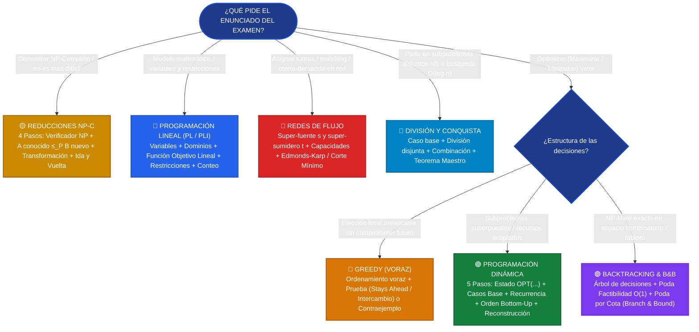

### Tabla de Señales y Disparadores Léxicos

| Si el enunciado menciona... | Señal clave | Paradigma sugerido | Estructura / Técnica |
| :--- | :--- | :--- | :--- |
| "Intervalos de tiempo", "pedidos no solapados", "deadlines" | Maximizar cantidad sin pesos | **Greedy** | Ordenar por tiempo de finalización más temprano ($f_i$). |
| "Intervalos con pesos o beneficios", "Juan el Vago" | Decisión sobre días/turnos adyacentes | **Programación Dinámica** | $OPT(i) = \max(OPT(i-1), \; OPT(p(i)) + v_i)$. |
| "Mochila con peso y volumen", "delivery", "límite de seguro" | Recursos múltiples acoplados | **Programación Dinámica** | Matriz 2D/3D: $OPT(i, w, v, m)$. |
| "Ubicar antenas en celdas", "visitar lugares para ver especies" | Cobertura de conjuntos (*Set Cover*) | **Programación Lineal (PLI)** | Variables binarias $x_i \in \{0, 1\}$, restricciones $x_i \le \sum y_j$. |
| "Médicos y turnos", "estudiantes y cupos", "red de cañerías" | Capacidad unitaria o integral de transporte | **Redes de Flujo** | Super-fuente $s$, super-sumidero $t$, Ford-Fulkerson / Edmonds-Karp. |
| "Tablero", "ubicar piezas sin ataques", "4 cuadrados que sumen $n$" | Espacio de búsqueda combinatorio | **Backtracking** | Recursión con estructuras booleanas de poda en $O(1)$. |
| "Demostrar que $X$ es NP-Completo", "compró software para $Y$" | Relación de dificultad de problemas | **Reducciones NP** | Reducción de Karp $A \le_P B$ con demostración en 4 pasos. |


---

## 4. Tema 1: División y Conquista (DyC)

### Conceptos Mínimos de Supervivencia

1. **Definición del Paradigma:**
   Un algoritmo de División y Conquista divide un problema de tamaño $n$ en $a$ subproblemas independientes de tamaño $n/b$, resuelve cada subproblema recursivamente (conquista), y luego combina sus soluciones con un costo $f(n)$ (combinación).

2. **Teorema Maestro (Master Theorem):**
   Para recurrencias de la forma:
   > $$T(n) = a \cdot T(n/b) + \Theta(n^c)$$
   
   con $a \ge 1, b > 1, c \ge 0$:

   * **Caso 1 (Dominio de Hojas):** Si $\log_b a > c \implies T(n) = \Theta(n^{\log_b a})$. El costo computacional está dominado por las hojas del árbol de recursión.
   * **Caso 2 (Balance Equitativo):** Si $\log_b a = c \implies T(n) = \Theta(n^c \log n)$. Cada nivel del árbol recursivo aporta la misma cantidad asintótica de trabajo.
   * **Caso 3 (Dominio de la Raíz):** Si $\log_b a < c \implies T(n) = \Theta(n^c)$ (sujeto a la condición de regularidad $a \cdot f(n/b) \le k \cdot f(n)$ con $k < 1$). El costo de combinar en la raíz domina todo el proceso.

3. **Requisitos de Factibilidad:**
   * Los subproblemas deben ser **estrictamente disjuntos** (sin solapamiento; si hay solapamiento, corresponde Programación Dinámica).
   * La reducción del tamaño debe ser multiplicativa ($n/b$), no sustractiva ($n - 1$). Si es sustractiva ($T(n) = T(n - 1) + O(1)$), no aplica Teorema Maestro y la complejidad es lineal o cuadrática.

---

### Patrón de Ejercicio 1.1: Álgebra Matricial y Partición en Bloques

En los parciales aparece el requerimiento de formular algoritmos multiplicativos dividiendo estructuras bidimensionales en cuadrantes y deduciendo la complejidad formal con el Teorema Maestro.

---

### Ejercicio 1 — Multiplicación de Matrices Cuadradas por Bloques

**Clasificación:** 🔴 IMPRESCINDIBLE  
**Origen:** Parcial 2025-1-2 (17 de junio de 2025), Ejercicio 1

**Enunciado**  
Realizar un algoritmo que resuelva la multiplicación de dos matrices cuadradas de orden $n$ ($A$ y $B$) mediante división y conquista. Recordemos la definición: $C = A \times B$ donde $C_{ij} = \sum_{k=1}^n A_{ik} \cdot B_{kj}$ para todo $i, j \in \{1, \dots, n\}$. Para simplificar el algoritmo se puede suponer que $n$ es una potencia de 2. Indicar y justificar el orden de complejidad temporal y espacial del algoritmo.

**Qué está evaluando la cátedra**  
Partición de matrices en 4 bloques de orden $n/2$, formulación de las llamadas recursivas de multiplicación, suma de matrices en la etapa de combinación, y aplicación rigurosa del Teorema Maestro sin saltarse el análisis de casos.

#### 1. Deducción Metodológica Formal (Los 5 Pasos de DyC)

1. **Paso 1: División:**
   Se dividen las matrices cuadradas $A$ y $B$ de orden $n \times n$ en 4 submatrices (cuadrantes) de tamaño $(n/2) \times (n/2)$:
   $$A = \begin{pmatrix} A_{11} & A_{12} \\ A_{21} & A_{22} \end{pmatrix}, \quad B = \begin{pmatrix} B_{11} & B_{12} \\ B_{21} & B_{22} \end{pmatrix}$$

2. **Paso 2: Casos Base:**
   Cuando $n = 1$, las matrices se reducen a un único escalar cada una:
   $$C_{11} = A_{11} \cdot B_{11}$$
   Esta multiplicación escalar elemental se ejecuta en tiempo $O(1)$.

3. **Paso 3: Conquista (Llamadas Recursivas):**
   De acuerdo al producto matricial por bloques, la matriz resultante $C$ satisface:
   $$C = \begin{pmatrix} C_{11} & C_{12} \\ C_{21} & C_{22} \end{pmatrix} = \begin{pmatrix} A_{11} B_{11} + A_{12} B_{21} & A_{11} B_{12} + A_{12} B_{22} \\ A_{21} B_{11} + A_{22} B_{21} & A_{21} B_{12} + A_{22} B_{22} \end{pmatrix}$$
   Cada cuadrante requiere 2 productos de matrices de tamaño $(n/2) \times (n/2)$. En total se disparan **$a = 8$ llamadas recursivas**:

   * $M_1 = A_{11} \cdot B_{11}$, $M_2 = A_{12} \cdot B_{21}$
   * $M_3 = A_{11} \cdot B_{12}$, $M_4 = A_{12} \cdot B_{22}$
   * $M_5 = A_{21} \cdot B_{11}$, $M_6 = A_{22} \cdot B_{21}$
   * $M_7 = A_{21} \cdot B_{12}$, $M_8 = A_{22} \cdot B_{22}$

4. **Paso 4: Combinación:**
   Se calculan los 4 cuadrantes finales mediante 4 sumas de matrices de tamaño $(n/2) \times (n/2)$:

   * $C_{11} = M_1 + M_2$
   * $C_{12} = M_3 + M_4$
   * $C_{21} = M_5 + M_6$
   * $C_{22} = M_7 + M_8$
   Cada suma matricial de $(n/2) \times (n/2)$ elementos insume $(n/2)^2 = n^2 / 4$ operaciones. En total, las 4 sumas insumen $4 \cdot (n^2 / 4) = n^2$ operaciones, es decir, costo $\Theta(n^2)$.

5. **Paso 5: Ecuación de Recurrencia y Teorema Maestro:**
   $$T(n) = \begin{cases} \Theta(1) & \text{si } n = 1 \\ 8 \cdot T\left(\frac{n}{2}\right) + \Theta(n^2) & \text{si } n > 1 \end{cases}$$
   Identificamos los parámetros del Teorema Maestro:

   * $a = 8$ (número de subproblemas recursivos)
   * $b = 2$ (factor de reducción del tamaño de entrada)
   * $f(n) = \Theta(n^c)$ con $c = 2$ (costo de división y combinación de bloques)
   
   Calculamos el exponente crítico:
   $$\log_b a = \log_2 8 = 3$$
   Comparamos $\log_b a$ con $c$:
   $$\log_b a = 3 > 2 = c$$
   Dado que $\log_b a > c$, aplica estrictamente el **Caso 1 del Teorema Maestro** (el trabajo en las hojas del árbol domina el costo global):
   $$T(n) = \Theta(n^{\log_b a}) = \Theta(n^{\log_2 8}) = \Theta(n^3)$$

#### 2. Justificación Directa de Correctitud (Lista para Examen)

* **Caso Base ($n = 1$):** Cuando las matrices son de $1 \times 1$, tienen un solo número cada una y el algoritmo multiplica directamente $A[0][0] \cdot B[0][0]$ en tiempo $O(1)$.
* **Paso Recursivo ($n > 1$):**
  Por propiedad de multiplicación de matrices por bloques, para obtener cada cuadrante de $C$ basta con multiplicar las mitades correspondientes de las filas de $A$ por las mitades de las columnas de $B$ y sumar ambos resultados parciales:

    * Cuadrante superior izquierdo: $C_{11} = A_{11} B_{11} + A_{12} B_{21}$
    * Cuadrante superior derecho: $C_{12} = A_{11} B_{12} + A_{12} B_{22}$
    * Cuadrante inferior izquierdo: $C_{21} = A_{21} B_{11} + A_{22} B_{21}$
    * Cuadrante inferior derecho: $C_{22} = A_{21} B_{12} + A_{22} B_{22}$
  Como las 8 llamadas recursivas resuelven submatrices de la mitad de tamaño ($n/2$) hasta llegar al caso base de $1 \times 1$, la suma de los bloques reconstruye exactamente la matriz producto $C$.

#### 3. Ejemplo Concreto y Traza Paso a Paso ($n = 2$)

Sean las matrices $2 \times 2$:
$$A = \begin{pmatrix} 1 & 2 \\ 3 & 4 \end{pmatrix}, \quad B = \begin{pmatrix} 5 & 6 \\ 7 & 8 \end{pmatrix}$$

| Cuadrante / Operación | Definición Algebraica | Cálculo Numérico | Resultado |
| :--- | :--- | :--- | :--- |
| **Bloques de $A$** | $A_{11}=[1], A_{12}=[2], A_{21}=[3], A_{22}=[4]$ | Descomposición en $1 \times 1$ | 4 escalares |
| **Bloques de $B$** | $B_{11}=[5], B_{12}=[6], B_{21}=[7], B_{22}=[8]$ | Descomposición en $1 \times 1$ | 4 escalares |
| **$M_1$** | $A_{11} \cdot B_{11}$ | $1 \cdot 5$ | $5$ |
| **$M_2$** | $A_{12} \cdot B_{21}$ | $2 \cdot 7$ | $14$ |
| **$M_3$** | $A_{11} \cdot B_{12}$ | $1 \cdot 6$ | $6$ |
| **$M_4$** | $A_{12} \cdot B_{22}$ | $2 \cdot 8$ | $16$ |
| **$M_5$** | $A_{21} \cdot B_{11}$ | $3 \cdot 5$ | $15$ |
| **$M_6$** | $A_{22} \cdot B_{21}$ | $4 \cdot 7$ | $28$ |
| **$M_7$** | $A_{21} \cdot B_{12}$ | $3 \cdot 6$ | $18$ |
| **$M_8$** | $A_{22} \cdot B_{22}$ | $4 \cdot 8$ | $32$ |
| **$C_{11} = M_1 + M_2$** | $A_{11} B_{11} + A_{12} B_{21}$ | $5 + 14$ | **$19$** |
| **$C_{12} = M_3 + M_4$** | $A_{11} B_{12} + A_{12} B_{22}$ | $6 + 16$ | **$22$** |
| **$C_{21} = M_5 + M_6$** | $A_{21} B_{11} + A_{22} B_{21}$ | $15 + 28$ | **$43$** |
| **$C_{22} = M_7 + M_8$** | $A_{21} B_{12} + A_{22} B_{22}$ | $18 + 32$ | **$50$** |

Matriz final ensamblada:
$$C = \begin{pmatrix} 19 & 22 \\ 43 & 50 \end{pmatrix}$$
*Verificación por producto tradicional:*

* Fila 1 × Columna 1: $1 \cdot 5 + 2 \cdot 7 = 19$. Correcto.
* Fila 1 × Columna 2: $1 \cdot 6 + 2 \cdot 8 = 22$. Correcto.
* Fila 2 × Columna 1: $3 \cdot 5 + 4 \cdot 7 = 43$. Correcto.
* Fila 2 × Columna 2: $3 \cdot 6 + 4 \cdot 8 = 50$. Correcto.

#### 4. Diagrama del Árbol de Recursión

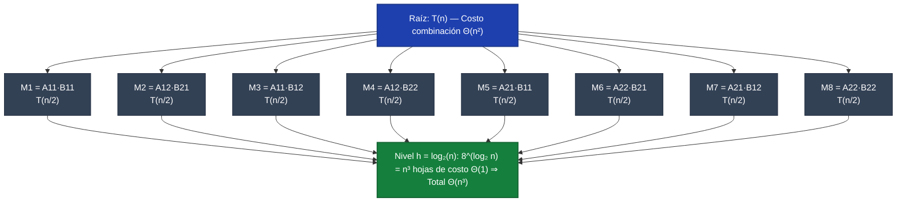

#### 5. Pseudocódigo del Algoritmo (Estilo Examen Presencial)

```text
Algoritmo MultiplicarMatrices(A, B):
    n = dimension(A)  // Matriz de n x n (suponiendo n potencia de 2)
    devolver MultiplicarMatricesDyC(A, B, n)

función MultiplicarMatricesDyC(A, B, n):
    // Caso Base: matriz de 1x1
    si n == 1:
        devolver [[ A[0][0] * B[0][0] ]]

    m = n / 2
    // Dividir A y B en 4 submatrices de m x m cada una:
    (A11, A12, A21, A22) = PartirEn4Bloques(A, m)
    (B11, B12, B21, B22) = PartirEn4Bloques(B, m)

    // 8 multiplicaciones recursivas de tamaño m = n/2:
    M1 = MultiplicarMatricesDyC(A11, B11, m)
    M2 = MultiplicarMatricesDyC(A12, B21, m)
    M3 = MultiplicarMatricesDyC(A11, B12, m)
    M4 = MultiplicarMatricesDyC(A12, B22, m)
    M5 = MultiplicarMatricesDyC(A21, B11, m)
    M6 = MultiplicarMatricesDyC(A22, B21, m)
    M7 = MultiplicarMatricesDyC(A21, B12, m)
    M8 = MultiplicarMatricesDyC(A22, B22, m)

    // 4 sumas de matrices de tamaño m x m en O(m^2):
    C11 = M1 + M2
    C12 = M3 + M4
    C21 = M5 + M6
    C22 = M7 + M8

    // Combinar en matriz final C de n x n
    devolver EnsamblarMatriz(C11, C12, C21, C22)
```

<div class="trap-callout">
  <div class="trap-header">⚠️ Trampa Típica de Corrección</div>
  <p><strong>Puntos donde restan puntaje los docentes de FIUBA:</strong></p>
  <ul>
    <li><strong>Afirmar que DyC clásico reduce la complejidad a $O(n^2)$ o $O(n^{2.81})$:</strong> El algoritmo estándar por cuadrantes realiza 8 multiplicaciones ($a = 8$), lo que da exactamente $\Theta(n^3)$, igual que el método iterativo cúbico de 3 bucles. Para bajar a $O(n^{\log_2 7}) \approx O(n^{2.81})$ es indispensable el truco algebraico de Volker Strassen (7 multiplicaciones).</li>
    <li><strong>Confusión de índices en los productos cruzados:</strong> Un error muy penalizado es escribir $A_{12} B_{12}$ en lugar de $A_{12} B_{21}$. Recuerde que la fila de $A$ multiplica a la columna de $B$.</li>
    <li><strong>Olvidar el costo de partición y combinación:</strong> Copiar matrices o sumarlas no es gratis; toma $\Theta(n^2)$. Omitir este término en la recurrencia anula la justificación del Teorema Maestro.</li>
  </ul>
</div>

---

### Patrón de Ejercicio 1.2: Búsqueda Binaria sobre Propiedades Monótonas

Se busca un elemento o punto crítico en arreglos que no están completamente ordenados pero que presentan una propiedad monótona o un cambio de tendencia detectable en tiempo $O(\log n)$.

---

### Ejercicio 2 — Elemento Pico en un Arreglo Unimodal

**Clasificación:** 🟡 IMPORTANTE  
**Origen:** Guía de Ejercicios 01, Ejercicio 4 / Parcial FIUBA

**Enunciado**  
Dado un arreglo $A$ de $n$ enteros distintos donde no hay dos elementos adyacentes iguales, un elemento $A[i]$ se define como "pico" si es estrictamente mayor que sus vecinos existentes (es decir, $A[i] > A[i-1]$ y $A[i] > A[i+1]$, considerando los extremos con un único vecino). Diseñar un algoritmo por División y Conquista que encuentre un elemento pico en tiempo $O(\log n)$. Justificar la correctitud y la complejidad.

**Qué está evaluando la cátedra**  
Capacidad de descarte logarítmico aprovechando la dirección de la pendiente local, manejo riguroso de condiciones de borde en índices y demostración formal de que siempre existe al menos un pico en la mitad elegida.

#### 1. Deducción Metodológica Formal (Los 5 Pasos de DyC)

1. **Paso 1: Definición del Invariante de Búsqueda:**
   En cada llamada sobre el rango $[ini, fin]$, se mantiene el siguiente invariante: **garantizadamente existe al menos un pico local dentro del subarreglo $A[ini \dots fin]$**.

2. **Paso 2: Caso Base:**
   Cuando $ini = fin$, el rango contiene un único elemento. Por el invariante de búsqueda, este elemento debe ser un pico local. Se retorna $ini$ en tiempo $O(1)$.

3. **Paso 3: División:**
   Se calcula el índice central:
   $$m = \lfloor(ini + fin) / 2\rfloor$$
   Como $ini < fin$, necesariamente $m < fin$, lo cual garantiza que la posición $m + 1$ es siempre un índice válido dentro del arreglo (sin desbordamiento).

4. **Paso 4: Conquista y Criterio de Descarte:**
   Se comparan los elementos contiguos $A[m]$ y $A[m + 1]$:

   * **Caso A ($A[m] < A[m + 1]$):** La pendiente asciende hacia la derecha. Por el Teorema de Existencia, existe al menos un pico en el subrango $[m + 1, fin]$. Se descarta toda la mitad izquierda $[ini, m]$.
   * **Caso B ($A[m] > A[m + 1]$):** La pendiente desciende hacia la derecha (asciende hacia la izquierda). Por lo tanto, existe al menos un pico en el subrango $[ini, m]$ (el propio $m$ podría ser el pico). Se descarta el subrango $[m + 1, fin]$.
5. **Paso 5: Ecuación de Recurrencia y Teorema Maestro:**
   En cada paso se realiza exactamente una llamada recursiva sobre un subarreglo de tamaño a lo sumo $\lceil n/2 \rceil$ con trabajo de comparación $O(1)$:
   $$T(n) = 1 \cdot T(n/2) + \Theta(1)$$
   Parámetros: $a = 1, b = 2, c = 0$.
   $$\log_b a = \log_2 1 = 0 = c$$
   Aplica el **Caso 2 del Teorema Maestro** con $k = 0$:
   $$T(n) = \Theta(n^c \log n) = \Theta(n^0 \log n) = \Theta(\log n)$$

#### 2. Justificación Directa de Correctitud (Por qué siempre hay un pico en la mitad elegida)

* **Idea de la pendiente:** En el centro miramos los vecinos $A[m]$ y $A[m + 1]$. Como no hay elementos consecutivos iguales, los valores sí o sí suben o bajan:
    * **Si $A[m] < A[m + 1]$ (sube hacia la derecha):** Como a partir de $m + 1$ los números van subiendo, pasan dos cosas posibles: o bien siguen subiendo sin parar hasta el borde derecho `fin` (entonces $A[fin]$ es un pico porque es más grande que el anterior y no tiene a nadie a la derecha), o bien en algún momento dejan de subir y bajan (y el primer número donde empieza a bajar es un pico porque le gana al de su izquierda y al de su derecha). Por eso **seguro hay un pico en la mitad derecha $[m + 1, fin]$**.
    * **Si $A[m] > A[m + 1]$ (sube hacia la izquierda):** Por el mismo razonamiento hacia la izquierda, **seguro hay un pico en la mitad izquierda $[ini, m]$** (incluso el propio $A[m]$ podría ser el pico).

#### 3. Ejemplo Concreto y Traza Paso a Paso

Sea el arreglo de $n = 7$ elementos:
$$A = [1, 2, 1, 3, 5, 6, 4]$$

| Paso | Rango $[ini, fin]$ | $m$ | $A[m]$ | $A[m+1]$ | Comparación | Decisión / Rango Siguiente |
| :---: | :---: | :---: | :---: | :---: | :---: | :--- |
| **1** | $[0, 6]$ | $3$ | $3$ | $5$ | $3 < 5$ (sube a derecha) | Descartar izquierda $\implies [4, 6]$ |
| **2** | $[4, 6]$ | $5$ | $6$ | $4$ | $6 > 4$ (baja a derecha) | Descartar derecha $\implies [4, 5]$ |
| **3** | $[4, 5]$ | $4$ | $5$ | $6$ | $5 < 6$ (sube a derecha) | Descartar izquierda $\implies [5, 5]$ |
| **4** | $[5, 5]$ | - | - | - | **$ini == fin = 5$** | **Caso base: Pico en índice 5 ($A[5] = 6$)** |

*Verificación:* $A[5] = 6$ es estrictamente mayor que su vecino izquierdo $A[4] = 5$ y su vecino derecho $A[6] = 4$. Es un pico válido encontrado en solo 3 iteraciones ($<\log_2 7 \approx 2.8$).

#### 4. Diagrama Visual de Búsqueda Binaria de la Pendiente

```mermaid
flowchart LR
    A["Rango [0..6]: m=3<br/>A[3]=3 &lt; A[4]=5"]:::step -->|Descarta izq [0..3]| B["Rango [4..6]: m=5<br/>A[5]=6 &gt; A[6]=4"]:::step
    B -->|Conserva m=5| C["Rango [4..5]: m=4<br/>A[4]=5 &lt; A[5]=6"]:::step
    C -->|Descarta m=4| D["Rango [5..5]: ini=fin"]:::step
    D --> E(["Pico Hallado: Índice 5 (A[5] = 6)"]):::opt
    classDef step fill:#1e40af,stroke:#1e3a8a,stroke-width:2px,color:#fff
    classDef opt fill:#15803d,stroke:#166534,stroke-width:2px,color:#fff
```

#### 5. Pseudocódigo del Algoritmo (Estilo Examen Presencial)

```text
Algoritmo EncontrarPico(A, n):
    si n == 0:
        devolver -1
    devolver EncontrarPicoRec(A, 0, n - 1)

función EncontrarPicoRec(A, ini, fin):
    // Caso Base: un único elemento en el subarreglo es garantizadamente pico
    si ini == fin:
        devolver ini

    m = (ini + fin) / 2

    // Lema de la pendiente: si sube hacia la derecha, el pico está a la derecha
    si A[m] < A[m + 1]:
        devolver EncontrarPicoRec(A, m + 1, fin)
    sino:
        // Si la pendiente desciende, m puede ser el propio pico
        devolver EncontrarPicoRec(A, ini, m)
```

<div class="trap-callout">
  <div class="trap-header">⚠️ Trampa Típica de Corrección</div>
  <p><strong>Puntos donde restan puntaje los docentes de FIUBA:</strong></p>
  <ul>
    <li><strong>Hacer <code>fin = m - 1</code> en la rama descendente:</strong> Si $A[m] > A[m+1]$, el elemento $A[m]$ podría ser precisamente el pico. Si ajustas <code>fin = m - 1</code>, excluyes a $m$ y el algoritmo puede retornar un índice incorrecto o fallar. Debe ser obligatoriamente <code>fin = m</code>.</li>
    <li><strong>Desbordamiento de índice al calcular $m+1$:</strong> Si el bucle tiene condición <code>ini &le; fin</code>, en la última iteración $m = fin$ y la consulta <code>arr[m + 1]</code> arroja <code>IndexError</code>. La condición estricta debe ser <code>ini &lt; fin</code>.</li>
    <li><strong>Creer que el arreglo debe estar ordenado:</strong> Este algoritmo funciona sobre arreglos desordenados gracias al Lema de la Pendiente. Afirmar en el examen que se requiere ordenar previamente ($O(n \log n)$) invalida la cota $O(\log n)$.</li>
  </ul>
</div>

---

### Ejercicio 3 — Búsqueda del Primer Cero en un Arreglo de Unos y Ceros

**Clasificación:** 🔴 IMPRESCINDIBLE  
**Origen:** Guía de Ejercicios 01, Ejercicio 2 / Final FIUBA

**Enunciado**  
Se tiene un arreglo $A$ de $n$ elementos compuesto exclusivamente por números 1 seguidos por números 0 (es decir, de la forma $[1, 1, \dots, 1, 0, 0, \dots, 0]$). Puede ocurrir que todos sean 1 o todos sean 0. Implementar un algoritmo por División y Conquista que determine la posición del primer 0 en tiempo $O(\log n)$. Si el arreglo no contiene ceros, retornar $-1$.

**Qué está evaluando la cátedra**  
Identificación de la propiedad de frontera de transición, manejo riguroso de casos donde el cero está en el índice 0 o no existe, y parada anticipada sin incurrir en recorridos lineales.

#### 1. Deducción Metodológica Formal (Los 5 Pasos de DyC)

1. **Paso 1: Propiedad de Monotonía y Frontera:**
   El arreglo $A$ es monótonamente decreciente no estricto: $A[i] \ge A[i+1]$ para todo $i$. El "primer cero" es el único índice $k$ que satisface:
   $$A[k] = 0 \quad \land \quad (k = 0 \lor A[k - 1] = 1)$$

2. **Paso 2: Casos Base de Rango Vacío:**
   Si $ini > fin$, el subrango colapsó sin encontrar ningún cero (ocurre cuando el arreglo es puramente de unos). Se retorna $-1$.

3. **Paso 3: División:**
   Se evalúa el elemento en la posición media:
   $$m = \lfloor(ini + fin) / 2\rfloor$$

4. **Paso 4: Conquista y Reducción del Espacio de Búsqueda:**
   * **Condición de Éxito Inmediato:** Si $A[m] == 0$ y además ($m == 0$ o $A[m - 1] == 1$), entonces $m$ es por definición el primer cero. Se retorna $m$ inmediatamente en $O(1)$.
   * **Rama Izquierda ($A[m] == 0$ pero $A[m - 1] == 0$):** Hay más ceros hacia la izquierda. Se descarta la mitad derecha y se busca recursivamente en $[ini, m - 1]$.
   * **Rama Derecha ($A[m] == 1$):** Por monotonía, todos los elementos desde $ini$ hasta $m$ son 1. El primer cero solo puede estar estrictamente a la derecha. Se busca en $[m + 1, fin]$.
5. **Paso 5: Ecuación de Recurrencia y Teorema Maestro:**
   $$T(n) = 1 \cdot T(n/2) + \Theta(1)$$
   Con $a = 1, b = 2, c = 0$:
   $$\log_2 1 = 0 = c \implies T(n) = \Theta(\log n)$$
   Espacio auxiliar: $O(1)$ en implementación iterativa, $O(\log n)$ en la pila de recursión.

#### 2. Justificación Directa de Correctitud (Lista para Examen)

* Como el arreglo tiene todos los `1` al principio y todos los `0` al final, al mirar la posición del medio `m` solo pueden pasar tres cosas:
    1. **Si `A[m] == 1`:** Como antes de un `1` solo puede haber otros `1`, es imposible que el primer `0` esté a la izquierda. Descartamos toda la mitad izquierda y buscamos a la derecha (`[m + 1, fin]`).
    2. **Si `A[m] == 0` y su anterior es `1` (o `m == 0`):** Estamos parados justo en el cambio de `1` a `0`, así que `m` es el primer cero y lo devolvemos.
    3. **Si `A[m] == 0` y su anterior también es `0`:** El primer cero está más atrás, así que descartamos la mitad derecha y buscamos a la izquierda (`[ini, m - 1]`).
* Si el rango se queda sin elementos (`ini > fin`), significa que eran todos `1` y devolvemos `-1`.

#### 3. Ejemplo Concreto y Traza Paso a Paso

Sea el arreglo de $n = 8$ elementos:
$$A = [1, 1, 1, 1, 0, 0, 0, 0]$$

| Iteración | Rango $[ini, fin]$ | $m$ | $A[m]$ | Verificación $A[m-1]$ | Decisión / Rango Siguiente |
| :---: | :---: | :---: | :---: | :---: | :--- |
| **1** | $[0, 7]$ | $3$ | $1$ | No aplica ($A[m]=1$) | $A[3]=1 \implies$ Descartar $[0, 3]$. Nuevo rango: $[4, 7]$ |
| **2** | $[4, 7]$ | $5$ | $0$ | $A[4] = 0$ | $A[5]=0$ pero $A[4]=0 \implies$ Hay ceros antes. Nuevo rango: $[4, 4]$ |
| **3** | $[4, 4]$ | $4$ | $0$ | $A[3] = 1$ | **$A[4] = 0 \land A[3] = 1 \implies$ ¡Primer cero hallado en índice 4!** |

*Resultado devuelto:* $4$. Complejidad real: 3 comparaciones ($\le \lceil \log_2 8 \rceil = 3$).

#### 4. Diagrama Visual del Corte de Frontera

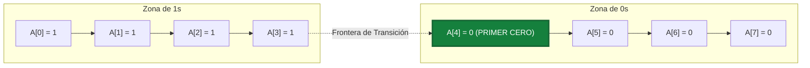

#### 5. Pseudocódigo del Algoritmo (Estilo Examen Presencial)

```text
Algoritmo BuscarPrimerCero(A, n):
    si n == 0:
        devolver -1
    devolver BuscarPrimerCeroRec(A, 0, n - 1)

función BuscarPrimerCeroRec(A, ini, fin):
    // Caso Base: rango inválido sin ceros
    si ini > fin:
        devolver -1

    m = (ini + fin) / 2

    si A[m] == 0:
        // Si es el primer elemento o el anterior es 1, encontramos el primer cero
        si m == 0 o A[m - 1] == 1:
            devolver m
        // Continuar buscando un cero previo más a la izquierda
        devolver BuscarPrimerCeroRec(A, ini, m - 1)
    sino:
        // A[m] == 1: por orden monótono, el primer cero debe residir a la derecha
        devolver BuscarPrimerCeroRec(A, m + 1, fin)
```

<div class="trap-callout">
  <div class="trap-header">⚠️ Trampa Típica de Corrección</div>
  <p><strong>Puntos donde restan puntaje los docentes de FIUBA:</strong></p>
  <ul>
    <li><strong>Acceder a <code>arr[m - 1]</code> cuando $m = 0$:</strong> Si el primer cero está en la posición 0, evaluar <code>arr[m - 1]</code> en Python consultará <code>arr[-1]</code> (el último elemento del arreglo), produciendo un falso positivo o error lógico en otros lenguajes (C/Java) con <code>IndexOutOfBoundsException</code>. Siempre se debe anteponer la guarda <code>m == 0 or arr[m - 1] == 1</code>.</li>
    <li><strong>Arreglos sin ceros (todos 1s):</strong> Si el arreglo no contiene ceros, el algoritmo debe retornar $-1$. Si no se maneja la condición de parada <code>ini &gt; fin</code>, el algoritmo puede retornar un índice erróneo.</li>
    <li><strong>Hacer un recorrido lineal desde $m$:</strong> Al encontrar un 0 en $m$, algunos estudiantes retroceden linealmente con un bucle mientras <code>arr[i] == 0</code>. Eso degrada la complejidad a $O(n)$ en el peor caso (por ejemplo, en un arreglo compuesto íntegramente por ceros), anulando completamente el beneficio de la búsqueda binaria.</li>
  </ul>
</div>

---

### Errores Frecuentes en Exámenes sobre División y Conquista

1. **Olvidar el Caso Base:** Omitir la condición de parada cuando $n = 1$ o $ini \ge fin$, provocando recursión infinita en la traza.
2. **Calcular erróneamente los parámetros del Teorema Maestro:** Confundir $a$ (cantidad de subproblemas) con $b$ (factor de reducción del tamaño). Ejemplo clásico: en multiplicación de matrices, poner $a = 4$ en lugar de $a = 8$.
3. **No justificar el costo de combinación $f(n)$:** Poner directamente $O(n^2)$ sin detallar que proviene de recorrer las submatrices sumando elemento a elemento.
4. **Dividir en subproblemas no balanceados:** Si la división reduce el tamaño a $n - 1$ (como Quicksort en el peor caso), no se puede aplicar el Teorema Maestro básico; se debe resolver mediante sumatoria telescópica.


---

## 5. Tema 2: Algoritmos Greedy (Voraces)

### Conceptos Mínimos de Supervivencia

1. **Naturaleza de un Algoritmo Greedy:**
   En cada paso, toma la decisión que parece mejor en ese momento específico (óptimo local) bajo una regla de selección fija, sin mirar atrás ni reconsiderar elecciones previas (elección irrevocable).

2. **Propiedad de la Elección Voraz y Subestructura Óptima:**
   Para que un algoritmo greedy sea **óptimo**, debe cumplirse que:

   * Una elección voraz inicial conduce a una solución globalmente óptima (propiedad de elección voraz).
   * La solución óptima del problema global contiene dentro de sí soluciones óptimas a los subproblemas resultantes (subestructura óptima).

3. **Las Dos Técnicas Canónicas de Demostración de Optimalidad:**
   * **Greedy Stays Ahead ("El voraz se mantiene adelante"):** Se define una métrica de progreso $m(i)$. Se demuestra por inducción que en cada paso $k$, la solución voraz aventaja o iguala a cualquier solución óptima $OPT$ ($m(G_k) \le m(OPT_k)$ o $m(G_k) \ge m(OPT_k)$), garantizando que al finalizar no puede ser superada.
   * **Argumento de Intercambio (Exchange Argument):** Se toma una solución óptima hipotética $OPT$ que difiere de la solución greedy $G$. Se identifica la primera inversión o discrepancia y se demuestra que al intercambiar el elemento de $OPT$ por el elemento elegido por $G$, la calidad de la solución no empeora. Repitiendo el proceso, $OPT$ se transforma en $G$ sin perder valor, probando que $G$ también es óptima.

4. **Cómo Probar que una Idea Greedy es Incorrecta (El Contraejemplo):**
   Si en un examen te preguntan *"¿El algoritmo greedy propuesto es óptimo siempre? Indicar si es óptimo o dar un contraejemplo"*, **NUNCA** respondas con explicaciones vagas. Debes presentar un contraejemplo concreto:

   1. Definir una instancia pequeña con datos numéricos explícitos.
   2. Mostrar paso a paso qué elige el algoritmo greedy y cuál es su costo/beneficio obtenido.
   3. Mostrar una solución alternativa factible y su costo/beneficio estrictamente superior.
   4. Concluir formalmente: *Como $\text{Valor}(\text{Alternativa}) > \text{Valor}(\text{Greedy})$, el algoritmo no garantiza la solución óptima.*

---

### Patrón de Ejercicio 2.1: Interval Scheduling (Planificación de Intervalos No Solapados)

Aparece con diferentes metáforas narrativas: charlas en un aula, pedidos de mafias locales por el control de kilómetros de una ruta, franjas horarias de satélites o turnos de guardias. El objetivo es maximizar la cantidad total de pedidos aceptados sin solapamiento.

---

### Ejercicio 4 — Concesión de Permisos a Mafias en la Ruta Costera (Arnook)

**Clasificación:** 🔴 IMPRESCINDIBLE  
**Origen:** Parcial 2024-2-2 (26 de noviembre de 2024), Ejercicio 3 / Guía 02 Ejercicio 12

**Enunciado**  
Trabajamos para el mafioso Arnook, quien organiza los pedidos de pequeñas mafias locales por el control de diferentes kilómetros de la ruta costera de Ciudad República. Cada mafia le pide control sobre un rango de kilómetros $[s_i, f_i]$ (por ejemplo, del kilómetro 1 al 5, del 3 al 8, etc.). Si una mafia toma control de un kilómetro, ninguna otra puede ocupar ese mismo tramo (no pueden solaparse). Arnook cobra una tarifa fija por otorgar el permiso, independientemente de los kilómetros pedidos, por lo que su objetivo es maximizar la cantidad total de permisos otorgados sin conflictos de territorio.  

1. Implementar un algoritmo Greedy que determine a qué mafias otorgar el permiso.  
2. Indicar y justificar la complejidad temporal y espacial.  
3. Justificar por qué el algoritmo planteado es Greedy.  
4. ¿El algoritmo da la solución óptima siempre? Demostrarlo formalmente.

**Qué está evaluando la cátedra**  
Comprensión del arquetipo de *Interval Scheduling*, diseño del criterio voraz correcto (ordenamiento por punto final más temprano), y la demostración formal de optimalidad vía *Greedy Stays Ahead*.

#### 1. Deducción Metodológica Formal (Los 5 Pasos de Greedy)

1. **Paso 1: Análisis de Reglas Candidatas y Descarte de Erróneas:**
   * *Criterio erróneo 1 (Inicio más temprano $s_i$):* Falla si un pedido empieza muy temprano y ocupa toda la ruta ($[1, 100]$ bloquea a $[2, 3]$ y $[4, 5]$).
   * *Criterio erróneo 2 (Menor longitud $f_i - s_i$):* Falla si un intervalo corto bloquea a dos largos compatibles a sus extremos ($[10, 20]$ y $[20, 30]$ vs $[19, 21]$).
   * *Criterio Óptimo:* Ordenar las solicitudes por su **kilómetro de finalización más temprano ($f_i$)**. Al terminar lo antes posible, se libera el recurso de la ruta lo más temprano posible para futuras mafias.
2. **Paso 2: Criterio de Ordenamiento:**
   Se ordenan los $n$ intervalos de modo que $f_1 \le f_2 \le \dots \le f_n$. Esto insume tiempo $O(n \log n)$.

3. **Paso 3: Verificación de Factibilidad:**
   Un intervalo candidato $j$ es factible si y solo si su punto de inicio es mayor o igual al fin del último intervalo aceptado:
   $$s_j \ge f_{\text{último}}$$

4. **Paso 4: Invocación Irrevocable:**
   Se acepta el intervalo compatible y se actualiza $f_{\text{último}} = f_j$. Esta decisión es definitiva: nunca se desasigna un permiso otorgado.

5. **Paso 5: Complejidad:**
   * **Tiempo:** $O(n \log n)$ por el ordenamiento inicial y $O(n)$ en el barrido secuencial. Total: $\Theta(n \log n)$.
   * **Espacio:** $O(n)$ para la lista de permisos seleccionados.

#### 2. Demostración Directa de Optimalidad ("El Voraz se Mantiene Adelante" / Greedy Stays Ahead)

* **Idea central:** Comparemos paso a paso los permisos que elige nuestro algoritmo Greedy ($g_1, g_2, \dots, g_k$) contra los de cualquier solución óptima ($o_1, o_2, \dots, o_m$), ambos ordenados de izquierda a derecha en la ruta.
* **1. En el primer permiso ($r = 1$):** Como Greedy elige el pedido que termina en el kilómetro más chico de todos, seguro termina antes o igual que el primero de la solución óptima (`fin(g_1) <= fin(o_1)`).
* **2. En cualquier permiso siguiente ($r$):**
    * Como el permiso anterior de Greedy terminó antes o igual que el del óptimo (`fin(g_{r-1}) <= fin(o_{r-1})`), a Greedy le queda libre la ruta desde antes.
    * Por lo tanto, el $r$-ésimo pedido que eligió el óptimo ($o_r$) también está disponible y sin solaparse para Greedy.
    * Como entre todos los disponibles Greedy siempre agarra el que termina primero, su elección $g_r$ también termina antes o igual que $o_r$ (`fin(g_r) <= fin(o_r)`).
* **3. Por qué tienen la misma cantidad de permisos ($k = m$):**
    * Si la solución óptima tuviera un permiso más ($o_{k+1}$), como empieza después de que termina $o_k$, también empezaría después de que termina $g_k$ (porque `fin(g_k) <= fin(o_k)`).
    * Entonces ese permiso $o_{k+1}$ no se chocaba con $g_k$ y Greedy lo habría agregado antes de frenar. Como Greedy solo frena cuando ya no entra ningún pedido más, el óptimo no puede tener más permisos que Greedy. **Greedy es óptimo.**

#### 3. Ejemplo Concreto y Tabla de Traza Paso a Paso

Sean los siguientes 5 pedidos de mafias sobre la ruta costera:

| ID | Mafia | Kilómetros $[s_i, f_i]$ | Longitud | ¿Fin más temprano? |
| :---: | :---: | :---: | :---: | :---: |
| **A** | Los del Puerto | $[1, 4]$ | $3$ | 1º en terminar ($f=4$) |
| **B** | Banda del Centro | $[3, 5]$ | $2$ | 2º en terminar ($f=5$) |
| **C** | Costanera Sur | $[0, 6]$ | $6$ | 3º en terminar ($f=6$) |
| **D** | Zona Norte | $[4, 7]$ | $3$ | 4º en terminar ($f=7$) |
| **E** | Pescadores | $[6, 9]$ | $3$ | 5º en terminar ($f=9$) |

*Traza del Algoritmo Voraz (Ordenados por $f_i$ ascendente: A, B, C, D, E):*

| Paso | Pedido Evaluado | $[s_i, f_i]$ | $f_{\text{último}}$ | Condición $s_i \ge f_{\text{último}}$ | Decisión | Permisos Otorgados |
| :---: | :---: | :---: | :---: | :---: | :---: | :--- |
| **1** | **A** | $[1, 4]$ | $0$ (inicial) | $1 \ge 0$ (Sí) | **ACEPTAR A** | $\{A\}$, $f_{\text{último}} = 4$ |
| **2** | **B** | $[3, 5]$ | $4$ | $3 \ge 4$ (No) | **RECHAZAR** (conflicto) | $\{A\}$ |
| **3** | **C** | $[0, 6]$ | $4$ | $0 \ge 4$ (No) | **RECHAZAR** (conflicto) | $\{A\}$ |
| **4** | **D** | $[4, 7]$ | $4$ | $4 \ge 4$ (Sí) | **ACEPTAR D** | $\{A, D\}$, $f_{\text{último}} = 7$ |
| **5** | **E** | $[6, 9]$ | $7$ | $6 \ge 7$ (No) | **RECHAZAR** (conflicto) | $\{A, D\}$ |

*Total de permisos máximos otorgados:* 2 mafias ($\{A, D\}$).

#### 4. Diagrama Visual de Intervalos

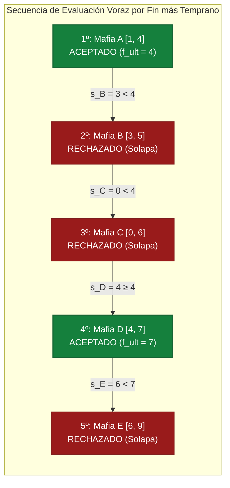

#### 5. Pseudocódigo del Algoritmo (Estilo Examen Presencial)

```text
Algoritmo ConcederPermisosMafias(pedidos):
    si pedidos está vacío: devolver []

    // 1. Regla voraz: ordenar por tiempo de finalización (p.fin) creciente
    ordenar pedidos por p.fin ascendente

    seleccionados = [ pedidos[0] ]
    ultimo_fin = pedidos[0].fin

    // 2. Selección voraz de intervalos compatibles en O(n)
    para cada p en pedidos desde el segundo en adelante:
        si p.inicio >= ultimo_fin:
            agregar p a seleccionados
            ultimo_fin = p.fin

    devolver seleccionados  // Máximo conjunto disjunto de intervalos
```

<div class="trap-callout">
  <div class="trap-header">⚠️ Trampa Típica de Corrección</div>
  <p><strong>Puntos donde restan puntaje los docentes de FIUBA:</strong></p>
  <ul>
    <li><strong>Confundir Interval Scheduling con Interval Scheduling Ponderado:</strong> Si las mafias ofrecieran dinero diferente por cada permiso ($v_i$), la regla voraz por fin más temprano **deja de ser óptima**. Se debe resolver obligatoriamente mediante Programación Dinámica con búsqueda binaria en $O(n \log n)$ (ver Ejercicio 18).</li>
    <li><strong>Solapamiento en extremos ($s_j == f_i$):</strong> Prestar atención a si el enunciado indica si compartir el kilómetro exacto está permitido o no ($s_j \ge f_i$ vs $s_j > f_i$). En la ruta costera, la frontera compartida es admisible ($s_j \ge f_{\text{último}}$).</li>
    <li><strong>Ordenar por duración ($f_i - s_i$):</strong> Es el error intuitivo más frecuente en parciales. Recuerde que un intervalo de duración 2 puede arruinar a dos intervalos adyacentes de duración 3, obteniendo 1 en lugar de 2.</li>
  </ul>
</div>

---

### Patrón de Ejercicio 2.2: Mochila Fraccionaria vs 0-1 con Garantía de Calidad 1/2

En las evaluaciones teóricas y en los TPs de la cátedra se examina la relación entre la solución fraccionaria (óptima con greedy) y la versión entera 0-1, demostrando cómo una regla greedy corregida otorga una cota de aproximación constante.

---

### Ejercicio 5 — Mochila 0-1 con Garantía de Aproximación 1/2

**Clasificación:** 🔴 IMPRESCINDIBLE  
**Origen:** Guía de Ejercicios 02, Ejercicio 8 / Diapositivas Explicativas de Cátedra

**Enunciado**  
Se tiene una mochila de capacidad de peso $W$ y $n$ objetos indivisibles (0-1), donde cada objeto $i$ tiene peso $w_i$ y valor $v_i$.  

1. Explicar por qué la regla voraz estándar basada en ordenar por densidad de valor ($v_i / w_i$) puede fallar de forma arbitraria en la mochila 0-1.  
2. Diseñar un algoritmo greedy modificado que garantice una calidad de al menos $1/2$ respecto a la solución óptima global ($V_{\text{aprox}} \ge \frac{1}{2} OPT$).  
3. Demostrar formalmente que $V_{\text{aprox}} / OPT > 1/2$.  
4. Indicar la complejidad temporal del algoritmo.

**Qué está evaluando la cátedra**  
Capacidad de analizar por qué un algoritmo voraz falla en problemas NP-Hard, diseño de heurísticas con garantías formales de aproximación y uso de la relajación continua como cota superior de optimalidad.

#### 1. Deducción Metodológica Formal (Los 5 Pasos)

1. **Paso 1: Análisis del Fallo de la Densidad Voraz Pura:**
   Consideremos $W = 100$, un objeto 1 con $w_1 = 1, v_1 = 2$ (densidad $2$) y un objeto 2 con $w_2 = 100, v_2 = 100$ (densidad $1$). La regla voraz elige el objeto 1 y llena la mochila hasta $w=1$, impidiendo que entre el objeto 2. Obtiene valor 2 en vez del óptimo 100 (eficiencia tan mala como $2/100 \to 0$).

2. **Paso 2: Filtrado Previo de Factibilidad:**
   Se descartan de inmediato todos los ítems cuyo peso individual sea mayor a la capacidad ($w_i > W$).

3. **Paso 3: Identificación del Elemento Crítico:**
   Se ordenan los elementos restantes por ratio de densidad decreciente:
   $$\frac{v_1}{w_1} \ge \frac{v_2}{w_2} \ge \dots \ge \frac{v_n}{w_n}$$
   Se introducen ítems vorazmente hasta que el primer elemento no entra por exceso de peso. A este ítem lo llamamos **Elemento Crítico ($k$)** con valor $v_k$ y peso $w_k$.

4. **Paso 4: Corrección de Cota Dual:**
   Sea $V_{\text{greedy}}$ el valor acumulado antes de topar con el elemento crítico. Se define la solución aproximada como el máximo entre la solución voraz y el elemento crítico en solitario:
   $$V_{\text{aprox}} = \max(V_{\text{greedy}}, \; v_k)$$

5. **Paso 5: Complejidad:**
   * Filtrado inicial en $O(n)$.
   * Ordenamiento por densidad en $O(n \log n)$.
   * Barrido voraz en $O(n)$.
   * Complejidad total: $\Theta(n \log n)$ en tiempo y $O(n)$ en espacio auxiliar.

#### 2. Demostración Directa de la Garantía 1/2 (Lista para Examen)

1. **Comparación con la mochila fraccionaria:** Si pudiéramos partir los objetos (mochila fraccionaria), el valor obtenido $OPT_{\text{frac}}$ sería mayor o igual al mejor valor posible sin partir objetos ($OPT$), es decir: `OPT <= OPT_frac`.
2. **Qué entra en la fraccionaria:** La mochila fraccionaria mete exactamente los mismos objetos enteros que metió nuestro Greedy ($V_{\text{greedy}}$) más un pedazo del primer objeto que ya no entró entero (el objeto crítico, de valor $v_k$).
3. **Por lo tanto:** El óptimo entero nunca llega a superar la suma de esas dos partes:
   `OPT < V_greedy + v_k`

4. **Cierre en un renglón:** Como nuestro algoritmo elige el más grande entre `V_greedy` y `v_k`, ese más grande tiene que ser sí o sí **al menos la mitad de la suma de los dos** (porque si dos números suman más que `OPT`, el mayor de los dos vale al menos la mitad de `OPT`). Así queda probado que `V_aprox > OPT / 2`.

#### 3. Ejemplo Concreto y Tabla de Traza Paso a Paso

Capacidad $W = 50$. Tres elementos candidatos:

| Ítem | Peso ($w_i$) | Valor ($v_i$) | Densidad ($v_i / w_i$) | ¿Entra en Greedy? |
| :---: | :---: | :---: | :---: | :--- |
| **1** | $10$ | $60$ | $6.0$ | Sí (Peso acumulado: $10$, Valor: $60$) |
| **2** | $20$ | $100$ | $5.0$ | Sí (Peso acumulado: $30$, Valor: $160$) |
| **3** | $30$ | $120$ | $4.0$ | No cabe ($30 + 30 = 60 > 50$). **¡ELEMENTO CRÍTICO!** |

*Comparación:*

* $V_{\text{greedy}} = 60 + 100 = 160$ (elementos $\{1, 2\}$, peso 30).
* Elemento Crítico en solitario: Ítem 3 ($v_3 = 120$, peso $30 \le 50$).
* $V_{\text{aprox}} = \max(160, 120) = 160$.
* *Óptimo entero real (DP):* Ítems $\{2, 3\}$ con peso $20 + 30 = 50$, valor $100 + 120 = 220$.
* *Ratio obtenido:* $160 / 220 \approx 72.7\% > 50\%$ (satisface holgadamente la cota $\ge 1/2$).

#### 4. Diagrama del Proceso de Selección

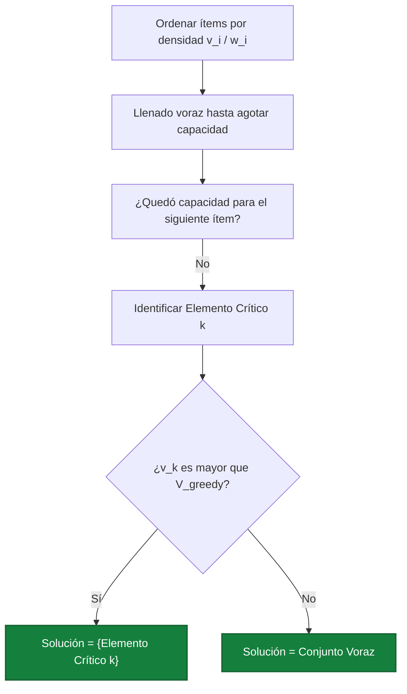

#### 5. Pseudocódigo del Algoritmo (Estilo Examen Presencial)

```text
Algoritmo MochilaAproxMedio(items, W_max):
    // 1. Filtrar los que no caben por sí solos
    candidatos = [ it para it en items si it.peso <= W_max ]
    si candidatos está vacío: devolver (0, [])

    // 2. Ordenar por densidad decreciente de valor (v_i / w_i)
    ordenar candidatos por (it.valor / it.peso) descendente

    v_greedy = 0
    w_greedy = 0
    sol_greedy = []
    elemento_critico = nulo

    // 3. Llenado voraz
    para cada it en candidatos:
        si w_greedy + it.peso <= W_max:
            agregar it a sol_greedy
            w_greedy = w_greedy + it.peso
            v_greedy = v_greedy + it.valor
        sino si elemento_critico es nulo:
            elemento_critico = it  // Primer ítem que desborda la capacidad

    // 4. Cota dual: max(V_greedy, v_critico) garantiza factor 1/2
    si elemento_critico != nulo y elemento_critico.valor > v_greedy:
        devolver (elemento_critico.valor, [ elemento_critico ])
    sino:
        devolver (v_greedy, sol_greedy)
```

<div class="trap-callout">
  <div class="trap-header">⚠️ Trampa Típica de Corrección</div>
  <p><strong>Puntos donde restan puntaje los docentes de FIUBA:</strong></p>
  <ul>
    <li><strong>Olvidar el filtrado inicial $w_i \le W$:</strong> Si un objeto pesa 150 y la mochila es de 100, jamás puede ser candidato ni elemento crítico. Si lo seleccionas como solución única cometes una infracción de factibilidad.</li>
    <li><strong>No usar la relajación fraccionaria en la demostración:</strong> Decir que "el elemento que no entró más lo que entró supera al óptimo" exige justificar formalmente que $OPT \le OPT_{\text{frac}} = V_{\text{greedy}} + \alpha v_k$. Sin la relajación continua no hay demostración válida.</li>
  </ul>
</div>

---

### Patrón de Ejercicio 2.3: Minimización de Latencia y Deadlines (EDF)

Se tienen tareas con tiempos de procesamiento y fechas límite de entrega (deadlines). El objetivo es ordenar las tareas para minimizar la latencia máxima que experimenta cualquier tarea.

---

### Ejercicio 6 — Minimización de Latencia Máxima (Earliest Deadline First)

**Clasificación:** 🟡 IMPORTANTE  
**Origen:** Guía de Ejercicios 02, Ejercicio 9 / Práctica

**Enunciado**  
Se tienen $n$ tareas que deben procesarse secuencialmente en una única máquina que comienza en el tiempo $t = 0$. Cada tarea $i$ tiene una duración $t_i$ y una fecha límite de entrega (deadline) $d_i$. Si una tarea comienza en el tiempo $s_i$, finaliza en $f_i = s_i + t_i$. La latencia de la tarea $i$ se define como $L_i = \max(0, f_i - d_i)$. Diseñar un algoritmo greedy que programe las tareas minimizando la latencia máxima $L_{\max} = \max_i L_i$. Demostrar formalmente su optimalidad.

**Qué está evaluando la cátedra**  
Técnica de ordenamiento por fecha de vencimiento más temprana (*Earliest Deadline First*) y demostración formal por argumento de intercambio de inversiones adyacentes (*Exchange Argument*).

#### 1. Deducción Metodológica Formal (Los 5 Pasos)

1. **Paso 1: Análisis de Reglas Voraces Alternativas y sus Fallas:**
   * *Menor duración primero ($t_i$):* Falla si una tarea corta tiene un deadline muy lejano y desplaza a una tarea larga con vencimiento inmediato.
   * *Menor holgura primero ($d_i - t_i$):* Falla si una tarea corta tiene holgura 1 pero vence en $t=100$, bloqueando a una con holgura 2 que vence en $t=2$.
   * *Criterio Óptimo (EDF):* Ordenar las tareas en orden creciente de sus fechas límites: $d_1 \le d_2 \le \dots \le d_n$.
2. **Paso 2: Ausencia de Tiempo Ocioso:**
   La máquina procesa las tareas de forma continua sin pausas entre tareas consecutivas. El tiempo de inicio de cada tarea es igual al tiempo de fin de la tarea previa.

3. **Paso 3: Algoritmo Voraz:**
   Ordenar por deadline $d_i$ ascendente en $O(n \log n)$ y asignar tiempos $s_i, f_i$ en un único recorrido de $O(n)$.

4. **Paso 4: Complejidad:**
   * **Tiempo:** $\Theta(n \log n)$ por el ordenamiento inicial.
   * **Espacio:** $O(n)$ para la lista del cronograma.

#### 2. Demostración Directa de Optimalidad (Argumento de Intercambio)

* **¿Qué es una inversión?:** Decimos que un orden de tareas tiene una "inversión" si hay dos tareas pegadas $i$ y $j$ donde $i$ se hace antes que $j$, pero $j$ vencía antes ($d_i > d_j$). Nuestro algoritmo Greedy ordena por vencimiento, así que **no tiene ninguna inversión**.
* **Qué pasa si intercambiamos un par invertido $(i, j)$ en una solución óptima:**
  Supongamos que una solución óptima tiene a la tarea $i$ justo antes de $j$ con $d_i > d_j$, y las cambiamos de lugar (hacemos primero $j$ y después $i$):

    1. **El resto de las tareas no cambia:** Todas las tareas anteriores a $i$ y posteriores a $j$ terminan exactamente a la misma hora que antes.
    2. **La tarea $j$ mejora:** Como ahora se hace antes, termina más temprano y su retraso baja (o sigue en 0).
    3. **La tarea $i$ no supera el retraso que antes tenía $j$:** Al pasar atrás, la tarea $i$ termina exactamente a la hora en que antes terminaba $j$. Pero como el vencimiento de $i$ es más holgado que el de $j$ ($d_i > d_j$), el retraso que sufre ahora $i$ es menor que el retraso que sufría antes $j$.
* **Conclusión:** Al desarmar cualquier inversión entre dos tareas vecinas, el retraso máximo nunca empeora. Repitiendo estos cambios hasta quitar todas las inversiones, llegamos al orden de nuestro algoritmo Greedy sin empeorar el resultado óptimo. **Por lo tanto, Greedy es óptimo.**

#### 3. Ejemplo Concreto y Tabla de Traza Paso a Paso

Consideremos 4 tareas:

| Tarea ($i$) | Duración ($t_i$) | Deadline ($d_i$) |
| :---: | :---: | :---: |
| **A** | $3$ | $6$ |
| **B** | $2$ | $4$ |
| **C** | $1$ | $9$ |
| **D** | $4$ | $8$ |

*Paso 1: Ordenar por deadline ascendente (EDF):*

1. Tarea **B**: $d_B = 4$
2. Tarea **A**: $d_A = 6$
3. Tarea **D**: $d_D = 8$
4. Tarea **C**: $d_C = 9$

*Paso 2: Traza temporal continua:*

| Orden | Tarea | Duración ($t_i$) | Inicio ($s_i$) | Fin ($f_i$) | Deadline ($d_i$) | Retraso ($f_i - d_i$) | Latencia ($L_i$) |
| :---: | :---: | :---: | :---: | :---: | :---: | :---: | :---: |
| **1** | **B** | $2$ | $0$ | $2$ | $4$ | $2 - 4 = -2$ | **$0$** |
| **2** | **A** | $3$ | $2$ | $5$ | $6$ | $5 - 6 = -1$ | **$0$** |
| **3** | **D** | $4$ | $5$ | $9$ | $8$ | $9 - 8 = +1$ | **$1$** |
| **4** | **C** | $1$ | $9$ | $10$ | $9$ | $10 - 9 = +1$ | **$1$** |

*Latencia máxima alcanzada:* $L_{\max} = \max(0, 0, 1, 1) = 1$. Es imposible lograr latencia 0 porque el trabajo total acumulado supera los plazos.

#### 4. Diagrama Visual de Cronograma

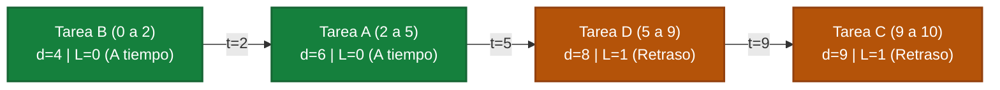

#### 5. Pseudocódigo del Algoritmo (Estilo Examen Presencial)

```text
Algoritmo MinimizarLatenciaEDF(tareas):
    // 1. Regla voraz: ordenar por deadline ascendente (Earliest Deadline First)
    ordenar tareas por deadline d_i ascendente

    tiempo_actual = 0
    latencia_maxima = 0
    cronograma = []

    para cada tarea (nombre, t_i, d_i) en tareas:
        inicio = tiempo_actual
        fin = tiempo_actual + t_i
        latencia = max(0, fin - d_i)

        si latencia > latencia_maxima:
            latencia_maxima = latencia

        agregar (nombre, inicio, fin, latencia) a cronograma
        tiempo_actual = fin

    devolver (latencia_maxima, cronograma)
```

<div class="trap-callout">
  <div class="trap-header">⚠️ Trampa Típica de Corrección</div>
  <p><strong>Puntos donde restan puntaje los docentes de FIUBA:</strong></p>
  <ul>
    <li><strong>Definición de Latencia vs Retraso negativo:</strong> La latencia nunca es negativa ($L_i = \max(0, f_i - d_i)$). Si entregas una tarea antes del deadline, su latencia es $0$, no un número negativo que compense a otras tareas.</li>
    <li><strong>Tiempos de arribo ($r_i$):</strong> Este algoritmo asume que todas las tareas están disponibles en $t = 0$. Si el enunciado incluye tiempos de llegada diferentes ($r_i \neq 0$), el problema se convierte en NP-Duro y EDF simple deja de ser óptimo.</li>
  </ul>
</div>

---

### Patrón de Ejercicio 2.4: Heurísticas Voraces de Cobertura (Set Cover Greedy)

Aparece cuando el problema exacto es NP-Hard (como Set Cover o Dominating Set) y el enunciado solicita explícitamente: *"Diseñar un algoritmo greedy de costo/beneficio marginal..."*.

---

### Ejercicio 7 — Ubicación Voraz de Antenas Celulares con Costo por Vecindario

**Clasificación:** 🔴 IMPRESCINDIBLE  
**Origen:** Parcial 2024-2-3 (10 de diciembre de 2024), Ejercicio 4

**Enunciado**  
Una empresa de telefonía celular desea colocar antenas en una grilla de celdas para brindar cobertura a un conjunto de vecindarios distribuidos en la zona. Cada antena colocada en una celda $(i, j)$ da cobertura a esa celda y a las 8 que la rodean (un bloque de $3 \times 3$). El costo de instalar una antena en la celda $(i, j)$ es de $CTO_{ij}$ pesos. Se desea cubrir todos los vecindarios minimizando el costo total. Diseñar un algoritmo Greedy que determine en qué celdas colocar antenas. Justificar la regla de elección voraz, la cota de aproximación y la complejidad del algoritmo.

**Qué está evaluando la cátedra**  
Modelado del problema canónico de *Weighted Set Cover* mediante una heurística voraz de costo/beneficio marginal, junto con el análisis de su factor de aproximación logarítmico de Chvátal.

#### 1. Deducción Metodológica Formal (Los 5 Pasos)

1. **Paso 1: Formulación como Set Cover con Costos:**
   Tenemos el conjunto de todos los vecindarios a cubrir ($V$ en total). Cada celda candidata $c = (i, j)$ cubre un grupo de vecindarios en su bloque de $3 \times 3$ y cuesta $CTO_c$.

2. **Paso 2: Regla Voraz (Menor costo por cada vecindario nuevo):**
   En cada paso miramos cuántos vecindarios **que todavía no tienen cobertura** ($\text{nuevos}(c)$) cubriría cada antena candidata $c$, y calculamos su costo por vecindario nuevo:
   $$\text{Ratio}(c) = \frac{CTO_c}{\text{nuevos}(c)}$$
   Elegimos la antena con el **menor ratio** (la más barata por cada nuevo vecindario que suma).

3. **Paso 3: Actualización y Terminación:**
   Agregamos la antena elegida, marcamos sus vecindarios como cubiertos y repetimos hasta que no queden vecindarios sin cubrir.

4. **Paso 4: ¿Es óptimo? (Garantía de Aproximación):**
   **No garantiza el óptimo** porque *Set Cover* es NP-Completo. Es una heurística que garantiza un costo de a lo sumo $(\ln V + 1) \cdot OPT$ (aproximación logarítmica).

5. **Paso 5: Complejidad:**
   * En cada paso evaluamos las $M$ celdas candidatas mirando sus 9 casillas vecinas en $O(1)$.
   * Como en cada paso cubrimos al menos 1 vecindario nuevo, damos a lo sumo $V$ vueltas.
   * Complejidad temporal: $O(V \cdot M)$. Espacio: $O(V + M)$.

#### 2. Ejemplo Concreto y Traza Paso a Paso

Sean 4 vecindarios $\{v_1, v_2, v_3, v_4\}$ y 3 antenas candidatas:

| Antena | Cobertura ($S_c$) | Costo ($CTO$) |
| :---: | :---: | :---: |
| **A1** | $\{v_1, v_2\}$ | $\$10$ |
| **A2** | $\{v_2, v_3, v_4\}$ | $\$24$ |
| **A3** | $\{v_3, v_4\}$ | $\$12$ |

*Iteración 1 ($U_{\text{restantes}} = \{v_1, v_2, v_3, v_4\}$):*

* A1: cubre $2$ nuevos $\implies$ Ratio $= 10 / 2 = 5.0$.
* A2: cubre $3$ nuevos $\implies$ Ratio $= 24 / 3 = 8.0$.
* A3: cubre $2$ nuevos $\implies$ Ratio $= 12 / 2 = 6.0$.
* **Elección voraz:** Se instala **A1** (costo $\$10$). Quedan sin cubrir $\{v_3, v_4\}$.

*Iteración 2 ($U_{\text{restantes}} = \{v_3, v_4\}$):*

* A2: cubre $\{v_3, v_4\}$ ($2$ nuevos) $\implies$ Ratio $= 24 / 2 = 12.0$.
* A3: cubre $\{v_3, v_4\}$ ($2$ nuevos) $\implies$ Ratio $= 12 / 2 = 6.0$.
* **Elección voraz:** Se instala **A3** (costo $\$12$). Quedan sin cubrir $\emptyset$.

*Resultado Greedy:* Antenas $\{A1, A3\}$ con Costo Total $= 10 + 12 = \$22$. (En este caso coincide con el óptimo global).

#### 3. Diagrama Visual de Cobertura de Conjuntos


#### 4. Pseudocódigo del Algoritmo (Estilo Examen Presencial)

```text
Algoritmo AntenasSetCoverGreedy(vecindarios, antenas):
    no_cubiertos = copiar(vecindarios)
    antenas_elegidas = []

    mientras no_cubiertos no esté vacío:
        mejor_antena = nulo
        mejor_ratio = infinito

        // Evaluar costo marginal por cada nuevo vecindario cubierto
        para cada antena A en antenas:
            nuevos = cantidad(A.cobertura intersección no_cubiertos)
            si nuevos > 0:
                ratio = A.costo / nuevos
                si ratio < mejor_ratio:
                    mejor_ratio = ratio
                    mejor_antena = A

        si mejor_antena es nulo:
            break  // Infactible cubrir los restantes

        agregar mejor_antena a antenas_elegidas
        no_cubiertos = no_cubiertos - mejor_antena.cobertura

    devolver antenas_elegidas
```

<div class="trap-callout">
  <div class="trap-header">⚠️ Trampa Típica de Corrección</div>
  <p><strong>Puntos donde restan puntaje los docentes de FIUBA:</strong></p>
  <ul>
    <li><strong>Calcular el ratio sobre la cobertura total histórica:</strong> El denominador del ratio DEBE ser exclusivamente los vecindarios <em>no cubiertos hasta el momento</em> ($\Delta(c) = |S_c \cap U_{\text{restantes}}|$). Si divides por $|S_c|$ fijo, una antena que cubre celdas ya satisfechas parecerá falsamente rentable.</li>
    <li><strong>Afirmar que es óptimo:</strong> Set Cover es NP-Completo. Cualquier afirmación de que este greedy es siempre óptimo se califica con 0 puntos. Es una heurística con cota de aproximación armónica $\ln |U| + 1$.</li>
  </ul>
</div>

---

### Patrón de Ejercicio 2.5: Greedy en Caminos y Etapas (Demostración de No-Optimalidad)

Aparece cuando se plantea un problema de etapas secuenciales y se pide evaluar si un enfoque voraz local alcanza el óptimo global.

---

### Ejercicio 8 — Traslado Crítico INVAP: Enfoque Voraz y Contraejemplo Formal

**Clasificación:** 🔴 IMPRESCINDIBLE  
**Origen:** Parcial 2025-1-2 (17 de junio de 2025), Ejercicio 3

**Enunciado**  
Para el traslado de una carga peligrosa del INVAP de Ezeiza a Bariloche a través de etapas diarias (con alternativas de ciudades intermedias y costos de seguro asociados a cada tramo):  

1. Diseñar un algoritmo Greedy que decida el itinerario.  
2. Indicar si la solución obtenida será óptima o no. Fundamentar con un contraejemplo riguroso con datos numéricos explícitos.

**Qué está evaluando la cátedra**  
Construcción de heurísticas paso a paso y formulación de contraejemplos matemáticos claros para refutar la optimalidad de algoritmos voraces en grafos de decisión multietapa.

#### 1. Deducción Metodológica Formal

1. **Paso 1: Regla Voraz Local:**
   Estando en la ciudad actual en la etapa $t$, el algoritmo voraz selecciona como siguiente parada aquella ciudad conectada en la etapa $t+1$ que tenga el **menor costo de seguro inmediato**.

2. **Paso 2: Veredicto de Optimalidad:**
   **El algoritmo NO es óptimo**. Un ahorro mínimo en el tramo inicial puede forzar al convoy a quedar atrapado en una ciudad cuyas únicas salidas hacia el destino tengan costos astronómicos.

3. **Paso 3: Protocolo de Contraejemplo de Cátedra:**
   Para refutar formalmente un algoritmo voraz se deben definir:

   - Los nodos y aristas de una red pequeña pero completa.
   - La traza paso a paso de la decisión voraz y su costo total acumulado.
   - Una ruta alternativa factible con costo estrictamente inferior.
   - Conclusión formal matemática: $\text{Costo}(\text{Voraz}) > \text{Costo}(\text{Alternativa})$.

#### 2. Contraejemplo Formal Numérico

Sea el traslado desde **Origen $E$ (Ezeiza)** hasta **Destino $B$ (Bariloche)** a través de dos ciudades intermedias en la Etapa 1 ($V_1$ y $V_2$):

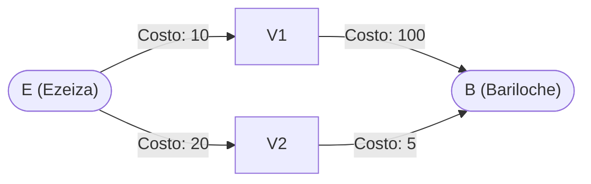

* **Traza del Algoritmo Greedy:**
    1. En el nodo inicial $E$, evalúa las aristas salientes:
     * Tramo $E \to V_1$: costo $10$.
     * Tramo $E \to V_2$: costo $20$.
    2. Elige vorazmente el tramo de menor costo inmediato: $E \to V_1$ ($10$ pesos).
    3. Desde $V_1$, la única conexión hacia el destino es $V_1 \to B$ con costo $100$ pesos.
    4. **Costo total obtenido por Greedy:**
     $$\text{Costo}_{\text{greedy}} = 10 + 100 = 110 \text{ pesos}$$

* **Solución Alternativa Factible:**
    1. Tramo inicial $E \to V_2$ con costo $20$ pesos (rechazado por el voraz).
    2. Tramo final $V_2 \to B$ con costo $5$ pesos.
    3. **Costo total alternativo:**
     $$\text{Costo}_{\text{alternativo}} = 20 + 5 = 25 \text{ pesos}$$

* **Conclusión Formal:**
  $$\text{Costo}_{\text{greedy}} = 110 > 25 = \text{Costo}_{\text{alternativo}}$$
  Como la solución voraz es estrictamente peor que la alternativa factible, queda demostrado que **el enfoque greedy no garantiza la solución óptima**.
  *Paradigma adecuado:* Este problema exhibe subestructura óptima con superposición de subproblemas y debe modelarse mediante **Programación Dinámica** en tiempo $O(V + E)$ (ver Ejercicio 32). $\blacksquare$

#### 3. Pseudocódigo del Algoritmo Greedy y Contraejemplo Formal

```text
Algoritmo TrasladoINVAPGreedy(G, origen, destino):
    actual = origen
    camino = [ actual ]
    costo_total = 0

    mientras actual != destino:
        vecinos = G.vecinos(actual)
        si vecinos está vacío:
            devolver (infinito, [])

        // Elección voraz miope: arista saliente de menor costo inmediato
        (mejor_siguiente, menor_costo) = vecino de menor costo en vecinos
        agregar mejor_siguiente a camino
        costo_total = costo_total + menor_costo
        actual = mejor_siguiente

    devolver (costo_total, camino)

// Demostración del contraejemplo numérico:
// Grafo: E -> V1 (costo 10), E -> V2 (costo 20)
//        V1 -> B (costo 100), V2 -> B (costo 5)
// Decisión Voraz:  E -> V1 -> B  =>  Costo = 10 + 100 = 110
// Ruta Óptima:     E -> V2 -> B  =>  Costo = 20 + 5 = 25
// Conclusión: Costo(Greedy) = 110 > 25 = OPT  =>  Greedy NO es óptimo.
```

<div class="trap-callout">
  <div class="trap-header">⚠️ Trampa Típica de Corrección</div>
  <p><strong>Puntos donde restan puntaje los docentes de FIUBA:</strong></p>
  <ul>
    <li><strong>Contraejemplos sin valores numéricos:</strong> Escribir <em>"podría ser que después de la primera ciudad los caminos sean muy caros"</em> no es un contraejemplo válido para la cátedra y recibe 0 puntos. Se exige un grafo explícito con etiquetas de costos y sumatorias numéricas comparativas.</li>
    <li><strong>Afirmar que Dijkstra es greedy:</strong> Si bien Dijkstra utiliza una cola de prioridad voraz sobre la distancia acumulada, **no toma decisiones miopes por arista individual**. Evalúa la distancia total acumulada desde la fuente $d[u] + w(u, v)$, lo que pertenece conceptualmente a la programación dinámica sobre grafos dirigidos acíclicos.</li>
  </ul>
</div>

---

### Errores Frecuentes en Exámenes sobre Greedy

1. **Afirmar que Greedy es óptimo sin demostrarlo:** Poner *"es óptimo porque siempre elijo lo mejor en cada paso"* es causal de pérdida total de puntos. Se debe presentar *Greedy Stays Ahead* o *Argumento de Intercambio*.
2. **Dar un contraejemplo sin números:** Un contraejemplo exige nodos, aristas y costos numéricos explícitos.
3. **No justificar por qué el algoritmo es voraz:** Se debe explicitar que la decisión es local, miope e irrevocable.
4. **Confundir Interval Scheduling con Interval Scheduling Ponderado:** Si las tareas tienen valores o beneficios distintos, ordenar por tiempo de fin no es óptimo.


---

## 6. Tema 3: Backtracking y Branch & Bound

### Conceptos Mínimos de Supervivencia

1. **Definición del Paradigma:**
   Backtracking es una técnica de búsqueda exhaustiva sistemática sobre un **árbol de estados combinatorios**. Avanza construyendo soluciones candidatas paso a paso; en cuanto determina que el estado actual no puede completarse para dar una solución válida u óptima, retrocede (*backtrack*) al estado anterior deshaciendo los cambios aplicados.

2. **Las Dos Clases Fundamentales de Podas:**
   * **Poda por Factibilidad (Feasibility Pruning):** Se aplica tanto en problemas de decisión como de optimización. Descarta una rama si el estado actual viola una restricción obligatoria del problema (por ejemplo, dos reinas en la misma diagonal, o la suma acumulada supera el valor objetivo).
   * **Poda por Cota u Optimalidad (Branch and Bound):** Se aplica en problemas de optimización. Se calcula una cota teórica (superior para maximización, inferior para minimización) del mejor valor que podría lograrse explorando el subárbol actual. Si esa cota no supera a la mejor solución factible ya registrada (`mejor_solucion`), la rama entera se poda de raíz.

3. **Estructuras Auxiliares para Validación en $O(1)$:**
   En los parciales es fuertemente penalizado verificar restricciones recorriendo estructuras con bucles $O(n)$ dentro de cada paso recursivo. Se deben emplear **arreglos o tablas booleanas auxiliares** para chequear y marcar ocupación en tiempo constante $O(1)$ (ejemplo: columnas y diagonales directas e inversas en N-Reinas).

4. **Complejidad en el Peor Caso:**
   Aunque las podas reducen drásticamente el tiempo de ejecución empírico, la complejidad asintótica en el peor caso sigue siendo exponencial ($O(2^n), O(k^n)$) o factorial ($O(n!)$), dado que los problemas resueltos típicamente son NP-Hard.

---

### Patrón de Ejercicio 3.1: Posicionamiento en Tableros con Estructuras O(1)

Aparece en enunciados de colocación de piezas (reinas, caballos, torres) donde se exige explicitar las estructuras de datos que garantizan validaciones en tiempo constante.

---

### Ejercicio 9 — Problema de las 8 Reinas con Control de Conflictos en O(1)

**Clasificación:** 🔴 IMPRESCINDIBLE  
**Origen:** Parcial 2025-1-2 (17 de junio de 2025), Ejercicio 4 / Guía 03 Ejercicio 3

**Enunciado**  
Realizar un algoritmo que resuelva el problema de las 8 reinas mediante backtracking. El problema consiste en ubicar 8 reinas en un tablero de ajedrez de $8 \times 8$ de manera que no haya dos reinas en la misma fila, columna o diagonal. Indicar detalladamente las estructuras de datos utilizadas para representar el problema y la solución, garantizando que el chequeo de amenazas se realice en $O(1)$. Justificar la complejidad temporal y espacial.

**Qué está evaluando la cátedra**  
Construcción de un árbol de búsqueda fila por fila, uso de vectores booleanos de acceso directo para columnas y diagonales directas/inversas en $O(1)$, y gestión simétrica del estado (*hacer decisión $\to$ recursión $\to$ deshacer decisión*).

#### 1. Deducción Metodológica Formal (Los 5 Pasos de Backtracking)

1. **Paso 1: Definición del Estado y Vector Solución:**
   Colocamos exactamente una reina por fila, avanzando fila por fila desde $fila = 0$ hasta $fila = 7$. Esto elimina automáticamente la posibilidad de conflictos de fila.
   El vector solución es un arreglo unidimensional `solucion` de longitud 8, donde `solucion[i] = col` indica que en la fila $i$ la reina fue colocada en la columna `col`.

2. **Paso 2: Deducción Matemática del Mapeo de Diagonales en $O(1)$:**
   * **Columnas:** Arreglo booleano `col_ocupada[8]`. Si la columna $c$ tiene una reina, `col_ocupada[c] = True`.
   * **Diagonal Principal ($\setminus$):** Para todas las celdas $(f, c)$ que comparten una misma diagonal principal descendente, la diferencia $f - c$ es una constante invariante:
     $$-7 \le f - c \le 7$$
     Para mapear este rango de 15 valores a índices válidos de arreglo $[0, 14]$, aplicamos un desplazamiento de $+7$:
     $$\text{clave}_{\text{prin}}(f, c) = f - c + 7$$
     Estructura: arreglo booleano `diag_prin[15]`.

   * **Diagonal Secundaria ($/$):** Para todas las celdas $(f, c)$ que comparten una misma diagonal ascendente, la suma $f + c$ es una constante invariante:
     $$0 \le f + c \le 14$$
     Directamente mapea al rango $[0, 14]$:
     $$\text{clave}_{\text{sec}}(f, c) = f + c$$
     Estructura: arreglo booleano `diag_sec[15]`.

3. **Paso 3: Poda por Factibilidad en $O(1)$:**
   Una reina puede situarse en $(fila, col)$ si y solo si:
   $$\neg \, col\_ocupada[col] \quad \land \quad \neg \, diag\_prin[fila - col + 7] \quad \land \quad \neg \, diag\_sec[fila + col]$$
   Esta consulta involucra exactamente 3 accesos indexados a memoria en tiempo $O(1)$.

4. **Paso 4: Mecanismo de Backtracking (Restauración de Estado):**
   Al probar una columna factible, se marcan en `True` las 3 estructuras booleanas y se almacena `solucion[fila] = col`. Al retornar de la llamada recursiva (si esa rama no alcanzó solución), es **estrictamente obligatorio** restablecer los booleanos a `False` y `solucion[fila] = -1` antes de probar la siguiente columna.

5. **Paso 5: Complejidad:**
   * **Tiempo:** En el peor caso teórico sin podas el espacio sería $8^8 \approx 16.7$ millones de hojas. Al colocar una reina por fila y descartar columnas usadas, el árbol se reduce a $8! = 40.320$ permutaciones. Con las podas diagonales en tiempo real, el algoritmo explora apenas unos 876 nodos para hallar la primera solución. Complejidad asintótica: $O(N!)$ en el peor caso.
   * **Espacio Auxiliar:** $O(N)$ para la pila de recursión (profundidad 8) más $8 + 15 + 15 = 38$ booleanos de control.

#### 2. Explicación Directa de por qué el Chequeo Diagonal es O(1)

* **Diagonal Principal ($\setminus$, baja de izquierda a derecha):** Cuando nos movemos un casillero abajo y uno a la derecha (`fila + 1`, `col + 1`), la resta `fila - col` no cambia. Por lo tanto, todas las casillas de una misma diagonal principal tienen el mismo resultado en `fila - col`. Le sumamos `+ 7` solo para que el índice quede entre `0` y `14` y no dé negativo.
* **Diagonal Secundaria ($/$, sube de izquierda a derecha):** Cuando nos movemos un casillero arriba y uno a la derecha (`fila - 1`, `col + 1`), lo que se compensa y se mantiene siempre igual es la suma `fila + col` (entre `0` y `14`).
* Gracias a esto, para saber si una casilla `(fila, col)` está amenazada no hace falta recorrer el tablero: alcanza con mirar 3 posiciones fijas en los arreglos booleanos (`col_ocupada[col]`, `diag_prin[fila - col + 7]` y `diag_sec[fila + col]`) en tiempo `O(1)`.

#### 3. Ejemplo Concreto y Tabla de Traza Paso a Paso (Primeras Filas)

Búsqueda de la primera solución sobre el tablero $8 \times 8$:

| Fila | Columna Probada | Clave Col ($c$) | Clave Diag Prin ($f - c + 7$) | Clave Diag Sec ($f + c$) | Estado de Booleanos | Decisión |
| :---: | :---: | :---: | :---: | :---: | :---: | :--- |
| **0** | $0$ | $0$ | $0 - 0 + 7 = 7$ | $0 + 0 = 0$ | Libres | **Colocar Reina en $(0, 0)$**, marcar |
| **1** | $0$ | $0$ | $1 - 0 + 7 = 8$ | $1 + 0 = 1$ | `col[0]=True` | **PODA** (conflicto columna 0) |
| **1** | $1$ | $1$ | $1 - 1 + 7 = 7$ | $1 + 1 = 2$ | `diag_prin[7]=True` | **PODA** (conflicto diag prin con $(0,0)$) |
| **1** | $2$ | $2$ | $1 - 2 + 7 = 6$ | $1 + 2 = 3$ | Libres | **Colocar Reina en $(1, 2)$**, marcar |
| **2** | $0$ | $0$ | - | - | `col[0]=True` | **PODA** (conflicto columna 0) |
| **2** | $1$ | $1$ | $2 - 1 + 7 = 8$ | $2 + 1 = 3$ | `diag_sec[3]=True` | **PODA** (conflicto diag sec con $(1,2)$) |
| **2** | $2$ | $2$ | - | - | `col[2]=True` | **PODA** (conflicto columna 2) |
| **2** | $3$ | $3$ | $2 - 3 + 7 = 6$ | $2 + 3 = 5$ | `diag_prin[6]=True` | **PODA** (conflicto diag prin con $(1,2)$) |
| **2** | $4$ | $4$ | $2 - 4 + 7 = 5$ | $2 + 4 = 6$ | Libres | **Colocar Reina en $(2, 4)$**, marcar |

*Primera solución completa hallada:*
`solucion = [0, 4, 7, 5, 2, 6, 1, 3]` (columnas por fila de 0 a 7).

#### 4. Diagrama del Árbol de Decisiones de Backtracking

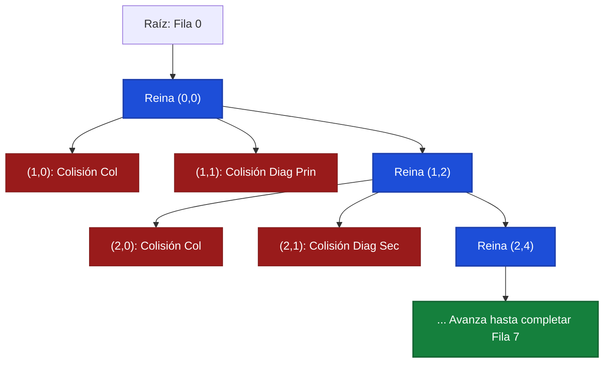

#### 5. Pseudocódigo del Algoritmo (Estilo Examen Presencial)

```text
Algoritmo Resolver8Reinas():
    n = 8
    solucion = arreglo de tamaño n inicializado en -1
    col_ocupada = arreglo de tamaño n en Falso
    diag_prin = arreglo de tamaño (2n - 1) en Falso  // fila - col + (n - 1)
    diag_sec = arreglo de tamaño (2n - 1) en Falso   // fila + col

    si Resolver8ReinasBT(0, solucion, col_ocupada, diag_prin, diag_sec, n):
        devolver solucion
    sino:
        devolver "Sin solución"

función Resolver8ReinasBT(fila, solucion, col_ocupada, diag_prin, diag_sec, n):
    // Caso Base: se ubicaron las 8 reinas sin conflictos
    si fila == n:
        devolver Verdadero

    para col desde 0 hasta n - 1:
        dp = fila - col + (n - 1)
        ds = fila + col

        // Poda por Factibilidad en O(1)
        si no col_ocupada[col] y no diag_prin[dp] y no diag_sec[ds]:
            // 1. Marcar decisión
            solucion[fila] = col
            col_ocupada[col] = Verdadero
            diag_prin[dp] = Verdadero
            diag_sec[ds] = Verdadero

            // 2. Recursión a fila siguiente
            si Resolver8ReinasBT(fila + 1, solucion, col_ocupada, diag_prin, diag_sec, n):
                devolver Verdadero

            // 3. Deshacer decisión (Backtrack)
            solucion[fila] = -1
            col_ocupada[col] = Falso
            diag_prin[dp] = Falso
            diag_sec[ds] = Falso

    devolver Falso
```

<div class="trap-callout">
  <div class="trap-header">⚠️ Trampa Típica de Corrección</div>
  <p><strong>Puntos donde restan puntaje los docentes de FIUBA:</strong></p>
  <ul>
    <li><strong>Olvidar desmarcar booleanos al retroceder:</strong> Si omites <code>col_ocupada[col] = False</code> tras retornar de la llamada recursiva, las ramas hermanas creerán que la columna continúa ocupada, causando que el algoritmo falle en encontrar soluciones válidas.</li>
    <li><strong>Verificar colisiones recorriendo las filas anteriores con un bucle:</strong> Hacer un bucle <code>for f in range(fila): if solucion[f] == col or ...</code> dentro de cada nodo agrega un costo $O(n)$ por estado, degradando la complejidad de verificación a $O(n \cdot n!)$ en lugar de $O(n!)$ con chequeo $O(1)$.</li>
    <li><strong>Error de signo en la diagonal principal:</strong> Olvidar el $+7$ en $f - col$ produce índices negativos (en Python mapea al final de la lista alterando otras diagonales; en C/Java arroja error de segmentación).</li>
  </ul>
</div>

---

### Patrón de Ejercicio 3.2: Descomposición Numérica con Cotas (Lagrange)

Problemas donde se debe descomponer un número entero en sumas de componentes (cuadrados, primos, monedas) bajo un número fijo de términos.

---

### Ejercicio 10 — Suma de Cuatro Cuadrados de Lagrange con Cotas y Podas

**Clasificación:** 🔴 IMPRESCINDIBLE  
**Origen:** Parcial 2024-2-1 (5 de noviembre de 2024), Ejercicio 1

**Enunciado**  
El teorema de los cuatro cuadrados de Lagrange especifica que cualquier número entero no negativo $n$ puede expresarse como la suma de cuatro cuadrados de enteros no negativos:
$$n = w^2 + x^2 + y^2 + z^2$$

Desarrollar un algoritmo que, dado el valor de $n$, indique cuáles son los cuatro enteros no negativos que lo componen. Justificar detalladamente el árbol de decisiones, las podas aplicadas y la complejidad del algoritmo.

**Qué está evaluando la cátedra**  
Diseño de un árbol de backtracking acotado a profundidad 4, imposición de orden no creciente para eliminar ramas simétricas redundantes ($w \ge x \ge y \ge z$), poda por cota inferior y determinación analítica del último término en $O(1)$.

#### 1. Deducción Metodológica Formal (Los 5 Pasos)

1. **Paso 1: Eliminación de Simetrías por Orden No Creciente:**
   Toda solución permutable representa la misma descomposición. Para evitar explorar las $4! = 24$ permutaciones repetidas de una misma tupla, forzamos la restricción de monotonía:
   $$w \ge x \ge y \ge z \ge 0$$

2. **Paso 2: Determinación Analítica en $O(1)$ del Cuarto Cuadrado:**
   No es necesario iterar en el cuarto nivel. Si ya asignamos $w, x, y$, el remanente obligatorio es $R = n - (w^2 + x^2 + y^2)$. El algoritmo simplemente verifica en $O(1)$ si $R$ es un cuadrado perfecto ($z = \lfloor\sqrt{R}\rfloor$ y $z^2 = R$) y si respeta $z \le y$. Si se cumplen ambas condiciones, la solución se completa con éxito sin bifurcaciones adicionales.

3. **Paso 3: Poda por Cota Superior (Factibilidad):**
   En el paso $k$ con remanente $R$, ningún valor $v$ puede superar $\lfloor\sqrt{R}\rfloor$, ni el valor asignado en el paso anterior $v_{\text{previo}}$:
   $$v \le \min(v_{\text{previo}}, \; \lfloor\sqrt{R}\rfloor)$$

4. **Paso 4: Poda por Cota Inferior (Optimalidad/Alcance):**
   Quedan $(4 - paso)$ términos por asignar. Como los valores son no crecientes, cada uno de los términos restantes aportará a lo sumo $v^2$. Si la suma máxima potencial es estrictamente menor al remanente requerido:
   $$(4 - paso) \cdot v^2 < R$$
   entonces es **matemáticamente imposible** alcanzar $R$ utilizando valores menores o iguales a $v$. Se interrumpe el bucle de prueba (`break`) podando todo el resto del subárbol de una sola vez.

5. **Paso 5: Complejidad:**
   * **Tiempo:** Sin podas, 4 bucles hasta $\sqrt{n}$ requerirían $O((\sqrt{n})^4) = O(n^2)$. Al resolver el cuarto término analíticamente en $O(1)$, la cota máxima cae a $O((\sqrt{n})^3) = O(n^{3/2})$. Con la poda de simetría ($w \ge x \ge y \ge z$) y la cota inferior $(4-k)v^2 < R$, el número real de estados explorados es una pequeña fracción de $n^{3/2}$, resolviendo $n = 10^6$ en milisegundos.
   * **Espacio Auxiliar:** $O(1)$ de memoria adicional fija más la pila de recursión de profundidad a lo sumo 4.

#### 2. Ejemplo Concreto y Traza Paso a Paso ($n = 31$)

Sea $n = 31$. Buscamos $w \ge x \ge y \ge z$ tales que $w^2 + x^2 + y^2 + z^2 = 31$.

| Nivel / Paso | Remanente ($R$) | Límite Superior ($v \le \min$) | Valor $v$ Probado | ¿Poda $(4-k)v^2 < R$? | Acción Siguiente |
| :---: | :---: | :---: | :---: | :---: | :--- |
| **Paso 0 ($w$)** | $31$ | $\lfloor\sqrt{31}\rfloor = 5$ | $v = 5$ | $4 \cdot 5^2 = 100 \ge 31$ (OK) | Asignar $w = 5$, nuevo $R = 31 - 25 = 6$ |
| **Paso 1 ($x$)** | $6$ | $\min(5, \lfloor\sqrt{6}\rfloor) = 2$ | $v = 2$ | $3 \cdot 2^2 = 12 \ge 6$ (OK) | Asignar $x = 2$, nuevo $R = 6 - 4 = 2$ |
| **Paso 2 ($y$)** | $2$ | $\min(2, \lfloor\sqrt{2}\rfloor) = 1$ | $v = 1$ | $2 \cdot 1^2 = 2 \ge 2$ (OK) | Asignar $y = 1$, nuevo $R = 2 - 1 = 1$ |
| **Paso 3 ($z$)** | $1$ | - | $z = \lfloor\sqrt{1}\rfloor = 1$ | $1^2 = 1 == R$ y $1 \le 1$ | **¡ÉXITO EN EL 4TO TÉRMINO!** |

*Solución obtenida:* $(w, x, y, z) = (5, 2, 1, 1)$.
*Verificación:* $5^2 + 2^2 + 1^2 + 1^2 = 25 + 4 + 1 + 1 = 31$.
*Eficiencia:* Se halló la solución en exactamente 4 evaluaciones directas sin retrocesos.

#### 3. Diagrama Visual del Árbol de Lagrange

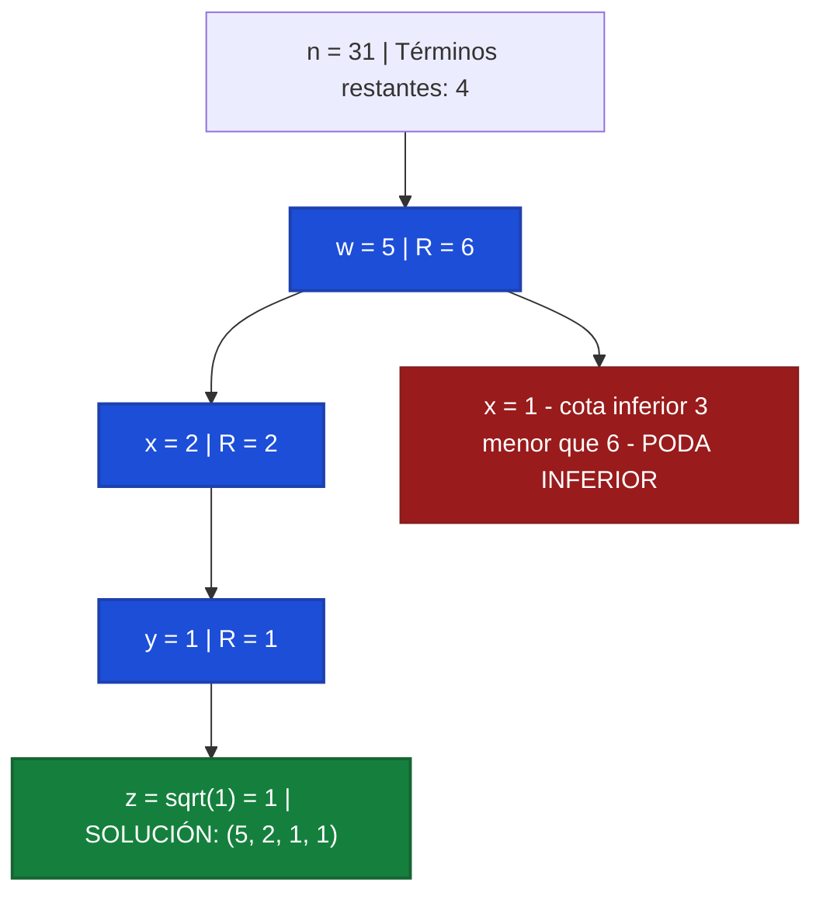

#### 4. Pseudocódigo del Algoritmo (Estilo Examen Presencial)

```text
Algoritmo CuatroCuadradosLagrange(n):
    solucion = arreglo [0, 0, 0, 0]
    limite_inicial = entero(raiz(n))

    si CuatroCuadradosBT(0, n, limite_inicial, solucion):
        devolver solucion
    sino:
        devolver "Sin solución"

función CuatroCuadradosBT(paso, remanente, max_limite, solucion):
    // En el 4to término, se calcula directamente por raíz exacta en O(1)
    si paso == 3:
        z = entero(raiz(remanente))
        si z * z == remanente y z <= max_limite:
            solucion[3] = z
            devolver Verdadero
        devolver Falso

    limite_sup = min(max_limite, entero(raiz(remanente)))

    para v desde limite_sup bajando hasta 0:
        // Poda por cota inferior: ni usando v en todos los restantes alcanzamos remanente
        terminos_restantes = 4 - paso
        si terminos_restantes * (v * v) < remanente:
            romper bucle // Ningún valor menor podrá alcanzarlo

        solucion[paso] = v
        si CuatroCuadradosBT(paso + 1, remanente - v * v, v, solucion):
            devolver Verdadero

    devolver Falso
```

<div class="trap-callout">
  <div class="trap-header">⚠️ Trampa Típica de Corrección</div>
  <p><strong>Puntos donde restan puntaje los docentes de FIUBA:</strong></p>
  <ul>
    <li><strong>Iterar el 4to cuadrado en un bucle:</strong> Si el alumno escribe 4 bucles anidados en lugar de resolver el último término con <code>isqrt(remanente)</code> en $O(1)$, la cátedra descuenta puntos por falta de optimización algorítmica.</li>
    <li><strong>No imponer $w \ge x \ge y \ge z$:</strong> Permitir que los valores crezcan nuevamente en niveles inferiores provoca que el algoritmo evalúe las 24 permutaciones de la misma suma, multiplicando innecesariamente el tiempo de cómputo.</li>
  </ul>
</div>

---

### Patrón de Ejercicio 3.3: Cobertura en Grafos con Branch and Bound (Vertex Cover)

Aparece cuando se solicita un algoritmo exacto para un problema NP-Hard sobre grafos no dirigidos.

---

### Ejercicio 11 — Vertex Cover Mínimo por Branch and Bound

**Clasificación:** 🔴 IMPRESCINDIBLE  
**Origen:** Parcial 2024-2-2 (26 de noviembre de 2024), Ejercicio 1 / Guía 03 Ejercicio 13

**Enunciado**  
Implementar un algoritmo que dado un grafo no dirigido $G = (V, E)$ devuelva un conjunto de vértices que represente un mínimo Vertex Cover del mismo. Explicar el árbol de decisiones, las podas aplicadas y la complejidad.

**Qué está evaluando la cátedra**  
Estrategia de ramificación sobre aristas no cubiertas (al menos uno de los dos extremos debe pertenecer a la cobertura), poda por cota superior (*Branch and Bound*) descartando ramas que alcancen o superen el mejor tamaño ya hallado.

#### 1. Deducción Metodológica Formal (Los 5 Pasos)

1. **Paso 1: Definición de Vertex Cover:**
   Un conjunto $C \subseteq V$ es un Vertex Cover de $G = (V, E)$ si para toda arista $(u, v) \in E$, se cumple que $u \in C \lor v \in C$. Buscamos minimizar $|C|$.

2. **Paso 2: Ramificación por Arista No Cubierta (Factor de Branching 2):**
   En lugar de ramificar vértice por vértice ($2^{|V|}$ hojas), buscamos una arista arbitraria $(u, v)$ que **aún no esté cubierta** por el conjunto actual $C$:

   * **Rama 1:** Incluir el vértice $u$ en $C$ y continuar la búsqueda.
   * **Rama 2:** Incluir el vértice $v$ en $C$ y continuar la búsqueda.
   Esto garantiza que cada bifurcación cubre al menos una arista nueva y acota la profundidad del árbol al tamaño del Vertex Cover mínimo $k$.

3. **Paso 3: Poda por Cota Superior (Branch and Bound):**
   Mantenemos el tamaño de la mejor cobertura factible hallada hasta el momento: `mejor_tamano = len(mejor_solucion)` (inicializada trivialmente en $|V|$).
   Si en cualquier nodo del árbol el tamaño de la cobertura actual satisface:
   $$|C_{\text{actual}}| \ge \text{mejor tamaño}$$
   se poda inmediatamente la rama. Ninguna extensión de $C_{\text{actual}}$ puede mejorar el récord actual.

4. **Paso 4: Caso Base y Actualización del Récord:**
   Si no quedan aristas sin cubrir, el conjunto actual $C_{\text{actual}}$ es un Vertex Cover válido y su tamaño es estrictamente menor a `mejor_tamano`. Se actualiza la mejor solución con una copia profunda de $C_{\text{actual}}$.

5. **Paso 5: Complejidad:**
   * **Tiempo:** $O(2^k \cdot |E|)$ en el peor caso, donde $k$ es el tamaño del Vertex Cover óptimo. Esto es exponencialmente superior al algoritmo ingenuo $O(2^{|V|} \cdot |E|)$, especialmente cuando $k \ll |V|$.
   * **Espacio Auxiliar:** $O(|V|)$ para almacenar el conjunto actual y la pila de recursión.

#### 2. Ejemplo Concreto y Traza Paso a Paso

Sea el grafo con 4 vértices $V = \{1, 2, 3, 4\}$ y aristas $E = \{(1, 2), (2, 3), (3, 4)\}$ (camino de 4 vértices).

| Paso / Rama | Cobertura Actual ($C$) | Cota Actual ($|C|$) | Arista No Cubierta Elegida | Decisión / Poda |
| :---: | :---: | :---: | :---: | :--- |
| **Inicio** | $\emptyset$ | $0$ | $(1, 2)$ | Mejor récord inicial: $|V| = 4$ |
| **Rama 1 (incluir 1)** | $\{1\}$ | $1 < 4$ | $(2, 3)$ | Ramificar con arista $(2, 3)$ |
| **Rama 1.1 (incluir 2)** | $\{1, 2\}$ | $2 < 4$ | $(3, 4)$ | Ramificar con arista $(3, 4)$ |
| **Rama 1.1.1 (incluir 3)** | $\{1, 2, 3\}$ | $3 < 4$ | Ninguna | **Cobertura válida hallada! Récord = 3** ($\{1, 2, 3\}$) |
| **Rama 1.1.2 (incluir 4)** | $\{1, 2, 4\}$ | $3 \ge 3$ | - | **PODA BRANCH & BOUND** ($|C| \ge 3$) |
| **Rama 1.2 (incluir 3)** | $\{1, 3\}$ | $2 < 3$ | $(3, 4)$ cubierta! Aristas libres: Ninguna! | **¡Nuevo Récord Óptimo = 2!** ($\{1, 3\}$) |
| **Rama 2 (incluir 2)** | $\{2\}$ | $1 < 2$ | $(3, 4)$ | Ramificar con arista $(3, 4)$ |
| **Rama 2.1 (incluir 3)** | $\{2, 3\}$ | $2 \ge 2$ | - | **PODA BRANCH & BOUND** ($|C| \ge 2$) |
| **Rama 2.2 (incluir 4)** | $\{2, 4\}$ | $2 \ge 2$ | - | **PODA BRANCH & BOUND** ($|C| \ge 2$) |

*Resultado óptimo final:* Vertex Cover de tamaño mínimo **$k = 2$** (por ejemplo $\{1, 3\}$ o $\{2, 3\}$).

#### 3. Diagrama Visual del Árbol de Branch & Bound

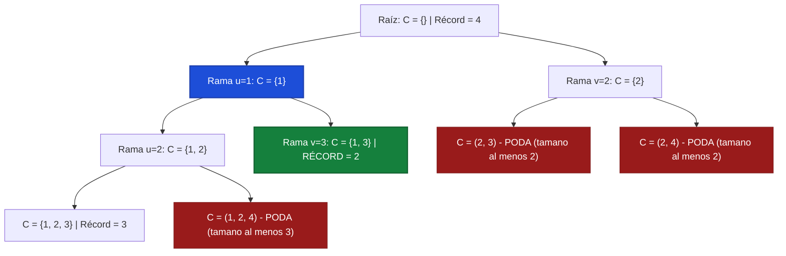

#### 4. Pseudocódigo del Algoritmo (Estilo Examen Presencial)

```text
Algoritmo MinimoVertexCover(V, E):
    mejor_cobertura = copiar(V)  // Cota superior inicial (todos los vértices)
    actual = conjunto_vacío()

    mejor_cobertura = MinimoVertexCoverBT(actual, mejor_cobertura, E)
    devolver mejor_cobertura

función MinimoVertexCoverBT(actual, mejor_cobertura, E):
    // Poda Branch & Bound: si el tamaño actual ya iguala o supera al mejor récord
    si tamaño(actual) >= tamaño(mejor_cobertura):
        devolver mejor_cobertura

    arista = BuscarAristaNoCubierta(E, actual)
    si arista es nulo:
        // Todas las aristas cubiertas con un tamaño estrictamente menor
        devolver copiar(actual)

    (u, v) = arista

    // Rama 1: Incluir u
    agregar u a actual
    mejor_cobertura = MinimoVertexCoverBT(actual, mejor_cobertura, E)
    quitar u de actual  // Deshacer (Backtrack)

    // Rama 2: Incluir v
    agregar v a actual
    mejor_cobertura = MinimoVertexCoverBT(actual, mejor_cobertura, E)
    quitar v de actual  // Deshacer (Backtrack)

    devolver mejor_cobertura
```

<div class="trap-callout">
  <div class="trap-header">⚠️ Trampa Típica de Corrección</div>
  <p><strong>Puntos donde restan puntaje los docentes de FIUBA:</strong></p>
  <ul>
    <li><strong>Podar con <code>&gt;</code> en vez de <code>&gt;=</code>:</strong> La poda debe ser <code>len(actual) &gt;= len(mejor_cobertura)</code>. Si usas <code>&gt;</code>, el algoritmo continuará explorando ramas de tamaño igual al récord que jamás podrán mejorarlo, duplicando el tiempo de ejecución.</li>
    <li><strong>No copiar la solución óptima:</strong> Escribir <code>mejor_cobertura = actual</code> guarda una referencia al conjunto mutable. Al hacer backtracking, <code>mejor_cobertura</code> se vacía junto con <code>actual</code>. Se debe hacer siempre copia profunda con <code>set(actual)</code>.</li>
  </ul>
</div>

---

### Patrón de Ejercicio 3.4: Suma de Subconjuntos (Subset Sum) con Podas

Exploración binaria de inclusión/exclusión de elementos para alcanzar un valor objetivo exacto.

---

### Ejercicio 12 — Suma de Subconjuntos con Podas Tempranas

**Clasificación:** 🟡 IMPORTANTE  
**Origen:** Guía de Ejercicios 03, Ejercicio 11 / Práctica

**Enunciado**  
Dada una lista de enteros positivos $L$ y un entero objetivo $S$, implementar un algoritmo por backtracking que determine si existe un subconjunto de $L$ cuya suma sea exactamente $S$, y en caso afirmativo devuelva dicho subconjunto. Indicar y justificar las podas de factibilidad aplicadas y la complejidad.

**Qué está evaluando la cátedra**  
Árbol binario de inclusión/exclusión, poda temprana por exceso de suma y optimización del espacio de búsqueda mediante ordenamiento previo de los elementos.

#### 1. Deducción Metodológica Formal (Los 5 Pasos)

1. **Paso 1: Ordenamiento Previo para Poda en Bloque:**
   Se ordena la lista $L$ de forma ascendente: $L[0] \le L[1] \le \dots \le L[n-1]$ en $O(n \log n)$.

2. **Paso 2: Árbol Binario de Decisiones:**
   En cada nivel $i$ correspondiente al elemento $L[i]$ con remanente $R$ ($R = S - \text{suma acumulada}$):

   * **Rama Inclusión:** Tomar $L[i]$, reducir el remanente a $R - L[i]$ y avanzar al nivel $i+1$.
   * **Rama Exclusión:** Omitir $L[i]$, mantener el remanente $R$ y avanzar al nivel $i+1$.
3. **Paso 3: Poda por Ordenamiento (Corte Temprano):**
   Si en el índice actual $L[i] > R$, como la lista está ordenada ascendentemente, todos los elementos posteriores $L[j] \ge L[i] > R$ para $j > i$. Por ende, **ningún elemento posterior podrá ser incluido sin exceder $S$**. Se corta la búsqueda de inmediato retornando `False`.

4. **Paso 4: Caso Base:**
   * Si $R = 0$: Se alcanzó la suma exacta $S$. Se retorna `True` inmediatamente con la solución acumulada.
   * Si $i \ge n$ o $R < 0$: Se agotaron los elementos sin llegar a la suma. Retorna `False`.
5. **Paso 5: Complejidad:**
   * **Tiempo:** $O(2^n)$ en el peor caso teórico (cuando ningún subconjunto suma $S$ y las podas no pueden actuar hasta el final). Sin embargo, con $L$ ordenado, la poda temprana $L[i] > R$ reduce el espacio a una pequeña fracción.
   * **Espacio Auxiliar:** $O(n)$ para la pila recursiva y el arreglo de la solución.

#### 2. Ejemplo Concreto y Tabla de Traza Paso a Paso

Sea $L = [2, 3, 5, 7, 10]$ y objetivo $S = 14$.

| Nivel ($i$) | Elemento ($L[i]$) | Remanente ($R$) | Condición $L[i] > R$ | Decisión | Solución Parcial |
| :---: | :---: | :---: | :---: | :---: | :--- |
| **0** | $2$ | $14$ | $2 > 14$ (No) | **Incluir 2** $\implies R = 12$ | $\{2\}$ |
| **1** | $3$ | $12$ | $3 > 12$ (No) | **Incluir 3** $\implies R = 9$ | $\{2, 3\}$ |
| **2** | $5$ | $9$ | $5 > 9$ (No) | **Incluir 5** $\implies R = 4$ | $\{2, 3, 5\}$ |
| **3** | $7$ | $4$ | $7 > 4$ (Sí) | **PODA TEMPRANA** ($7 > 4$) | Backtrack: Quitar 5 |
| **2** | $5$ (excluir) | $9$ | - | **Excluir 5** $\implies R = 9$ | $\{2, 3\}$ |
| **3** | $7$ | $9$ | $7 > 9$ (No) | **Incluir 7** $\implies R = 2$ | $\{2, 3, 7\}$ |
| **4** | $10$ | $2$ | $10 > 2$ (Sí) | **PODA TEMPRANA** ($10 > 2$) | Backtrack: Quitar 7 |
| **3** | $7$ (excluir) | $9$ | - | **Excluir 7** $\implies R = 9$ | $\{2, 3\}$ |
| **4** | $10$ | $9$ | $10 > 9$ (Sí) | **PODA TEMPRANA** ($10 > 9$) | Backtrack: Quitar 3 |
| **1** | $3$ (excluir) | $12$ | - | **Excluir 3** $\implies R = 12$ | $\{2\}$ |
| **2** | $5$ | $12$ | $5 > 12$ (No) | **Incluir 5** $\implies R = 7$ | $\{2, 5\}$ |
| **3** | $7$ | $7$ | $7 > 7$ (No) | **Incluir 7** $\implies R = 0$ | **¡ÉXITO: $R = 0$! Solución: $\{2, 5, 7\}$** |

*Verificación:* $2 + 5 + 7 = 14 = S$.

#### 3. Diagrama Visual del Árbol de Inclusión/Exclusión

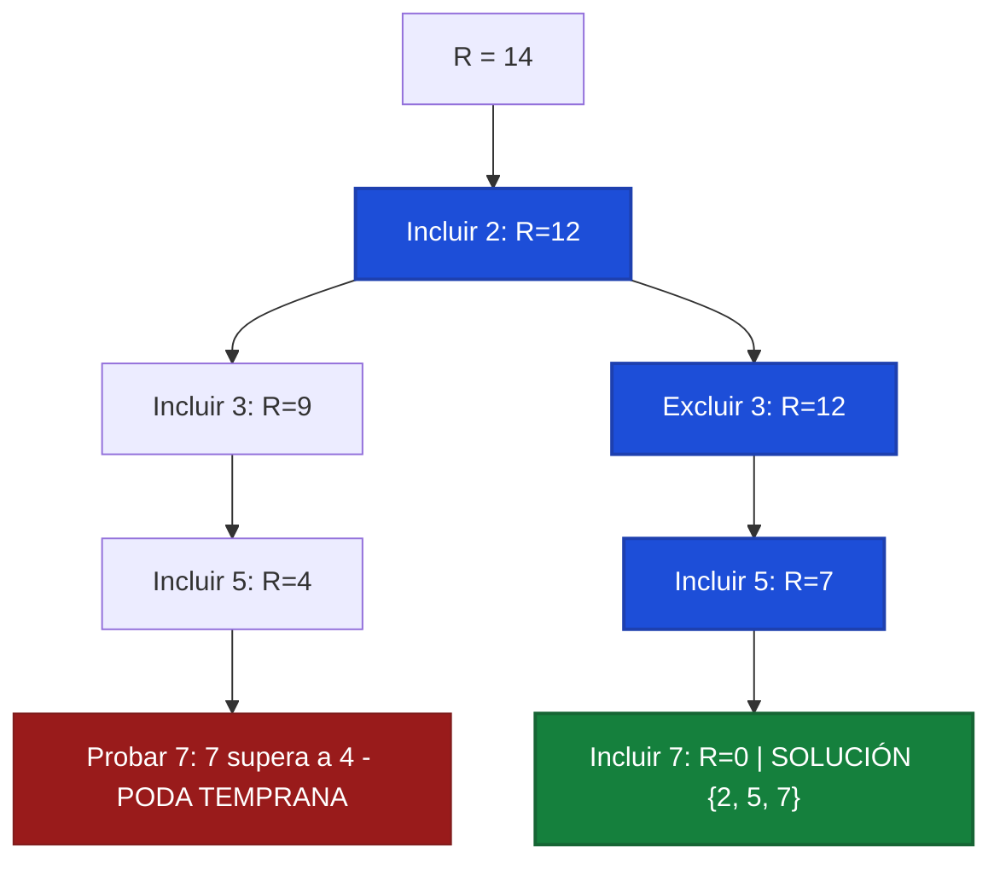

#### 4. Pseudocódigo del Algoritmo (Estilo Examen Presencial)

```text
Algoritmo SubsetSumBacktracking(nums, target):
    // 1. Ordenar crecientemente para habilitar podas tempranas en O(n log n)
    ordenar nums de menor a mayor
    solucion = []

    si SubsetSumBT(0, target, nums, solucion):
        devolver solucion
    sino:
        devolver nulo

función SubsetSumBT(indice, remanente, nums, solucion):
    si remanente == 0:
        devolver Verdadero
    si indice >= longitud(nums) o remanente < 0:
        devolver Falso

    // Poda temprana: al estar ordenado, ningún elemento posterior entrará
    si nums[indice] > remanente:
        devolver Falso

    // Rama 1: Incluir nums[indice]
    agregar nums[indice] a solucion
    si SubsetSumBT(indice + 1, remanente - nums[indice], nums, solucion):
        devolver Verdadero
    quitar_ultimo(solucion)  // Deshacer (Backtrack)

    // Rama 2: Excluir nums[indice]
    si SubsetSumBT(indice + 1, remanente, nums, solucion):
        devolver Verdadero

    devolver Falso
```

<div class="trap-callout">
  <div class="trap-header">⚠️ Trampa Típica de Corrección</div>
  <p><strong>Puntos donde restan puntaje los docentes de FIUBA:</strong></p>
  <ul>
    <li><strong>Aplicar la poda <code>L[i] &gt; remanente</code> sin ordenar:</strong> La poda por exceso solo es válida si la lista está previamente ordenada. Si la lista contiene números desordenados (por ejemplo $[10, 2]$ con $R = 5$), descartar por $10 > 5$ omitiría erróneamente al $2$.</li>
    <li><strong>Números negativos o nulos:</strong> Esta poda asume que todos los elementos son positivos ($L[i] > 0$). Si hubiera números negativos, sumar un elemento posterior podría reducir la suma actual y permitir alcanzar el objetivo.</li>
  </ul>
</div>

---

### Errores Frecuentes en Exámenes sobre Backtracking

1. **Olvidar desmarcar el estado en el retorno (Backtrack):** Dejar variables modificadas al salir de una llamada arruina la exploración de las ramas hermanas.
2. **Validar restricciones recorriendo estructuras completas:** Usar bucles en cada nodo en vez de booleanos de control $O(1)$.
3. **No justificar la complejidad en el peor caso:** Afirmar que con podas el algoritmo pasa a ser polinomial. Las podas optimizan el caso promedio, pero el peor caso sigue siendo exponencial o factorial.
4. **No podar simetrías:** Permitir explorar permutaciones del mismo conjunto en problemas de combinatoria.


---

## 7. Tema 4: Programación Dinámica (PD)

### Conceptos Mínimos de Supervivencia

1. **Cuándo Usar Programación Dinámica:**
   * El problema exhibe **Subestructura Óptima**: la solución óptima global se compone de soluciones óptimas a sus subproblemas.
   * El problema tiene **Subproblemas Superpuestos**: los mismos subproblemas se resuelven una y otra vez (a diferencia de División y Conquista, donde los subproblemas son disjuntos).
2. **Los Cinco Pasos Obligatorios en el Examen de TDA:**
   Para obtener el puntaje completo en un ejercicio de Programación Dinámica, tu respuesta debe contener explícitamente:

   1. **Definición Formal del Estado:** ¿Qué significa exactamente $OPT(i, w)$ en el contexto del enunciado? (Ej: *"Valor máximo obtenible considerando un subconjunto de los primeros $i$ elementos con una capacidad restante de $w$ kilos"*).
   2. **Casos Base:** Valores donde la solución es trivial o inmediata (ej: $OPT(0, w) = 0$, $OPT(i, 0) = 0$).
   3. **Ecuación de Recurrencia:** La fórmula matemática cerrada que computa $OPT$ a partir de subproblemas más chicos, detallando las opciones consideradas y la función objetivo ($\min$ o $\max$).
   4. **Orden de Llenado de la Tabla:** Justificación de la dirección en que se itera la matriz (ej: *"De menor a mayor índice $i$, y para cada $i$ de menor a mayor capacidad $w$, asegurando que los valores requeridos ya hayan sido calculados"*).
   5. **Algoritmo de Reconstrucción de la Solución:** Procedimiento que recorre la tabla hacia atrás desde el resultado final para identificar qué elementos concretos componen la solución óptima.

---

### Patrón de Ejercicio 4.1: DP 1D Aritmética y Transición de Estados

Problemas de cálculo de pasos mínimos o secuencias de transformación entre dos valores numéricos dados ($0 \to K$ o $N \to 1$).

---

### Ejercicio 13 — Mínima Cantidad de Operaciones para Llegar de 0 a K (+1, × 2)

**Clasificación:** 🔴 IMPRESCINDIBLE  
**Origen:** Parcial 2024-2-2 (26 de noviembre de 2024), Ejercicio 2 / Guía 04 Ejercicio 11

**Enunciado**  
Dado un número natural $K$, se desea obtener la mínima cantidad de operaciones para llegar desde $0$ hasta $K$, sabiendo que las operaciones permitidas son:  
(i) Aumentar el valor del operando en 1 ($x \leftarrow x + 1$).  
(ii) Duplicar el valor del operando ($x \leftarrow 2x$).  
Implementar un algoritmo que, por programación dinámica, obtenga la menor cantidad de operaciones a realizar y detalle la secuencia exacta de dichas operaciones. Desarrollar la ecuación de recurrencia. Indicar y justificar la complejidad temporal y espacial.

**Qué está evaluando**  
Modelado del estado en 1D, razonamiento hacia atrás ($K \to 0$), planteo riguroso de la recurrencia con análisis de paridad, demostración formal de optimalidad y reconstrucción exacta de la secuencia de operaciones.

**Idea de resolución y Perspectiva Inversa**  

* *Perspectiva hacia atrás ($i \to 0$):* Pensar cómo llegar a un número $i$:
    * Siempre podemos llegar desde $i - 1$ aplicando la operación $+1$.
    * Si $i$ es par, también podemos llegar desde $i / 2$ aplicando la operación $\times 2$. Si $i$ es impar, es imposible haber llegado duplicando un entero.
* *Casos trampa iniciales:* Desde $0$, la operación $\times 2$ no genera avance ($0 \times 2 = 0$). El primer paso hacia adelante siempre debe ser $+1$ (hacia 1).

#### 1. Deducción Metodológica Formal (Los 5 Pasos de Programación Dinámica)

1. **Definición Formal del Estado:**  
   $$OPT(i) = \text{Mínima cantidad de operaciones necesarias para alcanzar el valor } i \text{ partiendo desde } 0.$$

2. **Casos Base:**  
   * $OPT(0) = 0$: Ya estamos en el origen, se requieren $0$ operaciones.  
   * $OPT(1) = 1$: Única transición válida es $0 + 1 = 1$, pues $0 \times 2 = 0$ no avanza.

3. **Ecuación de Recurrencia:**  
   Para todo $i \ge 1$:
   $$OPT(i) = \begin{cases} OPT(i - 1) + 1 & \text{si } i \text{ es impar} \\ \min\Big(OPT(i - 1) + 1, \; OPT\left(\frac{i}{2}\right) + 1\Big) & \text{si } i \text{ es par} \end{cases}$$

4. **Orden de Llenado de la Tabla:**  
   Iteración unidireccional creciente (*Bottom-Up*) desde $i = 1$ hasta $K$.  
   *Justificación:* Cada estado $i$ solo depende de $i - 1$ y $i / 2$. Como ambos predecesores son estrictamente menores que $i$, todos los subproblemas necesarios ya habrán sido resueltos y almacenados previamente en el DAG de dependencias.

5. **Algoritmo de Reconstrucción de la Secuencia:**  
   Retrocedemos desde $K$ hasta $0$ consultando el arreglo de predecesores `padre[i]`. Si $\text{padre}[i] = i / 2$, la operación fue $\times 2$; en caso contrario, fue $+1$. Se invierte la lista resultante para presentar la secuencia en orden cronológico de $0$ a $K$.

#### 2. Justificación Directa de Correctitud (Lista para Examen)

* **1. Solo hay dos formas de llegar a `i`:**
    * Si la última operación fue `+1`, vinimos sí o sí de `i - 1`.
    * Si la última operación fue `x2`, vinimos sí o sí de `i / 2` (y esto solo es posible cuando `i` es par).
* **2. Subestructura óptima:** Para llegar a `i` en la menor cantidad de pasos, necesitamos haber llegado primero a `i - 1` (o a `i / 2`) en la menor cantidad de pasos posible y sumarle `1` paso más.
* **3. Sin ciclos:** Como `i - 1` e `i / 2` son siempre más chicos que `i`, al llenar la tabla en orden desde `1` hasta `K` nos aseguramos de que ambos valores ya están calculados cuando los necesitamos.

#### 3. Diagrama de Flujo y Grafo Acíclico (DAG) de Decisiones

A continuación se representa el flujo de decisión iterativo y el grafo de transiciones óptimas para $K = 10$:

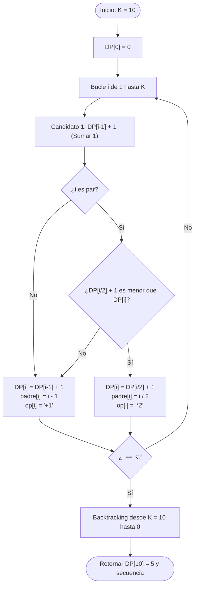

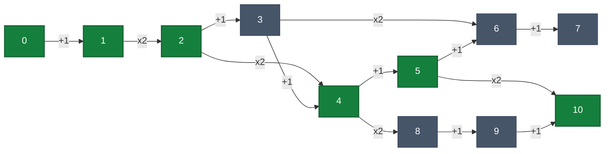

<div class="visual-trace-container">
  <span class="trace-node start-node">0</span>
  <span class="trace-arrow"><span class="arrow-op">+1</span>➜</span>
  <span class="trace-node">1</span>
  <span class="trace-arrow"><span class="arrow-op">×2</span>➜</span>
  <span class="trace-node">2</span>
  <span class="trace-arrow"><span class="arrow-op">×2</span>➜</span>
  <span class="trace-node">4</span>
  <span class="trace-arrow"><span class="arrow-op">+1</span>➜</span>
  <span class="trace-node">5</span>
  <span class="trace-arrow"><span class="arrow-op">×2</span>➜</span>
  <span class="trace-node end-node">10</span>
</div>

#### 4. Tabla de Seguimiento Paso a Paso (Trace Table para $K = 10$)

| $i$ | Paridad | Opción $+1$ ($DP[i-1]+1$) | Opción $\times 2$ ($DP[i/2]+1$) | $DP[i]$ Óptimo | Decisión Tomada | `padre[i]` |
|:---:|:---:|:---:|:---:|:---:|:---:|:---:|
| **0** | Par | — | — | **0** | Estado Inicial | — |
| **1** | Impar | $DP[0] + 1 = 0 + 1 = \mathbf{1}$ | No aplica ($1$ es impar) | **1** | $+1$ desde $0$ | 0 |
| **2** | Par | $DP[1] + 1 = 1 + 1 = 2$ | $DP[1] + 1 = 1 + 1 = \mathbf{2}$ | **2** | $\times 2$ desde $1$ | 1 |
| **3** | Impar | $DP[2] + 1 = 2 + 1 = \mathbf{3}$ | No aplica ($3$ es impar) | **3** | $+1$ desde $2$ | 2 |
| **4** | Par | $DP[3] + 1 = 3 + 1 = 4$ | $DP[2] + 1 = 2 + 1 = \mathbf{3}$ | **3** | $\times 2$ desde $2$ | 2 |
| **5** | Impar | $DP[4] + 1 = 3 + 1 = \mathbf{4}$ | No aplica ($5$ es impar) | **4** | $+1$ desde $4$ | 4 |
| **6** | Par | $DP[5] + 1 = 4 + 1 = 5$ | $DP[3] + 1 = 3 + 1 = \mathbf{4}$ | **4** | $\times 2$ desde $3$ | 3 |
| **7** | Impar | $DP[6] + 1 = 4 + 1 = \mathbf{5}$ | No aplica ($7$ es impar) | **5** | $+1$ desde $6$ | 6 |
| **8** | Par | $DP[7] + 1 = 5 + 1 = 6$ | $DP[4] + 1 = 3 + 1 = \mathbf{4}$ | **4** | $\times 2$ desde $4$ | 4 |
| **9** | Impar | $DP[8] + 1 = 4 + 1 = \mathbf{5}$ | No aplica ($9$ es impar) | **5** | $+1$ desde $8$ | 8 |
| **10** | Par | $DP[9] + 1 = 5 + 1 = 6$ | $DP[5] + 1 = 4 + 1 = \mathbf{5}$ | **5** | $\times 2$ desde $5$ | 5 |

**Detalle de Reconstrucción (Backtracking desde $K = 10$):**

1. En $10$: `padre[10] = 5`, operación = $\times 2$.
2. En $5$: `padre[5] = 4`, operación = $+1$.
3. En $4$: `padre[4] = 2`, operación = $\times 2$.
4. En $2$: `padre[2] = 1`, operación = $\times 2$.
5. En $1$: `padre[1] = 0`, operación = $+1$.
6. En $0$: Fin del recorrido.
* **Resultado exacto:** $5$ operaciones mínimas: `[+1, ×2, ×2, +1, ×2]`.

#### 5. Pseudocódigo Formal para Examen

```text
FUNCION MinimasOperacionesAK(K):
    SI K = 0:
        RETORNAR (0, lista vacía)

    // 1. Inicialización de la tabla DP y estructuras de reconstrucción
    INICIALIZAR DP como arreglo de tamaño (K + 1) en 0
    INICIALIZAR padre como arreglo de tamaño (K + 1) en 0
    INICIALIZAR op como arreglo de tamaño (K + 1) en cadenas vacías

    DP[0] <- 0

    // 2. Llenado Bottom-Up
    PARA i <- 1 HASTA K:
        // Opción por defecto: Sumar 1 desde (i - 1)
        DP[i] <- DP[i - 1] + 1
        padre[i] <- i - 1
        op[i] <- "SUMAR_1"

        // Opción alternativa: Duplicar desde (i / 2) si i es par
        SI (i MOD 2) = 0:
            SI DP[i / 2] + 1 < DP[i]:
                DP[i] <- DP[i / 2] + 1
                padre[i] <- i / 2
                op[i] <- "DUPLICAR"

    // 3. Reconstrucción en reversa del camino óptimo
    INICIALIZAR secuencia como lista vacía
    actual <- K
    MIENTRAS actual > 0:
        INSERTAR op[actual] AL INICIO DE secuencia
        actual <- padre[actual]

    RETORNAR (DP[K], secuencia)
```

**Complejidad**  

* **Temporal:** $\mathcal{O}(K)$. La tabla tiene $K + 1$ posiciones y cada una se calcula en tiempo constante $\mathcal{O}(1)$ comparando a lo sumo dos candidatos aritméticos. La reconstrucción realiza a lo sumo $K$ saltos (en la práctica $\le 2 \log_2 K$ saltos), lo que toma $\mathcal{O}(\log K) \subseteq \mathcal{O}(K)$.
* **Espacial:** $\mathcal{O}(K)$. Arreglos contiguos de tamaño $K + 1$ para almacenar los costos óptimos y punteros de retroceso.

<div class="trap-callout">
  <div class="trap-header">⚠️ Trampa Típica de Corrección</div>
  <p><strong>Puntos donde restan puntaje los docentes de FIUBA:</strong></p>
  <ul>
    <li><strong>Intentar duplicar desde 0:</strong> $0 \times 2 = 0$. Duplicar solo genera avance a partir de $x \ge 1$.</li>
    <li><strong>No incluir la reconstrucción de operaciones:</strong> Si el enunciado pide explícitamente <em>"y cómo son dichas operaciones"</em>, no devolver la secuencia descuenta la mitad del puntaje del ejercicio.</li>
    <li><strong>No justificar la paridad:</strong> Es indispensable explicitar en la recurrencia que la opción $\times 2$ solo se evalúa cuando $(i \pmod 2) = 0$.</li>
  </ul>
</div>

**Variación típica de parcial (Pregunta Clave: DP vs Greedy)**  

* *¿Se puede resolver con Greedy en tiempo $\mathcal{O}(\log K)$?*  
  **Sí:** Pensando de $K$ hacia $0$, si $K$ es par siempre conviene dividir por $2$; si es impar, restar $1$. Esto toma $\mathcal{O}(\log K)$ pasos.

* *¿Por qué entonces la cátedra exige Programación Dinámica?*  
    1. **Consigna estricta:** Si el enunciado impone DP, usar Greedy anula el ejercicio.  
    2. **Generalización ante variantes:** La formulación de DP es genérica y se adapta de inmediato si se introducen reglas más complejas donde Greedy fracasa (por ejemplo, si existieran transiciones como $+3$, $\times 3$, o costos no unitarios para cada operación). Con DP, simplemente se agrega un nuevo término a la función $\min()$:
     $$OPT(i) = \min\big(OPT(i-1) + c_{+1}, \; OPT(i/2) + c_{\times 2}, \; OPT(i-3) + c_{+3}\big)$$
     En cambio, un enfoque voraz requeriría una demostración formal de elección voraz (*Greedy Choice Property*) que con múltiples operaciones adicionales suele ser falsa.

---

### Patrón de Ejercicio 4.2: Mochila 2D con Restricciones Lógicas

Aparece cuando la mochila tiene múltiples recursos acoplados (peso y volumen) y condiciones lógicas adicionales sobre subconjuntos específicos de elementos (exclusión mutua y obligatoriedad).

---

### Ejercicio 14 — Mochila 2D con Selección Obligatoria y Excluyente de Guías de Aves

**Clasificación:** 🔴 IMPRESCINDIBLE  
**Origen:** Parcial 2024-2-1 (5 de noviembre de 2024), Ejercicio 3

**Enunciado**  
Paolo Casanova llevará una mochila para el fin de semana con capacidad de peso $C$ kilos y volumen $L$ litros. Tiene una lista de $n$ elementos posibles, donde cada elemento $i$ tiene un peso $w_i$, un volumen $v_i$ y un beneficio $b_i$. Los ítems $1$ y $2$ son dos guías de observación de aves distintas. Por utilidad, **no tiene sentido llevar ambas guías, pero Paolo debe llevar obligatoriamente una de las dos** (es decir, debe elegir exactamente la guía $1$ o la guía $2$, nunca ninguna ni las dos). Desarrollar un algoritmo de Programación Dinámica que encuentre la combinación óptima de elementos que maximice el beneficio total respetando las capacidades.

**Qué está evaluando la cátedra**  
Mochila 2D (estado tridimensional $\text{elemento} \times \text{peso} \times \text{volumen}$) y manejo riguroso de restricciones lógicas XOR mediante bifurcación en dos subinstancias independientes o fijación de estado inicial.

#### 1. Deducción Metodológica Formal (Los 5 Pasos de Programación Dinámica)

1. **Reducción de la Restricción XOR y Definición del Estado:**
   Como los ítems $1$ y $2$ tienen una restricción XOR estricta ($\text{Guía } 1 \oplus \text{Guía } 2$), descomponemos el problema en dos casos mutuamente excluyentes sobre el subconjunto de ítems restantes $R = \{3, 4, \dots, n\}$ (de tamaño $m = n - 2$):

   * **Caso A (Fijar Guía 1):** Si $w_1 \le C \land v_1 \le L$, reservamos la Guía 1 y resolvemos una Mochila 2D estándar sobre los $m$ ítems restantes con capacidades remanentes $C_A = C - w_1$ y $L_A = L - v_1$, sumando $b_1$ al resultado.
   * **Caso B (Fijar Guía 2):** Si $w_2 \le C \land v_2 \le L$, reservamos la Guía 2 y resolvemos sobre los $m$ ítems restantes con capacidades remanentes $C_B = C - w_2$ y $L_B = L - v_2$, sumando $b_2$ al resultado.
   
   Para la Mochila 2D auxiliar sobre los $m$ elementos restantes, definimos el estado:
   $$OPT(i, p, v) = \text{Máximo beneficio obtenible usando un subconjunto de los primeros } i \text{ elementos de } R \text{ con peso disponible } p \text{ y volumen disponible } v.$$

2. **Casos Base:**
   $$OPT(0, p, v) = 0 \quad \forall p \in [0, C], \; \forall v \in [0, L]$$
   $$OPT(i, 0, v) = 0, \quad OPT(i, p, 0) = 0 \quad \text{(asumiendo } w_i, v_i > 0\text{)}$$

3. **Ecuación de Recurrencia:**
   Para cada elemento $i \in \{1, \dots, m\}$ con peso $w_i$, volumen $v_i$ y beneficio $b_i$:
   $$OPT(i, p, v) = \begin{cases} OPT(i - 1, p, v) & \text{si } w_i > p \lor v_i > v \\ \max\Big(OPT(i - 1, p, v), \; OPT(i - 1, p - w_i, v - v_i) + b_i\Big) & \text{si } w_i \le p \land v_i \le v \end{cases}$$
   El valor óptimo global del problema original es:
   $$OPT_{\text{total}} = \max\Big( b_1 + OPT(m, C - w_1, L - v_1), \;\; b_2 + OPT(m, C - w_2, L - v_2) \Big)$$

4. **Orden de Llenado de la Tabla:**
   Tres bucles anidados crecientes: índice de elemento $i$ desde $1$ hasta $m$, peso $p$ desde $0$ hasta $C_{\text{rem}}$ y volumen $v$ desde $0$ hasta $L_{\text{rem}}$.

5. **Reconstrucción de la Solución:**
   Se determina cuál de los dos casos ($A$ o $B$) alcanzó el máximo global, se agrega la guía correspondiente, y se retrocede desde $(m, C_{\text{rem}}, L_{\text{rem}})$ hasta $i = 1$ comparando si $DP[i][p][v] \neq DP[i-1][p][v]$.

#### 2. Diagrama Visual de Descomposición XOR + Mochila 2D

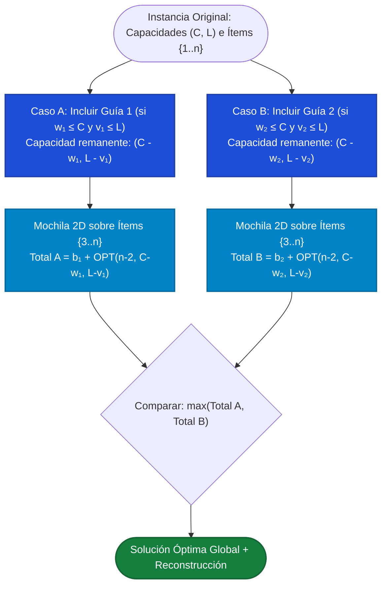

#### 3. Ejemplo Concreto y Traza Paso a Paso

Sea una mochila con capacidad de peso $C = 5\text{ kg}$ y volumen $L = 5\text{ litros}$, y $n = 4$ ítems:

| Ítem | Descripción | Peso ($w_i$) | Volumen ($v_i$) | Beneficio ($b_i$) | Rol |
| :---: | :--- | :---: | :---: | :---: | :--- |
| **1** | Guía de Aves Patagónicas | $2$ | $2$ | $10$ | Guía 1 (XOR) |
| **2** | Guía de Aves Pampeanas | $4$ | $3$ | $18$ | Guía 2 (XOR) |
| **3** | Binoculares Profesionales | $3$ | $2$ | $15$ | Ítem libre ($R_1$) |
| **4** | Cámara Teleobjetivo | $2$ | $3$ | $12$ | Ítem libre ($R_2$) |

* **Evaluación Caso A (Llevar Guía 1):**
    * Consume $w_1 = 2, v_1 = 2$, aporta $b_1 = 10$. Capacidad remanente: $C_A = 3, L_A = 3$.
    * Entre los ítems libres $\{3, 4\}$:
    * Ítem 3 ($w=3, v=2 \le (3,3)$): entra y aporta $15$.
    * Ítem 4 ($w=2, v=3 \le (3,3)$): entra por sí solo ($12$), pero no junto con el 3 ($3+2 = 5 > 3$).
    * Óptimo remanente: $OPT(2, 3, 3) = 15$ (Binoculares).
    * **Total Caso A:** $10 + 15 = \mathbf{25}$ (Guía 1 + Binoculares, peso total $5$, volumen $4$).
* **Evaluación Caso B (Llevar Guía 2):**
    * Consume $w_2 = 4, v_2 = 3$, aporta $b_2 = 18$. Capacidad remanente: $C_B = 1, L_B = 2$.
    * Ninguno de los ítems $\{3, 4\}$ cabe en peso remanente $1$. $OPT(2, 1, 2) = 0$.
    * **Total Caso B:** $18 + 0 = \mathbf{18}$ (solo Guía 2).
* **Decisión Óptima:** $\max(25, 18) = \mathbf{25}$ llevando $\{\text{Guía 1}, \text{Binoculares}\}$.

#### 4. Pseudocódigo Formal (Estilo Examen Presencial)

```text
FUNCION MochilaPaoloCasanova(items, C, L):
    // items[0] es Guia 1, items[1] es Guia 2, items[2..n-1] son el resto
    beneficio_mejor <- -INFINITO
    INICIALIZAR mejor_solucion como lista vacía
    resto_items <- items[2 .. longitud(items) - 1]

    // --- CASO A: Llevar Guia 1 (items[0]) ---
    SI items[0].peso <= C Y items[0].volumen <= L:
        (ben_A, sol_A) <- Mochila2DEstandar(resto_items, C - items[0].peso, L - items[0].volumen)
        total_ben_A <- items[0].beneficio + ben_A
        SI total_ben_A > beneficio_mejor:
            beneficio_mejor <- total_ben_A
            INSERTAR items[0] AL INICIO DE sol_A
            mejor_solucion <- sol_A

    // --- CASO B: Llevar Guia 2 (items[1]) ---
    SI items[1].peso <= C Y items[1].volumen <= L:
        (ben_B, sol_B) <- Mochila2DEstandar(resto_items, C - items[1].peso, L - items[1].volumen)
        total_ben_B <- items[1].beneficio + ben_B
        SI total_ben_B > beneficio_mejor:
            beneficio_mejor <- total_ben_B
            INSERTAR items[1] AL INICIO DE sol_B
            mejor_solucion <- sol_B

    RETORNAR (beneficio_mejor, mejor_solucion)

FUNCION Mochila2DEstandar(elementos, MaxPeso, MaxVol):
    m <- longitud(elementos)
    INICIALIZAR DP como matriz 3D de (m + 1) x (MaxPeso + 1) x (MaxVol + 1) en 0

    PARA i <- 1 HASTA m:
        elem <- elementos[i - 1]
        PARA p <- 0 HASTA MaxPeso:
            PARA v <- 0 HASTA MaxVol:
                DP[i][p][v] <- DP[i - 1][p][v]
                SI elem.peso <= p Y elem.volumen <= v:
                    val_con_elem <- DP[i - 1][p - elem.peso][v - elem.volumen] + elem.beneficio
                    SI val_con_elem > DP[i][p][v]:
                        DP[i][p][v] <- val_con_elem

    // Reconstrucción
    INICIALIZAR seleccion como lista vacía
    rem_p <- MaxPeso
    rem_v <- MaxVol
    PARA i <- m BAJANDO HASTA 1:
        SI DP[i][rem_p][rem_v] != DP[i - 1][rem_p][rem_v]:
            elem <- elementos[i - 1]
            INSERTAR elem EN seleccion
            rem_p <- rem_p - elem.peso
            rem_v <- rem_v - elem.volumen

    RETORNAR (DP[m][MaxPeso][MaxVol], seleccion)
```

**Complejidad**  

* **Tiempo:** Resolvemos la tabla 3D a lo sumo dos veces (una por cada guía obligatoria). Cada llenado tiene dimensiones $(n-2) \times C \times L$ y operaciones $O(1)$ por celda: **$\Theta(n \cdot C \cdot L)$** (pseudo-polinomial).
* **Espacio:** Tabla 3D de tamaño **$\Theta(n \cdot C \cdot L)$**.

<div class="trap-callout">
  <div class="trap-header">⚠️ Trampa Típica de Corrección</div>
  <p><strong>Puntos donde restan puntaje los docentes de FIUBA:</strong></p>
  <ul>
    <li><strong>Permitir que la mochila quede sin guías o con ambas:</strong> Si se mete la Guía 1 y la Guía 2 en el bucle general de la mochila sin separar los casos, la recurrencia podría elegir ambas o ninguna.</li>
    <li><strong>No validar si la guía cabe individualmente:</strong> Antes de restar $C - w_1$ y $L - v_1$, es obligatorio verificar que $w_1 \le C \land v_1 \le L$ para no indexar capacidades negativas.</li>
  </ul>
</div>

---

### Patrón de Ejercicio 4.3: Partición de Secuencias y Formateo (Word Wrap)

Minimizar una penalidad cuadrática o no lineal sobre la partición de un arreglo de palabras en líneas de longitud fija.

---

### Ejercicio 15 — Justificación de Texto (Word Wrap / Knuth-Plass)

**Clasificación:** 🔴 IMPRESCINDIBLE  
**Origen:** Parcial 2024-2-3 (10 de diciembre de 2024), Ejercicio 2

**Enunciado**  
Se tiene un texto formado por una sucesión de $n$ palabras $W_1, W_2, \dots, W_n$. Cada palabra $W_i$ tiene una longitud de $C_i$ caracteres ($C_i \le L$). Se quiere dividir el texto en líneas de ancho máximo $L$. Si se asignan las palabras contiguas $W_j, \dots, W_i$ a una misma línea, la longitud total ocupada es:
$$\text{Longitud}(j, i) = \sum_{k=j}^i C_k + (i - j)$$
donde $(i - j)$ representa el espacio en blanco simple obligatorio entre palabras contiguas. Una línea es válida si $\text{Longitud}(j, i) \le L$. Al valor sobrante de la línea se lo define como:
$$\text{Sobrante}(j, i) = L - \text{Longitud}(j, i)$$
Diseñar un algoritmo por Programación Dinámica que realice una partición del texto en líneas minimizando la suma de los cuadrados de los sobrantes de todas las líneas. Desarrollar la recurrencia, complejidad y reconstrucción.

**Qué está evaluando la cátedra**  
DP sobre prefijos de secuencias ($1 \dots i$), prueba exhaustiva del punto de inicio $j$ de la última línea y minimización de funciones de costo cuadrático.

#### 1. Deducción Metodológica Formal (Los 5 Pasos de Programación Dinámica)

1. **Definición Formal del Estado:**  
   $$OPT(i) = \text{Mínimo costo total (suma de cuadrados de sobrantes) de formatear el prefijo de palabras } W_1, \dots, W_i.$$

2. **Caso Base:**  
   $$OPT(0) = 0 \quad (\text{el texto vacío sin palabras tiene costo } 0)$$

3. **Ecuación de Recurrencia:**  
   Para formatear hasta la palabra $i$ ($1 \le i \le n$), la última línea debe contener algún sufijo válido de palabras $W_j, \dots, W_i$ con $1 \le j \le i$ tal que $\text{Longitud}(j, i) \le L$:
   $$OPT(i) = \min_{\substack{1 \le j \le i \\ \text{Longitud}(j, i) \le L}} \Big\{ OPT(j - 1) + \big(L - \text{Longitud}(j, i)\big)^2 \Big\}$$

4. **Orden de Llenado de la Tabla:**  
   De izquierda a derecha para $i = 1, 2, \dots, n$. Para cada $i$, iteramos $j$ hacia atrás ($j = i, i-1, \dots, 1$) acumulando $\text{Longitud}(j, i)$ en $O(1)$ y cortando el bucle interno apenas $\text{Longitud}(j, i) > L$.

5. **Reconstrucción de la Partición:**  
   Almacenamos en `corte[i]` el índice $j^*$ que minimizó $OPT(i)$. Luego retrocedemos desde $idx = n$: la línea actual abarca $[corte[idx], \; idx]$, y saltamos a $idx = corte[idx] - 1$ hasta llegar a $0$.

#### 2. Diagrama Visual de Transición de Prefijos (Word Wrap)

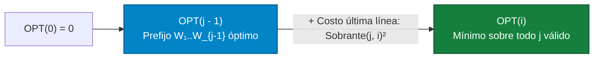

#### 3. Ejemplo Concreto y Tabla de Traza Paso a Paso

Sea un ancho máximo de línea $L = 6$ y $n = 4$ palabras con longitudes $C = [3, 2, 2, 3]$ (ej: `"SOL"`, `"DE"`, `"LA"`, `"PAZ"`):

| Prefijo $i$ | Palabra $W_i$ | Candidatos de última línea $[j..i]$ con $\text{Long}(j,i) \le 6$ | Cálculo $OPT(j-1) + \text{Sobrante}(j,i)^2$ | $OPT(i)$ Mínimo | `corte[i]` |
| :---: | :---: | :--- | :--- | :---: | :---: |
| **0** | — | — | Caso base | **$0$** | — |
| **1** | `"SOL"` ($3$) | $[1..1]$: $\text{Long}=3$, $\text{Sob}=3$ | $OPT(0) + 3^2 = 0 + 9 = 9$ | **$9$** | $1$ |
| **2** | `"DE"` ($2$) | $[2..2]$: $\text{Long}=2$, $\text{Sob}=4$<br/>$[1..2]$: $\text{Long}=3+1+2=6$, $\text{Sob}=0$ | $j=2: OPT(1) + 4^2 = 9 + 16 = 25$<br/>$j=1: OPT(0) + 0^2 = 0 + 0 = \mathbf{0}$ | **$0$** | $1$ |
| **3** | `"LA"` ($2$) | $[3..3]$: $\text{Long}=2$, $\text{Sob}=4$<br/>$[2..3]$: $\text{Long}=2+1+2=5$, $\text{Sob}=1$<br/>$[1..3]$: $\text{Long}=8 > 6$ (Poda) | $j=3: OPT(2) + 4^2 = 0 + 16 = 16$<br/>$j=2: OPT(1) + 1^2 = 9 + 1 = \mathbf{10}$ | **$10$** | $2$ |
| **4** | `"PAZ"` ($3$) | $[4..4]$: $\text{Long}=3$, $\text{Sob}=3$<br/>$[3..4]$: $\text{Long}=2+1+3=6$, $\text{Sob}=0$<br/>$[2..4]$: $\text{Long}=9 > 6$ (Poda) | $j=4: OPT(3) + 3^2 = 10 + 9 = 19$<br/>$j=3: OPT(2) + 0^2 = 0 + 0 = \mathbf{0}$ | **$0$** | $3$ |

*Reconstrucción:* `corte[4] = 3` $\implies$ Línea 2: $[W_3, W_4]$ (`"LA PAZ"`, largo 6, sobrante 0); luego `idx = 2`, `corte[2] = 1` $\implies$ Línea 1: $[W_1, W_2]$ (`"SOL DE"`, largo 6, sobrante 0). Costo total óptimo: $0$. (Observe que un Greedy voraz habría metido `"SOL DE"` en la línea 1, pero si $W_1=3, W_2=2, W_3=4$ con $L=6$, Greedy deja $W_3$ sola con costo $0^2 + 2^2 = 4$, mientras que DP equilibra).

#### 4. Pseudocódigo Formal (Estilo Examen Presencial)

```text
FUNCION JustificarTextoWordWrap(longitudes_palabras, L):
    n <- longitud(longitudes_palabras)

    // DP[i]: costo mínimo para las primeras i palabras
    INICIALIZAR DP como arreglo de tamaño (n + 1) con INFINITO
    INICIALIZAR corte como arreglo de tamaño (n + 1) con 0
    DP[0] <- 0

    // Llenado de DP para prefijos crecientes
    PARA i <- 1 HASTA n:
        longitud_acumulada <- 0

        // Probamos que la última línea comience en la palabra j
        PARA j <- i BAJANDO HASTA 1:
            SI j = i:
                longitud_acumulada <- longitudes_palabras[i - 1]
            SINO:
                longitud_acumulada <- longitud_acumulada + 1 + longitudes_palabras[j - 1]

            // Si excede el ancho de línea L, no caben más palabras hacia atrás
            SI longitud_acumulada > L:
                ROMPER

            sobrante <- L - longitud_acumulada
            costo_linea <- sobrante * sobrante

            SI DP[j - 1] + costo_linea < DP[i]:
                DP[i] <- DP[j - 1] + costo_linea
                corte[i] <- j

    // Reconstrucción de la partición en líneas
    INICIALIZAR lineas como lista vacía
    idx <- n
    MIENTRAS idx > 0:
        inicio_linea <- corte[idx]
        INSERTAR (inicio_linea, idx) AL INICIO DE lineas
        idx <- inicio_linea - 1

    RETORNAR (DP[n], lineas)
```

**Complejidad**  

* **Tiempo:** Hay $n$ estados. Para cada estado $i$, el bucle interno evalúa a lo sumo $i$ palabras (y como máximo $L / 2$ palabras antes de superar el ancho $L$). En el peor caso la complejidad es **$O(n^2)$** (o bien **$O(n \cdot L)$**).
* **Espacio:** Arreglos 1D de tamaño $n + 1$ para `DP` y `corte`: **$\Theta(n)$**.

<div class="trap-callout">
  <div class="trap-header">⚠️ Trampa Típica de Corrección</div>
  <p><strong>Puntos donde restan puntaje los docentes de FIUBA:</strong></p>
  <ul>
    <li><strong>Olvidar sumar 1 por cada espacio en blanco intermedio:</strong> Entre $W_j$ y $W_i$ hay exactamente $(i - j)$ espacios obligatorios. Omitirlos calcula mal la capacidad de la línea.</li>
    <li><strong>Permitir sobrantes negativos cuando $\text{Longitud}(j, i) > L$:</strong> Como el costo está elevado al cuadrado ($\text{sobrante}^2$), si no se corta el bucle cuando $\text{Longitud}(j, i) > L$, un sobrante negativo como $(-2)^2 = 4$ parecería válido y barato. Es obligatorio cortar o asignar $+\infty$.</li>
  </ul>
</div>

---

### Patrón de Ejercicio 4.4: Mochila 3D Multidimensional con Restricciones Presupuestarias

Aparece cuando el problema presenta 3 dimensiones de recursos simultáneas (peso, volumen, costo monetario o seguro) y exige definir un estado 4D.

---

### Ejercicio 16 — Problema del Delivery: Mochila 3D con Límite de Seguro Financiero

**Clasificación:** 🔴 IMPRESCINDIBLE  
**Origen:** Parcial 2025-1-1 (27 de mayo de 2025), Ejercicio 4

**Enunciado**  
Se tiene el problema del delivery. Para cada paquete $i$ de una lista de $n$ paquetes se conoce su peso $W_i$, su volumen $V_i$, su costo de seguro $C_i$ y su beneficio comercial $B_i$. El repartidor dispone de un vehículo con capacidad máxima de peso $C$ kilos y volumen máximo de $T$ litros. Además, por una cláusula estricta del seguro de transporte, la suma total de los costos de los productos transportados no puede superar los $M$ pesos. Desarrollar un algoritmo de Programación Dinámica que resuelva el problema maximizando el beneficio.

**Qué está evaluando la cátedra**  
Generalización formal de la mochila 0-1 a tres dimensiones de capacidad acumuladas simultáneamente (tabla 4D).

#### 1. Deducción Metodológica Formal (Los 5 Pasos de Programación Dinámica)

1. **Definición Formal del Estado:**  
   $$OPT(i, w, v, m) = \text{Máximo beneficio comercial seleccionando un subconjunto de los primeros } i \text{ paquetes con peso máximo } w, \text{ volumen máximo } v \text{ y seguro máximo } m.$$
   donde $0 \le i \le n$, $0 \le w \le C$, $0 \le v \le T$, $0 \le m \le M$.

2. **Casos Base:**  
   $$OPT(0, w, v, m) = 0 \quad \forall w \in [0, C], \; \forall v \in [0, T], \; \forall m \in [0, M]$$

3. **Ecuación de Recurrencia:**  
   Para el paquete $i$ con parámetros $(W_i, V_i, C_i, B_i)$:
   $$OPT(i, w, v, m) = \begin{cases} OPT(i - 1, w, v, m) & \text{si } W_i > w \lor V_i > v \lor C_i > m \\ \max\Big(OPT(i - 1, w, v, m), \; OPT(i - 1, w - W_i, v - V_i, m - C_i) + B_i\Big) & \text{si } W_i \le w \land V_i \le v \land C_i \le m \end{cases}$$

4. **Orden de Llenado de la Tabla:**  
   Cuatro bucles anidados crecientes: paquete $i$ de $1$ a $n$, peso $w$ de $0$ a $C$, volumen $v$ de $0$ a $T$ y seguro $m$ de $0$ a $M$.

5. **Reconstrucción de la Solución:**  
   Partiendo de $(n, C, T, M)$ y retrocediendo $i$ desde $n$ hasta $1$: si $DP[i][w][v][m] \neq DP[i-1][w][v][m]$, el paquete $i$ fue incluido y se actualizan $(w, v, m) \leftarrow (w - W_i, v - V_i, m - C_i)$.

#### 2. Diagrama Visual de Transición 4D del Estado

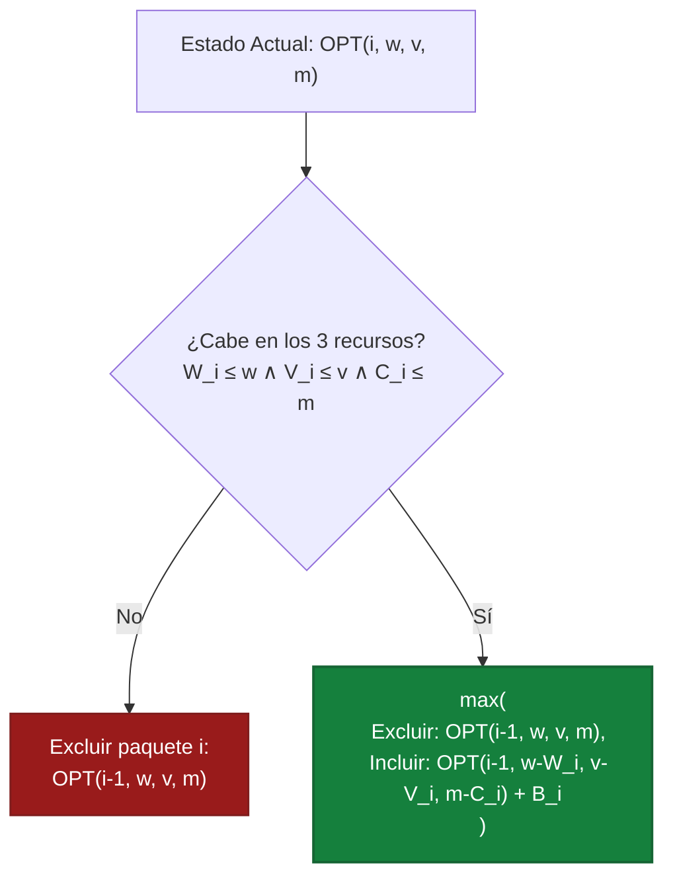

#### 3. Pseudocódigo Formal (Estilo Examen Presencial)

```text
FUNCION ResolverDeliveryMochila3D(paquetes, C, T, M):
    n <- longitud(paquetes)

    // Tabla 4D de dimensiones: (n + 1) x (C + 1) x (T + 1) x (M + 1)
    INICIALIZAR DP como arreglo 4D inicializado en 0

    // Llenado bottom-up
    PARA i <- 1 HASTA n:
        p <- paquetes[i - 1]
        PARA w <- 0 HASTA C:
            PARA v <- 0 HASTA T:
                PARA m <- 0 HASTA M:
                    // Opción 1: Excluir paquete i
                    DP[i][w][v][m] <- DP[i - 1][w][v][m]

                    // Opción 2: Incluir paquete i si no satura ningún recurso
                    SI p.peso <= w Y p.volumen <= v Y p.costo <= m:
                        val_con_p <- DP[i - 1][w - p.peso][v - p.volumen][m - p.costo] + p.beneficio
                        SI val_con_p > DP[i][w][v][m]:
                            DP[i][w][v][m] <- val_con_p

    // Reconstrucción de los paquetes seleccionados
    INICIALIZAR seleccionados como lista vacía
    curr_w <- C
    curr_v <- T
    curr_m <- M

    PARA i <- n BAJANDO HASTA 1:
        SI DP[i][curr_w][curr_v][curr_m] != DP[i - 1][curr_w][curr_v][curr_m]:
            p <- paquetes[i - 1]
            INSERTAR p EN seleccionados
            curr_w <- curr_w - p.peso
            curr_v <- curr_v - p.volumen
            curr_m <- curr_m - p.costo

    RETORNAR (DP[n][C][T][M], seleccionados)
```

**Complejidad**  

* **Tiempo:** Se llenan $(n + 1) \cdot (C + 1) \cdot (T + 1) \cdot (M + 1)$ celdas con $O(1)$ operaciones por celda: **$\Theta(n \cdot C \cdot T \cdot M)$** (Complejidad pseudo-polinomial).
* **Espacio:** **$\Theta(n \cdot C \cdot T \cdot M)$** para la matriz completa (u $O(C \cdot T \cdot M)$ si solo se pide el valor máximo iterando en reversa sobre una única tabla 3D).

<div class="trap-callout">
  <div class="trap-header">⚠️ Trampa Típica de Corrección</div>
  <p><strong>Puntos donde restan puntaje los docentes de FIUBA:</strong></p>
  <ul>
    <li><strong>Olvidar una de las tres dimensiones en la guarda:</strong> Se debe verificar simultáneamente <code>p.peso &lt;= w Y p.volumen &lt;= v Y p.costo &lt;= m</code>.</li>
    <li><strong>No aclarar que la complejidad es pseudo-polinomial:</strong> Depende directamente de las magnitudes numéricas $C, T, M$ y es exponencial respecto a la cantidad de bits $\log_2(C \cdot T \cdot M)$.</li>
  </ul>
</div>

---

### Patrón de Ejercicio 4.5: Exclusión Adyacente (House Robber / Juan el Vago)

Decisión sobre elementos consecutivos donde elegir un elemento prohíbe elegir a su vecino inmediato.

---

### Ejercicio 17 — Juan el Vago (Exclusión de Días Consecutivos)

**Clasificación:** 🟡 IMPORTANTE  
**Origen:** Guía de Ejercicios 04, Ejercicio 4 / Práctica

**Enunciado**  
Juan dispone de ofertas de trabajo para los próximos $n$ días. Cada día $i$ le ofrece una ganancia $G[i] > 0$. Sin embargo, Juan es vago y no está dispuesto a trabajar dos días seguidos. Diseñar un algoritmo por Programación Dinámica que determine la ganancia máxima que Juan puede obtener y qué días debe trabajar.

#### 1. Deducción Metodológica Formal (Los 5 Pasos de Programación Dinámica)

1. **Definición Formal del Estado:**  
   $$OPT(i) = \text{Ganancia máxima obtenible considerando los primeros } i \text{ días } (1 \le i \le n) \text{ sin trabajar dos días consecutivos.}$$

2. **Casos Base:**  
   $$OPT(0) = 0 \quad (\text{sin días}), \qquad OPT(1) = G[1] \quad (\text{conviene trabajar el único día disponible})$$

3. **Ecuación de Recurrencia:**  
   Para el día $i \ge 2$:

   * **Descansar el día $i$:** Mantiene la ganancia óptima hasta el día anterior: $OPT(i - 1)$.
   * **Trabajar el día $i$:** Suma $G[i]$, pero exige obligatoriamente haber descansado el día $i - 1$, por lo que suma el óptimo hasta $i - 2$: $OPT(i - 2) + G[i]$.
   $$OPT(i) = \max\Big(OPT(i - 1), \; OPT(i - 2) + G[i]\Big)$$

4. **Orden de Llenado de la Tabla:**  
   Secuencial creciente desde $i = 2$ hasta $n$ en tiempo $O(n)$.

5. **Reconstrucción de los Días Trabajados:**  
   Retrocediendo desde $i = n$: si $DP[i] == DP[i - 2] + G[i]$, Juan trabajó el día $i$ y saltamos a $i - 2$; en caso contrario descansó el día $i$ y pasamos a $i - 1$.

#### 2. Diagrama Visual de Decisión con Exclusión Adyacente

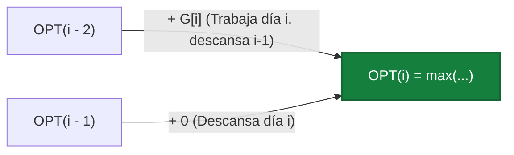

#### 3. Ejemplo Concreto y Tabla de Traza Paso a Paso

Sean $n = 5$ días con ganancias $G = [10, 20, 15, 30, 10]$:

| Día $i$ | Ganancia $G[i]$ | Descansar: $OPT(i-1)$ | Trabajar: $OPT(i-2) + G[i]$ | $OPT(i)$ | Decisión en $i$ |
| :---: | :---: | :---: | :---: | :---: | :--- |
| **0** | — | — | — | **$0$** | Caso base |
| **1** | $10$ | $0$ | $0 + 10 = 10$ | **$10$** | Trabaja día 1 |
| **2** | $20$ | $10$ | $0 + 20 = 20$ | **$20$** | Trabaja día 2 |
| **3** | $15$ | $20$ | $10 + 15 = 25$ | **$25$** | Trabaja días $\{1, 3\}$ |
| **4** | $30$ | $25$ | $20 + 30 = 50$ | **$50$** | Trabaja días $\{2, 4\}$ |
| **5** | $10$ | $50$ | $25 + 10 = 35$ | **$50$** | Descansa día 5 (mantiene $\{2, 4\}$) |

*Resultado óptimo:* Ganancia máxima **$50$** trabajando los días $2$ y $4$ ($20 + 30 = 50$).

#### 4. Pseudocódigo Formal (Estilo Examen Presencial)

```text
FUNCION JuanElVago(G):
    n <- longitud(G)
    SI n = 0:
        RETORNAR (0, lista vacía)
    SI n = 1:
        RETORNAR (G[0], [0])

    INICIALIZAR DP como arreglo de tamaño (n + 1) en 0
    DP[0] <- 0
    DP[1] <- G[0]

    PARA i <- 2 HASTA n:
        DP[i] <- maximo(DP[i - 1], DP[i - 2] + G[i - 1])

    // Reconstrucción
    INICIALIZAR dias como lista vacía
    idx <- n
    MIENTRAS idx > 0:
        SI idx = 1:
            INSERTAR 0 AL INICIO DE dias
            ROMPER
        SI DP[idx] = DP[idx - 2] + G[idx - 1]:
            INSERTAR (idx - 1) AL INICIO DE dias
            idx <- idx - 2
        SINO:
            idx <- idx - 1

    RETORNAR (DP[n], dias)
```

**Complejidad**  

* **Tiempo:** $\Theta(n)$ pues llena una tabla lineal de $n + 1$ posiciones con operaciones $O(1)$.
* **Espacio:** $\Theta(n)$ para reconstruir los días (u $O(1)$ usando solo dos variables escalares si únicamente se pide el monto máximo).

---

### Patrón de Ejercicio 4.6: Interval Scheduling Ponderado (DP con Búsqueda Binaria)

Selección de intervalos con pesos o beneficios arbitrarios donde Greedy falla y se requiere DP con búsqueda logarítmica del predecesor compatible.

---

### Ejercicio 18 — Interval Scheduling Ponderado (DP + Búsqueda Binaria)

**Clasificación:** 🔴 IMPRESCINDIBLE  
**Origen:** Guía de Ejercicios 04, Ejercicio 2 / Práctica

**Enunciado**  
Se tiene un conjunto de $n$ intervalos $[s_i, f_i]$, cada uno con un beneficio o peso $v_i > 0$. No se pueden seleccionar intervalos que se solapen. Diseñar un algoritmo que maximice la suma de los beneficios de los intervalos elegidos en tiempo $O(n \log n)$.

#### 1. Deducción Metodológica Formal (Los 5 Pasos de Programación Dinámica)

1. **Ordenamiento Previo y Función de Predecesor Compatible $p(i)$:**  
   Ordenamos los intervalos por tiempo de finalización creciente: $f_1 \le f_2 \le \dots \le f_n$ en $O(n \log n)$.  
   Para cada intervalo $i \in \{1, \dots, n\}$, definimos $p(i)$ como el mayor índice $j < i$ tal que el intervalo $j$ no se solapa con $i$ ($f_j \le s_i$). Si no existe tal intervalo, $p(i) = 0$. Como las fechas de fin están ordenadas, $p(i)$ se halla mediante **Búsqueda Binaria** en $O(\log n)$.

2. **Definición Formal del Estado:**  
   $$OPT(i) = \text{Beneficio máximo obtenible seleccionando un subconjunto de intervalos mutuamente compatibles dentro de } \{1, \dots, i\}.$$

3. **Caso Base:**  
   $$OPT(0) = 0$$

4. **Ecuación de Recurrencia:**  
   $$OPT(i) = \max\Big(OPT(i - 1), \;\; OPT(p(i)) + v_i\Big)$$

5. **Orden de Llenado y Reconstrucción:**  
   Se llena para $i = 1 \dots n$ en $O(n)$. Para reconstruir, desde $i = n$: si $DP[p(i)] + v_i \ge DP[i-1]$, se incluye el intervalo $i$ y se salta directamente a $i \leftarrow p(i)$; si no, se avanza a $i \leftarrow i - 1$.

#### 2. Diagrama Visual del Salto al Predecesor Compatible $p(i)$

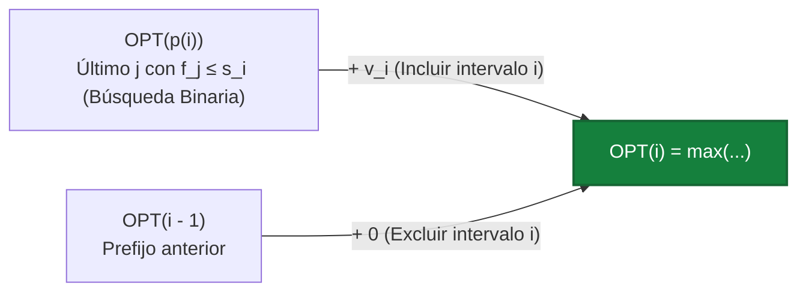

#### 3. Ejemplo Concreto y Tabla de Traza Paso a Paso

Consideremos $n = 4$ intervalos ya ordenados por $f_i$:

| Índice $i$ | Intervalo $[s_i, f_i]$ | Valor $v_i$ | Predecesor $p(i)$ ($f_j \le s_i$) | Excluir: $OPT(i-1)$ | Incluir: $OPT(p(i)) + v_i$ | $OPT(i)$ |
| :---: | :---: | :---: | :---: | :---: | :---: | :---: |
| **1** | $[1, 3]$ | $50$ | $0$ | $0$ | $0 + 50 = 50$ | **$50$** |
| **2** | $[2, 5]$ | $20$ | $0$ ($f_1=3 > 2$) | $50$ | $0 + 20 = 20$ | **$50$** |
| **3** | $[4, 6]$ | $100$ | $1$ ($f_1=3 \le 4$) | $50$ | $OPT(1) + 100 = 150$ | **$150$** |
| **4** | $[5, 8]$ | $70$ | $2$ ($f_2=5 \le 5$) | $150$ | $OPT(2) + 70 = 50 + 70 = 120$ | **$150$** |

*Solución óptima:* Intervalos $\{1, 3\}$ con ganancia total $50 + 100 = \mathbf{150}$.

#### 4. Pseudocódigo Formal (Estilo Examen Presencial)

```text
FUNCION IntervalSchedulingPonderado(intervalos):
    n <- longitud(intervalos)
    ORDENAR intervalos POR fin ASCENDENTE

    // Precalcular p(i) para cada i mediante búsqueda binaria en O(n log n)
    INICIALIZAR P como arreglo de tamaño (n + 1) en 0
    PARA i <- 1 HASTA n:
        P[i] <- BuscarUltimoCompatible(intervalos, i)

    INICIALIZAR DP como arreglo de tamaño (n + 1) en 0
    DP[0] <- 0

    PARA i <- 1 HASTA n:
        val_excluir <- DP[i - 1]
        val_incluir <- DP[P[i]] + intervalos[i - 1].valor
        DP[i] <- maximo(val_excluir, val_incluir)

    // Reconstrucción
    INICIALIZAR seleccion como lista vacía
    idx <- n
    MIENTRAS idx > 0:
        SI DP[P[idx]] + intervalos[idx - 1].valor >= DP[idx - 1]:
            INSERTAR intervalos[idx - 1] AL INICIO DE seleccion
            idx <- P[idx]
        SINO:
            idx <- idx - 1

    RETORNAR (DP[n], seleccion)

FUNCION BuscarUltimoCompatible(intervalos, i):
    ini <- 0
    fin <- i - 2
    res <- 0
    s_i <- intervalos[i - 1].inicio

    MIENTRAS ini <= fin:
        med <- (ini + fin) / 2
        SI intervalos[med].fin <= s_i:
            res <- med + 1 // Convertido a índice 1-based
            ini <- med + 1
        SINO:
            fin <- med - 1

    RETORNAR res
```

**Complejidad**  

* **Tiempo:** Ordenamiento en $O(n \log n) + n$ búsquedas binarias de $O(\log n)$ para calcular $p(i) +$ llenado lineal de DP en $O(n)$. Total: **$\Theta(n \log n)$**.
* **Espacio:** **$\Theta(n)$** para los arreglos `DP`, `P` y la reconstrucción.

<div class="trap-callout">
  <div class="trap-header">⚠️ Trampa Típica de Corrección</div>
  <p><strong>Puntos donde restan puntaje los docentes de FIUBA:</strong></p>
  <ul>
    <li><strong>Buscar $p(i)$ de forma lineal con un bucle hacia atrás:</strong> Si buscas el último intervalo compatible recorriendo desde $i-1$ hasta $1$, el preprocesamiento toma $O(n^2)$ en el peor caso, incumpliendo la cota exigida de $O(n \log n)$. Debe usarse Búsqueda Binaria sobre los tiempos de fin ordenados.</li>
    <li><strong>Ordenar por tiempo de inicio $s_i$ en vez de fin $f_i$:</strong> Para que el prefijo $1 \dots p(i)$ contenga exactamente todos los intervalos que terminan antes de $s_i$, el arreglo debe estar ordenado por $f_i$.</li>
  </ul>
</div>

---

### Errores Frecuentes en Exámenes sobre Programación Dinámica

1. **No definir formalmente qué significa $OPT(\dots)$:** Escribir directamente una matriz sin explicar qué representan las filas y columnas anula la justificación.
2. **Olvidar los casos base:** No definir $OPT(0, w)$ o inicializar en $0$ cuando un valor inaccesible debería ser $-\infty$.
3. **No justificar el orden de llenado:** Asumir que se llena mágicamente sin decir que las filas se procesan de $0$ a $n$ y las capacidades de $0$ a $W$.
4. **Omitir la reconstrucción:** Quedarse con el número final $DP[n][W]$ cuando el problema pide "cuáles son los elementos".


---

## 8. Tema 5: Programación Lineal y Entera (PL / PLI)

### Conceptos Mínimos de Supervivencia

1. **Estructura Canónica de un Modelo Matemático:**
   En las correcciones de FIUBA, todo modelo debe estructurarse obligatoriamente en cinco bloques explícitos:

   * **Conjuntos y Parámetros:** Definición rigurosa de índices, conjuntos de entrada y constantes numéricas con sus unidades físicas.
   * **Variables de Decisión y Dominios:** Qué representa semánticamente cada variable, con su dominio matemático estricto ($x_i \in \{0, 1\}$, $y_j \ge 0$, $z \in \mathbb{R}$).
   * **Función Objetivo:** Maximizar o minimizar una combinación lineal exacta. Está estrictamente prohibido multiplicar variables entre sí o emplear funciones no lineales directas ($\max$, $\min$, $|\cdot|$).
   * **Restricciones Lineales:** Desigualdades e igualdades lineales ($\le, \ge, =$) que delimitan el poliedro convexo de soluciones factibles.
   * **Conteo Exhaustivo de Variables y Restricciones:** Identificar la dimensionalidad exacta del modelo en función de los parámetros de entrada ($O(|V|)$, $O(|E|)$).

2. **Técnicas Clave de Linealización y Modelado Lógico:**
   * **Minimización de un Máximo ($\min \max(f_1, f_2, \dots, f_k)$):**
     Se introduce una variable auxiliar continua $Z \in \mathbb{R}$.
     $$\min Z \quad \text{sujeto a:} \quad Z \ge f_r(x) \quad \forall r \in \{1, \dots, k\}$$
     *Principio:* Al minimizar $Z$, el optimizador presiona $Z$ hacia abajo hasta topar con la cota más restrictiva, cumpliéndose en el óptimo que $Z^* = \max_r f_r(x^*)$.

   * **Relación de Cobertura y Activación (*Linking Constraints*):**
     Si la entidad $i$ solo puede activarse ($x_i = 1$) cuando al menos un recurso $j$ que la abastece está seleccionado ($y_j = 1$):
     $$x_i \le \sum_{j \in Abastecedores(i)} y_j \quad \forall i$$
     Si la sumatoria es 0, fuerza $x_i = 0$. Si es $\ge 1$, permite $x_i \le \text{valor}$, y al maximizar $\sum x_i$, se fijará en 1.

   * **Unimodularidad Total (TUM):**
     Si la matriz de restricciones $A$ de un problema continuo ($Ax \le b$) es totalmente unimodular (todo subdeterminante es $0, 1$ o $-1$) y el vector $b$ es entero, **todos los vértices del poliedro son enteros**. Esto permite resolver problemas de flujo o camino mínimo con Simplex continuo en tiempo polinomial garantizando soluciones $100\%$ enteras.

---

### Patrón de Ejercicio 5.1: Máxima Cobertura con Presupuesto de Recursos

Problemas donde se busca maximizar la cantidad de elementos cubiertos o beneficiados sujeto a un límite estricto de tiempo, dinero o capacidad disponible.

---

### Ejercicio 19 — Observación de Aves de Paolo Casanova (Máxima Cobertura con Presupuesto de Tiempo)

**Clasificación:** 🔴 IMPRESCINDIBLE  
**Origen:** Parcial 2024-2-1 (5 de noviembre de 2024), Ejercicio 4  
**Qué evalúa la cátedra:** Modelado de *Maximum Coverage Problem* en PLI, formulación rigurosa de restricciones de enlace (*linking constraints*) entre variables de recurso y variables de beneficio, y conteo analítico de componentes.

#### 1. Enunciado Completo
Paolo Casanova dispone de 2 días para realizar salidas a diferentes lugares cercanos y observar la mayor cantidad posible de especies de aves. Hay 10 especies en particular que desea encontrar ($E = \{1, \dots, 10\}$) y 6 lugares posibles a visitar ($L = \{1, \dots, 6\}$). Algunos lugares insumen medio día ($0.5$ días) y otros un día completo ($1.0$ días). Para cada lugar se conoce exactamente qué especies habitan allí según una matriz binaria de presencia $A_{ij}$ ($A_{ij} = 1$ si la especie $i$ habita en el lugar $j$, $0$ si no). Plantear un modelo de Programación Lineal Entera que determine qué lugares visitar para maximizar la cantidad de especies distintas encontradas en el tiempo disponible. Indicar la cantidad exacta de variables y restricciones del modelo.

#### 2. Los 5 Pasos Metodológicos de Modelado en PLI

1. **Identificación de Decisiones y Recursos:**
   - Decisión primaria: ¿Se visita el lugar $j \in L$? (Variable binaria $y_j$).
   - Decisión secundaria/beneficio: ¿Se logra observar la especie $i \in E$? (Variable binaria $x_i$).
   - Recurso limitante: Presupuesto temporal global de $2.0$ días.
2. **Definición de Conjuntos y Parámetros:**
   - $E = \{1, \dots, 10\}$: Conjunto de especies objetivo.
   - $L = \{1, \dots, 6\}$: Conjunto de sitios candidatos.
   - $d_j \in \{0.5, 1.0\}$: Duración de la visita al sitio $j$.
   - $A_{ij} \in \{0, 1\}$: Matriz de incidencia especie-sitio.
   - $T_{max} = 2.0$: Días disponibles.
3. **Formulación de la Función Objetivo:**
   Maximizar la cardinalidad del conjunto de especies distintas avistadas:
   $$\max Z = \sum_{i \in E} x_i$$

4. **Restricción Presupuestaria y Restricciones de Enlace:**
   - Presupuesto de tiempo: La suma ponderada de sitios elegidos no excede $T_{max}$:
     $$\sum_{j \in L} d_j \cdot y_j \le 2.0$$

   - Enlace Lógico (*Coverage Constraint*): Para cada especie $i$, $x_i$ solo puede valer 1 si se visita al menos un sitio $j$ tal que $A_{ij} = 1$:
     $$x_i \le \sum_{j \in L} A_{ij} \cdot y_j \quad \forall i \in E$$

5. **Declaración Explícita de Dominios:**
   $$y_j \in \{0, 1\} \quad \forall j \in L, \qquad x_i \in \{0, 1\} \quad \forall i \in E$$

#### 3. Explicación Directa de por qué Funciona la Restricción de Enlace

1. **Si no visitamos ningún lugar donde viva la especie `i`:** La suma de los `y_j` de sus lugares da `0`. Como `x_i <= 0` y es binaria, la restricción obliga a que `x_i = 0` (no podemos contar un ave que no vimos).
2. **Si visitamos al menos un lugar donde vive la especie `i`:** La suma de sus `y_j` da `1` o más. Como buscamos maximizar la suma de `x_i`, el modelo automáticamente le pone el mayor valor permitido a `x_i`, que es `1`.
3. **No cuenta dos veces la misma especie:** Aunque visitemos 2 o 3 lugares donde está la misma ave (la suma da `2` o `3`), como `x_i` es binaria (`{0, 1}`), nunca puede pasar de `1`. Así cada especie distinta suma como máximo `1`.

#### 4. Diagrama Visual del Grafo de Cobertura Bipartito

```mermaid
flowchart LR
    subgraph Lugares [Lugares Candidatos]
        L1["L1: 0.5 dias"]
        L2["L2: 1.0 dias"]
        L3["L3: 0.5 dias"]
        L4["L4: 1.0 dias"]
    end
    subgraph Especies [Especies Observadas]
        E1["Especie 1"]
        E2["Especie 2"]
        E3["Especie 3"]
        E4["Especie 4"]
    end
    L1 --> E1
    L1 --> E2
    L2 --> E2
    L2 --> E3
    L3 --> E3
    L3 --> E4
    L4 --> E1
    L4 --> E4
```

#### 5. Ejemplo Numérico y Traza de Decisión

Consideremos una instancia representativa con 4 lugares y 5 especies para verificar el enlace:

| Lugar $j$ | Duración $d_j$ | Especies presentes ($A_{ij}=1$) |
| :--- | :--- | :--- |
| **L1** | 0.5 días | $\{E_1, E_2\}$ |
| **L2** | 1.0 días | $\{E_2, E_3, E_4\}$ |
| **L3** | 0.5 días | $\{E_3, E_5\}$ |
| **L4** | 1.0 días | $\{E_1, E_4, E_5\}$ |

* **Presupuesto:** $T = 2.0$ días.
* **Evaluación de combinaciones:**
    - Visitar $\{L_1, L_3, L_2\}$: Duración $0.5 + 0.5 + 1.0 = 2.0$ días. Especies cubiertas: $\{E_1, E_2\} \cup \{E_3, E_5\} \cup \{E_2, E_3, E_4\} = \{E_1, E_2, E_3, E_4, E_5\}$ (5 especies).
    - Valor objetivo óptimo: $Z^* = 5$.
    - Variables: $y_1=1, y_2=1, y_3=1, y_4=0$; $x_1=x_2=x_3=x_4=x_5=1$.

#### 6. Conteo Formal de Variables y Restricciones

* **Variables de Decisión:**
    - $|L| = 6$ variables binarias de visita $y_j$.
    - $|E| = 10$ variables binarias de avistamiento $x_i$.
    - **Total de variables:** $6 + 10 = 16$ variables binarias.
* **Restricciones Lineales:**
    - 1 restricción de presupuesto temporal.
    - $|E| = 10$ restricciones de cobertura lógica (una por especie).
    - **Total de restricciones:** $1 + 10 = 11$ restricciones funcionales (además de los dominios $0 \le x_i, y_j \le 1$).

#### 7. Pseudocódigo de Formulación y Resolución (Estilo Examen Presencial)

```text
Algoritmo ResolverObservacionAvesPLI(Especies, Lugares, duraciones, presencia, T_max):
    Crear modelo de Programación Lineal Entera (PLI):

    // 1. Variables de decisión binarias:
    Para cada lugar j in Lugares:
        Definir y[j] in {0, 1}   // 1 si se visita el sitio j, 0 si no
    Para cada especie i in Especies:
        Definir x[i] in {0, 1}   // 1 si se avista la especie i, 0 si no

    // 2. Función Objetivo: maximizar especies distintas avistadas
    Maximizar Z = Sumatoria_{i in Especies} x[i]

    // 3. Restricciones:
    // (a) Presupuesto temporal máximo de expedición:
    Sumatoria_{j in Lugares} (duraciones[j] * y[j]) <= T_max

    // (b) Enlace lógico de presencia por especie:
    Para cada especie i in Especies:
        x[i] <= Sumatoria_{j in Lugares} (presencia[i, j] * y[j])

    // 4. Resolución mediante solver PLI estándar:
    (Z_opt, valores_y, valores_x) = ResolverSolverPLI(modelo)

    devolver (Z_opt, LugaresCon(valores_y == 1), EspeciesCon(valores_x == 1))
```

<div class="trap-callout">
  <div class="trap-header">⚠️ Trampa Típica de Corrección</div>
  <p><strong>Puntos donde restan puntaje los docentes de FIUBA:</strong></p>
  <ul>
    <li><strong>Forzar igualdad en la cobertura ($x_i = \sum A_{ij} y_j$):</strong> Si Paolo visita 2 sitios que albergan a la especie $i$, $x_i$ se vería forzada a valer 2, violando el dominio binario o inflando artificialmente el valor objetivo al sumar dos veces la misma ave. La relación correcta es estrictamente de desigualdad $\le$.</li>
    <li><strong>Declarar variables continuas en lugar de binarias:</strong> Si se omite $y_j \in \{0, 1\}$, el solver visitará fracciones de lugares (ej. visitar $0.25$ del lugar 1 y $0.25$ del lugar 4), obteniendo una solución matemáticamente óptima pero físicamente absurda.</li>
  </ul>
</div>

---

### Patrón de Ejercicio 5.2: Cobertura de Celdas con Umbral Porcentual

Problemas de infraestructura (antenas, sensores, cámaras) sobre grillas donde se exige cubrir una fracción mínima del total de objetivos con costo mínimo.

---

### Ejercicio 20 — Cobertura de Antenas Celulares con Umbral del 70% de Vecindarios

**Clasificación:** 🔴 IMPRESCINDIBLE  
**Origen:** Parcial 2024-2-3 (10 de diciembre de 2024), Ejercicio 3  
**Qué evalúa la cátedra:** Modelado de *Partial Set Cover* en PLI, formulación de umbrales porcentuales de servicio y minimización de costos fijos.

#### 1. Enunciado Completo
Una empresa de telefonía celular colocará antenas en una grilla bidimensional de celdas para prestar servicio a vecindarios distribuidos en un mapa. Si se instala una antena en la celda $(i, j)$, brindará cobertura a un bloque de 9 celdas (la propia celda $(i, j)$ y sus 8 celdas contiguas en vecindad de Moore). Instalar una antena tiene un costo fijo $CTE > 0$ idéntico en cualquier celda. Se dispone de un conjunto $V$ de vecindarios distribuidos en la zona. La empresa exige brindar servicio a **por lo menos el 70% de los vecindarios** minimizando la inversión total. Plantear un modelo de Programación Lineal Entera indicando claramente variables, dominios, función objetivo, restricciones y su conteo exacto.

#### 2. Los 5 Pasos Metodológicos de Modelado en PLI

1. **Identificación de Decisiones:**
   - Decisión de infraestructura: ¿Se instala una antena en la celda candidata $c \in C$? Variable binaria $y_c$.
   - Decisión de servicio: ¿El vecindario $v \in V$ resulta efectivamente cubierto? Variable binaria $x_v$.
2. **Definición de Conjuntos y Parámetros:**
   - $C$: Conjunto de celdas de la grilla donde es factible instalar antenas.
   - $V$: Conjunto de vecindarios a servir.
   - $Cubren(v) \subseteq C$: Conjunto de celdas candidatas cuya antena cubre al vecindario $v$ (es decir, todas las celdas $c$ a distancia Chebyshev $\le 1$ de la celda de $v$).
   - $CTE$: Costo unitario de instalación de una antena.
3. **Formulación de la Función Objetivo:**
   Minimizar el gasto de instalación de infraestructura:
   $$\min CostoTotal = CTE \cdot \sum_{c \in C} y_c$$

4. **Restricciones de Cobertura y Umbral de Satisfacción:**
   - **Umbral del 70%:** La cantidad total de vecindarios cubiertos debe ser al menos el $70\%$ del total:
     $$\sum_{v \in V} x_v \ge 0.70 \cdot |V|$$

   - **Enlace de Cobertura Física:** Un vecindario $v$ solo puede declararse cubierto si se instala al menos una antena en alguna celda dentro de su rango de alcance:
     $$x_v \le \sum_{c \in Cubren(v)} y_c \quad \forall v \in V$$

5. **Dominios de las Variables:**
   $$y_c \in \{0, 1\} \quad \forall c \in C, \qquad x_v \in \{0, 1\} \quad \forall v \in V$$

#### 3. Explicación Directa de por qué Funciona el Modelo

1. **Si ninguna antena cubre al vecindario `v`:** La suma de las antenas en su bloque de $3 \times 3$ da `0`, lo que fuerza `x_v = 0`.
2. **Meta del 70%:** La restricción `sum(x_v) >= 0.70 * |V|` obliga a que al menos el 70% de los vecindarios tengan `x_v = 1`, lo que a su vez obliga a encender las antenas `y_c` necesarias para cubrirlos.
3. **No se instalan antenas de más:** Como la función objetivo minimiza el gasto total en antenas, el modelo solo activa las antenas estrictamente necesarias para llegar al 70%.

#### 4. Diagrama Visual de Vecindad de Cobertura (3x3)

```mermaid
graph TD
    subgraph CeldaAntena [Antena Central]
        C["Celda Central (i, j)"]
    end
    subgraph CeldasCubiertas [Radio de Vecindad]
        V1["Vecino (i-1, j-1)"]
        V2["Vecino (i-1, j)"]
        V3["Vecino (i-1, j+1)"]
        V4["Vecino (i, j-1)"]
        V5["Vecino (i, j+1)"]
        V6["Vecino (i+1, j-1)"]
        V7["Vecino (i+1, j)"]
        V8["Vecino (i+1, j+1)"]
    end
    C --> V1
    C --> V2
    C --> V3
    C --> V4
    C --> V5
    C --> V6
    C --> V7
    C --> V8
```

#### 5. Ejemplo Numérico y Traza

Supongamos una grilla pequeña con 10 vecindarios ($|V| = 10$).

- Umbral requerido: $\lceil 0.70 \times 10 \rceil = 7$ vecindarios.
- Supongamos que la antena $A_1$ cubre $\{v_1, v_2, v_3, v_4\}$, la antena $A_2$ cubre $\{v_4, v_5, v_6, v_7\}$ y la antena $A_3$ cubre $\{v_8, v_9, v_{10}\}$.
- Con 2 antenas ($A_1$ y $A_2$), se cubren $\{v_1, \dots, v_7\}$ (7 vecindarios).
- Inversión mínima: $2 \times CTE$.
- Solución factible óptima: $y_{A1}=1, y_{A2}=1, y_{A3}=0$; $x_1=x_2=\dots=x_7=1$, $x_8=x_9=x_{10}=0$.

#### 6. Conteo Formal de Variables y Restricciones

* **Variables de Decisión:**
    - $|C|$ variables binarias de antena $y_c$.
    - $|V|$ variables binarias de servicio $x_v$.
    - **Total:** $|C| + |V|$ variables binarias.
* **Restricciones Lineales:**
    - 1 restricción global de umbral del 70%.
    - $|V|$ restricciones individuales de cobertura de vecindario.
    - **Total:** $|V| + 1$ restricciones lineales.

#### 7. Pseudocódigo de Formulación y Resolución (Estilo Examen Presencial)

```text
Algoritmo FormularAntenas70PLI(Celdas, Vecindarios, Cubren, Costo_antena):
    Crear modelo PLI:

    // 1. Variables de decisión binarias:
    Para cada celda c in Celdas:
        Definir y[c] in {0, 1}       // 1 si se instala antena en c
    Para cada vecindario v in Vecindarios:
        Definir x[v] in {0, 1}       // 1 si el vecindario v queda cubierto

    // 2. Función Objetivo: minimizar costo de antenas
    Minimizar Costo = Sumatoria_{c in Celdas} (Costo_antena * y[c])

    // 3. Restricciones:
    // (a) Umbral mínimo de cobertura del 70%:
    Sumatoria_{v in Vecindarios} x[v] >= techo(0.70 * cantidad(Vecindarios))

    // (b) Cobertura física por vecindario:
    Para cada vecindario v in Vecindarios:
        x[v] <= Sumatoria_{c in Cubren[v]} y[c]

    (Costo_opt, antenas_activas) = ResolverSolverPLI(modelo)
    devolver (Costo_opt, antenas_activas)
```

<div class="trap-callout">
  <div class="trap-header">⚠️ Trampa Típica de Corrección</div>
  <p><strong>Puntos donde restan puntaje los docentes de FIUBA:</strong></p>
  <ul>
    <li><strong>Confundir el sentido de la desigualdad del umbral:</strong> Escribir $\sum x_v \le 0.70 |V|$ en lugar de $\ge$. Si se pone $\le$, el modelo elegirá no cubrir a nadie ($x_v = 0$), obteniendo costo 0 pero incumpliendo la meta empresarial.</li>
    <li><strong>Creer que el problema pide maximizar cobertura:</strong> La función objetivo NO es $\max \sum x_v$; es **minimizar el costo de antenas** sujeto a que la cobertura alcance el $70\%$. Maximizar cobertura instalaría antenas en toda la grilla innecesariamente.</li>
  </ul>
</div>

---

### Patrón de Ejercicio 5.3: Flujo de Costo Mínimo / Transporte Multizona

Problemas de balance de oferta y demanda con capacidades máximas y costos de transporte por arista en redes continuas.

---

### Ejercicio 21 — Distribución Energética Multizona con Costos de Transporte (Flujo de Costo Mínimo)

**Clasificación:** 🔴 IMPRESCINDIBLE  
**Origen:** Parcial 2025-1-1 (27 de mayo de 2025), Ejercicio 3  
**Qué evalúa la cátedra:** Modelado de *Min-Cost Flow* en Programación Lineal continua, conservación nodal de flujo con fuentes de generación y pozos de demanda, y restricciones de capacidad de línea.

#### 1. Enunciado Completo
El sistema interconectado argentino está dividido en 9 regiones eléctricas ($R = \{1, \dots, 9\}$). Para cada región $i$ se conoce su capacidad de generación prevista $G_i \ge 0$ (en MWh) y su demanda requerida $D_i \ge 0$ (en MWh). Desde cualquier región $i$ se puede transmitir energía a otra región $j$ con un costo unitario de transporte $C_{ij} \ge 0$ pesos por MWh. Cada línea de transmisión posee una capacidad máxima de transporte de $CAP_{ij} \ge 0$ MWh/día. Plantear un modelo de Programación Lineal continuo que determine el despacho de energía más económico para satisfacer plenamente la demanda de todas las regiones sin violar capacidades de transporte. Indicar variables y restricciones.

#### 2. Los 5 Pasos Metodológicos de Modelado en PL Continuo

1. **Identificación de la Naturaleza Continua:**
   La energía eléctrica es un bien continuo medido en MWh. No se requieren variables binarias; es un problema de Programación Lineal clásica ($x_{ij} \ge 0$).

2. **Definición de Conjuntos y Parámetros:**
   - $R = \{1, \dots, 9\}$: Conjunto de nodos regionales.
   - $L = \{(i, j) \in R \times R : i \ne j\}$: Líneas de transmisión disponibles.
   - $G_i \ge 0$: Generación inyectada en el nodo $i$.
   - $D_i \ge 0$: Demanda consumida en el nodo $i$.
   - $C_{ij} \ge 0$: Costo por MWh en el arco $(i, j)$.
   - $CAP_{ij} \ge 0$: Capacidad máxima del arco $(i, j)$.
3. **Formulación de la Función Objetivo:**
   Minimizar el costo total de despacho y transporte interregional:
   $$\min CostoTotal = \sum_{(i, j) \in L} C_{ij} \cdot x_{ij}$$

4. **Restricciones de Balance y Capacidad:**
   - **Balance Nodal de Potencia:** En cada región $i \in R$, la generación local más la energía entrante desde otras regiones debe cubrir la energía saliente hacia otros nodos más la demanda local:
     $$G_i + \sum_{k \in R, k \ne i} x_{ki} - \sum_{j \in R, j \ne i} x_{ij} = D_i \quad \forall i \in R$$
     *(O en forma estándar: $\sum_{j} x_{ij} - \sum_{k} x_{ki} \le G_i - D_i$ si se permite generación ociosa).*

   - **Capacidad de las Líneas de Transmisión:**
     $$x_{ij} \le CAP_{ij} \quad \forall (i, j) \in L$$

5. **No Negatividad de las Variables:**
   $$x_{ij} \ge 0 \quad \forall (i, j) \in L$$

#### 3. Explicación Directa del Balance de Energía

En cada región $i$, toda la energía que se genera localmente más la que entra desde otras regiones tiene que ser igual a la que se consume allí más la que se envía hacia afuera:
$$\text{Generación}_i + \text{Entra}_i - \text{Sale}_i = \text{Demanda}_i$$
*(Nota: Si el país puede generar más energía de la que consume en total, basta con poner `Sale - Entra <= Generación - Demanda` para que las centrales no estén obligadas a inyectar el sobrante).*

#### 4. Diagrama Visual de Red de Flujo con Costos

```mermaid
flowchart LR
    R1["Region 1: G1=100 D1=20"] -->|x12 Costo 5 Cap 50| R2["Region 2: G2=10 D2=80"]
    R1 -->|x13 Costo 8 Cap 40| R3["Region 3: G3=30 D3=40"]
    R2 -->|x23 Costo 3 Cap 30| R3
```

#### 5. Ejemplo Numérico y Traza de Balance

Analicemos 3 regiones simplificadas:

- $R_1$: $G_1 = 100, D_1 = 20 \implies \text{Excedente} = +80$.
- $R_2$: $G_2 = 10, D_2 = 80 \implies \text{Déficit} = -70$.
- $R_3$: $G_3 = 30, D_3 = 40 \implies \text{Déficit} = -10$.
- Líneas:
    - $(1, 2)$: $C_{12} = 5, CAP_{12} = 50$.
    - $(1, 3)$: $C_{13} = 9, CAP_{13} = 40$.
    - $(2, 3)$: $C_{23} = 2, CAP_{23} = 20$.
- Despacho Óptimo:
    - Enviar $50$ MWh por $(1, 2)$ al costo $5 \times 50 = 250$ (satura línea). Faltan $20$ en $R_2$.
    - Enviar $30$ MWh por $(1, 3)$ al costo $9 \times 30 = 270$. $R_3$ recibe $30$, cubre sus $10$ de déficit y envía $20$ a $R_2$ por $(3, 2)$ si fuera bidireccional.

#### 6. Conteo Formal de Variables y Restricciones

* **Variables de Decisión:**
    - Cantidad de arcos posibles entre 9 regiones: $9 \times 8 = 72$ variables continuas no negativas ($x_{ij} \ge 0$).
* **Restricciones Lineales:**
    - 9 restricciones de balance nodal de potencia (una por región).
    - 72 restricciones de cota superior de capacidad ($x_{ij} \le CAP_{ij}$).
    - **Total:** $9 + 72 = 81$ restricciones lineales (más $x_{ij} \ge 0$).

#### 7. Pseudocódigo de Formulación y Resolución (Estilo Examen Presencial)

```text
Algoritmo FormularDistribucionFlujoPL(Regiones, Aristas, Generacion, Demanda, Costo, Capacidad):
    Crear modelo de Programación Lineal Continua:

    // 1. Variables de decisión continuas:
    Para cada arista (u, v) in Aristas:
        Definir x[u, v] >= 0         // Potencia transportada por la línea

    // 2. Función Objetivo: minimizar costo de transmisión
    Minimizar CostoTotal = Sumatoria_{(u, v) in Aristas} (Costo[u, v] * x[u, v])

    // 3. Restricciones:
    // (a) Balance nodal de potencia para cada región i in Regiones:
    Sumatoria_{v} x[i, v] - Sumatoria_{u} x[u, i] = Generacion[i] - Demanda[i]

    // (b) Capacidad física máxima por línea:
    Para cada arista (u, v) in Aristas:
        x[u, v] <= Capacidad[u, v]

    (Costo_min, flujos_optimos) = ResolverSimplex(modelo)
    devolver (Costo_min, flujos_optimos)
```

<div class="trap-callout">
  <div class="trap-header">⚠️ Trampa Típica de Corrección</div>
  <p><strong>Puntos donde restan puntaje los docentes de FIUBA:</strong></p>
  <ul>
    <li><strong>Declarar variables enteras $x_{ij} \in \mathbb{Z}^+$:</strong> La energía eléctrica no se transporta en paquetes indivisibles; forzar variables enteras convierte un problema resoluble en tiempo polinomial en un problema NP-Hard innecesariamente.</li>
    <li><strong>Invertir los signos del balance nodal:</strong> Restar las entradas y sumar las salidas. El balance físico es: $(\text{Generación local}) + (\text{Flujo Entrante}) - (\text{Flujo Saliente}) = \text{Demanda local}$.</li>
  </ul>
</div>

---

### Patrón de Ejercicio 5.4: Camino Mínimo Formulado como Flujo Unitario

Formulación de la búsqueda de rutas óptimas en grafos dirigidos acíclicos como problemas de inyección y extracción de una única unidad de flujo en Programación Lineal continua aprovechando Unimodularidad Total.

---

### Ejercicio 22 — Camino de Mínimo Riesgo (INVAP) como Flujo Unitario en PL

**Clasificación:** 🟡 IMPORTANTE  
**Origen:** Parcial 2025-1-2 (17 de junio de 2025), Ejercicio 5  
**Qué evalúa la cátedra:** Formulación de caminos mínimos como problemas de flujo en PL, comprensión de la Unimodularidad Total (TUM) de matrices de incidencia de grafos, y justificación teórica de por qué la relajación continua garantiza soluciones enteras.

#### 1. Enunciado Completo
Para el traslado de una carga crítica de alta seguridad de la empresa INVAP desde el centro atómico Ezeiza ($s$) hasta el laboratorio central en Bariloche ($t$), se dispone de un grafo dirigido $G = (V, E)$. Cada tramo carretero $(u, v) \in E$ tiene un costo de póliza de seguro $C_{uv} > 0$. Plantear un modelo de Programación Lineal continuo que determine la ruta de menor costo de seguro. Justificar formalmente por qué no es necesario declarar las variables como binarias para obtener una ruta válida. Indicar la cantidad exacta de variables y restricciones.

#### 2. Los 5 Pasos Metodológicos de Modelado en PL Continuo

1. **Inyección de Flujo Unitario:**
   Se modela la búsqueda del camino inyectando exactamente $+1$ unidad de flujo en el nodo de origen $s$ (Ezeiza) y extrayendo $-1$ unidad en el sumidero $t$ (Bariloche).

2. **Definición de Variables de Decisión:**
   $x_{uv} \ge 0 \quad \forall (u, v) \in E$: Magnitud de flujo que transita por la arista $(u, v)$.

3. **Función Objetivo:**
   Minimizar el costo total del seguro devengado:
   $$\min CostoSeguro = \sum_{(u, v) \in E} C_{uv} \cdot x_{uv}$$

4. **Restricciones de Conservación de Flujo Nodal:**
   Para cada nodo $i \in V$, la diferencia neta entre el flujo que emite y el flujo que recibe debe coincidir con su inyección externa:
   $$\sum_{v : (i, v) \in E} x_{iv} - \sum_{u : (u, i) \in E} x_{ui} = b(i) \quad \forall i \in V$$
   donde el vector de balance externo $b(i)$ está definido por:
   $$b(i) = \begin{cases} +1 & \text{si } i = s \text{ (Ezeiza - Fuente)} \\ -1 & \text{si } i = t \text{ (Bariloche - Sumidero)} \\ 0 & \text{si } i \in V \setminus \{s, t\} \text{ (Puntos intermedios)} \end{cases}$$

5. **Cotas de las Variables:**
   $$x_{uv} \ge 0 \quad \forall (u, v) \in E$$

#### 3. ¿Por qué no hace falta declarar variables binarias? (Justificación Directa para Examen)

1. **Propiedad de Unimodularidad Total (TUM):** En cualquier problema de flujo o camino mínimo sobre un grafo donde las restricciones son únicamente de conservación (`flujo que sale - flujo que entra = balance`), la matriz del sistema es **Totalmente Unimodular**.
2. **Qué garantiza esta propiedad:** Siempre que los valores de entrada/salida sean enteros (`+1` en Ezeiza, `-1` en Bariloche y `0` en el resto), **todos los vértices del poliedro tienen coordenadas enteras**.
3. **Conclusión:** Al resolver el modelo con **PL continua** (Simplex en tiempo polinomial), el óptimo dará automáticamente valores enteros `0` o `1` en cada arista sin necesidad de partir la carga ni usar programación entera (PLI).

#### 4. Diagrama Visual del Grafo de Traslado

```mermaid
flowchart LR
    S_NODE["Ezeiza s (+1)"] -->|C=12| N1["Neuquén"]
    S_NODE -->|C=18| N2["Bahía Blanca"]
    N1 -->|C=6| T_NODE["Bariloche t (-1)"]
    N2 -->|C=7| T_NODE
    N2 -->|C=3| N1
```

#### 5. Ejemplo Numérico y Traza

Rutas alternativas en el grafo del diagrama:

- Ruta 1: Ezeiza $\to$ Neuquén $\to$ Bariloche: Costo $12 + 6 = 18$.
- Ruta 2: Ezeiza $\to$ Bahía Blanca $\to$ Bariloche: Costo $18 + 7 = 25$.
- Ruta 3: Ezeiza $\to$ Bahía Blanca $\to$ Neuquén $\to$ Bariloche: Costo $18 + 3 + 6 = 27$.
- El solver continuo asignará automáticamente: $x_{s,\text{Neuquén}} = 1.0$, $x_{\text{Neuquén}, t} = 1.0$, y todas las demás aristas en $0.0$.
- Costo mínimo: $18$.

#### 6. Conteo Formal de Variables y Restricciones

* **Variables de Decisión:** $|E|$ variables continuas ($x_{uv} \ge 0$).
* **Restricciones Lineales:** $|V|$ restricciones de conservación de flujo nodal (1 en origen, 1 en destino y $|V| - 2$ intermedias).
* *(Nota: Una de las restricciones es linealmente dependiente porque la suma de todos los balances es $1 + (-1) + 0 = 0$).*

#### 7. Pseudocódigo de Formulación y Resolución (Estilo Examen Presencial)

```text
Algoritmo FormularCaminoMinimoPL(Vertices, Aristas, Costo, origen, destino):
    Crear modelo de Programación Lineal Continua:

    // 1. Variables continuas (por TUM serán naturalmente enteras en {0, 1})
    Para cada arista (u, v) in Aristas:
        Definir x[u, v] >= 0

    // 2. Función Objetivo: minimizar costo de seguro acumulado
    Minimizar CostoSeguro = Sumatoria_{(u, v) in Aristas} (Costo[u, v] * x[u, v])

    // 3. Restricciones de conservación de flujo unitario:
    Para cada vértice i in Vertices:
        flujo_neto = Sumatoria_{v} x[i, v] - Sumatoria_{u} x[u, i]
        si i == origen:     flujo_neto == 1   // Inyecta 1 unidad
        si i == destino:    flujo_neto == -1  // Extrae 1 unidad
        si i es intermedio: flujo_neto == 0   // Conservación estricta

    (Costo_min, aristas_activas) = ResolverSimplex(modelo)
    devolver (Costo_min, aristas_activas)
```

<div class="trap-callout">
  <div class="trap-header">⚠️ Trampa Típica de Corrección</div>
  <p><strong>Puntos donde restan puntaje los docentes de FIUBA:</strong></p>
  <ul>
    <li><strong>Declarar variables enteras $x_{uv} \in \{0, 1\}$ sin justificar TUM:</strong> Cuando el enunciado pide explícitamente "plantear un modelo de Programación Lineal y justificar la integralidad", imponer restricciones enteras anula el objetivo de la pregunta. Se debe plantear como **PL continuo** e invocar la Unimodularidad Total.</li>
    <li><strong>Olvidar el nodo sumidero:</strong> Poner conservación $= 0$ en todos lados sin definir la extracción de $-1$ en el destino $t$.</li>
  </ul>
</div>

---

### Patrón de Ejercicio 5.5: Linealización de Funciones No Lineales (min max)

Transformación de funciones objetivo no lineales como minimax o discrepancias absolutas en sistemas lineales estándar con variables continuas auxiliares.

---

### Ejercicio 23 — 2-Partition Min-Max con Linealización de Variable Auxiliar

**Clasificación:** 🟡 IMPORTANTE  
**Origen:** Guía de Ejercicios 05, Ejercicio 12 / Práctica de Examen  
**Qué evalúa la cátedra:** Linealización formal del operador $\min \max(f_1, f_2)$ mediante variable auxiliar continua acotante, y formulación de partición de conjuntos en PLI.

#### 1. Enunciado Completo
Dado un conjunto de $n$ tareas con tiempos de procesamiento enteros positivos $T = \{T_1, T_2, \dots, T_n\}$, se desea particionar las tareas entre dos procesadores idénticos $P_1$ y $P_2$ de manera que se minimice el *makespan* (el tiempo de finalización de la máquina más cargada):
$$\min \max \left( \sum_{i \in P_1} T_i, \sum_{j \in P_2} T_j \right)$$
Formular el problema como un modelo de Programación Lineal Entera, linealizando rigurosamente el operador $\max$. Indicar variables, dominios y conteo de restricciones.

#### 2. Los 5 Pasos Metodológicos de Linealización en PLI

1. **Definición de Variables de Partición:**
   Para cada tarea $i \in \{1, \dots, n\}$, definimos una variable binaria:
   $$x_i = \begin{cases} 1 & \text{si la tarea } i \text{ se asigna al procesador } P_1 \\ 0 & \text{si la tarea } i \text{ se asigna al procesador } P_2 \end{cases}$$

2. **Expresión de Carga de cada Máquina:**
   - Carga del procesador $P_1$: $L_1 = \sum_{i=1}^n T_i \cdot x_i$.
   - Carga del procesador $P_2$: $L_2 = \sum_{i=1}^n T_i \cdot (1 - x_i)$.
3. **Introducción de la Variable Auxiliar Continua:**
   Definimos una variable continua $Z \in \mathbb{R}$ que representará la cota superior del *makespan*:
   $$Z \ge 0$$

4. **Linealización del Máximo mediante Desigualdades:**
   Para garantizar que $Z \ge \max(L_1, L_2)$, imponemos simultáneamente:
   $$Z \ge \sum_{i=1}^n T_i \cdot x_i$$
   $$Z \ge \sum_{i=1}^n T_i \cdot (1 - x_i)$$

5. **Función Objetivo Lineal:**
   $$\min Z$$

#### 3. Explicación Directa de por qué Funciona la Linealización

1. Como imponemos las dos restricciones `Z >= Carga_P1` y `Z >= Carga_P2`, la variable `Z` está obligada a ser **al menos tan grande como la máquina más cargada**.
2. Como la función objetivo pide **minimizar `Z`**, el modelo "aprieta" a `Z` hacia abajo todo lo que puede hasta que choca contra la mayor de las dos cargas (`Z = max(Carga_P1, Carga_P2)`).
3. De esa forma, achicar `Z` al mínimo es exactamente lo mismo que achicar la carga de la máquina más ocupada.

#### 4. Diagrama Visual de Acotamiento de la Variable Z

```mermaid
flowchart LR
    T1["Tarea 1"] --> P1["Carga P1"]
    T2["Tarea 2"] --> P2["Carga P2"]
    P1 -->|Cota L1| Z["Variable Z Makespan"]
    P2 -->|Cota L2| Z
    MinZ["min Z"] -->|Presiona| Z
```

#### 5. Ejemplo Numérico y Traza

Consideremos las tareas $T = \{3, 5, 8, 2, 4\}$:

- Suma total: $3 + 5 + 8 + 2 + 4 = 22$. Carga ideal perfecta: $22 / 2 = 11$.
- Asignación factible 1:
    - $P_1 = \{8, 3\} \implies L_1 = 11$.
    - $P_2 = \{5, 4, 2\} \implies L_2 = 11$.
    - Restricciones: $Z \ge 11$ y $Z \ge 11 \implies Z^* = 11$.
- Asignación factible 2:
    - $P_1 = \{8, 5\} \implies L_1 = 13$.
    - $P_2 = \{4, 3, 2\} \implies L_2 = 9$.
    - Restricciones: $Z \ge 13$ y $Z \ge 9 \implies Z = 13$ (peor que el óptimo).
- El solver devolverá $Z^* = 11$ con $x = [1, 0, 1, 0, 0]$.

#### 6. Conteo Formal de Variables y Restricciones

* **Variables de Decisión:**
    - $n$ variables binarias de asignación $x_i \in \{0, 1\}$.
    - 1 variable continua auxiliar $Z \ge 0$.
    - **Total:** $n + 1$ variables ($n$ binarias, 1 continua).
* **Restricciones Lineales:**
    - 2 restricciones de cota superior sobre $Z$ ($Z \ge L_1$ y $Z \ge L_2$).
    - **Total:** 2 restricciones lineales funcionales.

#### 7. Pseudocódigo de Formulación y Resolución (Estilo Examen Presencial)

```text
Algoritmo Formular2PartitionMinMaxPLI(tiempos, n):
    Crear modelo PLI:

    // 1. Variables de decisión:
    Para cada tarea i desde 1 hasta n:
        Definir x[i] in {0, 1}       // 1 si se asigna a máquina 1, 0 si a máquina 2
    Definir Z >= 0                   // Variable continua auxiliar (makespan a minimizar)

    // 2. Función Objetivo: minimizar la carga máxima
    Minimizar Z

    // 3. Restricciones de linealización del Min-Max:
    // (a) Z acota superiormente a la carga de la Máquina 1:
    Z >= Sumatoria_{i=1}^n (tiempos[i] * x[i])

    // (b) Z acota superiormente a la carga de la Máquina 2:
    Z >= Sumatoria_{i=1}^n (tiempos[i] * (1 - x[i]))

    (Z_opt, asignaciones) = ResolverSolverPLI(modelo)
    devolver (Z_opt, asignaciones)
```

<div class="trap-callout">
  <div class="trap-header">⚠️ Trampa Típica de Corrección</div>
  <p><strong>Puntos donde restan puntaje los docentes de FIUBA:</strong></p>
  <ul>
    <li><strong>Intentar linealizar $\max \min$ con el mismo truco:</strong> La técnica de variable auxiliar superior $Z \ge f_i$ solo funciona cuando la función objetivo es de **minimización**. Si se quisiera maximizar el mínimo ($\max \min$), se debe usar $Z \le f_i$. Aplicar $Z \ge f_i$ al maximizar $Z$ haría que $Z$ crezca hasta el infinito sin acotarse al valor mínimo real.</li>
    <li><strong>Declarar $Z$ como entera innecesariamente:</strong> Si los tiempos son enteros, $Z$ adoptará un valor entero automáticamente; forzarla a entera solo recarga el árbol de Branch and Bound del solver sin ninguna necesidad matemática.</li>
  </ul>
</div>

---

### Errores Frecuentes en Exámenes sobre Programación Lineal

1. **Multiplicar dos variables de decisión:** Escribir términos como $x_i \cdot y_j$ destruye la linealidad del modelo. En PL/PLI todos los términos deben ser el producto de una constante conocida por una única variable.
2. **Usar operadores $\max$, $\min$ o valores absolutos $|\cdot|$ directamente:** Deben linealizarse obligatoriamente mediante variables auxiliares continuas ($Z$) y sistemas de desigualdades.
3. **No declarar el dominio estricto de las variables:** Omitir si una variable es binaria ($x_i \in \{0, 1\}$), continua no negativa ($x_{ij} \ge 0$) o entera no negativa ($z_k \in \mathbb{Z}^+$) es motivo de descuento directo del $40\%$ del valor de la pregunta.
4. **Omitir el conteo analítico de variables y restricciones:** Si la consigna indica *"indicar variables y restricciones"*, debe tabularse cuántas variables continuas, cuántas binarias y cuántas restricciones lineales componen el modelo en función de los parámetros de entrada.


---

## 9. Tema 6: Redes de Flujo (Flujo Máximo y Corte Mínimo)

### Conceptos Mínimos de Supervivencia

1. **Definiciones y Leyes Fundamentales:**
   * **Red de Transporte:** Grafo dirigido $G = (V, E)$ con un nodo fuente $s$, un nodo sumidero $t$, y capacidades no negativas $c(u, v) \ge 0$ en cada arista. Si $(u, v) \notin E$, $c(u, v) = 0$.
   * **Restricción de Capacidad:** Para toda arista $(u, v) \in E$: $0 \le f(u, v) \le c(u, v)$.
   * **Conservación de Flujo:** Para todo vértice intermedio $u \in V \setminus \{s, t\}$:
     $$\sum_{v \in V} f(v, u) = \sum_{w \in V} f(u, w)$$
     *(El caudal entrante es idéntico al caudal saliente).*

2. **Red Residual ($G_f$) y Aristas Hacia Atrás:**
   La red residual modela la capacidad disponible para empujar más flujo o para **deshacer / reencaminar** flujo previamente enviado:

   * **Arista hacia adelante (*forward*):** Para cada $(u, v) \in E$, si $f(u, v) < c(u, v)$, existe arista $(u, v)$ en $G_f$ con capacidad residual:
     $$c_f(u, v) = c(u, v) - f(u, v)$$

   * **Arista hacia atrás (*backward*):** Para cada $(u, v) \in E$, si $f(u, v) > 0$, existe arista reversa $(v, u)$ en $G_f$ con capacidad residual:
     $$c_f(v, u) = f(u, v)$$
   *Sin aristas backward, el algoritmo queda atrapado en óptimos locales subóptimos.*

3. **Algoritmos y Complejidades:**
   * **Ford-Fulkerson:** Busca caminos de aumento arbitrarios en $G_f$ (vía DFS o BFS). Complejidad $O(E \cdot |f^*|)$ (pseudo-polinomial con capacidades enteras).
   * **Edmonds-Karp:** Elige caminos de aumento de **menor cantidad de aristas** mediante BFS estricto. Complejidad estrictamente polinomial: $O(V \cdot E^2)$.
   * **Dinic:** Construye grafos por niveles y bloquea flujos. Complejidad $O(V^2 E)$, y en redes unitarias $O(E \sqrt{V})$.
4. **Teorema Fundamental Max-Flow Min-Cut:**
   * Un corte $(A, B)$ es una partición de $V$ tal que $s \in A$ y $t \in B$ con $B = V \setminus A$.
   * La **capacidad del corte** es la suma de las capacidades de las aristas orientadas estrictamente de $A$ hacia $B$:
     $$C(A, B) = \sum_{u \in A, v \in B} c(u, v)$$

   * **Teorema de Ford-Fulkerson:** En toda red de flujo, el valor del flujo máximo es exactamente igual a la capacidad del corte mínimo que separa $s$ de $t$.
   * **Recuperación del Corte Mínimo:** Al finalizar el algoritmo (cuando no hay más caminos de aumento de $s$ a $t$ en $G_f$), el conjunto $A$ está formado por todos los nodos alcanzables desde $s$ en $G_f$, y $B = V \setminus A$.

---

### Patrón de Ejercicio 6.1: Matching Bipartito y Asignación con Restricciones

Problemas de emparejamiento de entidades disjuntas (médicos-turnos, tareas-máquinas, estudiantes-proyectos) bajo cotas de compatibilidad y unicidad.

---

### Ejercicio 24 — Asignación de Turnos Médicos y Pacientes (Matching Bipartito Máximo)

**Clasificación:** 🔴 IMPRESCINDIBLE  
**Origen:** Parcial 2024-2-2 (26 de noviembre de 2024), Ejercicio 4 / Guía 06 Ejercicio 15  
**Qué evalúa la cátedra:** Modelado de matching con capacidades unitarias y franjas horarias mediante Redes de Flujo, creación de nodos compuestos para evitar colisiones de agenda, demostración mediante Teorema de Integralidad y análisis de complejidad.

#### 1. Enunciado Completo
En un centro médico de alta complejidad se dispone de un conjunto de $M$ profesionales médicos y un conjunto de $P$ pacientes. Cada médico $m \in M$ dispone de un listado de franjas horarias libres $H_m$ para consultas. Cada paciente $p \in P$ requiere a lo sumo una cita médica y ha declarado un listado de tuplas compatibles $(m, h)$ donde puede y desea ser atendido. Se desea diseñar un algoritmo eficiente basado en redes de flujo que determine la asignación que maximice la cantidad total de citas médicas efectivas, garantizando que:

- Ningún médico atienda a más de un paciente en una misma franja horaria.
- Ningún paciente reciba más de un turno médico.
Detallar la topología formal de la red, capacidades, algoritmo empleado, demostración de correctitud y complejidad asintótica.

#### 2. Los 5 Pasos Metodológicos de Modelado en Redes de Flujo

1. **Diseño de la Topología en Capas Nodal:**
   Para desacoplar médicos de franjas horarias y evitar que un médico atienda a dos pacientes a la misma hora, construimos una red dirigida en 4 niveles de nodos:

   - Nivel 0: Super-fuente $s$.
   - Nivel 1: Capa de pacientes: un nodo $p$ por cada paciente $p \in P$.
   - Nivel 2: Capa de citas específicas: un nodo compuesto $(m, h)$ por cada médico $m$ y cada franja horaria disponible $h \in H_m$.
   - Nivel 3: Super-sumidero $t$.
2. **Definición de Aristas y Asignación de Capacidades:**
   - **Fuente a Pacientes:** Aristas dirigidas $(s, p)$ con capacidad $c(s, p) = 1$ para todo $p \in P$. *Significado:* Cada paciente puede recibir a lo sumo 1 consulta en todo el sistema.
   - **Pacientes a Turnos Disponibles:** Aristas dirigidas $(p, (m, h))$ con capacidad $c(p, (m, h)) = 1$ para cada compatibilidad declarada por el paciente $p$. *Significado:* El paciente puede optar por dicho horario.
   - **Turnos a Sumidero:** Aristas dirigidas $((m, h), t)$ con capacidad $c((m, h), t) = 1$ para cada franja médica $(m, h)$. *Significado:* Cada médico solo puede atender a un único paciente en esa franja temporal.
3. **Conservación de Flujo e Invariantes:**
   En cada nodo intermedio $p$ y $(m, h)$, el flujo entrante coincide con el saliente: un paciente solo transmite su unidad de flujo hacia una única cita compatible, y esa cita la transmite a $t$.

4. **Algoritmo de Resolución:**
   Ejecutar **Edmonds-Karp** (Ford-Fulkerson con BFS) desde $s$ hasta $t$ en la red construida.

5. **Decodificación del Matching:**
   Toda arista $(p, (m, h))$ con flujo residual saturado $f(p, (m, h)) = 1$ representa una cita médica confirmada entre el paciente $p$, el médico $m$ y el horario $h$.

#### 3. Justificación Directa de Correctitud e Integralidad (Lista para Examen)

1. **Por qué no da medios turnos (Teorema de Integralidad):** Como todas las capacidades de la red son números enteros (`1`), el algoritmo de flujo máximo garantiza que el flujo por cada arista será entero (`0` o `1`). Ningún paciente queda partido entre dos médicos.
2. **A lo sumo 1 turno por paciente:** Como la arista que entra a cada paciente desde la fuente `s` tiene capacidad `1`, por conservación de flujo de ese paciente puede salir como máximo `1` unidad de flujo hacia un único turno `(m, h)`.
3. **A lo sumo 1 paciente por médico y horario:** Como la arista que sale de cada nodo `(m, h)` hacia el sumidero `t` tiene capacidad `1`, a ese turno puede entrar como máximo `1` paciente.
4. **Por qué maximiza las citas:** Cada unidad de flujo que llega a `t` equivale exactamente a 1 cita médica válida asignada, por lo que hallar el flujo máximo equivale a encontrar la mayor cantidad posible de citas.

#### 4. Diagrama Visual de la Red en 4 Capas

```mermaid
flowchart LR
    S_SRC["Nodo Fuente s"] -->|1| P1["Paciente 1"]
    S_SRC -->|1| P2["Paciente 2"]
    S_SRC -->|1| P3["Paciente 3"]
    P1 -->|1| T1["Dr. Perez 09h"]
    P1 -->|1| T2["Dr. Perez 10h"]
    P2 -->|1| T2
    P2 -->|1| T3["Dra. Gomez 09h"]
    P3 -->|1| T3
    T1 -->|1| T_SNK["Nodo Sumidero t"]
    T2 -->|1| T_SNK
    T3 -->|1| T_SNK
```

#### 5. Ejemplo Numérico y Traza de Aumento

Consideremos 3 pacientes y 3 turnos:

- Pacientes: $P_1, P_2, P_3$.
- Turnos: $T_1 = (\text{Perez}, 9), T_2 = (\text{Perez}, 10), T_3 = (\text{Gomez}, 9)$.
- Compatibilidades: $P_1 \to \{T_1, T_2\}$; $P_2 \to \{T_2, T_3\}$; $P_3 \to \{T_3\}$.

| Iteración | Camino de Aumento en $G_f$ | Cuello de Botella | Flujo Acumulado | Asignación Provisional |
| :---: | :--- | :---: | :---: | :--- |
| **1** | $s \to P_1 \to T_1 \to t$ | $1$ | $1$ | $P_1 \to T_1$ |
| **2** | $s \to P_2 \to T_2 \to t$ | $1$ | $2$ | $P_1 \to T_1, P_2 \to T_2$ |
| **3** | $s \to P_3 \to T_3 \to t$ | $1$ | $3$ | $P_1 \to T_1, P_2 \to T_2, P_3 \to T_3$ |
| **Fin** | No hay más caminos alcanzables hacia $t$ | - | **$3$ citas** | Citas óptimas = 3 |

*Si en la iteración 1 se hubiera elegido $s \to P_1 \to T_2 \to t$, en la siguiente iteración el camino de aumento residual usaría la arista backward $T_2 \to P_1$ para redirigir a $P_1$ hacia $T_1$ y liberar $T_2$ para $P_2$, alcanzando igualmente el óptimo de 3.*

#### 6. Análisis de Complejidad Asintótica

- **Cantidad de Nodos:** $|V| = 2 + |P| + \sum_{m \in M} |H_m| = O(|P| + |Turnos|)$.
- **Cantidad de Aristas:** $|E| = |P| + |Compatibilidades| + |Turnos| = O(|Compatibilidades|)$.
- **Cota del Flujo Máximo:** $|f^*| \le \min(|P|, |Turnos|) \le |P|$.
- Como cada camino de aumento se halla en $O(|E|)$ y se requieren a lo sumo $|P|$ aumentos unitarios:
  $$\text{Complejidad Temporal:} \quad O(|P| \cdot |E|)$$
  lo cual es estrictamente polinomial y óptimo para redes unitarias.

#### 7. Pseudocódigo del Algoritmo (Estilo Examen Presencial)

```text
Algoritmo AsignarTurnosMedicos(Medicos, Pacientes, HorariosPorMedico, Compatibilidades):
    Construir Red de Flujo G = (V, E) con super-fuente s y super-sumidero t:

    // 1. Nivel 0 -> Nivel 1: Arcos desde la fuente s a cada paciente p (capacidad 1)
    para cada p in Pacientes:
        agregar_arco(G, s, p, capacidad = 1)

    // 2. Nivel 1 -> Nivel 2: Arcos desde el paciente p a sus turnos compatibles (m, h)
    para cada p in Pacientes:
        para cada tupla (m, h) in Compatibilidades[p]:
            agregar_arco(G, p, (m, h), capacidad = 1)

    // 3. Nivel 2 -> Nivel 3: Arcos desde cada turno (m, h) al sumidero t (capacidad 1)
    // (Nota: si el enunciado agregara un tope diario C_m por médico, se intercala un nodo m
    //  con arcos (m, h) -> m de cap 1 y m -> t de cap C_m)
    para cada m in Medicos:
        para cada h in HorariosPorMedico[m]:
            agregar_arco(G, (m, h), t, capacidad = 1)

    // 4. Ejecución de flujo máximo mediante algoritmo polinomial estándar:
    flujo_maximo = EdmondsKarp(G, s, t)

    // 5. Decodificar asignaciones (aristas intermedias p -> (m, h) con flujo_maximo == 1)
    citas_confirmadas = []
    para cada arco (p, (m, h)) con flujo_maximo(p, (m, h)) == 1:
        agregar (p, m, h) a citas_confirmadas

    devolver (cantidad(citas_confirmadas), citas_confirmadas)
```

<div class="trap-callout">
  <div class="trap-header">⚠️ Trampa Típica de Corrección</div>
  <p><strong>Puntos donde restan puntaje los docentes de FIUBA:</strong></p>
  <ul>
    <li><strong>Conectar pacientes directamente a los médicos:</strong> Si se crea un nodo por médico con capacidad igual a la cantidad de horarios, se pierde el control de concurrencia: el algoritmo podría asignarle 3 pacientes al Dr. Pérez a las 09:00 hs. Es **obligatorio crear un nodo por cada par (médico, horario)**.</li>
    <li><strong>Olvidar justificar el Teorema de Integralidad:</strong> Si no se menciona que las capacidades enteras garantizan flujo $0$ o $1$, la cátedra descuenta puntos al asumir que las soluciones podrían ser fraccionarias (ej. paciente atendido $0.5$ por un médico y $0.5$ por otro).</li>
  </ul>
</div>

---

### Patrón de Ejercicio 6.2: Redes de Demanda y Suministro con Super-Nodos

Sistemas de transporte, logística o energía con múltiples fuentes de generación y múltiples centros de consumo, requiriendo super-fuente y super-sumidero para balancear el sistema.

---

### Ejercicio 25 — Red de Distribución Energética con Super-Fuente y Super-Sumidero (Ford-Fulkerson)

**Clasificación:** 🔴 IMPRESCINDIBLE  
**Origen:** Parcial 2025-1-1 (27 de mayo de 2025), Ejercicio 1  
**Qué evalúa la cátedra:** Modelado de múltiples fuentes y sumideros con cotas heterogéneas, construcción de la red residual, ejecución de Ford-Fulkerson y análisis de corte mínimo para diagnóstico de cuellos de botella energéticos.

#### 1. Enunciado Completo
El sistema interconectado energético nacional está constituido por 9 regiones geográficas ($R_1, \dots, R_9$). Para cada región $i$ se conoce su capacidad de generación prevista $G_i \ge 0$ (MWh) y su demanda requerida $D_i \ge 0$ (MWh). Entre pares de regiones existen líneas de transmisión de alta tensión con capacidad máxima $CAP_{ij}$ MWh/día. Se desea diseñar un algoritmo basado en redes de flujo que determine si es factible abastecer la demanda total de todas las regiones y, en caso afirmativo, cuánta energía transportar por cada línea. Si la demanda no puede cubrirse, el algoritmo debe identificar el conjunto crítico de líneas que causan el cuello de botella.

#### 2. Los 5 Pasos Metodológicos de Modelado con Super-Nodos

1. **Creación de Super-Fuente ($S$) y Super-Sumidero ($T$):**
   Dado que existen múltiples puntos generadores y múltiples centros de consumo, introducimos dos vértices ficticios:

   - Super-fuente $S$: inyecta toda la generación del país a la red.
   - Super-sumidero $T$: absorbe toda la demanda del país desde la red.
2. **Definición de Aristas y Capacidades:**
   - **Alimentación desde Generadores:** Para cada región $i$ con $G_i > 0$, creamos arista dirigida $(S, R_i)$ con capacidad $c(S, R_i) = G_i$.
   - **Extracción hacia Consumidores:** Para cada región $j$ con $D_j > 0$, creamos arista dirigida $(R_j, T)$ con capacidad $c(R_j, T) = D_j$.
   - **Líneas de Red:** Para cada línea de transmisión entre $i$ y $j$, arista $(R_i, R_j)$ con capacidad $c(R_i, R_j) = CAP_{ij}$.
3. **Criterio de Factibilidad Global:**
   Sea $D_{total} = \sum_{j=1}^9 D_j$ la demanda acumulada.

   - Si $\text{FlujoMax}(S, T) = D_{total}$: El sistema es **factible**. Todas las aristas $(R_j, T)$ están saturadas al $100\%$.
   - Si $\text{FlujoMax}(S, T) < D_{total}$: El sistema tiene un **déficit energético insalvable**.
4. **Diagnóstico del Cuello de Botella vía Corte Mínimo:**
   Si hay déficit, hallamos el corte mínimo $(A, B)$ alcanzable desde $S$ en la red residual final $G_f$. Las aristas que cruzan de $A$ a $B$ están totalmente saturadas y constituyen el cuello de botella físico de la red.

5. **Determinación del Transporte Interregional:**
   Para cada línea $(R_i, R_j)$, el valor $f(R_i, R_j)$ representa exactamente la energía a transmitir en MWh/día.

#### 3. Justificación Directa de Conservación y Factibilidad

En cada región `i`, por ley de conservación de flujo en la red, todo lo que entra tiene que ser igual a todo lo que sale:

- **Lo que entra a la región `i`:** La energía que genera localmente (que viene desde la super-fuente `S`, con tope `G_i`) más la energía que importa desde otras regiones.
- **Lo que sale de la región `i`:** La energía que consume su propia demanda (que va hacia el super-sumidero `T`, con tope `D_i`) más la energía que exporta a otras regiones.

Si el flujo máximo que llega al super-sumidero `T` alcanza la suma de todas las demandas `D_total`, significa que todas las aristas hacia `T` se llenaron al 100% y **toda la demanda del país quedó cubierta**. Si da menos que `D_total`, es imposible cubrir la demanda y las aristas que cruzan el corte mínimo `(A, B)` son los cuellos de botella.

#### 4. Diagrama Visual de la Red con Super-Fuente y Super-Sumidero

```mermaid
graph LR
    S((Super-Fuente S)) -->|G1| R1["R1 (Generadora)"]
    S -->|G2| R2["R2 (Generadora)"]
    R1 -->|CAP_13| R3["R3 (Intermedia)"]
    R2 -->|CAP_23| R3
    R1 -->|CAP_14| R4["R4 (Consumidora)"]
    R3 -->|CAP_34| R4
    R4 -->|D4| T((Super-Sumidero T))
    R3 -->|D3| T
```

#### 5. Ejemplo Numérico y Traza

- Regiones:
    - $R_1$: $G_1 = 50, D_1 = 0$.
    - $R_2$: $G_2 = 40, D_2 = 0$.
    - $R_3$: $G_3 = 0, D_3 = 60$.
    - $R_4$: $G_4 = 0, D_4 = 30$.
- Demanda total requerida: $60 + 30 = 90$ MWh. Generación total: $50 + 40 = 90$ MWh.
- Capacidades de línea:
    - $(R_1, R_3) = 35$, $(R_1, R_4) = 15$.
    - $(R_2, R_3) = 25$, $(R_2, R_4) = 15$.
- Despacho:
    - $R_1$ envía $35$ a $R_3$ y $15$ a $R_4$ (total $50$, satura $S \to R_1$).
    - $R_2$ envía $25$ a $R_3$ y $15$ a $R_4$ (total $40$, satura $S \to R_2$).
    - $R_3$ recibe $35 + 25 = 60$ y los envía a $T$ (cubre su demanda de $60$).
    - $R_4$ recibe $15 + 15 = 30$ y los envía a $T$ (cubre su demanda de $30$).
- Flujo Máximo $= 90 = D_{total}$. Sistema **100% Factible**.

#### 6. Análisis de Complejidad

- Número de nodos: $|V| = 9 + 2 = 11$.
- Número de aristas: $|E| \le 9 (\text{fuente}) + 9 (\text{sumidero}) + 72 (\text{líneas}) = 90$.
- Complejidad con Edmonds-Karp: $O(|V| \cdot |E|^2) \approx 11 \cdot 90^2 \approx 89.100$ operaciones elementales, ejecutándose en menos de $0.5$ milisegundos.

#### 7. Pseudocódigo del Algoritmo y Diagnóstico de Corte (Estilo Examen Presencial)

```text
Algoritmo DiagnosticarRedEnergetica(Generacion, Demanda, Lineas):
    Construir Red de Flujo G con superfuente S y supersumidero T:
    demanda_total = sumatoria(Demanda[r] para cada r)

    // 1. Conectar superfuente S a regiones generadoras
    para cada r in Generacion donde Generacion[r] > 0:
        agregar_arco(G, S, r, capacidad = Generacion[r])

    // 2. Conectar regiones demandantes a supersumidero T
    para cada r in Demanda donde Demanda[r] > 0:
        agregar_arco(G, r, T, capacidad = Demanda[r])

    // 3. Arcos dirigidos de transporte interzonal
    para cada (u, v, cap) in Lineas:
        agregar_arco(G, u, v, capacidad = cap)

    // 4. Flujo máximo y red residual final con algoritmo polinomial
    (valor_flujo, flujo_maximo, G_f) = EdmondsKarp(G, S, T)

    si valor_flujo == demanda_total:
        devolver (Verdadero, flujo_maximo, "Demanda satisfecha al 100%")
    sino:
        // Hallar corte mínimo (A, B) por BFS en red residual G_f desde S
        A_alcanzables = NodosAlcanzablesDesde(G_f, S)
        cuellos_botella = [ (u, v) para (u, v, cap) en Lineas si u in A_alcanzables y v no in A_alcanzables ]
        devolver (Falso, flujo_maximo, cuellos_botella)
```

<div class="trap-callout">
  <div class="trap-header">⚠️ Trampa Típica de Corrección</div>
  <p><strong>Puntos donde restan puntaje los docentes de FIUBA:</strong></p>
  <ul>
    <li><strong>Crear aristas bidireccionales sumando flujos netos erróneamente:</strong> En una línea de transmisión se debe modelar con dos aristas dirigidas opuestas independientes $(u, v)$ y $(v, u)$, cada una con su capacidad $CAP$.</li>
    <li><strong>No distinguir capacidad de generación de capacidad de transporte:</strong> Asumir que toda la energía generada llega si $\sum G_i \ge \sum D_i$. El examen evalúa precisamente el cuello de botella en las líneas intermedias.</li>
  </ul>
</div>

---

### Patrón de Ejercicio 6.3: Análisis Teórico y Propiedades de Cortes Mínimos

Preguntas conceptuales de demostración formal o refutación mediante contraejemplos matemáticos mínimos ante perturbaciones uniformes en las capacidades de las aristas.

---

### Ejercicio 26 — Análisis Teórico: Aumento Uniforme de Capacidades y Corte Mínimo

**Clasificación:** 🔴 IMPRESCINDIBLE  
**Origen:** Parcial 2024-2-3 (10 de diciembre de 2024), Ejercicio 1  
**Qué evalúa la cátedra:** Comprensión matemática rigurosa de la definición de capacidad de un corte, sensibilidad ante perturbaciones uniformes $+1$, y construcción de contraejemplos matemáticos minimales irrebatibles.

#### 1. Enunciado Completo
Indicar si la siguiente afirmación es verdadera o falsa. Si es verdadera, proveer una demostración formal rigurosa. Si es falsa, construir un contraejemplo explícito indicando nodos, aristas, capacidades originales, corte original, nuevas capacidades y el nuevo corte mínimo:  
*“Sea $G = (V, E)$ una red de flujo arbitraria con fuente $s$, sumidero $t$ y capacidades enteras positivas $c(e)$ en cada arista $e \in E$. Sea $(A, B)$ un corte mínimo $s-t$ con respecto a las capacidades $c$. Si se suma $1$ a la capacidad de cada arista de la red ($c'(e) = c(e) + 1$), el corte $(A, B)$ sigue siendo obligatoriamente un corte mínimo respecto a las nuevas capacidades $c'$.”*

#### 2. Explicación Directa de por qué es FALSA

**La afirmación es FALSA.**

* **Por qué falla la intuición:** Cuando sumamos `+1` a la capacidad de **cada arista**, la capacidad de un corte **no aumenta en `+1`**, sino que aumenta en **`+1` por cada arista que tenga ese corte**.
    * Es decir: `Capacidad_Nueva = Capacidad_Vieja + cantidad_de_aristas_del_corte`.
* Por lo tanto, un corte que era mínimo pero tenía **muchas aristas chicas** va a subir mucho más de capacidad que otro corte que tenía **una sola arista grande**, perdiendo el primer puesto como corte mínimo.

#### 3. Contraejemplo Numérico Directo

Armemos una red donde compiten dos cortes entre `s` y `t`:

- **Corte 1 (del lado de `s`):** Tiene **5 aristas** en paralelo saliendo de `s`, cada una de capacidad `2`:
    - Capacidad original: `2 + 2 + 2 + 2 + 2 = 10`.
- **Corte 2 (del lado de `t`):** Tiene **1 sola arista** entrando a `t`, de capacidad `11`:
    - Capacidad original: `11`.
- **Antes de sumar 1:** El corte mínimo es el **Corte 1** porque `10 < 11`.
- **Después de sumar `+1` a cada arista:**
    - **Corte 1 (5 aristas):** Cada una de las 5 aristas pasa de `2` a `3` $\to$ Nueva capacidad: `3 * 5 = 15`.
    - **Corte 2 (1 arista):** Su única arista pasa de `11` a `12` $\to$ Nueva capacidad: `12`.
- **Conclusión:** Ahora `12 < 15`, por lo que el Corte 1 **dejó de ser el corte mínimo** y el nuevo corte mínimo pasó a ser el Corte 2. Queda refutada la afirmación.

#### 4. Diagrama Visual del Contraejemplo

```mermaid
flowchart LR
    S_SRC["Fuente s"] -->|c=2 → c'=3| u1["u1"]
    S_SRC -->|c=2 → c'=3| u2["u2"]
    S_SRC -->|c=2 → c'=3| u3["u3"]
    S_SRC -->|c=2 → c'=3| u4["u4"]
    S_SRC -->|c=2 → c'=3| u5["u5"]
    u1 -->|c=10| v["Hub v"]
    u2 -->|c=10| v
    u3 -->|c=10| v
    u4 -->|c=10| v
    u5 -->|c=10| v
    v -->|c=11 → c'=12| T_SNK["Sumidero t"]
```

#### 5. Tabla Comparativa de Capacidades de Corte

| Corte | Composición de Aristas | Capacidad Original $C$ | Aristas $|\delta^+|$ | Nueva Capacidad $C'$ | ¿Es Mínimo? |
| :--- | :---: | :---: | :---: | :---: | :---: |
| **Corte 1 ($A_1=\{s\}$)** | 5 aristas de capacidad 2 | **$10$** | $5$ | $10 + 5 = \mathbf{15}$ | **NO** (Pierde minimalidad) |
| **Corte 2 ($B_2=\{t\}$)** | 1 arista de capacidad 11 | $11$ | $1$ | $11 + 1 = \mathbf{12}$ | **SÍ (Nuevo Corte Mínimo)** |

<div class="trap-callout">
  <div class="trap-header">⚠️ Trampa Típica de Corrección</div>
  <p><strong>Puntos donde restan puntaje los docentes de FIUBA:</strong></p>
  <ul>
    <li><strong>Decir que es Verdadera asumiendo que "sumar una constante no cambia el mínimo":</strong> En optimización lineal, sumar una constante a la función objetivo no cambia el óptimo. Pero aquí **no se suma una constante al corte**, se suma 1 a cada arista, por lo que a cada corte se le suma una constante distinta proporcional a su cantidad de aristas ($C' = C + k$).</li>
    <li><strong>Dar un contraejemplo sin valores numéricos explícitos:</strong> Un contraejemplo debe incluir el grafo completo, los conjuntos de vértices $A$ y $B$, y la cuenta aritmética explícita de antes y después.</li>
  </ul>
</div>

---

### Patrón de Ejercicio 6.4: Actualización Dinámica de Flujo Máximo

Se dispone del flujo máximo y red residual calculados y se incrementa la capacidad de una única arista en 1 unidad. Se pide actualizar el flujo en tiempo lineal $O(V + E)$ sin reejecutar el algoritmo desde cero.

---

### Ejercicio 27 — Actualización de Flujo Máximo ante Aumento de Capacidad Unitaria en O(V + E)

**Clasificación:** 🟡 IMPORTANTE  
**Origen:** Guía de Ejercicios 06, Ejercicio 5  
**Qué evalúa la cátedra:** Comprensión profunda de la red residual, explotación del estado previo para actualización incremental (*dynamic max-flow*) y cota estricta de caminos de aumento en $O(V + E)$.

#### 1. Enunciado Completo
Dada una red de flujo $G = (V, E)$ con capacidades enteras positivas, se ha calculado previamente un flujo máximo $f^*$ de $s$ a $t$ y se dispone de su red residual asociada $G_f$. Supongamos que se incrementa en una unidad la capacidad de una arista arbitraria $(u, v) \in E$ (de $c(u, v)$ pasa a $c(u, v) + 1$). Diseñar un algoritmo que recalcule el nuevo flujo máximo en tiempo estrictamente acotado por $O(V + E)$. Justificar la correctitud y la cota temporal.

#### 2. Los 5 Pasos Metodológicos de Actualización Incremental

1. **Impacto Local en la Red Residual:**
   Al modificarse únicamente la arista $(u, v)$, en la red residual $G_f$ la capacidad residual de esa arista pasa de $c_f(u, v) = c(u, v) - f^*(u, v)$ a:
   $$c_f'(u, v) = c(u, v) + 1 - f^*(u, v) = c_f(u, v) + 1$$
   Todas las demás capacidades residuales de la red permanecen inalteradas.

2. **Propiedad de Acotamiento del Incremento:**
   Por el Teorema Max-Flow Min-Cut, la capacidad de cualquier corte que contenga a $(u, v)$ aumenta a lo sumo en $1$, y los cortes que no la contienen mantienen su capacidad idéntica. Por lo tanto, el nuevo flujo máximo $f_{nuevo}^*$ satisface estrictamente:
   $$|f^*| \le |f_{nuevo}^*| \le |f^*| + 1$$

3. **Búsqueda de Camino de Aumento Único:**
   Dado que las capacidades son enteras y el incremento es a lo sumo 1, alcanza con buscar **a lo sumo un camino de aumento** desde $s$ hasta $t$ en la red residual actualizada $G_f'$ mediante BFS o DFS.

4. **Actualización de Flujos:**
   - Si se encuentra un camino de aumento $P$ de $s$ a $t$: su cuello de botella es necesariamente $\ge 1$ (al ser capacidades enteras). Se empuja exactamente 1 unidad de flujo a lo largo de $P$, actualizando las aristas forward y backward. El nuevo flujo máximo es $|f^*| + 1$.
   - Si no existe ningún camino de aumento en $G_f'$: $t$ sigue siendo inalcanzable desde $s$. El flujo máximo se mantiene en $|f^*|$.
5. **Cómputo en Tiempo Lineal:**
   Un único recorrido BFS/DFS sobre la red residual toma $O(|V| + |E|)$.

#### 3. Justificación Directa de Correctitud (Lista para Examen)

1. **El flujo máximo solo puede subir en `0` o en `1`:** Como las capacidades son enteras y solo subimos en `+1` la capacidad de una única arista `(u, v)`, cualquier corte de la red aumentó su capacidad a lo sumo en `1`.
2. **Alcanza con un solo recorrido BFS/DFS:**
   - Actualizamos la red residual sumando `+1` a la arista `(u, v)`.
   - Hacemos **un único BFS** desde `s` hasta `t` en `O(V + E)`.
   - Si encontramos un camino de `s` a `t`, mandamos `1` unidad de flujo más por ese camino y ya tenemos el nuevo flujo máximo (`|f*| + 1`).
   - Si no hay camino de `s` a `t`, significa que hay otro cuello de botella que frena el flujo, así que el flujo máximo sigue siendo el mismo (`|f*|`).

#### 4. Diagrama Visual del Proceso de Actualización

```mermaid
flowchart LR
    A["c'(u,v) = c(u,v) + 1"] --> B["c'_f(u,v) = c_f(u,v) + 1"]
    B --> C{"¿BFS en G'_f halla<br/>camino s → t?"}
    C -->|Sí| D["Empujar Δ = 1 por P"]:::opt
    D --> E(["Nuevo Flujo = |f*| + 1"]):::opt
    C -->|No| F(["Flujo se mantiene en |f*|"]):::same
    classDef opt fill:#15803d,stroke:#166534,stroke-width:2px,color:#fff
    classDef same fill:#1e40af,stroke:#1e3a8a,stroke-width:2px,color:#fff
```

#### 5. Ejemplo Numérico y Traza

Sea una red con $s \to u \to v \to t$:

- Capacidades: $c(s, u) = 5$, $c(u, v) = 3$, $c(v, t) = 5$.
- Flujo máximo previo: $f^* = 3$ (cuello de botella en $(u, v)$).
- Red residual inicial $G_f$: $c_f(u, v) = 3 - 3 = 0$. No hay camino de $s$ a $t$.
- Se aumenta la capacidad de $(u, v)$ de 3 a 4:
    - $c_f'(u, v) = 0 + 1 = 1$.
    - BFS halla el camino $s \to u \to v \to t$ con capacidades residuales $(2, 1, 2)$.
    - Cuello de botella del camino: $\min(2, 1, 2) = 1$.
    - Se empuja 1 unidad: $f(s, u) = 4, f(u, v) = 4, f(v, t) = 4$.
    - Nuevo flujo máximo: $3 + 1 = 4$.

#### 6. Pseudocódigo del Algoritmo en O(V + E) (Estilo Examen Presencial)

```text
Algoritmo ActualizarFlujoAumentoUnitario(G_f, f, valor_flujo, s, t, u, v):
    // 1. Incrementar en 1 unidad la capacidad residual de la arista modificada
    c_f(u, v) = c_f(u, v) + 1

    // 2. Realizar un único BFS desde s en G_f para buscar camino de aumento en O(V + E)
    camino = BFS_BuscarCamino(G_f, s, t)

    // 3. Actualizar flujo si se encontró camino
    si camino != nulo:
        // Como las capacidades son enteras, el cuello de botella es exactamente Delta = 1
        para cada arista (x, y) en camino:
            f(x, y) = f(x, y) + 1
            c_f(x, y) = c_f(x, y) - 1
            c_f(y, x) = c_f(y, x) + 1
        devolver (valor_flujo + 1, f)
    sino:
        // Si no hay camino de aumento, el flujo previo sigue siendo el óptimo
        devolver (valor_flujo, f)
```

<div class="trap-callout">
  <div class="trap-header">⚠️ Trampa Típica de Corrección</div>
  <p><strong>Puntos donde restan puntaje los docentes de FIUBA:</strong></p>
  <ul>
    <li><strong>Ejecutar Edmonds-Karp completo desde cero:</strong> Si se reinicia el algoritmo desde flujo 0, la complejidad vuelve a ser $O(V E^2)$, violando la cota obligatoria de $O(V + E)$ exigida en el enunciado.</li>
    <li><strong>Buscar más de un camino de aumento:</strong> Como la capacidad de una sola arista aumentó en 1, el flujo máximo no puede crecer en más de 1 unidad. Ejecutar un bucle `while` buscando caminos adicionales es conceptualmente redundante.</li>
  </ul>
</div>

---

### Errores Frecuentes en Exámenes sobre Redes de Flujo

1. **Omitir las aristas hacia atrás en la red residual:** No graficar o no considerar las capacidades $c_f(v, u) = f(u, v)$ impide deshacer decisiones subóptimas y es motivo de anulación del algoritmo.
2. **Confundir la capacidad del corte:** Sumar erróneamente aristas dirigidas que van desde el conjunto de destino $B$ hacia el conjunto de origen $A$. La definición matemática solo suma aristas orientadas de $A \to B$.
3. **Ignorar el Teorema de Integralidad:** Asumir que se pueden obtener flujos fraccionarios en redes con capacidades enteras, o no citar este teorema al modelar problemas combinatorios discretos.
4. **Afirmar que Ford-Fulkerson es polinomial:** Ford-Fulkerson depende del valor del flujo $|f^*|$ ($O(E \cdot |f^*|)$), lo que lo hace pseudo-polinomial. El algoritmo polinomial estándar evaluado es **Edmonds-Karp** ($O(V E^2)$).


---

## 10. Tema 7: Reducciones Polinomiales y NP-Completitud

### Conceptos Mínimos de Supervivencia

1. **Definiciones Formales de Clases de Complejidad:**
   * **Clase P:** Problemas de decisión que pueden resolverse mediante un algoritmo determinístico en tiempo polinomial ($O(n^k)$).
   * **Clase NP (Nondeterministic Polynomial):** Problemas de decisión cuyas instancias afirmativas (*instancias YES*) admiten un **certificado polinomial** (o testigo $C$) que puede ser verificado por un algoritmo determinístico en tiempo polinomial $O(P(n))$.
   * **Reducción Polinomial de Karp ($A \le_P B$):** Significa que el problema $A$ se reduce en tiempo polinomial al problema $B$.
     $$\text{Interpretación:} \quad \text{"El problema } A \text{ no es más difícil que el problema } B \text{ (a lo sumo tan difícil como } B\text{)"}$$
     Si contamos con una subrutina polinomial para resolver $B$, podemos resolver $A$ en tiempo polinomial.

   * **Clase NP-Completo (NPC):** Un problema $B$ es NP-Completo si y solo si:
     1. $B \in \text{NP}$.
     2. Para todo $A \in \text{NP}$, $A \le_P B$ (es decir, $B$ es **NP-Hard**).
2. **El Esquema Canónico de 4 Pasos Obligatorios para Demostrar que un Problema B es NP-Completo:**
   En las correcciones de FIUBA, no hace falta usar notación matemática pesada, pero sí cumplir estos 4 pasos claros en lenguaje directo:

   * **Paso 1: Demostrar que B está en NP (`Verificador`).**  
     Explicar qué es el **certificado** (una solución candidata que nos dan armada) y cómo un algoritmo verificador chequea en **tiempo polinomial** si cumple las condiciones del problema.

   * **Paso 2: Elegir el problema conocido A que ya sabemos que es NP-Completo.**  
     Elegir un problema visto en clase (3-SAT, Vertex Cover, Ciclo Hamiltoniano, Independent Set, Subset Sum, k-Coloring).  
     **DIRECCIÓN SAGRADA:** Siempre reducir **DESDE** el problema conocido **HACIA** el problema nuevo (`Conocido <=p Nuevo`). Reducir al revés anula el ejercicio.

   * **Paso 3: Transformación Polinomial (`Transformar`).**  
     Explicar paso a paso cómo convertir cualquier entrada del problema conocido A en una entrada del problema nuevo B en **tiempo polinomial** (sin resolver el problema).

   * **Paso 4: Equivalencia ("Ida y Vuelta" con palabras):**  
     * **Ida ($\implies$):** Explicar por qué si A tiene solución, entonces la instancia transformada de B también tiene solución.
     * **Vuelta ($\impliedby$):** Explicar por qué si la instancia transformada de B tiene solución, de ahí podemos recuperar una solución válida para A.

---

### Patrón de Ejercicio 7.1: Reducciones sobre Grafos con Gadgets de Aristas

Aparece de forma reiterada en los parciales de FIUBA (2024 y 2025). Requiere transformar cobertura de aristas en dominancia de vértices mediante *gadgets*.

---

### Ejercicio 28 — Demostración de NP-Completitud de Dominating Set (desde Vertex Cover)

**Clasificación:** 🔴 IMPRESCINDIBLE  
**Origen:** Parcial 2024-2-2 (Ej 5) y Parcial 2024-2-3 (Ej 5) / Guía 07 Ejercicio 2 y 14  
**Qué evalúa la cátedra:** Protocolo de 4 pasos completo, diseño del triángulo auxiliar por arista, verificación polinomial y justificación de ida y vuelta en lenguaje claro.

#### 1. Enunciado Completo
Un conjunto dominante (*Dominating Set*) en un grafo no dirigido $G = (V, E)$ es un subconjunto de vértices $D \subseteq V$ tal que todo vértice $v \in V$ pertenece a $D$ o es adyacente a al menos un vértice en $D$.  
El problema de decisión de Dominating Set plantea: dado un grafo $G = (V, E)$ y un entero positivo $k \le |V|$, ¿existe un conjunto dominante $D$ tal que $|D| \le k$?  
Demostrar formalmente que **Dominating Set es NP-Completo**, reduciendo desde **Vertex Cover**.

#### 2. Demostración Directa (Lista para Hoja de Examen)

##### Paso 1: Dominating Set está en NP
Si alguien nos entrega un subconjunto de vértices `certificado_D` como posible solución, podemos verificar si es válido en tiempo polinomial:

1. Chequeamos que `certificado_D` tenga a lo sumo `k` vértices.
2. Recorremos cada vértice de `certificado_D` y marcamos como "dominados" a él mismo y a todos sus vecinos directos.
3. Al terminar, nos fijamos si la cantidad de vértices marcados es igual al total de vértices del grafo.

Como solo recorremos los vértices y sus aristas una vez, el verificador tarda `O(V + E)` (polinomial). Por lo tanto, **Dominating Set pertenece a NP**.

##### Paso 2 y 3: Reducción Polinomial desde Vertex Cover (`Vertex Cover <=p Dominating Set`)
Sabemos que **Vertex Cover (VC)** es NP-Completo (¿existen a lo sumo `k` vértices que toquen todas las aristas de `G`?).  
Dada una instancia `(G, k)` de Vertex Cover:

1. **Vértices aislados:** Asumimos sin pérdida de generalidad que `G` no tiene vértices aislados (sin aristas), ya que en Vertex Cover no sirven para cubrir ninguna arista y se pueden eliminar antes de empezar en `O(V)`.
2. **Construcción del grafo `G'`:**
   - Copiamos todos los vértices y aristas originales de `G`.
   - **Por cada arista `(u, v)` de `G`, agregamos un vértice auxiliar nuevo `w_uv` y lo conectamos tanto a `u` como a `v`** (formando un triángulo entre `u`, `v` y `w_uv`).
3. **Cota:** Mantenemos el mismo límite **`k' = k`**.

*Complejidad de la transformación:* Solo agregamos un vértice y dos aristas por cada arista original, lo que toma tiempo `O(V + E)` (polinomial).

#### 3. Demostración de Equivalencia (Ida y Vuelta)

##### ($\implies$) Ida: Si `G` tiene un Vertex Cover de tamaño `<= k`, entonces `G'` tiene un Dominating Set de tamaño `<= k`
Elegimos exactamente los mismos vértices del Vertex Cover como nuestro conjunto dominante `D` en `G'`.

- **Los vértices nuevos `w_uv` quedan dominados:** Como el Vertex Cover cubría todas las aristas de `G`, para cada arista `(u, v)` al menos uno de sus extremos (`u` o `v`) está en `D`. Como `w_uv` es vecino de ambos, queda dominado.
- **Los vértices originales de `G` quedan dominados:** Como no hay vértices aislados, todo vértice `u` tiene al menos una arista `(u, v)`. Si `u` fue elegido en `D`, se domina a sí mismo; si no fue elegido, obligatoriamente su vecino `v` está en `D` (para cubrir esa arista) y lo domina.
Por lo tanto, `D` domina todo `G'` usando a lo sumo `k` vértices.

##### ($\impliedby$) Vuelta: Si `G'` tiene un Dominating Set de tamaño `<= k`, entonces `G` tiene un Vertex Cover de tamaño `<= k`
Tomamos el conjunto dominante de `G'`.

- **Reemplazo de vértices nuevos:** Si el conjunto dominante incluye algún vértice auxiliar `w_uv`, lo cambiamos por `u` (o por `v`). Hacer este cambio **no aumenta la cantidad de vértices** y no pierde cobertura, porque `w_uv` solo tenía como vecinos a `u` y `v` (y `u` también los cubre a ambos, además de cubrir a otros posibles vecinos).
- Tras reemplazar todos los vértices auxiliares, nos queda un conjunto de a lo sumo `k` vértices formado **únicamente por vértices originales de `G`**.
- **Por qué es un Vertex Cover:** Para cada arista `(u, v)` de `G`, su vértice auxiliar `w_uv` está dominado. Como ningún `w_uv` quedó dentro del conjunto elegido, sí o sí tiene que estar elegido al menos uno de sus únicos dos vecinos (`u` o `v`). Esto garantiza que toda arista `(u, v)` de `G` tiene al menos un extremo elegido.

**Conclusión Final:** Como Dominating Set está en NP y transformamos Vertex Cover en Dominating Set en tiempo polinomial probando la equivalencia de ida y vuelta, **Dominating Set es NP-Completo**.

#### 4. Diagrama Visual del Gadget Triangular

```mermaid
flowchart LR
    subgraph AristaG [Arista uv en G]
        u1["Vertice u"] --- v1["Vertice v"]
    end
    subgraph GadgetGPrime [Gadget Triangular en G prima]
        u2["Vertice u"] --- v2["Vertice v"]
        u2 --- we["Vertice Auxiliar we"]
        v2 --- we
    end
```

#### 5. Ejemplo Numérico y Traza

Consideremos un grafo simple $G$ con 3 vértices en línea: $1 - 2 - 3$.

- Aristas: $e_1 = (1, 2)$ y $e_2 = (2, 3)$.
- Vertex Cover óptimo en $G$: $S = \{2\}$ de tamaño $k = 1$ (el nodo 2 cubre ambas aristas).
- Construcción de $G'$:
    - Vértices: $V' = \{1, 2, 3, w_{e1}, w_{e2}\}$.
    - Aristas de $w_{e1}$: $(1, w_{e1})$ y $(2, w_{e1})$.
    - Aristas de $w_{e2}$: $(2, w_{e2})$ y $(3, w_{e2})$.
    - Aristas originales: $(1, 2)$ y $(2, 3)$.
- Evaluemos $D = \{2\}$ en $G'$ ($k'=1$):
    - Nodo 2 se domina a sí mismo.
    - Nodos 1 y 3 son adyacentes a 2 $\implies$ dominados.
    - Nodos $w_{e1}$ y $w_{e2}$ son adyacentes a 2 $\implies$ dominados.
- ¡Todos los 5 vértices de $G'$ quedan dominados con un único nodo $D = \{2\}$!

#### 6. Pseudocódigo del Verificador y Reducción (Estilo Examen Presencial)

```text
Algoritmo VerificadorDominatingSet(G = (V, E), k, certificado_D):
    // 1. Verificar tamaño de la cota en O(1)
    si tamaño(certificado_D) > k:
        devolver Falso

    // 2. Construir conjunto de vértices dominados en O(V + E)
    dominados = conjunto_vacío()
    para cada u in certificado_D:
        agregar u a dominados             // Se domina a sí mismo
        para cada vecino v in G.adyacentes(u):
            agregar v a dominados         // Domina a sus vecinos

    // 3. Verificar cobertura total
    si tamaño(dominados) == cantidad(V):
        devolver Verdadero  // Certificado válido en tiempo polinomial O(V + E)
    sino:
        devolver Falso

Algoritmo TransformarVCaDominatingSet(G = (V, E), k):
    // Construir G' = (V', E') en tiempo O(V + E)
    V' = copiar(V)
    E' = copiar(E)

    para cada arista e = (u, v) in E:
        crear nuevo vértice auxiliar w_e
        agregar w_e a V'
        agregar aristas (u, w_e) y (v, w_e) a E'

    k' = k
    devolver (G', k')
```

<div class="trap-callout">
  <div class="trap-header">⚠️ Trampa Típica de Corrección</div>
  <p><strong>Puntos donde restan puntaje los docentes de FIUBA:</strong></p>
  <ul>
    <li><strong>Reducir al revés ($DominatingSet \le_P VertexCover$):</strong> Reducir el problema nuevo al problema conocido demuestra que el nuevo es fácil, pero **no prueba que sea NP-Hard**. La reducción debe partir obligatoriamente desde el problema conocido.</li>
    <li><strong>Olvidar reemplazar los vértices auxiliares en la vuelta:</strong> Si un conjunto dominante contiene $w_e$, no es un subconjunto de los vértices originales. Es obligatorio explicar por qué $w_e$ puede sustituirse por $u$ sin aumentar el tamaño ni perder dominancia.</li>
  </ul>
</div>

---

### Patrón de Ejercicio 7.2: Reducciones de Caminos y Ciclos (El Dilema de Marco el Cadete)

Reducción polinomial estricta desde Ciclo Hamiltoniano hacia el Problema del Viajante de Comercio (TSP) en grafos ponderados completos.

---

### Ejercicio 29 — El Dilema de Marco el Cadete: Reducción de Ciclo Hamiltoniano a TSP

**Clasificación:** 🔴 IMPRESCINDIBLE  
**Origen:** Parcial 2025-1-1 (27 de mayo de 2025), Ejercicio 5  
**Qué evalúa la cátedra:** Reducción entre problemas NP-Completos de grafos, diseño de matrices de costo con penalización asimétrica (gadget métrico), y prueba bidireccional.

#### 1. Enunciado Completo
Marco, el cadete administrativo de una empresa de logística, compró un costoso paquete de software para resolver el **Problema del Viajante de Comercio** (TSP en su versión de decisión), cuando la gerencia le había solicitado explícitamente un módulo para resolver **Ciclo Hamiltoniano**. El vendedor del software le aseguró a Marco:  
*"Si puedes resolver TSP de decisión en un grafo completo ponderado, puedes resolver exactamente Ciclo Hamiltoniano en cualquier grafo en el mismo orden de tiempo"*.  
Definiciones formales:

- **Ciclo Hamiltoniano (HC):** Dado un grafo no dirigido $G = (V, E)$, determinar si existe un ciclo simple que visite todos los vértices de $V$ exactamente una vez y retorne al origen.
- **TSP (Decisión):** Dado un grafo completo $G' = (V', E')$ con pesos enteros $w(e) \ge 0$ en las aristas y un entero $k$, determinar si existe un tour cerrado que visite cada vértice una única vez con costo total $\le k$.
Determinar con fundamento formal si el vendedor tiene razón o si hay que despedir a Marco. Desarrollar la reducción polinomial completa con demostración de equivalencia.

#### 2. Demostración Directa (Lista para Hoja de Examen)

**El vendedor tiene razón.** Demostraremos que podemos transformar cualquier problema de **Ciclo Hamiltoniano** en uno de **TSP (Decisión)** en tiempo polinomial (`Ciclo Hamiltoniano <=p TSP`), por lo que el software de TSP sirve para resolver Ciclo Hamiltoniano.

##### 1. Transformación Polinomial (`O(V^2)`)
Dado el grafo `G` de Ciclo Hamiltoniano con `n` vértices:

1. Creamos un **grafo completo `G'`** con las mismas `n` ciudades (conectamos todos contra todos).
2. Asignamos los pesos de las aristas en `G'` con esta regla simple:
   - **Peso `1`** si la arista **existía** en el grafo original `G`.
   - **Peso `2`** si la arista **no existía** en `G` (arista agregada con penalización).
3. Fijamos el límite de costo máximo del tour en **`k = n`**.

*Complejidad:* Armar la matriz de `n x n` consultando si cada arista existía o no en `G` toma tiempo `O(n^2)` (polinomial).

##### 2. Demostración de Equivalencia (Ida y Vuelta)

- **($\implies$) Ida: Si `G` tiene un Ciclo Hamiltoniano $\to$ `G'` tiene un tour TSP de costo `<= n`:**
    - El Ciclo Hamiltoniano pasa por las `n` ciudades y vuelve al inicio usando exactamente `n` aristas que sí existen en `G`.
    - En `G'`, todas esas aristas tienen peso `1`.
    - Por lo tanto, ese mismo recorrido es un tour válido de TSP con costo total `n * 1 = n <= k`.

- **($\impliedby$) Vuelta: Si `G'` tiene un tour TSP de costo `<= n` $\to$ `G` tiene un Ciclo Hamiltoniano:**
    - Todo tour de TSP que recorre las `n` ciudades y vuelve al origen usa exactamente `n` aristas.
    - Como todas las aristas de `G'` cuestan `1` o `2`, **es imposible que el tour haya usado siquiera una arista de peso `2`**: si usara aunque sea una de peso `2`, como las otras `n - 1` cuestan al menos `1`, el costo total sería como mínimo `2 + (n - 1) = n + 1`, superando el límite `n`.
    - Entonces, las `n` aristas usadas tienen sí o sí **peso `1`**, lo que significa que todas existían en el grafo original `G` y forman un Ciclo Hamiltoniano válido.

**Conclusión:** Marco puede cargar la matriz con pesos `1` y `2` y tope `k = n` en el software de TSP. Si el software responde que sí existe tour, hay Ciclo Hamiltoniano; si responde que no, no existe. **El vendedor tenía razón y Marco conserva su empleo.**

#### 3. Diagrama Visual del Gadget de Penalización

```mermaid
graph LR
    subgraph GrafoOriginalG [Grafo G con 4 vertices]
        A["Nodo A"] -->|Existe en E| B["Nodo B"]
        B -->|Existe en E| C["Nodo C"]
        C -->|Existe en E| D["Nodo D"]
        D -->|Existe en E| A
    end
    subgraph GrafoCompletoGPrime [Grafo Completo Ponderado]
        A2["Nodo A"] -->|peso 1| B2["Nodo B"]
        B2 -->|peso 1| C2["Nodo C"]
        C2 -->|peso 1| D2["Nodo D"]
        D2 -->|peso 1| A2
        A2 -. Penalizacion peso 2 .-> C2
        B2 -. Penalizacion peso 2 .-> D2
    end
```

#### 4. Pseudocódigo de la Reducción Polinomial (Estilo Examen Presencial)

```text
Algoritmo ReducirCicloHamiltonianoATSP(G = (V, E)):
    n = cantidad(V)
    Crear grafo completo G' = (V, E') con pesos en aristas:

    para cada par de vértices u, v in V con u != v:
        si (u, v) in E:
            peso(u, v) = 1    // Arista original presente
        sino:
            peso(u, v) = 2    // Arista penalizada inexistente en G

    cota_k = n  // Cota de costo del tour

    // Se entrega la instancia (G', cota_k) al resolvedor de decisión de TSP
    devolver (G', cota_k)
```

<div class="trap-callout">
  <div class="trap-header">⚠️ Trampa Típica de Corrección</div>
  <p><strong>Puntos donde restan puntaje los docentes de FIUBA:</strong></p>
  <ul>
    <li><strong>Asignar peso 0 a las aristas existentes y 1 a las inexistentes:</strong> Si se pone peso 0 a las aristas existentes y cota $k = 0$, matemáticamente es válido, pero muchos docentes exigen pesos estrictamente positivos ($w(e) > 0$). Con pesos $\{1, 2\}$ y cota $k = n$, se respeta la formulación clásica de TSP métrico.</li>
    <li><strong>No explicar por qué no puede haber aristas de peso 2 en la vuelta:</strong> Hay que mencionar explícitamente que si usara una sola arista de peso 2, el tour de $n$ aristas costaría al menos $n + 1 > n$.</li>
  </ul>
</div>

---

### Patrón de Ejercicio 7.3: Reducciones Numéricas (Cambio de Monedas a Subset Sum)

Demostración de que la versión de decisión del problema de cambio de monedas no es más difícil que Subset Sum y análisis de equivalencia en la clase NP-Completo.

---

### Ejercicio 30 — Reducción de Cambio de Monedas a Subset Sum

**Clasificación:** 🔴 IMPRESCINDIBLE  
**Origen:** Parcial 2024-2-1 (5 de noviembre de 2024), Ejercicio 5  
**Qué evalúa la cátedra:** Concepto de orden de dificultad entre problemas en NP, transformación con copias de monedas y comprensión de que dos problemas NP-Completos se reducen mutuamente.

#### 1. Enunciado Completo
Demostrar formalmente que el problema del **Cambio de Monedas** (en su versión de decisión: dadas denominaciones enteras $D = \{d_1, \dots, d_m\}$, un entero objetivo $V$ y una cota $k$, ¿es posible dar cambio de valor exacto $V$ utilizando a lo sumo $k$ monedas?) **no es más difícil** que el problema de la **Suma de Subconjuntos (Subset Sum)**.  
¿Es posible demostrar la reducción en sentido inverso? Fundamentar en base a las clases de complejidad teóricas.

#### 2. Demostración Directa (Lista para Hoja de Examen)

**¿Qué significa "no es más difícil"?**  
Decir que *Cambio de Monedas* no es más difícil que *Subset Sum* significa que podemos reducir `Cambio de Monedas <=p Subset Sum` en tiempo polinomial.

##### 1. Transformación Polinomial (`O(m * k)`)
La diferencia entre ambos problemas es que en *Cambio de Monedas* podemos repetir una misma denominación y tenemos un tope de `k` monedas, mientras que en *Subset Sum* cada número de la lista se puede elegir una sola vez.

1. **Expandir en copias:** Como en total se usan a lo sumo `k` monedas, ninguna denominación puede usarse más de `k` veces. Creamos una lista `L` repitiendo `k` veces cada denominación disponible (total: `m * k` números).
2. **Controlar el límite de `k` monedas:** Para que Subset Sum controle al mismo tiempo que el valor sume `V` y que no se elijan más de `k` elementos, desplazamos los números multiplicando por `M = k + 1` y sumando `1`:
   - Cada moneda de valor `d` pasa a valer **`d * (k + 1) + 1`** (el `+1` final actúa como contador de monedas).
   - Buscamos si existe un subconjunto que sume **`W = V * (k + 1) + k'`** (para alguna cantidad `k'` de `1` a `k` monedas).
- *Complejidad:* Generar los `m * k` números toma tiempo `O(m * k)` (polinomial respecto a `m` y `k`).

##### 2. Equivalencia (Ida y Vuelta)

- **($\implies$) Ida:** Si se puede formar el monto `V` usando `k'` monedas (`k' <= k`), eligiendo esas mismas `k'` copias en la lista `L` la parte alta suma `V * (k + 1)` y los `+1` suman `k'`, alcanzando exactamente `W`.
- **($\impliedby$) Vuelta:** Si un subconjunto de la lista `L` suma `W`, como cada elemento elegido aporta `+1` y `k' < k + 1` no puede producir acarreo hacia el monto, obligatoriamente se eligieron `k' <= k` monedas cuyos valores suman exactamente `V`.

##### 3. ¿Se puede demostrar al revés (`Subset Sum <=p Cambio de Monedas`)?
**SÍ, totalmente.**  

- *Justificación directa:* *Subset Sum* está en **NP** y la versión de decisión de *Cambio de Monedas* (con valores en binario) es **NP-Completa**. Por definición de NP-Completitud, **cualquier problema de la clase NP se puede reducir en tiempo polinomial a un problema NP-Completo**, por lo que ambos problemas tienen la misma dificultad teórica.

#### 3. Diagrama Visual del Gadget de Réplicas y Base $M = k + 1$

```mermaid
flowchart LR
    I["Instancia Cambio de Monedas:<br/>D = {d₁..dₘ}, monto V, cota k"]:::src --> R["Expansión en k copias:<br/>L tiene m · k elementos"]:::step
    R --> G["Gadget Base M = k + 1:<br/>eᵢ⁽ʳ⁾ = dᵢ · M + 1<br/>Objetivo W = V · M + k'"]:::step
    G --> SS(["Oráculo Subset Sum:<br/>¿Existe subconjunto que sume W?"]):::opt
    classDef src fill:#1e40af,stroke:#1e3a8a,stroke-width:2px,color:#fff
    classDef step fill:#334155,stroke:#1e293b,stroke-width:1px,color:#fff
    classDef opt fill:#15803d,stroke:#166534,stroke-width:2px,color:#fff
```

<div class="trap-callout">
  <div class="trap-header">⚠️ Trampa Típica de Corrección</div>
  <p><strong>Puntos donde restan puntaje los docentes de FIUBA:</strong></p>
  <ul>
    <li><strong>Confundir tiempo pseudo-polinomial con polinomial:</strong> Afirmar que como ambos se resuelven con programación dinámica en $O(n V)$ están en P. No están en P bajo codificación binaria porque el tamaño de la entrada es $O(\log V)$, haciendo que $O(V)$ sea exponencial respecto a la longitud en bits.</li>
    <li><strong>Decir que no se puede reducir en sentido inverso:</strong> Creer erróneamente que porque uno parece más general no puede reducirse al otro. Dos problemas NP-Completos cualesquiera siempre admiten reducción mutua bidireccional.</li>
  </ul>
</div>

---

### Patrón de Ejercicio 7.4: La Reducción Dual Canónica (Independent Set a Vertex Cover)

Reducción estructural basada en el Teorema del Complemento de Gallai en grafos no dirigidos.

---

### Ejercicio 31 — Reducción Dual: Independent Set a Vertex Cover

**Clasificación:** 🟡 IMPORTANTE  
**Origen:** Guía de Ejercicios 07, Ejercicio 3  
**Qué evalúa la cátedra:** Comprensión de la dualidad entre Independent Set y Vertex Cover por complemento en tiempo `O(1)`.

#### 1. Enunciado Completo
Dados los problemas de decisión de **Independent Set** (¿existe un subconjunto de vértices $I \subseteq V$ de tamaño $|I| \ge k$ tal que no existan aristas entre vértices de $I$?) y **Vertex Cover** (¿existe un subconjunto $S \subseteq V$ de tamaño $|S| \le k'$ que cubra todas las aristas de $E$?):

1. Diseñar una reducción polinomial formal de **Independent Set a Vertex Cover**.
2. Demostrar rigurosamente la equivalencia lógica fundamentando el teorema del complemento en teoría de grafos.

#### 2. Demostración Directa de la Propiedad del Complemento

**Propiedad Clave:**  
En cualquier grafo `G`, un grupo de vértices `S` es un **Independent Set** (ninguna arista une dos vértices de `S`) si y solo si los vértices restantes **`V - S`** forman un **Vertex Cover** (toda arista toca al menos un vértice de `V - S`).

- **($\implies$) Si `S` es un Independent Set $\to$ el resto `V - S` es un Vertex Cover:**
    - Tomemos cualquier arista `(u, v)` del grafo.
    - Como en `S` no puede haber dos vértices conectados entre sí, es imposible que tanto `u` como `v` estén ambos dentro de `S`.
    - Por lo tanto, al menos uno de los dos (`u` o `v`) quedó afuera de `S`, es decir, está en `V - S`.
    - Como esto pasa para todas las aristas, `V - S` cubre todas las aristas del grafo.

- **($\impliedby$) Si `V - S` es un Vertex Cover $\to$ `S` es un Independent Set:**
    - Como `V - S` cubre todas las aristas del grafo, toda arista tiene al menos un extremo en `V - S`.
    - Eso significa que ninguna arista puede tener sus dos extremos dentro de `S`.
    - Por lo tanto, no hay aristas entre vértices de `S`, así que `S` es un conjunto independiente válido.

#### 3. Transformación Polinomial (`O(1)`)

Dada una instancia `(G, k)` de Independent Set:

1. Dejamos exactamente el mismo grafo: **`G' = G`**.
2. Fijamos el límite de tamaño para Vertex Cover como **`k' = |V| - k`**.
- *Complejidad:* Solo hacemos una resta en tiempo `O(1)` (polinomial).

#### 4. Equivalencia (Ida y Vuelta)

- **Ida:** Si `G` tiene un Independent Set `S` de tamaño **al menos `k`**, entonces los vértices restantes `V - S` son un Vertex Cover de tamaño **a lo sumo `|V| - k = k'`**.
- **Vuelta:** Si `G` tiene un Vertex Cover `C` de tamaño **a lo sumo `k' = |V| - k`**, entonces los vértices restantes `V - C` son un Independent Set de tamaño **al menos `|V| - (|V| - k) = k`**.

#### 5. Diagrama Visual de la Dualidad

```mermaid
flowchart LR
    IS["Independent Set S: tamano al menos k"] ---|Complemento Exacto en V| VC["Vertex Cover: V sin S, tamano a lo sumo V-k"]
```

<div class="trap-callout">
  <div class="trap-header">⚠️ Trampa Típica de Corrección</div>
  <p><strong>Puntos donde restan puntaje los docentes de FIUBA:</strong></p>
  <ul>
    <li><strong>Invertir el sentido de las desigualdades:</strong> Olvidar que Independent Set es un problema de **maximización** ($|S| \ge k$) mientras que Vertex Cover es de **minimización** ($|C| \le k'$). Al restar del total $|V|$, la desigualdad se invierte automáticamente ($|S| \ge k \iff |V| - |S| \le |V| - k$).</li>
  </ul>
</div>

---

### Errores Fatales en Exámenes sobre Reducciones NP

1. **Reducir en la dirección equivocada ($B \le_P A$ en lugar de $A \le_P B$):** Es el error más grave de toda la materia. Si se pide probar que $B \in \text{NPC}$, la reducción DEBE partir del problema conocido $A$ y llegar al nuevo problema $B$. Reducir al revés tiene calificación automática de 0 puntos en la pregunta.
2. **Omitir el Paso 1 ($B \in \text{NP}$):** No definir el certificado o no justificar la verificación polinomial impide calificar el problema como NP-Completo (solo quedaría como NP-Hard).
3. **Probar únicamente la implicación de ida ($\implies$):** Demostrar que si $I_A \in \text{YES} \implies I_B \in \text{YES}$ no es suficiente. Debe demostrarse rigurosamente la vuelta ($\impliedby$) para asegurar que instancias $\text{NO}$ de $A$ no produzcan falsos positivos en $B$.
4. **Usar algoritmos exponenciales en la transformación:** La función de mapeo $f(I_A)$ debe ejecutarse en tiempo estrictamente polinomial $O(n^c)$. Si la reducción requiere calcular algo NP-Hard antes de armar la instancia, la reducción queda invalidada.


---

## 11. Ejercicios Integradores Multi-Paradigma

En los parciales más exigentes, la cátedra suele plantear un mismo escenario del mundo real y exigir resolverlo o compararlo a través de múltiples paradigmas distintos (Greedy vs Programación Dinámica vs Programación Lineal vs Redes de Flujo). Esta sección entrena la capacidad de conectar y contrastar estos enfoques.

---

### Ejercicio 32 — El Dilema del Transporte en Etapas: Greedy vs Programación Dinámica vs Programación Lineal

**Clasificación:** 🔴 IMPRESCINDIBLE  
**Origen:** Integrador Parcial 2025-1-2 (Ejercicios 2, 3 y 5 combinados)

**Enunciado Integrador**  
El INVAP debe transportar una carga de alta seguridad desde Ezeiza hasta Bariloche a través de un grafo de etapas donde las ciudades intermedias están agrupadas en días de viaje (máximo $400\text{ km/día}$, sin viajar de noche). Para cada tramo dirigido $(u, v)$ entre paradas consecutivas se conoce el costo de seguro $C_{uv} > 0$.  

1. **Paradigma Greedy:** Formular un algoritmo voraz. Demostrar formalmente mediante un contraejemplo por qué **no garantiza** la solución óptima.  
2. **Paradigma Programación Dinámica:** Desarrollar la solución óptima definiendo el estado $OPT(v)$, la ecuación de recurrencia, el algoritmo en pseudocódigo y la complejidad temporal.  
3. **Paradigma Programación Lineal:** Formular un modelo de PL que encuentre la ruta de mínimo costo indicando variables, función objetivo, restricciones y recuento exacto de las mismas.

---

#### 1. Resolución por Algoritmo Greedy y Contraejemplo de No-Optimalidad

* **Regla Voraz:** Desde la ciudad actual $u$, avanzar hacia la ciudad siguiente $v$ que tenga el menor costo de seguro inmediato $C_{uv}$.
* **Contraejemplo Minimal:**
    * Origen $E$ (Ezeiza). Opciones etapa 1: Ciudad $A$ (costo $10$), Ciudad $B$ (costo $20$).
    * Desde $A$ al destino Bariloche: costo $100$.
    * Desde $B$ al destino Bariloche: costo $5$.
    * *Resultado Greedy:* Elige $E \to A$ (costo $10$), luego $A \to \text{Bariloche}$ (costo $100$). $\text{Costo Total} = 110$.
    * *Ruta Óptima:* $E \to B \to \text{Bariloche}$. $\text{Costo Total} = 20 + 5 = 25$.
    * Como $110 > 25$, **Greedy falla**.

```mermaid
flowchart LR
    E(["Ezeiza (Origen)"]) -->|"C = 10 (Elige Greedy)"| A["Ciudad A (Etapa 1)"]:::bad
    E -->|"C = 20 (Ruta Óptima)"| B["Ciudad B (Etapa 1)"]:::opt
    A -->|"C = 100 (Trampa: Total 110)"| T(["Bariloche (Destino)"])
    B -->|"C = 5 (Óptimo: Total 25)"| T
    classDef opt fill:#15803d,stroke:#166534,stroke-width:2px,color:#fff
    classDef bad fill:#991b1b,stroke:#7f1d1d,stroke-width:2px,color:#fff
```

---

#### 2. Resolución Óptima por Programación Dinámica

* Como el grafo es por etapas (viajes de día sin ciclos), es un **DAG (Grafo Dirigido Acíclico)**.
* **Definición del Estado:**  
  $$OPT(v) = \text{Mínimo costo de seguro acumulado para llegar desde Ezeiza hasta la ciudad } v.$$

* **Casos Base:**  
  $$OPT(\text{Ezeiza}) = 0, \qquad OPT(v) = +\infty \quad \forall v \neq \text{Ezeiza}$$

* **Ecuación de Recurrencia:**  
  Para cualquier ciudad $v \in V \setminus \{\text{Ezeiza}\}$:
  $$OPT(v) = \min_{u \in \text{Predecesores}(v)} \Big\{ OPT(u) + C_{uv} \Big\}$$

* **Orden de Llenado:** Orden topológico de los vértices (etapa por etapa, del día $1$ al día final).

**Pseudocódigo de Programación Dinámica**

```text
FUNCION InvapCaminoOptimoPD(grafo_etapas, ezeiza, bariloche):
    INICIALIZAR DP como diccionario con INFINITO para todo nodo
    INICIALIZAR predecesor como diccionario con NULO para todo nodo
    DP[ezeiza] <- 0

    // Procesamos los nodos etapa por etapa (orden topológico)
    PARA CADA etapa k <- 1 HASTA TotalEtapas:
        PARA CADA v EN NodosDeEtapa(k):
            PARA CADA (u, costo) EN AristasHacia(grafo_etapas, v):
                SI DP[u] + costo < DP[v]:
                    DP[v] <- DP[u] + costo
                    predecesor[v] <- u

    // Reconstrucción del camino óptimo
    INICIALIZAR ruta como lista vacía
    actual <- bariloche
    MIENTRAS actual != NULO:
        INSERTAR actual AL INICIO DE ruta
        actual <- predecesor[actual]

    RETORNAR (DP[bariloche], ruta)
```

* **Complejidad:** Cada arista se recorre una sola vez al procesar su nodo destino. Tiempo: $\Theta(|V| + |E|)$. Espacio: $\Theta(|V|)$.

---

#### 3. Resolución por Programación Lineal

* **Variables:** $x_{uv} \ge 0$ (o $x_{uv} \in \{0, 1\}$; por Unimodularidad Total de la matriz de incidencia nodo-arco, la relajación continua produce soluciones enteras en $\{0, 1\}$) para cada arista dirigida $(u, v) \in E$.
* **Función Objetivo:**
  $$\min Z = \sum_{(u, v) \in E} C_{uv} \cdot x_{uv}$$

* **Restricciones de Conservación de Flujo Unitario:**  
  $$\sum_{w: (v, w) \in E} x_{vw} - \sum_{u: (u, v) \in E} x_{uv} = \begin{cases} +1 & \text{si } v = \text{Ezeiza} \\ -1 & \text{si } v = \text{Bariloche} \\ 0 & \forall v \in V \setminus \{\text{Ezeiza}, \text{Bariloche}\} \end{cases}$$

* **Conteo:** $|E|$ variables de decisión y $|V|$ restricciones lineales de balance.

<div class="trap-callout">
  <div class="trap-header">⚠️ Trampa Típica de Corrección</div>
  <p><strong>Puntos donde restan puntaje los docentes de FIUBA:</strong></p>
  <ul>
    <li><strong>En PD, no mencionar el orden topológico por etapas:</strong> La recurrencia $OPT(v) = \min(OPT(u) + C_{uv})$ solo es válida sin ciclos (DAG). En un grafo con ciclos requeriría Dijkstra o Bellman-Ford.</li>
    <li><strong>En PL, olvidar las restricciones de conservación en los nodos intermedios:</strong> Sin el balance $\sum_{\text{salen}} - \sum_{\text{entran}} = 0$ en cada ciudad intermedia, el solver dejaría el camino desconectado.</li>
  </ul>
</div>

---

### Ejercicio 33 — Asignación de Recursos con Restricción de Capacidad: Redes de Flujo vs PLI

**Clasificación:** 🔴 IMPRESCINDIBLE  
**Origen:** Integrador Sistemas de Distribución / Asignación

**Enunciado Integrador**  
Una empresa dispone de $N$ servidores y $M$ tareas. Cada tarea $j$ requiere una cantidad de memoria $R_j$, y cada servidor $i$ tiene una capacidad máxima $C_i$. Se sabe qué tareas pueden ejecutarse en qué servidores.  

1. Si todas las tareas tienen requerimiento unitario ($R_j = 1$), ¿qué paradigma conviene usar para maximizar tareas asignadas? Modelarlo.  
2. Si las tareas tienen requerimientos heterogéneos ($R_j$ arbitrarios), ¿por qué Redes de Flujo estándar ya no puede modelar el problema directamente y se debe recurrir a Programación Lineal Entera?

**Resolución y Comparativa de Paradigmas**

#### 1. Caso Unitario ($R_j = 1$): Redes de Flujo

* Al ser las tareas de tamaño $1$, el problema se modela directamente con **Redes de Flujo**:
    * Super-fuente $s \to \text{Tarea } j$ con capacidad $1$.
    * $\text{Tarea } j \to \text{Servidor } i$ con capacidad $1$ (si es compatible).
    * $\text{Servidor } i \to \text{Super-sumidero } t$ con capacidad $C_i$.
* Se resuelve en tiempo polinomial estricto con Edmonds-Karp en $O(|V| \cdot |E|^2)$. El **Teorema de Integralidad** asegura que las tareas se asignan enteras sin fraccionamiento.

#### 2. Caso Heterogéneo ($R_j$ arbitrarios): Imposibilidad de Flujo y Formulación en PLI

* **Por qué falla Redes de Flujo:** En una red de flujo estándar, si mandamos $R_j$ unidades de flujo a través de una arista desde $s$ hacia la tarea $j$, el nodo de la tarea podría **bifurcar el flujo** entre dos servidores distintos (ej: enviar $3\text{ GB}$ al Servidor 1 y $2\text{ GB}$ al Servidor 2 para completar una tarea indivisible de $5\text{ GB}$). El flujo continuo conserva la suma, pero no puede imponer la condición de indivisibilidad (*all-or-nothing*) hacia un único servidor.
* **Modelo en Programación Lineal Entera (PLI):**
    * **Variables:** $x_{ji} \in \{0, 1\}$ ($1$ si la tarea $j$ se asigna íntegramente al servidor $i$, $0$ si no) para cada par compatible $(j, i)$.
    * **Función Objetivo:**
    $$\max Z = \sum_{j=1}^M \sum_{i=1}^N x_{ji}$$

    * **Restricciones:**
    * Unicidad de servidor por tarea: $\sum_{i=1}^N x_{ji} \le 1 \quad \forall j \in \{1, \dots, M\}$.
    * Capacidad de memoria por servidor: $\sum_{j=1}^M R_j \cdot x_{ji} \le C_i \quad \forall i \in \{1, \dots, N\}$.
    * Compatibilidad: $x_{ji} = 0$ si la tarea $j$ no es compatible con el servidor $i$.

```mermaid
flowchart TD
    Q(["Asignar M Tareas (demanda R_j) a N Servidores (capacidad C_i)"]) --> COND{"¿Cómo son las demandas R_j?"}
    COND -->|"Unitarias: R_j = 1 ∀j"| FL["🔴 REDES DE FLUJO (Edmonds-Karp)<br/>Polinomial O(V·E²) por Teorema de Integralidad"]:::fl
    COND -->|"Heterogéneas indivisibles: R_j > 1"| PLI["🔵 PROGRAMACIÓN LINEAL ENTERA (PLI)<br/>NP-Hard (Multiple Knapsack): Variables binarias x_{ji} ∈ {0, 1}"]:::pli
    classDef fl fill:#15803d,stroke:#166534,stroke-width:2px,color:#fff
    classDef pli fill:#1d4ed8,stroke:#1e40af,stroke-width:2px,color:#fff
```

<div class="trap-callout">
  <div class="trap-header">⚠️ Trampa Típica de Corrección</div>
  <p><strong>Puntos donde restan puntaje los docentes de FIUBA:</strong></p>
  <ul>
    <li><strong>Poner aristas de capacidad $R_j$ en Redes de Flujo para tareas indivisibles:</strong> Es un error clásico de parcial. Poner capacidad $R_j$ entre la tarea $j$ y cada servidor compatible permite que la tarea se parta en pedazos entre varios servidores.</li>
  </ul>
</div>

---

### Ejercicio 34 — Cobertura de Nodos en Redes: Vertex Cover por Backtracking, PLI y Aproximación 2

**Clasificación:** 🔴 IMPRESCINDIBLE  
**Origen:** Integrador Problemas NP-Hard (Vertex Cover)

**Enunciado Integrador**  
Para el problema de Vertex Cover Mínimo en un grafo $G = (V, E)$, comparar tres estrategias de abordaje:  

1. **Solución Exacta Combinatoria:** Backtracking con Branch and Bound.  
2. **Solución Exacta Matemática:** Formulación en Programación Lineal Entera.  
3. **Solución Heurística Polinomial:** Algoritmo de Aproximación con factor $2$ (basado en *Maximal Matching*).

**Comparativa Técnica Exhaustiva**

| Dimensión | 1. Backtracking con B&B | 2. Programación Lineal Entera (PLI) | 3. Algoritmo Aproximado (2-Aprox) |
| :--- | :--- | :--- | :--- |
| **Garantía de Solución** | Óptima exacta | Óptima exacta | Aproximada: $|C| \le 2 \cdot OPT$ |
| **Complejidad Temporal** | $O(2^k \cdot |E|)$ (peor caso exponencial) | Exponencial en el peor caso (*Branch & Cut*) | **$O(|V| + |E|)$** (lineal) |
| **Escalabilidad** | Eficiente solo para $k$ pequeño ($k \le 40$) | Eficiente para grafos medianos ($|V| \le 500$) | **Escala a millones de nodos y aristas** |
| **Formulación Central** | Ramificación en aristas no cubiertas: $u \in C$ o $v \in C$ con podas de tamaño. | $\min \sum x_v$ s.a. $x_u + x_v \ge 1, \; \forall (u, v) \in E$, con $x_v \in \{0, 1\}$. | Iterar sobre aristas: tomar **ambos extremos** de aristas disjuntas hasta cubrir el grafo. |

```mermaid
flowchart LR
    subgraph MatchingM [Emparejamiento Disjunto M]
        u1((u1)) ===|"e1 ∈ M"| v1((v1))
        u2((u2)) ===|"e2 ∈ M"| v2((v2))
    end
    MatchingM -->|"OPT debe usar ≥ 1 nodo por cada arista de M"| Cota1["Cota Inferior: OPT ≥ |M|"]:::opt
    MatchingM -->|"Algoritmo toma ambos extremos (u y v)"| Cota2["Solución C: |C| = 2·|M| ≤ 2·OPT"]:::approx
    classDef opt fill:#15803d,stroke:#166534,stroke-width:2px,color:#fff
    classDef approx fill:#1d4ed8,stroke:#1e40af,stroke-width:2px,color:#fff
```

**Pseudocódigo del Algoritmo 2-Aproximado para Vertex Cover**

```text
FUNCION VertexCoverAproximado2(G):
    INICIALIZAR C como conjunto vacío
    INICIALIZAR aristas_disjuntas como conjunto vacío

    // Recorremos todas las aristas
    PARA CADA (u, v) EN E(G):
        // Si la arista no está cubierta por los nodos ya elegidos
        SI u NO PERTENECE A C Y v NO PERTENECE A C:
            AGREGAR u A C
            AGREGAR v A C
            AGREGAR (u, v) A aristas_disjuntas

    RETORNAR C
```

**Demostración Directa de la Garantía de Aproximación 2:**  

1. Las aristas que fue eligiendo el algoritmo no se tocan entre sí (ninguna comparte vértices con otra). Si el algoritmo eligió `|M|` aristas disjuntas, **cualquier solución óptima tiene que elegir sí o sí al menos 1 vértice distinto por cada una de esas aristas** para poder cubrirlas (`OPT >= |M|`).
2. Como nuestro algoritmo agrega **los 2 extremos** de cada arista elegida, en total agarra `|C| = 2 * |M|` vértices.
3. Por lo tanto, `|C| = 2 * |M| <= 2 * OPT`: nunca usa más del doble de vértices que el óptimo y tarda `O(V + E)`.

<div class="trap-callout">
  <div class="trap-header">⚠️ Trampa Típica de Corrección</div>
  <p><strong>Puntos donde restan puntaje los docentes de FIUBA:</strong></p>
  <ul>
    <li><strong>Elegir solo 1 extremo en lugar de ambos en el 2-Aproximado:</strong> Si al tomar una arista $(u, v)$ agregas solo $u$ (o el de mayor grado), el algoritmo pierde la garantía de factor 2 (el greedy por mayor grado tiene factor $O(\log |V|)$, no 2). Es obligatorio agregar <strong>ambos extremos</strong> $u$ y $v$.</li>
  </ul>
</div>

---

### Ejercicio 35 — El Problema Canónico de la Mochila (Knapsack) Resuelto en Todos los Paradigmas Algorítmicos

**Clasificación:** 🔴 IMPRESCINDIBLE  
**Origen:** Problema Arquetípico Canónico de TDA / Evaluación Integral Multi-Paradigma

**Enunciado Integrador**  
Se dispone de una mochila con capacidad entera máxima de peso $W > 0$ y un conjunto de $n$ elementos disponibles, donde cada elemento $i \in \{1, \dots, n\}$ posee un peso entero $w_i > 0$ y un valor o beneficio entero $v_i > 0$.  
Resolver y contrastar el problema a través de todos los paradigmas algorítmicos fundamentales evaluados en la materia:

1. **Paradigma Greedy (Algoritmo Voraz):**
   * Resolver la **Mochila Fraccionaria (Continuous Knapsack)**: regla voraz por densidad de valor, pseudocódigo y demostración formal de optimalidad por técnica de intercambio.
   * Analizar la **Mochila 0-1 (Indivisible)**: contraejemplo formal de por qué la regla voraz falla arbitrariamente y desarrollo del **Algoritmo 1/2-Aproximado** con su demostración de cota garantizada.
2. **Paradigma Programación Dinámica (DP):**
   * Resolver la **Mochila 0-1 Estándar**: definición formal del subproblema $OPT(i, w)$, casos base, ecuación de recurrencia, pseudocódigo bottom-up con tabla $(n+1) \times (W+1)$, algoritmo de reconstrucción exacta de ítems y optimización de memoria espacial a $O(W)$. Demostración de su complejidad pseudo-polinomial frente al número de bits de la entrada.
   * Resolver la **Mochila No Acotada (Unbounded Knapsack)** con disponibilidad infinita de cada ítem en $O(n \cdot W)$ tiempo y $O(W)$ espacio.
3. **Paradigma Backtracking y Branch & Bound:**
   * Diseñar el árbol binario de decisiones, podas por factibilidad y podas por optimalidad con cota superior (*Branch and Bound*) mediante la relajación continua fraccionaria. Explicar cuándo este enfoque supera a la Programación Dinámica en la práctica.
4. **Paradigma Programación Lineal Entera (PLI):**
   * Modelar formalmente el problema indicando variables de decisión binarias, función objetivo, restricciones, conteo de variables/restricciones y su relación directa con la relajación lineal continua (*LP Relaxation*).
5. **Análisis de División y Conquista (DyC):**
   * Explicar teóricamente por qué División y Conquista puro fracasa o no es aplicable a la mochila 0-1 (subproblemas no disjuntos).
6. **Tabla Comparativa Maestra:**
   * Matriz comparativa multidimensional de complejidades, optimalidad y escenarios de examen.

---

#### Mapa Visual de Decisión para el Problema de la Mochila

```mermaid
flowchart TD
    K(["🎒 PROBLEMA DE LA MOCHILA (n ítems, capacidad W)"]) --> FRAC{"¿Los objetos se pueden fraccionar?"}
    FRAC -->|"SÍ (x_i ∈ [0, 1])"| GR_OPT["🔶 GREEDY FRACCIONARIO<br/>Ordenar por v_i / w_i decreciente<br/>✅ Óptimo en Θ(n log n)"]:::gr
    FRAC -->|"NO (Indivisibles 0-1)"| TIPO{"¿Se exige solución exacta o aproximación rápida?"}
    TIPO -->|"Aproximación Polinomial"| GR_APX["🔶 GREEDY 1/2-APROXIMADO<br/>max(V_greedy, v_crítico)<br/>⚡ Tiempo Θ(n log n) | Cota ≥ 1/2 OPT"]:::gr
    TIPO -->|"Exacta Óptima"| CAP{"¿Magnitud de W vs n?"}
    CAP -->|"W moderado (W ≤ 10⁶)"| DP_01["🟢 PROGRAMACIÓN DINÁMICA<br/>Tabla (n+1)×(W+1): OPT(i, w)<br/>✅ Exacto en Θ(n·W) pseudo-polinomial"]:::dp
    CAP -->|"W astronómico (W > 10⁹), n ≤ 40"| BB_01["🟣 BACKTRACKING + BRANCH & BOUND<br/>Cota superior con Relajación Fraccionaria<br/>✅ Exacto en O(2ⁿ) con podas masivas"]:::bt
    CAP -->|"Múltiples restricciones acopladas"| PLI_01["🔵 PROGRAMACIÓN LINEAL ENTERA<br/>Variables x_i ∈ {0, 1}, Σ w_i x_i ≤ W<br/>✅ Solver Branch & Cut"]:::pl

    classDef gr fill:#d97706,stroke:#b45309,stroke-width:2px,color:#fff
    classDef dp fill:#15803d,stroke:#166534,stroke-width:2px,color:#fff
    classDef bt fill:#7c3aed,stroke:#6d28d9,stroke-width:2px,color:#fff
    classDef pl fill:#2563eb,stroke:#1d4ed8,stroke-width:2px,color:#fff
```

---

#### 1. Paradigma Greedy (Algoritmos Voraces)

##### A. Mochila Fraccionaria (Continuous Knapsack) — Solución Óptima en O(n log n)
En la versión fraccionaria se permite tomar una fracción $x_i \in [0, 1]$ de cada elemento $i$. El beneficio aportado es $x_i \cdot v_i$ y el peso consumido es $x_i \cdot w_i$.

* **Regla Voraz:** Ordenar los elementos de forma decreciente según su **densidad de valor por unidad de peso**:
  $$r_i = \frac{v_i}{w_i} \quad \text{tal que } r_1 \ge r_2 \ge \dots \ge r_n$$

* **Estrategia:** Tomar la mayor cantidad posible del elemento con mayor densidad disponible. Si el elemento cabe entero ($w_i \le \text{capacidad remanente}$), se toma completo ($x_i = 1$). Si no cabe entero, se toma exactamente la fracción que satura la mochila ($x_i = \frac{\text{capacidad remanente}}{w_i}$) y se finaliza el proceso.

**Pseudocódigo de la Mochila Fraccionaria**

```text
FUNCION MochilaFraccionariaGreedy(pesos, valores, n, W):
    // 1. Calcular densidades y ordenar en O(n log n)
    INICIALIZAR items como lista de tuplas (id=i, peso=pesos[i], valor=valores[i], ratio=valores[i]/pesos[i])
    ORDENAR items DECRECIENTE por campo ratio

    cap_restante <- W
    valor_total <- 0.0
    INICIALIZAR fraccion como arreglo de tamaño n en 0.0

    // 2. Selección voraz
    PARA i <- 0 HASTA n - 1:
        SI cap_restante = 0:
            ROMPER

        item_actual <- items[i]
        id <- item_actual.id

        SI item_actual.peso <= cap_restante:
            fraccion[id] <- 1.0
            valor_total <- valor_total + item_actual.valor
            cap_restante <- cap_restante - item_actual.peso
        SINO:
            // Tomamos la fracción que satura exactamente la mochila
            f <- cap_restante / item_actual.peso
            fraccion[id] <- f
            valor_total <- valor_total + f * item_actual.valor
            cap_restante <- 0

    RETORNAR (valor_total, fraccion)
```

**Demostración Directa de Optimalidad (Argumento de Intercambio):**

1. Supongamos que una solución óptima dejó afuera parte de un objeto $k$ que nuestro Greedy sí metió, y en su lugar llenó ese peso $\Delta w$ con pedazos de otros objetos $j$ que estaban más atrás en la lista.
2. Como la lista está ordenada por valor por kilo decreciente, el objeto $k$ rinde más (o igual) por cada kilo que cualquier objeto $j$ posterior ($r_k \ge r_j$).
3. Si en la solución óptima sacamos $\Delta w$ kilos del objeto $j$ y los cambiamos por $\Delta w$ kilos del objeto $k$, el peso total no cambia y el valor total sube o se mantiene igual.
4. Repitiendo este cambio, cualquier solución óptima se transforma en la solución de Greedy sin perder valor. Por lo tanto, **Greedy es óptimo**.
* **Complejidad:** Tiempo $O(n \log n)$ por el ordenamiento inicial; Espacio $O(n)$.

---

##### B. Mochila 0-1: Por qué Greedy Falla y Algoritmo 1/2-Aproximado
En la mochila 0-1 los objetos son indivisibles ($x_i \in \{0, 1\}$).

* **Contraejemplo Minimal de No-Optimalidad para Greedy por Densidad:**
    * Capacidad $W = 100$.
    * Ítem 1: peso $w_1 = 1$, valor $v_1 = 2 \implies r_1 = 2.0$.
    * Ítem 2: peso $w_2 = 100$, valor $v_2 = 100 \implies r_2 = 1.0$.
    * *Resultado Greedy:* Toma el ítem 1 (densidad $2.0$). Capacidad restante: $99$. El ítem 2 no cabe. **Valor Greedy = 2**.
    * *Solución Óptima:* Tomar únicamente el ítem 2. Peso $= 100 \le 100$. **Valor Óptimo = 100**.
    * La solución voraz logra un valor arbitrariamente alejado del óptimo (el ratio puede tender a $0$ si $v_2 \to \infty$).

* **Algoritmo Greedy 1/2-Aproximado para Mochila 0-1:**
    1. Ejecutar la regla voraz por densidad tomando ítems completos hasta el primer ítem $k$ que no quepa entero (ítem de corte). Sea $V_{\text{greedy}}$ el valor de los ítems tomados.
    2. Hallar el ítem individual más valioso que quepa en la mochila: $v_{\max} = \max \{ v_i : w_i \le W \}$.
    3. Retornar la mejor de las dos opciones:
     $$V_{\text{aprox}} = \max(V_{\text{greedy}}, \; v_{\max})$$

**Demostración Directa de la Garantía 1/2:**

1. La mochila fraccionaria siempre gana o empata contra la mochila 0-1 óptima (`OPT_01 <= V_frac`).
2. La mochila fraccionaria mete todos los objetos enteros que metió Greedy (`V_greedy`) más una fracción del primer objeto `k` que ya no entró entero (cuyo valor `v_k` es a lo sumo `v_max`).
3. Por lo tanto, el óptimo entero es menor que la suma de esas dos cosas: `OPT_01 < V_greedy + v_max`.
4. Como nuestro algoritmo se queda con el mayor entre `V_greedy` y `v_max`, ese mayor vale **al menos la mitad de la suma de ambos**, garantizando al menos el **50% del óptimo** (`V_aprox >= OPT_01 / 2`) en tiempo `O(n log n)`.

---

#### 2. Paradigma Programación Dinámica (Dynamic Programming)

##### A. Mochila 0-1 Estándar — Solución Óptima Exacta

* **Definición del Subproblema:**
  > **$OPT(i, w)$:** Beneficio máximo acumulable eligiendo un subconjunto de los primeros $i$ elementos ($1 \le i \le n$) tal que la suma de sus pesos no exceda la capacidad disponible $w$ ($0 \le w \le W$).

* **Casos Base:**
    * $OPT(0, w) = 0$ para todo $w \in [0, W]$ (sin elementos disponibles, beneficio 0).
    * $OPT(i, 0) = 0$ para todo $i \in [0, n]$ (con capacidad 0, no se puede cargar peso positivo).
* **Ecuación de Recurrencia:**
  Para el elemento $i$ con peso $w_i$ y valor $v_i$:

    1. Si $w_i > w$: el elemento $i$ no cabe con la capacidad actual.
     $$OPT(i, w) = OPT(i - 1, w)$$

    2. Si $w_i \le w$: se elige el máximo entre excluir el elemento o incluirlo:
     $$OPT(i, w) = \max \Big( OPT(i - 1, w), \; OPT(i - 1, w - w_i) + v_i \Big)$$

* **Orden de Llenado:** Celdas calculadas fila por fila ($i$ de $1$ a $n$), y para cada fila capacidad $w$ de $0$ a $W$.

**Pseudocódigo de Programación Dinámica con Reconstrucción**

```text
FUNCION Mochila01ProgramacionDinamica(pesos, valores, n, W):
    // Crear matriz de dimensiones (n + 1) x (W + 1) inicializada en 0
    INICIALIZAR DP como matriz de tamaño (n + 1) x (W + 1) en 0

    // Llenado de la tabla Bottom-Up
    PARA i <- 1 HASTA n:
        w_i <- pesos[i - 1]
        v_i <- valores[i - 1]
        PARA w <- 0 HASTA W:
            SI w_i > w:
                DP[i][w] <- DP[i - 1][w]
            SINO:
                excluir <- DP[i - 1][w]
                incluir <- DP[i - 1][w - w_i] + v_i
                SI incluir > excluir:
                    DP[i][w] <- incluir
                SINO:
                    DP[i][w] <- excluir

    // Reconstrucción exacta de los ítems elegidos
    INICIALIZAR seleccionados como lista vacía
    cap_actual <- W
    PARA i <- n BAJANDO HASTA 1:
        // Si el valor cambió respecto a la fila anterior, el elemento i fue incluido
        SI DP[i][cap_actual] != DP[i - 1][cap_actual]:
            INSERTAR (i - 1) AL INICIO DE seleccionados
            cap_actual <- cap_actual - pesos[i - 1]

    RETORNAR (DP[n][W], seleccionados)
```

**Optimización de Memoria Espacial a O(W):**
Como la fila $i$ solo depende estrictamente de la fila inmediata anterior $i - 1$, podemos utilizar un **único vector 1D** de tamaño $W + 1$.  
*Condición crítica de examen:* La capacidad $w$ debe recorrerse en **orden decreciente (de $W$ bajando hasta $w_i$)** para evitar que el mismo ítem se contabilice múltiples veces en la misma fila:

```text
FUNCION Mochila01EspacioOptimizado(pesos, valores, n, W):
    INICIALIZAR DP como arreglo de tamaño (W + 1) en 0
    PARA i <- 0 HASTA n - 1:
        w_i <- pesos[i]
        v_i <- valores[i]
        PARA w <- W BAJANDO HASTA w_i:
            DP[w] <- MAXIMO(DP[w], DP[w - w_i] + v_i)
    RETORNAR DP[W]
```

* **Complejidad:**
    * **Tiempo:** $O(n \cdot W)$ operaciones aritméticas elementales.
    * **Espacio:** $O(n \cdot W)$ con matriz para reconstrucción, o $O(W)$ con vector unidimensional.
    * **Análisis de Pseudo-Polinomialidad:** La longitud de la entrada en bits para representar el número $W$ es $L = \lceil \log_2 W \rceil$. Por ende, $W = 2^L$. La complejidad en función del tamaño de entrada es $O(n \cdot 2^L)$, lo cual es **exponencial en el tamaño de representación de $W$**. Si $W$ es astronómico ($W = 10^{12}$), DP es impracticable por tiempo y memoria.

---

##### B. Mochila No Acotada (Unbounded Knapsack) — Repetición Ilimitada
Si se dispone de cantidad ilimitada de cada ítem, el estado depende únicamente de la capacidad $w$:

* **Subproblema:** $OPT(w) =$ beneficio máximo que se puede obtener con capacidad exacta $w$.
* **Recurrencia:**
  $$OPT(w) = \max_{i: w_i \le w} \{ OPT(w - w_i) + v_i \}, \quad \text{con } OPT(0) = 0$$

* En este caso, el recorrido del vector 1D se realiza **de izquierda a derecha (creciente de $w_i$ a $W$)**, permitiendo explícitamente reutilizar el mismo ítem múltiples veces. Tiempo: $O(n \cdot W)$, Espacio: $O(W)$.

---

#### 3. Paradigma Backtracking y Branch & Bound (Búsqueda Exacta con Podas)

Cuando $W$ es gigantesco pero $n$ es moderado ($n \le 40$), la Programación Dinámica colapsa por memoria pero **Backtracking con Branch & Bound** resuelve en milisegundos.

* **Estructura del Árbol de Búsqueda:**
  Árbol binario de profundidad $n$. En el nivel $i$, decidimos si incluimos o no el elemento $i$ ($x_i \in \{0, 1\}$).

* **Las Dos Clases de Podas Obligatorias en Parcial:**
    1. **Poda por Factibilidad (Feasibility):**
     Si $\text{peso actual} + w_i > W$, podar la rama de inclusión de $i$.

    2. **Poda por Optimalidad (Branch and Bound con Relajación Continua Fraccionaria):**
     Para el estado actual en el elemento $i$, calculamos una **cota superior (Upper Bound)** del máximo valor que podría obtenerse en el subárbol:
     $$\text{CotaSuperior} = \text{valor actual} + \text{MochilaFraccionaria}(\text{elementos restantes desde } i+1, \; W - \text{peso actual})$$
     Si $\text{CotaSuperior} \le \text{mejor valor global}$, es matemáticamente imposible que este subárbol supere el récord actual ya hallado $\implies$ **podar inmediatamente toda la rama**.

**Pseudocódigo de Backtracking con Branch & Bound**

```text
FUNCION MochilaBranchAndBound(pesos, valores, n, W):
    // Preordenar elementos por densidad decreciente maximiza la efectividad de las podas
    ORDENAR pesos y valores DECRECIENTE según (valores[i] / pesos[i])
    
    mejor_valor <- 0
    INICIALIZAR mejor_solucion como arreglo de tamaño n en 0
    INICIALIZAR solucion_actual como arreglo de tamaño n en 0

    (mejor_valor, mejor_solucion) <- MochilaBT(0, 0, 0, solucion_actual, mejor_solucion, mejor_valor, pesos, valores, n, W)
    RETORNAR (mejor_valor, mejor_solucion)

FUNCION MochilaBT(idx, peso_act, valor_act, sol_act, MEJOR_SOL, MEJOR_VAL, pesos, valores, n, W):
    // Caso base: se evaluaron los n elementos
    SI idx = n:
        SI valor_act > MEJOR_VAL:
            MEJOR_VAL <- valor_act
            MEJOR_SOL <- COPIAR(sol_act)
        RETORNAR (MEJOR_VAL, MEJOR_SOL)

    // 1. Poda por Branch and Bound: Cota superior con relajación fraccionaria
    cota_sup <- valor_act + CalcularCotaFraccionaria(idx, W - peso_act, pesos, valores, n)
    SI cota_sup <= MEJOR_VAL:
        RETORNAR (MEJOR_VAL, MEJOR_SOL) // Poda: imposible mejorar la mejor solución registrada

    // Rama 1: Intentar INCLUIR el elemento idx (si cabe: poda por factibilidad)
    SI peso_act + pesos[idx] <= W:
        sol_act[idx] <- 1
        (MEJOR_VAL, MEJOR_SOL) <- MochilaBT(idx + 1, peso_act + pesos[idx], valor_act + valores[idx], 
                                            sol_act, MEJOR_SOL, MEJOR_VAL, pesos, valores, n, W)
        sol_act[idx] <- 0 // Backtrack: restaurar estado

    // Rama 2: EXCLUIR el elemento idx
    sol_act[idx] <- 0
    (MEJOR_VAL, MEJOR_SOL) <- MochilaBT(idx + 1, peso_act, valor_act, 
                                        sol_act, MEJOR_SOL, MEJOR_VAL, pesos, valores, n, W)

    RETORNAR (MEJOR_VAL, MEJOR_SOL)

FUNCION CalcularCotaFraccionaria(inicio, cap_disponible, pesos, valores, n):
    cota <- 0.0
    cap <- cap_disponible
    PARA j <- inicio HASTA n - 1:
        SI cap = 0:
            ROMPER
        SI pesos[j] <= cap:
            cota <- cota + valores[j]
            cap <- cap - pesos[j]
        SINO:
            cota <- cota + valores[j] * (cap / pesos[j])
            cap <- 0
    RETORNAR cota
```

* **Complejidad:** Peor caso asintótico $O(2^n)$ (árbol binario exhaustivo). En la práctica, con la cota fraccionaria y ordenamiento previo por densidad, las podas eliminan más del $99\%$ de las ramas para $n \le 50$. Memoria: $O(n)$ en la pila de recursión.

---

#### 4. Paradigma Programación Lineal Entera (PLI)

* **Variables de Decisión:**
  $$x_i \in \{0, 1\} \quad \forall i \in \{1, \dots, n\}$$
  donde $x_i = 1$ si el elemento $i$ se introduce en la mochila, y $0$ en caso contrario.

* **Función Objetivo:**
  $$\text{MAXIMIZAR } Z = \sum_{i=1}^n v_i \cdot x_i$$

* **Restricción de Capacidad:**
  $$\sum_{i=1}^n w_i \cdot x_i \le W$$

* **Restricciones de Dominio:**
  $$x_i \in \{0, 1\} \quad \forall i \in \{1, \dots, n\}$$

* **Recuento Riguroso para Examen:**
    * **Variables:** Exactamente $n$ variables binarias.
    * **Restricciones:** Exactamente 1 restricción lineal de capacidad $+ n$ cotas de dominio binario.
* **Vínculo con la Relajación Lineal (LP Relaxation):**
  Si reemplazamos $x_i \in \{0, 1\}$ por $0 \le x_i \le 1$ (variables continuas), el problema de PL continuo resultante se resuelve en tiempo polinomial y **su solución óptima es idéntica a la Mochila Fraccionaria Greedy**.

---

#### 5. Por qué Falla División y Conquista (DyC) Puro en la Mochila

* En **División y Conquista** (como MergeSort o multiplicación de Strassen), el problema se divide en subproblemas **disjuntos e independientes** cuyas soluciones se combinan sin solapamiento.
* En la Mochila 0-1, si partiéramos el conjunto de $n$ elementos en dos mitades de tamaño $n/2$, no sabemos a priori **cuánta capacidad $W_1$ y $W_2$ asignar a cada mitad** tal que $W_1 + W_2 = W$.
* Para encontrar la partición óptima de capacidad, habría que probar todos los posibles valores de $w \in [0, W]$, generando subproblemas repetidos de forma masiva. Intentar resolverlo recursivamente sin memorización conduce a un árbol de llamadas de costo $O(2^n)$.
* La presencia de **subestructura óptima con superposición masiva de subproblemas** es precisamente la condición teórica que invalida DyC e impone **Programación Dinámica**.

---

#### 6. Tabla Comparativa Maestra: La Mochila en los 5 Paradigmas

| Paradigma | Variante | Complejidad Temporal | Complejidad Espacial | ¿Garantiza Óptimo? | Cuándo Usarlo en Parcial |
| :--- | :--- | :--- | :--- | :---: | :--- |
| **Greedy (Voraz)** | Fraccionaria | **$O(n \log n)$** | **$O(1) / O(n)$** | ✅ **SÍ (Óptimo)** | Cuando el enunciado permite fraccionar bienes (harina, combustible, tiempo). |
| **Greedy Aprox** | 0-1 (Indivisible) | **$O(n \log n)$** | **$O(n)$** | ❌ 1/2-Aprox ($V \ge \frac{1}{2}OPT$) | Cuando piden algoritmo rápido polinomial con garantía de calidad mínima. |
| **Prog. Dinámica** | 0-1 (Indivisible) | **$O(n \cdot W)$** | **$O(W) / O(n \cdot W)$** | ✅ **SÍ (Exacto)** | Cuando $W$ es razonable ($W \le 10^6$) y se exige el óptimo absoluto. |
| **Prog. Dinámica** | No Acotada | **$O(n \cdot W)$** | **$O(W)$** | ✅ **SÍ (Exacto)** | Cuando hay stock infinito de cada ítem (cambio de monedas, cortes de varilla). |
| **Backtracking (B&B)**| 0-1 (Indivisible) | **$O(2^n)$** peor caso | **$O(n)$** | ✅ **SÍ (Exacto)** | Cuando $W$ es astronómico ($W > 10^9$) pero $n$ es moderado ($n \le 40$). |
| **Prog. Lineal (PLI)**| 0-1 Multidimensional| Exponencial (peor caso) | Polinomial en modelo | ✅ **SÍ (Exacto)** | Cuando hay múltiples recursos acoplados (peso, volumen, costo, exclusiones). |
| **División y Conquista**| 0-1 | $O(2^n)$ (inviable) | $O(n)$ | ❌ Inadecuado | Demostrar en examen por qué subproblemas no disjuntos invalidan DyC. |

---

### Ejercicio 36 — El Problema del Viajante de Comercio (TSP) Resuelto en Todos los Paradigmas Algorítmicos

**Clasificación:** 🔴 IMPRESCINDIBLE  
**Origen:** Problema Arquetípico Canónico de Grafos y NP-Hard / Evaluación Integral Multi-Paradigma

**Enunciado Integrador**  
Dado un conjunto de $n$ ciudades numeradas $\{1, 2, \dots, n\}$ y una matriz de distancias o costos $C = [c_{ij}]$ no negativos entre cada par de ciudades, el **Problema del Viajante de Comercio (TSP - Travelling Salesperson Problem)** consiste en encontrar un circuito simple (tour cerrado) que visite **exactamente una vez cada ciudad y retorne a la ciudad de origen** minimizando la distancia total recorrida.  
Resolver y comparar este problema a través de todos los paradigmas algorítmicos fundamentales:

1. **Paradigma Backtracking y Branch & Bound (Búsqueda Exacta):**
   * Definir el árbol de permutaciones, podas por factibilidad, poda por cota superior actual y poda avanzada por **Cota Inferior basada en Árbol Generador Mínimo (MST / 1-Tree)**.
2. **Paradigma Programación Dinámica (Algoritmo de Bellman-Held-Karp):**
   * Identificar la subestructura óptima y superposición de estados. Definir formalmente el subproblema sobre subconjuntos de vértices $C(S, j)$, la ecuación de recurrencia, el algoritmo tabular y demostrar la reducción de complejidad factorial $O(n!)$ a exponencial $O(n^2 2^n)$.
3. **Paradigma Greedy y Heurísticas de Aproximación:**
   * Desarrollar la heurística voraz del **Vecino más Cercano (Nearest Neighbor)** y exhibir un contraejemplo demostrando por qué no es óptima.
   * Diseñar el **Algoritmo 2-Aproximado para TSP Métrico** (con desigualdad triangular) basado en Árbol Generador Mínimo y recorrido en preorden con atajos (*shortcuts*). Desarrollar la demostración formal paso a paso de la cota $\text{Costo}(\text{Tour}) \le 2 \cdot OPT$.
4. **Paradigma Programación Lineal Entera (PLI):**
   * Formular el modelo matemático exacto mediante la **formulación de Miller-Tucker-Zemlin (MTZ)** con variables de orden continuo $u_i$ para eliminar subtours desconectados. Recuento de variables y restricciones.
5. **Reducciones Polinomiales y Complejidad NP-Completa:**
   * Enunciar la versión de decisión de TSP. Demostrar formalmente que $\text{TSP} \in \text{NP}$ y que es NP-Completo mediante una reducción polinomial desde **Ciclo Hamiltoniano** ($\text{Ciclo Hamiltoniano} \le_P \text{TSP}$).
6. **Tabla Comparativa Maestra:**
   * Síntesis técnica de complejidades, optimalidad, garantías y casos de uso en parcial.

---

#### Mapa Visual de Abordaje para el Problema del Viajante (TSP)

```mermaid
flowchart TD
    TSP(["🚗 PROBLEMA DEL VIAJANTE (TSP en n ciudades)"]) --> OBJ{"¿Qué solicita la consigna del examen?"}
    OBJ -->|"Demostrar NP-Completitud"| RED["🟡 REDUCCIÓN DESDE CICLO HAMILTONIANO<br/>Grafo completo con pesos w=1 (arista en E) y w=2 (no en E), cota K=n"]:::npc
    OBJ -->|"Aproximación en tiempo polinomial (Métrico)"| APX["🔶 2-APROXIMACIÓN CON MST + PREORDEN<br/>Prim/Kruskal + DFS con atajos: Costo(T) ≤ 2·Costo(MST) ≤ 2·OPT en O(n²)"]:::gr
    OBJ -->|"Modelo Matemático PLI"| MTZ["🔵 PLI CON ELIMINACIÓN DE SUBTOURS (MTZ)<br/>Variables x_{ij} ∈ {0,1} + orden u_i: u_i - u_j + n·x_{ij} ≤ n-1"]:::pl
    OBJ -->|"Algoritmo Exacto"| EX{"¿Enfoque combinatorio o tabular?"}
    EX -->|"Subproblemas superpuestos (n ≤ 23)"| HK["🟢 PROGRAMACIÓN DINÁMICA (Held-Karp)<br/>Estado C(S, j): Reduce O(n!) a Θ(n²·2ⁿ)"]:::dp
    EX -->|"Árbol de búsqueda con podas"| BB["🟣 BACKTRACKING + BRANCH & BOUND<br/>Cota inferior con MST de no visitados en O(n!)"]:::bt

    classDef npc fill:#ca8a04,stroke:#a16207,stroke-width:2px,color:#fff
    classDef gr fill:#d97706,stroke:#b45309,stroke-width:2px,color:#fff
    classDef pl fill:#2563eb,stroke:#1d4ed8,stroke-width:2px,color:#fff
    classDef dp fill:#15803d,stroke:#166534,stroke-width:2px,color:#fff
    classDef bt fill:#7c3aed,stroke:#6d28d9,stroke-width:2px,color:#fff
```

---

#### 1. Paradigma Backtracking y Branch & Bound (Exacto con Podas)

* **Espacio de Búsqueda:**
  Cualquier solución factible es una permutación de las $n$ ciudades que comienza y termina en la ciudad 1. Sin podas, el espacio tiene tamaño $(n - 1)! / 2$ (fijando el origen y evitando simetrías de sentido inverso).

* **Podas Esenciales en Parcial:**
    1. **Poda por Factibilidad:** Si entre la ciudad actual $u$ y la candidata $v$ no existe arista conectiva ($c_{uv} = \infty$), descartar $v$.
    2. **Poda por Cota Superior:** Mantener el mejor costo de tour cerrado completo hallado hasta el momento (`mejor_costo`). Si en el camino parcial actual:
     $$\text{costo parcial} \ge \text{mejor costo}$$
     podar inmediatamente la rama (ningún costo de arista es negativo).

    3. **Poda por Cota Inferior (Branch & Bound con MST / 1-Tree):**
     Para el conjunto de ciudades restantes aún no visitadas $V_{\text{restantes}}$, cualquier tour válido debe conectar estas ciudades formando al menos un árbol. Por ende:
     $$\text{CotaInferior} = \text{costo parcial} + \text{CostoMST}(V_{\text{restantes}}) + \min_{r \in V_{\text{restantes}}} c_{\text{actual}, r} + \min_{r \in V_{\text{restantes}}} c_{r, 1}$$
     Si $\text{CotaInferior} \ge \text{mejor costo} \implies$ podar toda la rama.

**Pseudocódigo de TSP por Backtracking con Branch and Bound**

```text
FUNCION TSP_BranchAndBound(ciudades, matriz_costos, n):
    INICIALIZAR visitado como arreglo booleano de tamaño n en FALSO
    INICIALIZAR ruta_actual como arreglo de tamaño n en 0
    INICIALIZAR mejor_ruta como arreglo de tamaño n en 0
    mejor_costo <- INFINITO

    // Fijamos la ciudad de partida en el nodo 0 para romper simetrías de rotación
    ruta_actual[0] <- 0
    visitado[0] <- VERDADERO

    (mejor_costo, mejor_ruta) <- TSP_BT(1, 0, 0, ruta_actual, mejor_ruta, mejor_costo, visitado, matriz_costos, n)
    RETORNAR (mejor_costo, mejor_ruta)

FUNCION TSP_BT(paso, actual, costo_acum, ruta_act, MEJOR_RUTA, MEJOR_COSTO, visitado, C, n):
    // Caso base: visitamos las n ciudades, cerramos el tour retornando al origen (nodo 0)
    SI paso = n:
        costo_cierre <- C[actual][0]
        SI costo_cierre != INFINITO:
            costo_total <- costo_acum + costo_cierre
            SI costo_total < MEJOR_COSTO:
                MEJOR_COSTO <- costo_total
                MEJOR_RUTA <- COPIAR(ruta_act)
        RETORNAR (MEJOR_COSTO, MEJOR_RUTA)

    // Poda por cota superior básica
    SI costo_acum >= MEJOR_COSTO:
        RETORNAR (MEJOR_COSTO, MEJOR_RUTA)

    // Probar cada ciudad candidata no visitada
    PARA candidata <- 1 HASTA n - 1:
        SI NO visitado[candidata] Y C[actual][candidata] != INFINITO:
            nuevo_costo <- costo_acum + C[actual][candidata]

            // Poda Branch & Bound: si con el costo directo ya superamos el récord
            SI nuevo_costo < MEJOR_COSTO:
                visitado[candidata] <- VERDADERO
                ruta_act[paso] <- candidata

                (MEJOR_COSTO, MEJOR_RUTA) <- TSP_BT(paso + 1, candidata, nuevo_costo, ruta_act, MEJOR_RUTA, MEJOR_COSTO, visitado, C, n)

                // Backtrack: desmarcar estado
                visitado[candidata] <- FALSO
                ruta_act[paso] <- 0

    RETORNAR (MEJOR_COSTO, MEJOR_RUTA)
```

* **Complejidad:** Peor caso asintótico $O(n!)$, pero con podas de cota inferior resuelve óptimamente instancias de hasta $n \approx 25$ ciudades. Espacio: $O(n)$ en pila de llamadas.

---

#### 2. Paradigma Programación Dinámica (Algoritmo de Bellman-Held-Karp)

* **Principio de Subestructura Óptima:**
  Para completar el tour desde la ciudad actual $j$, no importa el orden exacto en que se visitaron las ciudades anteriores; **solo importa qué ciudad es la actual y cuál es el subconjunto de ciudades ya visitadas**.

* **Definición Formal del Subproblema:**
  > **$C(S, j)$:** Longitud mínima de un camino simple que comienza en la ciudad 1, visita **exactamente** todas las ciudades del subconjunto $S \subseteq \{2, 3, \dots, n\}$ y finaliza en la ciudad $j \in S$.

* **Casos Base:**
  Para subconjuntos de tamaño 1 ($S = \{j\}$):
  $$C(\{j\}, j) = c_{1, j} \quad \forall j \in \{2, \dots, n\}$$

* **Ecuación de Recurrencia:**
  Para cualquier subconjunto $S$ de tamaño $|S| \ge 2$ y cualquier ciudad de llegada $j \in S$:
  $$C(S, j) = \min_{k \in S \setminus \{j\}} \left[ C(S \setminus \{j\}, k) + c_{kj} \right]$$

* **Cálculo del Tour Cerrado Óptimo:**
  Una vez calculada la tabla para el conjunto completo $V' = \{2, 3, \dots, n\}$:
  $$OPT = \min_{j \in \{2, \dots, n\}} \left[ C(\{2, \dots, n\}, j) + c_{j, 1} \right]$$

**Pseudocódigo de Held-Karp**

```text
FUNCION TSP_HeldKarp(C, n):
    // Hay 2^(n-1) subconjuntos posibles de ciudades intermedias {2, ..., n}
    INICIALIZAR DP como tabla indexada por (subconjunto_bits, ciudad_destino) con INFINITO
    INICIALIZAR padre como tabla para reconstrucción

    // Casos base: caminos de longitud 1 desde ciudad 1 a ciudad j
    PARA j <- 1 HASTA n - 1: // Índice base 0: ciudad 0 es el nodo 1
        mascara_unitaria <- 1 << (j - 1)
        DP[mascara_unitaria][j] <- C[0][j]

    // Iteramos por tamaño de subconjunto: s = 2, 3, ..., n - 1
    PARA tam <- 2 HASTA n - 1:
        PARA CADA mascara DE TAMAÑO tam EN SubconjuntosDeBits(n - 1):
            PARA CADA j EN ElementosDe(mascara):
                mascara_previa <- mascara SIN EL BIT DE j
                PARA CADA k EN ElementosDe(mascara_previa):
                    costo_cand <- DP[mascara_previa][k] + C[k][j]
                    SI costo_cand < DP[mascara][j]:
                        DP[mascara][j] <- costo_cand
                        padre[mascara][j] <- k

    // Cierre del tour hacia el origen 0
    mascara_completa <- (1 << (n - 1)) - 1
    optimo <- INFINITO
    ultimo_nodo <- -1

    PARA j <- 1 HASTA n - 1:
        costo_total <- DP[mascara_completa][j] + C[j][0]
        SI costo_total < optimo:
            optimo <- costo_total
            ultimo_nodo <- j

    // Reconstrucción hacia atrás
    INICIALIZAR tour como lista
    curr_mascara <- mascara_completa
    curr_nodo <- ultimo_nodo
    MIENTRAS curr_nodo != -1:
        INSERTAR curr_nodo AL INICIO DE tour
        prev_nodo <- padre[curr_mascara][curr_nodo]
        curr_mascara <- curr_mascara SIN EL BIT DE curr_nodo
        curr_nodo <- prev_nodo
    INSERTAR 0 AL INICIO DE tour
    AGREGAR 0 AL FINAL DE tour

    RETORNAR (optimo, tour)
```

* **Complejidad:**
    * **Tiempo:** Hay $\binom{n-1}{k}$ subconjuntos de tamaño $k$. Para cada par $(S, j)$, hay $k$ transiciones posibles. El tiempo total es:
    $$\sum_{k=1}^{n-1} k \binom{n-1}{k} (n-1) = O(n^2 2^n)$$

    * **Espacio:** $O(n \cdot 2^n)$ para almacenar los estados de la tabla DP.
    * **Comparativa con Fuerza Bruta:** Para $n = 20$:
    * $n! = 20! \approx 2.43 \times 10^{18}$ operaciones (imposible en milenios).
    * $n^2 2^n = 20^2 \cdot 2^{20} \approx 4.19 \times 10^8$ operaciones (corre en **menos de 1 segundo** en una PC moderna).

---

#### 3. Paradigma Greedy y Heurísticas de Aproximación

##### A. Heurística Voraz del Vecino más Cercano (Nearest Neighbor)

* **Regla:** Comenzar en una ciudad inicial y en cada paso viajar a la **ciudad no visitada más cercana**. Al visitar las $n$ ciudades, regresar al inicio.
* **Complejidad:** $O(n^2)$ en tiempo y $O(n)$ en espacio.
* **Contraejemplo de Falla Catastrófica (No es óptimo ni acotado en general):**
    * Consideremos 4 ciudades en línea: $A, B, C, D$ con distancias: $\text{dist}(A, B) = 1$, $\text{dist}(B, C) = 2$, $\text{dist}(C, D) = 4$, y $\text{dist}(A, D) = 100$.
    * Iniciando en $B$:
    * El vecino más cercano es $A$ (costo 1).
    * Desde $A$, las no visitadas son $C$ y $D$. La más cercana es $C$ (costo $\text{dist}(A, C) = 3$).
    * Desde $C$, la única no visitada es $D$ (costo 4).
    * Finalmente, desde $D$ debe regresar a $B$ (costo $\text{dist}(D, B) = 6$ o arista de retorno forzosa).
    * Si la última arista de retorno cuesta $M = 10.000$, la voracidad inicial queda atrapada en un costo astronómico.
    * *Conclusión:* En grafos generales, ninguna heurística voraz puede garantizar una cota de aproximación constante a menos que $P = NP$.

---

##### B. Algoritmo 2-Aproximado para TSP Métrico (con Desigualdad Triangular)
Cuando las distancias cumplen la **desigualdad triangular** ($c_{uw} \le c_{uv} + c_{vw}$ para todo $u, v, w$), existe un algoritmo polinomial que garantiza que el costo del tour es a lo sumo **el doble del óptimo ($\text{Tour} \le 2 \cdot OPT$)**.

* **Pasos del Algoritmo:**
    1. **Árbol Generador Mínimo (MST):** Construir un MST del grafo completo usando Kruskal o Prim en $O(n^2)$.
    2. **Duplicación de Aristas:** Duplicar cada arista del MST. El grafo resultante es euleriano (todos los vértices tienen grado par).
    3. **Recorrido en Preorden con Atajos (*Shortcuts*):** Realizar un recorrido DFS en preorden sobre el MST. Si un nodo ya fue visitado previamente, **se saltea tomando un atajo directo** hacia la siguiente ciudad no visitada, regresando finalmente al origen.

**Pseudocódigo del Algoritmo 2-Aproximado**

```text
FUNCION TSP_Metrico2Aproximado(grafo_completo_con_pesos, n):
    // 1. Árbol Generador Mínimo con Prim en O(n^2)
    mst <- PrimMST(grafo_completo_con_pesos, nodo_origen=0)

    // 2. Recorrido DFS en preorden para generar el tour con atajos
    INICIALIZAR visitado como arreglo booleano de tamaño n en FALSO
    INICIALIZAR tour como lista vacía

    DFS_Preorden(mst, 0, visitado, tour)

    // 3. Cerrar el tour regresando al nodo inicial
    AGREGAR 0 AL FINAL DE tour
    RETORNAR tour

PROCEDIMIENTO DFS_Preorden(mst, u, visitado, tour):
    visitado[u] <- VERDADERO
    AGREGAR u AL FINAL DE tour
    PARA CADA v EN VecinosEnMST(mst, u):
        SI NO visitado[v]:
            DFS_Preorden(mst, v, visitado, tour)
```

**Demostración Directa de la Garantía de Aproximación 2:**

1. **El MST cuesta menos que el tour óptimo (`Costo(MST) <= OPT`):** Si al tour óptimo de TSP le borramos una arista cualquiera, nos queda un árbol que conecta todas las ciudades. Como el Árbol Generador Mínimo (MST) es el más barato de todos los árboles posibles, seguro cuesta menos o igual que el tour óptimo.
2. **Ida y vuelta por el MST cuesta el doble (`2 * Costo(MST) <= 2 * OPT`):** Recorrer el árbol con DFS pasando dos veces por cada arista (una de ida y otra de vuelta) cuesta exactamente `2 * Costo(MST)`.
3. **Los atajos no encarecen el recorrido:** Cuando el DFS está por repetir una ciudad ya visitada y toma el atajo directo a la siguiente ciudad nueva, por desigualdad triangular ir directo cuesta menos o igual que dar el rodeo. Por lo tanto, el tour final cuesta **`<= 2 * OPT`**.

---

#### 4. Paradigma Programación Lineal Entera (PLI) — Formulación MTZ

Para formular TSP en PLI, no basta con exigir que cada nodo tenga grado de entrada 1 y grado de salida 1 (eso admitiría **subtours desconectados**, por ejemplo dos triángulos aislados de 3 nodos en vez de un ciclo de 6). Se utiliza la **formulación de Miller-Tucker-Zemlin (MTZ)**:

* **Variables de Decisión:**
    * $x_{ij} \in \{0, 1\}$ para todo $i, j \in \{1, \dots, n\}$ con $i \neq j$ (1 si se viaja directamente de la ciudad $i$ a la $j$, 0 si no).
    * $u_i \in \mathbb{R}$ para $i \in \{2, \dots, n\}$: variable continua auxiliar que representa el **orden de visita** de la ciudad $i$ a lo largo del tour.
* **Función Objetivo:**
  $$\text{MINIMIZAR } Z = \sum_{i=1}^n \sum_{j=1, j \neq i}^n c_{ij} \cdot x_{ij}$$

* **Restricciones de Grado (Asignación):**
    1. Salir exactamente una vez de cada ciudad:
     $$\sum_{j=1, j \neq i}^n x_{ij} = 1 \quad \forall i \in \{1, \dots, n\}$$

    2. Llegar exactamente una vez a cada ciudad:
     $$\sum_{i=1, i \neq j}^n x_{ij} = 1 \quad \forall j \in \{1, \dots, n\}$$

* **Restricciones de Eliminación de Subtours (MTZ):**
  Para cada par de ciudades $i, j \in \{2, \dots, n\}$ con $i \neq j$:
  $$u_i - u_j + n \cdot x_{ij} \le n - 1$$

* **Por qué MTZ elimina los subtours (Explicación directa):**
    * Cada vez que viajamos de `i` a `j` (`x_{ij} = 1`), la restricción obliga a que el número de orden suba (`u_j >= u_i + 1`).
    * Si hubiera un ciclo cerrado aparte que no pasa por la ciudad inicial `1`, los números de orden `u` tendrían que subir en cada paso alrededor del ciclo hasta que una ciudad tendría que tener un orden mayor a sí misma (imposible). Así solo puede existir un único tour conectado que sale y vuelve a la ciudad `1`.
* **Recuento Riguroso para Examen:**
    * **Variables:** $n(n - 1)$ variables binarias $x_{ij} + (n - 1)$ variables continuas $u_i$. Total: $n^2 - 1$ variables.
    * **Restricciones:** $n$ de salida $+ n$ de entrada $+ (n - 1)(n - 2)$ restricciones MTZ. Total: $2n + n^2 - 3n + 2 = n^2 - n + 2$ restricciones (orden $O(n^2)$, frente a las $O(2^n)$ de la formulación DFJ).

---

#### 5. Reducciones Polinomiales y Complejidad NP-Completa

* **Problema de Decisión de TSP:**
  Dado un grafo ponderado $G = (V, E)$, matriz de costos $C = [c_{uv}]$ y un entero $K$, ¿existe un tour cerrado que visite cada ciudad exactamente una vez con costo total $\le K$?

* **Paso 1: TSP está en NP:**
    * Si nos dan una lista ordenada de ciudades como certificado, chequeamos en `O(n)` que estén todas las ciudades sin repetir y que la suma de los costos de las aristas sea `<= K`. Como verifica en tiempo polinomial, **TSP pertenece a NP**.
* **Paso 2 y 3: Reducción desde Ciclo Hamiltoniano (`HC <=p TSP`):**
  Dado un grafo `G = (V, E)` de Ciclo Hamiltoniano:

    1. Creamos un grafo completo `G'` con las mismas ciudades.
    2. Le ponemos **peso `1`** a las aristas que existían en `G` y **peso `2`** a las que no existían.
    3. Fijamos el costo máximo en **`K = |V|`**. Construir `G'` tarda `O(V^2)` (polinomial).
* **Paso 4: Equivalencia (Ida y Vuelta):**
    * **($\implies$) Ida:** Si `G` tiene un Ciclo Hamiltoniano, usa `|V|` aristas originales (todas de peso `1`), por lo que en `G'` forma un tour de TSP de costo `|V| * 1 = |V| <= K`.
    * **($\impliedby$) Vuelta:** Si `G'` tiene un tour de TSP de costo `<= |V|`, como el tour tiene `|V|` aristas y ninguna cuesta menos de `1`, no pudo haber usado ninguna arista de peso `2` (si usara una de peso `2`, costaría al menos `|V| + 1`). Por lo tanto, todas sus aristas son de peso `1`, existen en `G` y forman un Ciclo Hamiltoniano.
* **Conclusión:** TSP es **NP-Completo**.

---

#### 6. Tabla Comparativa Maestra: El Viajante de Comercio en los 5 Paradigmas

| Paradigma | Enfoque / Algoritmo | Complejidad Temporal | Complejidad Espacial | ¿Garantiza Óptimo? | Cuándo Usarlo en Parcial |
| :--- | :--- | :--- | :--- | :---: | :--- |
| **Backtracking (B&B)**| Búsqueda con cota MST | **$O(n!)$** peor caso | **$O(n)$** | ✅ **SÍ (Exacto)** | Cuando $n \le 20$ y piden algoritmo exacto combinatorio con poda de árbol. |
| **Prog. Dinámica** | Bellman-Held-Karp | **$O(n^2 \cdot 2^n)$** | **$O(n \cdot 2^n)$** | ✅ **SÍ (Exacto)** | Cuando $n \le 23$ y se exige el óptimo reduciendo factorial a exponencial. |
| **Greedy Heurístico** | Vecino más Cercano | **$O(n^2)$** | **$O(n)$** | ❌ Sin garantía general | Para mostrar por qué una decisión voraz miope puede ser catastrófica. |
| **Algoritmo Aprox** | 2-Aproximación por MST | **$O(n^2)$** | **$O(n)$** | ❌ Cota: $\text{Tour} \le 2 \cdot OPT$ | En grafos métricos (con desigualdad triangular) para tiempo polinomial. |
| **Prog. Lineal (PLI)**| Formulación MTZ | Exponencial (peor caso) | $O(n^2)$ variables | ✅ **SÍ (Exacto)** | Para solvers de optimización matemática con eliminación de subtours. |
| **Reducciones NP-C** | De Ciclo Hamiltoniano | Reducción en **$O(V^2)$** | $O(V^2)$ | Demostración formal | Cuando piden probar que TSP de decisión es NP-Completo. |


---

## 12. Ejercicios Tipo Parcial Generados

Esta sección contiene ejercicios integrales creados específicamente siguiendo la estructura narrativa, nivel de dificultad, trampas de corrección y estilo de la cátedra de Teoría de Algoritmos de FIUBA.

---

### Ejercicio 37 — Despacho de Drones de Emergencia con Ventanas de Batería

**Tipo:** Ejercicio de Examen Integrador  
**Clasificación:** 🔴 IMPRESCINDIBLE  
**Paradigma:** Redes de Flujo (Matching Bipartito con Restricción de Recursos)  
**Qué evalúa la cátedra:** Modelado de capacidades heterogéneas ($c=2$ en fuentes intermedias), filtrado de compatibilidades temporales y espaciales previo al grafo, y demostración de integralidad.

#### 1. Enunciado Completo
El sistema de emergencias médicas de una provincia dispone de una flota de $D$ drones para transportar medicamentos críticos a $P$ puestos sanitarios aislados. Cada dron $i$ tiene una base de despegue y una autonomía de batería que le permite realizar vuelos únicamente dentro de un intervalo horario específico $[t_i^{ini}, t_i^{fin}]$. Además, por limitaciones de disipación térmica y recarga, cada dron puede realizar **a lo sumo 2 entregas** durante su turno de operación. Por su parte, cada puesto sanitario $j$ requiere **exactamente 1 entrega** y define una ventana horaria estricta $[h_j^{min}, h_j^{max}]$ en la cual su helipuerto está operativo. Se conoce la matriz de distancias y qué drones pueden alcanzar qué puestos.

1. Diseñar un algoritmo basado en Redes de Flujo que maximice la cantidad total de puestos sanitarios abastecidos.
2. Detallar la topología formal de la red (nodos, aristas, fuentes, sumideros y capacidades).
3. Demostrar la correctitud del modelo e indicar la complejidad temporal del algoritmo.

#### 2. Los 5 Pasos Metodológicos de Modelado

1. **Preprocesamiento de Compatibilidad:**
   Un dron $i$ es compatible con un puesto $j$ si y solo si está dentro de su alcance de vuelo y la ventana horaria del puesto entra dentro del horario de batería del dron (`Distancia(i, j) <= Alcance_i` y `t_ini_i <= h_min_j` y `h_max_j <= t_fin_i`). Esto se precalcula para todos los pares en `O(D * P)`.

2. **Topología en Capas Nodal:**
   - Super-fuente $s$.
   - Capa de drones: un nodo $d_i$ por cada dron $i \in \{1, \dots, D\}$.
   - Capa de puestos sanitarios: un nodo $p_j$ por cada puesto $j \in \{1, \dots, P\}$.
   - Super-sumidero $t$.
3. **Asignación de Aristas y Capacidades:**
   - **Aristas de Fuente a Drones:** $(s, d_i)$ con capacidad $c(s, d_i) = 2$ para todo $i$. *Justificación:* Modela directamente que cada dron puede efectuar a lo sumo 2 entregas.
   - **Aristas de Compatibilidad Dron-Puesto:** $(d_i, p_j)$ con capacidad $c(d_i, p_j) = 1$ para cada par compatible. *Justificación:* Un mismo dron realiza como máximo 1 viaje hacia un puesto determinado.
   - **Aristas de Puestos a Sumidero:** $(p_j, t)$ con capacidad $c(p_j, t) = 1$ para todo puesto $j$. *Justificación:* Cada puesto solo requiere y absorbe 1 entrega médica.
4. **Algoritmo de Resolución:**
   Ejecutar el algoritmo de **Edmonds-Karp** desde $s$ hasta $t$.

5. **Decodificación de la Solución:**
   Toda arista $(d_i, p_j)$ con flujo $f(d_i, p_j) = 1$ representa el despacho efectivo del dron $i$ hacia el puesto sanitario $j$.

#### 3. Justificación Directa de Correctitud e Integralidad (Lista para Examen)

1. **Entregas enteras (Teorema de Integralidad):** Como todas las capacidades de la red son enteras (`1` y `2`), Edmonds-Karp garantiza que el flujo por cada arista entre un dron y un puesto será `0` o `1` (nunca medio viaje).
2. **A lo sumo 2 viajes por dron:** Como la arista desde la fuente `s` hacia cada dron tiene capacidad `2`, por conservación de flujo ese dron solo puede enviar flujo hacia como máximo `2` puestos distintos.
3. **A lo sumo 1 entrega por puesto:** Como la arista desde cada puesto hacia el sumidero `t` tiene capacidad `1`, cada puesto recibe a lo sumo `1` dron.
4. **Maximización:** Cada unidad de flujo que llega a `t` representa un puesto sanitario abastecido, por lo que el flujo máximo encuentra la mayor cantidad posible de puestos cubiertos.

#### 4. Diagrama Visual de la Red de Flujo

```mermaid
graph LR
    s((Super-Fuente s)) -->|c=2| D1["Dron 1 (Max 2)"]
    s -->|c=2| D2["Dron 2 (Max 2)"]
    s -->|c=2| D3["Dron 3 (Max 2)"]
    D1 -->|c=1| P1["Puesto 1"]
    D1 -->|c=1| P2["Puesto 2"]
    D2 -->|c=1| P2
    D2 -->|c=1| P3["Puesto 3"]
    D3 -->|c=1| P3
    D3 -->|c=1| P4["Puesto 4"]
    P1 -->|c=1| t((Super-Sumidero t))
    P2 -->|c=1| t
    P3 -->|c=1| t
    P4 -->|c=1| t
```

#### 5. Pseudocódigo del Algoritmo (Estilo Examen Presencial)

```text
Algoritmo DespacharDronesEmergencia(Drones, Puestos, Compatibilidades):
    Construir Red de Flujo G = (V, E) con fuente s y sumidero t:

    // 1. Arcos desde s a cada dron d (capacidad 2 = cada dron realiza hasta 2 viajes)
    para cada d in Drones:
        agregar_arco(G, s, d, capacidad = 2)

    // 2. Arcos de compatibilidad entre dron d y puesto p (capacidad 1)
    para cada (d, p) in Compatibilidades:
        agregar_arco(G, d, p, capacidad = 1)

    // 3. Arcos desde cada puesto p a sumidero t (capacidad 1 = 1 dron por puesto)
    para cada p in Puestos:
        agregar_arco(G, p, t, capacidad = 1)

    // 4. Ejecución de flujo máximo en tiempo O(|Puestos| * |E|):
    flujo_maximo = EdmondsKarp(G, s, t)
    despachos = [ (d, p) para cada (d, p) en Compatibilidades si flujo_maximo(d, p) == 1 ]

    si cantidad(despachos) == cantidad(Puestos):
        devolver (cantidad(despachos), despachos)
    sino:
        devolver (cantidad(despachos), "Infactible: no es posible abastecer a todos los puestos")
```

<div class="trap-callout">
  <div class="trap-header">⚠️ Trampa Típica de Corrección</div>
  <p><strong>Puntos donde restan puntaje los docentes de FIUBA:</strong></p>
  <ul>
    <li><strong>Duplicar los nodos de drones en lugar de asignar capacidad 2:</strong> Es válido crear nodos $d_{i,1}$ y $d_{i,2}$, pero innecesario y propenso a errores de índice. La forma canónica elegante es asignar directamente $c(s, d_i) = 2$.</li>
    <li><strong>Intentar modelar horarios con tiempos continuos en la red de flujo:</strong> Los filtros de horarios deben resolverse en el preprocesamiento de compatibilidad estática, no dentro de la red.</li>
  </ul>
</div>

---

### Ejercicio 38 — Plan de Publicidad Digital con Días de Enfriamiento y Presupuesto

**Tipo:** Ejercicio de Examen Integrador  
**Clasificación:** 🔴 IMPRESCINDIBLE  
**Paradigma:** Programación Dinámica (Exclusión Multidía con Restricción de Presupuesto)  
**Qué evalúa la cátedra:** Definición formal de subproblemas 2D, manejo riguroso de saltos de índice ($i - 3$) por cooldown y reconstrucción exacta de decisiones.

#### 1. Enunciado Completo
Una empresa de marketing digital planifica su campaña durante los próximos $n$ días. Para cada día $i \in \{1, \dots, n\}$ se dispone de una propuesta de pauta publicitaria que cuesta $C[i]$ pesos y genera una conversión estimada de $B[i]$ nuevos clientes ($C[i], B[i] > 0$). El presupuesto global disponible es de $P$ pesos. Por políticas de saturación de audiencia, si se pauta en el día $i$, **no se puede volver a pautar durante los siguientes 2 días** (es decir, los días $i+1$ e $i+2$ son de enfriamiento obligatorio; recién se podría volver a pautar el día $i+3$). Diseñar un algoritmo de Programación Dinámica que maximice las conversiones acumuladas sin exceder el presupuesto $P$.

#### 2. Los 5 Pasos Metodológicos de Programación Dinámica

1. **Definición Formal del Subproblema:**
   $$OPT(i, p): \text{Máxima conversión obtenible considerando el prefijo de días } \{1, \dots, i\} \text{ con un presupuesto disponible de } p \text{ pesos}$$
   donde $0 \le i \le n$ y $0 \le p \le P$.

2. **Casos Base:**
   - $OPT(0, p) = 0 \quad \forall p \in \{0, \dots, P\}$ (sin días disponibles no hay conversiones).
   - $OPT(i, 0) = 0 \quad \forall i \in \{0, \dots, n\}$ (sin dinero no es posible pautar, asumiendo $C[i] > 0$).
3. **Ecuación de Recurrencia de Bellman:**
   Para el día $i$, existen exactamente dos decisiones excluyentes:

   - **Opción A (No pautar el día $i$):** No consumimos presupuesto ni ganamos beneficio hoy. El valor es $OPT(i-1, p)$.
   - **Opción B (Pautar el día $i$):** Factible solo si $p \ge C[i]$. Ganamos $B[i]$ conversiones y el día publicitario previo pudo ser a lo sumo el día $i-3$ (por el enfriamiento obligatorio de 2 días). El valor es $OPT(\max(0, i-3), p - C[i]) + B[i]$.
   Combinando ambas alternativas:
   $$OPT(i, p) = \begin{cases} OPT(i-1, p) & \text{si } C[i] > p \\ \max \left( OPT(i-1, p), \; OPT(\max(0, i-3), p - C[i]) + B[i] \right) & \text{si } C[i] \le p \end{cases}$$

4. **Orden de Llenado de la Tabla:**
   Doble bucle anidado: fila por fila de $i = 1$ hasta $n$, y dentro de cada fila, columna por columna de presupuesto $p = 0$ hasta $P$.

5. **Reconstrucción del Plan Óptimo:**
   Comenzando desde $(n, P)$, si $OPT(i, p) = OPT(\max(0, i-3), p - C[i]) + B[i]$, se incluye el día $i$ y se transiciona a $(\max(0, i-3), p - C[i])$; si no, se transiciona a $(i-1, p)$.

#### 3. Justificación Directa de Optimalidad (Lista para Examen)

En cada día `i` con presupuesto `p`, solo hay dos opciones posibles:

1. **No pautar en el día `i`:** Nos queda intacto el presupuesto `p` para usar en los primeros `i - 1` días (`OPT(i - 1, p)`).
2. **Pautar en el día `i` (si `p >= C[i]`):** Ganamos `B[i]`, gastamos `C[i]` (nos queda `p - C[i]`) y, como hay 2 días obligatorios de enfriamiento, los días `i - 1` e `i - 2` quedan prohibidos, por lo que sumamos la mejor campaña posible hasta el día `i - 3` (`OPT(i - 3, p - C[i]) + B[i]`).

Como la tabla se llena desde el día `1` hasta `n` y desde presupuesto `0` hasta `P`, cuando calculamos `OPT(i, p)` tanto la fila `i - 1` como la `i - 3` ya fueron resueltas de forma óptima.

#### 4. Diagrama Visual de la Decisión con Cooldown

```mermaid
graph TD
    D_i["Decisión en Día i con Presupuesto p"] -->|NO Pautar| DP_prev["OPT(i-1, p)"]
    D_i -->|PAUTAR si p es suficiente| DP_jump["OPT(i-3, p - C(i)) + B(i)"]
    DP_jump -. Salta días i-1 e i-2 por enfriamiento .-> D_i
```

#### 5. Ejemplo Numérico y Traza

Consideremos $n = 4$ días, presupuesto $P = 10$:

- Día 1: Costo 5, Beneficio 10.
- Día 2: Costo 4, Beneficio 8.
- Día 3: Costo 6, Beneficio 14.
- Día 4: Costo 5, Beneficio 12.
- Si pautamos día 1 (costo 5, ben 10) $\implies$ enfriamiento días 2 y 3 $\implies$ podemos pautar día 4 (costo 5, ben 12).
- Costo total: $5 + 5 = 10 \le 10$. Beneficio total: $10 + 12 = 22$.
- Si pautáramos día 3 (costo 6, ben 14), no podríamos pautar día 1 ni 2 ni 4. Total = 14.
- El algoritmo devuelve $OPT(4, 10) = 22$ con días elegidos $\{1, 4\}$.

#### 6. Pseudocódigo del Algoritmo DP (Estilo Examen Presencial)

```text
Algoritmo PlanificarCampanaPublicidad(costos, beneficios, n, Presupuesto_Max):
    // 1. Matriz DP de dimensiones (n + 1) x (Presupuesto_Max + 1) en 0
    crear matriz DP[(n + 1)][(Presupuesto_Max + 1)] = 0

    // 2. Llenado Bottom-Up
    para i desde 1 hasta n:
        c_i = costos[i]
        b_i = beneficios[i]
        prev_dia = max(0, i - 3)  // Enfriamiento de 2 días: saltamos a i - 3

        para p desde 0 hasta Presupuesto_Max:
            val_sin = DP[i - 1][p]
            si p >= c_i:
                val_con = DP[prev_dia][p - c_i] + b_i
                DP[i][p] = max(val_sin, val_con)
            sino:
                DP[i][p] = val_sin

    // 3. Reconstrucción de los días de pauta óptimos
    dias_elegidos = []
    curr_i = n, curr_p = Presupuesto_Max

    mientras curr_i > 0 y curr_p > 0:
        c_i = costos[curr_i]
        b_i = beneficios[curr_i]
        prev_dia = max(0, curr_i - 3)

        si curr_p >= c_i y DP[curr_i][curr_p] == DP[prev_dia][curr_p - c_i] + b_i:
            agregar curr_i a dias_elegidos
            curr_p = curr_p - c_i
            curr_i = prev_dia
        sino:
            curr_i = curr_i - 1

    invertir(dias_elegidos)
    devolver (DP[n][Presupuesto_Max], dias_elegidos)
```

<div class="trap-callout">
  <div class="trap-header">⚠️ Trampa Típica de Corrección</div>
  <p><strong>Puntos donde restan puntaje los docentes de FIUBA:</strong></p>
  <ul>
    <li><strong>Saltar a $i-2$ en lugar de $i-3$:</strong> Un error común es pensar que "2 días de enfriamiento" significa $i-2$. Si pautamos en el día 5 y hay 2 días de enfriamiento (días 6 y 7), la siguiente pauta recién puede ser en el día 8, por lo que el estado previo debe ser $i-3$.</li>
    <li><strong>Olvidar el parámetro de presupuesto en el estado:</strong> Definir el estado como $OPT(i)$ ignorando el dinero disponible convierte el problema en irresoluble. Es estrictamente una **DP 2D** ($i, p$).</li>
  </ul>
</div>

---

### Ejercicio 39 — Ubicación de Servidores Edge con Resiliencia del 80%

**Tipo:** Ejercicio de Examen Integrador  
**Clasificación:** 🔴 IMPRESCINDIBLE  
**Paradigma:** Programación Lineal Entera (Set Cover Ponderado con Umbral y Capacidad)  
**Qué evalúa la cátedra:** Modelado en PLI de vinculación de cobertura (*linking constraints* de capacidad de tráfico), activación de servidores e imposición de metas porcentuales.

#### 1. Enunciado Completo
Una compañía de infraestructura de telecomunicaciones debe instalar servidores de computación Edge en un conjunto de $S$ ubicaciones geográficas posibles para dar cobertura de ultrabaja latencia a $U$ clientes corporativos. Instalar un servidor en el sitio $i \in S$ tiene un costo de obra civil de $K_i > 0$ y ofrece una capacidad máxima de procesamiento de tráfico de $T_i > 0$ Gbps. Cada cliente $j \in U$ demanda $d_j > 0$ Gbps y define un conjunto $S_j \subseteq S$ de sitios candidatos cuya latencia de fibra óptica es $\le 5$ ms. La empresa exige brindar servicio a **por lo menos el 80% de los clientes corporativos** minimizando la inversión en infraestructura.
Plantear un modelo formal de Programación Lineal Entera indicando variables, dominios, función objetivo, restricciones y recuento exacto.

#### 2. Los 5 Pasos Metodológicos de Modelado en PLI

1. **Variables de Decisión:**
   - $y_i \in \{0, 1\} \quad \forall i \in S$: Vale 1 si se instala un servidor en la ubicación $i$, 0 si no.
   - $u_j \in \{0, 1\} \quad \forall j \in U$: Vale 1 si el cliente corporativo $j$ recibe servicio, 0 si no.
   - $x_{ji} \in \{0, 1\} \quad \forall j \in U, i \in S_j$: Vale 1 si el cliente $j$ es atendido específicamente por el servidor $i$, 0 si no.
2. **Función Objetivo:**
   Minimizar el gasto de inversión en infraestructura física:
   $$\min Z = \sum_{i \in S} K_i \cdot y_i$$

3. **Restricción de Umbral de Servicio (80%):**
   $$\sum_{j \in U} u_j \ge \lceil 0.80 \cdot |U| \rceil$$

4. **Restricciones de Asignación y Capacidad Operativa:**
   - **Unicidad de Asignación:** Todo cliente atendido ($u_j = 1$) debe ser abastecido por exactamente un servidor dentro de su rango de baja latencia $S_j$:
     $$\sum_{i \in S_j} x_{ji} = u_j \quad \forall j \in U$$

   - **Capacidad de Servidor con Activación (*Linking Constraint*):** El tráfico total asignado a un servidor no puede superar su capacidad $T_i$ si está activo ($y_i = 1$), y debe ser 0 si no fue instalado ($y_i = 0$):
     $$\sum_{j \in U : i \in S_j} d_j \cdot x_{ji} \le T_i \cdot y_i \quad \forall i \in S$$

5. **Dominios de las Variables:**
   $$y_i \in \{0, 1\} \quad \forall i \in S, \qquad u_j \in \{0, 1\} \quad \forall j \in U, \qquad x_{ji} \in \{0, 1\} \quad \forall j \in U, i \in S_j$$

#### 3. Conteo Formal de Variables y Restricciones

- **Variables de Decisión:**
   - $|S|$ variables de apertura de servidor $y_i$.
   - $|U|$ variables de cliente atendido $u_j$.
   - $\sum_{j \in U} |S_j|$ variables de asignación cliente-servidor $x_{ji}$.
   - **Total:** $|S| + |U| + \sum_{j \in U} |S_j|$ variables binarias.
- **Restricciones Lineales:**
   - 1 restricción de umbral mínimo del 80%.
   - $|U|$ restricciones de asignación exclusiva.
   - $|S|$ restricciones de capacidad de tráfico con enlace de activación.
   - **Total:** $1 + |U| + |S|$ restricciones funcionales.

#### 4. Diagrama Visual de Enlace Lógico Cliente-Servidor

```mermaid
graph TD
    subgraph Servidores [Servidores Edge y_i]
        S1["Servidor 1 (K1, T1)"]
        S2["Servidor 2 (K2, T2)"]
    end
    subgraph Clientes [Clientes Corporativos u_j]
        C1["Cliente 1 (d1)"]
        C2["Cliente 2 (d2)"]
        C3["Cliente 3 (d3)"]
    end
    C1 -->|x11| S1
    C2 -->|x21| S1
    C2 -->|x22| S2
    C3 -->|x32| S2
    S1 -. Demanda a lo sumo T1 .-> Cap1["Capacidad T1"]
    S2 -. Demanda a lo sumo T2 .-> Cap2["Capacidad T2"]
```

<div class="trap-callout">
  <div class="trap-header">⚠️ Trampa Típica de Corrección</div>
  <p><strong>Puntos donde restan puntaje los docentes de FIUBA:</strong></p>
  <ul>
    <li><strong>Olvidar multiplicar la capacidad por $y_i$:</strong> Si se escribe $\sum d_j x_{ji} \le T_i$, el modelo asignará clientes a servidores no instalados ($y_i = 0$), teniendo costo 0 y violando la lógica física. La restricción debe ser estrictamente $\le T_i \cdot y_i$.</li>
    <li><strong>No imponer $x_{ji} = 0$ para servidores con latencia $> 5$ ms:</strong> Se debe indexar $x_{ji}$ únicamente sobre el subconjunto $S_j$ de baja latencia.</li>
  </ul>
</div>

---

### Ejercicio 40 — NP-Completitud del Problema de Asignación de Frecuencias

**Tipo:** Ejercicio de Examen Integrador  
**Clasificación:** 🔴 IMPRESCINDIBLE  
**Paradigma:** Reducciones Polinomiales (K-Coloring a Asignación de Frecuencias)  
**Qué evalúa la cátedra:** Protocolo riguroso de 4 pasos de NP-Completitud, reducción de K-Coloring y equivalencia de clases independientes.

#### 1. Enunciado Completo
Se define formalmente el problema de **Asignación de Frecuencias (AF)** de la siguiente manera:  
Dado un conjunto de $A$ antenas de transmisión y un conjunto $I$ de pares no ordenados de antenas que generan interferencia destructiva si operan en la misma frecuencia, junto con un número entero $k$ de canales de radiofrecuencia disponibles, determinar si es posible asignar un canal a cada antena de modo que ningún par de antenas con interferencia comparta canal.  
Demostrar formalmente que **Asignación de Frecuencias es NP-Completo** mediante una reducción polinomial desde **k-Coloring de Grafos**.

#### 2. Demostración Directa en 4 Pasos (Lista para Hoja de Examen)

##### Paso 1: Asignación de Frecuencias (AF) está en NP
Si nos dan una asignación candidata `C` que indica qué canal (de `1` a `k`) usa cada antena:

1. Chequeamos que todas las antenas tengan asignado un número de canal entre `1` y `k`.
2. Recorremos cada par de antenas con interferencia `(u, v)` y verificamos que sus canales sean distintos (`C[u] != C[v]`).
Como solo recorremos las antenas y los pares de interferencia una vez, el verificador tarda `O(A + I)` (polinomial). Luego, **AF pertenece a NP**.

##### Paso 2 y 3: Reducción Polinomial desde k-Coloring (`k-Coloring <=p AF`)
Sabemos que **k-Coloring** (para `k >= 3`) es NP-Completo: dado un grafo `G = (V, E)` y `k` colores, ¿se puede pintar cada vértice de modo que ningún par unido por una arista tenga el mismo color?  
Transformamos cualquier entrada `(G, k)` de k-Coloring en una entrada de Asignación de Frecuencias así:

1. **Antenas:** Por cada vértice de `V`, creamos una antena en `A`.
2. **Interferencias:** Por cada arista `(u, v)` de `E`, agregamos un par de interferencia `(u, v)` en `I`.
3. **Canales:** Usamos la misma cantidad `k` de canales que de colores.
- *Complejidad:* Copiar vértices y aristas toma tiempo `O(V + E)` (polinomial).

##### Paso 4: Equivalencia (Ida y Vuelta)

- **($\implies$) Ida: Si `G` se puede pintar con `k` colores $\to$ hay asignación válida de `k` frecuencias:**
  Le asignamos a cada antena el número del color que recibió su vértice. Como ningún par de vértices unidos por arista tiene el mismo color, ningún par de antenas con interferencia comparte el mismo canal.

- **($\impliedby$) Vuelta: Si hay una asignación válida de `k` frecuencias $\to$ `G` se puede pintar con `k` colores:**
  Pintamos cada vértice con el número de canal que recibió su antena. Como ningún par de antenas con interferencia tiene el mismo canal, ningún par de vértices vecinos queda con el mismo color.

**Conclusión:** Como AF está en NP y redujimos k-Coloring a AF en tiempo polinomial probando la equivalencia de ida y vuelta, **Asignación de Frecuencias es NP-Completo**.

#### 3. Diagrama Visual de la Reducción Identidad

```mermaid
graph LR
    subgraph KColoringG [Instancia k-Coloring G]
        V1((Vértice 1)) ---|Arista de Conflicto| V2((Vértice 2))
    end
    subgraph AsignacionFreq [Instancia AF]
        A1["Antena 1 (Canal c1)"] -. Par de Interferencia .-> A2["Antena 2 (Canal c2 != c1)"]
    end
    V1 ==>|Identidad O V+E| A1
    V2 ==>|Identidad O V+E| A2
```

<div class="trap-callout">
  <div class="trap-header">⚠️ Trampa Típica de Corrección</div>
  <p><strong>Puntos donde restan puntaje los docentes de FIUBA:</strong></p>
  <ul>
    <li><strong>Creer que porque la reducción es la identidad estructural no requiere demostración:</strong> Aunque el mapeo sea directo, la cátedra exige escribir los 4 pasos completos: el verificador en NP, la transformación y la ida y vuelta.</li>
    <li><strong>Reducir para $k=2$:</strong> 2-Coloring (bipartición) está en P (se resuelve con BFS en $O(V+E)$). Se debe especificar que la reducción es desde $k$-Coloring con $k \ge 3$, que es donde el problema es NP-Completo.</li>
  </ul>
</div>


---

## 13. Catálogo de Errores Típicos de Parcial y Trampas Frecuentes

Este catálogo compila las fallas y penalizaciones más comunes detectadas en las correcciones de exámenes de la cátedra:

### 1. En Reducciones NP-Completitud (Las fallas más costosas)

* ❌ **Reducir al revés ($B \le_P A$ en vez de $A \le_P B$):** Es el error que anula inmediatamente el ejercicio. Recordá la regla mnemotécnica: *"Reduzco DESDE el problema difícil que ya conozco ($A$) HACIA el problema nuevo ($B$)"*.
* ❌ **Olvidar probar que $B \in \text{NP}$:** No incluir el certificado y el algoritmo verificador polinomial reduce la nota del ejercicio al $50\%$, pues solo probaste que es NP-Hard.
* ❌ **Probar únicamente la implicación de ida ($\implies$):** Si solo probás la ida, no demostraste que resolver $B$ resuelve $A$. La vuelta ($\impliedby$) es obligatoria.
* ❌ **Usar certificados de tamaño exponencial:** El certificado debe poder escribirse en espacio polinomial $O(n^k)$.

### 2. En Programación Dinámica

* ❌ **No definir formalmente qué almacena la tabla $OPT(\dots)$:** Escribir una matriz o una fórmula sin explicar en palabras qué significan los índices $i, w$ es fuertemente penalizado.
* ❌ **Olvidar los Casos Base:** Dejar celdas no inicializadas o asumir $0$ en estados que representan configuraciones infactibles (los cuales deben inicializarse con $-\infty$ o $+\infty$).
* ❌ **Omitir la reconstrucción de la solución:** Si el problema pide "cuáles son los elementos" o "qué días trabajar", dar únicamente el número del valor máximo equivale a respuesta incompleta.
* ❌ **No justificar la dirección de llenado:** La tabla debe llenarse en un orden donde cada estado consulte celdas previamente computadas.

### 3. En Algoritmos Greedy (Voraces)

* ❌ **Afirmar optimalidad sin demostración:** Decir *"es óptimo porque en cada paso elijo lo que más conviene"* no es una demostración. Se debe aplicar *Greedy Stays Ahead* o *Argumento de Intercambio*.
* ❌ **Dar un contraejemplo abstracto:** Escribir *"podría pasar que después haya un costo más alto"* no refuta nada. Un contraejemplo debe tener nodos, aristas y valores numéricos exactos donde Greedy obtenga un resultado peor que la alternativa.
* ❌ **Confundir la mochila fraccionaria con la 0-1:** La mochila fraccionaria es voraz en $O(n \log n)$; la 0-1 es NP-Hard y requiere Programación Dinámica en $O(n \cdot W)$.

### 4. En Programación Lineal (PL / PLI)

* ❌ **Multiplicar variables de decisión ($x_i \cdot y_j$):** Destruye la condición de linealidad y anula el modelo.
* ❌ **No declarar el dominio de las variables:** Olvidar explicitar $x_i \in \{0, 1\}$ o $y_j \ge 0$.
* ❌ **Olvidar contar variables y restricciones:** Si el enunciado pide el recuento, debe presentarse la sumatoria algebraica explícita de variables y restricciones.
* ❌ **Usar operadores no lineales directos:** Como $\max(a, b)$ o $|x - y|$; deben linealizarse con variables auxiliares continuas y desigualdades.

### 5. En Redes de Flujo

* ❌ **Olvidar las aristas hacia atrás (residuales):** Si la red residual no permite cancelar flujo hacia atrás, el algoritmo no es Ford-Fulkerson y no alcanzará el flujo máximo.
* ❌ **Confundir la capacidad de un corte:** Sumar aristas que van de $B$ hacia $A$ en vez de sumar estrictamente las aristas dirigidas desde $A$ hacia $B$.
* ❌ **No justificar por qué la solución es entera:** En problemas de emparejamiento, debe citarse el **Teorema de Integralidad de Flujo**.

### 6. En Backtracking

* ❌ **Olvidar deshacer la modificación (Backtrack):** Dejar marcadas variables globales o booleanos al retornar de la recursión corrompe las ramas posteriores.
* ❌ **Validar en $O(n)$ en vez de $O(1)$:** En problemas como N-Reinas, chequear conflictos con bucles es penalizado; se deben usar arreglos booleanos de columnas y diagonales.

---

## 14. Checklist Definitiva Antes de Entrar al Parcial

Utilizá esta lista de verificación durante tu última hora de repaso antes de ingresar al aula:

### A. Dominio de Paradigmas

- [ ] **División y Conquista:** Me sé de memoria los 3 casos del Teorema Maestro ($T(n) = a \cdot T(n/b) + \Theta(n^c)$) y sé identificar $a, b$ y $c$.
- [ ] **Greedy:** Sé aplicar la demostración por inducción *Greedy Stays Ahead* y sé diseñar un contraejemplo numérico si el algoritmo voraz no es óptimo.
- [ ] **Backtracking:** Sé implementar podas de factibilidad y cotas de Branch & Bound, usando tablas booleanas de control en $O(1)$ y deshaciendo el estado al retornar.
- [ ] **Programación Dinámica:** Cumplo siempre los 5 pasos: 1) Definición formal del estado, 2) Casos base, 3) Ecuación de recurrencia, 4) Orden de llenado bottom-up, 5) Reconstrucción.
- [ ] **Programación Lineal:** Sé definir variables con sus dominios, función objetivo lineal, restricciones lineales, linealización de $\min \max$ y conteo de variables/restricciones.
- [ ] **Redes de Flujo:** Sé construir la super-fuente y el super-sumidero, formular la red residual con aristas hacia atrás y calcular la capacidad del corte mínimo.
- [ ] **Reducciones NP-Completitud:** Sigo estrictamente los 4 pasos: 1) Certificado y Verificador en NP, 2) Problema conocido en NPC, 3) Transformación polinomial en tiempo polinomial, 4) Demostración de ida ($\implies$) y vuelta ($\impliedby$).

### B. Ejecución en la Hoja de Examen

- [ ] Cada ejercicio está escrito en una **hoja separada** con nombre y padrón.
- [ ] El pseudocódigo usa palabras clave claras (`PROCEDIMIENTO`, `FUNCION`, `SI`, `SINO`, `MIENTRAS`, `PARA`, `RETORNAR`).
- [ ] Contemplé los **casos borde** relevantes (estructuras vacías, un elemento, capacidades nulas, grafos sin aristas).
- [ ] Justifiqué la **complejidad temporal y espacial** explicando de dónde sale cada término ($O(n \log n)$, $O(V \cdot E)$, etc.), sin limitarme a tirar una fórmula suelta.
