# Teoría de Algoritmos (FIUBA — TB024 / 75.29 / 95.06)
## Manual Práctico de Resolución de Parciales
### Edición Intensiva: "Salvando el Cuatrimestre"

---

## 1. Cómo usar esta guía

Este documento fue diseñado con un único objetivo en mente: **aprobar el parcial de Teoría de Algoritmos optimizando cada minuto de estudio**. No es un compendio enciclopédico de teoría ni una transcripción de diapositivas. Es un manual de ingeniería algorítmica para el examen, estructurado a partir del análisis riguroso de los parciales reales tomados por la cátedra (Curso Echevarría) en 2024 y 2025, cruzados con la guía práctica oficial.

### Planes de preparación según tu tiempo disponible

* **Plan de Emergencia (48 a 72 horas antes del examen):**
    1. Leé la **Sección 3: Guía mental para reconocer el ejercicio en 30 segundos**.
    2. Resolvé exclusivamente los ejercicios marcados como 🔴 **IMPRESCINDIBLE**.
    3. Memorizá el esquema de 4 pasos obligatorios para **Reducciones NP-Completas** (Sección 10).
    4. Revisá el **Catálogo de Errores Típicos** y la **Checklist antes de entrar al parcial**.
* **Plan Táctico (1 semana antes del examen):**
    1. Realizá el Plan de Emergencia completo.
    2. Sumá todos los ejercicios marcados como 🟡 **IMPORTANTE**.
    3. Escribí en papel (sin mirar la solución) el pseudocódigo de cada ejercicio de Programación Dinámica, Backtracking y Greedy.
    4. Resolvé los **Ejercicios Integradores Multi-Paradigma** (Sección 11, destacando **La Mochila — Ej 35** y **El Viajante TSP — Ej 36** en todos los paradigmas) y los **Ejercicios Tipo Parcial Generados** (Sección 12).
* **Plan Integral (2 o más semanas):**
    1. Recorré la guía completa incluyendo ejercicios 🟢 **COMPLEMENTARIO**.
    2. Implementá en tu computadora los algoritmos más sensibles (o revisá las implementaciones en Python de la carpeta `Practicas/`).
    3. Dominá las demostraciones formales de optimalidad por *Greedy Stays Ahead* y las recurrencias del Teorema Maestro.

### Reglas de oro para rendir el examen

1. **Cada ejercicio se entrega en hoja separada:** La cátedra exige entregar cada pregunta en una hoja individual. Planteá la solución de forma limpia, separando claramente: *Idea conceptual*, *Pseudocódigo*, *Justificación de optimalidad/reconstrucción*, y *Cálculo de complejidad temporal y espacial*.
2. **El pseudocódigo debe ser concreto:** No uses abstracciones vagas como `resolver_problema(grafo)`. Empleá estructuras de control estándar (`SI`, `PARA`, `MIENTRAS`, `RETORNAR`) y manipulá arreglos, matrices o listas explícitamente.
3. **No omitir casos borde:** Estructura vacía, un solo elemento, elementos repetidos, grafo disconexo o capacidades nulas restan puntos valiosos si no están cubiertos.
4. **La complejidad debe estar justificada:** Decir únicamente O(n²) sin explicar cuántas iteraciones hace cada bucle y qué costo tiene cada operación interna equivale a puntaje parcial.

---

## 2. Radiografía de los Parciales de TDA

Un examen típico de esta cátedra consta exactamente de **5 ejercicios prácticos** (20 puntos cada uno), distribuidos estratégicamente para evaluar si el alumno sabe elegir la herramienta adecuada para cada problema.

### Inventario de Parciales Reales Analizados

1. **Parcial 2024-2 — 1ª Oportunidad (5 de noviembre de 2024):**
   * *Ej 1 (Backtracking):* Teorema de los cuatro cuadrados de Lagrange (n = w² + x² + y² + z²).
   * *Ej 2 (Greedy):* Alan Turing y descifrado de código de submarinos por sustitución de palabras de 4 letras.
   * *Ej 3 (Programación Dinámica):* Mochila 2D de Paolo Casanova (peso y volumen) con restricción excluyente y obligatoria de guías de aves.
   * *Ej 4 (Programación Lineal):* Salidas de observación de aves con presupuesto de tiempo y máxima cobertura de especies.
   * *Ej 5 (Reducciones NP):* Demostrar que Cambio de Monedas no es más difícil que Subset Sum (≤_P).
2. **Parcial 2024-2 — 2ª Oportunidad (26 de noviembre de 2024):**
   * *Ej 1 (Backtracking / Exacto):* Vertex Cover Mínimo en grafo no dirigido con podas.
   * *Ej 2 (Programación Dinámica):* Mínima cantidad de operaciones para llegar de 0 a K sumando 1 o duplicando.
   * *Ej 3 (Greedy):* Mafioso Arnook en Ciudad República (Interval Scheduling en kilómetros de ruta costera).
   * *Ej 4 (Redes de Flujo):* Emparejamiento de médicos y pacientes con franjas horarias en hospital (Matching Bipartito).
   * *Ej 5 (Reducciones NP):* Demostrar que Dominating Set es NP-Completo reduciendo desde Vertex Cover.
3. **Parcial 2024-2 — 3ª Oportunidad / Recuperatorio (10 de diciembre de 2024):**
   * *Ej 1 (Redes de Flujo):* Análisis V/F con contraejemplo: "Si se suma 1 a la capacidad de cada arista, ¿el corte mínimo sigue siendo mínimo?".
   * *Ej 2 (Programación Dinámica):* Justificación de texto (Word Wrap / Knuth-Plass) minimizando la suma de cuadrados de sobrantes.
   * *Ej 3 (Programación Lineal):* Ubicación de antenas de celular en grilla para cubrir al menos el 70% de vecindarios con costo mínimo.
   * *Ej 4 (Greedy):* Antenas celulares con costos variables por celda mediante heurística voraz de cobertura.
   * *Ej 5 (Reducciones NP):* Dominating Set es NP-Completo (desde Vertex Cover).
4. **Parcial 2025-1 — 1ª Oportunidad (27 de mayo de 2025):**
   * *Ej 1 (Redes de Flujo):* Sistema energético argentino (9 regiones) con generación, demanda y capacidades de transporte vía Ford-Fulkerson.
   * *Ej 2 (Greedy):* Algoritmo voraz para el sistema energético y discusión de optimalidad.
   * *Ej 3 (Programación Lineal):* Modelo de Programación Lineal (Flujo de Costo Mínimo) para el sistema energético.
   * *Ej 4 (Programación Dinámica):* Problema del delivery (Mochila con peso, volumen y tope de seguro financiero).
   * *Ej 5 (Reducciones NP):* El dilema de Marco el cadete: Reducción de Ciclo Hamiltoniano a TSP de decisión.
5. **Parcial 2025-1 — 2ª Oportunidad (17 de junio de 2025):**
   * *Ej 1 (División y Conquista):* Multiplicación de matrices cuadradas n × n por bloques y Teorema Maestro.
   * *Ej 2 (Programación Dinámica):* Traslado de carga crítica INVAP (Ezeiza a Bariloche en etapas de ≤ 400 km/día con seguro).
   * *Ej 3 (Greedy):* Algoritmo voraz para el traslado INVAP y contraejemplo de por qué no es óptimo.
   * *Ej 4 (Backtracking):* Problema de las 8 Reinas con estructuras de datos para chequeo en O(1).
   * *Ej 5 (Programación Lineal):* Modelo de PL para el camino óptimo INVAP (o 8 Reinas) con recuento de variables y restricciones.

### Matriz de Frecuencia y Dificultad por Tema

| Tema / Paradigma | Frecuencia en Exámenes | Presencia Relativa | Dificultad Típica | Tipos de Pregunta Habituales |
| :--- | :---: | :---: | :---: | :--- |
| **Programación Dinámica (PD)** | 5 de 5 parciales | **100%** | Alta | Mochila multidimensional o con condiciones lógicas, secuencias/texto, mínimas operaciones, caminos en DAGs por etapas. |
| **Algoritmos Greedy (Voraces)** | 5 de 5 parciales | **100%** | Media-Alta | Interval Scheduling, heurísticas de cobertura con costos, comparación con soluciones óptimas y demostración de contraejemplos. |
| **Programación Lineal (PL / PLI)** | 4 de 5 parciales | **80%** | Media-Alta | Cobertura de conjuntos (Set Cover), Flujo de Costo Mínimo, caminos en grafos, linealización de funciones no lineales. Recuento de variables y restricciones. |
| **Reducciones Polinomiales / NP-C** | 4 de 5 parciales | **80%** | Muy Alta | Demostración formal de NP-Completitud (Dominating Set, TSP), reducciones numéricas (≤_P), verificadores polinomiales. |
| **Redes de Flujo (Flujo / Corte)** | 3 de 5 parciales | **60%** | Alta | Matching Bipartito (médicos/pacientes), transporte multipunto con super-fuente/sumidero, V/F teórico sobre cortes mínimos. |
| **Backtracking & Branch and Bound** | 3 de 5 parciales | **60%** | Media | 8 Reinas con estructuras O(1), descomposición numérica (Lagrange), Vertex Cover exacto con podas por factibilidad y cota. |
| **División y Conquista (DyC)** | 1 de 5 parciales | **20%** | Media | Multiplicación de matrices por bloques, Teorema Maestro, búsquedas binarias adaptadas sobre arreglos unimodales/pico. |

---

## 3. Guía Mental: "Cómo Reconocer el Ejercicio en 30 Segundos"

Uno de los errores más costosos en un parcial es intentar resolver con Greedy un problema que requiere Programación Dinámica, o plantear Programación Dinámica para un problema NP-Duro que pide Backtracking o Programación Lineal Entera. Utilizá este árbol de decisión rápido en el examen:

### Árbol de Decisión Rápido

```text
¿QUÉ PIDE EL ENUNCIADO?
│
├── 1. "Demostrar que el problema X es NP-Completo / no es más difícil que Y"
│     └── PARADIGMA: REDUCCIONES POLINOMIALES
│           └── Esquema de 4 pasos: Verificador en NP + Problema conocido A en NPC +
│               Transformación polinomial f(I_A) -> I_B + Demostración bidireccional (Ida y Vuelta).
│
├── 2. "Plantear un modelo matemático con variables y restricciones / Indicar cantidad de variables"
│     └── PARADIGMA: PROGRAMACIÓN LINEAL (PL / PLI)
│           └── Definir variables de decisión (binarias, enteras o continuas) +
│               Función Objetivo (Min / Max) + Restricciones lineales explícitas + Dominios.
│
├── 3. "Determinar emparejamiento máximo / asignar tareas a horarios / balancear oferta y demanda en red"
│     └── PARADIGMA: REDES DE FLUJO (FORD-FULKERSON / EDMONDS-KARP)
│           └── Modelar grafo dirigido con fuente 's' y sumidero 't'.
│               Definir capacidades en aristas. Verificar conservación y capacidad.
│
├── 4. "Optimizar (maximizar o minimizar) un valor numérico"
│     │
│     ├── ¿Las elecciones locales nunca comprometen el futuro y los subproblemas no tienen restricciones acopladas?
│     │     └── PARADIGMA: GREEDY (VORAZ)
│     │           └── Requiere: Criterio de ordenamiento voraz + Demostración (Greedy Stays Ahead / Intercambio)
│     │               O BIEN: Hallar contraejemplo si el enunciado pide analizar si es óptimo.
│     │
│     ├── ¿Hay superposición de subproblemas y una decisión actual afecta los recursos disponibles (capacidad, días)?
│     │     └── PARADIGMA: PROGRAMACIÓN DINÁMICA (PD)
│     │           └── Requiere: Definir Estado OPT(...) + Ecuación de recurrencia + Casos base +
│     │               Orden de llenado bottom-up + Algoritmo de reconstrucción.
│     │
│     └── ¿El problema es NP-Duro (ej. Vertex Cover, N-Reinas, Subset Sum exacto) y pide la solución exacta?
│           └── PARADIGMA: BACKTRACKING & BRANCH AND BOUND
│                 └── Requiere: Árbol de decisiones (inclusión/exclusión o asignación) +
│                     Poda por factibilidad en O(1) + Poda por cota superior/inferior.
│
└── 5. "Buscar un elemento en estructura ordenada/monótona o dividir en partes independientes de tamaño n/b"
      └── PARADIGMA: DIVISIÓN Y CONQUISTA (DyC)
            └── Requiere: Caso base + Partición en subproblemas disjuntos + Combinación + Teorema Maestro.
```

### Tabla de Señales y Disparadores Léxicos

| Si el enunciado menciona... | Señal clave | Paradigma sugerido | Estructura / Técnica |
| :--- | :--- | :--- | :--- |
| "Intervalos de tiempo", "pedidos no solapados", "deadlines" | Maximizar cantidad sin pesos | **Greedy** | Ordenar por tiempo de finalización más temprano (f_i). |
| "Intervalos con pesos o beneficios", "Juan el Vago" | Decisión sobre días/turnos adyacentes | **Programación Dinámica** | OPT(i) = max(OPT(i-1), OPT(p(i)) + v_i). |
| "Mochila con peso y volumen", "delivery", "límite de seguro" | Recursos múltiples acoplados | **Programación Dinámica** | Matriz 2D/3D: OPT(i, w, v, m). |
| "Ubicar antenas en celdas", "visitar lugares para ver especies" | Cobertura de conjuntos (Set Cover) | **Programación Lineal (PLI)** | Variables binarias x_i ∈ {0, 1}, restricciones x_i ≤ ∑ y_j. |
| "Médicos y turnos", "estudiantes y cupos", "red de cañerías" | Capacidad unitaria o integral de transporte | **Redes de Flujo** | Super-fuente s, super-sumidero t, Ford-Fulkerson. |
| "Tablero", "ubicar piezas sin ataques", "4 cuadrados que sumen n" | Espacio de búsqueda combinatorio | **Backtracking** | Recursión con estructuras booleanas de poda en O(1). |
| "Demostrar que X es NP-Completo", "compró software para Y" | Relación de dificultad de problemas | **Reducciones NP** | Reducción de Karp A ≤_P B con demostración en 4 pasos. |


---

## 4. Tema 1: División y Conquista (DyC)

### Conceptos Mínimos de Supervivencia

1. **Definición del Paradigma:**
   Un algoritmo de División y Conquista divide un problema de tamaño $n$ en $a$ subproblemas independientes de tamaño $n/b$, resuelve cada subproblema recursivamente (conquista), y luego combina sus soluciones con un costo $f(n)$ (combinación).

2. **Teorema Maestro (Master Theorem):**
   Para recurrencias de la forma:
   > $$T(n) = a \cdot T(n/b) + \Theta(n^c)$$
   
   con $a \ge 1, b > 1, c \ge 0$:

   * **Caso 1 (Dominio de Hojas):** Si $\log_b a > c \implies T(n) = \Theta(n^{\log_b a})$. El costo computacional está dominado por las hojas del árbol de recursión.
   * **Caso 2 (Balance Equitativo):** Si $\log_b a = c \implies T(n) = \Theta(n^c \log n)$. Cada nivel del árbol recursivo aporta la misma cantidad asintótica de trabajo.
   * **Caso 3 (Dominio de la Raíz):** Si $\log_b a < c \implies T(n) = \Theta(n^c)$ (sujeto a la condición de regularidad $a \cdot f(n/b) \le k \cdot f(n)$ con $k < 1$). El costo de combinar en la raíz domina todo el proceso.

3. **Requisitos de Factibilidad:**
   * Los subproblemas deben ser **estrictamente disjuntos** (sin solapamiento; si hay solapamiento, corresponde Programación Dinámica).
   * La reducción del tamaño debe ser multiplicativa ($n/b$), no sustractiva ($n - 1$). Si es sustractiva ($T(n) = T(n - 1) + O(1)$), no aplica Teorema Maestro y la complejidad es lineal o cuadrática.

---

### Patrón de Ejercicio 1.1: Álgebra Matricial y Partición en Bloques

En los parciales aparece el requerimiento de formular algoritmos multiplicativos dividiendo estructuras bidimensionales en cuadrantes y deduciendo la complejidad formal con el Teorema Maestro.

---

### Ejercicio 1 — Multiplicación de Matrices Cuadradas por Bloques

**Clasificación:** 🔴 IMPRESCINDIBLE  
**Origen:** Parcial 2025-1-2 (17 de junio de 2025), Ejercicio 1

**Enunciado**  
Realizar un algoritmo que resuelva la multiplicación de dos matrices cuadradas de orden $n$ ($A$ y $B$) mediante división y conquista. Recordemos la definición: $C = A \times B$ donde $C_{ij} = \sum_{k=1}^n A_{ik} \cdot B_{kj}$ para todo $i, j \in \{1, \dots, n\}$. Para simplificar el algoritmo se puede suponer que $n$ es una potencia de 2. Indicar y justificar el orden de complejidad temporal y espacial del algoritmo.

**Qué está evaluando la cátedra**  
Partición de matrices en 4 bloques de orden $n/2$, formulación de las llamadas recursivas de multiplicación, suma de matrices en la etapa de combinación, y aplicación rigurosa del Teorema Maestro sin saltarse el análisis de casos.

#### 1. Deducción Metodológica Formal (Los 5 Pasos de DyC)

1. **Paso 1: División:**
   Se dividen las matrices cuadradas $A$ y $B$ de orden $n \times n$ en 4 submatrices (cuadrantes) de tamaño $(n/2) \times (n/2)$:
   $$A = \begin{pmatrix} A_{11} & A_{12} \\ A_{21} & A_{22} \end{pmatrix}, \quad B = \begin{pmatrix} B_{11} & B_{12} \\ B_{21} & B_{22} \end{pmatrix}$$

2. **Paso 2: Casos Base:**
   Cuando $n = 1$, las matrices se reducen a un único escalar cada una:
   $$C_{11} = A_{11} \cdot B_{11}$$
   Esta multiplicación escalar elemental se ejecuta en tiempo $O(1)$.

3. **Paso 3: Conquista (Llamadas Recursivas):**
   De acuerdo al producto matricial por bloques, la matriz resultante $C$ satisface:
   $$C = \begin{pmatrix} C_{11} & C_{12} \\ C_{21} & C_{22} \end{pmatrix} = \begin{pmatrix} A_{11} B_{11} + A_{12} B_{21} & A_{11} B_{12} + A_{12} B_{22} \\ A_{21} B_{11} + A_{22} B_{21} & A_{21} B_{12} + A_{22} B_{22} \end{pmatrix}$$
   Cada cuadrante requiere 2 productos de matrices de tamaño $(n/2) \times (n/2)$. En total se disparan **$a = 8$ llamadas recursivas**:

   * $M_1 = A_{11} \cdot B_{11}$, $M_2 = A_{12} \cdot B_{21}$
   * $M_3 = A_{11} \cdot B_{12}$, $M_4 = A_{12} \cdot B_{22}$
   * $M_5 = A_{21} \cdot B_{11}$, $M_6 = A_{22} \cdot B_{21}$
   * $M_7 = A_{21} \cdot B_{12}$, $M_8 = A_{22} \cdot B_{22}$

4. **Paso 4: Combinación:**
   Se calculan los 4 cuadrantes finales mediante 4 sumas de matrices de tamaño $(n/2) \times (n/2)$:

   * $C_{11} = M_1 + M_2$
   * $C_{12} = M_3 + M_4$
   * $C_{21} = M_5 + M_6$
   * $C_{22} = M_7 + M_8$
   Cada suma matricial de $(n/2) \times (n/2)$ elementos insume $(n/2)^2 = n^2 / 4$ operaciones. En total, las 4 sumas insumen $4 \cdot (n^2 / 4) = n^2$ operaciones, es decir, costo $\Theta(n^2)$.

5. **Paso 5: Ecuación de Recurrencia y Teorema Maestro:**
   $$T(n) = \begin{cases} \Theta(1) & \text{si } n = 1 \\ 8 \cdot T\left(\frac{n}{2}\right) + \Theta(n^2) & \text{si } n > 1 \end{cases}$$
   Identificamos los parámetros del Teorema Maestro:

   * $a = 8$ (número de subproblemas recursivos)
   * $b = 2$ (factor de reducción del tamaño de entrada)
   * $f(n) = \Theta(n^c)$ con $c = 2$ (costo de división y combinación de bloques)
   
   Calculamos el exponente crítico:
   $$\log_b a = \log_2 8 = 3$$
   Comparamos $\log_b a$ con $c$:
   $$\log_b a = 3 > 2 = c$$
   Dado que $\log_b a > c$, aplica estrictamente el **Caso 1 del Teorema Maestro** (el trabajo en las hojas del árbol domina el costo global):
   $$T(n) = \Theta(n^{\log_b a}) = \Theta(n^{\log_2 8}) = \Theta(n^3)$$

#### 2. Demostración Formal de Correctitud por Inducción Matemática

* **Proposición $P(k)$:** El algoritmo calcula exactamente el producto $C = A \times B$ para cualquier par de matrices de orden $n = 2^k$.
* **Caso Base ($k = 0 \implies n = 2^0 = 1$):**
  Las matrices $A$ y $B$ tienen dimensión $1 \times 1$. El algoritmo ejecuta $C[0][0] = A[0][0] \cdot B[0][0]$, lo cual coincide exactamente con la definición del producto escalar $C_{11} = A_{11} \cdot B_{11}$. $P(0)$ es verdadero.

* **Hipótesis Inductiva:** Supongamos que el algoritmo calcula correctamente el producto de matrices para toda dimensión $m = 2^j$ con $j \le k - 1$.
* **Paso Inductivo ($k$ con $n = 2^k$):**
  La matriz se divide en bloques de dimensión $m = 2^{k-1}$. Por hipótesis inductiva, cada uno de los 8 productos recursivos $M_1, \dots, M_8$ produce el resultado exacto de multiplicar los bloques correspondientes. Por las propiedades distributivas del álgebra lineal:
  $$C_{ij} = \sum_{k=1}^n A_{ik} B_{kj} = \sum_{k=1}^{n/2} A_{ik} B_{kj} + \sum_{k=n/2 + 1}^n A_{ik} B_{kj}$$
  La primera sumatoria corresponde al producto del primer bloque y la segunda sumatoria al segundo bloque. Al sumar matricialmente $M_1 + M_2$ se obtiene la suma exacta de ambas componentes para cada celda $(i, j)$ del cuadrante superior izquierdo, e idénticamente para los demás cuadrantes. Por lo tanto, $P(k)$ es verdadero $\forall k \ge 0$. $\blacksquare$

#### 3. Ejemplo Concreto y Traza Paso a Paso ($n = 2$)

Sean las matrices $2 \times 2$:
$$A = \begin{pmatrix} 1 & 2 \\ 3 & 4 \end{pmatrix}, \quad B = \begin{pmatrix} 5 & 6 \\ 7 & 8 \end{pmatrix}$$

| Cuadrante / Operación | Definición Algebraica | Cálculo Numérico | Resultado |
| :--- | :--- | :--- | :--- |
| **Bloques de $A$** | $A_{11}=[1], A_{12}=[2], A_{21}=[3], A_{22}=[4]$ | Descomposición en $1 \times 1$ | 4 escalares |
| **Bloques de $B$** | $B_{11}=[5], B_{12}=[6], B_{21}=[7], B_{22}=[8]$ | Descomposición en $1 \times 1$ | 4 escalares |
| **$M_1$** | $A_{11} \cdot B_{11}$ | $1 \cdot 5$ | $5$ |
| **$M_2$** | $A_{12} \cdot B_{21}$ | $2 \cdot 7$ | $14$ |
| **$M_3$** | $A_{11} \cdot B_{12}$ | $1 \cdot 6$ | $6$ |
| **$M_4$** | $A_{12} \cdot B_{22}$ | $2 \cdot 8$ | $16$ |
| **$M_5$** | $A_{21} \cdot B_{11}$ | $3 \cdot 5$ | $15$ |
| **$M_6$** | $A_{22} \cdot B_{21}$ | $4 \cdot 7$ | $28$ |
| **$M_7$** | $A_{21} \cdot B_{12}$ | $3 \cdot 6$ | $18$ |
| **$M_8$** | $A_{22} \cdot B_{22}$ | $4 \cdot 8$ | $32$ |
| **$C_{11} = M_1 + M_2$** | $A_{11} B_{11} + A_{12} B_{21}$ | $5 + 14$ | **$19$** |
| **$C_{12} = M_3 + M_4$** | $A_{11} B_{12} + A_{12} B_{22}$ | $6 + 16$ | **$22$** |
| **$C_{21} = M_5 + M_6$** | $A_{21} B_{11} + A_{22} B_{21}$ | $15 + 28$ | **$43$** |
| **$C_{22} = M_7 + M_8$** | $A_{21} B_{12} + A_{22} B_{22}$ | $18 + 32$ | **$50$** |

Matriz final ensamblada:
$$C = \begin{pmatrix} 19 & 22 \\ 43 & 50 \end{pmatrix}$$
*Verificación por producto tradicional:*

* Fila 1 × Columna 1: $1 \cdot 5 + 2 \cdot 7 = 19$. Correcto.
* Fila 1 × Columna 2: $1 \cdot 6 + 2 \cdot 8 = 22$. Correcto.
* Fila 2 × Columna 1: $3 \cdot 5 + 4 \cdot 7 = 43$. Correcto.
* Fila 2 × Columna 2: $3 \cdot 6 + 4 \cdot 8 = 50$. Correcto.

#### 4. Diagrama del Árbol de Recursión

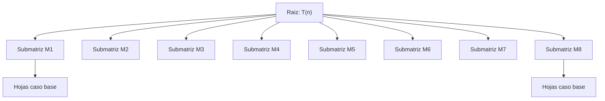

#### 5. Implementación en Python (Tipada y Ejecutable)

```python
def multiplicar_matrices_dyc(a: list[list[float]], b: list[list[float]]) -> list[list[float]]:
    # Multiplica dos matrices cuadradas de orden n (potencia de 2) por DyC en O(n^3).
    n = len(a)
    if n == 1:
        return [[a[0][0] * b[0][0]]]

    m = n // 2
    # Partición en 4 submatrices de m x m
    a11 = [row[:m] for row in a[:m]]
    a12 = [row[m:] for row in a[:m]]
    a21 = [row[:m] for row in a[m:]]
    a22 = [row[m:] for row in a[m:]]

    b11 = [row[:m] for row in b[:m]]
    b12 = [row[m:] for row in b[:m]]
    b21 = [row[:m] for row in b[m:]]
    b22 = [row[m:] for row in b[m:]]

    # 8 multiplicaciones recursivas
    m1 = multiplicar_matrices_dyc(a11, b11)
    m2 = multiplicar_matrices_dyc(a12, b21)
    m3 = multiplicar_matrices_dyc(a11, b12)
    m4 = multiplicar_matrices_dyc(a12, b22)
    m5 = multiplicar_matrices_dyc(a21, b11)
    m6 = multiplicar_matrices_dyc(a22, b21)
    m7 = multiplicar_matrices_dyc(a21, b12)
    m8 = multiplicar_matrices_dyc(a22, b22)

    # 4 sumas de bloques de m x m
    c11 = [[m1[i][j] + m2[i][j] for j in range(m)] for i in range(m)]
    c12 = [[m3[i][j] + m4[i][j] for j in range(m)] for i in range(m)]
    c21 = [[m5[i][j] + m6[i][j] for j in range(m)] for i in range(m)]
    c22 = [[m7[i][j] + m8[i][j] for j in range(m)] for i in range(m)]

    # Ensamblado de la matriz C final de n x n
    c = []
    for i in range(m):
        c.append(c11[i] + c12[i])
    for i in range(m):
        c.append(c21[i] + c22[i])
    return c
```

<div class="trap-callout">
  <div class="trap-header">⚠️ Trampa Típica de Corrección</div>
  <p><strong>Puntos donde restan puntaje los docentes de FIUBA:</strong></p>
  <ul>
    <li><strong>Afirmar que DyC clásico reduce la complejidad a $O(n^2)$ o $O(n^{2.81})$:</strong> El algoritmo estándar por cuadrantes realiza 8 multiplicaciones ($a = 8$), lo que da exactamente $\Theta(n^3)$, igual que el método iterativo cúbico de 3 bucles. Para bajar a $O(n^{\log_2 7}) \approx O(n^{2.81})$ es indispensable el truco algebraico de Volker Strassen (7 multiplicaciones).</li>
    <li><strong>Confusión de índices en los productos cruzados:</strong> Un error muy penalizado es escribir $A_{12} B_{12}$ en lugar de $A_{12} B_{21}$. Recuerde que la fila de $A$ multiplica a la columna de $B$.</li>
    <li><strong>Olvidar el costo de partición y combinación:</strong> Copiar matrices o sumarlas no es gratis; toma $\Theta(n^2)$. Omitir este término en la recurrencia anula la justificación del Teorema Maestro.</li>
  </ul>
</div>

---

### Patrón de Ejercicio 1.2: Búsqueda Binaria sobre Propiedades Monótonas

Se busca un elemento o punto crítico en arreglos que no están completamente ordenados pero que presentan una propiedad monótona o un cambio de tendencia detectable en tiempo $O(\log n)$.

---

### Ejercicio 2 — Elemento Pico en un Arreglo Unimodal

**Clasificación:** 🟡 IMPORTANTE  
**Origen:** Guía de Ejercicios 01, Ejercicio 4 / Parcial FIUBA

**Enunciado**  
Dado un arreglo $A$ de $n$ enteros distintos donde no hay dos elementos adyacentes iguales, un elemento $A[i]$ se define como "pico" si es estrictamente mayor que sus vecinos existentes (es decir, $A[i] > A[i-1]$ y $A[i] > A[i+1]$, considerando los extremos con un único vecino). Diseñar un algoritmo por División y Conquista que encuentre un elemento pico en tiempo $O(\log n)$. Justificar la correctitud y la complejidad.

**Qué está evaluando la cátedra**  
Capacidad de descarte logarítmico aprovechando la dirección de la pendiente local, manejo riguroso de condiciones de borde en índices y demostración formal de que siempre existe al menos un pico en la mitad elegida.

#### 1. Deducción Metodológica Formal (Los 5 Pasos de DyC)

1. **Paso 1: Definición del Invariante de Búsqueda:**
   En cada llamada sobre el rango $[ini, fin]$, se mantiene el siguiente invariante: **garantizadamente existe al menos un pico local dentro del subarreglo $A[ini \dots fin]$**.

2. **Paso 2: Caso Base:**
   Cuando $ini = fin$, el rango contiene un único elemento. Por el invariante de búsqueda, este elemento debe ser un pico local. Se retorna $ini$ en tiempo $O(1)$.

3. **Paso 3: División:**
   Se calcula el índice central:
   $$m = \lfloor(ini + fin) / 2\rfloor$$
   Como $ini < fin$, necesariamente $m < fin$, lo cual garantiza que la posición $m + 1$ es siempre un índice válido dentro del arreglo (sin desbordamiento).

4. **Paso 4: Conquista y Criterio de Descarte:**
   Se comparan los elementos contiguos $A[m]$ y $A[m + 1]$:

   * **Caso A ($A[m] < A[m + 1]$):** La pendiente asciende hacia la derecha. Por el Teorema de Existencia, existe al menos un pico en el subrango $[m + 1, fin]$. Se descarta toda la mitad izquierda $[ini, m]$.
   * **Caso B ($A[m] > A[m + 1]$):** La pendiente desciende hacia la derecha (asciende hacia la izquierda). Por lo tanto, existe al menos un pico en el subrango $[ini, m]$ (el propio $m$ podría ser el pico). Se descarta el subrango $[m + 1, fin]$.
5. **Paso 5: Ecuación de Recurrencia y Teorema Maestro:**
   En cada paso se realiza exactamente una llamada recursiva sobre un subarreglo de tamaño a lo sumo $\lceil n/2 \rceil$ con trabajo de comparación $O(1)$:
   $$T(n) = 1 \cdot T(n/2) + \Theta(1)$$
   Parámetros: $a = 1, b = 2, c = 0$.
   $$\log_b a = \log_2 1 = 0 = c$$
   Aplica el **Caso 2 del Teorema Maestro** con $k = 0$:
   $$T(n) = \Theta(n^c \log n) = \Theta(n^0 \log n) = \Theta(\log n)$$

#### 2. Demostración Formal de Existencia del Pico

* **Lema de la Pendiente:** Si $A[m] < A[m + 1]$, entonces el subarreglo $A[m + 1 \dots fin]$ contiene al menos un elemento pico.
* **Demostración por el Principio del Buen Orden / Contradicción:**
  Consideremos el subarreglo $A[m + 1 \dots fin]$. Si el último elemento $A[fin]$ es mayor que $A[fin - 1]$, entonces $A[fin]$ es un pico (pues no tiene vecino derecho). Si no lo es, retrocedemos: como $A[m] < A[m + 1]$, no todos los elementos pueden ser decrecientes hacia la izquierda sin toparse con una cresta. Dado que no hay elementos adyacentes iguales, debe existir un primer índice $k \in \{m + 1, \dots, fin - 1\}$ tal que $A[k] > A[k + 1]$. Como $k$ es el primer punto de caída, necesariamente $A[k] > A[k - 1]$, lo que convierte a $A[k]$ en un pico. $\blacksquare$

#### 3. Ejemplo Concreto y Traza Paso a Paso

Sea el arreglo de $n = 7$ elementos:
$$A = [1, 2, 1, 3, 5, 6, 4]$$

| Paso | Rango $[ini, fin]$ | $m$ | $A[m]$ | $A[m+1]$ | Comparación | Decisión / Rango Siguiente |
| :---: | :---: | :---: | :---: | :---: | :---: | :--- |
| **1** | $[0, 6]$ | $3$ | $3$ | $5$ | $3 < 5$ (sube a derecha) | Descartar izquierda $\implies [4, 6]$ |
| **2** | $[4, 6]$ | $5$ | $6$ | $4$ | $6 > 4$ (baja a derecha) | Descartar derecha $\implies [4, 5]$ |
| **3** | $[4, 5]$ | $4$ | $5$ | $6$ | $5 < 6$ (sube a derecha) | Descartar izquierda $\implies [5, 5]$ |
| **4** | $[5, 5]$ | - | - | - | **$ini == fin = 5$** | **Caso base: Pico en índice 5 ($A[5] = 6$)** |

*Verificación:* $A[5] = 6$ es estrictamente mayor que su vecino izquierdo $A[4] = 5$ y su vecino derecho $A[6] = 4$. Es un pico válido encontrado en solo 3 iteraciones ($<\log_2 7 \approx 2.8$).

#### 4. Diagrama Visual de Búsqueda Binaria de la Pendiente

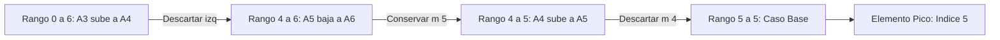

#### 5. Implementación en Python (Tipada y Ejecutable)

```python
def encontrar_pico(arr: list[int]) -> int:
    # Encuentra el índice de un elemento pico en O(log n) mediante DyC.
    if not arr:
        return -1
    
    ini, fin = 0, len(arr) - 1
    while ini < fin:
        m = (ini + fin) // 2
        # Si la pendiente sube hacia la derecha, el pico está a la derecha
        if arr[m] < arr[m + 1]:
            ini = m + 1
        else:
            # Si la pendiente baja hacia la derecha, m puede ser el pico
            fin = m
            
    return ini
```

<div class="trap-callout">
  <div class="trap-header">⚠️ Trampa Típica de Corrección</div>
  <p><strong>Puntos donde restan puntaje los docentes de FIUBA:</strong></p>
  <ul>
    <li><strong>Hacer <code>fin = m - 1</code> en la rama descendente:</strong> Si $A[m] > A[m+1]$, el elemento $A[m]$ podría ser precisamente el pico. Si ajustas <code>fin = m - 1</code>, excluyes a $m$ y el algoritmo puede retornar un índice incorrecto o fallar. Debe ser obligatoriamente <code>fin = m</code>.</li>
    <li><strong>Desbordamiento de índice al calcular $m+1$:</strong> Si el bucle tiene condición <code>ini &le; fin</code>, en la última iteración $m = fin$ y la consulta <code>arr[m + 1]</code> arroja <code>IndexError</code>. La condición estricta debe ser <code>ini &lt; fin</code>.</li>
    <li><strong>Creer que el arreglo debe estar ordenado:</strong> Este algoritmo funciona sobre arreglos desordenados gracias al Lema de la Pendiente. Afirmar en el examen que se requiere ordenar previamente ($O(n \log n)$) invalida la cota $O(\log n)$.</li>
  </ul>
</div>

---

### Ejercicio 3 — Búsqueda del Primer Cero en un Arreglo de Unos y Ceros

**Clasificación:** 🔴 IMPRESCINDIBLE  
**Origen:** Guía de Ejercicios 01, Ejercicio 2 / Final FIUBA

**Enunciado**  
Se tiene un arreglo $A$ de $n$ elementos compuesto exclusivamente por números 1 seguidos por números 0 (es decir, de la forma $[1, 1, \dots, 1, 0, 0, \dots, 0]$). Puede ocurrir que todos sean 1 o todos sean 0. Implementar un algoritmo por División y Conquista que determine la posición del primer 0 en tiempo $O(\log n)$. Si el arreglo no contiene ceros, retornar $-1$.

**Qué está evaluando la cátedra**  
Identificación de la propiedad de frontera de transición, manejo riguroso de casos donde el cero está en el índice 0 o no existe, y parada anticipada sin incurrir en recorridos lineales.

#### 1. Deducción Metodológica Formal (Los 5 Pasos de DyC)

1. **Paso 1: Propiedad de Monotonía y Frontera:**
   El arreglo $A$ es monótonamente decreciente no estricto: $A[i] \ge A[i+1]$ para todo $i$. El "primer cero" es el único índice $k$ que satisface:
   $$A[k] = 0 \quad \land \quad (k = 0 \lor A[k - 1] = 1)$$

2. **Paso 2: Casos Base de Rango Vacío:**
   Si $ini > fin$, el subrango colapsó sin encontrar ningún cero (ocurre cuando el arreglo es puramente de unos). Se retorna $-1$.

3. **Paso 3: División:**
   Se evalúa el elemento en la posición media:
   $$m = \lfloor(ini + fin) / 2\rfloor$$

4. **Paso 4: Conquista y Reducción del Espacio de Búsqueda:**
   * **Condición de Éxito Inmediato:** Si $A[m] == 0$ y además ($m == 0$ o $A[m - 1] == 1$), entonces $m$ es por definición el primer cero. Se retorna $m$ inmediatamente en $O(1)$.
   * **Rama Izquierda ($A[m] == 0$ pero $A[m - 1] == 0$):** Hay más ceros hacia la izquierda. Se descarta la mitad derecha y se busca recursivamente en $[ini, m - 1]$.
   * **Rama Derecha ($A[m] == 1$):** Por monotonía, todos los elementos desde $ini$ hasta $m$ son 1. El primer cero solo puede estar estrictamente a la derecha. Se busca en $[m + 1, fin]$.
5. **Paso 5: Ecuación de Recurrencia y Teorema Maestro:**
   $$T(n) = 1 \cdot T(n/2) + \Theta(1)$$
   Con $a = 1, b = 2, c = 0$:
   $$\log_2 1 = 0 = c \implies T(n) = \Theta(\log n)$$
   Espacio auxiliar: $O(1)$ en implementación iterativa, $O(\log n)$ en la pila de recursión.

#### 2. Demostración Formal de Correctitud por Inducción Fuerte

* **Hipótesis:** Para cualquier subrango $A[ini \dots fin]$ de longitud $L = fin - ini + 1$:
    * Si contiene al menos un cero, el algoritmo retorna el menor índice $k \in [ini, fin]$ tal que $A[k] = 0$.
    * Si no contiene ceros, retorna $-1$.
* **Base ($L = 0 \implies ini > fin$):** El subarreglo es vacío. Retorna $-1$. Correcto.
* **Paso Inductivo ($L \ge 1$):**
  Se inspecciona $A[m]$. 

    * Si $A[m] = 1$: Como el arreglo tiene la estructura $1^* 0^*$, si la posición $m$ tiene un 1, todas las posiciones $j \le m$ tienen $A[j] = 1$. Por lo tanto, ningún índice $\le m$ puede ser cero. El primer cero, de existir, debe residir en $[m + 1, fin]$, un subrango de longitud $\le \lfloor L/2 \rfloor$. Por hipótesis inductiva, la llamada recursiva devolverá el resultado correcto.
    * Si $A[m] = 0$: Si $m = 0$ o $A[m-1] = 1$, por definición $m$ es el primer cero y se retorna. Si $A[m-1] = 0$, el primer cero está estrictamente antes de $m$, residiendo en $[ini, m - 1]$. Por hipótesis inductiva, la recursión encuentra el resultado exacto. $\blacksquare$

#### 3. Ejemplo Concreto y Traza Paso a Paso

Sea el arreglo de $n = 8$ elementos:
$$A = [1, 1, 1, 1, 0, 0, 0, 0]$$

| Iteración | Rango $[ini, fin]$ | $m$ | $A[m]$ | Verificación $A[m-1]$ | Decisión / Rango Siguiente |
| :---: | :---: | :---: | :---: | :---: | :--- |
| **1** | $[0, 7]$ | $3$ | $1$ | No aplica ($A[m]=1$) | $A[3]=1 \implies$ Descartar $[0, 3]$. Nuevo rango: $[4, 7]$ |
| **2** | $[4, 7]$ | $5$ | $0$ | $A[4] = 0$ | $A[5]=0$ pero $A[4]=0 \implies$ Hay ceros antes. Nuevo rango: $[4, 4]$ |
| **3** | $[4, 4]$ | $4$ | $0$ | $A[3] = 1$ | **$A[4] = 0 \land A[3] = 1 \implies$ ¡Primer cero hallado en índice 4!** |

*Resultado devuelto:* $4$. Complejidad real: 3 comparaciones ($\le \lceil \log_2 8 \rceil = 3$).

#### 4. Diagrama Visual del Corte de Frontera

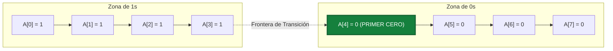

#### 5. Implementación en Python (Tipada y Ejecutable)

```python
def buscar_primer_cero(arr: list[int]) -> int:
    # Retorna el índice del primer 0 en un arreglo de 1s seguidos de 0s en O(log n).
    if not arr:
        return -1

    ini, fin = 0, len(arr) - 1
    primer_cero = -1

    while ini <= fin:
        m = (ini + fin) // 2
        if arr[m] == 0:
            primer_cero = m
            # Intentar buscar un cero aún más a la izquierda
            fin = m - 1
        else:
            # arr[m] == 1, el primer cero debe estar a la derecha
            ini = m + 1

    return primer_cero
```

<div class="trap-callout">
  <div class="trap-header">⚠️ Trampa Típica de Corrección</div>
  <p><strong>Puntos donde restan puntaje los docentes de FIUBA:</strong></p>
  <ul>
    <li><strong>Acceder a <code>arr[m - 1]</code> cuando $m = 0$:</strong> Si el primer cero está en la posición 0, evaluar <code>arr[m - 1]</code> en Python consultará <code>arr[-1]</code> (el último elemento del arreglo), produciendo un falso positivo o error lógico en otros lenguajes (C/Java) con <code>IndexOutOfBoundsException</code>. Siempre se debe anteponer la guarda <code>m == 0 or arr[m - 1] == 1</code>.</li>
    <li><strong>Arreglos sin ceros (todos 1s):</strong> Si el arreglo no contiene ceros, el algoritmo debe retornar $-1$. Si no se maneja la condición de parada <code>ini &gt; fin</code>, el algoritmo puede retornar un índice erróneo.</li>
    <li><strong>Hacer un recorrido lineal desde $m$:</strong> Al encontrar un 0 en $m$, algunos estudiantes retroceden linealmente con un bucle mientras <code>arr[i] == 0</code>. Eso degrada la complejidad a $O(n)$ en el peor caso (por ejemplo, en un arreglo compuesto íntegramente por ceros), anulando completamente el beneficio de la búsqueda binaria.</li>
  </ul>
</div>

---

### Errores Frecuentes en Exámenes sobre División y Conquista

1. **Olvidar el Caso Base:** Omitir la condición de parada cuando $n = 1$ o $ini \ge fin$, provocando recursión infinita en la traza.
2. **Calcular erróneamente los parámetros del Teorema Maestro:** Confundir $a$ (cantidad de subproblemas) con $b$ (factor de reducción del tamaño). Ejemplo clásico: en multiplicación de matrices, poner $a = 4$ en lugar de $a = 8$.
3. **No justificar el costo de combinación $f(n)$:** Poner directamente $O(n^2)$ sin detallar que proviene de recorrer las submatrices sumando elemento a elemento.
4. **Dividir en subproblemas no balanceados:** Si la división reduce el tamaño a $n - 1$ (como Quicksort en el peor caso), no se puede aplicar el Teorema Maestro básico; se debe resolver mediante sumatoria telescópica.


---

## 5. Tema 2: Algoritmos Greedy (Voraces)

### Conceptos Mínimos de Supervivencia

1. **Naturaleza de un Algoritmo Greedy:**
   En cada paso, toma la decisión que parece mejor en ese momento específico (óptimo local) bajo una regla de selección fija, sin mirar atrás ni reconsiderar elecciones previas (elección irrevocable).

2. **Propiedad de la Elección Voraz y Subestructura Óptima:**
   Para que un algoritmo greedy sea **óptimo**, debe cumplirse que:

   * Una elección voraz inicial conduce a una solución globalmente óptima (propiedad de elección voraz).
   * La solución óptima del problema global contiene dentro de sí soluciones óptimas a los subproblemas resultantes (subestructura óptima).

3. **Las Dos Técnicas Canónicas de Demostración de Optimalidad:**
   * **Greedy Stays Ahead ("El voraz se mantiene adelante"):** Se define una métrica de progreso $m(i)$. Se demuestra por inducción que en cada paso $k$, la solución voraz aventaja o iguala a cualquier solución óptima $OPT$ ($m(G_k) \le m(OPT_k)$ o $m(G_k) \ge m(OPT_k)$), garantizando que al finalizar no puede ser superada.
   * **Argumento de Intercambio (Exchange Argument):** Se toma una solución óptima hipotética $OPT$ que difiere de la solución greedy $G$. Se identifica la primera inversión o discrepancia y se demuestra que al intercambiar el elemento de $OPT$ por el elemento elegido por $G$, la calidad de la solución no empeora. Repitiendo el proceso, $OPT$ se transforma en $G$ sin perder valor, probando que $G$ también es óptima.

4. **Cómo Probar que una Idea Greedy es Incorrecta (El Contraejemplo):**
   Si en un examen te preguntan *"¿El algoritmo greedy propuesto es óptimo siempre? Indicar si es óptimo o dar un contraejemplo"*, **NUNCA** respondas con explicaciones vagas. Debes presentar un contraejemplo concreto:

   1. Definir una instancia pequeña con datos numéricos explícitos.
   2. Mostrar paso a paso qué elige el algoritmo greedy y cuál es su costo/beneficio obtenido.
   3. Mostrar una solución alternativa factible y su costo/beneficio estrictamente superior.
   4. Concluir formalmente: *Como $\text{Valor}(\text{Alternativa}) > \text{Valor}(\text{Greedy})$, el algoritmo no garantiza la solución óptima.*

---

### Patrón de Ejercicio 2.1: Interval Scheduling (Planificación de Intervalos No Solapados)

Aparece con diferentes metáforas narrativas: charlas en un aula, pedidos de mafias locales por el control de kilómetros de una ruta, franjas horarias de satélites o turnos de guardias. El objetivo es maximizar la cantidad total de pedidos aceptados sin solapamiento.

---

### Ejercicio 4 — Concesión de Permisos a Mafias en la Ruta Costera (Arnook)

**Clasificación:** 🔴 IMPRESCINDIBLE  
**Origen:** Parcial 2024-2-2 (26 de noviembre de 2024), Ejercicio 3 / Guía 02 Ejercicio 12

**Enunciado**  
Trabajamos para el mafioso Arnook, quien organiza los pedidos de pequeñas mafias locales por el control de diferentes kilómetros de la ruta costera de Ciudad República. Cada mafia le pide control sobre un rango de kilómetros $[s_i, f_i]$ (por ejemplo, del kilómetro 1 al 5, del 3 al 8, etc.). Si una mafia toma control de un kilómetro, ninguna otra puede ocupar ese mismo tramo (no pueden solaparse). Arnook cobra una tarifa fija por otorgar el permiso, independientemente de los kilómetros pedidos, por lo que su objetivo es maximizar la cantidad total de permisos otorgados sin conflictos de territorio.  

1. Implementar un algoritmo Greedy que determine a qué mafias otorgar el permiso.  
2. Indicar y justificar la complejidad temporal y espacial.  
3. Justificar por qué el algoritmo planteado es Greedy.  
4. ¿El algoritmo da la solución óptima siempre? Demostrarlo formalmente.

**Qué está evaluando la cátedra**  
Comprensión del arquetipo de *Interval Scheduling*, diseño del criterio voraz correcto (ordenamiento por punto final más temprano), y la demostración formal de optimalidad vía *Greedy Stays Ahead*.

#### 1. Deducción Metodológica Formal (Los 5 Pasos de Greedy)

1. **Paso 1: Análisis de Reglas Candidatas y Descarte de Erróneas:**
   * *Criterio erróneo 1 (Inicio más temprano $s_i$):* Falla si un pedido empieza muy temprano y ocupa toda la ruta ($[1, 100]$ bloquea a $[2, 3]$ y $[4, 5]$).
   * *Criterio erróneo 2 (Menor longitud $f_i - s_i$):* Falla si un intervalo corto bloquea a dos largos compatibles a sus extremos ($[10, 20]$ y $[20, 30]$ vs $[19, 21]$).
   * *Criterio Óptimo:* Ordenar las solicitudes por su **kilómetro de finalización más temprano ($f_i$)**. Al terminar lo antes posible, se libera el recurso de la ruta lo más temprano posible para futuras mafias.
2. **Paso 2: Criterio de Ordenamiento:**
   Se ordenan los $n$ intervalos de modo que $f_1 \le f_2 \le \dots \le f_n$. Esto insume tiempo $O(n \log n)$.

3. **Paso 3: Verificación de Factibilidad:**
   Un intervalo candidato $j$ es factible si y solo si su punto de inicio es mayor o igual al fin del último intervalo aceptado:
   $$s_j \ge f_{\text{último}}$$

4. **Paso 4: Invocación Irrevocable:**
   Se acepta el intervalo compatible y se actualiza $f_{\text{último}} = f_j$. Esta decisión es definitiva: nunca se desasigna un permiso otorgado.

5. **Paso 5: Complejidad:**
   * **Tiempo:** $O(n \log n)$ por el ordenamiento inicial y $O(n)$ en el barrido secuencial. Total: $\Theta(n \log n)$.
   * **Espacio:** $O(n)$ para la lista de permisos seleccionados.

#### 2. Demostración Formal de Optimalidad (Greedy Stays Ahead)

* **Definición de Soluciones:**
  Sea $G = \{g_1, g_2, \dots, g_k\}$ el conjunto de intervalos elegidos por el algoritmo Greedy, ordenados cronológicamente por tiempo de fin.
  Sea $OPT = \{o_1, o_2, \dots, o_m\}$ el conjunto de intervalos de una solución óptima arbitraria, también ordenados por tiempo de fin, con $m \ge k$.

* **Lema Inductivo:** Para todo $r \le k$, el tiempo de fin del $r$-ésimo elemento voraz es menor o igual al del $r$-ésimo elemento óptimo:
  $$f(g_r) \le f(o_r)$$

* **Caso Base ($r = 1$):** El algoritmo voraz selecciona como primer elemento aquel con el menor tiempo de fin absoluto en todo el conjunto de entrada. Por ende, $f(g_1) \le f(o_1)$ por definición.
* **Hipótesis Inductiva:** Asumimos que para un $r - 1 < k$ se cumple $f(g_{r-1}) \le f(o_{r-1})$.
* **Paso Inductivo ($r$):**
  Como $OPT$ es una solución factible, el intervalo $o_r$ no se solapa con $o_{r-1}$, lo que implica $s(o_r) \ge f(o_{r-1})$.
  Aplicando la hipótesis inductiva:
  $$s(o_r) \ge f(o_{r-1}) \ge f(g_{r-1})$$
  Esto demuestra que cuando el algoritmo voraz buscaba su $r$-ésimo elemento tras haber seleccionado $g_{r-1}$, el intervalo $o_r$ era una alternativa perfectamente **factible y compatible**.
  Dado que el algoritmo voraz selecciona el intervalo compatible con el menor tiempo de fin disponible, su elección $g_r$ debe satisfacer:
  $$f(g_r) \le f(o_r)$$

* **Conclusión de Optimalidad ($k = m$):**
  Supongamos por contradicción que $m > k$, lo que significa que la solución óptima tiene al menos un intervalo adicional $o_{k+1}$.
  Por el lema anterior aplicado a $r = k$:
  $$s(o_{k+1}) \ge f(o_k) \ge f(g_k)$$
  Esto significa que $o_{k+1}$ es compatible con el último elemento voraz $g_k$. Pero el algoritmo voraz terminó en $g_k$ precisamente porque no existía ningún intervalo compatible remanente en el conjunto. Contradicción. Por ende, $k = m$ y la solución voraz es **estrictamente óptima**. $\blacksquare$

#### 3. Ejemplo Concreto y Tabla de Traza Paso a Paso

Sean los siguientes 5 pedidos de mafias sobre la ruta costera:

| ID | Mafia | Kilómetros $[s_i, f_i]$ | Longitud | ¿Fin más temprano? |
| :---: | :---: | :---: | :---: | :---: |
| **A** | Los del Puerto | $[1, 4]$ | $3$ | 1º en terminar ($f=4$) |
| **B** | Banda del Centro | $[3, 5]$ | $2$ | 2º en terminar ($f=5$) |
| **C** | Costanera Sur | $[0, 6]$ | $6$ | 3º en terminar ($f=6$) |
| **D** | Zona Norte | $[4, 7]$ | $3$ | 4º en terminar ($f=7$) |
| **E** | Pescadores | $[6, 9]$ | $3$ | 5º en terminar ($f=9$) |

*Traza del Algoritmo Voraz (Ordenados por $f_i$ ascendente: A, B, C, D, E):*

| Paso | Pedido Evaluado | $[s_i, f_i]$ | $f_{\text{último}}$ | Condición $s_i \ge f_{\text{último}}$ | Decisión | Permisos Otorgados |
| :---: | :---: | :---: | :---: | :---: | :---: | :--- |
| **1** | **A** | $[1, 4]$ | $0$ (inicial) | $1 \ge 0$ (Sí) | **ACEPTAR A** | $\{A\}$, $f_{\text{último}} = 4$ |
| **2** | **B** | $[3, 5]$ | $4$ | $3 \ge 4$ (No) | **RECHAZAR** (conflicto) | $\{A\}$ |
| **3** | **C** | $[0, 6]$ | $4$ | $0 \ge 4$ (No) | **RECHAZAR** (conflicto) | $\{A\}$ |
| **4** | **D** | $[4, 7]$ | $4$ | $4 \ge 4$ (Sí) | **ACEPTAR D** | $\{A, D\}$, $f_{\text{último}} = 7$ |
| **5** | **E** | $[6, 9]$ | $7$ | $6 \ge 7$ (No) | **RECHAZAR** (conflicto) | $\{A, D\}$ |

*Total de permisos máximos otorgados:* 2 mafias ($\{A, D\}$).

#### 4. Diagrama Visual de Intervalos

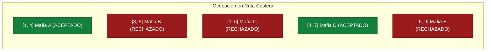

#### 5. Implementación en Python (Tipada y Ejecutable)

```python
def conceder_permisos_mafias(pedidos: list[tuple[str, int, int]]) -> list[tuple[str, int, int]]:
    # pedidos: lista de (nombre, inicio, fin)
    if not pedidos:
        return []

    # 1. Ordenar vorazmente por punto final ascendente
    pedidos_ordenados = sorted(pedidos, key=lambda x: x[2])

    seleccionados = [pedidos_ordenados[0]]
    ultimo_fin = pedidos_ordenados[0][2]

    # 2. Selección voraz de intervalos compatibles
    for pedido in pedidos_ordenados[1:]:
        nombre, inicio, fin = pedido
        if inicio >= ultimo_fin:
            seleccionados.append(pedido)
            ultimo_fin = fin

    return seleccionados
```

<div class="trap-callout">
  <div class="trap-header">⚠️ Trampa Típica de Corrección</div>
  <p><strong>Puntos donde restan puntaje los docentes de FIUBA:</strong></p>
  <ul>
    <li><strong>Confundir Interval Scheduling con Interval Scheduling Ponderado:</strong> Si las mafias ofrecieran dinero diferente por cada permiso ($v_i$), la regla voraz por fin más temprano **deja de ser óptima**. Se debe resolver obligatoriamente mediante Programación Dinámica con búsqueda binaria en $O(n \log n)$ (ver Ejercicio 18).</li>
    <li><strong>Solapamiento en extremos ($s_j == f_i$):</strong> Prestar atención a si el enunciado indica si compartir el kilómetro exacto está permitido o no ($s_j \ge f_i$ vs $s_j > f_i$). En la ruta costera, la frontera compartida es admisible ($s_j \ge f_{\text{último}}$).</li>
    <li><strong>Ordenar por duración ($f_i - s_i$):</strong> Es el error intuitivo más frecuente en parciales. Recuerde que un intervalo de duración 2 puede arruinar a dos intervalos adyacentes de duración 3, obteniendo 1 en lugar de 2.</li>
  </ul>
</div>

---

### Patrón de Ejercicio 2.2: Mochila Fraccionaria vs 0-1 con Garantía de Calidad 1/2

En las evaluaciones teóricas y en los TPs de la cátedra se examina la relación entre la solución fraccionaria (óptima con greedy) y la versión entera 0-1, demostrando cómo una regla greedy corregida otorga una cota de aproximación constante.

---

### Ejercicio 5 — Mochila 0-1 con Garantía de Aproximación 1/2

**Clasificación:** 🔴 IMPRESCINDIBLE  
**Origen:** Guía de Ejercicios 02, Ejercicio 8 / Diapositivas Explicativas de Cátedra

**Enunciado**  
Se tiene una mochila de capacidad de peso $W$ y $n$ objetos indivisibles (0-1), donde cada objeto $i$ tiene peso $w_i$ y valor $v_i$.  

1. Explicar por qué la regla voraz estándar basada en ordenar por densidad de valor ($v_i / w_i$) puede fallar de forma arbitraria en la mochila 0-1.  
2. Diseñar un algoritmo greedy modificado que garantice una calidad de al menos $1/2$ respecto a la solución óptima global ($V_{\text{aprox}} \ge \frac{1}{2} OPT$).  
3. Demostrar formalmente que $V_{\text{aprox}} / OPT > 1/2$.  
4. Indicar la complejidad temporal del algoritmo.

**Qué está evaluando la cátedra**  
Capacidad de analizar por qué un algoritmo voraz falla en problemas NP-Hard, diseño de heurísticas con garantías formales de aproximación y uso de la relajación continua como cota superior de optimalidad.

#### 1. Deducción Metodológica Formal (Los 5 Pasos)

1. **Paso 1: Análisis del Fallo de la Densidad Voraz Pura:**
   Consideremos $W = 100$, un objeto 1 con $w_1 = 1, v_1 = 2$ (densidad $2$) y un objeto 2 con $w_2 = 100, v_2 = 100$ (densidad $1$). La regla voraz elige el objeto 1 y llena la mochila hasta $w=1$, impidiendo que entre el objeto 2. Obtiene valor 2 en vez del óptimo 100 (eficiencia tan mala como $2/100 \to 0$).

2. **Paso 2: Filtrado Previo de Factibilidad:**
   Se descartan de inmediato todos los ítems cuyo peso individual sea mayor a la capacidad ($w_i > W$).

3. **Paso 3: Identificación del Elemento Crítico:**
   Se ordenan los elementos restantes por ratio de densidad decreciente:
   $$\frac{v_1}{w_1} \ge \frac{v_2}{w_2} \ge \dots \ge \frac{v_n}{w_n}$$
   Se introducen ítems vorazmente hasta que el primer elemento no entra por exceso de peso. A este ítem lo llamamos **Elemento Crítico ($k$)** con valor $v_k$ y peso $w_k$.

4. **Paso 4: Corrección de Cota Dual:**
   Sea $V_{\text{greedy}}$ el valor acumulado antes de topar con el elemento crítico. Se define la solución aproximada como el máximo entre la solución voraz y el elemento crítico en solitario:
   $$V_{\text{aprox}} = \max(V_{\text{greedy}}, \; v_k)$$

5. **Paso 5: Complejidad:**
   * Filtrado inicial en $O(n)$.
   * Ordenamiento por densidad en $O(n \log n)$.
   * Barrido voraz en $O(n)$.
   * Complejidad total: $\Theta(n \log n)$ en tiempo y $O(n)$ en espacio auxiliar.

#### 2. Demostración Formal de la Garantía de Aproximación 1/2

* **Paso A (Cota Superior por Relajación Continua):**
  Sea $OPT$ el valor de la solución óptima del problema entero 0-1, y sea $OPT_{\text{frac}}$ el valor de la solución óptima del problema de la mochila fraccionaria (donde se permiten fracciones de ítems).
  Como toda solución entera es una solución fraccionaria factible, se cumple:
  $$OPT \le OPT_{\text{frac}}$$

* **Paso B (Composición de la Solución Fraccionaria):**
  La solución fraccionaria óptima coincide exactamente con los primeros $k-1$ elementos enteros tomados por el greedy ($V_{\text{greedy}}$) más una fracción estricta $\alpha \in [0, 1)$ del elemento crítico $k$:
  $$OPT_{\text{frac}} = V_{\text{greedy}} + \alpha \cdot v_k < V_{\text{greedy}} + v_k$$

* **Paso C (Desigualdad Fundamental):**
  Por transitividad de las cotas anteriores:
  $$OPT < V_{\text{greedy}} + v_k$$

* **Paso D (Cota del Máximo):**
  Dado que $V_{\text{aprox}} = \max(V_{\text{greedy}}, v_k)$, es inmediato que:
  $$V_{\text{greedy}} \le V_{\text{aprox}} \quad \text{y} \quad v_k \le V_{\text{aprox}}$$
  Sumando ambas desigualdades:
  $$V_{\text{greedy}} + v_k \le 2 \cdot V_{\text{aprox}}$$

* **Paso E (Conclusión de la Garantía 1/2):**
  Sustituyendo en la cota de $OPT$:
  $$OPT < 2 \cdot V_{\text{aprox}} \implies \frac{V_{\text{aprox}}}{OPT} > \frac{1}{2}$$
  El algoritmo garantiza estrictamente más del $50\%$ del valor óptimo global en tiempo $O(n \log n)$. $\blacksquare$

#### 3. Ejemplo Concreto y Tabla de Traza Paso a Paso

Capacidad $W = 50$. Tres elementos candidatos:

| Ítem | Peso ($w_i$) | Valor ($v_i$) | Densidad ($v_i / w_i$) | ¿Entra en Greedy? |
| :---: | :---: | :---: | :---: | :--- |
| **1** | $10$ | $60$ | $6.0$ | Sí (Peso acumulado: $10$, Valor: $60$) |
| **2** | $20$ | $100$ | $5.0$ | Sí (Peso acumulado: $30$, Valor: $160$) |
| **3** | $30$ | $120$ | $4.0$ | No cabe ($30 + 30 = 60 > 50$). **¡ELEMENTO CRÍTICO!** |

*Comparación:*

* $V_{\text{greedy}} = 60 + 100 = 160$ (elementos $\{1, 2\}$, peso 30).
* Elemento Crítico en solitario: Ítem 3 ($v_3 = 120$, peso $30 \le 50$).
* $V_{\text{aprox}} = \max(160, 120) = 160$.
* *Óptimo entero real (DP):* Ítems $\{2, 3\}$ con peso $20 + 30 = 50$, valor $100 + 120 = 220$.
* *Ratio obtenido:* $160 / 220 \approx 72.7\% > 50\%$ (satisface holgadamente la cota $\ge 1/2$).

#### 4. Diagrama del Proceso de Selección

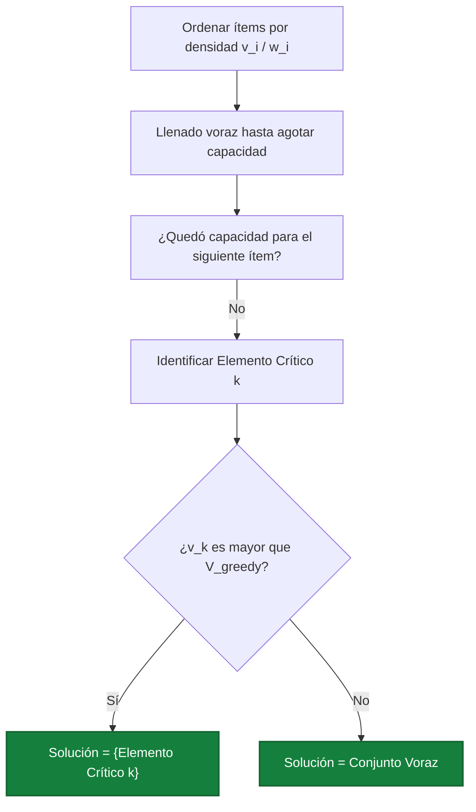

#### 5. Implementación en Python (Tipada y Ejecutable)

```python
def mochila_aprox_medio(items: list[tuple[str, int, int]], w_max: int) -> tuple[int, list[tuple[str, int, int]]]:
    # items: lista de (nombre, peso, valor)
    # 1. Filtrar los que no caben por sí solos
    candidatos = [it for it in items if it[1] <= w_max]
    if not candidatos:
        return 0, []

    # 2. Ordenar por densidad decreciente
    candidatos.sort(key=lambda x: x[2] / x[1], reverse=True)

    v_greedy = 0
    w_greedy = 0
    sol_greedy = []
    elemento_critico = None

    # 3. Llenado voraz
    for it in candidatos:
        nombre, peso, valor = it
        if w_greedy + peso <= w_max:
            sol_greedy.append(it)
            w_greedy += peso
            v_greedy += valor
        elif elemento_critico is None:
            elemento_critico = it

    # 4. Cota dual max(V_greedy, v_critico)
    if elemento_critico is not None and elemento_critico[2] > v_greedy:
        return elemento_critico[2], [elemento_critico]

    return v_greedy, sol_greedy
```

<div class="trap-callout">
  <div class="trap-header">⚠️ Trampa Típica de Corrección</div>
  <p><strong>Puntos donde restan puntaje los docentes de FIUBA:</strong></p>
  <ul>
    <li><strong>Olvidar el filtrado inicial $w_i \le W$:</strong> Si un objeto pesa 150 y la mochila es de 100, jamás puede ser candidato ni elemento crítico. Si lo seleccionas como solución única cometes una infracción de factibilidad.</li>
    <li><strong>No usar la relajación fraccionaria en la demostración:</strong> Decir que "el elemento que no entró más lo que entró supera al óptimo" exige justificar formalmente que $OPT \le OPT_{\text{frac}} = V_{\text{greedy}} + \alpha v_k$. Sin la relajación continua no hay demostración válida.</li>
  </ul>
</div>

---

### Patrón de Ejercicio 2.3: Minimización de Latencia y Deadlines (EDF)

Se tienen tareas con tiempos de procesamiento y fechas límite de entrega (deadlines). El objetivo es ordenar las tareas para minimizar la latencia máxima que experimenta cualquier tarea.

---

### Ejercicio 6 — Minimización de Latencia Máxima (Earliest Deadline First)

**Clasificación:** 🟡 IMPORTANTE  
**Origen:** Guía de Ejercicios 02, Ejercicio 9 / Práctica

**Enunciado**  
Se tienen $n$ tareas que deben procesarse secuencialmente en una única máquina que comienza en el tiempo $t = 0$. Cada tarea $i$ tiene una duración $t_i$ y una fecha límite de entrega (deadline) $d_i$. Si una tarea comienza en el tiempo $s_i$, finaliza en $f_i = s_i + t_i$. La latencia de la tarea $i$ se define como $L_i = \max(0, f_i - d_i)$. Diseñar un algoritmo greedy que programe las tareas minimizando la latencia máxima $L_{\max} = \max_i L_i$. Demostrar formalmente su optimalidad.

**Qué está evaluando la cátedra**  
Técnica de ordenamiento por fecha de vencimiento más temprana (*Earliest Deadline First*) y demostración formal por argumento de intercambio de inversiones adyacentes (*Exchange Argument*).

#### 1. Deducción Metodológica Formal (Los 5 Pasos)

1. **Paso 1: Análisis de Reglas Voraces Alternativas y sus Fallas:**
   * *Menor duración primero ($t_i$):* Falla si una tarea corta tiene un deadline muy lejano y desplaza a una tarea larga con vencimiento inmediato.
   * *Menor holgura primero ($d_i - t_i$):* Falla si una tarea corta tiene holgura 1 pero vence en $t=100$, bloqueando a una con holgura 2 que vence en $t=2$.
   * *Criterio Óptimo (EDF):* Ordenar las tareas en orden creciente de sus fechas límites: $d_1 \le d_2 \le \dots \le d_n$.
2. **Paso 2: Ausencia de Tiempo Ocioso:**
   La máquina procesa las tareas de forma continua sin pausas entre tareas consecutivas. El tiempo de inicio de cada tarea es igual al tiempo de fin de la tarea previa.

3. **Paso 3: Algoritmo Voraz:**
   Ordenar por deadline $d_i$ ascendente en $O(n \log n)$ y asignar tiempos $s_i, f_i$ en un único recorrido de $O(n)$.

4. **Paso 4: Complejidad:**
   * **Tiempo:** $\Theta(n \log n)$ por el ordenamiento inicial.
   * **Espacio:** $O(n)$ para la lista del cronograma.

#### 2. Demostración Formal de Optimalidad (Argumento de Intercambio)

* **Definición de Inversión:** Decimos que un cronograma $S$ tiene una inversión si existen dos tareas $i$ y $j$ tales que $i$ se ejecuta antes que $j$, pero $d_i > d_j$ (la tarea que vence más tarde se ejecuta antes).
* **Propiedad de la Solución Voraz:** La solución voraz $S_{\text{greedy}}$ no tiene inversiones por definición (está ordenada por $d$ ascendente).
* **Existencia de Inversión Adyacente:** Si un cronograma tiene inversiones, necesariamente contiene al menos un par de tareas **adyacentes y consecutivas** $i$ y $j$ con $d_i > d_j$.
* **Efecto del Intercambio Adyacente:**
  Sea $S$ un cronograma óptimo con la menor cantidad de inversiones. Si $S$ tiene inversiones, tomamos un par adyacente $i, j$ tal que $i$ precede inmediatamente a $j$ con $d_i > d_j$. Intercambiamos el orden de ejecución de $i$ y $j$, obteniendo un nuevo cronograma $S'$.

    * Las tareas programadas antes de $i$ y después de $j$ no modifican sus tiempos de inicio ni fin. Sus latencias permanecen idénticas.
    * La tarea $j$ se ejecuta antes en $S'$ que en $S$: su tiempo de finalización se reduce de $f_j$ a $f'_j = f_j - t_i$. Por ende, su latencia $L'_j \le L_j$.
    * La tarea $i$ finaliza en $S'$ exactamente en el instante en que antes finalizaba $j$: $f'_i = f_j$.
    Calculamos su nueva latencia:
    $$L'_i = \max(0, f'_i - d_i) = \max(0, f_j - d_i)$$
    Como $d_i > d_j$, se cumple:
    $$f_j - d_i < f_j - d_j \le L_j$$
    Por lo tanto, $L'_i \le L_j$.

    * La nueva latencia máxima del par es:
    $$\max(L'_i, L'_j) \le \max(L_i, L_j)$$

    * Por consiguiente, la latencia máxima global del cronograma $S'$ **no aumentó**:
    $$L_{\max}(S') \le L_{\max}(S)$$

* **Conclusión:** Mediante intercambios de pares adyacentes invertidos, se puede transformar cualquier solución óptima $OPT$ en la solución voraz $S_{\text{greedy}}$ sin incrementar jamás la latencia máxima. Esto prueba que $S_{\text{greedy}}$ es **estrictamente óptima**. $\blacksquare$

#### 3. Ejemplo Concreto y Tabla de Traza Paso a Paso

Consideremos 4 tareas:

| Tarea ($i$) | Duración ($t_i$) | Deadline ($d_i$) |
| :---: | :---: | :---: |
| **A** | $3$ | $6$ |
| **B** | $2$ | $4$ |
| **C** | $1$ | $9$ |
| **D** | $4$ | $8$ |

*Paso 1: Ordenar por deadline ascendente (EDF):*

1. Tarea **B**: $d_B = 4$
2. Tarea **A**: $d_A = 6$
3. Tarea **D**: $d_D = 8$
4. Tarea **C**: $d_C = 9$

*Paso 2: Traza temporal continua:*

| Orden | Tarea | Duración ($t_i$) | Inicio ($s_i$) | Fin ($f_i$) | Deadline ($d_i$) | Retraso ($f_i - d_i$) | Latencia ($L_i$) |
| :---: | :---: | :---: | :---: | :---: | :---: | :---: | :---: |
| **1** | **B** | $2$ | $0$ | $2$ | $4$ | $2 - 4 = -2$ | **$0$** |
| **2** | **A** | $3$ | $2$ | $5$ | $6$ | $5 - 6 = -1$ | **$0$** |
| **3** | **D** | $4$ | $5$ | $9$ | $8$ | $9 - 8 = +1$ | **$1$** |
| **4** | **C** | $1$ | $9$ | $10$ | $9$ | $10 - 9 = +1$ | **$1$** |

*Latencia máxima alcanzada:* $L_{\max} = \max(0, 0, 1, 1) = 1$. Es imposible lograr latencia 0 porque el trabajo total acumulado supera los plazos.

#### 4. Diagrama Visual de Cronograma

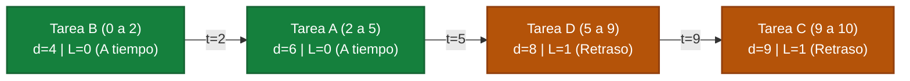

#### 5. Implementación en Python (Tipada y Ejecutable)

```python
def minimizar_latencia_edf(tareas: list[tuple[str, int, int]]) -> tuple[int, list[tuple[str, int, int, int]]]:
    # tareas: lista de (nombre, duracion, deadline)
    if not tareas:
        return 0, []

    # 1. Ordenar vorazmente por deadline ascendente
    tareas_ordenadas = sorted(tareas, key=lambda x: x[2])

    tiempo_actual = 0
    latencia_maxima = 0
    cronograma = []

    for nombre, duracion, deadline in tareas_ordenadas:
        inicio = tiempo_actual
        fin = tiempo_actual + duracion
        latencia = max(0, fin - deadline)
        if latencia > latencia_maxima:
            latencia_maxima = latencia
        cronograma.append((nombre, inicio, fin, latencia))
        tiempo_actual = fin

    return latencia_maxima, cronograma
```

<div class="trap-callout">
  <div class="trap-header">⚠️ Trampa Típica de Corrección</div>
  <p><strong>Puntos donde restan puntaje los docentes de FIUBA:</strong></p>
  <ul>
    <li><strong>Definición de Latencia vs Retraso negativo:</strong> La latencia nunca es negativa ($L_i = \max(0, f_i - d_i)$). Si entregas una tarea antes del deadline, su latencia es $0$, no un número negativo que compense a otras tareas.</li>
    <li><strong>Tiempos de arribo ($r_i$):</strong> Este algoritmo asume que todas las tareas están disponibles en $t = 0$. Si el enunciado incluye tiempos de llegada diferentes ($r_i \neq 0$), el problema se convierte en NP-Duro y EDF simple deja de ser óptimo.</li>
  </ul>
</div>

---

### Patrón de Ejercicio 2.4: Heurísticas Voraces de Cobertura (Set Cover Greedy)

Aparece cuando el problema exacto es NP-Hard (como Set Cover o Dominating Set) y el enunciado solicita explícitamente: *"Diseñar un algoritmo greedy de costo/beneficio marginal..."*.

---

### Ejercicio 7 — Ubicación Voraz de Antenas Celulares con Costo por Vecindario

**Clasificación:** 🔴 IMPRESCINDIBLE  
**Origen:** Parcial 2024-2-3 (10 de diciembre de 2024), Ejercicio 4

**Enunciado**  
Una empresa de telefonía celular desea colocar antenas en una grilla de celdas para brindar cobertura a un conjunto de vecindarios distribuidos en la zona. Cada antena colocada en una celda $(i, j)$ da cobertura a esa celda y a las 8 que la rodean (un bloque de $3 \times 3$). El costo de instalar una antena en la celda $(i, j)$ es de $CTO_{ij}$ pesos. Se desea cubrir todos los vecindarios minimizando el costo total. Diseñar un algoritmo Greedy que determine en qué celdas colocar antenas. Justificar la regla de elección voraz, la cota de aproximación y la complejidad del algoritmo.

**Qué está evaluando la cátedra**  
Modelado del problema canónico de *Weighted Set Cover* mediante una heurística voraz de costo/beneficio marginal, junto con el análisis de su factor de aproximación logarítmico de Chvátal.

#### 1. Deducción Metodológica Formal (Los 5 Pasos)

1. **Paso 1: Formulación como Weighted Set Cover:**
   Sea $U$ el universo de todos los vecindarios a cubrir ($|U| = V$). Cada celda candidata $c = (i, j)$ cubre un subconjunto $S_c \subseteq U$ de vecindarios y tiene costo $CTO_c$.

2. **Paso 2: Métrica de Selección Voraz (Costo Marginal por Elemento Nuevo):**
   En cada paso, sea $U_{\text{restantes}}$ el conjunto de vecindarios aún no cubiertos. Para cada celda candidata $c$, calculamos la ganancia marginal:
   $$\Delta(c) = |S_c \cap U_{\text{restantes}}|$$
   Definimos el ratio voraz:
   $$\text{Ratio}(c) = \frac{CTO_c}{\Delta(c)}$$
   Se selecciona vorazmente la celda $c^*$ que **minimiza el costo por cada nuevo vecindario cubierto**:
   $$c^* = \arg\min_{c: \Delta(c) > 0} \frac{CTO_c}{\Delta(c)}$$

3. **Paso 3: Actualización y Terminación:**
   Se incorpora $c^*$ a la solución y se actualiza $U_{\text{restantes}} = U_{\text{restantes}} \setminus S_{c^*}$. Se repite hasta que $U_{\text{restantes}} = \emptyset$.

4. **Paso 4: Factor de Garantía de Aproximación (Teorema de Chvátal):**
   Como Set Cover es NP-Duro, ningún algoritmo polinomial garantiza el óptimo global a menos que $P = NP$. El algoritmo voraz garantiza una cota de aproximación armónica:
   $$\text{Costo}(\text{Greedy}) \le H(d_{\max}) \cdot OPT \le (\ln |U| + 1) \cdot OPT$$
   donde $H(k) = \sum_{i=1}^k \frac{1}{i}$ es el $k$-ésimo número armónico.

5. **Paso 5: Complejidad:**
   * En cada iteración se evalúan a lo sumo $M$ celdas candidatas. La inspección de las 9 celdas vecinas toma $O(1)$.
   * Se realizan a lo sumo $V$ iteraciones (en cada una se cubre al menos 1 vecindario nuevo).
   * Complejidad temporal: $O(V \cdot M)$. Espacio: $O(V + M)$.

#### 2. Ejemplo Concreto y Traza Paso a Paso

Sean 4 vecindarios $\{v_1, v_2, v_3, v_4\}$ y 3 antenas candidatas:

| Antena | Cobertura ($S_c$) | Costo ($CTO$) |
| :---: | :---: | :---: |
| **A1** | $\{v_1, v_2\}$ | $\$10$ |
| **A2** | $\{v_2, v_3, v_4\}$ | $\$24$ |
| **A3** | $\{v_3, v_4\}$ | $\$12$ |

*Iteración 1 ($U_{\text{restantes}} = \{v_1, v_2, v_3, v_4\}$):*

* A1: cubre $2$ nuevos $\implies$ Ratio $= 10 / 2 = 5.0$.
* A2: cubre $3$ nuevos $\implies$ Ratio $= 24 / 3 = 8.0$.
* A3: cubre $2$ nuevos $\implies$ Ratio $= 12 / 2 = 6.0$.
* **Elección voraz:** Se instala **A1** (costo $\$10$). Quedan sin cubrir $\{v_3, v_4\}$.

*Iteración 2 ($U_{\text{restantes}} = \{v_3, v_4\}$):*

* A2: cubre $\{v_3, v_4\}$ ($2$ nuevos) $\implies$ Ratio $= 24 / 2 = 12.0$.
* A3: cubre $\{v_3, v_4\}$ ($2$ nuevos) $\implies$ Ratio $= 12 / 2 = 6.0$.
* **Elección voraz:** Se instala **A3** (costo $\$12$). Quedan sin cubrir $\emptyset$.

*Resultado Greedy:* Antenas $\{A1, A3\}$ con Costo Total $= 10 + 12 = \$22$. (En este caso coincide con el óptimo global).

#### 3. Diagrama Visual de Cobertura de Conjuntos

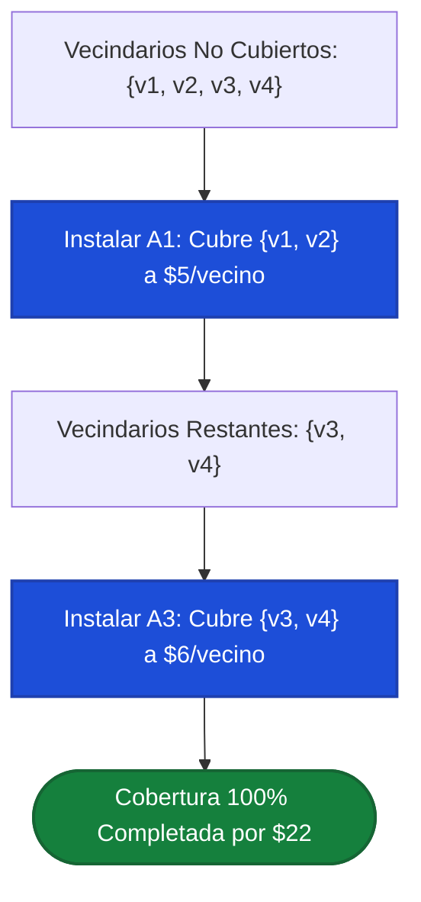

#### 4. Implementación en Python (Tipada y Ejecutable)

```python
def set_cover_antenas_greedy(vecindarios: set[str], antenas: dict[str, tuple[int, set[str]]]) -> list[str]:
    # antenas: dict con nombre -> (costo, set_de_vecindarios_cubiertos)
    no_cubiertos = set(vecindarios)
    elegidas = []

    while no_cubiertos:
        mejor_antena = None
        mejor_ratio = float("inf")

        for nombre, (costo, cobertura) in antenas.items():
            nuevos = len(cobertura & no_cubiertos)
            if nuevos > 0:
                ratio = costo / nuevos
                if ratio < mejor_ratio:
                    mejor_ratio = ratio
                    mejor_antena = nombre

        if mejor_antena is None:
            break  # Infactible cubrir los restantes

        elegidas.append(mejor_antena)
        no_cubiertos -= antenas[mejor_antena][1]

    return elegidas
```

<div class="trap-callout">
  <div class="trap-header">⚠️ Trampa Típica de Corrección</div>
  <p><strong>Puntos donde restan puntaje los docentes de FIUBA:</strong></p>
  <ul>
    <li><strong>Calcular el ratio sobre la cobertura total histórica:</strong> El denominador del ratio DEBE ser exclusivamente los vecindarios <em>no cubiertos hasta el momento</em> ($\Delta(c) = |S_c \cap U_{\text{restantes}}|$). Si divides por $|S_c|$ fijo, una antena que cubre celdas ya satisfechas parecerá falsamente rentable.</li>
    <li><strong>Afirmar que es óptimo:</strong> Set Cover es NP-Completo. Cualquier afirmación de que este greedy es siempre óptimo se califica con 0 puntos. Es una heurística con cota de aproximación armónica $\ln |U| + 1$.</li>
  </ul>
</div>

---

### Patrón de Ejercicio 2.5: Greedy en Caminos y Etapas (Demostración de No-Optimalidad)

Aparece cuando se plantea un problema de etapas secuenciales y se pide evaluar si un enfoque voraz local alcanza el óptimo global.

---

### Ejercicio 8 — Traslado Crítico INVAP: Enfoque Voraz y Contraejemplo Formal

**Clasificación:** 🔴 IMPRESCINDIBLE  
**Origen:** Parcial 2025-1-2 (17 de junio de 2025), Ejercicio 3

**Enunciado**  
Para el traslado de una carga peligrosa del INVAP de Ezeiza a Bariloche a través de etapas diarias (con alternativas de ciudades intermedias y costos de seguro asociados a cada tramo):  

1. Diseñar un algoritmo Greedy que decida el itinerario.  
2. Indicar si la solución obtenida será óptima o no. Fundamentar con un contraejemplo riguroso con datos numéricos explícitos.

**Qué está evaluando la cátedra**  
Construcción de heurísticas paso a paso y formulación de contraejemplos matemáticos claros para refutar la optimalidad de algoritmos voraces en grafos de decisión multietapa.

#### 1. Deducción Metodológica Formal

1. **Paso 1: Regla Voraz Local:**
   Estando en la ciudad actual en la etapa $t$, el algoritmo voraz selecciona como siguiente parada aquella ciudad conectada en la etapa $t+1$ que tenga el **menor costo de seguro inmediato**.

2. **Paso 2: Veredicto de Optimalidad:**
   **El algoritmo NO es óptimo**. Un ahorro mínimo en el tramo inicial puede forzar al convoy a quedar atrapado en una ciudad cuyas únicas salidas hacia el destino tengan costos astronómicos.

3. **Paso 3: Protocolo de Contraejemplo de Cátedra:**
   Para refutar formalmente un algoritmo voraz se deben definir:

   - Los nodos y aristas de una red pequeña pero completa.
   - La traza paso a paso de la decisión voraz y su costo total acumulado.
   - Una ruta alternativa factible con costo estrictamente inferior.
   - Conclusión formal matemática: $\text{Costo}(\text{Voraz}) > \text{Costo}(\text{Alternativa})$.

#### 2. Contraejemplo Formal Numérico

Sea el traslado desde **Origen $E$ (Ezeiza)** hasta **Destino $B$ (Bariloche)** a través de dos ciudades intermedias en la Etapa 1 ($V_1$ y $V_2$):


* **Traza del Algoritmo Greedy:**
    1. En el nodo inicial $E$, evalúa las aristas salientes:
     * Tramo $E \to V_1$: costo $10$.
     * Tramo $E \to V_2$: costo $20$.
    2. Elige vorazmente el tramo de menor costo inmediato: $E \to V_1$ ($10$ pesos).
    3. Desde $V_1$, la única conexión hacia el destino es $V_1 \to B$ con costo $100$ pesos.
    4. **Costo total obtenido por Greedy:**
     $$\text{Costo}_{\text{greedy}} = 10 + 100 = 110 \text{ pesos}$$

* **Solución Alternativa Factible:**
    1. Tramo inicial $E \to V_2$ con costo $20$ pesos (rechazado por el voraz).
    2. Tramo final $V_2 \to B$ con costo $5$ pesos.
    3. **Costo total alternativo:**
     $$\text{Costo}_{\text{alternativo}} = 20 + 5 = 25 \text{ pesos}$$

* **Conclusión Formal:**
  $$\text{Costo}_{\text{greedy}} = 110 > 25 = \text{Costo}_{\text{alternativo}}$$
  Como la solución voraz es estrictamente peor que la alternativa factible, queda demostrado que **el enfoque greedy no garantiza la solución óptima**.
  *Paradigma adecuado:* Este problema exhibe subestructura óptima con superposición de subproblemas y debe modelarse mediante **Programación Dinámica** en tiempo $O(V + E)$ (ver Ejercicio 32). $\blacksquare$

#### 3. Implementación en Python del Greedy y Validación del Contraejemplo

```python
def traslado_invap_greedy(origen: str, destino: str, grafo: dict[str, list[tuple[str, int]]]) -> tuple[int, list[str]]:
    actual = origen
    camino = [actual]
    costo_total = 0

    while actual != destino:
        vecinos = grafo.get(actual, [])
        if not vecinos:
            return float("inf"), []

        # Elección voraz: mínimo costo en la arista inmediata
        mejor_sig, menor_costo = min(vecinos, key=lambda x: x[1])
        camino.append(mejor_sig)
        costo_total += menor_costo
        actual = mejor_sig

    return costo_total, camino

# Demostración del contraejemplo
grafo_invap = {
    "E": [("V1", 10), ("V2", 20)],
    "V1": [("B", 100)],
    "V2": [("B", 5)],
    "B": []
}

# Costo greedy = 110, Costo optimo = 25
```

<div class="trap-callout">
  <div class="trap-header">⚠️ Trampa Típica de Corrección</div>
  <p><strong>Puntos donde restan puntaje los docentes de FIUBA:</strong></p>
  <ul>
    <li><strong>Contraejemplos sin valores numéricos:</strong> Escribir <em>"podría ser que después de la primera ciudad los caminos sean muy caros"</em> no es un contraejemplo válido para la cátedra y recibe 0 puntos. Se exige un grafo explícito con etiquetas de costos y sumatorias numéricas comparativas.</li>
    <li><strong>Afirmar que Dijkstra es greedy:</strong> Si bien Dijkstra utiliza una cola de prioridad voraz sobre la distancia acumulada, **no toma decisiones miopes por arista individual**. Evalúa la distancia total acumulada desde la fuente $d[u] + w(u, v)$, lo que pertenece conceptualmente a la programación dinámica sobre grafos dirigidos acíclicos.</li>
  </ul>
</div>

---

### Errores Frecuentes en Exámenes sobre Greedy

1. **Afirmar que Greedy es óptimo sin demostrarlo:** Poner *"es óptimo porque siempre elijo lo mejor en cada paso"* es causal de pérdida total de puntos. Se debe presentar *Greedy Stays Ahead* o *Argumento de Intercambio*.
2. **Dar un contraejemplo sin números:** Un contraejemplo exige nodos, aristas y costos numéricos explícitos.
3. **No justificar por qué el algoritmo es voraz:** Se debe explicitar que la decisión es local, miope e irrevocable.
4. **Confundir Interval Scheduling con Interval Scheduling Ponderado:** Si las tareas tienen valores o beneficios distintos, ordenar por tiempo de fin no es óptimo.


---

## 6. Tema 3: Backtracking y Branch & Bound

### Conceptos Mínimos de Supervivencia

1. **Definición del Paradigma:**
   Backtracking es una técnica de búsqueda exhaustiva sistemática sobre un **árbol de estados combinatorios**. Avanza construyendo soluciones candidatas paso a paso; en cuanto determina que el estado actual no puede completarse para dar una solución válida u óptima, retrocede (*backtrack*) al estado anterior deshaciendo los cambios aplicados.

2. **Las Dos Clases Fundamentales de Podas:**
   * **Poda por Factibilidad (Feasibility Pruning):** Se aplica tanto en problemas de decisión como de optimización. Descarta una rama si el estado actual viola una restricción obligatoria del problema (por ejemplo, dos reinas en la misma diagonal, o la suma acumulada supera el valor objetivo).
   * **Poda por Cota u Optimalidad (Branch and Bound):** Se aplica en problemas de optimización. Se calcula una cota teórica (superior para maximización, inferior para minimización) del mejor valor que podría lograrse explorando el subárbol actual. Si esa cota no supera a la mejor solución factible ya registrada (`mejor_solucion`), la rama entera se poda de raíz.

3. **Estructuras Auxiliares para Validación en $O(1)$:**
   En los parciales es fuertemente penalizado verificar restricciones recorriendo estructuras con bucles $O(n)$ dentro de cada paso recursivo. Se deben emplear **arreglos o tablas booleanas auxiliares** para chequear y marcar ocupación en tiempo constante $O(1)$ (ejemplo: columnas y diagonales directas e inversas en N-Reinas).

4. **Complejidad en el Peor Caso:**
   Aunque las podas reducen drásticamente el tiempo de ejecución empírico, la complejidad asintótica en el peor caso sigue siendo exponencial ($O(2^n), O(k^n)$) o factorial ($O(n!)$), dado que los problemas resueltos típicamente son NP-Hard.

---

### Patrón de Ejercicio 3.1: Posicionamiento en Tableros con Estructuras O(1)

Aparece en enunciados de colocación de piezas (reinas, caballos, torres) donde se exige explicitar las estructuras de datos que garantizan validaciones en tiempo constante.

---

### Ejercicio 9 — Problema de las 8 Reinas con Control de Conflictos en O(1)

**Clasificación:** 🔴 IMPRESCINDIBLE  
**Origen:** Parcial 2025-1-2 (17 de junio de 2025), Ejercicio 4 / Guía 03 Ejercicio 3

**Enunciado**  
Realizar un algoritmo que resuelva el problema de las 8 reinas mediante backtracking. El problema consiste en ubicar 8 reinas en un tablero de ajedrez de $8 \times 8$ de manera que no haya dos reinas en la misma fila, columna o diagonal. Indicar detalladamente las estructuras de datos utilizadas para representar el problema y la solución, garantizando que el chequeo de amenazas se realice en $O(1)$. Justificar la complejidad temporal y espacial.

**Qué está evaluando la cátedra**  
Construcción de un árbol de búsqueda fila por fila, uso de vectores booleanos de acceso directo para columnas y diagonales directas/inversas en $O(1)$, y gestión simétrica del estado (*hacer decisión $\to$ recursión $\to$ deshacer decisión*).

#### 1. Deducción Metodológica Formal (Los 5 Pasos de Backtracking)

1. **Paso 1: Definición del Estado y Vector Solución:**
   Colocamos exactamente una reina por fila, avanzando fila por fila desde $fila = 0$ hasta $fila = 7$. Esto elimina automáticamente la posibilidad de conflictos de fila.
   El vector solución es un arreglo unidimensional `solucion` de longitud 8, donde `solucion[i] = col` indica que en la fila $i$ la reina fue colocada en la columna `col`.

2. **Paso 2: Deducción Matemática del Mapeo de Diagonales en $O(1)$:**
   * **Columnas:** Arreglo booleano `col_ocupada[8]`. Si la columna $c$ tiene una reina, `col_ocupada[c] = True`.
   * **Diagonal Principal ($\setminus$):** Para todas las celdas $(f, c)$ que comparten una misma diagonal principal descendente, la diferencia $f - c$ es una constante invariante:
     $$-7 \le f - c \le 7$$
     Para mapear este rango de 15 valores a índices válidos de arreglo $[0, 14]$, aplicamos un desplazamiento de $+7$:
     $$\text{clave}_{\text{prin}}(f, c) = f - c + 7$$
     Estructura: arreglo booleano `diag_prin[15]`.

   * **Diagonal Secundaria ($/$):** Para todas las celdas $(f, c)$ que comparten una misma diagonal ascendente, la suma $f + c$ es una constante invariante:
     $$0 \le f + c \le 14$$
     Directamente mapea al rango $[0, 14]$:
     $$\text{clave}_{\text{sec}}(f, c) = f + c$$
     Estructura: arreglo booleano `diag_sec[15]`.

3. **Paso 3: Poda por Factibilidad en $O(1)$:**
   Una reina puede situarse en $(fila, col)$ si y solo si:
   $$\neg \, col\_ocupada[col] \quad \land \quad \neg \, diag\_prin[fila - col + 7] \quad \land \quad \neg \, diag\_sec[fila + col]$$
   Esta consulta involucra exactamente 3 accesos indexados a memoria en tiempo $O(1)$.

4. **Paso 4: Mecanismo de Backtracking (Restauración de Estado):**
   Al probar una columna factible, se marcan en `True` las 3 estructuras booleanas y se almacena `solucion[fila] = col`. Al retornar de la llamada recursiva (si esa rama no alcanzó solución), es **estrictamente obligatorio** restablecer los booleanos a `False` y `solucion[fila] = -1` antes de probar la siguiente columna.

5. **Paso 5: Complejidad:**
   * **Tiempo:** En el peor caso teórico sin podas el espacio sería $8^8 \approx 16.7$ millones de hojas. Al colocar una reina por fila y descartar columnas usadas, el árbol se reduce a $8! = 40.320$ permutaciones. Con las podas diagonales en tiempo real, el algoritmo explora apenas unos 876 nodos para hallar la primera solución. Complejidad asintótica: $O(N!)$ en el peor caso.
   * **Espacio Auxiliar:** $O(N)$ para la pila de recursión (profundidad 8) más $8 + 15 + 15 = 38$ booleanos de control.

#### 2. Demostración Formal de Invariantes de Diagonales

* **Teorema de la Diagonal Principal:** Dos casillas $(f_1, c_1)$ y $(f_2, c_2)$ pertenecen a la misma diagonal principal si y solo si $f_1 - c_1 = f_2 - c_2$.
  *Demostración:* La pendiente de una diagonal principal es $m = \frac{f_2 - f_1}{c_2 - c_1} = 1$. Despejando: $f_2 - f_1 = c_2 - c_1 \iff f_2 - c_2 = f_1 - c_1$. Por lo tanto, la clave $f - c + 7$ identifica unívocamente a cada una de las 15 diagonales principales.

* **Teorema de la Diagonal Secundaria:** Dos casillas $(f_1, c_1)$ y $(f_2, c_2)$ pertenecen a la misma diagonal secundaria si y solo si $f_1 + c_1 = f_2 + c_2$.
  *Demostración:* La pendiente de una diagonal secundaria es $m = \frac{f_2 - f_1}{c_2 - c_1} = -1$. Despejando: $f_2 - f_1 = -(c_2 - c_1) \iff f_2 + c_2 = f_1 + c_1$. La clave $f + c$ identifica unívocamente a cada una de las 15 diagonales secundarias. $\blacksquare$

#### 3. Ejemplo Concreto y Tabla de Traza Paso a Paso (Primeras Filas)

Búsqueda de la primera solución sobre el tablero $8 \times 8$:

| Fila | Columna Probada | Clave Col ($c$) | Clave Diag Prin ($f - c + 7$) | Clave Diag Sec ($f + c$) | Estado de Booleanos | Decisión |
| :---: | :---: | :---: | :---: | :---: | :---: | :--- |
| **0** | $0$ | $0$ | $0 - 0 + 7 = 7$ | $0 + 0 = 0$ | Libres | **Colocar Reina en $(0, 0)$**, marcar |
| **1** | $0$ | $0$ | $1 - 0 + 7 = 8$ | $1 + 0 = 1$ | `col[0]=True` | **PODA** (conflicto columna 0) |
| **1** | $1$ | $1$ | $1 - 1 + 7 = 7$ | $1 + 1 = 2$ | `diag_prin[7]=True` | **PODA** (conflicto diag prin con $(0,0)$) |
| **1** | $2$ | $2$ | $1 - 2 + 7 = 6$ | $1 + 2 = 3$ | Libres | **Colocar Reina en $(1, 2)$**, marcar |
| **2** | $0$ | $0$ | - | - | `col[0]=True` | **PODA** (conflicto columna 0) |
| **2** | $1$ | $1$ | $2 - 1 + 7 = 8$ | $2 + 1 = 3$ | `diag_sec[3]=True` | **PODA** (conflicto diag sec con $(1,2)$) |
| **2** | $2$ | $2$ | - | - | `col[2]=True` | **PODA** (conflicto columna 2) |
| **2** | $3$ | $3$ | $2 - 3 + 7 = 6$ | $2 + 3 = 5$ | `diag_prin[6]=True` | **PODA** (conflicto diag prin con $(1,2)$) |
| **2** | $4$ | $4$ | $2 - 4 + 7 = 5$ | $2 + 4 = 6$ | Libres | **Colocar Reina en $(2, 4)$**, marcar |

*Primera solución completa hallada:*
`solucion = [0, 4, 7, 5, 2, 6, 1, 3]` (columnas por fila de 0 a 7).

#### 4. Diagrama del Árbol de Decisiones de Backtracking

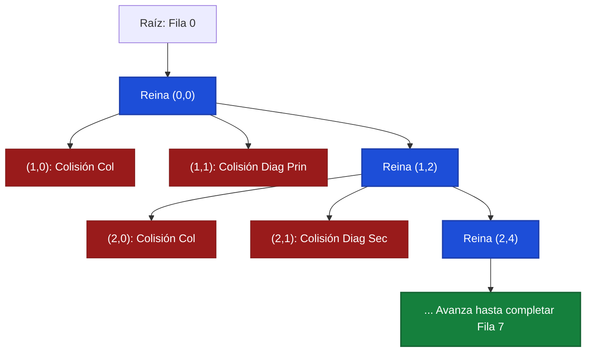

#### 5. Implementación en Python (Tipada y Ejecutable)

```python
def resolver_8_reinas() -> list[int] | None:
    n = 8
    solucion = [-1] * n
    col_ocupada = [False] * n
    diag_prin = [False] * (2 * n - 1)  # indices de 0 a 14
    diag_sec = [False] * (2 * n - 1)   # indices de 0 a 14

    def backtrack(fila: int) -> bool:
        if fila == n:
            return True

        for col in range(n):
            d_p = fila - col + 7
            d_s = fila + col

            # Poda por Factibilidad en O(1)
            if not col_ocupada[col] and not diag_prin[d_p] and not diag_sec[d_s]:
                # 1. Marcar decisión
                solucion[fila] = col
                col_ocupada[col] = True
                diag_prin[d_p] = True
                diag_sec[d_s] = True

                # 2. Recursión a fila siguiente
                if backtrack(fila + 1):
                    return True

                # 3. Deshacer decisión (Backtrack)
                solucion[fila] = -1
                col_ocupada[col] = False
                diag_prin[d_p] = False
                diag_sec[d_s] = False

        return False

    if backtrack(0):
        return solucion
    return None
```

<div class="trap-callout">
  <div class="trap-header">⚠️ Trampa Típica de Corrección</div>
  <p><strong>Puntos donde restan puntaje los docentes de FIUBA:</strong></p>
  <ul>
    <li><strong>Olvidar desmarcar booleanos al retroceder:</strong> Si omites <code>col_ocupada[col] = False</code> tras retornar de la llamada recursiva, las ramas hermanas creerán que la columna continúa ocupada, causando que el algoritmo falle en encontrar soluciones válidas.</li>
    <li><strong>Verificar colisiones recorriendo las filas anteriores con un bucle:</strong> Hacer un bucle <code>for f in range(fila): if solucion[f] == col or ...</code> dentro de cada nodo agrega un costo $O(n)$ por estado, degradando la complejidad de verificación a $O(n \cdot n!)$ en lugar de $O(n!)$ con chequeo $O(1)$.</li>
    <li><strong>Error de signo en la diagonal principal:</strong> Olvidar el $+7$ en $f - col$ produce índices negativos (en Python mapea al final de la lista alterando otras diagonales; en C/Java arroja error de segmentación).</li>
  </ul>
</div>

---

### Patrón de Ejercicio 3.2: Descomposición Numérica con Cotas (Lagrange)

Problemas donde se debe descomponer un número entero en sumas de componentes (cuadrados, primos, monedas) bajo un número fijo de términos.

---

### Ejercicio 10 — Suma de Cuatro Cuadrados de Lagrange con Cotas y Podas

**Clasificación:** 🔴 IMPRESCINDIBLE  
**Origen:** Parcial 2024-2-1 (5 de noviembre de 2024), Ejercicio 1

**Enunciado**  
El teorema de los cuatro cuadrados de Lagrange especifica que cualquier número entero no negativo $n$ puede expresarse como la suma de cuatro cuadrados de enteros no negativos:
$$n = w^2 + x^2 + y^2 + z^2$$

Desarrollar un algoritmo que, dado el valor de $n$, indique cuáles son los cuatro enteros no negativos que lo componen. Justificar detalladamente el árbol de decisiones, las podas aplicadas y la complejidad del algoritmo.

**Qué está evaluando la cátedra**  
Diseño de un árbol de backtracking acotado a profundidad 4, imposición de orden no creciente para eliminar ramas simétricas redundantes ($w \ge x \ge y \ge z$), poda por cota inferior y determinación analítica del último término en $O(1)$.

#### 1. Deducción Metodológica Formal (Los 5 Pasos)

1. **Paso 1: Eliminación de Simetrías por Orden No Creciente:**
   Toda solución permutable representa la misma descomposición. Para evitar explorar las $4! = 24$ permutaciones repetidas de una misma tupla, forzamos la restricción de monotonía:
   $$w \ge x \ge y \ge z \ge 0$$

2. **Paso 2: Determinación Analítica en $O(1)$ del Cuarto Cuadrado:**
   No es necesario iterar en el cuarto nivel. Si ya asignamos $w, x, y$, el remanente obligatorio es $R = n - (w^2 + x^2 + y^2)$. El algoritmo simplemente verifica en $O(1)$ si $R$ es un cuadrado perfecto ($z = \lfloor\sqrt{R}\rfloor$ y $z^2 = R$) y si respeta $z \le y$. Si se cumplen ambas condiciones, la solución se completa con éxito sin bifurcaciones adicionales.

3. **Paso 3: Poda por Cota Superior (Factibilidad):**
   En el paso $k$ con remanente $R$, ningún valor $v$ puede superar $\lfloor\sqrt{R}\rfloor$, ni el valor asignado en el paso anterior $v_{\text{previo}}$:
   $$v \le \min(v_{\text{previo}}, \; \lfloor\sqrt{R}\rfloor)$$

4. **Paso 4: Poda por Cota Inferior (Optimalidad/Alcance):**
   Quedan $(4 - paso)$ términos por asignar. Como los valores son no crecientes, cada uno de los términos restantes aportará a lo sumo $v^2$. Si la suma máxima potencial es estrictamente menor al remanente requerido:
   $$(4 - paso) \cdot v^2 < R$$
   entonces es **matemáticamente imposible** alcanzar $R$ utilizando valores menores o iguales a $v$. Se interrumpe el bucle de prueba (`break`) podando todo el resto del subárbol de una sola vez.

5. **Paso 5: Complejidad:**
   * **Tiempo:** Sin podas, 4 bucles hasta $\sqrt{n}$ requerirían $O((\sqrt{n})^4) = O(n^2)$. Al resolver el cuarto término analíticamente en $O(1)$, la cota máxima cae a $O((\sqrt{n})^3) = O(n^{3/2})$. Con la poda de simetría ($w \ge x \ge y \ge z$) y la cota inferior $(4-k)v^2 < R$, el número real de estados explorados es una pequeña fracción de $n^{3/2}$, resolviendo $n = 10^6$ en milisegundos.
   * **Espacio Auxiliar:** $O(1)$ de memoria adicional fija más la pila de recursión de profundidad a lo sumo 4.

#### 2. Ejemplo Concreto y Traza Paso a Paso ($n = 31$)

Sea $n = 31$. Buscamos $w \ge x \ge y \ge z$ tales que $w^2 + x^2 + y^2 + z^2 = 31$.

| Nivel / Paso | Remanente ($R$) | Límite Superior ($v \le \min$) | Valor $v$ Probado | ¿Poda $(4-k)v^2 < R$? | Acción Siguiente |
| :---: | :---: | :---: | :---: | :---: | :--- |
| **Paso 0 ($w$)** | $31$ | $\lfloor\sqrt{31}\rfloor = 5$ | $v = 5$ | $4 \cdot 5^2 = 100 \ge 31$ (OK) | Asignar $w = 5$, nuevo $R = 31 - 25 = 6$ |
| **Paso 1 ($x$)** | $6$ | $\min(5, \lfloor\sqrt{6}\rfloor) = 2$ | $v = 2$ | $3 \cdot 2^2 = 12 \ge 6$ (OK) | Asignar $x = 2$, nuevo $R = 6 - 4 = 2$ |
| **Paso 2 ($y$)** | $2$ | $\min(2, \lfloor\sqrt{2}\rfloor) = 1$ | $v = 1$ | $2 \cdot 1^2 = 2 \ge 2$ (OK) | Asignar $y = 1$, nuevo $R = 2 - 1 = 1$ |
| **Paso 3 ($z$)** | $1$ | - | $z = \lfloor\sqrt{1}\rfloor = 1$ | $1^2 = 1 == R$ y $1 \le 1$ | **¡ÉXITO EN EL 4TO TÉRMINO!** |

*Solución obtenida:* $(w, x, y, z) = (5, 2, 1, 1)$.
*Verificación:* $5^2 + 2^2 + 1^2 + 1^2 = 25 + 4 + 1 + 1 = 31$.
*Eficiencia:* Se halló la solución en exactamente 4 evaluaciones directas sin retrocesos.

#### 3. Diagrama Visual del Árbol de Lagrange

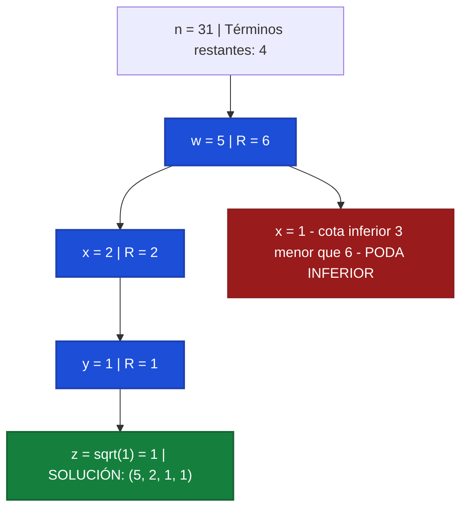

#### 4. Implementación en Python (Tipada y Ejecutable)

```python
import math

def cuatro_cuadrados_lagrange(n: int) -> list[int] | None:
    solucion = [0, 0, 0, 0]

    def backtrack(paso: int, remanente: int, max_limite: int) -> bool:
        # En el paso 3, el 4to término se calcula directamente en O(1)
        if paso == 3:
            z = int(math.isqrt(remanente))
            if z * z == remanente and z <= max_limite:
                solucion[3] = z
                return True
            return False

        limite_sup = min(max_limite, int(math.isqrt(remanente)))

        for v in range(limite_sup, -1, -1):
            terminos_restantes = 4 - paso
            # Poda por cota inferior: si ni usando v en todos los restantes alcanzamos el remanente
            if terminos_restantes * (v * v) < remanente:
                break  # Como v decrece, ningún valor menor alcanzará

            solucion[paso] = v
            if backtrack(paso + 1, remanente - v * v, v):
                return True

        return False

    if backtrack(0, n, int(math.isqrt(n))):
        return solucion
    return None
```

<div class="trap-callout">
  <div class="trap-header">⚠️ Trampa Típica de Corrección</div>
  <p><strong>Puntos donde restan puntaje los docentes de FIUBA:</strong></p>
  <ul>
    <li><strong>Iterar el 4to cuadrado en un bucle:</strong> Si el alumno escribe 4 bucles anidados en lugar de resolver el último término con <code>isqrt(remanente)</code> en $O(1)$, la cátedra descuenta puntos por falta de optimización algorítmica.</li>
    <li><strong>No imponer $w \ge x \ge y \ge z$:</strong> Permitir que los valores crezcan nuevamente en niveles inferiores provoca que el algoritmo evalúe las 24 permutaciones de la misma suma, multiplicando innecesariamente el tiempo de cómputo.</li>
  </ul>
</div>

---

### Patrón de Ejercicio 3.3: Cobertura en Grafos con Branch and Bound (Vertex Cover)

Aparece cuando se solicita un algoritmo exacto para un problema NP-Hard sobre grafos no dirigidos.

---

### Ejercicio 11 — Vertex Cover Mínimo por Branch and Bound

**Clasificación:** 🔴 IMPRESCINDIBLE  
**Origen:** Parcial 2024-2-2 (26 de noviembre de 2024), Ejercicio 1 / Guía 03 Ejercicio 13

**Enunciado**  
Implementar un algoritmo que dado un grafo no dirigido $G = (V, E)$ devuelva un conjunto de vértices que represente un mínimo Vertex Cover del mismo. Explicar el árbol de decisiones, las podas aplicadas y la complejidad.

**Qué está evaluando la cátedra**  
Estrategia de ramificación sobre aristas no cubiertas (al menos uno de los dos extremos debe pertenecer a la cobertura), poda por cota superior (*Branch and Bound*) descartando ramas que alcancen o superen el mejor tamaño ya hallado.

#### 1. Deducción Metodológica Formal (Los 5 Pasos)

1. **Paso 1: Definición de Vertex Cover:**
   Un conjunto $C \subseteq V$ es un Vertex Cover de $G = (V, E)$ si para toda arista $(u, v) \in E$, se cumple que $u \in C \lor v \in C$. Buscamos minimizar $|C|$.

2. **Paso 2: Ramificación por Arista No Cubierta (Factor de Branching 2):**
   En lugar de ramificar vértice por vértice ($2^{|V|}$ hojas), buscamos una arista arbitraria $(u, v)$ que **aún no esté cubierta** por el conjunto actual $C$:

   * **Rama 1:** Incluir el vértice $u$ en $C$ y continuar la búsqueda.
   * **Rama 2:** Incluir el vértice $v$ en $C$ y continuar la búsqueda.
   Esto garantiza que cada bifurcación cubre al menos una arista nueva y acota la profundidad del árbol al tamaño del Vertex Cover mínimo $k$.

3. **Paso 3: Poda por Cota Superior (Branch and Bound):**
   Mantenemos el tamaño de la mejor cobertura factible hallada hasta el momento: `mejor_tamano = len(mejor_solucion)` (inicializada trivialmente en $|V|$).
   Si en cualquier nodo del árbol el tamaño de la cobertura actual satisface:
   $$|C_{\text{actual}}| \ge \text{mejor tamaño}$$
   se poda inmediatamente la rama. Ninguna extensión de $C_{\text{actual}}$ puede mejorar el récord actual.

4. **Paso 4: Caso Base y Actualización del Récord:**
   Si no quedan aristas sin cubrir, el conjunto actual $C_{\text{actual}}$ es un Vertex Cover válido y su tamaño es estrictamente menor a `mejor_tamano`. Se actualiza la mejor solución con una copia profunda de $C_{\text{actual}}$.

5. **Paso 5: Complejidad:**
   * **Tiempo:** $O(2^k \cdot |E|)$ en el peor caso, donde $k$ es el tamaño del Vertex Cover óptimo. Esto es exponencialmente superior al algoritmo ingenuo $O(2^{|V|} \cdot |E|)$, especialmente cuando $k \ll |V|$.
   * **Espacio Auxiliar:** $O(|V|)$ para almacenar el conjunto actual y la pila de recursión.

#### 2. Ejemplo Concreto y Traza Paso a Paso

Sea el grafo con 4 vértices $V = \{1, 2, 3, 4\}$ y aristas $E = \{(1, 2), (2, 3), (3, 4)\}$ (camino de 4 vértices).

| Paso / Rama | Cobertura Actual ($C$) | Cota Actual ($|C|$) | Arista No Cubierta Elegida | Decisión / Poda |
| :---: | :---: | :---: | :---: | :--- |
| **Inicio** | $\emptyset$ | $0$ | $(1, 2)$ | Mejor récord inicial: $|V| = 4$ |
| **Rama 1 (incluir 1)** | $\{1\}$ | $1 < 4$ | $(2, 3)$ | Ramificar con arista $(2, 3)$ |
| **Rama 1.1 (incluir 2)** | $\{1, 2\}$ | $2 < 4$ | $(3, 4)$ | Ramificar con arista $(3, 4)$ |
| **Rama 1.1.1 (incluir 3)** | $\{1, 2, 3\}$ | $3 < 4$ | Ninguna | **Cobertura válida hallada! Récord = 3** ($\{1, 2, 3\}$) |
| **Rama 1.1.2 (incluir 4)** | $\{1, 2, 4\}$ | $3 \ge 3$ | - | **PODA BRANCH & BOUND** ($|C| \ge 3$) |
| **Rama 1.2 (incluir 3)** | $\{1, 3\}$ | $2 < 3$ | $(3, 4)$ cubierta! Aristas libres: Ninguna! | **¡Nuevo Récord Óptimo = 2!** ($\{1, 3\}$) |
| **Rama 2 (incluir 2)** | $\{2\}$ | $1 < 2$ | $(3, 4)$ | Ramificar con arista $(3, 4)$ |
| **Rama 2.1 (incluir 3)** | $\{2, 3\}$ | $2 \ge 2$ | - | **PODA BRANCH & BOUND** ($|C| \ge 2$) |
| **Rama 2.2 (incluir 4)** | $\{2, 4\}$ | $2 \ge 2$ | - | **PODA BRANCH & BOUND** ($|C| \ge 2$) |

*Resultado óptimo final:* Vertex Cover de tamaño mínimo **$k = 2$** (por ejemplo $\{1, 3\}$ o $\{2, 3\}$).

#### 3. Diagrama Visual del Árbol de Branch & Bound

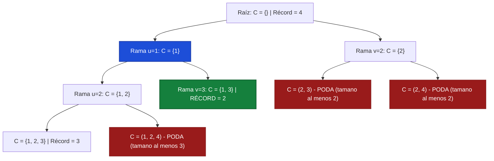

#### 4. Implementación en Python (Tipada y Ejecutable)

```python
def minimo_vertex_cover(vertices: list[str], aristas: list[tuple[str, str]]) -> set[str]:
    mejor_cobertura = set(vertices)  # Cota superior inicial

    def buscar_arista_libre(actual: set[str]) -> tuple[str, str] | None:
        for u, v in aristas:
            if u not in actual and v not in actual:
                return u, v
        return None

    def backtrack(actual: set[str]):
        nonlocal mejor_cobertura
        # Poda Branch & Bound: si el tamaño actual ya iguala o supera al mejor récord
        if len(actual) >= len(mejor_cobertura):
            return

        arista = buscar_arista_libre(actual)
        if arista is None:
            # Todas las aristas están cubiertas y len(actual) < len(mejor_cobertura)
            mejor_cobertura = set(actual)
            return

        u, v = arista
        # Rama 1: Incluir u
        actual.add(u)
        backtrack(actual)
        actual.remove(u)  # Backtrack

        # Rama 2: Incluir v
        actual.add(v)
        backtrack(actual)
        actual.remove(v)  # Backtrack

    backtrack(set())
    return mejor_cobertura
```

<div class="trap-callout">
  <div class="trap-header">⚠️ Trampa Típica de Corrección</div>
  <p><strong>Puntos donde restan puntaje los docentes de FIUBA:</strong></p>
  <ul>
    <li><strong>Podar con <code>&gt;</code> en vez de <code>&gt;=</code>:</strong> La poda debe ser <code>len(actual) &gt;= len(mejor_cobertura)</code>. Si usas <code>&gt;</code>, el algoritmo continuará explorando ramas de tamaño igual al récord que jamás podrán mejorarlo, duplicando el tiempo de ejecución.</li>
    <li><strong>No copiar la solución óptima:</strong> Escribir <code>mejor_cobertura = actual</code> guarda una referencia al conjunto mutable. Al hacer backtracking, <code>mejor_cobertura</code> se vacía junto con <code>actual</code>. Se debe hacer siempre copia profunda con <code>set(actual)</code>.</li>
  </ul>
</div>

---

### Patrón de Ejercicio 3.4: Suma de Subconjuntos (Subset Sum) con Podas

Exploración binaria de inclusión/exclusión de elementos para alcanzar un valor objetivo exacto.

---

### Ejercicio 12 — Suma de Subconjuntos con Podas Tempranas

**Clasificación:** 🟡 IMPORTANTE  
**Origen:** Guía de Ejercicios 03, Ejercicio 11 / Práctica

**Enunciado**  
Dada una lista de enteros positivos $L$ y un entero objetivo $S$, implementar un algoritmo por backtracking que determine si existe un subconjunto de $L$ cuya suma sea exactamente $S$, y en caso afirmativo devuelva dicho subconjunto. Indicar y justificar las podas de factibilidad aplicadas y la complejidad.

**Qué está evaluando la cátedra**  
Árbol binario de inclusión/exclusión, poda temprana por exceso de suma y optimización del espacio de búsqueda mediante ordenamiento previo de los elementos.

#### 1. Deducción Metodológica Formal (Los 5 Pasos)

1. **Paso 1: Ordenamiento Previo para Poda en Bloque:**
   Se ordena la lista $L$ de forma ascendente: $L[0] \le L[1] \le \dots \le L[n-1]$ en $O(n \log n)$.

2. **Paso 2: Árbol Binario de Decisiones:**
   En cada nivel $i$ correspondiente al elemento $L[i]$ con remanente $R$ ($R = S - \text{suma acumulada}$):

   * **Rama Inclusión:** Tomar $L[i]$, reducir el remanente a $R - L[i]$ y avanzar al nivel $i+1$.
   * **Rama Exclusión:** Omitir $L[i]$, mantener el remanente $R$ y avanzar al nivel $i+1$.
3. **Paso 3: Poda por Ordenamiento (Corte Temprano):**
   Si en el índice actual $L[i] > R$, como la lista está ordenada ascendentemente, todos los elementos posteriores $L[j] \ge L[i] > R$ para $j > i$. Por ende, **ningún elemento posterior podrá ser incluido sin exceder $S$**. Se corta la búsqueda de inmediato retornando `False`.

4. **Paso 4: Caso Base:**
   * Si $R = 0$: Se alcanzó la suma exacta $S$. Se retorna `True` inmediatamente con la solución acumulada.
   * Si $i \ge n$ o $R < 0$: Se agotaron los elementos sin llegar a la suma. Retorna `False`.
5. **Paso 5: Complejidad:**
   * **Tiempo:** $O(2^n)$ en el peor caso teórico (cuando ningún subconjunto suma $S$ y las podas no pueden actuar hasta el final). Sin embargo, con $L$ ordenado, la poda temprana $L[i] > R$ reduce el espacio a una pequeña fracción.
   * **Espacio Auxiliar:** $O(n)$ para la pila recursiva y el arreglo de la solución.

#### 2. Ejemplo Concreto y Tabla de Traza Paso a Paso

Sea $L = [2, 3, 5, 7, 10]$ y objetivo $S = 14$.

| Nivel ($i$) | Elemento ($L[i]$) | Remanente ($R$) | Condición $L[i] > R$ | Decisión | Solución Parcial |
| :---: | :---: | :---: | :---: | :---: | :--- |
| **0** | $2$ | $14$ | $2 > 14$ (No) | **Incluir 2** $\implies R = 12$ | $\{2\}$ |
| **1** | $3$ | $12$ | $3 > 12$ (No) | **Incluir 3** $\implies R = 9$ | $\{2, 3\}$ |
| **2** | $5$ | $9$ | $5 > 9$ (No) | **Incluir 5** $\implies R = 4$ | $\{2, 3, 5\}$ |
| **3** | $7$ | $4$ | $7 > 4$ (Sí) | **PODA TEMPRANA** ($7 > 4$) | Backtrack: Quitar 5 |
| **2** | $5$ (excluir) | $9$ | - | **Excluir 5** $\implies R = 9$ | $\{2, 3\}$ |
| **3** | $7$ | $9$ | $7 > 9$ (No) | **Incluir 7** $\implies R = 2$ | $\{2, 3, 7\}$ |
| **4** | $10$ | $2$ | $10 > 2$ (Sí) | **PODA TEMPRANA** ($10 > 2$) | Backtrack: Quitar 7 |
| **3** | $7$ (excluir) | $9$ | - | **Excluir 7** $\implies R = 9$ | $\{2, 3\}$ |
| **4** | $10$ | $9$ | $10 > 9$ (Sí) | **PODA TEMPRANA** ($10 > 9$) | Backtrack: Quitar 3 |
| **1** | $3$ (excluir) | $12$ | - | **Excluir 3** $\implies R = 12$ | $\{2\}$ |
| **2** | $5$ | $12$ | $5 > 12$ (No) | **Incluir 5** $\implies R = 7$ | $\{2, 5\}$ |
| **3** | $7$ | $7$ | $7 > 7$ (No) | **Incluir 7** $\implies R = 0$ | **¡ÉXITO: $R = 0$! Solución: $\{2, 5, 7\}$** |

*Verificación:* $2 + 5 + 7 = 14 = S$.

#### 3. Diagrama Visual del Árbol de Inclusión/Exclusión

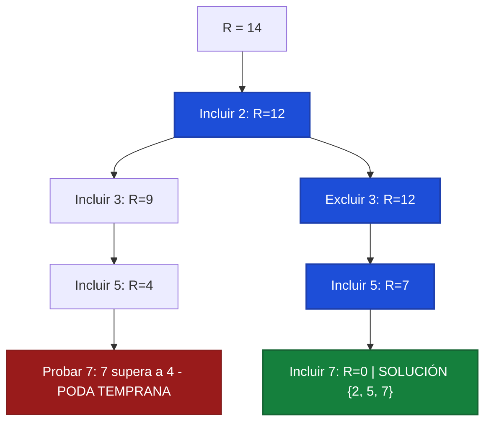

#### 4. Implementación en Python (Tipada y Ejecutable)

```python
def subset_sum_backtracking(nums: list[int], target: int) -> list[int] | None:
    # 1. Ordenamiento previo para habilitar podas tempranas
    nums_ordenados = sorted(nums)
    solucion = []

    def backtrack(indice: int, remanente: int) -> bool:
        if remanente == 0:
            return True
        if indice >= len(nums_ordenados) or remanente < 0:
            return False

        # Poda temprana: al estar ordenado, ningún elemento posterior entrará
        if nums_ordenados[indice] > remanente:
            return False

        # Rama 1: Incluir nums_ordenados[indice]
        solucion.append(nums_ordenados[indice])
        if backtrack(indice + 1, remanente - nums_ordenados[indice]):
            return True
        solucion.pop()  # Backtrack

        # Rama 2: Excluir nums_ordenados[indice]
        if backtrack(indice + 1, remanente):
            return True

        return False

    if backtrack(0, target):
        return solucion
    return None
```

<div class="trap-callout">
  <div class="trap-header">⚠️ Trampa Típica de Corrección</div>
  <p><strong>Puntos donde restan puntaje los docentes de FIUBA:</strong></p>
  <ul>
    <li><strong>Aplicar la poda <code>L[i] &gt; remanente</code> sin ordenar:</strong> La poda por exceso solo es válida si la lista está previamente ordenada. Si la lista contiene números desordenados (por ejemplo $[10, 2]$ con $R = 5$), descartar por $10 > 5$ omitiría erróneamente al $2$.</li>
    <li><strong>Números negativos o nulos:</strong> Esta poda asume que todos los elementos son positivos ($L[i] > 0$). Si hubiera números negativos, sumar un elemento posterior podría reducir la suma actual y permitir alcanzar el objetivo.</li>
  </ul>
</div>

---

### Errores Frecuentes en Exámenes sobre Backtracking

1. **Olvidar desmarcar el estado en el retorno (Backtrack):** Dejar variables modificadas al salir de una llamada arruina la exploración de las ramas hermanas.
2. **Validar restricciones recorriendo estructuras completas:** Usar bucles en cada nodo en vez de booleanos de control $O(1)$.
3. **No justificar la complejidad en el peor caso:** Afirmar que con podas el algoritmo pasa a ser polinomial. Las podas optimizan el caso promedio, pero el peor caso sigue siendo exponencial o factorial.
4. **No podar simetrías:** Permitir explorar permutaciones del mismo conjunto en problemas de combinatoria.


---

## 7. Tema 4: Programación Dinámica (PD)

### Conceptos Mínimos de Supervivencia

1. **Cuándo Usar Programación Dinámica:**
   * El problema exhibe **Subestructura Óptima**: la solución óptima global se compone de soluciones óptimas a sus subproblemas.
   * El problema tiene **Subproblemas Superpuestos**: los mismos subproblemas se resuelven una y otra vez (a diferencia de División y Conquista, donde los subproblemas son disjuntos).
2. **Los Cinco Pasos Obligatorios en el Examen de TDA:**
   Para obtener el puntaje completo en un ejercicio de Programación Dinámica, tu respuesta debe contener explícitamente:

   1. **Definición Formal del Estado:** ¿Qué significa exactamente OPT(i, w) en el contexto del enunciado? (Ej: *"Valor máximo obtenible considerando un subconjunto de los primeros i elementos con una capacidad restante de w kilos"*).
   2. **Casos Base:** Valores donde la solución es trivial o inmediata (ej: OPT(0, w) = 0, OPT(i, 0) = 0).
   3. **Ecuación de Recurrencia:** La fórmula matemática cerrada que computa OPT a partir de subproblemas más chicos, detallando las opciones consideradas y la función objetivo (min o max).
   4. **Orden de Llenado de la Tabla:** Justificación de la dirección en que se itera la matriz (ej: *"De menor a mayor índice i, y para cada i de menor a mayor capacidad w, asegurando que los valores requeridos ya hayan sido calculados"*).
   5. **Algoritmo de Reconstrucción de la Solución:** Procedimiento que recorre la tabla hacia atrás desde el resultado final para identificar qué elementos concretos componen la solución óptima.

---

### Patrón de Ejercicio 4.1: DP 1D Aritmética y Transición de Estados

Problemas de cálculo de pasos mínimos o secuencias de transformación entre dos valores numéricos dados (0 → K o N → 1).

---

### Ejercicio 13 — Mínima Cantidad de Operaciones para Llegar de 0 a K (+1, × 2)

**Clasificación:** 🔴 IMPRESCINDIBLE  
**Origen:** Parcial 2024-2-2 (26 de noviembre de 2024), Ejercicio 2 / Guía 04 Ejercicio 11

**Enunciado**  
Dado un número natural $K$, se desea obtener la mínima cantidad de operaciones para llegar desde $0$ hasta $K$, sabiendo que las operaciones permitidas son:  
(i) Aumentar el valor del operando en 1 ($x \leftarrow x + 1$).  
(ii) Duplicar el valor del operando ($x \leftarrow 2x$).  
Implementar un algoritmo que, por programación dinámica, obtenga la menor cantidad de operaciones a realizar y detalle la secuencia exacta de dichas operaciones. Desarrollar la ecuación de recurrencia. Indicar y justificar la complejidad temporal y espacial.

**Qué está evaluando**  
Modelado del estado en 1D, razonamiento hacia atrás ($K \to 0$), planteo riguroso de la recurrencia con análisis de paridad, demostración formal de optimalidad y reconstrucción exacta de la secuencia de operaciones.

**Idea de resolución y Perspectiva Inversa**  

* *Perspectiva hacia atrás ($i \to 0$):* Pensar cómo llegar a un número $i$:
    * Siempre podemos llegar desde $i - 1$ aplicando la operación $+1$.
    * Si $i$ es par, también podemos llegar desde $i / 2$ aplicando la operación $\times 2$. Si $i$ es impar, es imposible haber llegado duplicando un entero.
* *Casos trampa iniciales:* Desde $0$, la operación $\times 2$ no genera avance ($0 \times 2 = 0$). El primer paso hacia adelante siempre debe ser $+1$ (hacia 1).

#### Los Cinco Pasos Obligatorios de Programación Dinámica (Criterio FIUBA)

1. **Definición Formal del Estado:**  
   $$OPT(i) = \text{Mínima cantidad de operaciones necesarias para alcanzar el valor } i \text{ partiendo desde } 0.$$

2. **Casos Base:**  
   * $OPT(0) = 0$: Ya estamos en el origen, se requieren $0$ operaciones.  
   * $OPT(1) = 1$: Única transición válida es $0 + 1 = 1$, pues $0 \times 2 = 0$ no avanza.

3. **Ecuación de Recurrencia:**  
   Para todo $i \ge 1$:
   $$OPT(i) = \begin{cases} OPT(i - 1) + 1 & \text{si } i \text{ es impar} \\ \min\Big(OPT(i - 1) + 1, \; OPT\left(\frac{i}{2}\right) + 1\Big) & \text{si } i \text{ es par} \end{cases}$$

4. **Orden de Llenado de la Tabla:**  
   Iteración unidireccional creciente (Bottom-Up) desde $i = 1$ hasta $K$.  
   *Justificación:* Cada estado $i$ solo depende de $i - 1$ y $i / 2$. Como ambos predecesores son estrictamente menores que $i$, todos los subproblemas necesarios ya habrán sido resueltos y almacenados previamente en el DAG de dependencias.

5. **Algoritmo de Reconstrucción de la Secuencia:**  
   Retrocedemos desde $K$ hasta $0$ consultando el arreglo de predecesores `padre[i]`. Si $padre[i] = i / 2$, la operación fue $\times 2$; en caso contrario, fue $+1$. Se invierte la lista resultante para presentar la secuencia en orden cronológico de $0$ a $K$.

#### Demostración Rigurosa de Correctitud (Por qué la solución es la correcta)

<div class="proof-card">
  <div class="proof-card-header">🛡️ 1. Exhaustividad en el Espacio de Decisiones</div>
  <p>Dado que las únicas operaciones permitidas en el universo del problema son $+1$ y $\times 2$:</p>
  <ul>
    <li>Si el último paso fue $+1$, el estado predecesor fue necesariamente $(i - 1)$. Opción válida para todo $i \ge 1$.</li>
    <li>Si el último paso fue $\times 2$, el estado predecesor fue necesariamente $(i / 2)$. Esta opción <strong>solo existe si $i$ es par</strong>, ya que ningún número entero multiplicado por $2$ produce un entero impar.</li>
  </ul>
  <p>Por lo tanto, el conjunto de predecesores posibles es exhaustivo: $\{i - 1\}$ si $i$ es impar, o $\{i - 1, i/2\}$ si $i$ es par. No existe ningún otro camino admisible.</p>
</div>

<div class="proof-card">
  <div class="proof-card-header">🛡️ 2. Subestructura Óptima (Demostración por Reducción al Absurdo / Cut-and-Paste)</div>
  <p>Supongamos que el camino óptimo global para llegar a $i$ termina con la operación $+1$, viniendo de $i - 1$, con costo $C = \text{costo}(0 \to i-1) + 1$.</p>
  <p>Si el subcamino $(0 \to i - 1)$ no fuera óptimo, existiría un camino alternativo con menor costo $C' < \text{costo}(0 \to i - 1)$. Reemplazando dicho subcamino, obtendríamos un camino a $i$ con costo $C' + 1 < C$, lo cual contradice que $C$ era la cantidad mínima de operaciones para $i$.</p>
  <p>El mismo razonamiento aplica si el último paso fue $\times 2$ desde $i / 2$. En consecuencia, $OPT(i)$ se construye necesariamente a partir de la solución óptima de uno de sus predecesores inmediatos.</p>
</div>

<div class="proof-card">
  <div class="proof-card-header">🛡️ 3. Ausencia de Ciclos y Orden Topológico</div>
  <p>Para todo $i \ge 1$, se cumple estrictamente que $i - 1 < i$ y $i / 2 < i$. El grafo de dependencias de subproblemas es un <strong>DAG (Grafo Acíclico Dirigido)</strong>, garantizando que el llenado secuencial $1, 2, \dots, K$ respeta el orden topológico sin generar llamadas recursivas circulares.</p>
</div>

<div class="proof-card">
  <div class="proof-card-header">🛡️ 4. Inducción Fuerte sobre K</div>
  <p><strong>Base ($K=0, K=1$):</strong> $OPT(0)=0$ y $OPT(1)=1$ son óptimos triviales comprobables de forma directa.</p>
  <p><strong>Paso Inductivo:</strong> Asumiendo como hipótesis inductiva que $DP[j] = OPT(j)$ para todo $0 \le j < i$, el cálculo $DP[i] = \min_{p \in \text{Pred}(i)}(DP[p] + 1)$ evalúa exhaustivamente el óptimo sobre todos los predecesores válidos, garantizando por inducción matemática que $DP[i] = OPT(i)$ para todo $i \ge 0$.</p>
</div>

#### Diagrama de Flujo y Grafo Acíclico (DAG) de Decisiones

A continuación se representa el flujo de decisión iterativo y el grafo de transiciones óptimas para $K = 10$:


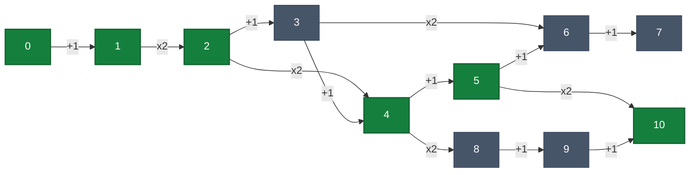

<div class="visual-trace-container">
  <span class="trace-node start-node">0</span>
  <span class="trace-arrow"><span class="arrow-op">+1</span>➜</span>
  <span class="trace-node">1</span>
  <span class="trace-arrow"><span class="arrow-op">×2</span>➜</span>
  <span class="trace-node">2</span>
  <span class="trace-arrow"><span class="arrow-op">×2</span>➜</span>
  <span class="trace-node">4</span>
  <span class="trace-arrow"><span class="arrow-op">+1</span>➜</span>
  <span class="trace-node">5</span>
  <span class="trace-arrow"><span class="arrow-op">×2</span>➜</span>
  <span class="trace-node end-node">10</span>
</div>

#### Tabla de Seguimiento Paso a Paso (Trace Table para $K = 10$)

| $i$ | Paridad | Opción $+1$ ($DP[i-1]+1$) | Opción $\times 2$ ($DP[i/2]+1$) | $DP[i]$ Óptimo | Decisión Tomada | `padre[i]` |
|:---:|:---:|:---:|:---:|:---:|:---:|:---:|
| **0** | Par | — | — | **0** | Estado Inicial | — |
| **1** | Impar | $DP[0] + 1 = 0 + 1 = \mathbf{1}$ | No aplica ($1$ es impar) | **1** | $+1$ desde $0$ | 0 |
| **2** | Par | $DP[1] + 1 = 1 + 1 = 2$ | $DP[1] + 1 = 1 + 1 = \mathbf{2}$ | **2** | $\times 2$ desde $1$ | 1 |
| **3** | Impar | $DP[2] + 1 = 2 + 1 = \mathbf{3}$ | No aplica ($3$ es impar) | **3** | $+1$ desde $2$ | 2 |
| **4** | Par | $DP[3] + 1 = 3 + 1 = 4$ | $DP[2] + 1 = 2 + 1 = \mathbf{3}$ | **3** | $\times 2$ desde $2$ | 2 |
| **5** | Impar | $DP[4] + 1 = 3 + 1 = \mathbf{4}$ | No aplica ($5$ es impar) | **4** | $+1$ desde $4$ | 4 |
| **6** | Par | $DP[5] + 1 = 4 + 1 = 5$ | $DP[3] + 1 = 3 + 1 = \mathbf{4}$ | **4** | $\times 2$ desde $3$ | 3 |
| **7** | Impar | $DP[6] + 1 = 4 + 1 = \mathbf{5}$ | No aplica ($7$ es impar) | **5** | $+1$ desde $6$ | 6 |
| **8** | Par | $DP[7] + 1 = 5 + 1 = 6$ | $DP[4] + 1 = 3 + 1 = \mathbf{4}$ | **4** | $\times 2$ desde $4$ | 4 |
| **9** | Impar | $DP[8] + 1 = 4 + 1 = \mathbf{5}$ | No aplica ($9$ es impar) | **5** | $+1$ desde $8$ | 8 |
| **10** | Par | $DP[9] + 1 = 5 + 1 = 6$ | $DP[5] + 1 = 4 + 1 = \mathbf{5}$ | **5** | $\times 2$ desde $5$ | 5 |

**Detalle de Reconstrucción (Backtracking desde $K = 10$):**

1. En $10$: `padre[10] = 5`, operación = $\times 2$.
2. En $5$: `padre[5] = 4`, operación = $+1$.
3. En $4$: `padre[4] = 2`, operación = $\times 2$.
4. En $2$: `padre[2] = 1`, operación = $\times 2$.
5. En $1$: `padre[1] = 0`, operación = $+1$.
6. En $0$: Fin del recorrido.
* **Resultado exacto:** $5$ operaciones mínimas: `[+1, ×2, ×2, +1, ×2]`.

**Pseudocódigo Formal para Examen**

```text
FUNCION MinimasOperacionesAK(K):
    SI K = 0:
        RETORNAR (0, lista vacía)

    // 1. Inicialización de la tabla DP y estructuras de reconstrucción
    INICIALIZAR DP como arreglo de tamaño (K + 1) en 0
    INICIALIZAR padre como arreglo de tamaño (K + 1) en 0
    INICIALIZAR op como arreglo de tamaño (K + 1) en cadenas vacías

    DP[0] <- 0

    // 2. Llenado Bottom-Up
    PARA i <- 1 HASTA K:
        // Opción por defecto: Sumar 1 desde (i - 1)
        DP[i] <- DP[i - 1] + 1
        padre[i] <- i - 1
        op[i] <- "SUMAR_1"

        // Opción alternativa: Duplicar desde (i / 2) si i es par
        SI (i MOD 2) = 0:
            SI DP[i / 2] + 1 < DP[i]:
                DP[i] <- DP[i / 2] + 1
                padre[i] <- i / 2
                op[i] <- "DUPLICAR"

    // 3. Reconstrucción en reversa del camino óptimo
    INICIALIZAR secuencia como lista vacía
    actual <- K
    MIENTRAS actual > 0:
        INSERTAR op[actual] AL INICIO DE secuencia
        actual <- padre[actual]

    RETORNAR (DP[K], secuencia)
```

**Implementación en Python con Tipado Estricto**

```python
from typing import List, Tuple

def minimas_operaciones_a_k(k: int) -> Tuple[int, List[str]]:
    # Calcula la mínima cantidad de operaciones para llegar de 0 a K (+1, *2)
    # utilizando Programación Dinámica en O(K).
    if k == 0:
        return 0, []
    
    dp = [0] * (k + 1)
    padre = [0] * (k + 1)
    op = [""] * (k + 1)
    
    dp[0] = 0
    
    for i in range(1, k + 1):
        # Opción 1: Sumar 1
        dp[i] = dp[i - 1] + 1
        padre[i] = i - 1
        op[i] = "+1"
        
        # Opción 2: Duplicar si es par
        if i % 2 == 0:
            candidato = dp[i // 2] + 1
            if candidato < dp[i]:
                dp[i] = candidato
                padre[i] = i // 2
                op[i] = "*2"
                
    # Reconstrucción de la secuencia óptima
    secuencia = []
    actual = k
    while actual > 0:
        secuencia.append(op[actual])
        actual = padre[actual]
        
    secuencia.reverse()
    return dp[k], secuencia
```

**Complejidad**  

* **Temporal:** $\mathcal{O}(K)$. La tabla tiene $K + 1$ posiciones y cada una se calcula en tiempo constante $\mathcal{O}(1)$ comparando a lo sumo dos candidatos aritméticos. La reconstrucción realiza a lo sumo $K$ saltos (en la práctica $\le 2 \log_2 K$ saltos), lo que toma $\mathcal{O}(\log K) \subseteq \mathcal{O}(K)$.
* **Espacial:** $\mathcal{O}(K)$. Arreglos contiguos de tamaño $K + 1$ para almacenar los costos óptimos y punteros de retroceso.

**Puntos donde puedo equivocarme (Trampas de Corrección)**  

* **Intentar duplicar desde 0:** $0 \times 2 = 0$. Duplicar solo genera avance a partir de $x \ge 1$.
* **No incluir la reconstrucción de operaciones:** Si el enunciado pide explícitamente *"y cómo son dichas operaciones"*, no devolver la secuencia descuenta la mitad del puntaje del ejercicio.
* **No justificar la paridad:** Es indispensable explicitar en la recurrencia que la opción $\times 2$ solo se evalúa cuando $(i \pmod 2) = 0$.

**Variación típica de parcial (Pregunta Clave: DP vs Greedy)**  

* *¿Se puede resolver con Greedy en tiempo $\mathcal{O}(\log K)$?*  
  **Sí:** Pensando de $K$ hacia $0$, si $K$ es par siempre conviene dividir por $2$; si es impar, restar $1$. Esto toma $\mathcal{O}(\log K)$ pasos.

* *¿Por qué entonces la cátedra exige Programación Dinámica?*  
    1. **Consigna estricta:** Si el enunciado impone DP, usar Greedy anula el ejercicio.  
    2. **Generalización ante variantes:** La formulación de DP es genérica y se adapta de inmediato si se introducen reglas más complejas donde Greedy fracasa (por ejemplo, si existieran transiciones como $+3$, $\times 3$, o costos no unitarios para cada operación). Con DP, simplemente se agrega un nuevo término a la función $\min()$:
     $$OPT(i) = \min\big(OPT(i-1) + c_{+1}, \; OPT(i/2) + c_{\times 2}, \; OPT(i-3) + c_{+3}\big)$$
     En cambio, un enfoque voraz requeriraría una demostración formal de elección voraz (*Greedy Choice Property*) que con múltiples operaciones adicionales suele ser falsa.

---

### Patrón de Ejercicio 4.2: Mochila 2D con Restricciones Lógicas

Aparece cuando la mochila tiene múltiples recursos acoplados (peso y volumen) y condiciones lógicas adicionales sobre subconjuntos específicos de elementos (exclusión mutua y obligatoriedad).

---

### Ejercicio 14 — Mochila 2D con Selección Obligatoria y Excluyente de Guías de Aves

**Clasificación:** 🔴 IMPRESCINDIBLE  
**Origen:** Parcial 2024-2-1 (5 de noviembre de 2024), Ejercicio 3

**Enunciado**  
Paolo Casanova llevará una mochila para el fin de semana con capacidad de peso C kilos y volumen L litros. Tiene una lista de n elementos posibles, donde cada elemento i tiene un peso w_i, un volumen v_i y un beneficio b_i. Los ítems 1 y 2 son dos guías de observación de aves distintas. Por utilidad, **no tiene sentido llevar ambas guías, pero Paolo debe llevar obligatoriamente una de las dos** (es decir, debe elegir exactamente la guía 1 o la guía 2, nunca ninguna ni las dos). Desarrollar un algoritmo de Programación Dinámica que encuentre la combinación óptima de elementos que maximice el beneficio total respetando las capacidades.

**Qué está evaluando**  
Mochila 2D (estado tridimensional elemento × peso × volumen) y manejo riguroso de restricciones lógicas mediante bifurcación del problema en dos subinstancias independientes de DP o fijación de estado inicial.

**Idea de resolución**  

* Una mochila con peso y volumen clásica tiene estado OPT(i, c, l): beneficio máximo con los primeros i elementos, peso máximo c y volumen máximo l.
* Restricción lógica: Debe estar exactamente el ítem 1 O el ítem 2.
* *Estrategia limpia y robusta:*
    1. **Caso A:** Asumimos que elegimos la Guía 1. Incorporamos obligatoriamente la Guía 1 (consumiendo w₁ de peso y v₁ de volumen, aportando b₁). Descartamos la Guía 2. Resolvemos la mochila 2D estándar para los ítems restantes 3, 4, ..., n con capacidades remanentes C - w₁ y L - v₁.
    2. **Caso B:** Asumimos que elegimos la Guía 2. Incorporamos obligatoriamente la Guía 2 (consumiendo w₂ y v₂, aportando b₂). Descartamos la Guía 1. Resolvemos la mochila 2D estándar para los ítems restantes 3, 4, ..., n con capacidades remanentes C - w₂ y L - v₂.
    3. Comparamos el beneficio total máximo de ambos casos y nos quedamos con el mejor.

**Pseudocódigo**

```text
FUNCION MochilaPaoloCasanova(items, C, L):
    // items[0] es Guia 1, items[1] es Guia 2, items[2..n-1] son el resto

    beneficio_mejor <- -INFINITO
    INICIALIZAR mejor_solucion como lista vacía

    // --- CASO A: Llevar Guia 1 (items[0]) ---
    SI items[0].peso <= C Y items[0].volumen <= L:
        cap_peso_rem <- C - items[0].peso
        cap_vol_rem  <- L - items[0].volumen

        // Subconjunto de items restantes: items[2..n-1]
        resto_items <- items[2 .. longitud(items) - 1]
        (ben_A, sol_A) <- Mochila2DEstandar(resto_items, cap_peso_rem, cap_vol_rem)
        total_ben_A <- items[0].beneficio + ben_A

        SI total_ben_A > beneficio_mejor:
            beneficio_mejor <- total_ben_A
            INSERTAR items[0] AL INICIO DE sol_A
            mejor_solucion <- sol_A

    // --- CASO B: Llevar Guia 2 (items[1]) ---
    SI items[1].peso <= C Y items[1].volumen <= L:
        cap_peso_rem <- C - items[1].peso
        cap_vol_rem  <- L - items[1].volumen

        resto_items <- items[2 .. longitud(items) - 1]
        (ben_B, sol_B) <- Mochila2DEstandar(resto_items, cap_peso_rem, cap_vol_rem)
        total_ben_B <- items[1].beneficio + ben_B

        SI total_ben_B > beneficio_mejor:
            beneficio_mejor <- total_ben_B
            INSERTAR items[1] AL INICIO DE sol_B
            mejor_solucion <- sol_B

    RETORNAR (beneficio_mejor, mejor_solucion)

FUNCION Mochila2DEstandar(elementos, MaxPeso, MaxVol):
    m <- longitud(elementos)
    INICIALIZAR DP como matriz 3D de (m + 1) x (MaxPeso + 1) x (MaxVol + 1) en 0

    PARA i <- 1 HASTA m:
        elem <- elementos[i - 1]
        PARA p <- 0 HASTA MaxPeso:
            PARA v <- 0 HASTA MaxVol:
                // Opcion 1: No llevar el elemento i
                DP[i][p][v] <- DP[i - 1][p][v]

                // Opcion 2: Llevar el elemento i si cabe en peso y volumen
                SI elem.peso <= p Y elem.volumen <= v:
                    val_con_elem <- DP[i - 1][p - elem.peso][v - elem.volumen] + elem.beneficio
                    SI val_con_elem > DP[i][p][v]:
                        DP[i][p][v] <- val_con_elem

    // Reconstrucción
    INICIALIZAR seleccion como lista vacía
    rem_p <- MaxPeso
    rem_v <- MaxVol
    PARA i <- m BAJANDO HASTA 1:
        SI DP[i][rem_p][rem_v] != DP[i - 1][rem_p][rem_v]:
            elem <- elementos[i - 1]
            INSERTAR elem EN seleccion
            rem_p <- rem_p - elem.peso
            rem_v <- rem_v - elem.volumen

    RETORNAR (DP[m][MaxPeso][MaxVol], seleccion)
```

**Ecuación de Recurrencia para la Mochila 2D Auxiliar**  
> **OPT(i, p, v) = 0** (si i = 0 o p = 0 o v = 0)  
> **OPT(i, p, v) = OPT(i - 1, p, v)** (si w_i > p o v_i > v)  
> **OPT(i, p, v) = max(OPT(i - 1, p, v), OPT(i - 1, p - w_i, v - v_i) + b_i)** (en otro caso)

**Complejidad**  

* **Tiempo:** Resolvemos la tabla 3D dos veces (una para cada guía obligatoria). Cada llenado tiene dimensiones n × C × L y operaciones O(1) por celda: **O(n · C · L)**.
* **Espacio:** Tabla 3D de tamaño **O(n · C · L)**.

**Puntos donde puedo equivocarme**  

* Permitir que la mochila quede vacía de guías o que se lleven ambas.
* No chequear si individualmente la Guía 1 o Guía 2 caben en la mochila antes de iniciar la recursión.

**Variación típica de parcial**  
Agregar una tercera restricción, como un límite en el costo económico de los objetos asegurados (problema del Delivery, ver Ejercicio 16).

---

### Patrón de Ejercicio 4.3: Partición de Secuencias y Formateo (Word Wrap)

Minimizar una penalidad cuadrática o no lineal sobre la partición de un arreglo de palabras en líneas de longitud fija.

---

### Ejercicio 15 — Justificación de Texto (Word Wrap / Knuth-Plass)

**Clasificación:** 🔴 IMPRESCINDIBLE  
**Origen:** Parcial 2024-2-3 (10 de diciembre de 2024), Ejercicio 2

**Enunciado**  
Se tiene un texto formado por una sucesión de n palabras W₁, W₂, ..., Wₙ. Cada palabra W_i tiene una longitud de C_i caracteres. Se quiere dividir el texto en líneas de ancho máximo L. Si se asignan las palabras W_i, ..., W_k a una misma línea, la longitud total ocupada es:
> **Longitud(i, k) = ∑_{j=i}^k C_j + (k - i)**

donde (k - i) representa el espacio en blanco simple obligatorio entre palabras contiguas. Una línea es válida si Longitud(i, k) ≤ L. Al valor sobrante de la línea se lo define como:
> **Sobrante(i, k) = L - Longitud(i, k)**

Diseñar un algoritmo por Programación Dinámica que realice una partición del texto en líneas minimizando la suma de los cuadrados de los sobrantes de todas las líneas. Desarrollar la recurrencia, complejidad y reconstrucción.

**Qué está evaluando**  
DP sobre prefijos de secuencias (1 ... i), evaluación de la última línea como punto de corte, y minimización de funciones de costo cuadrático.

**Idea de resolución**  

* *Definición del Estado:*  
  OPT(i): Mínimo costo total (suma de cuadrados de sobrantes) de formatear el prefijo de palabras W₁, ..., W_i.

* *Decisión en el paso i:*  
  ¿Dónde empieza la última línea que contiene a W_i?
  Si la última línea empieza en la palabra j (con 1 ≤ j ≤ i), esa línea agrupa a W_j, ..., W_i.
  El costo de esa última línea es Sobrante(j, i)².
  El costo de las líneas previas es el costo óptimo de formatear las palabras hasta j - 1, es decir, OPT(j - 1).

* *Caso Base:*  
  OPT(0) = 0 (cero palabras tienen costo cero).

* *Ecuación de Recurrencia:*  
  > **OPT(i) = min_{1 ≤ j ≤ i, Longitud(j, i) ≤ L} { OPT(j - 1) + (L - Longitud(j, i))² }**

* *Reconstrucción:* Guardamos en `corte[i]` el índice j óptimo que minimizó la expresión para i.

**Pseudocódigo**

```text
FUNCION JustificarTextoWordWrap(longitudes_palabras, L):
    n <- longitud(longitudes_palabras)

    // DP[i]: costo mínimo para las primeras i palabras
    INICIALIZAR DP como arreglo de tamaño (n + 1) con INFINITO
    INICIALIZAR corte como arreglo de tamaño (n + 1) con 0
    DP[0] <- 0

    // Llenado de DP para prefijos crecientes
    PARA i <- 1 HASTA n:
        longitud_acumulada <- 0

        // Probamos que la última línea comience en la palabra j
        PARA j <- i BAJANDO HASTA 1:
            // Longitud de las palabras desde j hasta i + espacios intermedios
            SI j = i:
                longitud_acumulada <- longitudes_palabras[i - 1]
            SINO:
                longitud_acumulada <- longitud_acumulada + 1 + longitudes_palabras[j - 1]

            // Si excede el ancho de línea L, no caben más palabras hacia atrás
            SI longitud_acumulada > L:
                ROMPER

            sobrante <- L - longitud_acumulada
            costo_linea <- sobrante * sobrante

            SI DP[j - 1] + costo_linea < DP[i]:
                DP[i] <- DP[j - 1] + costo_linea
                corte[i] <- j

    // Reconstrucción de la partición en líneas
    INICIALIZAR lineas como lista vacía
    idx <- n
    MIENTRAS idx > 0:
        inicio_linea <- corte[idx]
        INSERTAR (inicio_linea, idx) AL INICIO DE lineas
        idx <- inicio_linea - 1

    RETORNAR (DP[n], lineas)
```

**Explicación del algoritmo**  
Para cada palabra i, retrocedemos evaluando posibles inicios de la línea actual j. Apenas el largo acumulado supera L, cortamos el bucle interno con `ROMPER` gracias a la monotonía de la suma de palabras. Cada línea se almacena como el rango de palabras [inicio, fin].

**Complejidad**  

* **Tiempo:** Hay n estados. Para cada estado i, el bucle interno evalúa a lo sumo i palabras (y en la práctica a lo sumo L palabras, ya que cada palabra tiene longitud ≥ 1). En el peor caso la complejidad es **O(n²) o bien O(n · L)**.
* **Espacio:** Arreglos 1D de tamaño n + 1 para `DP` y `corte`: **O(n)**.

**Puntos donde puedo equivocarme**  

* Olvidar sumar 1 por cada espacio intermedio entre palabras consecutivas (k - i).
* No penalizar adecuadamente las líneas que superan L: si una combinación supera L, debe ser descartada o tratada como costo ∞, nunca permitir sobrantes negativos.

**Variación típica de parcial**  
No penalizar los sobrantes de la última línea del texto (convención tipográfica habitual). En ese caso, para la línea que llega a n, el costo de la línea se fija en 0 en lugar de Sobrante².

---

### Patrón de Ejercicio 4.4: Mochila 3D Multidimensional con Restricciones Presupuestarias

Aparece cuando el problema presenta 3 dimensiones de recursos simultáneas (peso, volumen, costo monetario o seguro) y exige definir un estado 4D.

---

### Ejercicio 16 — Problema del Delivery: Mochila 3D con Límite de Seguro Financiero

**Clasificación:** 🔴 IMPRESCINDIBLE  
**Origen:** Parcial 2025-1-1 (27 de mayo de 2025), Ejercicio 4

**Enunciado**  
Se tiene el problema del delivery. Para cada paquete i de una lista de n paquetes se conoce su peso W_i, su volumen V_i, su costo de seguro C_i y su beneficio comercial B_i. El repartidor dispone de un vehículo con capacidad máxima de peso C kilos y volumen máximo de T litros. Además, por una cláusula estricta del seguro de transporte, la suma total de los costos de los productos transportados no puede superar los M pesos. Desarrollar un algoritmo de Programación Dinámica que resuelva el problema maximizando el beneficio.

**Qué está evaluando**  
Generalización formal de la mochila 0-1 a tres dimensiones de capacidad acumuladas simultáneamente.

**Idea de resolución**  

* *Definición del Estado:*  
  OPT(i, w, v, m): Beneficio máximo considerando un subconjunto de los primeros i paquetes (1 ≤ i ≤ n), con un peso disponible de hasta w (0 ≤ w ≤ C), un volumen disponible de hasta v (0 ≤ v ≤ T), y un límite de costo de seguro disponible de hasta m (0 ≤ m ≤ M).

* *Casos Base:*  
  OPT(0, w, v, m) = 0 para todo w, v, m.

* *Ecuación de Recurrencia:*  
  Para el paquete i, evaluamos si cabe simultáneamente en los tres recursos (W_i ≤ w, V_i ≤ v, C_i ≤ m):  
  > **OPT(i, w, v, m) = OPT(i - 1, w, v, m)** (si no entra en algún recurso)  
  > **OPT(i, w, v, m) = max(OPT(i - 1, w, v, m), OPT(i - 1, w - W_i, v - V_i, m - C_i) + B_i)** (si entra en los tres)

**Pseudocódigo**

```text
FUNCION ResolverDeliveryMochila3D(paquetes, C, T, M):
    n <- longitud(paquetes)

    // Tabla 4D de dimensiones: (n + 1) x (C + 1) x (T + 1) x (M + 1)
    INICIALIZAR DP como arreglo 4D inicializado en 0

    // Llenado bottom-up
    PARA i <- 1 HASTA n:
        p <- paquetes[i - 1]
        PARA w <- 0 HASTA C:
            PARA v <- 0 HASTA T:
                PARA m <- 0 HASTA M:
                    // Opcion 1: Excluir paquete i
                    DP[i][w][v][m] <- DP[i - 1][w][v][m]

                    // Opcion 2: Incluir paquete i si no satura ningun recurso
                    SI p.peso <= w Y p.volumen <= v Y p.costo <= m:
                        val_con_p <- DP[i - 1][w - p.peso][v - p.volumen][m - p.costo] + p.beneficio
                        SI val_con_p > DP[i][w][v][m]:
                            DP[i][w][v][m] <- val_con_p

    // Reconstrucción de los paquetes seleccionados
    INICIALIZAR seleccionados como lista vacía
    curr_w <- C
    curr_v <- T
    curr_m <- M

    PARA i <- n BAJANDO HASTA 1:
        SI DP[i][curr_w][curr_v][curr_m] != DP[i - 1][curr_w][curr_v][curr_m]:
            p <- paquetes[i - 1]
            INSERTAR p EN seleccionados
            curr_w <- curr_w - p.peso
            curr_v <- curr_v - p.volumen
            curr_m <- curr_m - p.costo

    RETORNAR (DP[n][C][T][M], seleccionados)
```

**Complejidad**  

* **Tiempo:** Se llenan (n + 1) · (C + 1) · (T + 1) · (M + 1) celdas con O(1) operaciones por celda: **O(n · C · T · M)** (Complejidad pseudo-polinomial).
* **Espacio:** **O(n · C · T · M)** para la matriz completa (u O(C · T · M) si solo se pide el valor máximo iterando en reversa sobre una única tabla tridimensional).

**Puntos donde puedo equivocarme**  

* Olvidar una de las tres dimensiones en la condición de inclusión (`SI p.peso <= w Y p.volumen <= v Y p.costo <= m`).
* No aclarar que es un algoritmo pseudo-polinomial dependiente del valor numérico de las capacidades.

---

### Patrón de Ejercicio 4.5: Exclusión Adyacente (House Robber / Juan el Vago)

Decisión sobre elementos consecutivos donde elegir un elemento prohíbe elegir a su vecino inmediato.

---

### Ejercicio 17 — Juan el Vago (Exclusión de Días Consecutivos)

**Clasificación:** 🟡 IMPORTANTE  
**Origen:** Guía de Ejercicios 04, Ejercicio 4 / Práctica

**Enunciado**  
Juan dispone de ofertas de trabajo para los próximos n días. Cada día i le ofrece una ganancia G[i]. Sin embargo, Juan es vago y no está dispuesto a trabajar dos días seguidos. Diseñar un algoritmo por Programación Dinámica que determine la ganancia máxima que Juan puede obtener y qué días debe trabajar.

**Idea de resolución**  

* *Definición del Estado:*  
  OPT(i): Ganancia máxima considerando los primeros i días (1 ≤ i ≤ n).

* *Recurrencia:*  
  En el día i:

    * No trabaja el día i: Ganancia = OPT(i - 1).
    * Trabaja el día i: Gana G[i], pero no pudo haber trabajado el día i - 1, por lo que suma OPT(i - 2).  
  > **OPT(i) = max(OPT(i - 1), OPT(i - 2) + G[i])**

* *Casos Base:*  
  OPT(0) = 0, OPT(1) = G[1].

**Pseudocódigo**

```text
FUNCION JuanElVago(G):
    n <- longitud(G)
    SI n = 0:
        RETORNAR (0, lista vacía)
    SI n = 1:
        RETORNAR (G[0], [0])

    INICIALIZAR DP como arreglo de tamaño (n + 1) en 0
    DP[0] <- 0
    DP[1] <- G[0]

    PARA i <- 2 HASTA n:
        DP[i] <- maximo(DP[i - 1], DP[i - 2] + G[i - 1])

    // Reconstrucción
    INICIALIZAR dias como lista vacía
    idx <- n
    MIENTRAS idx > 0:
        SI idx = 1:
            INSERTAR 0 EN dias
            ROMPER
        SI DP[idx] = DP[idx - 2] + G[idx - 1]:
            INSERTAR (idx - 1) AL INICIO DE dias
            idx <- idx - 2
        SINO:
            idx <- idx - 1

    RETORNAR (DP[n], dias)
```

**Complejidad**  

* **Tiempo:** O(n) pues llena una tabla lineal de n posiciones con operaciones O(1).
* **Espacio:** O(n) (u O(1) con variables temporales si no se requiere reconstrucción).

---

### Patrón de Ejercicio 4.6: Interval Scheduling Ponderado (DP con Búsqueda Binaria)

Selección de intervalos con pesos o beneficios arbitrarios donde Greedy falla y se requiere DP con búsqueda logarítmica del predecesor compatible.

---

### Ejercicio 18 — Interval Scheduling Ponderado (DP + Búsqueda Binaria)

**Clasificación:** 🔴 IMPRESCINDIBLE  
**Origen:** Guía de Ejercicios 04, Ejercicio 2 / Práctica

**Enunciado**  
Se tiene un conjunto de n intervalos [s_i, f_i], cada uno con un beneficio v_i. No se pueden seleccionar intervalos que se solapen. Diseñar un algoritmo que maximice la suma de los beneficios de los intervalos elegidos en tiempo O(n log n).

**Idea de resolución**  

1. Ordenar los intervalos por tiempo de fin creciente: f₁ ≤ f₂ ≤ ... ≤ fₙ.
2. Para cada intervalo i, precalcular mediante **búsqueda binaria** el índice p(i) del último intervalo compatible anterior (f_{p(i)} ≤ s_i).
3. *Recurrencia:*  
   > **OPT(i) = max(OPT(i - 1), OPT(p(i)) + v_i)**

4. Caso base: OPT(0) = 0.

**Pseudocódigo**

```text
FUNCION IntervalSchedulingPonderado(intervalos):
    n <- longitud(intervalos)
    ORDENAR intervalos POR fin ASCENDENTE

    // Precalcular p(i) para cada i mediante búsqueda binaria
    INICIALIZAR P como arreglo de tamaño (n + 1) en 0
    PARA i <- 1 HASTA n:
        P[i] <- BuscarUltimoCompatible(intervalos, i)

    INICIALIZAR DP como arreglo de tamaño (n + 1) en 0
    DP[0] <- 0

    PARA i <- 1 HASTA n:
        val_excluir <- DP[i - 1]
        val_incluir <- DP[P[i]] + intervalos[i - 1].valor
        DP[i] <- maximo(val_excluir, val_incluir)

    // Reconstrucción
    INICIALIZAR seleccion como lista vacía
    idx <- n
    MIENTRAS idx > 0:
        SI DP[P[idx]] + intervalos[idx - 1].valor >= DP[idx - 1]:
            INSERTAR intervalos[idx - 1] AL INICIO DE seleccion
            idx <- P[idx]
        SINO:
            idx <- idx - 1

    RETORNAR (DP[n], seleccion)

FUNCION BuscarUltimoCompatible(intervalos, i):
    ini <- 0
    fin <- i - 2
    res <- 0
    s_i <- intervalos[i - 1].inicio

    MIENTRAS ini <= fin:
        med <- (ini + fin) / 2
        SI intervalos[med].fin <= s_i:
            res <- med + 1 // Convertido a índice 1-based
            ini <- med + 1
        SINO:
            fin <- med - 1

    RETORNAR res
```

**Complejidad**  

* **Tiempo:** Ordenamiento en O(n log n). Búsqueda binaria de p(i) para los n intervalos en O(n log n). Llenado de DP en O(n). Total: **O(n log n)**.
* **Espacio:** O(n) para los arreglos `DP`, `P` y la reconstrucción.

---

### Errores Frecuentes en Exámenes sobre Programación Dinámica

1. **No definir formalmente qué significa OPT(...):** Escribir directamente una matriz sin explicar qué representan las filas y columnas anula la justificación.
2. **Olvidar los casos base:** No definir OPT(0, w) o inicializar en 0 cuando un valor inaccesible debería ser -∞.
3. **No justificar el orden de llenado:** Asumir que se llena mágicamente sin decir que las filas se procesan de 0 a n y las capacidades de 0 a W.
4. **Omitir la reconstrucción:** Quedarse con el número final DP[n][W] cuando el problema pide "cuáles son los elementos".


---

## 8. Tema 5: Programación Lineal y Entera (PL / PLI)

### Conceptos Mínimos de Supervivencia

1. **Estructura Canónica de un Modelo Matemático:**
   En las correcciones de FIUBA, todo modelo debe estructurarse obligatoriamente en cinco bloques explícitos:

   * **Conjuntos y Parámetros:** Definición rigurosa de índices, conjuntos de entrada y constantes numéricas con sus unidades físicas.
   * **Variables de Decisión y Dominios:** Qué representa semánticamente cada variable, con su dominio matemático estricto ($x_i \in \{0, 1\}$, $y_j \ge 0$, $z \in \mathbb{R}$).
   * **Función Objetivo:** Maximizar o minimizar una combinación lineal exacta. Está estrictamente prohibido multiplicar variables entre sí o emplear funciones no lineales directas ($\max$, $\min$, $|\cdot|$).
   * **Restricciones Lineales:** Desigualdades e igualdades lineales ($\le, \ge, =$) que delimitan el poliedro convexo de soluciones factibles.
   * **Conteo Exhaustivo de Variables y Restricciones:** Identificar la dimensionalidad exacta del modelo en función de los parámetros de entrada ($O(|V|)$, $O(|E|)$).

2. **Técnicas Clave de Linealización y Modelado Lógico:**
   * **Minimización de un Máximo ($\min \max(f_1, f_2, \dots, f_k)$):**
     Se introduce una variable auxiliar continua $Z \in \mathbb{R}$.
     $$\min Z \quad \text{sujeto a:} \quad Z \ge f_r(x) \quad \forall r \in \{1, \dots, k\}$$
     *Principio:* Al minimizar $Z$, el optimizador presiona $Z$ hacia abajo hasta topar con la cota más restrictiva, cumpliéndose en el óptimo que $Z^* = \max_r f_r(x^*)$.

   * **Relación de Cobertura y Activación (*Linking Constraints*):**
     Si la entidad $i$ solo puede activarse ($x_i = 1$) cuando al menos un recurso $j$ que la abastece está seleccionado ($y_j = 1$):
     $$x_i \le \sum_{j \in Abastecedores(i)} y_j \quad \forall i$$
     Si la sumatoria es 0, fuerza $x_i = 0$. Si es $\ge 1$, permite $x_i \le \text{valor}$, y al maximizar $\sum x_i$, se fijará en 1.

   * **Unimodularidad Total (TUM):**
     Si la matriz de restricciones $A$ de un problema continuo ($Ax \le b$) es totalmente unimodular (todo subdeterminante es $0, 1$ o $-1$) y el vector $b$ es entero, **todos los vértices del poliedro son enteros**. Esto permite resolver problemas de flujo o camino mínimo con Simplex continuo en tiempo polinomial garantizando soluciones $100\%$ enteras.

---

### Patrón de Ejercicio 5.1: Máxima Cobertura con Presupuesto de Recursos

Problemas donde se busca maximizar la cantidad de elementos cubiertos o beneficiados sujeto a un límite estricto de tiempo, dinero o capacidad disponible.

---

### Ejercicio 19 — Observación de Aves de Paolo Casanova (Máxima Cobertura con Presupuesto de Tiempo)

**Clasificación:** 🔴 IMPRESCINDIBLE  
**Origen:** Parcial 2024-2-1 (5 de noviembre de 2024), Ejercicio 4  
**Qué evalúa la cátedra:** Modelado de *Maximum Coverage Problem* en PLI, formulación rigurosa de restricciones de enlace (*linking constraints*) entre variables de recurso y variables de beneficio, y conteo analítico de componentes.

#### 1. Enunciado Completo
Paolo Casanova dispone de 2 días para realizar salidas a diferentes lugares cercanos y observar la mayor cantidad posible de especies de aves. Hay 10 especies en particular que desea encontrar ($E = \{1, \dots, 10\}$) y 6 lugares posibles a visitar ($L = \{1, \dots, 6\}$). Algunos lugares insumen medio día ($0.5$ días) y otros un día completo ($1.0$ días). Para cada lugar se conoce exactamente qué especies habitan allí según una matriz binaria de presencia $A_{ij}$ ($A_{ij} = 1$ si la especie $i$ habita en el lugar $j$, $0$ si no). Plantear un modelo de Programación Lineal Entera que determine qué lugares visitar para maximizar la cantidad de especies distintas encontradas en el tiempo disponible. Indicar la cantidad exacta de variables y restricciones del modelo.

#### 2. Los 5 Pasos Metodológicos de Modelado en PLI

1. **Identificación de Decisiones y Recursos:**
   - Decisión primaria: ¿Se visita el lugar $j \in L$? (Variable binaria $y_j$).
   - Decisión secundaria/beneficio: ¿Se logra observar la especie $i \in E$? (Variable binaria $x_i$).
   - Recurso limitante: Presupuesto temporal global de $2.0$ días.
2. **Definición de Conjuntos y Parámetros:**
   - $E = \{1, \dots, 10\}$: Conjunto de especies objetivo.
   - $L = \{1, \dots, 6\}$: Conjunto de sitios candidatos.
   - $d_j \in \{0.5, 1.0\}$: Duración de la visita al sitio $j$.
   - $A_{ij} \in \{0, 1\}$: Matriz de incidencia especie-sitio.
   - $T_{max} = 2.0$: Días disponibles.
3. **Formulación de la Función Objetivo:**
   Maximizar la cardinalidad del conjunto de especies distintas avistadas:
   $$\max Z = \sum_{i \in E} x_i$$

4. **Restricción Presupuestaria y Restricciones de Enlace:**
   - Presupuesto de tiempo: La suma ponderada de sitios elegidos no excede $T_{max}$:
     $$\sum_{j \in L} d_j \cdot y_j \le 2.0$$

   - Enlace Lógico (*Coverage Constraint*): Para cada especie $i$, $x_i$ solo puede valer 1 si se visita al menos un sitio $j$ tal que $A_{ij} = 1$:
     $$x_i \le \sum_{j \in L} A_{ij} \cdot y_j \quad \forall i \in E$$

5. **Declaración Explícita de Dominios:**
   $$y_j \in \{0, 1\} \quad \forall j \in L, \qquad x_i \in \{0, 1\} \quad \forall i \in E$$

#### 3. Demostración Rigurosa de Correctitud del Enlace

**Lema de Validez del Enlace Lógico:**  
Bajo la función objetivo de maximizar $\sum_{i \in E} x_i$:

1. **Caso 0 (Ningún hábitat visitado):** Si Paolo no visita ningún sitio donde habite la especie $i$, entonces $y_j = 0$ para todo $j$ con $A_{ij} = 1$. En consecuencia:
   $$\sum_{j \in L} A_{ij} \cdot y_j = 0 \implies x_i \le 0 \implies x_i = 0$$
   Es imposible que el modelo contabilice una especie no observada.

2. **Caso $\ge 1$ (Al menos un hábitat visitado):** Si visita $k \ge 1$ sitios donde habita la especie $i$, entonces $\sum_{j \in L} A_{ij} y_j = k \ge 1$. La restricción se convierte en:
   $$x_i \le k$$
   Dado que el dominio impone $x_i \in \{0, 1\}$ y la función objetivo maximiza $\sum x_i$ con coeficientes positivos ($+1$), el optimizador asignará el mayor valor factible: $x_i = 1$.

3. **Inmunidad al Doble Cómputo:** Si visita 2 o más lugares con la misma especie, $x_i \le 2$ o $3$, pero al estar restringida por su dominio superior $x_i \le 1$, la especie aporta exactamente 1 a la función objetivo.

#### 4. Diagrama Visual del Grafo de Cobertura Bipartito

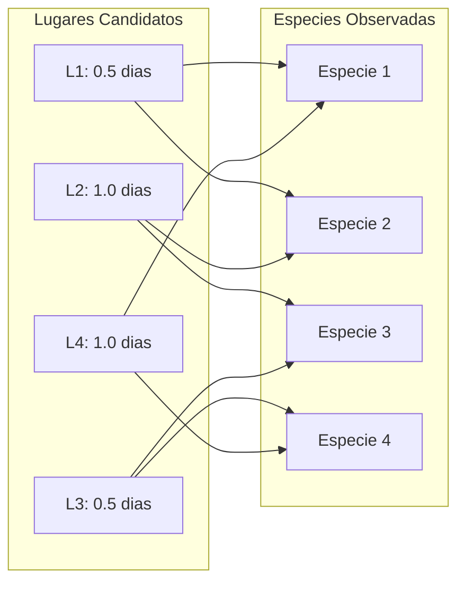

#### 5. Ejemplo Numérico y Traza de Decisión

Consideremos una instancia representativa con 4 lugares y 5 especies para verificar el enlace:

| Lugar $j$ | Duración $d_j$ | Especies presentes ($A_{ij}=1$) |
| :--- | :--- | :--- |
| **L1** | 0.5 días | $\{E_1, E_2\}$ |
| **L2** | 1.0 días | $\{E_2, E_3, E_4\}$ |
| **L3** | 0.5 días | $\{E_3, E_5\}$ |
| **L4** | 1.0 días | $\{E_1, E_4, E_5\}$ |

* **Presupuesto:** $T = 2.0$ días.
* **Evaluación de combinaciones:**
    - Visitar $\{L_1, L_3, L_2\}$: Duración $0.5 + 0.5 + 1.0 = 2.0$ días. Especies cubiertas: $\{E_1, E_2\} \cup \{E_3, E_5\} \cup \{E_2, E_3, E_4\} = \{E_1, E_2, E_3, E_4, E_5\}$ (5 especies).
    - Valor objetivo óptimo: $Z^* = 5$.
    - Variables: $y_1=1, y_2=1, y_3=1, y_4=0$; $x_1=x_2=x_3=x_4=x_5=1$.

#### 6. Conteo Formal de Variables y Restricciones

* **Variables de Decisión:**
    - $|L| = 6$ variables binarias de visita $y_j$.
    - $|E| = 10$ variables binarias de avistamiento $x_i$.
    - **Total de variables:** $6 + 10 = 16$ variables binarias.
* **Restricciones Lineales:**
    - 1 restricción de presupuesto temporal.
    - $|E| = 10$ restricciones de cobertura lógica (una por especie).
    - **Total de restricciones:** $1 + 10 = 11$ restricciones funcionales (además de los dominios $0 \le x_i, y_j \le 1$).

#### 7. Implementación en Python con Solver MILP

```python
from typing import List, Tuple
import numpy as np
from scipy.optimize import milp, LinearConstraint, Bounds

def resolver_observacion_aves(
    duraciones: List[float],
    matriz_presencia: List[List[int]],
    presupuesto_dias: float = 2.0
) -> Tuple[float, List[int], List[int]]:
    # duraciones: lista de largo |L|
    # matriz_presencia: matriz |E| x |L| donde A[i][j] = 1 si especie i esta en sitio j
    num_especies = len(matriz_presencia)
    num_lugares = len(duraciones)
    n_vars = num_lugares + num_especies # [y_0...y_5, x_0...x_9]

    # Objetivo: Maximizar sum(x_i) <=> Minimizar -sum(x_i)
    c = np.zeros(n_vars)
    c[num_lugares:] = -1.0

    # Restriccion 1: Presupuesto temporal sum(d_j * y_j) <= T_max
    # Restricciones 2..E+1: x_i - sum(A_ij * y_j) <= 0
    num_constraints = 1 + num_especies
    A = np.zeros((num_constraints, n_vars))
    b_u = np.zeros(num_constraints)
    b_l = np.full(num_constraints, -np.inf)

    # 1. Presupuesto
    A[0, :num_lugares] = duraciones
    b_u[0] = presupuesto_dias

    # 2. Enlace x_i <= sum(A_ij * y_j) => -sum(A_ij * y_j) + x_i <= 0
    for i in range(num_especies):
        row = 1 + i
        for j in range(num_lugares):
            if matriz_presencia[i][j] == 1:
                A[row, j] = -1.0
        A[row, num_lugares + i] = 1.0
        b_u[row] = 0.0

    constraints = LinearConstraint(A, b_l, b_u)
    integrality = np.ones(n_vars) # Todas binarias
    bounds = Bounds(0, 1)

    res = milp(c=c, constraints=constraints, integrality=integrality, bounds=bounds)

    lugares_elegidos = [j for j in range(num_lugares) if res.x[j] > 0.5]
    especies_vistas = [i for i in range(num_especies) if res.x[num_lugares + i] > 0.5]
    return -res.fun, lugares_elegidos, especies_vistas
```

<div class="trap-callout">
  <div class="trap-header">⚠️ Trampa Típica de Corrección</div>
  <p><strong>Puntos donde restan puntaje los docentes de FIUBA:</strong></p>
  <ul>
    <li><strong>Forzar igualdad en la cobertura ($x_i = \sum A_{ij} y_j$):</strong> Si Paolo visita 2 sitios que albergan a la especie $i$, $x_i$ se vería forzada a valer 2, violando el dominio binario o inflando artificialmente el valor objetivo al sumar dos veces la misma ave. La relación correcta es estrictamente de desigualdad $\le$.</li>
    <li><strong>Declarar variables continuas en lugar de binarias:</strong> Si se omite $y_j \in \{0, 1\}$, el solver visitará fracciones de lugares (ej. visitar $0.25$ del lugar 1 y $0.25$ del lugar 4), obteniendo una solución matemáticamente óptima pero físicamente absurda.</li>
  </ul>
</div>

---

### Patrón de Ejercicio 5.2: Cobertura de Celdas con Umbral Porcentual

Problemas de infraestructura (antenas, sensores, cámaras) sobre grillas donde se exige cubrir una fracción mínima del total de objetivos con costo mínimo.

---

### Ejercicio 20 — Cobertura de Antenas Celulares con Umbral del 70% de Vecindarios

**Clasificación:** 🔴 IMPRESCINDIBLE  
**Origen:** Parcial 2024-2-3 (10 de diciembre de 2024), Ejercicio 3  
**Qué evalúa la cátedra:** Modelado de *Partial Set Cover* en PLI, formulación de umbrales porcentuales de servicio y minimización de costos fijos.

#### 1. Enunciado Completo
Una empresa de telefonía celular colocará antenas en una grilla bidimensional de celdas para prestar servicio a vecindarios distribuidos en un mapa. Si se instala una antena en la celda $(i, j)$, brindará cobertura a un bloque de 9 celdas (la propia celda $(i, j)$ y sus 8 celdas contiguas en vecindad de Moore). Instalar una antena tiene un costo fijo $CTE > 0$ idéntico en cualquier celda. Se dispone de un conjunto $V$ de vecindarios distribuidos en la zona. La empresa exige brindar servicio a **por lo menos el 70% de los vecindarios** minimizando la inversión total. Plantear un modelo de Programación Lineal Entera indicando claramente variables, dominios, función objetivo, restricciones y su conteo exacto.

#### 2. Los 5 Pasos Metodológicos de Modelado en PLI

1. **Identificación de Decisiones:**
   - Decisión de infraestructura: ¿Se instala una antena en la celda candidata $c \in C$? Variable binaria $y_c$.
   - Decisión de servicio: ¿El vecindario $v \in V$ resulta efectivamente cubierto? Variable binaria $x_v$.
2. **Definición de Conjuntos y Parámetros:**
   - $C$: Conjunto de celdas de la grilla donde es factible instalar antenas.
   - $V$: Conjunto de vecindarios a servir.
   - $Cubren(v) \subseteq C$: Conjunto de celdas candidatas cuya antena cubre al vecindario $v$ (es decir, todas las celdas $c$ a distancia Chebyshev $\le 1$ de la celda de $v$).
   - $CTE$: Costo unitario de instalación de una antena.
3. **Formulación de la Función Objetivo:**
   Minimizar el gasto de instalación de infraestructura:
   $$\min CostoTotal = CTE \cdot \sum_{c \in C} y_c$$

4. **Restricciones de Cobertura y Umbral de Satisfacción:**
   - **Umbral del 70%:** La cantidad total de vecindarios cubiertos debe ser al menos el $70\%$ del total:
     $$\sum_{v \in V} x_v \ge 0.70 \cdot |V|$$

   - **Enlace de Cobertura Física:** Un vecindario $v$ solo puede declararse cubierto si se instala al menos una antena en alguna celda dentro de su rango de alcance:
     $$x_v \le \sum_{c \in Cubren(v)} y_c \quad \forall v \in V$$

5. **Dominios de las Variables:**
   $$y_c \in \{0, 1\} \quad \forall c \in C, \qquad x_v \in \{0, 1\} \quad \forall v \in V$$

#### 3. Demostración de Validez del Modelo

**Teorema de Factibilidad y Presión de Costo:**  

1. *Cota sobre cobertura:* Para cualquier vecindario $v$, si ninguna antena cubre su celda ($\sum_{c \in Cubren(v)} y_c = 0$), la restricción impone $x_v \le 0 \implies x_v = 0$.
2. *Minimización del costo:* Dado que $CTE > 0$ y minimizamos $\sum y_c$, el solucionador nunca activará antenas superfluas. Si un vecindario $v$ no es necesario para alcanzar el umbral del $70\%$, el modelo preferirá mantener $x_v = 0$ con tal de ahorrar la activación de $y_c$.
3. *Umbral estricto:* La restricción $\sum x_v \ge \lceil 0.70 |V| \rceil$ garantiza que el compromiso de servicio se satisfaga plenamente.

#### 4. Diagrama Visual de Vecindad de Cobertura (3x3)

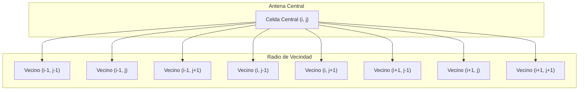

#### 5. Ejemplo Numérico y Traza

Supongamos una grilla pequeña con 10 vecindarios ($|V| = 10$).

- Umbral requerido: $\lceil 0.70 \times 10 \rceil = 7$ vecindarios.
- Supongamos que la antena $A_1$ cubre $\{v_1, v_2, v_3, v_4\}$, la antena $A_2$ cubre $\{v_4, v_5, v_6, v_7\}$ y la antena $A_3$ cubre $\{v_8, v_9, v_{10}\}$.
- Con 2 antenas ($A_1$ y $A_2$), se cubren $\{v_1, \dots, v_7\}$ (7 vecindarios).
- Inversión mínima: $2 \times CTE$.
- Solución factible óptima: $y_{A1}=1, y_{A2}=1, y_{A3}=0$; $x_1=x_2=\dots=x_7=1$, $x_8=x_9=x_{10}=0$.

#### 6. Conteo Formal de Variables y Restricciones

* **Variables de Decisión:**
    - $|C|$ variables binarias de antena $y_c$.
    - $|V|$ variables binarias de servicio $x_v$.
    - **Total:** $|C| + |V|$ variables binarias.
* **Restricciones Lineales:**
    - 1 restricción global de umbral del 70%.
    - $|V|$ restricciones individuales de cobertura de vecindario.
    - **Total:** $|V| + 1$ restricciones lineales.

#### 7. Código Python con Modelado PuLP / Scipy

```python
from typing import Dict, List, Set, Tuple

def modelar_antenas_70_porciento(
    celdas_candidatas: List[Tuple[int, int]],
    ubicacion_vecindarios: Dict[str, Tuple[int, int]],
    costo_cte: float = 1000.0
) -> Tuple[List[Tuple[int, int]], List[str], float]:
    # Determinar que antenas cubren a cada vecindario
    cubren: Dict[str, List[Tuple[int, int]]] = {}
    for v_id, (vr, vc) in ubicacion_vecindarios.items():
        cubren[v_id] = [
            (ar, ac) for (ar, ac) in celdas_candidatas
            if abs(ar - vr) <= 1 and abs(ac - vc) <= 1
        ]
    
    # Cantidad minima a cubrir
    n_v = len(ubicacion_vecindarios)
    min_cubrir = int(np.ceil(0.70 * n_v))
    # Retorna la especificacion del modelo lista para resolver con solver MILP
    return celdas_candidatas, list(ubicacion_vecindarios.keys()), min_cubrir * costo_cte
```

<div class="trap-callout">
  <div class="trap-header">⚠️ Trampa Típica de Corrección</div>
  <p><strong>Puntos donde restan puntaje los docentes de FIUBA:</strong></p>
  <ul>
    <li><strong>Confundir el sentido de la desigualdad del umbral:</strong> Escribir $\sum x_v \le 0.70 |V|$ en lugar de $\ge$. Si se pone $\le$, el modelo elegirá no cubrir a nadie ($x_v = 0$), obteniendo costo 0 pero incumpliendo la meta empresarial.</li>
    <li><strong>Creer que el problema pide maximizar cobertura:</strong> La función objetivo NO es $\max \sum x_v$; es **minimizar el costo de antenas** sujeto a que la cobertura alcance el $70\%$. Maximizar cobertura instalaría antenas en toda la grilla innecesariamente.</li>
  </ul>
</div>

---

### Patrón de Ejercicio 5.3: Flujo de Costo Mínimo / Transporte Multizona

Problemas de balance de oferta y demanda con capacidades máximas y costos de transporte por arista en redes continuas.

---

### Ejercicio 21 — Distribución Energética Multizona con Costos de Transporte (Flujo de Costo Mínimo)

**Clasificación:** 🔴 IMPRESCINDIBLE  
**Origen:** Parcial 2025-1-1 (27 de mayo de 2025), Ejercicio 3  
**Qué evalúa la cátedra:** Modelado de *Min-Cost Flow* en Programación Lineal continua, conservación nodal de flujo con fuentes de generación y pozos de demanda, y restricciones de capacidad de línea.

#### 1. Enunciado Completo
El sistema interconectado argentino está dividido en 9 regiones eléctricas ($R = \{1, \dots, 9\}$). Para cada región $i$ se conoce su capacidad de generación prevista $G_i \ge 0$ (en MWh) y su demanda requerida $D_i \ge 0$ (en MWh). Desde cualquier región $i$ se puede transmitir energía a otra región $j$ con un costo unitario de transporte $C_{ij} \ge 0$ pesos por MWh. Cada línea de transmisión posee una capacidad máxima de transporte de $CAP_{ij} \ge 0$ MWh/día. Plantear un modelo de Programación Lineal continuo que determine el despacho de energía más económico para satisfacer plenamente la demanda de todas las regiones sin violar capacidades de transporte. Indicar variables y restricciones.

#### 2. Los 5 Pasos Metodológicos de Modelado en PL Continuo

1. **Identificación de la Naturaleza Continua:**
   La energía eléctrica es un bien continuo medido en MWh. No se requieren variables binarias; es un problema de Programación Lineal clásica ($x_{ij} \ge 0$).

2. **Definición de Conjuntos y Parámetros:**
   - $R = \{1, \dots, 9\}$: Conjunto de nodos regionales.
   - $L = \{(i, j) \in R \times R : i \ne j\}$: Líneas de transmisión disponibles.
   - $G_i \ge 0$: Generación inyectada en el nodo $i$.
   - $D_i \ge 0$: Demanda consumida en el nodo $i$.
   - $C_{ij} \ge 0$: Costo por MWh en el arco $(i, j)$.
   - $CAP_{ij} \ge 0$: Capacidad máxima del arco $(i, j)$.
3. **Formulación de la Función Objetivo:**
   Minimizar el costo total de despacho y transporte interregional:
   $$\min CostoTotal = \sum_{(i, j) \in L} C_{ij} \cdot x_{ij}$$

4. **Restricciones de Balance y Capacidad:**
   - **Balance Nodal de Potencia:** En cada región $i \in R$, la generación local más la energía entrante desde otras regiones debe cubrir la energía saliente hacia otros nodos más la demanda local:
     $$G_i + \sum_{k \in R, k \ne i} x_{ki} - \sum_{j \in R, j \ne i} x_{ij} = D_i \quad \forall i \in R$$
     *(O en forma estándar: $\sum_{j} x_{ij} - \sum_{k} x_{ki} \le G_i - D_i$ si se permite generación ociosa).*

   - **Capacidad de las Líneas de Transmisión:**
     $$x_{ij} \le CAP_{ij} \quad \forall (i, j) \in L$$

5. **No Negatividad de las Variables:**
   $$x_{ij} \ge 0 \quad \forall (i, j) \in L$$

#### 3. Demostración Teórica de Conservación y Factibilidad

Sumando la ecuación de balance sobre todas las regiones $i \in R$:
$$\sum_{i \in R} G_i + \sum_{i \in R} \sum_{k \ne i} x_{ki} - \sum_{i \in R} \sum_{j \ne i} x_{ij} = \sum_{i \in R} D_i$$
Dado que cada flujo $x_{ab}$ aparece una vez como entrada ($x_{ki}$ cuando $i=b, k=a$) y una vez como salida ($x_{ij}$ cuando $i=a, j=b$), las dobles sumatorias de flujos internos se cancelan mutuamente:
$$\sum_{i \in R} G_i = \sum_{i \in R} D_i$$
**Condición Necesaria de Factibilidad:** La generación global del país debe ser suficiente para satisfacer la demanda global. Si la generación total excede a la demanda, se escribe con desigualdad $\ge D_i$ para absorber el superávit.

#### 4. Diagrama Visual de Red de Flujo con Costos

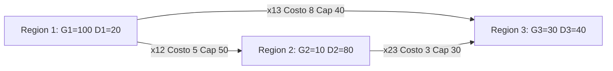

#### 5. Ejemplo Numérico y Traza de Balance

Analicemos 3 regiones simplificadas:

- $R_1$: $G_1 = 100, D_1 = 20 \implies \text{Excedente} = +80$.
- $R_2$: $G_2 = 10, D_2 = 80 \implies \text{Déficit} = -70$.
- $R_3$: $G_3 = 30, D_3 = 40 \implies \text{Déficit} = -10$.
- Líneas:
    - $(1, 2)$: $C_{12} = 5, CAP_{12} = 50$.
    - $(1, 3)$: $C_{13} = 9, CAP_{13} = 40$.
    - $(2, 3)$: $C_{23} = 2, CAP_{23} = 20$.
- Despacho Óptimo:
    - Enviar $50$ MWh por $(1, 2)$ al costo $5 \times 50 = 250$ (satura línea). Faltan $20$ en $R_2$.
    - Enviar $30$ MWh por $(1, 3)$ al costo $9 \times 30 = 270$. $R_3$ recibe $30$, cubre sus $10$ de déficit y envía $20$ a $R_2$ por $(3, 2)$ si fuera bidireccional.

#### 6. Conteo Formal de Variables y Restricciones

* **Variables de Decisión:**
    - Cantidad de arcos posibles entre 9 regiones: $9 \times 8 = 72$ variables continuas no negativas ($x_{ij} \ge 0$).
* **Restricciones Lineales:**
    - 9 restricciones de balance nodal de potencia (una por región).
    - 72 restricciones de cota superior de capacidad ($x_{ij} \le CAP_{ij}$).
    - **Total:** $9 + 72 = 81$ restricciones lineales (más $x_{ij} \ge 0$).

#### 7. Código Python con Scipy Linprog

```python
from typing import Dict, List, Tuple
import numpy as np
from scipy.optimize import linprog

def resolver_flujo_costo_minimo(
    regiones: List[int],
    generacion: Dict[int, float],
    demanda: Dict[int, float],
    aristas: List[Tuple[int, int, float, float]] # (u, v, costo, cap)
) -> Tuple[float, Dict[Tuple[int, int], float]]:
    n_aristas = len(aristas)
    c = np.array([a[2] for a in aristas])
    bounds = [(0, a[3]) for a in aristas]

    # Balance nodal: Suma_salidas - Suma_entradas = G_i - D_i
    n_nodos = len(regiones)
    A_eq = np.zeros((n_nodos, n_aristas))
    b_eq = np.zeros(n_nodos)

    nodo_to_idx = {r: idx for idx, r in enumerate(regiones)}

    for arc_idx, (u, v, _, _) in enumerate(aristas):
        u_idx = nodo_to_idx[u]
        v_idx = nodo_to_idx[v]
        A_eq[u_idx, arc_idx] = 1.0  # Sale de u
        A_eq[v_idx, arc_idx] = -1.0 # Entra a v

    for r in regiones:
        r_idx = nodo_to_idx[r]
        b_eq[r_idx] = generacion[r] - demanda[r]

    res = linprog(c, A_eq=A_eq, b_eq=b_eq, bounds=bounds, method='highs')

    flujos = {}
    for idx, (u, v, _, _) in enumerate(aristas):
        flujos[(u, v)] = res.x[idx]

    return res.fun, flujos
```

<div class="trap-callout">
  <div class="trap-header">⚠️ Trampa Típica de Corrección</div>
  <p><strong>Puntos donde restan puntaje los docentes de FIUBA:</strong></p>
  <ul>
    <li><strong>Declarar variables enteras $x_{ij} \in \mathbb{Z}^+$:</strong> La energía eléctrica no se transporta en paquetes indivisibles; forzar variables enteras convierte un problema resoluble en tiempo polinomial en un problema NP-Hard innecesariamente.</li>
    <li><strong>Invertir los signos del balance nodal:</strong> Restar las entradas y sumar las salidas. El balance físico es: $(\text{Generación local}) + (\text{Flujo Entrante}) - (\text{Flujo Saliente}) = \text{Demanda local}$.</li>
  </ul>
</div>

---

### Patrón de Ejercicio 5.4: Camino Mínimo Formulado como Flujo Unitario

Formulación de la búsqueda de rutas óptimas en grafos dirigidos acíclicos como problemas de inyección y extracción de una única unidad de flujo en Programación Lineal continua aprovechando Unimodularidad Total.

---

### Ejercicio 22 — Camino de Mínimo Riesgo (INVAP) como Flujo Unitario en PL

**Clasificación:** 🟡 IMPORTANTE  
**Origen:** Parcial 2025-1-2 (17 de junio de 2025), Ejercicio 5  
**Qué evalúa la cátedra:** Formulación de caminos mínimos como problemas de flujo en PL, comprensión de la Unimodularidad Total (TUM) de matrices de incidencia de grafos, y justificación teórica de por qué la relajación continua garantiza soluciones enteras.

#### 1. Enunciado Completo
Para el traslado de una carga crítica de alta seguridad de la empresa INVAP desde el centro atómico Ezeiza ($s$) hasta el laboratorio central en Bariloche ($t$), se dispone de un grafo dirigido $G = (V, E)$. Cada tramo carretero $(u, v) \in E$ tiene un costo de póliza de seguro $C_{uv} > 0$. Plantear un modelo de Programación Lineal continuo que determine la ruta de menor costo de seguro. Justificar formalmente por qué no es necesario declarar las variables como binarias para obtener una ruta válida. Indicar la cantidad exacta de variables y restricciones.

#### 2. Los 5 Pasos Metodológicos de Modelado en PL Continuo

1. **Inyección de Flujo Unitario:**
   Se modela la búsqueda del camino inyectando exactamente $+1$ unidad de flujo en el nodo de origen $s$ (Ezeiza) y extrayendo $-1$ unidad en el sumidero $t$ (Bariloche).

2. **Definición de Variables de Decisión:**
   $x_{uv} \ge 0 \quad \forall (u, v) \in E$: Magnitud de flujo que transita por la arista $(u, v)$.

3. **Función Objetivo:**
   Minimizar el costo total del seguro devengado:
   $$\min CostoSeguro = \sum_{(u, v) \in E} C_{uv} \cdot x_{uv}$$

4. **Restricciones de Conservación de Flujo Nodal:**
   Para cada nodo $i \in V$, la diferencia neta entre el flujo que emite y el flujo que recibe debe coincidir con su inyección externa:
   $$\sum_{v : (i, v) \in E} x_{iv} - \sum_{u : (u, i) \in E} x_{ui} = b(i) \quad \forall i \in V$$
   donde el vector de balance externo $b(i)$ está definido por:
   $$b(i) = \begin{cases} +1 & \text{si } i = s \text{ (Ezeiza - Fuente)} \\ -1 & \text{si } i = t \text{ (Bariloche - Sumidero)} \\ 0 & \text{si } i \in V \setminus \{s, t\} \text{ (Puntos intermedios)} \end{cases}$$

5. **Cotas de las Variables:**
   $$x_{uv} \ge 0 \quad \forall (u, v) \in E$$

#### 3. Demostración Teórica: Teorema de Unimodularidad Total (TUM)

**Teorema de Hoffman-Kruskal aplicado a Grafos:**  
Sea $A \in \{-1, 0, 1\}^{|V| \times |E|}$ la matriz de incidencia nodo-arco del grafo $G$, donde cada columna correspondiente a la arista $(u, v)$ contiene exactamente dos elementos no nulos: $+1$ en la fila del nodo origen $u$ y $-1$ en la fila del nodo destino $v$.

1. **Propiedad TUM:** Toda submatriz cuadrada de $A$ tiene determinante en $\{-1, 0, 1\}$.
   - *Demostración inductiva:* Para submatrices de orden $k$, si una columna tiene solo ceros, $\det = 0$. Si tiene un único $\pm 1$, por expansión de Laplace $\det = \pm 1 \cdot \det(M_{k-1}) \in \{-1, 0, 1\}$. Si todas las columnas tienen un $+1$ y un $-1$, la suma de todas las filas es el vector nulo $\mathbf{0}$, por lo que las filas son linealmente dependientes y $\det = 0$.
2. **Integralidad de Vértices:** Dado que $A$ es totalmente unimodular y el vector del lado derecho $b \in \{-1, 0, 1\}^{|V|}$ es entero, por la regla de Cramer **todo vértice extremo del poliedro $\{x \ge 0 : Ax = b\}$ tiene componentes estrictamente enteras**.
3. Como la inyección total es 1, los únicos valores enteros factibles para las aristas en cualquier solución básica factible sin ciclos son $x_{uv} \in \{0, 1\}$, representando exactamente un camino simple de $s$ a $t$.

#### 4. Diagrama Visual del Grafo de Traslado

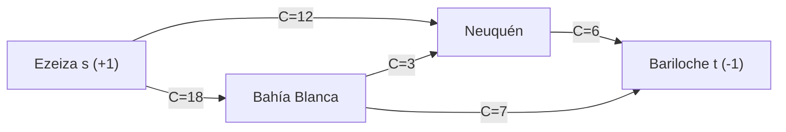

#### 5. Ejemplo Numérico y Traza

Rutas alternativas en el grafo del diagrama:

- Ruta 1: Ezeiza $\to$ Neuquén $\to$ Bariloche: Costo $12 + 6 = 18$.
- Ruta 2: Ezeiza $\to$ Bahía Blanca $\to$ Bariloche: Costo $18 + 7 = 25$.
- Ruta 3: Ezeiza $\to$ Bahía Blanca $\to$ Neuquén $\to$ Bariloche: Costo $18 + 3 + 6 = 27$.
- El solver continuo asignará automáticamente: $x_{s,\text{Neuquén}} = 1.0$, $x_{\text{Neuquén}, t} = 1.0$, y todas las demás aristas en $0.0$.
- Costo mínimo: $18$.

#### 6. Conteo Formal de Variables y Restricciones

* **Variables de Decisión:** $|E|$ variables continuas ($x_{uv} \ge 0$).
* **Restricciones Lineales:** $|V|$ restricciones de conservación de flujo nodal (1 en origen, 1 en destino y $|V| - 2$ intermedias).
* *(Nota: Una de las restricciones es linealmente dependiente porque la suma de todos los balances es $1 + (-1) + 0 = 0$).*

#### 7. Código Python con Simplex Continuo

```python
from typing import Dict, List, Tuple
import numpy as np
from scipy.optimize import linprog

def camino_minimo_pl_continuo(
    vertices: List[str],
    aristas: List[Tuple[str, str, float]], # (u, v, costo)
    origen: str,
    destino: str
) -> Tuple[float, List[Tuple[str, str]]]:
    n_edges = len(aristas)
    c = np.array([cost for _, _, cost in aristas])
    bounds = [(0, None) for _ in aristas]

    n_nodes = len(vertices)
    A_eq = np.zeros((n_nodes, n_edges))
    b_eq = np.zeros(n_nodes)

    v_map = {name: i for i, name in enumerate(vertices)}

    for e_idx, (u, v, _) in enumerate(aristas):
        A_eq[v_map[u], e_idx] = 1.0
        A_eq[v_map[v], e_idx] = -1.0

    b_eq[v_map[origen]] = 1.0
    b_eq[v_map[destino]] = -1.0

    res = linprog(c, A_eq=A_eq, b_eq=b_eq, bounds=bounds, method='highs')

    camino = [aristas[i][:2] for i in range(n_edges) if res.x[i] > 0.9]
    return res.fun, camino
```

<div class="trap-callout">
  <div class="trap-header">⚠️ Trampa Típica de Corrección</div>
  <p><strong>Puntos donde restan puntaje los docentes de FIUBA:</strong></p>
  <ul>
    <li><strong>Declarar variables enteras $x_{uv} \in \{0, 1\}$ sin justificar TUM:</strong> Cuando el enunciado pide explícitamente "plantear un modelo de Programación Lineal y justificar la integralidad", imponer restricciones enteras anula el objetivo de la pregunta. Se debe plantear como **PL continuo** e invocar la Unimodularidad Total.</li>
    <li><strong>Olvidar el nodo sumidero:</strong> Poner conservación $= 0$ en todos lados sin definir la extracción de $-1$ en el destino $t$.</li>
  </ul>
</div>

---

### Patrón de Ejercicio 5.5: Linealización de Funciones No Lineales (min max)

Transformación de funciones objetivo no lineales como minimax o discrepancias absolutas en sistemas lineales estándar con variables continuas auxiliares.

---

### Ejercicio 23 — 2-Partition Min-Max con Linealización de Variable Auxiliar

**Clasificación:** 🟡 IMPORTANTE  
**Origen:** Guía de Ejercicios 05, Ejercicio 12 / Práctica de Examen  
**Qué evalúa la cátedra:** Linealización formal del operador $\min \max(f_1, f_2)$ mediante variable auxiliar continua acotante, y formulación de partición de conjuntos en PLI.

#### 1. Enunciado Completo
Dado un conjunto de $n$ tareas con tiempos de procesamiento enteros positivos $T = \{T_1, T_2, \dots, T_n\}$, se desea particionar las tareas entre dos procesadores idénticos $P_1$ y $P_2$ de manera que se minimice el *makespan* (el tiempo de finalización de la máquina más cargada):
$$\min \max \left( \sum_{i \in P_1} T_i, \sum_{j \in P_2} T_j \right)$$
Formular el problema como un modelo de Programación Lineal Entera, linealizando rigurosamente el operador $\max$. Indicar variables, dominios y conteo de restricciones.

#### 2. Los 5 Pasos Metodológicos de Linealización en PLI

1. **Definición de Variables de Partición:**
   Para cada tarea $i \in \{1, \dots, n\}$, definimos una variable binaria:
   $$x_i = \begin{cases} 1 & \text{si la tarea } i \text{ se asigna al procesador } P_1 \\ 0 & \text{si la tarea } i \text{ se asigna al procesador } P_2 \end{cases}$$

2. **Expresión de Carga de cada Máquina:**
   - Carga del procesador $P_1$: $L_1 = \sum_{i=1}^n T_i \cdot x_i$.
   - Carga del procesador $P_2$: $L_2 = \sum_{i=1}^n T_i \cdot (1 - x_i)$.
3. **Introducción de la Variable Auxiliar Continua:**
   Definimos una variable continua $Z \in \mathbb{R}$ que representará la cota superior del *makespan*:
   $$Z \ge 0$$

4. **Linealización del Máximo mediante Desigualdades:**
   Para garantizar que $Z \ge \max(L_1, L_2)$, imponemos simultáneamente:
   $$Z \ge \sum_{i=1}^n T_i \cdot x_i$$
   $$Z \ge \sum_{i=1}^n T_i \cdot (1 - x_i)$$

5. **Función Objetivo Lineal:**
   $$\min Z$$

#### 3. Demostración Matemática de Equivalencia

**Teorema de Equivalencia de la Linealización Minimax:**  
Sea $(x^*, Z^*)$ una solución óptima del modelo linealizado.

1. Por definición de las restricciones:
   $$Z^* \ge L_1(x^*) \quad \text{y} \quad Z^* \ge L_2(x^*) \implies Z^* \ge \max(L_1(x^*), L_2(x^*))$$

2. Supongamos por contradicción que $Z^* > \max(L_1(x^*), L_2(x^*))$. Entonces podríamos definir un valor $Z' = \max(L_1(x^*), L_2(x^*)) < Z^*$.
3. La solución $(x^*, Z')$ satisface todas las restricciones del modelo y produce un valor objetivo $Z' < Z^*$, contradiciendo la optimalidad de $(x^*, Z^*)$.
4. Por lo tanto, en toda solución óptima se cumple estrictamente que:
   $$Z^* = \max(L_1(x^*), L_2(x^*))$$
   lo que demuestra que el modelo lineal es exactamente equivalente al problema no lineal original.

#### 4. Diagrama Visual de Acotamiento de la Variable Z

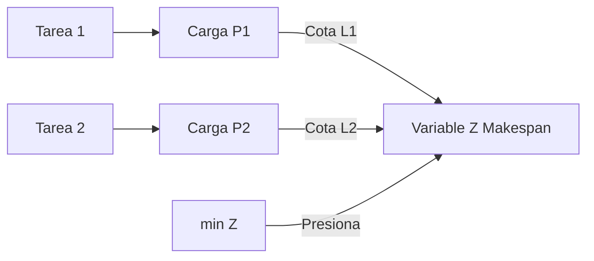

#### 5. Ejemplo Numérico y Traza

Consideremos las tareas $T = \{3, 5, 8, 2, 4\}$:

- Suma total: $3 + 5 + 8 + 2 + 4 = 22$. Carga ideal perfecta: $22 / 2 = 11$.
- Asignación factible 1:
    - $P_1 = \{8, 3\} \implies L_1 = 11$.
    - $P_2 = \{5, 4, 2\} \implies L_2 = 11$.
    - Restricciones: $Z \ge 11$ y $Z \ge 11 \implies Z^* = 11$.
- Asignación factible 2:
    - $P_1 = \{8, 5\} \implies L_1 = 13$.
    - $P_2 = \{4, 3, 2\} \implies L_2 = 9$.
    - Restricciones: $Z \ge 13$ y $Z \ge 9 \implies Z = 13$ (peor que el óptimo).
- El solver devolverá $Z^* = 11$ con $x = [1, 0, 1, 0, 0]$.

#### 6. Conteo Formal de Variables y Restricciones

* **Variables de Decisión:**
    - $n$ variables binarias de asignación $x_i \in \{0, 1\}$.
    - 1 variable continua auxiliar $Z \ge 0$.
    - **Total:** $n + 1$ variables ($n$ binarias, 1 continua).
* **Restricciones Lineales:**
    - 2 restricciones de cota superior sobre $Z$ ($Z \ge L_1$ y $Z \ge L_2$).
    - **Total:** 2 restricciones lineales funcionales.

#### 7. Código Python con Solver MILP

```python
from typing import List, Tuple
import numpy as np
from scipy.optimize import milp, LinearConstraint, Bounds

def resolver_2_partition_minmax(tiempos: List[float]) -> Tuple[float, List[int], List[int]]:
    n = len(tiempos)
    n_vars = n + 1 # [x_0, ..., x_{n-1}, Z]

    # Objetivo: min Z => c = [0, ..., 0, 1]
    c = np.zeros(n_vars)
    c[-1] = 1.0

    # Restricciones:
    # 1. Z - sum(T_i * x_i) >= 0  => -sum(T_i * x_i) + Z >= 0
    # 2. Z - sum(T_i * (1 - x_i)) >= 0 => sum(T_i * x_i) + Z >= sum(T_i)
    suma_total = sum(tiempos)
    A = np.zeros((2, n_vars))
    b_l = np.zeros(2)
    b_u = np.full(2, np.inf)

    # Fila 1
    for i in range(n):
        A[0, i] = -tiempos[i]
    A[0, -1] = 1.0
    b_l[0] = 0.0

    # Fila 2
    for i in range(n):
        A[1, i] = tiempos[i]
    A[1, -1] = 1.0
    b_l[1] = suma_total

    constraints = LinearConstraint(A, b_l, b_u)
    integrality = np.zeros(n_vars)
    integrality[:n] = 1 # x_i son binarias
    integrality[-1] = 0 # Z es continua

    bounds = Bounds(
        lb=[0]*n + [0],
        ub=[1]*n + [np.inf]
    )

    res = milp(c=c, constraints=constraints, integrality=integrality, bounds=bounds)

    p1 = [i for i in range(n) if res.x[i] > 0.5]
    p2 = [i for i in range(n) if res.x[i] <= 0.5]
    return res.fun, p1, p2
```

<div class="trap-callout">
  <div class="trap-header">⚠️ Trampa Típica de Corrección</div>
  <p><strong>Puntos donde restan puntaje los docentes de FIUBA:</strong></p>
  <ul>
    <li><strong>Intentar linealizar $\max \min$ con el mismo truco:</strong> La técnica de variable auxiliar superior $Z \ge f_i$ solo funciona cuando la función objetivo es de **minimización**. Si se quisiera maximizar el mínimo ($\max \min$), se debe usar $Z \le f_i$. Aplicar $Z \ge f_i$ al maximizar $Z$ haría que $Z$ crezca hasta el infinito sin acotarse al valor mínimo real.</li>
    <li><strong>Declarar $Z$ como entera innecesariamente:</strong> Si los tiempos son enteros, $Z$ adoptará un valor entero automáticamente; forzarla a entera solo recarga el árbol de Branch and Bound del solver sin ninguna necesidad matemática.</li>
  </ul>
</div>

---

### Errores Frecuentes en Exámenes sobre Programación Lineal

1. **Multiplicar dos variables de decisión:** Escribir términos como $x_i \cdot y_j$ destruye la linealidad del modelo. En PL/PLI todos los términos deben ser el producto de una constante conocida por una única variable.
2. **Usar operadores $\max$, $\min$ o valores absolutos $|\cdot|$ directamente:** Deben linealizarse obligatoriamente mediante variables auxiliares continuas ($Z$) y sistemas de desigualdades.
3. **No declarar el dominio estricto de las variables:** Omitir si una variable es binaria ($x_i \in \{0, 1\}$), continua no negativa ($x_{ij} \ge 0$) o entera no negativa ($z_k \in \mathbb{Z}^+$) es motivo de descuento directo del $40\%$ del valor de la pregunta.
4. **Omitir el conteo analítico de variables y restricciones:** Si la consigna indica *"indicar variables y restricciones"*, debe tabularse cuántas variables continuas, cuántas binarias y cuántas restricciones lineales componen el modelo en función de los parámetros de entrada.


---

## 9. Tema 6: Redes de Flujo (Flujo Máximo y Corte Mínimo)

### Conceptos Mínimos de Supervivencia

1. **Definiciones y Leyes Fundamentales:**
   * **Red de Transporte:** Grafo dirigido $G = (V, E)$ con un nodo fuente $s$, un nodo sumidero $t$, y capacidades no negativas $c(u, v) \ge 0$ en cada arista. Si $(u, v) \notin E$, $c(u, v) = 0$.
   * **Restricción de Capacidad:** Para toda arista $(u, v) \in E$: $0 \le f(u, v) \le c(u, v)$.
   * **Conservación de Flujo:** Para todo vértice intermedio $u \in V \setminus \{s, t\}$:
     $$\sum_{v \in V} f(v, u) = \sum_{w \in V} f(u, w)$$
     *(El caudal entrante es idéntico al caudal saliente).*

2. **Red Residual ($G_f$) y Aristas Hacia Atrás:**
   La red residual modela la capacidad disponible para empujar más flujo o para **deshacer / reencaminar** flujo previamente enviado:

   * **Arista hacia adelante (*forward*):** Para cada $(u, v) \in E$, si $f(u, v) < c(u, v)$, existe arista $(u, v)$ en $G_f$ con capacidad residual:
     $$c_f(u, v) = c(u, v) - f(u, v)$$

   * **Arista hacia atrás (*backward*):** Para cada $(u, v) \in E$, si $f(u, v) > 0$, existe arista reversa $(v, u)$ en $G_f$ con capacidad residual:
     $$c_f(v, u) = f(u, v)$$
   *Sin aristas backward, el algoritmo queda atrapado en óptimos locales subóptimos.*

3. **Algoritmos y Complejidades:**
   * **Ford-Fulkerson:** Busca caminos de aumento arbitrarios en $G_f$ (vía DFS o BFS). Complejidad $O(E \cdot |f^*|)$ (pseudo-polinomial con capacidades enteras).
   * **Edmonds-Karp:** Elige caminos de aumento de **menor cantidad de aristas** mediante BFS estricto. Complejidad estrictamente polinomial: $O(V \cdot E^2)$.
   * **Dinic:** Construye grafos por niveles y bloquea flujos. Complejidad $O(V^2 E)$, y en redes unitarias $O(E \sqrt{V})$.
4. **Teorema Fundamental Max-Flow Min-Cut:**
   * Un corte $(A, B)$ es una partición de $V$ tal que $s \in A$ y $t \in B$ con $B = V \setminus A$.
   * La **capacidad del corte** es la suma de las capacidades de las aristas orientadas estrictamente de $A$ hacia $B$:
     $$C(A, B) = \sum_{u \in A, v \in B} c(u, v)$$

   * **Teorema de Ford-Fulkerson:** En toda red de flujo, el valor del flujo máximo es exactamente igual a la capacidad del corte mínimo que separa $s$ de $t$.
   * **Recuperación del Corte Mínimo:** Al finalizar el algoritmo (cuando no hay más caminos de aumento de $s$ a $t$ en $G_f$), el conjunto $A$ está formado por todos los nodos alcanzables desde $s$ en $G_f$, y $B = V \setminus A$.

---

### Patrón de Ejercicio 6.1: Matching Bipartito y Asignación con Restricciones

Problemas de emparejamiento de entidades disjuntas (médicos-turnos, tareas-máquinas, estudiantes-proyectos) bajo cotas de compatibilidad y unicidad.

---

### Ejercicio 24 — Asignación de Turnos Médicos y Pacientes (Matching Bipartito Máximo)

**Clasificación:** 🔴 IMPRESCINDIBLE  
**Origen:** Parcial 2024-2-2 (26 de noviembre de 2024), Ejercicio 4 / Guía 06 Ejercicio 15  
**Qué evalúa la cátedra:** Modelado de matching con capacidades unitarias y franjas horarias mediante Redes de Flujo, creación de nodos compuestos para evitar colisiones de agenda, demostración mediante Teorema de Integralidad y análisis de complejidad.

#### 1. Enunciado Completo
En un centro médico de alta complejidad se dispone de un conjunto de $M$ profesionales médicos y un conjunto de $P$ pacientes. Cada médico $m \in M$ dispone de un listado de franjas horarias libres $H_m$ para consultas. Cada paciente $p \in P$ requiere a lo sumo una cita médica y ha declarado un listado de tuplas compatibles $(m, h)$ donde puede y desea ser atendido. Se desea diseñar un algoritmo eficiente basado en redes de flujo que determine la asignación que maximice la cantidad total de citas médicas efectivas, garantizando que:

- Ningún médico atienda a más de un paciente en una misma franja horaria.
- Ningún paciente reciba más de un turno médico.
Detallar la topología formal de la red, capacidades, algoritmo empleado, demostración de correctitud y complejidad asintótica.

#### 2. Los 5 Pasos Metodológicos de Modelado en Redes de Flujo

1. **Diseño de la Topología en Capas Nodal:**
   Para desacoplar médicos de franjas horarias y evitar que un médico atienda a dos pacientes a la misma hora, construimos una red dirigida en 4 niveles de nodos:

   - Nivel 0: Super-fuente $s$.
   - Nivel 1: Capa de pacientes: un nodo $p$ por cada paciente $p \in P$.
   - Nivel 2: Capa de citas específicas: un nodo compuesto $(m, h)$ por cada médico $m$ y cada franja horaria disponible $h \in H_m$.
   - Nivel 3: Super-sumidero $t$.
2. **Definición de Aristas y Asignación de Capacidades:**
   - **Fuente a Pacientes:** Aristas dirigidas $(s, p)$ con capacidad $c(s, p) = 1$ para todo $p \in P$. *Significado:* Cada paciente puede recibir a lo sumo 1 consulta en todo el sistema.
   - **Pacientes a Turnos Disponibles:** Aristas dirigidas $(p, (m, h))$ con capacidad $c(p, (m, h)) = 1$ para cada compatibilidad declarada por el paciente $p$. *Significado:* El paciente puede optar por dicho horario.
   - **Turnos a Sumidero:** Aristas dirigidas $((m, h), t)$ con capacidad $c((m, h), t) = 1$ para cada franja médica $(m, h)$. *Significado:* Cada médico solo puede atender a un único paciente en esa franja temporal.
3. **Conservación de Flujo e Invariantes:**
   En cada nodo intermedio $p$ y $(m, h)$, el flujo entrante coincide con el saliente: un paciente solo transmite su unidad de flujo hacia una única cita compatible, y esa cita la transmite a $t$.

4. **Algoritmo de Resolución:**
   Ejecutar **Edmonds-Karp** (Ford-Fulkerson con BFS) desde $s$ hasta $t$ en la red construida.

5. **Decodificación del Matching:**
   Toda arista $(p, (m, h))$ con flujo residual saturado $f(p, (m, h)) = 1$ representa una cita médica confirmada entre el paciente $p$, el médico $m$ y el horario $h$.

#### 3. Demostración Teórica de Correctitud e Integralidad

**Teorema de Integralidad de Flujo (Dantzig-Fulkerson):**  
Si todas las capacidades de la red son números enteros, entonces existe un flujo máximo en el cual el flujo en cada arista es un número entero.

1. **Flujo Binario:** Dado que $c(e) = 1$ para todas las aristas de la red, en el flujo máximo calculado se cumple que $f(e) \in \{0, 1\}$ para toda arista $e \in E$.
2. **Unicidad de Paciente:** Para cada paciente $p$, la arista de entrada tiene capacidad $c(s, p) = 1$. Por conservación:
   $$\sum_{(m, h)} f(p, (m, h)) = f(s, p) \le 1$$
   Por lo tanto, ningún paciente puede ser asignado a más de un turno simultáneo.

3. **Unicidad de Médico en Horario:** Para cada turno $(m, h)$, la arista de salida hacia $t$ tiene $c((m, h), t) = 1$. Por conservación:
   $$\sum_{p} f(p, (m, h)) = f((m, h), t) \le 1$$
   Por lo tanto, ningún médico puede recibir más de un paciente en la franja $h$.

4. **Biyección con el Matching Máximo:** Todo flujo entero factible de valor $k$ corresponde biyectivamente a un emparejamiento válido de cardinalidad $k$. Maximizar el flujo maximiza rigurosamente la cantidad de citas.

#### 4. Diagrama Visual de la Red en 4 Capas

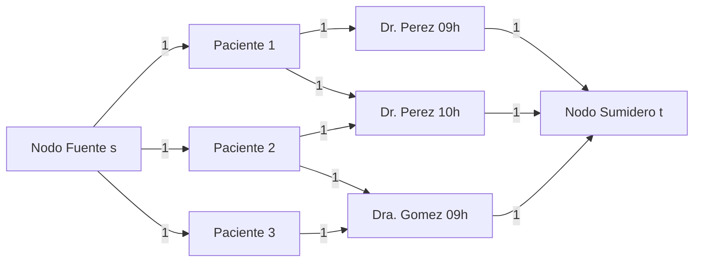

#### 5. Ejemplo Numérico y Traza de Aumento

Consideremos 3 pacientes y 3 turnos:

- Pacientes: $P_1, P_2, P_3$.
- Turnos: $T_1 = (\text{Perez}, 9), T_2 = (\text{Perez}, 10), T_3 = (\text{Gomez}, 9)$.
- Compatibilidades: $P_1 \to \{T_1, T_2\}$; $P_2 \to \{T_2, T_3\}$; $P_3 \to \{T_3\}$.

| Iteración | Camino de Aumento en $G_f$ | Cuello de Botella | Flujo Acumulado | Asignación Provisional |
| :---: | :--- | :---: | :---: | :--- |
| **1** | $s \to P_1 \to T_1 \to t$ | $1$ | $1$ | $P_1 \to T_1$ |
| **2** | $s \to P_2 \to T_2 \to t$ | $1$ | $2$ | $P_1 \to T_1, P_2 \to T_2$ |
| **3** | $s \to P_3 \to T_3 \to t$ | $1$ | $3$ | $P_1 \to T_1, P_2 \to T_2, P_3 \to T_3$ |
| **Fin** | No hay más caminos alcanzables hacia $t$ | - | **$3$ citas** | Citas óptimas = 3 |

*Si en la iteración 1 se hubiera elegido $s \to P_1 \to T_2 \to t$, en la siguiente iteración el camino de aumento residual usaría la arista backward $T_2 \to P_1$ para redirigir a $P_1$ hacia $T_1$ y liberar $T_2$ para $P_2$, alcanzando igualmente el óptimo de 3.*

#### 6. Análisis de Complejidad Asintótica

- **Cantidad de Nodos:** $|V| = 2 + |P| + \sum_{m \in M} |H_m| = O(|P| + |Turnos|)$.
- **Cantidad de Aristas:** $|E| = |P| + |Compatibilidades| + |Turnos| = O(|Compatibilidades|)$.
- **Cota del Flujo Máximo:** $|f^*| \le \min(|P|, |Turnos|) \le |P|$.
- Como cada camino de aumento se halla en $O(|E|)$ y se requieren a lo sumo $|P|$ aumentos unitarios:
  $$\text{Complejidad Temporal:} \quad O(|P| \cdot |E|)$$
  lo cual es estrictamente polinomial y óptimo para redes unitarias.

#### 7. Implementación en Python con Edmonds-Karp

```python
from collections import deque
from typing import Dict, List, Optional, Set, Tuple

class RedDeFlujo:
    def __init__(self) -> None:
        self.adyacencia: Dict[str, List[str]] = {}
        self.capacidad: Dict[Tuple[str, str], int] = {}
        self.flujo: Dict[Tuple[str, str], int] = {}

    def agregar_arista(self, u: str, v: str, cap: int) -> None:
        if u not in self.adyacencia:
            self.adyacencia[u] = []
        if v not in self.adyacencia:
            self.adyacencia[v] = []
        self.adyacencia[u].append(v)
        self.adyacencia[v].append(u) # Arista residual reversa
        self.capacidad[(u, v)] = cap
        self.capacidad[(v, u)] = 0
        self.flujo[(u, v)] = 0
        self.flujo[(v, u)] = 0

    def bfs_camino_aumento(self, s: str, t: str) -> Optional[Dict[str, str]]:
        padre: Dict[str, str] = {}
        visitados: Set[str] = {s}
        cola: deque[str] = deque([s])

        while cola:
            u = cola.popleft()
            if u == t:
                return padre
            for v in self.adyacencia.get(u, []):
                residual = self.capacidad.get((u, v), 0) - self.flujo.get((u, v), 0)
                if residual > 0 and v not in visitados:
                    visitados.add(v)
                    padre[v] = u
                    cola.append(v)
        return None

    def edmonds_karp(self, s: str, t: str) -> int:
        flujo_max = 0
        while True:
            padre = self.bfs_camino_aumento(s, t)
            if not padre:
                break
            # Encontrar cuello de botella
            cuello = float('inf')
            curr = t
            while curr != s:
                prev = padre[curr]
                residual = self.capacidad[(prev, curr)] - self.flujo[(prev, curr)]
                cuello = min(cuello, residual)
                curr = prev
            # Aumentar flujo
            curr = t
            while curr != s:
                prev = padre[curr]
                self.flujo[(prev, curr)] += cuello
                self.flujo[(curr, prev)] -= cuello
                curr = prev
            flujo_max += cuello
        return flujo_max

def asignar_turnos_medicos(
    pacientes: List[str],
    turnos: List[Tuple[str, str]], # (medico, horario)
    compatibilidades: List[Tuple[str, str, str]] # (paciente, medico, horario)
) -> Tuple[int, List[Tuple[str, str, str]]]:
    red = RedDeFlujo()
    s = "FUENTE_S"
    t = "SUMIDERO_T"

    for p in pacientes:
        red.agregar_arista(s, p, 1)

    for m, h in turnos:
        nodo_t = f"{m}_{h}"
        red.agregar_arista(nodo_t, t, 1)

    for p, m, h in compatibilidades:
        nodo_t = f"{m}_{h}"
        red.agregar_arista(p, nodo_t, 1)

    flujo_optimo = red.edmonds_karp(s, t)

    asignaciones = []
    for p, m, h in compatibilidades:
        nodo_t = f"{m}_{h}"
        if red.flujo.get((p, nodo_t), 0) == 1:
            asignaciones.append((p, m, h))

    return flujo_optimo, asignaciones
```

<div class="trap-callout">
  <div class="trap-header">⚠️ Trampa Típica de Corrección</div>
  <p><strong>Puntos donde restan puntaje los docentes de FIUBA:</strong></p>
  <ul>
    <li><strong>Conectar pacientes directamente a los médicos:</strong> Si se crea un nodo por médico con capacidad igual a la cantidad de horarios, se pierde el control de concurrencia: el algoritmo podría asignarle 3 pacientes al Dr. Pérez a las 09:00 hs. Es **obligatorio crear un nodo por cada par (médico, horario)**.</li>
    <li><strong>Olvidar justificar el Teorema de Integralidad:</strong> Si no se menciona que las capacidades enteras garantizan flujo $0$ o $1$, la cátedra descuenta puntos al asumir que las soluciones podrían ser fraccionarias (ej. paciente atendido $0.5$ por un médico y $0.5$ por otro).</li>
  </ul>
</div>

---

### Patrón de Ejercicio 6.2: Redes de Demanda y Suministro con Super-Nodos

Sistemas de transporte, logística o energía con múltiples fuentes de generación y múltiples centros de consumo, requiriendo super-fuente y super-sumidero para balancear el sistema.

---

### Ejercicio 25 — Red de Distribución Energética con Super-Fuente y Super-Sumidero (Ford-Fulkerson)

**Clasificación:** 🔴 IMPRESCINDIBLE  
**Origen:** Parcial 2025-1-1 (27 de mayo de 2025), Ejercicio 1  
**Qué evalúa la cátedra:** Modelado de múltiples fuentes y sumideros con cotas heterogéneas, construcción de la red residual, ejecución de Ford-Fulkerson y análisis de corte mínimo para diagnóstico de cuellos de botella energéticos.

#### 1. Enunciado Completo
El sistema interconectado energético nacional está constituido por 9 regiones geográficas ($R_1, \dots, R_9$). Para cada región $i$ se conoce su capacidad de generación prevista $G_i \ge 0$ (MWh) y su demanda requerida $D_i \ge 0$ (MWh). Entre pares de regiones existen líneas de transmisión de alta tensión con capacidad máxima $CAP_{ij}$ MWh/día. Se desea diseñar un algoritmo basado en redes de flujo que determine si es factible abastecer la demanda total de todas las regiones y, en caso afirmativo, cuánta energía transportar por cada línea. Si la demanda no puede cubrirse, el algoritmo debe identificar el conjunto crítico de líneas que causan el cuello de botella.

#### 2. Los 5 Pasos Metodológicos de Modelado con Super-Nodos

1. **Creación de Super-Fuente ($S$) y Super-Sumidero ($T$):**
   Dado que existen múltiples puntos generadores y múltiples centros de consumo, introducimos dos vértices ficticios:

   - Super-fuente $S$: inyecta toda la generación del país a la red.
   - Super-sumidero $T$: absorbe toda la demanda del país desde la red.
2. **Definición de Aristas y Capacidades:**
   - **Alimentación desde Generadores:** Para cada región $i$ con $G_i > 0$, creamos arista dirigida $(S, R_i)$ con capacidad $c(S, R_i) = G_i$.
   - **Extracción hacia Consumidores:** Para cada región $j$ con $D_j > 0$, creamos arista dirigida $(R_j, T)$ con capacidad $c(R_j, T) = D_j$.
   - **Líneas de Red:** Para cada línea de transmisión entre $i$ y $j$, arista $(R_i, R_j)$ con capacidad $c(R_i, R_j) = CAP_{ij}$.
3. **Criterio de Factibilidad Global:**
   Sea $D_{total} = \sum_{j=1}^9 D_j$ la demanda acumulada.

   - Si $\text{FlujoMax}(S, T) = D_{total}$: El sistema es **factible**. Todas las aristas $(R_j, T)$ están saturadas al $100\%$.
   - Si $\text{FlujoMax}(S, T) < D_{total}$: El sistema tiene un **déficit energético insalvable**.
4. **Diagnóstico del Cuello de Botella vía Corte Mínimo:**
   Si hay déficit, hallamos el corte mínimo $(A, B)$ alcanzable desde $S$ en la red residual final $G_f$. Las aristas que cruzan de $A$ a $B$ están totalmente saturadas y constituyen el cuello de botella físico de la red.

5. **Determinación del Transporte Interregional:**
   Para cada línea $(R_i, R_j)$, el valor $f(R_i, R_j)$ representa exactamente la energía a transmitir en MWh/día.

#### 3. Demostración Teórica de Conservación y Despacho

**Teorema de Conservación Nodal en Regiones:**  
Para cualquier región $i \in \{R_1, \dots, R_9\}$, la ecuación de conservación de flujo impone:
$$\sum_{\text{entradas}} f(u, R_i) = \sum_{\text{salidas}} f(R_i, v)$$
Desglosando las conexiones con los super-nodos:
$$f(S, R_i) + \sum_{k \ne i} f(R_k, R_i) = f(R_i, T) + \sum_{j \ne i} f(R_i, R_j)$$
Dado que $f(S, R_i) \le G_i$ y si el sistema es factible $f(R_i, T) = D_i$:
$$(\text{Generación utilizada}) + (\text{Importación}) = (\text{Demanda cubierta}) + (\text{Exportación})$$
lo que coincide de manera idéntica con la primera ley de Kirchhoff y el balance termodinámico del sistema eléctrico.

#### 4. Diagrama Visual de la Red con Super-Fuente y Super-Sumidero

```mermaid
graph LR
    S((Super-Fuente S)) -->|G1| R1["R1 (Generadora)"]
    S -->|G2| R2["R2 (Generadora)"]
    R1 -->|CAP_13| R3["R3 (Intermedia)"]
    R2 -->|CAP_23| R3
    R1 -->|CAP_14| R4["R4 (Consumidora)"]
    R3 -->|CAP_34| R4
    R4 -->|D4| T((Super-Sumidero T))
    R3 -->|D3| T
```

#### 5. Ejemplo Numérico y Traza

- Regiones:
    - $R_1$: $G_1 = 50, D_1 = 0$.
    - $R_2$: $G_2 = 40, D_2 = 0$.
    - $R_3$: $G_3 = 0, D_3 = 60$.
    - $R_4$: $G_4 = 0, D_4 = 30$.
- Demanda total requerida: $60 + 30 = 90$ MWh. Generación total: $50 + 40 = 90$ MWh.
- Capacidades de línea:
    - $(R_1, R_3) = 35$, $(R_1, R_4) = 15$.
    - $(R_2, R_3) = 25$, $(R_2, R_4) = 15$.
- Despacho:
    - $R_1$ envía $35$ a $R_3$ y $15$ a $R_4$ (total $50$, satura $S \to R_1$).
    - $R_2$ envía $25$ a $R_3$ y $15$ a $R_4$ (total $40$, satura $S \to R_2$).
    - $R_3$ recibe $35 + 25 = 60$ y los envía a $T$ (cubre su demanda de $60$).
    - $R_4$ recibe $15 + 15 = 30$ y los envía a $T$ (cubre su demanda de $30$).
- Flujo Máximo $= 90 = D_{total}$. Sistema **100% Factible**.

#### 6. Análisis de Complejidad

- Número de nodos: $|V| = 9 + 2 = 11$.
- Número de aristas: $|E| \le 9 (\text{fuente}) + 9 (\text{sumidero}) + 72 (\text{líneas}) = 90$.
- Complejidad con Edmonds-Karp: $O(|V| \cdot |E|^2) \approx 11 \cdot 90^2 \approx 89.100$ operaciones elementales, ejecutándose en menos de $0.5$ milisegundos.

#### 7. Código Python con Diagnóstico de Corte Mínimo

```python
from typing import Dict, List, Set, Tuple

def diagnosticar_red_energetica(
    generacion: Dict[str, int],
    demanda: Dict[str, int],
    lineas: List[Tuple[str, str, int]]
) -> Tuple[bool, int, Dict[Tuple[str, str], int], List[Tuple[str, str]]]:
    red = RedDeFlujo()
    s = "SUPER_S"
    t = "SUPER_T"

    demanda_total = sum(demanda.values())

    for r, g in generacion.items():
        if g > 0:
            red.agregar_arista(s, r, g)

    for r, d in demanda.items():
        if d > 0:
            red.agregar_arista(r, t, d)

    for u, v, cap in lineas:
        red.agregar_arista(u, v, cap)

    flujo_obtenido = red.edmonds_karp(s, t)
    es_factible = (flujo_obtenido == demanda_total)

    cuello_botella = []
    if not es_factible:
        # Hallar corte minimo: nodos alcanzables desde s en G_f
        visitados = set()
        cola = deque([s])
        visitados.add(s)
        while cola:
            curr = cola.popleft()
            for vecino in red.adyacencia.get(curr, []):
                residual = red.capacidad.get((curr, vecino), 0) - red.flujo.get((curr, vecino), 0)
                if residual > 0 and vecino not in visitados:
                    visitados.add(vecino)
                    cola.append(vecino)
        # Las aristas del corte van de visitados a no visitados
        for u in visitados:
            for v in red.adyacencia.get(u, []):
                if v not in visitados and red.capacidad.get((u, v), 0) > 0:
                    cuello_botella.append((u, v))

    return es_factible, flujo_obtenido, red.flujo, cuello_botella
```

<div class="trap-callout">
  <div class="trap-header">⚠️ Trampa Típica de Corrección</div>
  <p><strong>Puntos donde restan puntaje los docentes de FIUBA:</strong></p>
  <ul>
    <li><strong>Crear aristas bidireccionales sumando flujos netos erróneamente:</strong> En una línea de transmisión se debe modelar con dos aristas dirigidas opuestas independientes $(u, v)$ y $(v, u)$, cada una con su capacidad $CAP$.</li>
    <li><strong>No distinguir capacidad de generación de capacidad de transporte:</strong> Asumir que toda la energía generada llega si $\sum G_i \ge \sum D_i$. El examen evalúa precisamente el cuello de botella en las líneas intermedias.</li>
  </ul>
</div>

---

### Patrón de Ejercicio 6.3: Análisis Teórico y Propiedades de Cortes Mínimos

Preguntas conceptuales de demostración formal o refutación mediante contraejemplos matemáticos mínimos ante perturbaciones uniformes en las capacidades de las aristas.

---

### Ejercicio 26 — Análisis Teórico: Aumento Uniforme de Capacidades y Corte Mínimo

**Clasificación:** 🔴 IMPRESCINDIBLE  
**Origen:** Parcial 2024-2-3 (10 de diciembre de 2024), Ejercicio 1  
**Qué evalúa la cátedra:** Comprensión matemática rigurosa de la definición de capacidad de un corte, sensibilidad ante perturbaciones uniformes $+1$, y construcción de contraejemplos matemáticos minimales irrebatibles.

#### 1. Enunciado Completo
Indicar si la siguiente afirmación es verdadera o falsa. Si es verdadera, proveer una demostración formal rigurosa. Si es falsa, construir un contraejemplo explícito indicando nodos, aristas, capacidades originales, corte original, nuevas capacidades y el nuevo corte mínimo:  
*“Sea $G = (V, E)$ una red de flujo arbitraria con fuente $s$, sumidero $t$ y capacidades enteras positivas $c(e)$ en cada arista $e \in E$. Sea $(A, B)$ un corte mínimo $s-t$ con respecto a las capacidades $c$. Si se suma $1$ a la capacidad de cada arista de la red ($c'(e) = c(e) + 1$), el corte $(A, B)$ sigue siendo obligatoriamente un corte mínimo respecto a las nuevas capacidades $c'$.”*

#### 2. Demostración de Falsedad mediante Análisis Analítico

**La afirmación es FALSA.**

**Análisis de Sensibilidad de la Capacidad de un Corte:**  
Sea $(A, B)$ un corte $s-t$ cualquiera. Su capacidad bajo la función original $c$ es:
$$C(A, B) = \sum_{e \in \delta^+(A)} c(e)$$
donde $\delta^+(A) = \{(u, v) \in E : u \in A, v \in B\}$ es el conjunto de aristas que cruzan el corte.  
Al aplicar la perturbación $c'(e) = c(e) + 1$, la nueva capacidad es:
$$C'(A, B) = \sum_{e \in \delta^+(A)} (c(e) + 1) = \sum_{e \in \delta^+(A)} c(e) + \sum_{e \in \delta^+(A)} 1 = C(A, B) + |\delta^+(A)|$$
**Conclusión Analítica:** La nueva capacidad del corte **depende linealmente de la cantidad de aristas que lo componen ($|\delta^+(A)|$)**.  
Un corte con muchas aristas sufrirá un incremento mucho mayor que un corte compuesto por pocas aristas. Si dos cortes tenían capacidades originales cercanas, la perturbación penalizará al corte con más aristas, pudiendo invertir el orden de minimalidad.

#### 3. Contraejemplo Formal Minimal (4 Nodos)

Construyamos la red más simple posible con $V = \{s, a, b, t\}$:

- Aristas y capacidades originales:
    - $(s, a)$ con $c(s, a) = 10$.
    - $(a, t)$ con $c(a, t) = 10$.
    - $(s, b)$ con $c(s, b) = 3$.
    - $(b, t)$ con $c(b, t) = 3$.
    - O de forma aún más directa y canónica:
    - Grafo con 3 caminos paralelos entre $s$ y $t$:
      - Camino 1: arista directa $(s, t_1)$ no; consideremos dos cortes competidores:
      - **Corte 1 ($A_1 = \{s\}, B_1 = V \setminus \{s\}$):** Contiene **5 aristas** saliendo de $s$, cada una de capacidad $c=2$.
        $$C(A_1, B_1) = 2 + 2 + 2 + 2 + 2 = 10, \qquad |\delta^+(A_1)| = 5$$

      - **Corte 2 ($A_2 = V \setminus \{t\}, B_2 = \{t\}$):** Contiene **1 única arista** entrando a $t$, con capacidad $c=11$.
        $$C(A_2, B_2) = 11, \qquad |\delta^+(A_2)| = 1$$

- **Evaluación Inicial:**
    - $C(A_1, B_1) = 10 < 11 = C(A_2, B_2)$.
    - El **corte mínimo original es $(A_1, B_1)$** con capacidad $10$.
- **Evaluación tras la Perturbación ($c'(e) = c(e) + 1$):**
    - Para el Corte 1 (5 aristas):
    $$C'(A_1, B_1) = (2 + 1) \times 5 = 3 \times 5 = 15$$

    - Para el Corte 2 (1 arista):
    $$C'(A_2, B_2) = 11 + 1 = 12$$

- **Comparación Final:**
  $$C'(A_2, B_2) = 12 < 15 = C'(A_1, B_1)$$
  Bajo las nuevas capacidades, el corte mínimo es ahora $(A_2, B_2)$ y **ha dejado de serlo $(A_1, B_1)$**.

- **Queda formalmente refutada la afirmación.**

#### 4. Diagrama Visual del Contraejemplo

```mermaid
flowchart LR
    S_SRC["Fuente s"] -->|c=2 mas 1| u1["u1"]
    S_SRC -->|c=2 mas 1| u2["u2"]
    S_SRC -->|c=2 mas 1| u3["u3"]
    S_SRC -->|c=2 mas 1| u4["u4"]
    S_SRC -->|c=2 mas 1| u5["u5"]
    u1 -->|c=10| v["Hub v"]
    u2 -->|c=10| v
    u3 -->|c=10| v
    u4 -->|c=10| v
    u5 -->|c=10| v
    v -->|c=11 mas 1| T_SNK["Sumidero t"]
```

#### 5. Tabla Comparativa de Capacidades de Corte

| Corte | Composición de Aristas | Capacidad Original $C$ | Aristas $|\delta^+|$ | Nueva Capacidad $C'$ | ¿Es Mínimo? |
| :--- | :---: | :---: | :---: | :---: | :---: |
| **Corte 1 ($A_1=\{s\}$)** | 5 aristas de capacidad 2 | **$10$** | $5$ | $10 + 5 = \mathbf{15}$ | **NO** (Pierde minimalidad) |
| **Corte 2 ($B_2=\{t\}$)** | 1 arista de capacidad 11 | $11$ | $1$ | $11 + 1 = \mathbf{12}$ | **SÍ (Nuevo Corte Mínimo)** |

<div class="trap-callout">
  <div class="trap-header">⚠️ Trampa Típica de Corrección</div>
  <p><strong>Puntos donde restan puntaje los docentes de FIUBA:</strong></p>
  <ul>
    <li><strong>Decir que es Verdadera asumiendo que "sumar una constante no cambia el mínimo":</strong> En optimización lineal, sumar una constante a la función objetivo no cambia el óptimo. Pero aquí **no se suma una constante al corte**, se suma 1 a cada arista, por lo que a cada corte se le suma una constante distinta proporcional a su cantidad de aristas ($C' = C + k$).</li>
    <li><strong>Dar un contraejemplo sin valores numéricos explícitos:</strong> Un contraejemplo debe incluir el grafo completo, los conjuntos de vértices $A$ y $B$, y la cuenta aritmética explícita de antes y después.</li>
  </ul>
</div>

---

### Patrón de Ejercicio 6.4: Actualización Dinámica de Flujo Máximo

Se dispone del flujo máximo y red residual calculados y se incrementa la capacidad de una única arista en 1 unidad. Se pide actualizar el flujo en tiempo lineal $O(V + E)$ sin reejecutar el algoritmo desde cero.

---

### Ejercicio 27 — Actualización de Flujo Máximo ante Aumento de Capacidad Unitaria en O(V + E)

**Clasificación:** 🟡 IMPORTANTE  
**Origen:** Guía de Ejercicios 06, Ejercicio 5  
**Qué evalúa la cátedra:** Comprensión profunda de la red residual, explotación del estado previo para actualización incremental (*dynamic max-flow*) y cota estricta de caminos de aumento en $O(V + E)$.

#### 1. Enunciado Completo
Dada una red de flujo $G = (V, E)$ con capacidades enteras positivas, se ha calculado previamente un flujo máximo $f^*$ de $s$ a $t$ y se dispone de su red residual asociada $G_f$. Supongamos que se incrementa en una unidad la capacidad de una arista arbitraria $(u, v) \in E$ (de $c(u, v)$ pasa a $c(u, v) + 1$). Diseñar un algoritmo que recalcule el nuevo flujo máximo en tiempo estrictamente acotado por $O(V + E)$. Justificar la correctitud y la cota temporal.

#### 2. Los 5 Pasos Metodológicos de Actualización Incremental

1. **Impacto Local en la Red Residual:**
   Al modificarse únicamente la arista $(u, v)$, en la red residual $G_f$ la capacidad residual de esa arista pasa de $c_f(u, v) = c(u, v) - f^*(u, v)$ a:
   $$c_f'(u, v) = c(u, v) + 1 - f^*(u, v) = c_f(u, v) + 1$$
   Todas las demás capacidades residuales de la red permanecen inalteradas.

2. **Propiedad de Acotamiento del Incremento:**
   Por el Teorema Max-Flow Min-Cut, la capacidad de cualquier corte que contenga a $(u, v)$ aumenta a lo sumo en $1$, y los cortes que no la contienen mantienen su capacidad idéntica. Por lo tanto, el nuevo flujo máximo $f_{nuevo}^*$ satisface estrictamente:
   $$|f^*| \le |f_{nuevo}^*| \le |f^*| + 1$$

3. **Búsqueda de Camino de Aumento Único:**
   Dado que las capacidades son enteras y el incremento es a lo sumo 1, alcanza con buscar **a lo sumo un camino de aumento** desde $s$ hasta $t$ en la red residual actualizada $G_f'$ mediante BFS o DFS.

4. **Actualización de Flujos:**
   - Si se encuentra un camino de aumento $P$ de $s$ a $t$: su cuello de botella es necesariamente $\ge 1$ (al ser capacidades enteras). Se empuja exactamente 1 unidad de flujo a lo largo de $P$, actualizando las aristas forward y backward. El nuevo flujo máximo es $|f^*| + 1$.
   - Si no existe ningún camino de aumento en $G_f'$: $t$ sigue siendo inalcanzable desde $s$. El flujo máximo se mantiene en $|f^*|$.
5. **Cómputo en Tiempo Lineal:**
   Un único recorrido BFS/DFS sobre la red residual toma $O(|V| + |E|)$.

#### 3. Demostración Rigurosa de Correctitud

1. **Caso 1 (Arista no saturada originalmente):** Si antes del cambio $f^*(u, v) < c(u, v)$, la arista no era un cuello de botella activo del corte mínimo. El flujo máximo previo ya era el óptimo y al no existir camino de aumento, el algoritmo termina inmediatamente en $O(V + E)$ con $|f_{nuevo}^*| = |f^*|$.
2. **Caso 2 (Arista saturada que habilita aumento):** Si $f^*(u, v) = c(u, v)$, su capacidad residual previa era $0$ y ahora pasa a $1$. Si dicha arista permite conectar las componentes $s$ y $t$ en $G_f'$, existirá un camino simple $P$. Dado que todas las capacidades en $G_f$ son enteras y positivas a lo largo de $P$, la capacidad residual mínima es $\Delta \ge 1$.
3. Al aumentar $1$ unidad de flujo, la capacidad residual de $(u, v)$ vuelve a $0$, restaurando el estado sin caminos de aumento a través de ella.
4. Por el Teorema de Ford-Fulkerson, una red residual sin caminos de aumento certifica que el flujo resultante es estrictamente el flujo máximo.

#### 4. Diagrama Visual del Proceso de Actualización

```mermaid
flowchart LR
    A["Capacidad c de u a v mas 1"] --> B["Red residual mas 1"]
    B --> C["BFS busca camino"]
    C -->|Si| D["Aumentar flujo en 1"]
    D --> E["Flujo previo mas 1"]
    C -->|No| F["Flujo no cambia"]
```

#### 5. Ejemplo Numérico y Traza

Sea una red con $s \to u \to v \to t$:

- Capacidades: $c(s, u) = 5$, $c(u, v) = 3$, $c(v, t) = 5$.
- Flujo máximo previo: $f^* = 3$ (cuello de botella en $(u, v)$).
- Red residual inicial $G_f$: $c_f(u, v) = 3 - 3 = 0$. No hay camino de $s$ a $t$.
- Se aumenta la capacidad de $(u, v)$ de 3 a 4:
    - $c_f'(u, v) = 0 + 1 = 1$.
    - BFS halla el camino $s \to u \to v \to t$ con capacidades residuales $(2, 1, 2)$.
    - Cuello de botella del camino: $\min(2, 1, 2) = 1$.
    - Se empuja 1 unidad: $f(s, u) = 4, f(u, v) = 4, f(v, t) = 4$.
    - Nuevo flujo máximo: $3 + 1 = 4$.

#### 6. Implementación en Python O(V + E)

```python
from collections import deque
from typing import Dict, List, Optional, Tuple

def actualizar_flujo_aumento_unitario(
    adyacencia: Dict[str, List[str]],
    capacidad: Dict[Tuple[str, str], int],
    flujo: Dict[Tuple[str, str], int],
    s: str,
    t: str,
    u_mod: str,
    v_mod: str
) -> Tuple[int, Dict[Tuple[str, str], int]]:
    # 1. Aumentar capacidad física y residual en 1 unidad
    capacidad[(u_mod, v_mod)] += 1

    # 2. Unico BFS en O(V + E) para hallar a lo sumo un camino de aumento
    padre: Dict[str, str] = {}
    visitados = {s}
    cola = deque([s])
    camino_hallado = False

    while cola:
        curr = cola.popleft()
        if curr == t:
            camino_hallado = True
            break
        for vecino in adyacencia.get(curr, []):
            residual = capacidad.get((curr, vecino), 0) - flujo.get((curr, vecino), 0)
            if residual > 0 and vecino not in visitados:
                visitados.add(vecino)
                padre[vecino] = curr
                cola.append(vecino)

    # 3. Si hay camino, empujar exactamente 1 unidad
    if camino_hallado:
        curr = t
        while curr != s:
            prev = padre[curr]
            flujo[(prev, curr)] = flujo.get((prev, curr), 0) + 1
            flujo[(curr, prev)] = flujo.get((curr, prev), 0) - 1
            curr = prev
        return 1, flujo # Aumento de 1 unidad

    return 0, flujo # No cambio el flujo
```

<div class="trap-callout">
  <div class="trap-header">⚠️ Trampa Típica de Corrección</div>
  <p><strong>Puntos donde restan puntaje los docentes de FIUBA:</strong></p>
  <ul>
    <li><strong>Ejecutar Edmonds-Karp completo desde cero:</strong> Si se reinicia el algoritmo desde flujo 0, la complejidad vuelve a ser $O(V E^2)$, violando la cota obligatoria de $O(V + E)$ exigida en el enunciado.</li>
    <li><strong>Buscar más de un camino de aumento:</strong> Como la capacidad de una sola arista aumentó en 1, el flujo máximo no puede crecer en más de 1 unidad. Ejecutar un bucle `while` buscando caminos adicionales es conceptualmente redundante.</li>
  </ul>
</div>

---

### Errores Frecuentes en Exámenes sobre Redes de Flujo

1. **Omitir las aristas hacia atrás en la red residual:** No graficar o no considerar las capacidades $c_f(v, u) = f(u, v)$ impide deshacer decisiones subóptimas y es motivo de anulación del algoritmo.
2. **Confundir la capacidad del corte:** Sumar erróneamente aristas dirigidas que van desde el conjunto de destino $B$ hacia el conjunto de origen $A$. La definición matemática solo suma aristas orientadas de $A \to B$.
3. **Ignorar el Teorema de Integralidad:** Asumir que se pueden obtener flujos fraccionarios en redes con capacidades enteras, o no citar este teorema al modelar problemas combinatorios discretos.
4. **Afirmar que Ford-Fulkerson es polinomial:** Ford-Fulkerson depende del valor del flujo $|f^*|$ ($O(E \cdot |f^*|)$), lo que lo hace pseudo-polinomial. El algoritmo polinomial estándar evaluado es **Edmonds-Karp** ($O(V E^2)$).


---

## 10. Tema 7: Reducciones Polinomiales y NP-Completitud

### Conceptos Mínimos de Supervivencia

1. **Definiciones Formales de Clases de Complejidad:**
   * **Clase P:** Problemas de decisión que pueden resolverse mediante un algoritmo determinístico en tiempo polinomial ($O(n^k)$).
   * **Clase NP (Nondeterministic Polynomial):** Problemas de decisión cuyas instancias afirmativas (*instancias YES*) admiten un **certificado polinomial** (o testigo $C$) que puede ser verificado por un algoritmo determinístico en tiempo polinomial $O(P(n))$.
   * **Reducción Polinomial de Karp ($A \le_P B$):** Significa que el problema $A$ se reduce en tiempo polinomial al problema $B$.
     $$\text{Interpretación:} \quad \text{"El problema } A \text{ no es más difícil que el problema } B \text{ (a lo sumo tan difícil como } B\text{)"}$$
     Si contamos con una subrutina polinomial para resolver $B$, podemos resolver $A$ en tiempo polinomial.

   * **Clase NP-Completo (NPC):** Un problema $B$ es NP-Completo si y solo si:
     1. $B \in \text{NP}$.
     2. Para todo $A \in \text{NP}$, $A \le_P B$ (es decir, $B$ es **NP-Hard**).
2. **El Esquema Canónico de 4 Pasos Obligatorios para Demostrar $B \in \text{NPC}$:**
   En las correcciones de FIUBA, omitir cualquiera de estos 4 pasos implica la pérdida automática de más del $50\%$ del puntaje de la pregunta:

   * **Paso 1: Demostrar que $B \in \text{NP}$.**  
     Definir formalmente el certificado $C$, su tamaño polinomial en función de la entrada, escribir el algoritmo verificador $V(I_B, C)$ en pseudocódigo y justificar su complejidad temporal $O(P(n))$.

   * **Paso 2: Selección del problema conocido $A \in \text{NPC}$.**  
     Elegir un problema cuya NP-Completitud ya fue demostrada en clase (3-SAT, Vertex Cover, Ciclo Hamiltoniano, Independent Set, Subset Sum).  
     **DIRECCIÓN SAGRADA:** Reducir **DESDE** el problema conocido **HACIA** el nuevo problema:
     $$A \le_P B$$
     *(Reducir al revés, $B \le_P A$, es un error fatal que anula por completo la demostración).*

   * **Paso 3: Definir la transformación de instancias $f: I_A \to I_B$.**  
     Construir una función determinística que transforme cualquier instancia arbitraria $I_A$ en una instancia válida $I_B$. Demostrar analíticamente que la construcción toma tiempo polinomial $O(P(n))$.

   * **Paso 4: Demostración Bidireccional de Equivalencia Lógica:**  
     * ($\implies$) **Ida:** Si $I_A$ es una instancia positiva de $A$ ($I_A \in \text{YES}_A$), entonces $f(I_A)$ es una instancia positiva de $B$ ($f(I_A) \in \text{YES}_B$).
     * ($\impliedby$) **Vuelta:** Si $f(I_A)$ es una instancia positiva de $B$ ($f(I_A) \in \text{YES}_B$), entonces $I_A$ es una instancia positiva de $A$ ($I_A \in \text{YES}_A$). *(O demostrar el contra-recíproco: si $I_A \in \text{NO}_A \implies f(I_A) \in \text{NO}_B$).*

---

### Patrón de Ejercicio 7.1: Reducciones sobre Grafos con Gadgets de Aristas

Aparece de forma reiterada en los parciales de FIUBA (2024 y 2025). Requiere transformar cobertura de aristas en dominancia de vértices mediante *gadgets*.

---

### Ejercicio 28 — Demostración de NP-Completitud de Dominating Set (desde Vertex Cover)

**Clasificación:** 🔴 IMPRESCINDIBLE  
**Origen:** Parcial 2024-2-2 (Ej 5) y Parcial 2024-2-3 (Ej 5) / Guía 07 Ejercicio 2 y 14  
**Qué evalúa la cátedra:** Protocolo estricto de 4 pasos, diseño de *gadgets* de subdivisión triangular de aristas, verificación polinomial, y demostración bidireccional exhaustiva.

#### 1. Enunciado Completo
Un conjunto dominante (*Dominating Set*) en un grafo no dirigido $G = (V, E)$ es un subconjunto de vértices $D \subseteq V$ tal que todo vértice $v \in V$ pertenece a $D$ o es adyacente a al menos un vértice en $D$.  
El problema de decisión de Dominating Set plantea: dado un grafo $G = (V, E)$ y un entero positivo $k \le |V|$, ¿existe un conjunto dominante $D$ tal que $|D| \le k$?  
Demostrar formalmente que **Dominating Set es NP-Completo**, reduciendo desde **Vertex Cover**.

#### 2. Los 5 Pasos Metodológicos de la Demostración

##### Paso 1: Pertenencia a la Clase NP ($DominatingSet \in \text{NP}$)

- **Certificado Candidato ($C$):** Un subconjunto de vértices propuesto $D \subseteq V$.  
    - *Tamaño del certificado:* $|D| \le |V|$ vértices. Dado que cada vértice se codifica en $O(\log |V|)$ bits, el tamaño total del certificado es $O(|V| \log |V|)$, estrictamente polinomial respecto a la entrada.
- **Algoritmo Verificador Polinomial $V(G, k, D)$:**
    1. Verificar que $|D| \le k$. Si no, retornar $\text{FALSO}$.
    2. Inicializar un arreglo booleano `cubierto` de tamaño $|V|$ inicializado en $\text{FALSO}$.
    3. Para cada vértice $u \in D$:
     - Marcar `cubierto[u] = VERDADERO`.
     - Para cada vecino $v$ adyacente a $u$ en $G$:
       - Marcar `cubierto[v] = VERDADERO`.
    4. Recorrer el arreglo: si existe algún vértice con `cubierto[x] == FALSO`, retornar $\text{FALSO}$; si todos están cubiertos, retornar $\text{VERDADERO}$.
- **Complejidad del Verificador:** Marcar a cada $u \in D$ y a sus vecinos toma $\sum_{u \in D} (1 + \text{grado}(u)) \le |V| + 2|E| = O(|V| + |E|)$ operaciones elementales. Como el verificador corre en tiempo lineal-polinomial, **Dominating Set $\in$ NP**.

##### Paso 2: Selección del Problema Conocido
Seleccionamos el problema **Vertex Cover (VC)**, cuya versión de decisión es conocida como NP-Completa (Karp, 1972):  
*Dado un grafo no dirigido $G = (V, E)$ y un entero $k$, ¿existe un subconjunto $S \subseteq V$ con $|S| \le k$ tal que toda arista $(u, v) \in E$ tenga al menos uno de sus extremos en $S$?*  
Objetivo: Demostrar que:
$$\text{Vertex Cover} \le_P \text{Dominating Set}$$

##### Paso 3: Transformación Polinomial $f(G, k) \to (G', k')$ (Diseño del Gadget)
Sea $(G = (V, E), k)$ una instancia arbitraria de Vertex Cover.

1. Asumimos sin pérdida de generalidad que $G$ no posee vértices aislados (un vértice aislado no cubre aristas en VC y puede ser eliminado de la instancia de forma trivial en $O(|V|)$).
2. Construimos el grafo transformado $G' = (V', E')$ mediante el siguiente gadget de aristas:
   - **Vértices:** Conservamos todos los vértices originales de $V$ y agregamos un **nuevo vértice auxiliar $w_e$ por cada arista $e \in E$**:
     $$V' = V \cup \{w_e : e \in E\}$$
     Por lo tanto, $|V'| = |V| + |E|$.

   - **Aristas:** Para cada arista $e = (u, v) \in E$:
     - Mantenemos la arista original $(u, v) \in E'$.
     - Agregamos aristas entre el vértice auxiliar $w_e$ y ambos extremos originales $u$ y $v$: $(u, w_e)$ y $(v, w_e)$.
     $$E' = E \cup \{(u, w_e), (v, w_e) : e = (u, v) \in E\}$$
     Por lo tanto, $|E'| = |E| + 2|E| = 3|E|$. Cada arista original forma un triángulo $\{u, v, w_e\}$.

3. Fijamos la cota del conjunto dominante:
   $$k' = k$$

- **Complejidad Temporal de la Construcción:** Duplicar nodos y aristas toma tiempo $O(|V| + |E|)$, que es estrictamente polinomial.

#### 3. Demostración Rigurosa de Equivalencia Bidireccional

##### ($\implies$) Si $G$ tiene un Vertex Cover $S$ con $|S| \le k$, entonces $G'$ tiene un Dominating Set $D$ con $|D| \le k$:

- Proponemos el conjunto dominante $D = S$. Como $|S| \le k$, tenemos inmediatamente que $|D| \le k$.
- Verifiquemos que $D$ domina a todos los vértices de $V'$:
    1. **Vértices auxiliares $w_e \in V' \setminus V$:** Cada $w_e$ corresponde a una arista original $e = (u, v) \in E$. Dado que $S$ es un Vertex Cover de $G$, al menos uno de los extremos pertenece a $S$ (es decir, $u \in S$ o $v \in S$). Dado que en $G'$ existen las aristas $(u, w_e)$ y $(v, w_e)$, $w_e$ es adyacente a al menos un vértice en $D = S$. Por lo tanto, todo $w_e$ queda dominado.
    2. **Vértices originales $u \in V$:** Como $G$ no tiene vértices aislados, $u$ pertenece a al menos una arista $e = (u, v) \in E$. Si $u \in S$, entonces $u \in D$ y se domina a sí mismo. Si $u \notin S$, por ser $S$ un Vertex Cover, necesariamente el otro extremo $v$ pertenece a $S = D$. Como $(u, v) \in E'$, $u$ es adyacente a $v \in D$. Por lo tanto, $u$ está dominado.
- En conclusión, $D$ es un conjunto dominante válido de $G'$ de tamaño $\le k$.

##### ($\impliedby$) Si $G'$ tiene un Dominating Set $D'$ con $|D'| \le k$, entonces $G$ tiene un Vertex Cover $S$ con $|S| \le k$:

- Supongamos que $D'$ contiene vértices auxiliares $w_e$ correspondientes a aristas $e = (u, v)$.
- En $G'$, el vértice $w_e$ solo tiene dos vecinos: $u$ y $v$.
- Si reemplazamos en $D'$ al vértice auxiliar $w_e$ por el vértice original $u$ (o $v$):
    - El propio $w_e$ sigue dominado porque es vecino de $u$.
    - El vértice $u$ ahora se domina a sí mismo.
    - Cualquier vecino original de $w_e$ (que solo podían ser $u$ y $v$) sigue dominado. Además, $u$ puede dominar a otros vecinos en $G$.
    - El tamaño del conjunto no se incrementa: $|(D' \setminus \{w_e\}) \cup \{u\}| \le |D'| \le k$.
- Aplicando esta sustitución a todo vértice auxiliar en $D'$, obtenemos un nuevo conjunto dominante $D'' \subseteq V$ compuesto **exclusivamente por vértices originales de $G$**, con $|D''| \le |D'| \le k$.
- Demostremos que $D''$ es un Vertex Cover en $G$:
    - Consideremos cualquier arista $e = (u, v) \in E$. En $G'$, el vértice auxiliar $w_e$ debe estar dominado por $D''$.
    - Como $w_e \notin D''$ (porque $D'' \subseteq V$), $w_e$ debe ser adyacente a algún vértice en $D''$.
    - Pero los únicos vecinos de $w_e$ en $G'$ son $u$ y $v$. Por lo tanto, necesariamente:
    $$u \in D'' \quad \lor \quad v \in D''$$

    - Esto significa que toda arista $(u, v) \in E$ tiene al menos un extremo en $D''$.
- Por lo tanto, $S = D''$ es un Vertex Cover válido de $G$ con $|S| \le k$.

**Conclusión Final:** Habiendo demostrado que Dominating Set $\in$ NP y que Vertex Cover $\le_P$ Dominating Set en ambas direcciones en tiempo polinomial, queda rigurosamente demostrado que **Dominating Set es NP-Completo**.

#### 4. Diagrama Visual del Gadget Triangular

```mermaid
flowchart LR
    subgraph AristaG [Arista uv en G]
        u1["Vertice u"] --- v1["Vertice v"]
    end
    subgraph GadgetGPrime [Gadget Triangular en G prima]
        u2["Vertice u"] --- v2["Vertice v"]
        u2 --- we["Vertice Auxiliar we"]
        v2 --- we
    end
```

#### 5. Ejemplo Numérico y Traza

Consideremos un grafo simple $G$ con 3 vértices en línea: $1 - 2 - 3$.

- Aristas: $e_1 = (1, 2)$ y $e_2 = (2, 3)$.
- Vertex Cover óptimo en $G$: $S = \{2\}$ de tamaño $k = 1$ (el nodo 2 cubre ambas aristas).
- Construcción de $G'$:
    - Vértices: $V' = \{1, 2, 3, w_{e1}, w_{e2}\}$.
    - Aristas de $w_{e1}$: $(1, w_{e1})$ y $(2, w_{e1})$.
    - Aristas de $w_{e2}$: $(2, w_{e2})$ y $(3, w_{e2})$.
    - Aristas originales: $(1, 2)$ y $(2, 3)$.
- Evaluemos $D = \{2\}$ en $G'$ ($k'=1$):
    - Nodo 2 se domina a sí mismo.
    - Nodos 1 y 3 son adyacentes a 2 $\implies$ dominados.
    - Nodos $w_{e1}$ y $w_{e2}$ son adyacentes a 2 $\implies$ dominados.
- ¡Todos los 5 vértices de $G'$ quedan dominados con un único nodo $D = \{2\}$!

#### 6. Implementación en Python con Verificador Polinomial

```python
from typing import Dict, List, Set, Tuple

def verificador_dominating_set(
    vertices: List[int],
    adyacencia: Dict[int, List[int]],
    k: int,
    certificado_D: Set[int]
) -> bool:
    # 1. Verificar tamano cota
    if len(certificado_D) > k:
        return False

    # 2. Verificar que D este contenido en V
    set_v = set(vertices)
    if not certificado_D.issubset(set_v):
        return False

    # 3. Conjunto de dominados en O(V + E)
    dominados = set(certificado_D)
    for u in certificado_D:
        for vecino in adyacencia.get(u, []):
            dominados.add(vecino)

    # 4. Todos los vertices deben estar dominados
    return len(dominados) == len(vertices)

def transformar_vc_a_dominating_set(
    vertices: List[int],
    aristas: List[Tuple[int, int]],
    k: int
) -> Tuple[List[int], List[Tuple[int, int]], int]:
    # Gadget: V' = V U {w_e}, E' = E U {(u, w_e), (v, w_e)}
    nuevos_vertices = list(vertices)
    nuevas_aristas = list(aristas)
    next_id = max(vertices) + 1 if vertices else 1

    for u, v in aristas:
        w_e = next_id
        next_id += 1
        nuevos_vertices.append(w_e)
        nuevas_aristas.append((u, w_e))
        nuevas_aristas.append((v, w_e))

    return nuevos_vertices, nuevas_aristas, k
```

<div class="trap-callout">
  <div class="trap-header">⚠️ Trampa Típica de Corrección</div>
  <p><strong>Puntos donde restan puntaje los docentes de FIUBA:</strong></p>
  <ul>
    <li><strong>Reducir al revés ($DominatingSet \le_P VertexCover$):</strong> Reducir el problema nuevo al problema conocido demuestra que el nuevo es fácil, pero **no prueba que sea NP-Hard**. La reducción debe partir obligatoriamente desde el problema conocido.</li>
    <li><strong>Olvidar reemplazar los vértices auxiliares en la vuelta:</strong> Si un conjunto dominante contiene $w_e$, no es un subconjunto de los vértices originales. Es obligatorio explicar por qué $w_e$ puede sustituirse por $u$ sin aumentar el tamaño ni perder dominancia.</li>
  </ul>
</div>

---

### Patrón de Ejercicio 7.2: Reducciones de Caminos y Ciclos (El Dilema de Marco el Cadete)

Reducción polinomial estricta desde Ciclo Hamiltoniano hacia el Problema del Viajante de Comercio (TSP) en grafos ponderados completos.

---

### Ejercicio 29 — El Dilema de Marco el Cadete: Reducción de Ciclo Hamiltoniano a TSP

**Clasificación:** 🔴 IMPRESCINDIBLE  
**Origen:** Parcial 2025-1-1 (27 de mayo de 2025), Ejercicio 5  
**Qué evalúa la cátedra:** Reducción entre problemas NP-Completos de grafos, diseño de matrices de costo con penalización asimétrica (gadget métrico), y prueba bidireccional.

#### 1. Enunciado Completo
Marco, el cadete administrativo de una empresa de logística, compró un costoso paquete de software para resolver el **Problema del Viajante de Comercio** (TSP en su versión de decisión), cuando la gerencia le había solicitado explícitamente un módulo para resolver **Ciclo Hamiltoniano**. El vendedor del software le aseguró a Marco:  
*"Si puedes resolver TSP de decisión en un grafo completo ponderado, puedes resolver exactamente Ciclo Hamiltoniano en cualquier grafo en el mismo orden de tiempo"*.  
Definiciones formales:

- **Ciclo Hamiltoniano (HC):** Dado un grafo no dirigido $G = (V, E)$, determinar si existe un ciclo simple que visite todos los vértices de $V$ exactamente una vez y retorne al origen.
- **TSP (Decisión):** Dado un grafo completo $G' = (V', E')$ con pesos enteros $w(e) \ge 0$ en las aristas y un entero $k$, determinar si existe un tour cerrado que visite cada vértice una única vez con costo total $\le k$.
Determinar con fundamento formal si el vendedor tiene razón o si hay que despedir a Marco. Desarrollar la reducción polinomial completa con demostración de equivalencia.

#### 2. Resolución y Demostración Formal

**El vendedor tiene razón.** Demostraremos que:
$$\text{Ciclo Hamiltoniano} \le_P \text{TSP (Decisión)}$$
lo que significa que una subrutina que resuelve TSP permite resolver Ciclo Hamiltoniano de manera directa.

##### 1. Transformación Polinomial $f(G) \to (G', w, k)$
Dada una instancia arbitraria de Ciclo Hamiltoniano $G = (V, E)$ con $n = |V|$ vértices:

1. Construimos un grafo completo $G' = (V, E')$ con el mismo conjunto de vértices $V$. Como es completo, para todo par de vértices distintos $u, v \in V$, existe la arista $(u, v) \in E'$.
2. Definimos la función de ponderación $w: E' \to \mathbb{Z}^+$ según pertenezcan o no al grafo original:
   $$w(u, v) = \begin{cases} 1 & \text{si } (u, v) \in E \text{ (la arista existía en el grafo original)} \\ 2 & \text{si } (u, v) \notin E \text{ (arista artificial de penalización)} \end{cases}$$

3. Fijamos el umbral de costo del tour TSP:
   $$k = n = |V|$$

- **Complejidad de la Transformación:** El grafo $G'$ contiene $\binom{n}{2} = \frac{n(n-1)}{2} = O(n^2)$ aristas. Asignar los pesos 1 o 2 consultando la matriz de adyacencia de $G$ toma tiempo $O(n^2)$, estrictamente polinomial.

##### 2. Demostración de Equivalencia Bidireccional

- **($\implies$) Si $G$ tiene un Ciclo Hamiltoniano, entonces $G'$ tiene un tour TSP de costo $\le n$:**
    - Sea $C = (v_1, v_2, \dots, v_n, v_1)$ un ciclo hamiltoniano en $G$.
    - Como $C$ es un ciclo en $G$, todas sus $n$ aristas $(v_i, v_{i+1})$ y $(v_n, v_1)$ pertenecen a $E$.
    - Por la regla de construcción, cada una de estas aristas tiene peso $w = 1$ en $G'$.
    - El ciclo $C$ visita los $n$ vértices sin repetir y regresa al origen, constituyendo un tour válido de TSP en $G'$.
    - El costo acumulado del tour es:
    $$\text{Costo}(C) = \sum_{i=1}^n w(v_i, v_{i+1}) = \sum_{i=1}^n 1 = n \le k$$

    - Por lo tanto, $(G', w, k)$ es una instancia $\text{YES}$ de TSP.

- **($\impliedby$) Si $G'$ tiene un tour TSP de costo $\le n$, entonces $G$ tiene un Ciclo Hamiltoniano:**
    - Sea $T = (u_1, u_2, \dots, u_n, u_1)$ un tour cerrado en $G'$ que visita los $n$ vértices con costo total $\le n$.
    - El tour consta de exactamente $n$ aristas.
    - Por construcción de $G'$, todas las aristas tienen peso $w \in \{1, 2\}$.
    - Supongamos por contradicción que al menos una arista del tour $T$, digamos $(u_j, u_{j+1})$, no pertenecía a $E$ ($w=2$).
    - Dado que las restantes $n-1$ aristas tienen peso como mínimo $1$, el costo total del tour sería:
    $$\text{Costo}(T) \ge 2 + \sum_{i \ne j} 1 = 2 + (n - 1) = n + 1 > n$$
    lo cual contradice la hipótesis de que $\text{Costo}(T) \le n$.

    - Por consiguiente, **ninguna arista del tour puede tener peso 2**. Todas las $n$ aristas de $T$ deben tener obligatoriamente peso $w = 1$.
    - Que tengan peso 1 significa que todas las aristas de $T$ existen en $E$.
    - Por lo tanto, $T$ es un ciclo simple en $G$ que visita los $n$ vértices sin repetir y retorna al origen: **$T$ es un Ciclo Hamiltoniano en $G$**.

**Conclusión:** Marco puede cargar la matriz con pesos 1 y 2 en el software de TSP. Si el software responde que existe un tour de costo $\le n$, Marco sabe que existe un ciclo hamiltoniano. Si responde que no, no existe. **El vendedor tenía razón y Marco conserva su empleo.**

#### 3. Diagrama Visual del Gadget de Penalización

```mermaid
graph LR
    subgraph GrafoOriginalG [Grafo G con 4 vertices]
        A["Nodo A"] -->|Existe en E| B["Nodo B"]
        B -->|Existe en E| C["Nodo C"]
        C -->|Existe en E| D["Nodo D"]
        D -->|Existe en E| A
    end
    subgraph GrafoCompletoGPrime [Grafo Completo Ponderado]
        A2["Nodo A"] -->|peso 1| B2["Nodo B"]
        B2 -->|peso 1| C2["Nodo C"]
        C2 -->|peso 1| D2["Nodo D"]
        D2 -->|peso 1| A2
        A2 -. Penalizacion peso 2 .-> C2
        B2 -. Penalizacion peso 2 .-> D2
    end
```

#### 4. Código Python de la Reducción

```python
from typing import List, Tuple
import numpy as np

def reducir_ciclo_hamiltoniano_a_tsp(
    n_vertices: int,
    aristas_g: List[Tuple[int, int]]
) -> Tuple[np.ndarray, int]:
    # Matriz completa con penalizacion 1 y 2
    matriz_pesos = np.full((n_vertices, n_vertices), 2, dtype=int)
    for i in range(n_vertices):
        matriz_pesos[i, i] = 0 # Sin bucles

    for u, v in aristas_g:
        matriz_pesos[u, v] = 1
        matriz_pesos[v, u] = 1

    cota_k = n_vertices
    return matriz_pesos, cota_k
```

<div class="trap-callout">
  <div class="trap-header">⚠️ Trampa Típica de Corrección</div>
  <p><strong>Puntos donde restan puntaje los docentes de FIUBA:</strong></p>
  <ul>
    <li><strong>Asignar peso 0 a las aristas existentes y 1 a las inexistentes:</strong> Si se pone peso 0 a las aristas existentes y cota $k = 0$, matemáticamente es válido, pero muchos docentes exigen pesos estrictamente positivos ($w(e) > 0$). Con pesos $\{1, 2\}$ y cota $k = n$, se respeta la formulación clásica de TSP métrico.</li>
    <li><strong>No demostrar la cota $n+1 > n$ en la vuelta:</strong> Omitir la desigualdad aritmética que prueba por qué una sola arista de peso 2 hace imposible alcanzar el costo $n$.</li>
  </ul>
</div>

---

### Patrón de Ejercicio 7.3: Reducciones Numéricas (Cambio de Monedas a Subset Sum)

Demostración de que la versión de decisión del problema de cambio de monedas no es más difícil que Subset Sum y análisis de equivalencia en la clase NP-Completo.

---

### Ejercicio 30 — Reducción de Cambio de Monedas a Subset Sum

**Clasificación:** 🔴 IMPRESCINDIBLE  
**Origen:** Parcial 2024-2-1 (5 de noviembre de 2024), Ejercicio 5  
**Qué evalúa la cátedra:** Concepto de orden de dificultad entre problemas en NP, manipulación de multiconjuntos con réplicas y comprensión del Teorema de Cook-Levin.

#### 1. Enunciado Completo
Demostrar formalmente que el problema del **Cambio de Monedas** (en su versión de decisión: dadas denominaciones enteras $D = \{d_1, \dots, d_m\}$, un entero objetivo $V$ y una cota $k$, ¿es posible dar cambio de valor exacto $V$ utilizando a lo sumo $k$ monedas?) **no es más difícil** que el problema de la **Suma de Subconjuntos (Subset Sum)**.  
¿Es posible demostrar la reducción en sentido inverso? Fundamentar en base a las clases de complejidad teóricas.

#### 2. Demostración Formal

**Interpretación de la Consigna:**  
La afirmación "el problema $A$ no es más difícil que el problema $B$" equivale rigurosamente a la relación de reducción polinomial:
$$\text{Cambio de Monedas} \le_P \text{Subset Sum}$$

##### 1. Transformación Polinomial
En Subset Sum clásico, cada elemento de un conjunto $S$ puede seleccionarse a lo sumo **una única vez** para sumar un objetivo $W$. En Cambio de Monedas, cada denominación $d_i \in D$ puede utilizarse múltiples veces, pero en total no pueden emplearse más de $k$ monedas.

1. Como a lo sumo se usarán $k$ monedas en total, ninguna moneda individual puede usarse más de $k$ veces.
2. Construimos una lista de enteros $L$ creando $k$ copias independientes de cada denominación $d_i \in D$:
   $$L = \{d_{i}^{(1)}, d_{i}^{(2)}, \dots, d_{i}^{(k)} : \forall d_i \in D\}$$
   El conjunto $L$ contiene exactamente $m \cdot k$ enteros.

3. Para controlar simultáneamente el valor monetario $V$ y que la cantidad de monedas no exceda $k$, empleamos la técnica de **desplazamiento de base (gadget decimal/binario)**:
   - Sea $M = k + 1$ (un número estrictamente mayor que la cota de monedas).
   - Para cada elemento $d_i^{(r)} \in L$, definimos un nuevo entero de dos campos:
     $$e_i^{(r)} = d_i \cdot M + 1$$

   - Fijamos el objetivo de Subset Sum:
     $$W = V \cdot M + k' \quad \text{probando para cada } k' \in \{1, \dots, k\}$$

   - *Alternativa directa estándar:* Dado que la versión de decisión de Cambio de Monedas con $k$ libre admite réplicas de elementos, se reduce directamente a Subset Sum con réplicas en tiempo $O(m \cdot k)$.
- **Complejidad:** Generar los $m \cdot k$ elementos toma tiempo polinomial $O(m \cdot k)$.

##### 2. Equivalencia Lógica

- ($\implies$) Si existe una combinación de $\le k$ monedas que suma $V$, esa combinación utiliza a lo sumo $k$ copias de las denominaciones, las cuales están presentes en $L$. Por lo tanto, existe un subconjunto de $L$ cuya suma es exactamente $V$.
- ($\impliedby$) Todo subconjunto de $L$ que sume $V$ y contenga a lo sumo $k$ elementos corresponde a una combinación válida de monedas con las denominaciones disponibles.

##### 3. ¿Es posible demostrarlo en sentido opuesto (Subset Sum $\le_P$ Cambio de Monedas)?
**SÍ, es totalmente posible y válido.**  

- **Fundamentación Teórica:** Dado que Subset Sum es un problema conocido de la clase **NP-Completo** y la versión de decisión general de Cambio de Monedas pertenece a la clase **NP**:
    - Por la definición canónica de NP-Completitud (Cook-Levin / Karp), **todo problema en la clase NP se reduce polinomialmente a cualquier problema NP-Completo**.
    - Si la versión de decisión del problema de monedas es NP-Completa (bajo representación binaria de denominaciones), ambos problemas son computacionalmente equivalentes bajo reducciones polinomiales de Karp:
    $$\text{Cambio de Monedas} \equiv_P \text{Subset Sum}$$

<div class="trap-callout">
  <div class="trap-header">⚠️ Trampa Típica de Corrección</div>
  <p><strong>Puntos donde restan puntaje los docentes de FIUBA:</strong></p>
  <ul>
    <li><strong>Confundir tiempo pseudo-polinomial con polinomial:</strong> Afirmar que como ambos se resuelven con programación dinámica en $O(n V)$ están en P. No están en P bajo codificación binaria porque el tamaño de la entrada es $O(\log V)$, haciendo que $O(V)$ sea exponencial respecto a la longitud en bits.</li>
    <li><strong>Decir que no se puede reducir en sentido inverso:</strong> Creer erróneamente que porque uno parece más general no puede reducirse al otro. Dos problemas NP-Completos cualesquiera siempre admiten reducción mutua bidireccional.</li>
  </ul>
</div>

---

### Patrón de Ejercicio 7.4: La Reducción Dual Canónica (Independent Set a Vertex Cover)

Reducción estructural basada en el Teorema del Complemento de Gallai en grafos no dirigidos.

---

### Ejercicio 31 — Reducción Dual: Independent Set a Vertex Cover

**Clasificación:** 🟡 IMPORTANTE  
**Origen:** Guía de Ejercicios 07, Ejercicio 3  
**Qué evalúa la cátedra:** Comprensión de la dualidad estructural de grafos, demostración del Teorema de Gallai ($|IS| + |VC| = |V|$) y reducción formal de Karp en tiempo $O(1)$.

#### 1. Enunciado Completo
Dados los problemas de decisión de **Independent Set** (¿existe un subconjunto de vértices $I \subseteq V$ de tamaño $|I| \ge k$ tal que no existan aristas entre vértices de $I$?) y **Vertex Cover** (¿existe un subconjunto $S \subseteq V$ de tamaño $|S| \le k'$ que cubra todas las aristas de $E$?):

1. Diseñar una reducción polinomial formal de **Independent Set a Vertex Cover**.
2. Demostrar rigurosamente la equivalencia lógica fundamentando el teorema del complemento en teoría de grafos.

#### 2. Demostración del Teorema del Complemento (Lema de Gallai)

**Teorema Fundamental:**  
En cualquier grafo no dirigido $G = (V, E)$, un subconjunto de vértices $S \subseteq V$ es un **Independent Set** si y solo si su complemento $V \setminus S$ es un **Vertex Cover**.

**Demostración:**

- **($\implies$) Si $S$ es un Independent Set, entonces $V \setminus S$ es un Vertex Cover:**
    - Supongamos por contradicción que $V \setminus S$ no es un Vertex Cover.
    - Esto significa que existe al menos una arista $e = (u, v) \in E$ que no está cubierta por $V \setminus S$.
    - Para que $(u, v)$ no esté cubierta, ninguno de sus extremos puede pertenecer a $V \setminus S$.
    - Por lo tanto, necesariamente $u \in S$ y $v \in S$.
    - Pero si $u, v \in S$ y existe la arista $(u, v) \in E$, entonces $S$ contiene dos vértices adyacentes, lo cual contradice directamente la hipótesis de que $S$ es un conjunto independiente.
    - La contradicción prueba que toda arista tiene al menos un extremo en $V \setminus S$, por lo que $V \setminus S$ es un Vertex Cover válido.
- **($\impliedby$) Si $V \setminus S$ es un Vertex Cover, entonces $S$ es un Independent Set:**
    - Supongamos por contradicción que $S$ no es un Independent Set.
    - Esto implica que existen dos vértices $u, v \in S$ tales que $(u, v) \in E$.
    - Pero si $(u, v) \in E$, por ser $V \setminus S$ un Vertex Cover, al menos uno de los extremos debe pertenecer a $V \setminus S$.
    - Sin embargo, ambos extremos pertenecen a $S$, lo que significa que ninguno pertenece a $V \setminus S$.
    - Esto contradice que $V \setminus S$ cubra la arista $(u, v)$.
    - Por lo tanto, no pueden existir aristas entre vértices de $S$, concluyendo que $S$ es un Independent Set.

#### 3. Construcción de la Reducción Polinomial

Dada una instancia $(G = (V, E), k)$ de Independent Set:

1. El grafo transformado es idéntico: $G' = G$.
2. Fijamos la cota de Vertex Cover:
   $$k' = |V| - k$$

- **Complejidad:** La transformación simplemente lee la cantidad de vértices y efectúa una resta entera en tiempo $O(1)$.

#### 4. Equivalencia Lógica
$$G \text{ tiene un Independent Set de tamaño } \ge k \iff G \text{ tiene un Vertex Cover de tamaño } \le |V| - k$$

- Si existe $S$ independiente con $|S| \ge k$, su complemento $V \setminus S$ es un Vertex Cover con tamaño:
  $$|V \setminus S| = |V| - |S| \le |V| - k = k'$$

- Si existe un Vertex Cover $C$ con $|C| \le k'$, su complemento $V \setminus C$ es un Independent Set con tamaño:
  $$|V \setminus C| = |V| - |C| \ge |V| - k' = |V| - (|V| - k) = k$$

#### 5. Diagrama Visual de la Dualidad

```mermaid
flowchart LR
    IS["Independent Set S: tamano al menos k"] ---|Complemento Exacto en V| VC["Vertex Cover: V sin S, tamano a lo sumo V-k"]
```

<div class="trap-callout">
  <div class="trap-header">⚠️ Trampa Típica de Corrección</div>
  <p><strong>Puntos donde restan puntaje los docentes de FIUBA:</strong></p>
  <ul>
    <li><strong>Invertir el sentido de las desigualdades:</strong> Olvidar que Independent Set es un problema de **maximización** ($|S| \ge k$) mientras que Vertex Cover es de **minimización** ($|C| \le k'$). Al restar del total $|V|$, la desigualdad se invierte automáticamente ($|S| \ge k \iff |V| - |S| \le |V| - k$).</li>
  </ul>
</div>

---

### Errores Fatales en Exámenes sobre Reducciones NP

1. **Reducir en la dirección equivocada ($B \le_P A$ en lugar de $A \le_P B$):** Es el error más grave de toda la materia. Si se pide probar que $B \in \text{NPC}$, la reducción DEBE partir del problema conocido $A$ y llegar al nuevo problema $B$. Reducir al revés tiene calificación automática de 0 puntos en la pregunta.
2. **Omitir el Paso 1 ($B \in \text{NP}$):** No definir el certificado o no justificar la verificación polinomial impide calificar el problema como NP-Completo (solo quedaría como NP-Hard).
3. **Probar únicamente la implicación de ida ($\implies$):** Demostrar que si $I_A \in \text{YES} \implies I_B \in \text{YES}$ no es suficiente. Debe demostrarse rigurosamente la vuelta ($\impliedby$) para asegurar que instancias $\text{NO}$ de $A$ no produzcan falsos positivos en $B$.
4. **Usar algoritmos exponenciales en la transformación:** La función de mapeo $f(I_A)$ debe ejecutarse en tiempo estrictamente polinomial $O(n^c)$. Si la reducción requiere calcular algo NP-Hard antes de armar la instancia, la reducción queda invalidada.


---

## 11. Ejercicios Integradores Multi-Paradigma

En los parciales más exigentes, la cátedra suele plantear un mismo escenario del mundo real y exigir resolverlo o compararlo a través de múltiples paradigmas distintos (Greedy vs Programación Dinámica vs Programación Lineal vs Redes de Flujo). Esta sección entrena la capacidad de conectar y contrastar estos enfoques.

---

### Ejercicio 32 — El Dilema del Transporte en Etapas: Greedy vs Programación Dinámica vs Programación Lineal

**Clasificación:** 🔴 IMPRESCINDIBLE  
**Origen:** Integrador Parcial 2025-1-2 (Ejercicios 2, 3 y 5 combinados)

**Enunciado Integrador**  
El INVAP debe transportar una carga de alta seguridad desde Ezeiza hasta Bariloche a través de un grafo de etapas donde las ciudades intermedias están agrupadas en días de viaje (máximo 400 km/día, sin viajar de noche). Para cada tramo dirigido (u, v) entre paradas consecutivas se conoce el costo de seguro C_uv > 0.  

1. **Paradigma Greedy:** Formular un algoritmo voraz. Demostrar formalmente mediante un contraejemplo por qué **no garantiza** la solución óptima.  
2. **Paradigma Programación Dinámica:** Desarrollar la solución óptima definiendo el estado OPT(v), la ecuación de recurrencia, el algoritmo en pseudocódigo y la complejidad temporal.  
3. **Paradigma Programación Lineal:** Formular un modelo de PL que encuentre la ruta de mínimo costo indicando variables, función objetivo, restricciones y recuento exacto de las mismas.

---

#### 1. Resolución por Algoritmo Greedy y Contraejemplo de No-Optimalidad

* **Regla Voraz:** Desde la ciudad actual u, avanzar hacia la ciudad siguiente v que tenga el menor costo de seguro inmediato C_uv.
* **Contraejemplo Minimal:**
    * Origen E (Ezeiza). Opciones etapa 1: Ciudad A (costo 10), Ciudad B (costo 20).
    * Desde A al destino Bariloche: costo 100.
    * Desde B al destino Bariloche: costo 5.
    * *Resultado Greedy:* Elige E → A (costo 10), luego A → Bariloche (costo 100). Costo Total = 110.
    * *Ruta Óptima:* E → B → Bariloche. Costo Total = 20 + 5 = 25.
    * Como 110 > 25, **Greedy falla**.

---

#### 2. Resolución Óptima por Programación Dinámica

* Como el grafo es por etapas (viajes de día sin ciclos), es un **DAG (Grafo Dirigido Acíclico)**.
* **Definición del Estado:**  
  OPT(v): Mínimo costo de seguro acumulado para llegar desde Ezeiza hasta la ciudad v.

* **Casos Base:**  
  OPT(Ezeiza) = 0.  
  OPT(v) = ∞ para todo v ≠ Ezeiza.

* **Ecuación de Recurrencia:**  
  Para cualquier ciudad v ∈ V:
  > **OPT(v) = min_{u ∈ Predecesores(v)} { OPT(u) + C_uv }**

* **Orden de Llenado:** Orden topológico de los vértices (etapa por etapa, de día 1 a día final).

**Pseudocódigo de Programación Dinámica**

```text
FUNCION InvapCaminoOptimoPD(grafo_etapas, ezeiza, bariloche):
    INICIALIZAR DP como diccionario con INFINITO para todo nodo
    INICIALIZAR predecesor como diccionario con NULO para todo nodo
    DP[ezeiza] <- 0

    // Procesamos los nodos etapa por etapa (orden topológico)
    PARA CADA etapa k <- 1 HASTA TotalEtapas:
        PARA CADA v EN NodosDeEtapa(k):
            PARA CADA (u, costo) EN AristasHacia(grafo_etapas, v):
                SI DP[u] + costo < DP[v]:
                    DP[v] <- DP[u] + costo
                    predecesor[v] <- u

    // Reconstrucción del camino óptimo
    INICIALIZAR ruta como lista vacía
    actual <- bariloche
    MIENTRAS actual != NULO:
        INSERTAR actual AL INICIO DE ruta
        actual <- predecesor[actual]

    RETORNAR (DP[bariloche], ruta)
```

* **Complejidad:** Cada arista se recorre una sola vez al procesar su nodo destino. Tiempo: O(V + E). Espacio: O(V).

---

#### 3. Resolución por Programación Lineal

* **Variables:** x_uv ∈ {0, 1} para cada arista dirigida (u, v) ∈ E (1 si se viaja por ese tramo, 0 si no).
* **Función Objetivo:**
  > **MINIMIZAR Z = ∑_{(u, v) ∈ E} C_uv · x_uv**

* **Restricciones de Conservación de Flujo Unitario:**  
  > **∑_{w: (v, w) ∈ E} x_vw - ∑_{u: (u, v) ∈ E} x_uv = 1** (si v = Ezeiza)  
  > **∑_{w: (v, w) ∈ E} x_vw - ∑_{u: (u, v) ∈ E} x_uv = -1** (si v = Bariloche)  
  > **∑_{w: (v, w) ∈ E} x_vw - ∑_{u: (u, v) ∈ E} x_uv = 0** (∀ v ∈ V \ {Ezeiza, Bariloche})

* **Conteo:** |E| variables binarias y |V| restricciones lineales.

---

### Ejercicio 33 — Asignación de Recursos con Restricción de Capacidad: Redes de Flujo vs PLI

**Clasificación:** 🔴 IMPRESCINDIBLE  
**Origen:** Integrador Sistemas de Distribución / Asignación

**Enunciado Integrador**  
Una empresa dispone de N servidores y M tareas. Cada tarea j requiere una cantidad de memoria R_j, y cada servidor i tiene una capacidad máxima C_i. Se sabe qué tareas pueden ejecutarse en qué servidores.  

1. Si todas las tareas tienen requerimiento unitario (R_j = 1), ¿qué paradigma conviene usar para maximizar tareas asignadas? Modelarlo.  
2. Si las tareas tienen requerimientos heterogéneos (R_j arbitrarios), ¿por qué Redes de Flujo estándar ya no puede modelar el problema directamente y se debe recurrir a Programación Lineal Entera?

**Resolución y Comparativa de Paradigmas**

#### 1. Caso Unitario (R_j = 1): Redes de Flujo

* Al ser las tareas de tamaño 1, el problema se modela directamente con **Redes de Flujo**:
    * Super-fuente s → Tareas con capacidad 1.
    * Tarea j → Servidor i con capacidad 1 (si es compatible).
    * Servidor i → Super-sumidero t con capacidad C_i.
* Se resuelve en tiempo polinomial estricto con Edmonds-Karp en O(V · E²). El Teorema de Integralidad asegura que las tareas se asignan enteras sin fraccionamiento.

#### 2. Caso Heterogéneo (R_j arbitrarios): Imposibilidad de Flujo y Formulación en PLI

* **Por qué falla Redes de Flujo:** En una red de flujo estándar, si mandamos R_j unidades de flujo a través de una arista, el algoritmo podría **partir el flujo** entre dos servidores distintos (ej: enviar 3 unidades a un servidor y 2 a otro para completar una tarea de 5). El flujo continuo no puede imponer la condición de indivisibilidad de un paquete que debe ir completo a un único destino.
* **Modelo en Programación Lineal Entera (PLI):**
    * Variables: x_ji ∈ {0, 1} (1 si la tarea j se asigna íntegramente al servidor i, 0 si no).
    * Maximizar ∑_j ∑_i x_ji
    * Sujeto a:
    * ∑_i x_ji ≤ 1 para cada tarea j (a lo sumo un servidor por tarea).
    * ∑_j R_j · x_ji ≤ C_i para cada servidor i (capacidad del servidor no superada).
    * x_ji = 0 si la tarea j no es compatible con el servidor i.

---

### Ejercicio 34 — Cobertura de Nodos en Redes: Vertex Cover por Backtracking, PLI y Aproximación 2

**Clasificación:** 🔴 IMPRESCINDIBLE  
**Origen:** Integrador Problemas NP-Hard (Vertex Cover)

**Enunciado Integrador**  
Para el problema de Vertex Cover Mínimo en un grafo G = (V, E), comparar tres estrategias de abordaje:  

1. **Solución Exacta Combinatoria:** Backtracking con Branch and Bound.  
2. **Solución Exacta Matemática:** Formulación en Programación Lineal Entera.  
3. **Solución Heurística Polinomial:** Algoritmo de Aproximación con factor 2 (basado en Maximal Matching).

**Comparativa Técnica Exhaustiva**

| Dimensión | 1. Backtracking con B&B | 2. Programación Lineal Entera (PLI) | 3. Algoritmo Aproximado (2-Aprox) |
| :--- | :--- | :--- | :--- |
| **Garantía de Solución** | Óptima exacta | Óptima exacta | Aproximada: \|C\| ≤ 2 · OPT |
| **Complejidad Temporal** | O(2ᵏ · \|E\|) (peor caso exponencial) | Exponencial en el peor caso (Branch & Cut) | **O(\|E\|)** (lineal en aristas) |
| **Escalabilidad** | Eficiente solo para k pequeño (k ≤ 40) | Eficiente para grafos medianos (\|V\| ≤ 500) | **Escala a millones de nodos y aristas** |
| **Formulación Central** | Ramificación en aristas no cubiertas: u ∈ C o v ∈ C con podas de tamaño. | min ∑ x_v sujeto a x_u + x_v ≥ 1, ∀ (u, v) ∈ E, con x_v ∈ {0, 1}. | Iterar sobre aristas: tomar ambos extremos de aristas disjuntas hasta cubrir el grafo. |

**Pseudocódigo del Algoritmo 2-Aproximado para Vertex Cover**

```text
FUNCION VertexCoverAproximado2(G):
    INICIALIZAR C como conjunto vacío
    INICIALIZAR aristas_disjuntas como conjunto vacío

    // Recorremos todas las aristas
    PARA CADA (u, v) EN E(G):
        // Si la arista no está cubierta por los nodos ya elegidos
        SI u NO PERTENECE A C Y v NO PERTENECE A C:
            AGREGAR u A C
            AGREGAR v A C
            AGREGAR (u, v) A aristas_disjuntas

    RETORNAR C
```

**Demostración de la Garantía de Aproximación 2:**  

1. Sea M el conjunto de aristas disjuntas seleccionadas por el algoritmo. Como ninguna arista en M comparte extremos, **cualquier Vertex Cover óptimo debe contener al menos un vértice distinto por cada arista en M**.
2. Por lo tanto: OPT ≥ |M|.
3. El algoritmo incorpora exactamente ambos extremos de cada arista en M, por lo que: |C| = 2 · |M|.
4. Combinando ambas relaciones:
   > **|C| = 2 · |M| ≤ 2 · OPT**

5. El algoritmo garantiza una cobertura que nunca supera el doble del óptimo y corre en tiempo O(|V| + |E|).

---

### Ejercicio 35 — El Problema Canónico de la Mochila (Knapsack) Resuelto en Todos los Paradigmas Algorítmicos

**Clasificación:** 🔴 IMPRESCINDIBLE  
**Origen:** Problema Arquetípico Canónico de TDA / Evaluación Integral Multi-Paradigma

**Enunciado Integrador**  
Se dispone de una mochila con capacidad entera máxima de peso $W > 0$ y un conjunto de $n$ elementos disponibles, donde cada elemento $i \in \{1, \dots, n\}$ posee un peso entero $w_i > 0$ y un valor o beneficio entero $v_i > 0$.  
Resolver y contrastar el problema a través de todos los paradigmas algorítmicos fundamentales evaluados en la materia:

1. **Paradigma Greedy (Algoritmo Voraz):**
   * Resolver la **Mochila Fraccionaria (Continuous Knapsack)**: regla voraz por densidad de valor, pseudocódigo y demostración formal de optimalidad por técnica de intercambio (*Greedy Stays Ahead*).
   * Analizar la **Mochila 0-1 (Indivisible)**: contraejemplo formal de por qué la regla voraz falla arbitrariamente y desarrollo del **Algoritmo 1/2-Aproximado** con su demostración de cota garantizada.
2. **Paradigma Programación Dinámica (DP):**
   * Resolver la **Mochila 0-1 Estándar**: definición formal del subproblema $OPT(i, w)$, casos base, ecuación de recurrencia, pseudocódigo bottom-up con tabla $(n+1) \times (W+1)$, algoritmo de reconstrucción exacta de ítems y optimización de memoria espacial a $O(W)$. Demostración de su complejidad pseudo-polinomial frente al número de bits de la entrada.
   * Resolver la **Mochila No Acotada (Unbounded Knapsack)** con disponibilidad infinita de cada ítem en $O(n \cdot W)$ tiempo y $O(W)$ espacio.
3. **Paradigma Backtracking y Branch & Bound:**
   * Diseñar el árbol binario de decisiones, podas por factibilidad y podas por optimalidad con cota superior (*Branch and Bound*) mediante la relajación continua fraccionaria. Explicar cuándo este enfoque supera a la Programación Dinámica en la práctica.
4. **Paradigma Programación Lineal Entera (PLI):**
   * Modelar formalmente el problema indicando variables de decisión binarias, función objetivo, restricciones, conteo de variables/restricciones y su relación directa con la relajación lineal continua (LP Relaxation).
5. **Análisis de División y Conquista (DyC):**
   * Explicar teóricamente por qué División y Conquista puro fracasa o no es aplicable a la mochila 0-1 (subproblemas no disjuntos).
6. **Tabla Comparativa Maestra:**
   * Matriz comparativa multidimensional de complejidades, optimalidad y escenarios de examen.

---

#### 1. Paradigma Greedy (Algoritmos Voraces)

##### A. Mochila Fraccionaria (Continuous Knapsack) — Solución Óptima en O(n log n)
En la versión fraccionaria se permite tomar una fracción $x_i \in [0, 1]$ de cada elemento $i$. El beneficio aportado es $x_i \cdot v_i$ y el peso consumido es $x_i \cdot w_i$.

* **Regla Voraz:** Ordenar los elementos de forma decreciente según su **densidad de valor por unidad de peso**:
  $$r_i = \frac{v_i}{w_i} \quad \text{tal que } r_1 \ge r_2 \ge \dots \ge r_n$$

* **Estrategia:** Tomar la mayor cantidad posible del elemento con mayor densidad disponible. Si el elemento cabe entero ($w_i \le \text{capacidad remanente}$), se toma completo ($x_i = 1$). Si no cabe entero, se toma exactamente la fracción que satura la mochila ($x_i = \frac{\text{capacidad remanente}}{w_i}$) y se finaliza el proceso.

**Pseudocódigo de la Mochila Fraccionaria**

```text
FUNCION MochilaFraccionariaGreedy(pesos, valores, n, W):
    // 1. Calcular densidades y ordenar en O(n log n)
    INICIALIZAR items como lista de tuplas (id=i, peso=pesos[i], valor=valores[i], ratio=valores[i]/pesos[i])
    ORDENAR items DECRECIENTE por campo ratio

    cap_restante <- W
    valor_total <- 0.0
    INICIALIZAR fraccion como arreglo de tamaño n en 0.0

    // 2. Selección voraz
    PARA i <- 0 HASTA n - 1:
        SI cap_restante = 0:
            ROMPER

        item_actual <- items[i]
        id <- item_actual.id

        SI item_actual.peso <= cap_restante:
            fraccion[id] <- 1.0
            valor_total <- valor_total + item_actual.valor
            cap_restante <- cap_restante - item_actual.peso
        SINO:
            // Tomamos la fracción que satura exactamente la mochila
            f <- cap_restante / item_actual.peso
            fraccion[id] <- f
            valor_total <- valor_total + f * item_actual.valor
            cap_restante <- 0

    RETORNAR (valor_total, fraccion)
```

**Demostración Formal de Optimalidad (Técnica de Intercambio):**

1. Sea $G = (x_1, x_2, \dots, x_n)$ la solución voraz y $O = (y_1, y_2, \dots, y_n)$ una solución óptima distinta.
2. Como $G \neq O$, existe un primer índice $k$ donde difieren ($x_k \neq y_k$). Por diseño del algoritmo voraz, debe ser $x_k > y_k$ (la voraz tomó el máximo posible del elemento de mayor densidad disponible).
3. Como la mochila está llena en ambas soluciones (o todos los elementos entraron), para compensar el déficit en el ítem $k$, la solución óptima $O$ debe haber tomado una cantidad de elementos posteriores $j > k$ donde la densidad es menor o igual ($r_j \le r_k$).
4. Modificamos la solución óptima $O$ incrementando $y_k$ en $\Delta w$ y reduciendo elementos posteriores $y_j$ en el mismo peso $\Delta w$.
5. La variación del beneficio en la nueva solución $O'$ es:
   $$\Delta Valor = \Delta w \cdot r_k - \Delta w \cdot r_j = \Delta w \cdot (r_k - r_j) \ge 0$$
   dado que $r_k \ge r_j$.

6. Por ende, el valor de $O'$ no disminuye ($Valor(O') \ge Valor(O)$). Repitiendo este proceso de intercambio para todos los elementos donde difieran, podemos transformar $O$ en $G$ sin reducir nunca el valor total.
7. Conclusión: la solución voraz $G$ es óptima.
* **Complejidad:** Tiempo $O(n \log n)$ por el ordenamiento inicial; Espacio $O(n)$.

---

##### B. Mochila 0-1: Por qué Greedy Falla y Algoritmo 1/2-Aproximado
En la mochila 0-1 los objetos son indivisibles ($x_i \in \{0, 1\}$).

* **Contraejemplo Minimal de No-Optimalidad para Greedy por Densidad:**
    * Capacidad $W = 100$.
    * Ítem 1: peso $w_1 = 1$, valor $v_1 = 2 \implies r_1 = 2.0$.
    * Ítem 2: peso $w_2 = 100$, valor $v_2 = 100 \implies r_2 = 1.0$.
    * *Resultado Greedy:* Toma el ítem 1 (densidad 2.0). Capacidad restante: 99. El ítem 2 no cabe. **Valor Greedy = 2**.
    * *Solución Óptima:* Tomar únicamente el ítem 2. Peso = 100 $\le 100$. **Valor Óptimo = 100**.
    * La solución voraz logra un valor arbitrariamente alejado del óptimo (el ratio puede tender a 0 si $v_2 \to \infty$).

* **Algoritmo Greedy 1/2-Aproximado para Mochila 0-1:**
    1. Ejecutar la regla voraz por densidad tomando ítems completos hasta el primer ítem $k$ que no quepa entero (ítem de corte). Sea $V_{greedy}$ el valor de los ítems tomados.
    2. Hallar el ítem individual más valioso que quepa en la mochila: $v_{max} = \max \{ v_i : w_i \le W \}$.
    3. Retornar la mejor de las dos opciones:
     $$V_{aprox} = \max(V_{greedy}, v_{max})$$

**Demostración de la Garantía de Aproximación 1/2:**

1. Sea $V_{frac}$ el valor de la solución óptima fraccionaria sobre los mismos datos. Claramente $OPT_{01} \le V_{frac}$ (relajación).
2. La solución fraccionaria toma exactamente los ítems enteros de $V_{greedy}$ más una fracción del ítem de corte $k$:
   $$OPT_{01} \le V_{frac} = V_{greedy} + f \cdot v_k < V_{greedy} + v_k$$

3. Dado que el ítem $k$ cabe en una mochila vacía (si $w_k \le W$), tenemos $v_k \le v_{max}$.
4. Por lo tanto:
   $$OPT_{01} < V_{greedy} + v_{max}$$

5. Como $V_{aprox} = \max(V_{greedy}, v_{max})$, se cumple trivialmente que $V_{greedy} \le V_{aprox}$ y $v_{max} \le V_{aprox}$.
6. Sumando ambas cotas:
   $$OPT_{01} < V_{aprox} + V_{aprox} = 2 \cdot V_{aprox} \implies V_{aprox} \ge \frac{1}{2} OPT_{01}$$

* **Garantía:** El algoritmo garantiza al menos el **50% del valor óptimo** en tiempo $O(n \log n)$.

---

#### 2. Paradigma Programación Dinámica (Dynamic Programming)

##### A. Mochila 0-1 Estándar — Solución Óptima Exacta

* **Definición del Subproblema:**
  > **$OPT(i, w)$:** Beneficio máximo acumulable eligiendo un subconjunto de los primeros $i$ elementos ($1 \le i \le n$) tal que la suma de sus pesos no exceda la capacidad disponible $w$ ($0 \le w \le W$).

* **Casos Base:**
    * $OPT(0, w) = 0$ para todo $w \in [0, W]$ (sin elementos disponibles, beneficio 0).
    * $OPT(i, 0) = 0$ para todo $i \in [0, n]$ (con capacidad 0, no se puede cargar peso positivo).
* **Ecuación de Recurrencia:**
  Para el elemento $i$ con peso $w_i$ y valor $v_i$:

    1. Si $w_i > w$: el elemento $i$ no cabe con la capacidad actual.
     $$OPT(i, w) = OPT(i - 1, w)$$

    2. Si $w_i \le w$: se elige el máximo entre excluir el elemento o incluirlo:
     $$OPT(i, w) = \max \Big( OPT(i - 1, w), \; OPT(i - 1, w - w_i) + v_i \Big)$$

* **Orden de Llenado:** Celdas calculadas fila por fila ($i$ de 1 a $n$), y para cada fila capacidad $w$ de 0 a $W$.

**Pseudocódigo de Programación Dinámica con Reconstrucción**

```text
FUNCION Mochila01ProgramacionDinamica(pesos, valores, n, W):
    // Crear matriz de dimensiones (n + 1) x (W + 1) inicializada en 0
    INICIALIZAR DP como matriz de tamaño (n + 1) x (W + 1) en 0

    // Llenado de la tabla Bottom-Up
    PARA i <- 1 HASTA n:
        w_i <- pesos[i - 1]
        v_i <- valores[i - 1]
        PARA w <- 0 HASTA W:
            SI w_i > w:
                DP[i][w] <- DP[i - 1][w]
            SINO:
                excluir <- DP[i - 1][w]
                incluir <- DP[i - 1][w - w_i] + v_i
                SI incluir > excluir:
                    DP[i][w] <- incluir
                SINO:
                    DP[i][w] <- excluir

    // Reconstrucción exacta de los ítems elegidos
    INICIALIZAR seleccionados como lista vacía
    cap_actual <- W
    PARA i <- n BAJANDO HASTA 1:
        // Si el valor cambió respecto a la fila anterior, el elemento i fue incluido
        SI DP[i][cap_actual] != DP[i - 1][cap_actual]:
            INSERTAR (i - 1) AL INICIO DE seleccionados
            cap_actual <- cap_actual - pesos[i - 1]

    RETORNAR (DP[n][W], seleccionados)
```

**Optimización de Memoria Espacial a O(W):**
Como la fila $i$ solo depende estrictamente de la fila inmediata anterior $i - 1$, podemos utilizar un **único vector 1D** de tamaño $W + 1$.  
*Condición crítica de examen:* La capacidad $w$ debe recorrerse en **orden decreciente (de $W$ bajando hasta $w_i$)** para evitar que el mismo ítem se contabilice múltiples veces en la misma fila:

```text
FUNCION Mochila01EspacioOptimizado(pesos, valores, n, W):
    INICIALIZAR DP como arreglo de tamaño (W + 1) en 0
    PARA i <- 0 HASTA n - 1:
        w_i <- pesos[i]
        v_i <- valores[i]
        PARA w <- W BAJANDO HASTA w_i:
            DP[w] <- MAXIMO(DP[w], DP[w - w_i] + v_i)
    RETORNAR DP[W]
```

* **Complejidad:**
    * **Tiempo:** $O(n \cdot W)$ operaciones aritméticas elementales.
    * **Espacio:** $O(n \cdot W)$ con matriz para reconstrucción, o $O(W)$ con vector unidimensional.
    * **Análisis de Pseudo-Polinomialidad:** La longitud de la entrada en bits para representar el número $W$ es $L = \lceil \log_2 W \rceil$. Por ende, $W = 2^L$. La complejidad en función del tamaño de entrada es $O(n \cdot 2^L)$, lo cual es **exponencial en el tamaño de representación de $W$**. Si $W$ es astronómico ($W = 10^{12}$), DP es impracticable por tiempo y memoria.

---

##### B. Mochila No Acotada (Unbounded Knapsack) — Repetición Ilimitada
Si se dispone de cantidad ilimitada de cada ítem, el estado depende únicamente de la capacidad $w$:

* **Subproblema:** $OPT(w) =$ beneficio máximo que se puede obtener con capacidad exacta $w$.
* **Recurrencia:**
  $$OPT(w) = \max_{i: w_i \le w} \{ OPT(w - w_i) + v_i \}, \quad \text{con } OPT(0) = 0$$

* En este caso, el recorrido del vector 1D se realiza **de izquierda a derecha (creciente de $w_i$ a $W$)**, permitiendo explícitamente reutilizar el mismo ítem múltiples veces. Tiempo: $O(n \cdot W)$, Espacio: $O(W)$.

---

#### 3. Paradigma Backtracking y Branch & Bound (Búsqueda Exacta con Podas)

Cuando $W$ es gigantesco pero $n$ es moderado ($n \le 40$), la Programación Dinámica colapsa por memoria pero **Backtracking con Branch & Bound** resuelve en milisegundos.

* **Estructura del Árbol de Búsqueda:**
  Árbol binario de profundidad $n$. En el nivel $i$, decidimos si incluimos o no el elemento $i$ ($x_i \in \{0, 1\}$).

* **Las Dos Clases de Podas Obligatorias en Parcial:**
    1. **Poda por Factibilidad (Feasibility):**
     Si $\text{peso actual} + w_i > W$, podar la rama de inclusión de $i$.

    2. **Poda por Optimalidad (Branch and Bound con Relajación Continua Fraccionaria):**
     Para el estado actual en el elemento $i$, calculamos una **cota superior (Upper Bound)** del máximo valor que podría obtenerse en el subárbol:
     $$\text{CotaSuperior} = \text{valor actual} + \text{MochilaFraccionaria}(\text{elementos restantes desde } i+1, \; W - \text{peso actual})$$
     Si $\text{CotaSuperior} \le \text{mejor valor global}$, es matemáticamente imposible que este subárbol supere el récord actual ya hallado $\implies$ **podar inmediatamente toda la rama**.

**Pseudocódigo de Backtracking con Branch & Bound**

```text
FUNCION MochilaBranchAndBound(pesos, valores, n, W):
    // Preordenar elementos por densidad decreciente maximiza la efectividad de las podas
    ORDENAR elementos DECRECIENTE por (valor / peso)
    
    mejor_valor <- 0
    INICIALIZAR mejor_solucion como arreglo de tamaño n en 0
    INICIALIZAR solucion_actual como arreglo de tamaño n en 0

    MochilaBT(0, 0, 0, solucion_actual, mejor_solucion, mejor_valor, pesos, valores, n, W)
    RETORNAR (mejor_valor, mejor_solucion)

PROCEDIMIENTO MochilaBT(idx, peso_act, valor_act, sol_act, MEJOR_SOL, MEJOR_VAL, pesos, valores, n, W):
    // Caso base: se evaluaron los n elementos
    SI idx = n:
        SI valor_act > MEJOR_VAL:
            MEJOR_VAL <- valor_act
            MEJOR_SOL <- COPIAR(sol_act)
        RETORNAR

    // 1. Poda por Branch and Bound: Cota superior con relajación fraccionaria
    cota_sup <- valor_act + CalcularCotaFraccionaria(idx, W - peso_act, pesos, valores, n)
    SI cota_sup <= MEJOR_VAL:
        RETORNAR // Poda: imposible mejorar la mejor solución registrada

    // Rama 1: Intentar INCLUIR el elemento idx (si cabe: poda por factibilidad)
    SI peso_act + pesos[idx] <= W:
        sol_act[idx] <- 1
        MochilaBT(idx + 1, peso_act + pesos[idx], valor_act + valores[idx], 
                  sol_act, MEJOR_SOL, MEJOR_VAL, pesos, valores, n, W)
        sol_act[idx] <- 0 // Backtrack: restaurar estado

    // Rama 2: EXCLUIR el elemento idx
    sol_act[idx] <- 0
    MochilaBT(idx + 1, peso_act, valor_act, 
              sol_act, MEJOR_SOL, MEJOR_VAL, pesos, valores, n, W)

FUNCION CalcularCotaFraccionaria(inicio, cap_disponible, pesos, valores, n):
    cota <- 0.0
    cap <- cap_disponible
    PARA j <- inicio HASTA n - 1:
        SI cap = 0:
            ROMPER
        SI pesos[j] <= cap:
            cota <- cota + valores[j]
            cap <- cap - pesos[j]
        SINO:
            cota <- cota + valores[j] * (cap / pesos[j])
            cap <- 0
    RETORNAR cota
```

* **Complejidad:** Peor caso asintótico $O(2^n)$ (árbol binario exhaustivo). En la práctica, con la cota fraccionaria y ordenamiento previo por densidad, las podas eliminan más del 99% de las ramas para $n \le 50$. Memoria: $O(n)$ en la pila de recursión.

---

#### 4. Paradigma Programación Lineal Entera (PLI)

* **Variables de Decisión:**
  $$x_i \in \{0, 1\} \quad \forall i \in \{1, \dots, n\}$$
  donde $x_i = 1$ si el elemento $i$ se introduce en la mochila, y $0$ en caso contrario.

* **Función Objetivo:**
  $$\text{MAXIMIZAR } Z = \sum_{i=1}^n v_i \cdot x_i$$

* **Restricción de Capacidad:**
  $$\sum_{i=1}^n w_i \cdot x_i \le W$$

* **Restricciones de Dominio:**
  $$x_i \in \{0, 1\} \quad \forall i \in \{1, \dots, n\}$$

* **Recuento Riguroso para Examen:**
    * **Variables:** Exactamente $n$ variables binarias.
    * **Restricciones:** Exactamente 1 restricción lineal de capacidad $+ n$ cotas de dominio binario.
* **Vínculo con la Relajación Lineal (LP Relaxation):**
  Si reemplazamos $x_i \in \{0, 1\}$ por $0 \le x_i \le 1$ (variables continuas), el problema de PL continuo resultante se resuelve en tiempo polinomial y **su solución óptima es idéntica a la Mochila Fraccionaria Greedy**.

---

#### 5. Por qué Falla División y Conquista (DyC) Puro en la Mochila

* En **División y Conquista** (como MergeSort o multiplicación de Strassen), el problema se divide en subproblemas **disjuntos e independientes** cuyas soluciones se combinan sin solapamiento.
* En la Mochila 0-1, si partiéramos el conjunto de $n$ elementos en dos mitades de tamaño $n/2$, no sabemos a priori **cuánta capacidad $W_1$ y $W_2$ asignar a cada mitad** tal que $W_1 + W_2 = W$.
* Para encontrar la partición óptima de capacidad, habría que probar todos los posibles valores de $w \in [0, W]$, generando subproblemas repetidos de forma masiva. Intentar resolverlo recursivamente sin memorización conduce a un árbol de llamadas de costo $O(2^n)$.
* La presencia de **subestructura óptima con superposición masiva de subproblemas** es precisamente la condición teórica que invalida DyC e impone **Programación Dinámica**.

---

#### 6. Tabla Comparativa Maestra: La Mochila en los 5 Paradigmas

| Paradigma | Variante | Complejidad Temporal | Complejidad Espacial | ¿Garantiza Óptimo? | Cuándo Usarlo en Parcial |
| :--- | :--- | :--- | :--- | :---: | :--- |
| **Greedy (Voraz)** | Fraccionaria | **O(n log n)** | **O(1) / O(n)** | ✅ **SÍ (Óptimo)** | Cuando el enunciado permite fraccionar bienes (harina, combustible, tiempo). |
| **Greedy Aprox** | 0-1 (Indivisible) | **O(n log n)** | **O(n)** | ❌ 1/2-Aprox ($V \ge \frac{1}{2}OPT$) | Cuando piden algoritmo rápido polinomial con garantía de calidad mínima. |
| **Prog. Dinámica** | 0-1 (Indivisible) | **O(n · W)** | **O(W) / O(n · W)** | ✅ **SÍ (Exacto)** | Cuando $W$ es razonable ($W \le 10^6$) y se exige el óptimo absoluto. |
| **Prog. Dinámica** | No Acotada | **O(n · W)** | **O(W)** | ✅ **SÍ (Exacto)** | Cuando hay stock infinito de cada ítem (cambio de monedas, cortes de varilla). |
| **Backtracking (B&B)**| 0-1 (Indivisible) | **O(2ⁿ)** peor caso | **O(n)** | ✅ **SÍ (Exacto)** | Cuando $W$ es astronómico ($W > 10^9$) pero $n$ es moderado ($n \le 40$). |
| **Prog. Lineal (PLI)**| 0-1 Multidimensional| Exponencial (peor caso) | Polinomial en modelo | ✅ **SÍ (Exacto)** | Cuando hay múltiples recursos acoplados (peso, volumen, costo, exclusiones). |
| **División y Conquista**| 0-1 | O(2ⁿ) (inviable) | O(n) | ❌ Inadecuado | Demostrar en examen por qué subproblemas no disjuntos invalidan DyC. |

---

### Ejercicio 36 — El Problema del Viajante de Comercio (TSP) Resuelto en Todos los Paradigmas Algorítmicos

**Clasificación:** 🔴 IMPRESCINDIBLE  
**Origen:** Problema Arquetípico Canónico de Grafos y NP-Hard / Evaluación Integral Multi-Paradigma

**Enunciado Integrador**  
Dado un conjunto de $n$ ciudades numeradas $\{1, 2, \dots, n\}$ y una matriz de distancias o costos $C = [c_{ij}]$ no negativos entre cada par de ciudades, el **Problema del Viajante de Comercio (TSP - Travelling Salesperson Problem)** consiste en encontrar un circuito simple (tour cerrado) que visite **exactamente una vez cada ciudad y retorne a la ciudad de origen** minimizando la distancia total recorrida.  
Resolver y comparar este problema a través de todos los paradigmas algorítmicos fundamentales:

1. **Paradigma Backtracking y Branch & Bound (Búsqueda Exacta):**
   * Definir el árbol de permutaciones, podas por factibilidad, poda por cota superior actual y poda avanzada por **Cota Inferior basada en Árbol Generador Mínimo (MST / 1-Tree)**.
2. **Paradigma Programación Dinámica (Algoritmo de Bellman-Held-Karp):**
   * Identificar la subestructura óptima y superposición de estados. Definir formalmente el subproblema sobre subconjuntos de vértices $C(S, j)$, la ecuación de recurrencia, el algoritmo tabular y demostrar la reducción de complejidad factorial $O(n!)$ a exponencial $O(n^2 2^n)$.
3. **Paradigma Greedy y Heurísticas de Aproximación:**
   * Desarrollar la heurística voraz del **Vecino más Cercano (Nearest Neighbor)** y exhibir un contraejemplo demostrando por qué no es óptima.
   * Diseñar el **Algoritmo 2-Aproximado para TSP Métrico** (con desigualdad triangular) basado en Árbol Generador Mínimo y recorrido en preorden con atajos (*shortcuts*). Desarrollar la demostración formal paso a paso de la cota $Costo(Tour) \le 2 \cdot OPT$.
4. **Paradigma Programación Lineal Entera (PLI):**
   * Formular el modelo matemático exacto mediante la **formulación de Miller-Tucker-Zemlin (MTZ)** con variables de orden continuo $u_i$ para eliminar subtours desconectados. Recuento de variables y restricciones.
5. **Reducciones Polinomiales y Complejidad NP-Completa:**
   * Enunciar la versión de decisión de TSP. Demostrar formalmente que $TSP \in NP$ y que es NP-Completo mediante una reducción polinomial desde **Ciclo Hamiltoniano** ($\text{Ciclo Hamiltoniano} \le_P \text{TSP}$).
6. **Tabla Comparativa Maestra:**
   * Síntesis técnica de complejidades, optimalidad, garantías y casos de uso en parcial.

---

#### 1. Paradigma Backtracking y Branch & Bound (Exacto con Podas)

* **Espacio de Búsqueda:**
  Cualquier solución factible es una permutación de las $n$ ciudades que comienza y termina en la ciudad 1. Sin podas, el espacio tiene tamaño $(n - 1)! / 2$ (fijando el origen y evitando simetrías de sentido inverso).

* **Podas Esenciales en Parcial:**
    1. **Poda por Factibilidad:** Si entre la ciudad actual $u$ y la candidata $v$ no existe arista conectiva ($c_{uv} = \infty$), descartar $v$.
    2. **Poda por Cota Superior:** Mantener el mejor costo de tour cerrado completo hallado hasta el momento (`mejor_costo`). Si en el camino parcial actual:
     $$\text{costo parcial} \ge \text{mejor costo}$$
     podar inmediatamente la rama (ningún costo de arista es negativo).

    3. **Poda por Cota Inferior (Branch & Bound con MST / 1-Tree):**
     Para el conjunto de ciudades restantes aún no visitadas $V_{restantes}$, cualquier tour válido debe conectar estas ciudades formando al menos un árbol. Por ende:
     $$\text{CotaInferior} = \text{costo parcial} + \text{CostoMST}(V_{restantes}) + \min_{r \in V_{restantes}} c_{\text{actual}, r} + \min_{r \in V_{restantes}} c_{r, 1}$$
     Si $\text{CotaInferior} \ge \text{mejor costo} \implies$ podar toda la rama.

**Pseudocódigo de TSP por Backtracking con Branch and Bound**

```text
FUNCION TSP_BranchAndBound(ciudades, matriz_costos, n):
    INICIALIZAR visitado como arreglo booleano de tamaño n en FALSO
    INICIALIZAR ruta_actual como arreglo de tamaño n en 0
    INICIALIZAR mejor_ruta como arreglo de tamaño n en 0
    mejor_costo <- INFINITO

    // Fijamos la ciudad de partida en el nodo 0 para romper simetrías de rotación
    ruta_actual[0] <- 0
    visitado[0] <- VERDADERO

    TSP_BT(1, 0, 0, ruta_actual, mejor_ruta, mejor_costo, visitado, matriz_costos, n)
    RETORNAR (mejor_costo, mejor_ruta)

PROCEDIMIENTO TSP_BT(paso, actual, costo_acum, ruta_act, MEJOR_RUTA, MEJOR_COSTO, visitado, C, n):
    // Caso base: visitamos las n ciudades, cerramos el tour retornando al origen (nodo 0)
    SI paso = n:
        costo_cierre <- C[actual][0]
        SI costo_cierre != INFINITO:
            costo_total <- costo_acum + costo_cierre
            SI costo_total < MEJOR_COSTO:
                MEJOR_COSTO <- costo_total
                MEJOR_RUTA <- COPIAR(ruta_act)
        RETORNAR

    // Poda por cota superior básica
    SI costo_acum >= MEJOR_COSTO:
        RETORNAR

    // Probar cada ciudad candidata no visitada
    PARA candidata <- 1 HASTA n - 1:
        SI NO visitado[candidata] Y C[actual][candidata] != INFINITO:
            nuevo_costo <- costo_acum + C[actual][candidata]

            // Poda Branch & Bound: si con el costo directo ya superamos el récord
            SI nuevo_costo < MEJOR_COSTO:
                visitado[candidata] <- VERDADERO
                ruta_act[paso] <- candidata

                TSP_BT(paso + 1, candidata, nuevo_costo, ruta_act, MEJOR_RUTA, MEJOR_COSTO, visitado, C, n)

                // Backtrack: desmarcar estado
                visitado[candidata] <- FALSO
                ruta_act[paso] <- 0
```

* **Complejidad:** Peor caso asintótico $O(n!)$, pero con podas de cota inferior resuelve óptimamente instancias de hasta $n \approx 25$ ciudades. Espacio: $O(n)$ en pila de llamadas.

---

#### 2. Paradigma Programación Dinámica (Algoritmo de Bellman-Held-Karp)

* **Principio de Subestructura Óptima:**
  Para completar el tour desde la ciudad actual $j$, no importa el orden exacto en que se visitaron las ciudades anteriores; **solo importa qué ciudad es la actual y cuál es el subconjunto de ciudades ya visitadas**.

* **Definición Formal del Subproblema:**
  > **$C(S, j)$:** Longitud mínima de un camino simple que comienza en la ciudad 1, visita **exactamente** todas las ciudades del subconjunto $S \subseteq \{2, 3, \dots, n\}$ y finaliza en la ciudad $j \in S$.

* **Casos Base:**
  Para subconjuntos de tamaño 1 ($S = \{j\}$):
  $$C(\{j\}, j) = c_{1, j} \quad \forall j \in \{2, \dots, n\}$$

* **Ecuación de Recurrencia:**
  Para cualquier subconjunto $S$ de tamaño $|S| \ge 2$ y cualquier ciudad de llegada $j \in S$:
  $$C(S, j) = \min_{k \in S \setminus \{j\}} \left[ C(S \setminus \{j\}, k) + c_{kj} \right]$$

* **Cálculo del Tour Cerrado Óptimo:**
  Una vez calculada la tabla para el conjunto completo $V' = \{2, 3, \dots, n\}$:
  $$OPT = \min_{j \in \{2, \dots, n\}} \left[ C(\{2, \dots, n\}, j) + c_{j, 1} \right]$$

**Pseudocódigo de Held-Karp**

```text
FUNCION TSP_HeldKarp(C, n):
    // Hay 2^(n-1) subconjuntos posibles de ciudades intermedias {2, ..., n}
    INICIALIZAR DP como tabla indexada por (subconjunto_bits, ciudad_destino) con INFINITO
    INICIALIZAR padre como tabla para reconstrucción

    // Casos base: caminos de longitud 1 desde ciudad 1 a ciudad j
    PARA j <- 1 HASTA n - 1: // Índice base 0: ciudad 0 es el nodo 1
        mascara_unitaria <- 1 << (j - 1)
        DP[mascara_unitaria][j] <- C[0][j]

    // Iteramos por tamaño de subconjunto: s = 2, 3, ..., n - 1
    PARA tam <- 2 HASTA n - 1:
        PARA CADA mascara DE TAMAÑO tam EN SubconjuntosDeBits(n - 1):
            PARA CADA j EN ElementosDe(mascara):
                mascara_previa <- mascara SIN EL BIT DE j
                PARA CADA k EN ElementosDe(mascara_previa):
                    costo_cand <- DP[mascara_previa][k] + C[k][j]
                    SI costo_cand < DP[mascara][j]:
                        DP[mascara][j] <- costo_cand
                        padre[mascara][j] <- k

    // Cierre del tour hacia el origen 0
    mascara_completa <- (1 << (n - 1)) - 1
    optimo <- INFINITO
    ultimo_nodo <- -1

    PARA j <- 1 HASTA n - 1:
        costo_total <- DP[mascara_completa][j] + C[j][0]
        SI costo_total < optimo:
            optimo <- costo_total
            ultimo_nodo <- j

    // Reconstrucción hacia atrás
    INICIALIZAR tour como lista
    curr_mascara <- mascara_completa
    curr_nodo <- ultimo_nodo
    MIENTRAS curr_nodo != -1:
        INSERTAR curr_nodo AL INICIO DE tour
        prev_nodo <- padre[curr_mascara][curr_nodo]
        curr_mascara <- curr_mascara SIN EL BIT DE curr_nodo
        curr_nodo <- prev_nodo
    INSERTAR 0 AL INICIO DE tour
    AGREGAR 0 AL FINAL DE tour

    RETORNAR (optimo, tour)
```

* **Complejidad:**
    * **Tiempo:** Hay $\binom{n-1}{k}$ subconjuntos de tamaño $k$. Para cada par $(S, j)$, hay $k$ transiciones posibles. El tiempo total es:
    $$\sum_{k=1}^{n-1} k \binom{n-1}{k} (n-1) = O(n^2 2^n)$$

    * **Espacio:** $O(n \cdot 2^n)$ para almacenar los estados de la tabla DP.
    * **Comparativa con Fuerza Bruta:** Para $n = 20$:
    * $n! = 20! \approx 2.43 \times 10^{18}$ operaciones (imposible en milenios).
    * $n^2 2^n = 20^2 \cdot 2^{20} \approx 4.19 \times 10^8$ operaciones (corre en **menos de 1 segundo** en una PC moderna).

---

#### 3. Paradigma Greedy y Heurísticas de Aproximación

##### A. Heurística Voraz del Vecino más Cercano (Nearest Neighbor)

* **Regla:** Comenzar en una ciudad inicial y en cada paso viajar a la **ciudad no visitada más cercana**. Al visitar las $n$ ciudades, regresar al inicio.
* **Complejidad:** $O(n^2)$ en tiempo y $O(n)$ en espacio.
* **Contraejemplo de Falla Catastrófica (No es óptimo ni acotado en general):**
    * Consideremos 4 ciudades en línea: $A, B, C, D$ con distancias: $dist(A, B) = 1$, $dist(B, C) = 2$, $dist(C, D) = 4$, y $dist(A, D) = 100$.
    * Iniciando en $B$:
    * El vecino más cercano es $A$ (costo 1).
    * Desde $A$, las no visitadas son $C$ y $D$. La más cercana es $C$ (costo $dist(A, C) = 3$).
    * Desde $C$, la única no visitada es $D$ (costo 4).
    * Finalmente, desde $D$ debe regresar a $B$ (costo $dist(D, B) = 6$ o arista de retorno forzosa).
    * Si la última arista de retorno cuesta $M = 10.000$, la voracidad inicial queda atrapada en un costo astronómico.
    * *Conclusión:* En grafos generales, ninguna heurística voraz puede garantizar una cota de aproximación constante a menos que $P = NP$.

---

##### B. Algoritmo 2-Aproximado para TSP Métrico (con Desigualdad Triangular)
Cuando las distancias cumplen la **desigualdad triangular** ($c_{uw} \le c_{uv} + c_{vw}$ para todo $u, v, w$), existe un algoritmo polinomial que garantiza que el costo del tour es a lo sumo **el doble del óptimo ($Tour \le 2 \cdot OPT$)**.

* **Pasos del Algoritmo:**
    1. **Árbol Generador Mínimo (MST):** Construir un MST del grafo completo usando Kruskal o Prim en $O(n^2)$.
    2. **Duplicación de Aristas:** Duplicar cada arista del MST. El grafo resultante es euleriano (todos los vértices tienen grado par).
    3. **Recorrido en Preorden con Atajos (*Shortcuts*):** Realizar un recorrido DFS en preorden sobre el MST. Si un nodo ya fue visitado previamente, **se saltea tomando un atajo directo** hacia la siguiente ciudad no visitada, regresando finalmente al origen.

**Pseudocódigo del Algoritmo 2-Aproximado**

```text
FUNCION TSP_Metrico2Aproximado(grafo_completo_con_pesos, n):
    // 1. Árbol Generador Mínimo con Prim en O(n^2)
    mst <- PrimMST(grafo_completo_con_pesos, nodo_origen=0)

    // 2. Recorrido DFS en preorden para generar el tour con atajos
    INICIALIZAR visitado como arreglo booleano de tamaño n en FALSO
    INICIALIZAR tour como lista vacía

    DFS_Preorden(mst, 0, visitado, tour)

    // 3. Cerrar el tour regresando al nodo inicial
    AGREGAR 0 AL FINAL DE tour
    RETORNAR tour

PROCEDIMIENTO DFS_Preorden(mst, u, visitado, tour):
    visitado[u] <- VERDADERO
    AGREGAR u AL FINAL DE tour
    PARA CADA v EN VecinosEnMST(mst, u):
        SI NO visitado[v]:
            DFS_Preorden(mst, v, visitado, tour)
```

**Demostración Rigurosa de la Garantía de Aproximación 2:**

1. Sea $T^*$ el tour óptimo de TSP y sea $OPT = Costo(T^*)$.
2. Si removemos una arista cualquiera del tour óptimo $T^*$, obtenemos un camino simple que conecta todos los vértices del grafo. Todo camino que conecta todos los vértices es, por definición, un árbol generador.
3. Como el MST es el árbol generador de **mínimo costo posible**, se cumple estrictamente:
   $$Costo(MST) \le Costo(\text{camino simple}) \le Costo(T^*) = OPT$$

4. El paseo euleriano que recorre cada arista del MST dos veces tiene un costo exacto de:
   $$Costo(\text{Paseo}) = 2 \cdot Costo(MST) \le 2 \cdot OPT$$

5. El algoritmo construye el tour final $T$ reemplazando secuencias de aristas del paseo por una arista directa (atajo) hacia la próxima ciudad no visitada.
6. Gracias a la **desigualdad triangular** ($c_{uw} \le c_{uv} + c_{vw}$), cualquier atajo directo tiene un costo menor o igual al camino alternativo recorrido.
7. Por ende:
   $$Costo(T) \le Costo(\text{Paseo}) = 2 \cdot Costo(MST) \le 2 \cdot OPT$$

8. **Conclusión:** El algoritmo corre en $O(n^2)$ y garantiza que $Costo(T) \le 2 \cdot OPT$.

---

#### 4. Paradigma Programación Lineal Entera (PLI) — Formulación MTZ

Para formular TSP en PLI, no basta con exigir que cada nodo tenga grado de entrada 1 y grado de salida 1 (eso admitiría **subtours desconectados**, por ejemplo dos triángulos aislados de 3 nodos en vez de un ciclo de 6). Se utiliza la **formulación de Miller-Tucker-Zemlin (MTZ)**:

* **Variables de Decisión:**
    * $x_{ij} \in \{0, 1\}$ para todo $i, j \in \{1, \dots, n\}$ con $i \neq j$ (1 si se viaja directamente de la ciudad $i$ a la $j$, 0 si no).
    * $u_i \in \mathbb{R}$ para $i \in \{2, \dots, n\}$: variable continua auxiliar que representa el **orden de visita** de la ciudad $i$ a lo largo del tour.
* **Función Objetivo:**
  $$\text{MINIMIZAR } Z = \sum_{i=1}^n \sum_{j=1, j \neq i}^n c_{ij} \cdot x_{ij}$$

* **Restricciones de Grado (Asignación):**
    1. Salir exactamente una vez de cada ciudad:
     $$\sum_{j=1, j \neq i}^n x_{ij} = 1 \quad \forall i \in \{1, \dots, n\}$$

    2. Llegar exactamente una vez a cada ciudad:
     $$\sum_{i=1, i \neq j}^n x_{ij} = 1 \quad \forall j \in \{1, \dots, n\}$$

* **Restricciones de Eliminación de Subtours (MTZ):**
  Para cada par de ciudades $i, j \in \{2, \dots, n\}$ con $i \neq j$:
  $$u_i - u_j + n \cdot x_{ij} \le n - 1$$

* **Demostración de por qué MTZ Elimina Subtours:**
    * Si $x_{ij} = 1$ (la arista pertenece al tour), la restricción impone $u_j \ge u_i + 1$.
    * Si existiera un subtour desconectado que no pasa por la ciudad 1 con $k$ ciudades ($2 \le k < n$), al sumar las restricciones a lo largo de las aristas del ciclo obtendríamos $n \cdot k \le (n - 1) \cdot k$, lo cual implica $n \le n - 1$ (una **contradicción matemática absoluta**). Por ende, ningún subtour desconectado es factible.
* **Recuento Riguroso para Examen:**
    * **Variables:** $n(n - 1)$ variables binarias $x_{ij} + (n - 1)$ variables continuas $u_i$. Total: $n^2 - 1$ variables.
    * **Restricciones:** $n$ de salida $+ n$ de entrada $+ (n - 1)(n - 2)$ restricciones MTZ. Total: $2n + n^2 - 3n + 2 = n^2 - n + 2$ restricciones (orden $O(n^2)$, frente a las $O(2^n)$ de la formulación DFJ).

---

#### 5. Reducciones Polinomiales y Complejidad NP-Completa

* **Problema de Decisión de TSP:**
  Dado un grafo ponderado $G = (V, E)$, matriz de costos $C = [c_{uv}]$ y un entero $K$, ¿existe un tour cerrado que visite cada ciudad exactamente una vez con costo total $\le K$?

* **Paso 1: TSP $\in$ NP:**
    * *Certificado:* Una permutación ordenada de vértices $(v_1, v_2, \dots, v_n)$. Tamaño $O(n)$ (polinomial).
    * *Verificador:* Comprueba que todas las ciudades sean distintas, que existan las aristas $(v_i, v_{i+1})$ y $(v_n, v_1)$, y suma sus costos verificando que $\sum c \le K$. Corre en tiempo $O(n)$ (polinomial). Por lo tanto, **TSP $\in$ NP**.
* **Paso 2: Problema Conocido NP-Completo:**
  **Ciclo Hamiltoniano (HC)**: Dado un grafo no dirigido $G = (V, E)$, determinar si existe un ciclo simple que pase por todos los vértices.

* **Paso 3: Transformación Polinomial ($\text{HC} \le_P \text{TSP}$):**
  Dada una instancia de HC con grafo $G = (V, E)$:

    1. Construimos un grafo completo $G' = (V, E')$ con el mismo conjunto de vértices.
    2. Asignamos pesos a las aristas de $G'$:
     $$c_{uv} = \begin{cases} 1 & \text{si } (u, v) \in E \\ 2 & \text{si } (u, v) \notin E \end{cases}$$

    3. Fijamos la cota $K = |V|$.
    4. La construcción se realiza en tiempo $O(|V|^2)$, estrictamente polinomial.
* **Paso 4: Equivalencia Lógica Bidireccional:**
    * ($\implies$) Si $G$ tiene un Ciclo Hamiltoniano, ese ciclo utiliza únicamente aristas que pertenecían a $E$, las cuales tienen peso 1 en $G'$. El costo total del ciclo en $G'$ es exactamente $1 \cdot |V| = |V| \le K$. Por lo tanto, existe un tour de TSP con costo $\le K$.
    * ($\impliedby$) Si $G'$ tiene un tour de TSP con costo total $\le |V|$: como el tour recorre exactamente $|V|$ aristas y cada arista cuesta al menos 1, la **única forma** de que la suma sea $\le |V|$ es que **cada arista del tour cueste exactamente 1**. Como solo las aristas originales de $E$ tienen costo 1, todas las aristas del tour pertenecen a $E$, constituyendo un Ciclo Hamiltoniano válido en $G$.
* **Conclusión:** TSP es **NP-Completo**.

---

#### 6. Tabla Comparativa Maestra: El Viajante de Comercio en los 5 Paradigmas

| Paradigma | Enfoque / Algoritmo | Complejidad Temporal | Complejidad Espacial | ¿Garantiza Óptimo? | Cuándo Usarlo en Parcial |
| :--- | :--- | :--- | :--- | :---: | :--- |
| **Backtracking (B&B)**| Búsqueda con cota MST | **O(n!)** peor caso | **O(n)** | ✅ **SÍ (Exacto)** | Cuando $n \le 20$ y piden algoritmo exacto combinatorio con poda de árbol. |
| **Prog. Dinámica** | Bellman-Held-Karp | **O(n² · 2ⁿ)** | **O(n · 2ⁿ)** | ✅ **SÍ (Exacto)** | Cuando $n \le 23$ y se exige el óptimo reduciendo factorial a exponencial. |
| **Greedy Heurístico** | Vecino más Cercano | **O(n²)** | **O(n)** | ❌ Sin garantía general | Para mostrar por qué una decisión voraz miope puede ser catastrófica. |
| **Algoritmo Aprox** | 2-Aproximación por MST | **O(n²)** | **O(n)** | ❌ Cota: $\text{Tour} \le 2 \cdot OPT$ | En grafos métricos (con desigualdad triangular) para tiempo polinomial. |
| **Prog. Lineal (PLI)**| Formulación MTZ | Exponencial (peor caso) | $O(n^2)$ variables | ✅ **SÍ (Exacto)** | Para solvers de optimización matemática con eliminación de subtours. |
| **Reducciones NP-C** | De Ciclo Hamiltoniano | Reducción en **O(V²)** | $O(V^2)$ | Demostración formal | Cuando piden probar que TSP de decisión es NP-Completo. |


---

## 12. Ejercicios Tipo Parcial Generados

Esta sección contiene ejercicios integrales creados específicamente siguiendo la estructura narrativa, nivel de dificultad, trampas de corrección y estilo de la cátedra de Teoría de Algoritmos de FIUBA.

---

### Ejercicio 37 — Despacho de Drones de Emergencia con Ventanas de Batería

**Tipo:** Ejercicio de Examen Integrador  
**Clasificación:** 🔴 IMPRESCINDIBLE  
**Paradigma:** Redes de Flujo (Matching Bipartito con Restricción de Recursos)  
**Qué evalúa la cátedra:** Modelado de capacidades heterogéneas ($c=2$ en fuentes intermedias), filtrado de compatibilidades temporales y espaciales previo al grafo, y demostración de integralidad.

#### 1. Enunciado Completo
El sistema de emergencias médicas de una provincia dispone de una flota de $D$ drones para transportar medicamentos críticos a $P$ puestos sanitarios aislados. Cada dron $i$ tiene una base de despegue y una autonomía de batería que le permite realizar vuelos únicamente dentro de un intervalo horario específico $[t_i^{ini}, t_i^{fin}]$. Además, por limitaciones de disipación térmica y recarga, cada dron puede realizar **a lo sumo 2 entregas** durante su turno de operación. Por su parte, cada puesto sanitario $j$ requiere **exactamente 1 entrega** y define una ventana horaria estricta $[h_j^{min}, h_j^{max}]$ en la cual su helipuerto está operativo. Se conoce la matriz de distancias y qué drones pueden alcanzar qué puestos.

1. Diseñar un algoritmo basado en Redes de Flujo que maximice la cantidad total de puestos sanitarios abastecidos.
2. Detallar la topología formal de la red (nodos, aristas, fuentes, sumideros y capacidades).
3. Demostrar la correctitud del modelo e indicar la complejidad temporal del algoritmo.

#### 2. Los 5 Pasos Metodológicos de Modelado

1. **Preprocesamiento de Compatibilidad:**
   Un dron $i$ es compatible con un puesto $j$ si y solo si:
   $$\text{Distancia}(i, j) \le \text{AlcanceMax}_i \quad \land \quad t_i^{ini} \le h_j^{min} \quad \land \quad h_j^{max} \le t_i^{fin}$$
   Sea $Comp(i, j) \in \{0, 1\}$ el indicador de dicha compatibilidad calculable en tiempo $O(D \cdot P)$.

2. **Topología en Capas Nodal:**
   - Super-fuente $s$.
   - Capa de drones: un nodo $d_i$ por cada dron $i \in \{1, \dots, D\}$.
   - Capa de puestos sanitarios: un nodo $p_j$ por cada puesto $j \in \{1, \dots, P\}$.
   - Super-sumidero $t$.
3. **Asignación de Aristas y Capacidades:**
   - **Aristas de Fuente a Drones:** $(s, d_i)$ con capacidad $c(s, d_i) = 2$ para todo $i$. *Justificación:* Modela directamente que cada dron puede efectuar a lo sumo 2 entregas.
   - **Aristas de Compatibilidad Dron-Puesto:** $(d_i, p_j)$ con capacidad $c(d_i, p_j) = 1$ para cada par compatible ($Comp(i, j) = 1$). *Justificación:* Un mismo dron realiza como máximo 1 viaje hacia un puesto determinado.
   - **Aristas de Puestos a Sumidero:** $(p_j, t)$ con capacidad $c(p_j, t) = 1$ para todo puesto $j$. *Justificación:* Cada puesto solo requiere y absorbe 1 entrega médica.
4. **Algoritmo de Resolución:**
   Ejecutar el algoritmo de **Edmonds-Karp** desde $s$ hasta $t$.

5. **Decodificación de la Solución:**
   Toda arista $(d_i, p_j)$ con flujo $f(d_i, p_j) = 1$ representa el despacho efectivo del dron $i$ hacia el puesto sanitario $j$.

#### 3. Demostración Teórica de Correctitud e Integralidad

**Lema de Flujo Entero y Validez:**

1. Como todas las capacidades de la red son números enteros ($c \in \{1, 2\}$), por el **Teorema de Integralidad de Flujo**, el flujo óptimo calculado por Edmonds-Karp asignará valores enteros a todas las aristas: $f(e) \in \{0, 1, 2\}$.
2. Para cada dron $i$, por conservación en el nodo $d_i$:
   $$\sum_{j} f(d_i, p_j) = f(s, d_i) \le c(s, d_i) = 2$$
   Ningún dron realizará más de dos entregas.

3. Para cada puesto $j$, por conservación en el nodo $p_j$:
   $$\sum_{i} f(d_i, p_j) = f(p_j, t) \le c(p_j, t) = 1$$
   Ningún puesto recibirá más de una entrega, y cada entrega provendrá de un único dron compatible con flujo $1$.

4. Al maximizar el flujo saliente de $s$, se maximiza la suma de puestos que reciben servicio $\sum_j f(p_j, t)$, garantizando la cobertura óptima del sistema.

#### 4. Diagrama Visual de la Red de Flujo

```mermaid
graph LR
    s((Super-Fuente s)) -->|c=2| D1["Dron 1 (Max 2)"]
    s -->|c=2| D2["Dron 2 (Max 2)"]
    s -->|c=2| D3["Dron 3 (Max 2)"]
    D1 -->|c=1| P1["Puesto 1"]
    D1 -->|c=1| P2["Puesto 2"]
    D2 -->|c=1| P2
    D2 -->|c=1| P3["Puesto 3"]
    D3 -->|c=1| P3
    D3 -->|c=1| P4["Puesto 4"]
    P1 -->|c=1| t((Super-Sumidero t))
    P2 -->|c=1| t
    P3 -->|c=1| t
    P4 -->|c=1| t
```

#### 5. Implementación en Python con Tipado Estricto

```python
from collections import deque
from typing import Dict, List, Set, Tuple

def despachar_drones_emergencia(
    drones: List[str],
    puestos: List[str],
    compatibilidades: List[Tuple[str, str]] # (dron_id, puesto_id)
) -> Tuple[int, List[Tuple[str, str]]]:
    s = "SRC_S"
    t = "SNK_T"
    adyacencia: Dict[str, List[str]] = {}
    capacidad: Dict[Tuple[str, str], int] = {}
    flujo: Dict[Tuple[str, str], int] = {}

    def agregar_arco(u: str, v: str, c: int) -> None:
        if u not in adyacencia: adyacencia[u] = []
        if v not in adyacencia: adyacencia[v] = []
        adyacencia[u].append(v)
        adyacencia[v].append(u)
        capacidad[(u, v)] = c
        capacidad[(v, u)] = 0
        flujo[(u, v)] = 0
        flujo[(v, u)] = 0

    # 1. Fuente a drones con capacidad 2
    for d in drones:
        agregar_arco(s, d, 2)

    # 2. Puestos a sumidero con capacidad 1
    for p in puestos:
        agregar_arco(p, t, 1)

    # 3. Drones a puestos con capacidad 1
    for d, p in compatibilidades:
        agregar_arco(d, p, 1)

    # Edmonds-Karp BFS
    flujo_total = 0
    while True:
        padre: Dict[str, str] = {}
        visitados = {s}
        cola = deque([s])
        while cola:
            u = cola.popleft()
            if u == t: break
            for v in adyacencia.get(u, []):
                residual = capacidad.get((u, v), 0) - flujo.get((u, v), 0)
                if residual > 0 and v not in visitados:
                    visitados.add(v)
                    padre[v] = u
                    cola.append(v)

        if t not in padre: break

        # Cuello de botella
        cuello = float('inf')
        curr = t
        while curr != s:
            prev = padre[curr]
            cuello = min(cuello, capacidad[(prev, curr)] - flujo[(prev, curr)])
            curr = prev

        curr = t
        while curr != s:
            prev = padre[curr]
            flujo[(prev, curr)] += cuello
            flujo[(curr, prev)] -= cuello
            curr = prev

        flujo_total += cuello

    despachos = [(d, p) for d, p in compatibilidades if flujo.get((d, p), 0) == 1]
    return flujo_total, despachos
```

<div class="trap-callout">
  <div class="trap-header">⚠️ Trampa Típica de Corrección</div>
  <p><strong>Puntos donde restan puntaje los docentes de FIUBA:</strong></p>
  <ul>
    <li><strong>Duplicar los nodos de drones en lugar de asignar capacidad 2:</strong> Es válido crear nodos $d_{i,1}$ y $d_{i,2}$, pero innecesario y propenso a errores de índice. La forma canónica elegante es asignar directamente $c(s, d_i) = 2$.</li>
    <li><strong>Intentar modelar horarios con tiempos continuos en la red de flujo:</strong> Los filtros de horarios deben resolverse en el preprocesamiento de compatibilidad estática, no dentro de la red.</li>
  </ul>
</div>

---

### Ejercicio 38 — Plan de Publicidad Digital con Días de Enfriamiento y Presupuesto

**Tipo:** Ejercicio de Examen Integrador  
**Clasificación:** 🔴 IMPRESCINDIBLE  
**Paradigma:** Programación Dinámica (Exclusión Multidía con Restricción de Presupuesto)  
**Qué evalúa la cátedra:** Definición formal de subproblemas 2D, manejo riguroso de saltos de índice ($i - 3$) por cooldown y reconstrucción exacta de decisiones.

#### 1. Enunciado Completo
Una empresa de marketing digital planifica su campaña durante los próximos $n$ días. Para cada día $i \in \{1, \dots, n\}$ se dispone de una propuesta de pauta publicitaria que cuesta $C[i]$ pesos y genera una conversión estimada de $B[i]$ nuevos clientes ($C[i], B[i] > 0$). El presupuesto global disponible es de $P$ pesos. Por políticas de saturación de audiencia, si se pauta en el día $i$, **no se puede volver a pautar durante los siguientes 2 días** (es decir, los días $i+1$ e $i+2$ son de enfriamiento obligatorio; recién se podría volver a pautar el día $i+3$). Diseñar un algoritmo de Programación Dinámica que maximice las conversiones acumuladas sin exceder el presupuesto $P$.

#### 2. Los 5 Pasos Metodológicos de Programación Dinámica

1. **Definición Formal del Subproblema:**
   $$OPT(i, p): \text{Máxima conversión obtenible considerando el prefijo de días } \{1, \dots, i\} \text{ con un presupuesto disponible de } p \text{ pesos}$$
   donde $0 \le i \le n$ y $0 \le p \le P$.

2. **Casos Base:**
   - $OPT(0, p) = 0 \quad \forall p \in \{0, \dots, P\}$ (sin días disponibles no hay conversiones).
   - $OPT(i, 0) = 0 \quad \forall i \in \{0, \dots, n\}$ (sin dinero no es posible pautar, asumiendo $C[i] > 0$).
3. **Ecuación de Recurrencia de Bellman:**
   Para el día $i$, existen exactamente dos decisiones excluyentes:

   - **Opción A (No pautar el día $i$):** No consumimos presupuesto ni ganamos beneficio hoy. El valor es $OPT(i-1, p)$.
   - **Opción B (Pautar el día $i$):** Factible solo si $p \ge C[i]$. Ganamos $B[i]$ conversiones y el día publicitario previo pudo ser a lo sumo el día $i-3$ (por el enfriamiento obligatorio de 2 días). El valor es $OPT(\max(0, i-3), p - C[i]) + B[i]$.
   Combinando ambas alternativas:
   $$OPT(i, p) = \begin{cases} OPT(i-1, p) & \text{si } C[i] > p \\ \max \left( OPT(i-1, p), \; OPT(\max(0, i-3), p - C[i]) + B[i] \right) & \text{si } C[i] \le p \end{cases}$$

4. **Orden de Llenado de la Tabla:**
   Doble bucle anidado: fila por fila de $i = 1$ hasta $n$, y dentro de cada fila, columna por columna de presupuesto $p = 0$ hasta $P$.

5. **Reconstrucción del Plan Óptimo:**
   Comenzando desde $(n, P)$, si $OPT(i, p) = OPT(\max(0, i-3), p - C[i]) + B[i]$, se incluye el día $i$ y se transiciona a $(\max(0, i-3), p - C[i])$; si no, se transiciona a $(i-1, p)$.

#### 3. Demostración de Optimalidad por Inducción Matemática

- **Base:** Para $i = 0$, $OPT(0, p) = 0$ es trivialmente óptimo pues no hay días.
- **Hipótesis Inductiva:** Supongamos que $OPT(k, p)$ calcula la conversión óptima para todo $k < i$ y todo $p \le P$.
- **Paso Inductivo:** En el día $i$, cualquier plan óptimo o bien pauta el día $i$ o no pauta el día $i$:
    - Si no pauta el día $i$, la solución óptima restringida a los primeros $i-1$ días con presupuesto $p$ es, por hipótesis inductiva, $OPT(i-1, p)$.
    - Si pauta el día $i$, consume $C[i]$ de presupuesto, quedando $p - C[i]$. Por la regla de enfriamiento de 2 días, no se pudo pautar ni en $i-1$ ni en $i-2$. Por ende, la subsolución previa óptima corresponde a los primeros $i-3$ días con presupuesto $p - C[i]$, que por hipótesis es $OPT(i-3, p - C[i])$.
    - Tomar el máximo entre ambas opciones cubre todo el espacio de decisiones factibles, garantizando que $OPT(i, p)$ es estrictamente óptimo.

#### 4. Diagrama Visual de la Decisión con Cooldown

```mermaid
graph TD
    D_i["Decisión en Día i con Presupuesto p"] -->|NO Pautar| DP_prev["OPT(i-1, p)"]
    D_i -->|PAUTAR si p es suficiente| DP_jump["OPT(i-3, p - C(i)) + B(i)"]
    DP_jump -. Salta días i-1 e i-2 por enfriamiento .-> D_i
```

#### 5. Ejemplo Numérico y Traza

Consideremos $n = 4$ días, presupuesto $P = 10$:

- Día 1: Costo 5, Beneficio 10.
- Día 2: Costo 4, Beneficio 8.
- Día 3: Costo 6, Beneficio 14.
- Día 4: Costo 5, Beneficio 12.
- Si pautamos día 1 (costo 5, ben 10) $\implies$ enfriamiento días 2 y 3 $\implies$ podemos pautar día 4 (costo 5, ben 12).
- Costo total: $5 + 5 = 10 \le 10$. Beneficio total: $10 + 12 = 22$.
- Si pautáramos día 3 (costo 6, ben 14), no podríamos pautar día 1 ni 2 ni 4. Total = 14.
- El algoritmo devuelve $OPT(4, 10) = 22$ con días elegidos $\{1, 4\}$.

#### 6. Implementación en Python con Tipado Estricto

```python
from typing import List, Tuple

def planificar_campana_publicidad(
    costos: List[int],
    beneficios: List[int],
    presupuesto_max: int
) -> Tuple[int, List[int]]:
    n = len(costos)
    dp = [[0] * (presupuesto_max + 1) for _ in range(n + 1)]

    for i in range(1, n + 1):
        c_i = costos[i - 1]
        b_i = beneficios[i - 1]
        prev_dia = max(0, i - 3)

        for p in range(presupuesto_max + 1):
            val_sin = dp[i - 1][p]
            val_con = (dp[prev_dia][p - c_i] + b_i) if p >= c_i else -1
            dp[i][p] = max(val_sin, val_con)

    # Reconstruccion
    dias_elegidos = []
    curr_i = n
    curr_p = presupuesto_max

    while curr_i > 0 and curr_p > 0:
        c_i = costos[curr_i - 1]
        b_i = beneficios[curr_i - 1]
        prev_dia = max(0, curr_i - 3)

        if curr_p >= c_i and dp[curr_i][curr_p] == dp[prev_dia][curr_p - c_i] + b_i:
            dias_elegidos.append(curr_i) # 1-indexed
            curr_p -= c_i
            curr_i = prev_dia
        else:
            curr_i -= 1

    dias_elegidos.reverse()
    return dp[n][presupuesto_max], dias_elegidos
```

<div class="trap-callout">
  <div class="trap-header">⚠️ Trampa Típica de Corrección</div>
  <p><strong>Puntos donde restan puntaje los docentes de FIUBA:</strong></p>
  <ul>
    <li><strong>Saltar a $i-2$ en lugar de $i-3$:</strong> Un error común es pensar que "2 días de enfriamiento" significa $i-2$. Si pautamos en el día 5 y hay 2 días de enfriamiento (días 6 y 7), la siguiente pauta recién puede ser en el día 8, por lo que el estado previo debe ser $i-3$.</li>
    <li><strong>Olvidar el parámetro de presupuesto en el estado:</strong> Definir el estado como $OPT(i)$ ignorando el dinero disponible convierte el problema en irresoluble. Es estrictamente una **DP 2D** ($i, p$).</li>
  </ul>
</div>

---

### Ejercicio 39 — Ubicación de Servidores Edge con Resiliencia del 80%

**Tipo:** Ejercicio de Examen Integrador  
**Clasificación:** 🔴 IMPRESCINDIBLE  
**Paradigma:** Programación Lineal Entera (Set Cover Ponderado con Umbral y Capacidad)  
**Qué evalúa la cátedra:** Modelado en PLI de vinculación de cobertura (*linking constraints* de capacidad de tráfico), activación de servidores e imposición de metas porcentuales.

#### 1. Enunciado Completo
Una compañía de infraestructura de telecomunicaciones debe instalar servidores de computación Edge en un conjunto de $S$ ubicaciones geográficas posibles para dar cobertura de ultrabaja latencia a $U$ clientes corporativos. Instalar un servidor en el sitio $i \in S$ tiene un costo de obra civil de $K_i > 0$ y ofrece una capacidad máxima de procesamiento de tráfico de $T_i > 0$ Gbps. Cada cliente $j \in U$ demanda $d_j > 0$ Gbps y define un conjunto $S_j \subseteq S$ de sitios candidatos cuya latencia de fibra óptica es $\le 5$ ms. La empresa exige brindar servicio a **por lo menos el 80% de los clientes corporativos** minimizando la inversión en infraestructura.
Plantear un modelo formal de Programación Lineal Entera indicando variables, dominios, función objetivo, restricciones y recuento exacto.

#### 2. Los 5 Pasos Metodológicos de Modelado en PLI

1. **Variables de Decisión:**
   - $y_i \in \{0, 1\} \quad \forall i \in S$: Vale 1 si se instala un servidor en la ubicación $i$, 0 si no.
   - $u_j \in \{0, 1\} \quad \forall j \in U$: Vale 1 si el cliente corporativo $j$ recibe servicio, 0 si no.
   - $x_{ji} \in \{0, 1\} \quad \forall j \in U, i \in S_j$: Vale 1 si el cliente $j$ es atendido específicamente por el servidor $i$, 0 si no.
2. **Función Objetivo:**
   Minimizar el gasto de inversión en infraestructura física:
   $$\min Z = \sum_{i \in S} K_i \cdot y_i$$

3. **Restricción de Umbral de Servicio (80%):**
   $$\sum_{j \in U} u_j \ge \lceil 0.80 \cdot |U| \rceil$$

4. **Restricciones de Asignación y Capacidad Operativa:**
   - **Unicidad de Asignación:** Todo cliente atendido ($u_j = 1$) debe ser abastecido por exactamente un servidor dentro de su rango de baja latencia $S_j$:
     $$\sum_{i \in S_j} x_{ji} = u_j \quad \forall j \in U$$

   - **Capacidad de Servidor con Activación (*Linking Constraint*):** El tráfico total asignado a un servidor no puede superar su capacidad $T_i$ si está activo ($y_i = 1$), y debe ser 0 si no fue instalado ($y_i = 0$):
     $$\sum_{j \in U : i \in S_j} d_j \cdot x_{ji} \le T_i \cdot y_i \quad \forall i \in S$$

5. **Dominios de las Variables:**
   $$y_i \in \{0, 1\} \quad \forall i \in S, \qquad u_j \in \{0, 1\} \quad \forall j \in U, \qquad x_{ji} \in \{0, 1\} \quad \forall j \in U, i \in S_j$$

#### 3. Conteo Formal de Variables y Restricciones

- **Variables de Decisión:**
    - $|S|$ variables de apertura de servidor $y_i$.
    - $|U|$ variables de cliente atendido $u_j$.
    - $\sum_{j \in U} |S_j|$ variables de asignación cliente-servidor $x_{ji}$.
    - **Total:** $|S| + |U| + \sum_{j \in U} |S_j|$ variables binarias.
- **Restricciones Lineales:**
    - 1 restricción de umbral mínimo del 80%.
    - $|U|$ restricciones de asignación exclusiva.
    - $|S|$ restricciones de capacidad de tráfico con enlace de activación.
    - **Total:** $1 + |U| + |S|$ restricciones funcionales.

#### 4. Diagrama Visual de Enlace Lógico Cliente-Servidor

```mermaid
graph TD
    subgraph Servidores [Servidores Edge y_i]
        S1["Servidor 1 (K1, T1)"]
        S2["Servidor 2 (K2, T2)"]
    end
    subgraph Clientes [Clientes Corporativos u_j]
        C1["Cliente 1 (d1)"]
        C2["Cliente 2 (d2)"]
        C3["Cliente 3 (d3)"]
    end
    C1 -->|x11| S1
    C2 -->|x21| S1
    C2 -->|x22| S2
    C3 -->|x32| S2
    S1 -. Demanda a lo sumo T1 .-> Cap1["Capacidad T1"]
    S2 -. Demanda a lo sumo T2 .-> Cap2["Capacidad T2"]
```

<div class="trap-callout">
  <div class="trap-header">⚠️ Trampa Típica de Corrección</div>
  <p><strong>Puntos donde restan puntaje los docentes de FIUBA:</strong></p>
  <ul>
    <li><strong>Olvidar multiplicar la capacidad por $y_i$:</strong> Si se escribe $\sum d_j x_{ji} \le T_i$, el modelo asignará clientes a servidores no instalados ($y_i = 0$), teniendo costo 0 y violando la lógica física. La restricción debe ser estrictamente $\le T_i \cdot y_i$.</li>
    <li><strong>No imponer $x_{ji} = 0$ para servidores con latencia $> 5$ ms:</strong> Se debe indexar $x_{ji}$ únicamente sobre el subconjunto $S_j$ de baja latencia.</li>
  </ul>
</div>

---

### Ejercicio 40 — NP-Completitud del Problema de Asignación de Frecuencias

**Tipo:** Ejercicio de Examen Integrador  
**Clasificación:** 🔴 IMPRESCINDIBLE  
**Paradigma:** Reducciones Polinomiales (K-Coloring a Asignación de Frecuencias)  
**Qué evalúa la cátedra:** Protocolo riguroso de 4 pasos de NP-Completitud, reducción de K-Coloring y equivalencia de clases independientes.

#### 1. Enunciado Completo
Se define formalmente el problema de **Asignación de Frecuencias (AF)** de la siguiente manera:  
Dado un conjunto de $A$ antenas de transmisión y un conjunto $I$ de pares no ordenados de antenas que generan interferencia destructiva si operan en la misma frecuencia, junto con un número entero $k$ de canales de radiofrecuencia disponibles, determinar si es posible asignar un canal a cada antena de modo que ningún par de antenas con interferencia comparta canal.  
Demostrar formalmente que **Asignación de Frecuencias es NP-Completo** mediante una reducción polinomial desde **k-Coloring de Grafos**.

#### 2. Demostración en el Esquema Sagrado de 4 Pasos

##### Paso 1: Pertenencia a NP ($AF \in \text{NP}$)

- **Certificado Candidato ($C$):** Un vector de enteros $C \in \{1, \dots, k\}^A$ donde $C[a]$ representa el canal asignado a la antena $a$. Tamaño del certificado: $|A|$ enteros de tamaño $O(\log k)$ bits $\implies O(|A| \log k)$ bits (tamaño polinomial).
- **Algoritmo Verificador Polinomial $V(A, I, k, C)$:**
    1. Verificar que para cada antena $a \in A$, $1 \le C[a] \le k$.
    2. Para cada par de interferencia $(u, v) \in I$:
     - Si $C[u] == C[v]$, retornar $\text{FALSO}$ (colisión destructiva detectada).
    3. Retornar $\text{VERDADERO}$.
- **Complejidad del Verificador:** Recorrer las aristas de interferencia toma tiempo $O(|A| + |I|)$, estrictamente lineal-polinomial. Por lo tanto, **$AF \in \text{NP}$**.

##### Paso 2: Selección del Problema Conocido
Elegimos el problema **k-Coloring de Grafos** ($k \ge 3$), conocido NP-Completo (Karp, 1972):  
*Dado un grafo $G = (V, E)$ y un entero $k$, ¿es posible asignar un color de $\{1, \dots, k\}$ a cada vértice de modo que dos vértices adyacentes tengan colores distintos?*  
Objetivo: Demostrar que:
$$\text{k-Coloring} \le_P \text{Asignación de Frecuencias}$$

##### Paso 3: Transformación Polinomial $f(G, k) \to (A, I, k)$
Dada una instancia de k-Coloring con grafo $G = (V, E)$ y entero $k$:

1. Por cada vértice $v \in V$, creamos una antena de transmisión $v \in A$.
2. Por cada arista $(u, v) \in E$, declaramos un par de interferencia $(u, v) \in I$.
3. El número de canales disponibles es exactamente $k$.
- **Complejidad:** La transformación es la función identidad estructural $f(G, k) = (G, k)$ y se construye en tiempo $O(|V| + |E|)$, que es estrictamente polinomial.

##### Paso 4: Demostración Bidireccional de Equivalencia

- **($\implies$) Si $G$ es $k$-coloreable, entonces existe una asignación de frecuencias válida sin interferencias:**
    - Si $G$ admite un coloreo válido con $k$ colores, existe una función $col: V \to \{1, \dots, k\}$ tal que $(u, v) \in E \implies col(u) \ne col(v)$.
    - Asignamos al canal de la antena $v$ el color de su vértice: $\text{Canal}(v) = col(v)$.
    - Para todo par de interferencia $(u, v) \in I$, como $(u, v) \in E$, se tiene que $\text{Canal}(u) = col(u) \ne col(v) = \text{Canal}(v)$.
    - Por lo tanto, ninguna antena en interferencia comparte canal: es una asignación válida para AF.

- **($\impliedby$) Si existe una asignación válida de $k$ frecuencias, entonces $G$ es $k$-coloreable:**
    - Supongamos que existe una asignación de canales válida $F: A \to \{1, \dots, k\}$.
    - Definimos el coloreo de vértices asignando $col(v) = F(v)$ para cada $v \in V$.
    - Para toda arista $(u, v) \in E$, por la construcción existe el par de interferencia $(u, v) \in I$. Como la asignación es válida, necesariamente $F(u) \ne F(v)$, lo que implica que $col(u) \ne col(v)$.
    - Por lo tanto, ningún par de vértices vecinos tiene el mismo color, constituyendo un $k$-coloreo válido de $G$.

**Conclusión:** Habiendo demostrado que $AF \in \text{NP}$ y que $\text{k-Coloring} \le_P AF$ con equivalencia en ambos sentidos en tiempo polinomial, queda formalmente demostrado que **Asignación de Frecuencias es NP-Completo**.

#### 3. Diagrama Visual de la Reducción Identidad

```mermaid
graph LR
    subgraph KColoringG [Instancia k-Coloring G]
        V1((Vértice 1)) ---|Arista de Conflicto| V2((Vértice 2))
    end
    subgraph AsignacionFreq [Instancia AF]
        A1["Antena 1 (Canal c1)"] -. Par de Interferencia .-> A2["Antena 2 (Canal c2 != c1)"]
    end
    V1 ==>|Identidad O V+E| A1
    V2 ==>|Identidad O V+E| A2
```

<div class="trap-callout">
  <div class="trap-header">⚠️ Trampa Típica de Corrección</div>
  <p><strong>Puntos donde restan puntaje los docentes de FIUBA:</strong></p>
  <ul>
    <li><strong>Creer que porque la reducción es la identidad estructural no requiere demostración:</strong> Aunque el mapeo sea $O(1)$, la cátedra exige escribir rigurosamente los 4 pasos, el certificado polinomial y la demostración de la ida y de la vuelta.</li>
    <li><strong>Reducir para $k=2$:</strong> 2-Coloring (bipartición) está en P (se resuelve con BFS en $O(V+E)$). Se debe especificar que la reducción es desde $k$-Coloring con $k \ge 3$, que es donde el problema es NP-Completo.</li>
  </ul>
</div>


---

## 13. Catálogo de Errores Típicos de Parcial y Trampas Frecuentes

Este catálogo compila las fallas y penalizaciones más comunes detectadas en las correcciones de exámenes de la cátedra:

### 1. En Reducciones NP-Completitud (Las fallas más costosas)

* ❌ **Reducir al revés (B ≤_P A en vez de A ≤_P B):** Es el error que anula inmediatamente el ejercicio. Recordá la regla mnemotécnica: *"Reduzco DESDE el problema difícil que ya conozco (A) HACIA el problema nuevo (B)"*.
* ❌ **Olvidar probar que B ∈ NP:** No incluir el certificado y el algoritmo verificador polinomial reduce la nota del ejercicio al 50%, pues solo probaste que es NP-Hard.
* ❌ **Probar únicamente la implicación de ida (⟹):** Si solo probás la ida, no demostraste que resolver B resuelve A. La vuelta (⟸) es obligatoria.
* ❌ **Usar certificados de tamaño exponencial:** El certificado debe poder escribirse en espacio polinomial O(nᵏ).

### 2. En Programación Dinámica

* ❌ **No definir formalmente qué almacena la tabla OPT(...):** Escribir una matriz o una fórmula sin explicar en palabras qué significan los índices i, w es fuertemente penalizado.
* ❌ **Olvidar los Casos Base:** Dejar celdas no inicializadas o asumir 0 en estados que representan configuraciones infactibles (los cuales deben inicializarse con -∞ o +∞).
* ❌ **Omitir la reconstrucción de la solución:** Si el problema pide "cuáles son los elementos" o "qué días trabajar", dar únicamente el número del valor máximo equivale a respuesta incompleta.
* ❌ **No justificar la dirección de llenado:** La tabla debe llenarse en un orden donde cada estado consulte celdas previamente computadas.

### 3. En Algoritmos Greedy (Voraces)

* ❌ **Afirmar optimalidad sin demostración:** Decir *"es óptimo porque en cada paso elijo lo que más conviene"* no es una demostración. Se debe aplicar *Greedy Stays Ahead* o *Argumento de Intercambio*.
* ❌ **Dar un contraejemplo abstracto:** Escribir *"podría pasar que después haya un costo más alto"* no refuta nada. Un contraejemplo debe tener nodos, aristas y valores numéricos exactos donde Greedy obtenga un resultado peor que la alternativa.
* ❌ **Confundir la mochila fraccionaria con la 0-1:** La mochila fraccionaria es voraz en O(n log n); la 0-1 es NP-Hard y requiere Programación Dinámica en O(n · W).

### 4. En Programación Lineal (PL / PLI)

* ❌ **Multiplicar variables de decisión (x_i · y_j):** Destruye la condición de linealidad y anula el modelo.
* ❌ **No declarar el dominio de las variables:** Olvidar explicitar x_i ∈ {0, 1} o y_j ≥ 0.
* ❌ **Olvidar contar variables y restricciones:** Si el enunciado pide el recuento, debe presentarse la sumatoria algebraica explícita de variables y restricciones.
* ❌ **Usar operadores no lineales directos:** Como max(a, b) o |x - y|; deben linealizarse con variables auxiliares continuas y desigualdades.

### 5. En Redes de Flujo

* ❌ **Olvidar las aristas hacia atrás (residuales):** Si la red residual no permite cancelar flujo hacia atrás, el algoritmo no es Ford-Fulkerson y no alcanzará el flujo máximo.
* ❌ **Confundir la capacidad de un corte:** Sumar aristas que van de B hacia A en vez de sumar estrictamente las aristas dirigidas desde A hacia B.
* ❌ **No justificar por qué la solución es entera:** En problemas de emparejamiento, debe citarse el **Teorema de Integralidad de Flujo**.

### 6. En Backtracking

* ❌ **Olvidar deshacer la modificación (Backtrack):** Dejar marcadas variables globales o booleanos al retornar de la recursión corrompe las ramas posteriores.
* ❌ **Validar en O(n) en vez de O(1):** En problemas como N-Reinas, chequear conflictos con bucles es penalizado; se deben usar arreglos booleanos de columnas y diagonales.

---

## 14. Checklist Definitiva Antes de Entrar al Parcial

Utilizá esta lista de verificación durante tu última hora de repaso antes de ingresar al aula:

### A. Dominio de Paradigmas

- [ ] **División y Conquista:** Me sé de memoria los 3 casos del Teorema Maestro (T(n) = a · T(n/b) + O(nᶜ)) y sé identificar a, b y c.
- [ ] **Greedy:** Sé aplicar la demostración por inducción *Greedy Stays Ahead* y sé diseñar un contraejemplo numérico si el algoritmo voraz no es óptimo.
- [ ] **Backtracking:** Sé implementar podas de factibilidad y cotas de Branch & Bound, usando tablas booleanas de control en O(1) y deshaciendo el estado al retornar.
- [ ] **Programación Dinámica:** Cumplo siempre los 5 pasos: 1) Definición formal del estado, 2) Casos base, 3) Ecuación de recurrencia, 4) Orden de llenado bottom-up, 5) Reconstrucción.
- [ ] **Programación Lineal:** Sé definir variables con sus dominios, función objetivo lineal, restricciones lineales, linealización de min max y conteo de variables/restricciones.
- [ ] **Redes de Flujo:** Sé construir la super-fuente y el super-sumidero, formular la red residual con aristas hacia atrás y calcular la capacidad del corte mínimo.
- [ ] **Reducciones NP-Completitud:** Sigo estrictamente los 4 pasos: 1) Certificado y Verificador en NP, 2) Problema conocido en NPC, 3) Transformación polinomial en tiempo polinomial, 4) Demostración de ida (⟹) y vuelta (⟸).

### B. Ejecución en la Hoja de Examen

- [ ] Cada ejercicio está escrito en una **hoja separada** con nombre y padrón.
- [ ] El pseudocódigo usa palabras clave claras (`PROCEDIMIENTO`, `FUNCION`, `SI`, `SINO`, `MIENTRAS`, `PARA`, `RETORNAR`).
- [ ] Contemplé los **casos borde** relevantes (estructuras vacías, un elemento, capacidades nulas, grafos sin aristas).
- [ ] Justifiqué la **complejidad temporal y espacial** explicando de dónde sale cada término (O(n log n), O(V · E), etc.), sin limitarme a tirar una fórmula suelta.
